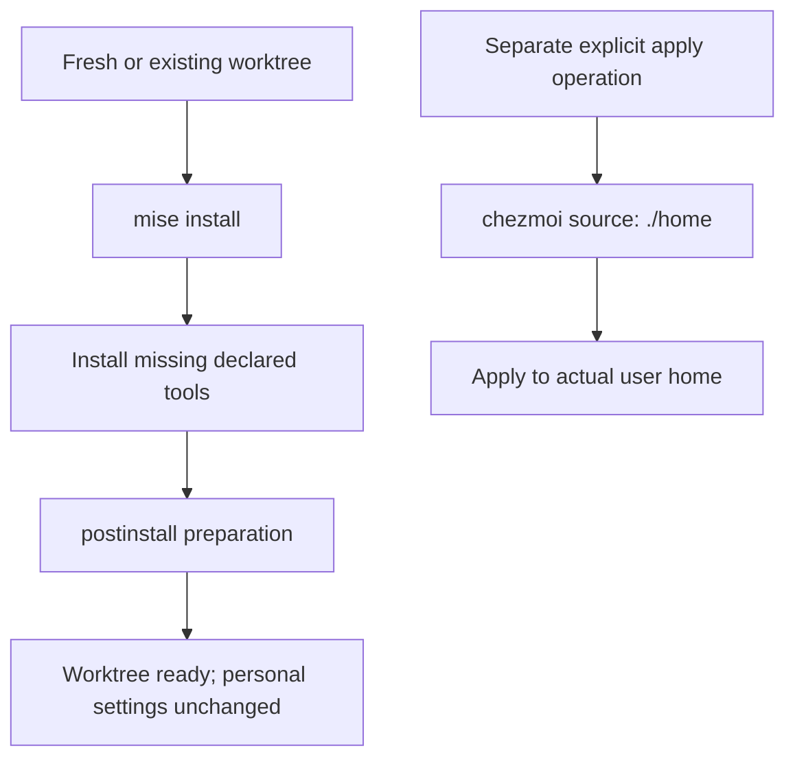
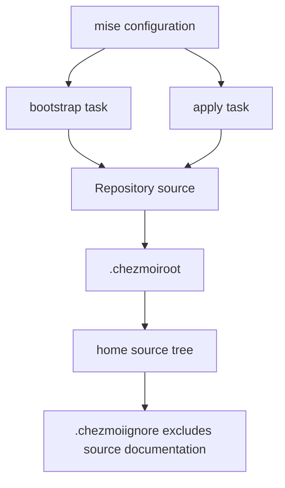

# Worktree Bootstrap and Repository Rules - Plan

## Goal Capsule

- **Objective:** The repository owner can prepare a fresh worktree for development without changing the PC's personal configuration.
- **Means:** Native mise hooks and tasks with chezmoi source-root discovery (KTD1, KTD2, KTD3).
- **Product authority:** The user-confirmed scope in this Product Contract governs implementation.
- **Open blockers:** None.
- **Execution profile:** One PR; implement and smoke-test locally, then review and ship without applying settings to the real user home.
- **Ownership:** The autonomous implementation workflow completes verification, review, commits, and shipping; merging remains with the owner.

## Product Contract

### Summary

Establish a repeatable worktree bootstrap and the repository rules that contributors must follow.
Keep development preparation separate from applying personal settings, and establish the source layout and ordering convention for chezmoi.

### Problem Frame

The owner needs to prepare worktrees without remembering extra setup commands or accidentally applying in-progress personal configuration.
Repository conventions must also distinguish source files from the PC settings they will eventually manage.

### Key Decisions

- **Separate preparation from application.** This prevents an ordinary worktree setup from applying unfinished personal settings. Governs R3, R5. (session-settled: user-directed — chosen over automatic application and opt-in application within bootstrap: worktree initialization should prepare the development environment only.)
- **Interpret `./home` as the source, not the destination.** This distinguishes repository content from the real user home directory. Governs R4. (session-settled: user-approved — chosen over interpreting the path as the apply destination: the user confirmed the source-directory clarification.)
- **Respect chezmoi execution phases.** Numeric ordering supplements rather than replaces phase selection. Governs R6. (session-settled: user-approved — chosen over treating numeric prefixes as a global ordering mechanism: the user confirmed that `before_` and `after_` remain authoritative.)

### Requirements

**Repository conventions**

- R1. Record the agreed bootstrap and chezmoi conventions as tracked repository rules for future contributors.

**Worktree preparation**

- R2. Use `mise install` as the single worktree initialization entry point, with any additional preparation scripts invoked through its project-level `postinstall` hook.
- R3. Worktree initialization must not apply dotfiles or change user-home or OS configuration.

**Configuration management**

- R4. Use chezmoi with repository-relative `./home` as its source directory; the application destination remains the actual user home directory.
- R5. Provide a separate explicit operation for applying the repository's chezmoi configuration, outside worktree initialization.
- R6. Use consistently padded numeric prefixes such as `10-windows` and `20-...` when chezmoi scripts depend on execution order within a phase; retain chezmoi's `before_` and `after_` phase semantics.

**Repeatability and platforms**

- R7. Repeating worktree initialization must remain safe and complete the required preparation even when the declared tools are already installed.
- R8. Support the preparation workflow on Windows, Linux, and macOS.

### Key Flows

- F1. Prepare a worktree. **Covers R2, R3, R7, R8.** The owner invokes initialization from the worktree on a supported OS.
- F2. Apply personal configuration. **Covers R4, R5, R6.** The owner deliberately invokes the separate apply operation.

### Acceptance Examples

- AE1. **Covers R2, R3, R8.** Given a fresh worktree on each supported OS with the bootstrap prerequisites available, when the owner runs `mise install`, the declared tools and required worktree preparation complete without a second preparation command or changes to personal settings.
- AE2. **Covers R3, R7.** Given an initialized worktree whose tools are already installed, when the owner repeats `mise install`, the preparation still completes safely and personal settings remain unchanged.
- AE3. **Covers R4, R5.** Given the repository's chezmoi source, when the owner invokes the separate apply operation, chezmoi uses `./home` as source content and the actual user home as the destination, not `./home` as the destination.
- AE4. **Covers R6.** Given two order-dependent scripts in the same chezmoi execution phase, when chezmoi runs that phase, their padded numeric prefixes determine their relative order; a prefix does not move a script across phases.

### Scope Boundaries

- This work covers repository rules, declared-tool installation, worktree preparation, and chezmoi source preparation.
- Concrete dotfiles, Git or GPG configuration, OS-specific application installation lists, and personal settings are deferred.
- Provisioning a brand-new PC before Git and mise are available is outside this worktree-bootstrap scope.
- The separation required by R3 and R5 does not remove personal-settings management from the repository's broader purpose.

### Dependencies / Assumptions

- Git and mise are already available when worktree initialization begins.
- The owner can authorize the repository's mise configuration according to mise's trust model.
- The exact bootstrap commands and available tool versions must be verified during implementation planning; this document defines desired behavior, not an existing implementation.

### Sources / Research

- [mise install hooks](https://mise.jdx.dev/hooks.html#install-hooks): project-level `postinstall` runs even when all tools are already installed.
- [mise hook definitions](https://mise.jdx.dev/hooks.html#define-a-hook): hook failures are reported as warnings, which matters when planning completion checks.
- [chezmoi script behavior](https://www.chezmoi.io/user-guide/use-scripts-to-perform-actions/): script ordering, execution phases, and script lifecycle semantics.

---

## Planning Contract

**Product Contract preservation:** Restructured, no scope change: R1–R8 and F1–F2 / AE1–AE4 are preserved; the planning-owned questions are resolved by KTD1–KTD3.

### Key Technical Decisions

- KTD1. **Use native mise task hooks instead of a bootstrap wrapper.** Add chezmoi to `mise.toml`, connect `postinstall` to a read-only `bootstrap` task, and have that task enumerate managed entries with scripts excluded. This exercises source discovery without applying settings or introducing a second script runtime. Implements R2, R3, R7, R8.
- KTD2. **Use `.chezmoiroot` for native source discovery.** Point it at `home`; keep source-local documentation in `home/README.md`, excluded by `home/.chezmoiignore`. This makes a tracked, intentionally configuration-free initial source usable without placeholder dotfiles. Implements R4.
- KTD3. **Use an explicit `apply` task bound to the current repository source.** Pass chezmoi the absolute config root rather than initializing or rewriting the owner's global chezmoi configuration. Implements R3, R4, R5.

### Assumptions

- No personal configuration is needed to complete this bootstrap; the initial source contains only excluded source documentation.
- A visible hook warning is a failed preparation check, even if mise itself exits successfully; document this behavior instead of adding a wrapper that replaces the required entry point.
- Windows runtime verification is available locally; Linux and macOS runtime coverage depends on available execution hosts and must not be claimed without execution.

### High-Level Technical Design

The flow in F1/F2 remains authoritative for the user boundary.
KTD1 supplies the read-only preparation path; KTD2 and KTD3 share the same native source resolution.
No source initialization, global config redirection, installation retry layer, or separate bootstrap script is required.

### Research Basis

- `mise.toml` already owns the repository's tool declarations and enables its lockfile.
- The available mise version is `2026.10.12`; existing declared tools are accessible through `mise exec` even when absent from the shell's `PATH`.
- [chezmoi source-root discovery](https://www.chezmoi.io/reference/special-files/chezmoiroot/) establishes KTD2.
- [chezmoi managed entries](https://www.chezmoi.io/reference/commands/managed/) provides KTD1's read-only command.
- [mise task configuration](https://mise.jdx.dev/tasks/task-configuration.html) supports config-root-bound task execution and quoted absolute source paths.

---

## Implementation Units

### U1. Establish the native bootstrap and source boundary

**Goal:** Make the confirmed preparation and explicit-application paths executable.

**Requirements:** R2–R5, R7, R8; F1, F2; KTD1–KTD3.

**Dependencies:** None.

**Files:** Modify `mise.toml` and `mise.lock`; create `.chezmoiroot`, `home/.chezmoiignore`, and `home/README.md`.

**Approach:**

1. Extend the existing tool declaration and generate the chezmoi lock entries without refreshing unrelated tools.
2. Add the source metadata and implement the two tasks using KTD1–KTD3.
3. Keep hook execution independent of shell activation and working-directory depth.

**Patterns:** Existing TOML tool declarations and native mise / chezmoi configuration.

**Execution note:** This is configuration work; prove it with real CLI smoke checks and temporary source/destination fixtures, not source-text or mocked-command tests.

**Test expectation:** No permanent test file for config wiring; execute temporary integration fixtures outside the repository.

**Test scenarios:**

- Covers AE1 / AE2. Run actual initialization twice and observe the postinstall preparation on both runs.
- Covers AE3. In a temporary checkout with spaces in its path, add a sentinel source file and apply through the task to an isolated destination; only the expected target appears and source documentation remains excluded.
- Covers AE1 / AE2. Add a script to the temporary source and verify initialization neither writes the sentinel destination file nor runs the script.
- Covers AE4. Execute disposable same-phase numbered scripts against an isolated destination and check their observed order.
- Confirm source resolution also works from a subdirectory and does not redirect the owner's unrelated chezmoi source.

**Verification:** Observe the real tasks, destination files, script marker, and command output; report each OS actually exercised.

### U2. Publish contributor rules and operator instructions

**Goal:** Make the agreed workflow discoverable without requiring this plan.

**Requirements:** R1, R2–R8.

**Dependencies:** U1.

**Files:** Modify `AGENTS.md`; create `README.md`; complete the source-local guidance in `home/README.md`.

**Approach:** Document prerequisites, the initialization command, separate explicit application, source layout, lifecycle-aware numeric naming, repeat-run behavior, and hook-failure interpretation.

**Patterns:** Preserve the existing agent instructions and write repository documentation in English.

**Test expectation:** None — documentation changes; verify commands against U1's smoke results.

**Verification:** The instructions match exercised behavior and contain no claim that initialization applies personal configuration.

---

## Verification Contract

- Run `mise install` twice and inspect the actual hook output, not only its exit code.
- Use `mise run bootstrap` as a diagnostic with normal task failure propagation.
- Exercise `mise run apply` only with an isolated temporary destination; never apply to the real user home during verification.
- Inspect chezmoi's resolved source and managed entries to confirm R4 and the exclusion of repository documentation.
- Execute the U1 fixtures with real chezmoi and clean up their temporary files afterward.
- Use installed CLI binaries through `mise exec` where the shell is not activated.
- Report Linux/macOS as unexercised if no such hosts are available; native command compatibility is not runtime evidence.

---

## Definition of Done

- R1–R8 are implemented, and AE1–AE4 have the available runtime evidence specified above.
- The declared chezmoi tool is locked, and initialization remains independent of shell activation.
- Contributor and operator documentation reflects the real commands and hook-warning semantics.
- No personal settings have been applied to the real user home.
- Temporary fixtures and abandoned implementation attempts are removed.
- Independent code review is resolved or its actionable residuals are recorded durably.
