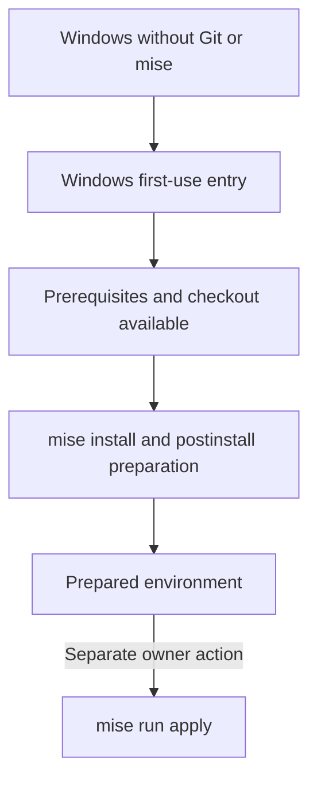
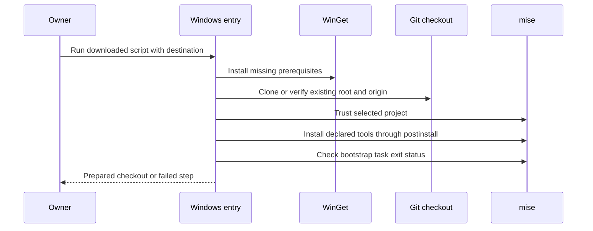

# Windows PC Bootstrap - Plan

## Goal Capsule

- **Objective:** The repository owner can prepare a new Windows PC without Git or mise installed and reach a state where the repository's explicit apply operation can run.
- **Product authority:** The user-confirmed Product Contract below governs scope; concrete personal settings and application provisioning are not active scope.
- **Open blockers:** None.
- **Means:** A Windows PowerShell entry point using WinGet and the existing mise tasks (KTD1, KTD4).
- **Execution profile:** One PR with local Windows verification; no application to the real user home.
- **Ownership:** The autonomous workflow implements, reviews, commits, pushes, opens a PR, and observes CI; merging remains with the owner.

---

## Product Contract

### Summary

Provide a Windows first-use entry point that acquires the prerequisites and repository, then hands preparation over to the existing mise workflow.
Keep personal configuration application explicit and separate; this work makes the apply operation available without adding a personal settings payload.

### Problem Frame

The repository currently assumes Git and mise are available before preparation begins.
The owner is still establishing bootstrap and has no existing deployed settings to migrate.

### Key Decisions

- **Start before Git and mise exist.** This closes the prerequisite gap rather than requiring the owner to prepare it manually. Governs R1, R2. (session-settled: user-directed — chosen over starting after Git installation or after both Git and mise installation: the owner selected support from a fresh Windows environment.)
- **Prioritize Windows bootstrap over personal configuration.** Establish the usable preparation path before choosing concrete settings. Governs R4, R5. (session-settled: user-approved — chosen over populating dotfiles and tool settings now: the owner confirmed that Windows bootstrap comes first.)
- **Extend the existing preparation workflow.** Reuse its ownership of declared tools rather than introducing a second tool-installation system. Governs R3.

<!-- ce-section: work-relationships -->
### How This Work Fits Together

This plan covers Windows PC first-use preparation.
The following relationships describe the current understanding, not a committed roadmap.

- **Builds on existing worktree preparation:** `.compound-engineering/artifacts/plans/2026-11-04-1047-feat-worktree-bootstrap-plan.md` establishes the preparation/application boundary that this work retains.
- **Enables later personal configuration:** Concrete Windows dotfiles and tool settings can use the prepared toolchain and explicit apply operation; their contents remain undecided.
- **Shares conventions with other operating systems:** Future first-use support can reuse the preparation/application boundary without making those platforms part of this delivery.

### Requirements

**First-use entry**

- R1. The owner can begin the documented Windows bootstrap from Windows-provided PowerShell without preinstalled Git, mise, or PowerShell 7.
- R2. Bootstrap installs missing Git and mise prerequisites and obtains a usable local checkout of this repository.

**Preparation and application boundary**

- R3. After prerequisites and the checkout are available, preparation uses `mise install` and its project-level `postinstall` path to install repository-declared tools and complete worktree preparation.
- R4. Preparation must not apply chezmoi source state or execute personal configuration hooks; installing the prerequisites and declared tools is permitted.
- R5. Completion leaves `mise run apply` executable as a separate owner-initiated operation against the prepared checkout, without requiring concrete personal settings in this delivery.

**Repeatability and completion**

- R6. Repeating bootstrap on the environment it prepared must reuse usable prerequisites and the checkout without duplicating or discarding them.
- R7. Bootstrap must distinguish completed preparation from a failed required step and identify the step needing attention.
- R8. Documentation must explain how to start from a PC without Git or mise and distinguish preparation completion from the separate apply operation.

### Key Flows

- F1. **First preparation. Covers R1, R2, R3, R4, R5, R7, R8.** The owner follows the Windows starting instructions, approves required installations, obtains the checkout, and reaches the prepared state through the repository workflow.
- F2. **Repeat preparation. Covers R3, R4, R6, R7.** The owner reruns bootstrap on the prepared environment; existing usable prerequisites and checkout remain in use while preparation completes again.
- F3. **Explicit application. Covers R4, R5.** After preparation, the owner may separately invoke apply from the checkout; the current absence of personal settings does not make bootstrap incomplete.

### Acceptance Examples

- AE1. **Covers R1, R2, R3, R5, R8.** Given a new Windows environment with neither Git nor mise installed, when the owner follows the documented starting instructions and approves required installations, preparation finishes with a usable checkout, declared tools, and an available explicit apply command.
- AE2. **Covers R3, R4.** Given an existing personal chezmoi configuration with mutating hooks, when bootstrap prepares the environment, those hooks do not run and personal configuration is not applied.
- AE3. **Covers R4, R6.** Given an environment prepared by a previous successful run, when the owner repeats bootstrap, it preserves the usable checkout and prerequisites and does not apply personal configuration.
- AE4. **Covers R5.** Given the prepared checkout with no concrete personal settings, when the owner separately invokes apply, the operation can run successfully; adding dotfiles is not required for this outcome.
- AE5. **Covers R7.** Given that a required installation, checkout acquisition, or worktree preparation step fails, when bootstrap returns control, it identifies the failed step and does not report preparation as complete.

### Scope Boundaries

- In scope: the Windows first-use entry, prerequisite acquisition, repository acquisition, connection to existing preparation, and instructions for reaching the separate apply operation.
- Deferred: concrete dotfiles, Git and GPG personal configuration, secret decryption, and work application provisioning.
- Outside this delivery: first-use entry points for Linux or macOS, automatic application of personal configuration, and automated OAuth or organizational sign-in.
- Existing non-Windows worktree preparation remains supported; this work does not replace it.

### Dependencies / Assumptions

- The PC has internet access to the repository and required tool distribution sources.
- The owner can approve required installation privileges and any repository-access authentication; bootstrap does not bypass those controls.
- Windows-provided PowerShell is available at the starting point.
- The current repository intentionally has no concrete personal settings, as documented in `home/README.md`.

### Sources / Research

- `mise.toml:12-21` — existing postinstall preparation and explicit apply tasks.
- `README.md:7-48` — current prerequisite assumption and separation of preparation from application.
- `.chezmoi-bootstrap.toml` — repository-owned hook-free configuration for preparation.
- `tests/test_bootstrap.py:12-64` — existing isolation scenario with mutating personal hooks and repeated initialization.
- `STRATEGY.md:14-28` — repository owner, first-use goal, and application/authentication boundaries.
- `home/README.md:3-9` — source/destination distinction and intentionally empty initial settings payload.

---

## Planning Contract

**Product Contract preservation:** Restructured, no scope change: planning-owned questions are resolved below; R1-R8, F1-F3, AE1-AE5, and the settled product decisions retain their meaning.

### Key Technical Decisions

- KTD1. **Use WinGet for the two missing prerequisites.** Add a root `bootstrap.ps1` compatible with Windows PowerShell 5.1; install exact `Git.Git` and `jdx.mise` packages from the `winget` source only when the corresponding application is unavailable. This follows [mise's recommended Windows installation method](https://mise.jdx.dev/installing-mise.html#windows) and [WinGet's disambiguation guidance](https://learn.microsoft.com/en-us/windows/package-manager/winget/install). Governs R1, R2.
- KTD2. **Rediscover applications without requiring a restarted terminal.** Preserve the process PATH, incorporate installer-written user/machine PATH entries, and resolve application executables after installation. No shell profile activation or custom persistent PATH editing belongs to the entry point. Governs R1, R2, R5.
- KTD3. **Reuse only the requested repository root.** Default the destination to the owner's `src/dotfiles` directory, expose a destination override, and clone the canonical HTTPS origin when absent. For an existing destination, verify the Git top-level and origin before trusting configuration; reject unrelated or non-repository content without deletion, reset, or pull. This avoids executing mise configuration from an unintended checkout. Governs R2, R6.
- KTD4. **Keep preparation in mise and check its result explicitly.** Trust only the selected checkout's project configuration, run `mise install`, then run the existing `bootstrap` task as an explicit completion check. [Mise hooks warn rather than propagate failure](https://mise.jdx.dev/hooks.html#define-a-hook); the repeated idempotent check gives a real exit status without creating a second preparation implementation. Leave the apply task unchanged. Governs R3, R4, R5, R7.
- KTD5. **Exercise the entry point under Windows PowerShell itself.** Use Python unittest subprocess coverage in `tests/test_windows_bootstrap.py` for destructive-boundary and failure cases; prefer real temporary Git repositories over command-echo tests. Keep live installation smoke separate from regression tests so the suite cannot install packages on the developer's real machine. Governs R4, R6, R7.

### Assumptions

- The first-use path targets Windows desktop versions supported by WinGet: Windows 10 1809 or newer, including Windows 11, with App Installer available; package architecture follows the installed OS and available package support.
- WinGet is an OS-distributed prerequisite rather than a third package manager maintained by this repository. If first-login registration is pending, the entry point can request the documented App Installer registration; if App Installer is absent, stop with the official installation instruction rather than downloading unverified executables.
- The canonical repository is `https://github.com/hyperlapse122/dotfiles.git`, based on the current origin.
- Reruns prepare the selected checkout as it stands; automatically fetching or switching branches is outside bootstrap.
- Full first-install proof requires a disposable Windows environment; availability is an execution-time constraint, not a reason to claim simulated package installation as live proof.

### High-Level Technical Design

The entry point owns only prerequisite discovery and checkout selection.
KTD4 owns the preparation handoff and its completion boundary.

### Risks and Boundaries

- Package installation can request UAC or source/package agreement approval; these remain visible owner actions.
- The entry point must not disable TLS checks, persist execution-policy changes, or alter certificate stores. The existing Windows CA lesson in `.compound-engineering/artifacts/solutions/integration-issues/github-cli-windows-ca-override.md` is operational context, not permission to commit machine-specific trust workarounds.
- No automatic checkout repair, update mode, retry framework, or machine-state rollback is added: failure is visible under R7, and those mechanisms are not required for the agreed starting path.

---

## Implementation Units

### U1. Add the Windows first-use entry

- **Goal:** Reach the existing preparation workflow from the Windows-provided shell.
- **Requirements:** R1-R7; F1-F3.
- **Dependencies:** None.
- **Files:** Create `bootstrap.ps1` and `tests/test_windows_bootstrap.py`; retain `mise.toml` task ownership.
- **Approach:** Implement KTD1-KTD4 in the standalone script, with step-specific native-command exit checks and a destination override.
- **Patterns to follow:** `mise.toml` separates bootstrap from apply; `tests/test_bootstrap.py` isolates user-home effects.
- **Execution note:** Use Windows PowerShell 5.1 for the runtime smoke, not only the mise-installed PowerShell 7.
- **Test scenarios:**
  1. Covers AE3. An existing matching checkout in a path containing spaces survives repeated preparation with an untracked sentinel unchanged.
  2. A non-repository destination and a nested path inside a different Git root are rejected before project trust or preparation.
  3. A checkout with a different origin is rejected without modifying its files.
  4. Covers AE5. A failed native installation or preparation step returns nonzero and cannot produce a success result.
  5. Covers AE5. A successful install command followed by a failed explicit bootstrap check remains a failed preparation.
- **Test seam:** Temporary native-command substitutes may trigger failure conditions, but do not prove real WinGet installation; real Git fixtures establish destination safety.
- **Verification:** The actual entry point reaches preparation in a temporary matching checkout and repeats safely, with the real installed tools and no personal configuration application.

### U2. Document and verify the new-PC path

- **Goal:** Make the first-use path executable by the owner without prior Git or mise knowledge.
- **Requirements:** R1-R8; F1-F3; AE1-AE5.
- **Dependencies:** U1.
- **Files:** Update `README.md`; extend `tests/test_windows_bootstrap.py` if execution reveals a missing behavioral case.
- **Approach:** Document script download and inspection, a process-local launch command, destination selection, App Installer prerequisites, installation approvals, failure reporting, and the separate apply operation.
- **Patterns to follow:** Existing README distinguishes preparation from application and documents hook failure reporting.
- **Test scenarios:**
  1. Covers AE2. Existing personal chezmoi hooks remain unexecuted during entry-point preparation.
  2. Covers AE4. In an isolated empty home, explicit apply can run separately after preparation.
  3. Covers AE1. In a disposable Windows environment when available, follow the starting instructions without Git or mise and observe installed prerequisites and a prepared checkout.
- **Verification:** Follow the documented command form in Windows PowerShell, run the existing isolation regression, and report live first-install coverage separately from isolated orchestration checks.

---

## Verification Contract

- Run `mise exec -- python -m unittest discover -s tests` on Windows after implementation is complete.
- Launch the actual `bootstrap.ps1` using Windows PowerShell against a temporary checkout with real Git and mise, repeat it, and inspect the outcome and preserved files.
- Run the separate apply operation only with an isolated temporary home and hook-free configuration; do not apply to the actual owner home.
- Observe native failure propagation, wrong-destination rejection, and the postinstall warning/explicit-check boundary through behavioral regression coverage.
- If a disposable clean Windows runtime is unavailable, explicitly report that real first-time WinGet installation was not exercised; do not equate command substitutes with that proof.

---

## Definition of Done

- U1 and U2 satisfy their cited requirements and acceptance examples without introducing personal settings.
- The runtime and regression checks above have observed results, with any platform or fresh-machine limit stated.
- Starting and apply instructions match the implemented command surface.
- The existing preparation/application separation and non-Windows worktree path remain intact.
- No abandoned implementation attempts or temporary smoke fixtures remain in the repository.
- Independent review findings are resolved or recorded durably before the branch is pushed and the PR opened.
