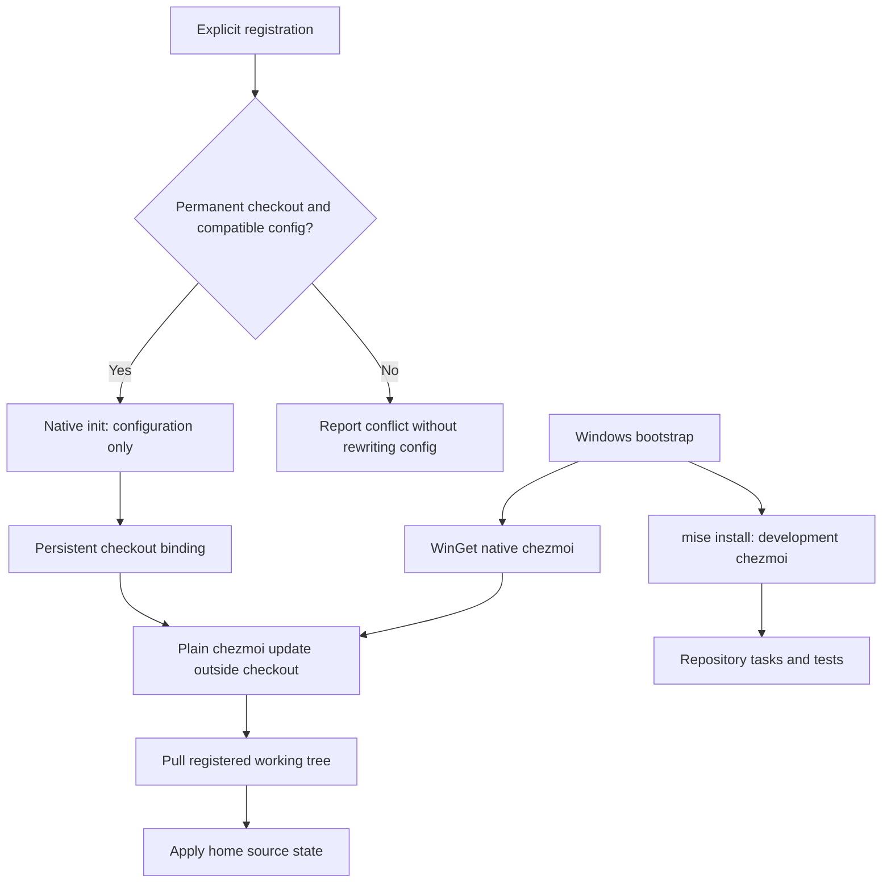
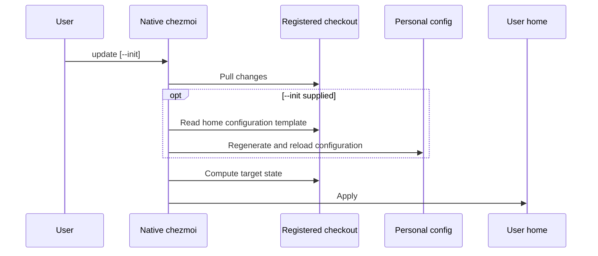

# Windows Global Chezmoi - Plan

## Goal Capsule

- **Objective:** The owner can update and apply this PC's dotfiles from an unrelated Windows directory without entering the dotfiles checkout.
- **Means:** A native Windows chezmoi installation and persistent source registration, separate from mise's development copy (KTD1, KTD2).
- **Product authority:** The confirmed scope in this session is captured in the Product Contract; its requirements govern implementation choices.
- **Stop conditions:** Do not replace another repository's personal configuration or register a temporary linked worktree.
- **Execution profile:** One PR; integration proof uses isolated homes and a local Git remote, with real installation proof in a disposable Windows environment.
- **Ownership:** This artifact authorizes planning only. A subsequent implementation request authorizes execution; applying to the owner's real home remains explicit.

---

## Product Contract

### Summary

Install a native Windows chezmoi for everyday use while retaining the mise-managed copy for repository development and tests.
Provide an explicit operation that connects the native installation to the permanent dotfiles checkout, then use chezmoi's own update command.

### Problem Frame

The current bootstrap installs Git and mise, and repository tasks select a worktree-specific chezmoi source.
It does not establish a native chezmoi command and persistent source for everyday use outside the checkout.
The owner wants to maintain the PC without navigating back to the repository or wrapping each command in mise.

### Key Decisions

- **Separate everyday and development installations.** The owner chose native Windows installation over exposing the mise-managed executable globally. Governs R1, R2. (session-settled: user-directed — chosen over mise shims for everyday use: mise's copy is reserved for development and tests.)
- **Preserve the preparation/application boundary.** Global source registration is an explicit personal-configuration operation, not a side effect of preparing a worktree. Governs R5, R6. (session-settled: user-approved — chosen over automatic registration during preparation: the owner confirmed the separate setup boundary.)

### Requirements

**Installation and command selection**

- R1. Windows bootstrap makes a native, non-mise chezmoi executable available to the current user outside the repository.
- R2. Repository tasks and tests continue to use the mise-declared chezmoi independently of the native installation.

**Source registration and updates**

- R3. An explicit registration operation connects the native installation to the permanent checkout obtained by bootstrap, including a custom bootstrap destination.
- R4. From an unrelated directory, plain `chezmoi update` pulls the registered repository and applies its source state; `chezmoi update --init` also regenerates and reloads the configuration before application.
- R5. Registration does not apply managed files, and default bootstrap/worktree preparation does not register a global source or apply personal settings.
- R6. Registration rejects an existing configuration for a different source and rejects a linked worktree without changing either source configuration.
- R7. Repeating successful registration keeps the same source and preserves unrelated existing supported configuration values.

### Scope Boundaries

- “Global” means available throughout the current Windows account, not provisioning every Windows account.
- No custom update wrapper, alias, Git synchronization policy, or force/reset behavior; chezmoi owns the update semantics.
- No mise global selection, mise shim PATH registration, or shell-profile activation for everyday chezmoi.
- No automatic chezmoi binary upgrades during dotfile updates; WinGet owns the installed binary's lifecycle.
- No new personal dotfiles payload, GUI application provisioning, secrets setup, or Linux/macOS global-install feature.
- No automatic migration of an unrelated or unsupported existing chezmoi configuration. Stop visibly before mutation; a separate migration is warranted only if an actual deployment requires it.

---

## Planning Contract

### Key Technical Decisions

- KTD1. **Use WinGet for the native installation.** Extend `bootstrap.ps1` using package identifier `twpayne.chezmoi`, retaining `mise.toml` and `mise.lock` as development-tool ownership. The official install guide supports this package, and its current Windows manifest declares a portable executable alias. Do not copy binaries from mise or add a second version declaration to user mise config. Implements R1, R2. (session-settled: user-directed — chosen over mise shims for everyday use: mise's copy is reserved for development and tests.)
- KTD2. **Use a separate explicit registration script.** Add `configure-chezmoi.ps1`, compatible with Windows PowerShell 5.1, taking the permanent checkout as its source and defaulting to the script's checkout. It resolves and invokes the native executable by absolute path, rather than trusting the first `chezmoi` in a mise-activated process. Validate repository root, expected origin, and a standalone checkout before configuration mutation. Implements R3, R5, R6.
- KTD3. **Persist the repository root through a configuration template.** Add `home/.chezmoi.toml.tmpl`; `.chezmoiroot` means the template belongs under `home`, not the repository root. Generate `sourceDir` and `workingTree` from the actual `.chezmoi.workingTree`, never the current directory or an embedded developer path. Use native init without application. Preserve other parsed configuration values using `.chezmoi.config` and native template serialization; correctly quote spaces, Unicode, and backslashes. This makes later configuration regeneration preserve the same checkout. Implements R3, R4, R7.
- KTD4. **Limit initial configuration handling to a clear, non-destructive path.** Create standard TOML configuration when none exists; accept same-source TOML and retain its unrelated values. Detect a different source or another existing configuration format before init and report a specific conflict without overwriting or introducing a competing config file. This is refusal to migrate, not a new migration engine. Implements R6, R7.
- KTD5. **Prove command provenance as well as behavior.** Native resolution must exclude mise installation directories and shims, including when this repository already put mise's executable first in the process PATH. After installation, refresh process discovery using the existing PATH-refresh pattern and verify a usable non-mise command. Do not rewrite unrelated PATH entries or profiles. A fresh non-activated shell outside the repository must resolve the native command; an intentional mise task still resolves the development copy. Implements R1, R2.

### High-Level Technical Design

The two installation owners remain separate; registration supplies configuration to the everyday executable rather than another command layer.

Configuration regeneration has an additional step, but must end at the same source binding.

### Existing Behavior Trace

A single-pass source trace establishes that `bootstrap.ps1` clones or validates its destination, runs mise preparation, and returns without applying.
`mise.toml` invokes the hook-free bootstrap config for managed-entry inspection and explicitly binds `apply` to the selected worktree.
`tests/test_bootstrap.py` already isolates user paths and proves mutating personal hooks do not run during preparation.
`tests/test_windows_bootstrap.py` already covers Windows PowerShell 5.1, repeated bootstrap, Unicode paths, unrelated destinations, and native failure propagation.
The new paths should extend these behaviors, not replace them.

### Risks and Dependencies

- A mise executable can masquerade as an installed global command; KTD5 and command-provenance verification address this concrete coexistence risk.
- Native and development versions may differ. Test the feature contract with both during implementation without requiring permanent version synchronization.
- WinGet registration and package PATH propagation require a real Windows environment. Unit fixtures cannot establish that an installer makes a fresh shell usable.
- Existing personal hooks and custom update configuration remain user-owned. Registration must preserve supported unrelated settings; do not overwrite a custom update policy to imitate default behavior.
- Package installation is allowed during bootstrap, as it already is for Git and mise. The preparation-only boundary applies to personal configuration and apply behavior, not installer-owned package registration.

### Sources

- `bootstrap.ps1`: `Install-Prerequisite`, `Find-Application`, `Update-ProcessPath`, and checked native-command failures.
- `mise.toml`, `.chezmoi-bootstrap.toml`, `.chezmoiroot`, `home/README.md`: worktree binding, isolation, and source layout.
- [Chezmoi installation](https://www.chezmoi.io/install/): native Windows package choice.
- [WinGet installer manifest](https://raw.githubusercontent.com/microsoft/winget-pkgs/master/manifests/t/twpayne/chezmoi/2.74.0/twpayne.chezmoi.installer.yaml): portable command alias, not an MSIX-only assumption.
- [Init](https://www.chezmoi.io/reference/commands/init/), [update](https://www.chezmoi.io/reference/commands/update/), and [configuration template](https://www.chezmoi.io/reference/special-files/chezmoi-format-tmpl/): explicit initialization, native pull/apply, and regeneration.
- [Source root](https://www.chezmoi.io/reference/special-files/chezmoiroot/) and [template variables](https://www.chezmoi.io/reference/templates/variables/): template placement and working-tree/configuration data.

---

## Implementation Units

### U1. Install the everyday Windows executable

**Goal:** Bootstrap leaves a native chezmoi available independently of the development copy.

**Requirements:** R1, R2, R5.

**Dependencies:** None.

**Files:** Modify `bootstrap.ps1` and `tests/test_windows_bootstrap.py`; retain existing development tool declarations in `mise.toml` and `mise.lock`.

**Approach:** Extend prerequisite installation with KTD1 and KTD5, preserving the existing destination and preparation behavior. Resolve an already installed non-mise executable without treating a mise copy as completion. Keep checked installer failures and final discovery failures visible. Completion output points to the explicit registration operation introduced by U2.

**Patterns to follow:** Existing prerequisite acquisition, PATH refresh, explicit native exit checks, and fixture-local environment overrides.

**Execution note:** Prefer installer/runtime smoke proof; use isolated regression fixtures for failure and coexistence boundaries.

**Test scenarios:**
1. With only mise's chezmoi discoverable, bootstrap does not report native installation complete merely because that command runs.
2. With a usable native installation, repeated bootstrap preserves local checkout edits and personal chezmoi configuration.
3. A failed chezmoi installation or an undiscoverable native command after installation produces a nonzero result and no success report.
4. Default bootstrap still does not register a source or apply managed files.

**Test seam:** `tests/test_windows_bootstrap.py` catches orchestration and command-selection regressions; it does not prove real WinGet package registration.

**Verification:** In a disposable Windows account, a fresh non-activated shell outside the checkout resolves the native executable and runs it successfully, while a repository mise task selects its own copy.

### U2. Register the permanent source without applying it

**Goal:** The native executable retains the correct source across ordinary updates and configuration regeneration.

**Requirements:** R3, R4, R5, R6, R7.

**Dependencies:** U1 for real native-install verification; development integration fixtures can be built independently.

**Files:** Create `configure-chezmoi.ps1`, `home/.chezmoi.toml.tmpl`, and `tests/test_global_chezmoi.py`; extend `tests/test_bootstrap.py` where the new template affects isolation coverage.

**Approach:** Implement KTD2–KTD4 with explicit preflight before configuration writes. Use the selected checkout, not the caller's current directory. Call native init without apply, then verify the effective source and working tree. Keep the existing worktree apply task unchanged.

**Patterns to follow:** PowerShell 5.1 native-command handling in `bootstrap.ps1`; temporary homes and XDG/Windows config overrides in `tests/test_bootstrap.py`; local Git fixtures in `tests/test_windows_bootstrap.py`.

**Execution note:** First exercise a disposable-home scenario with a local Git remote. Do not use the owner's live configuration to discover init or template behavior.

**Test scenarios:**
1. Register a standalone checkout at a Unicode path containing spaces from an unrelated current directory; effective source resolves to that checkout and no managed home file is applied.
2. Advance a local remote with changed home content; plain update from outside the checkout pulls it and changes the isolated destination to the new content.
3. Advance the same remote with a template-backed configuration change; update with init reloads the changed value, applies the expected content, and a subsequent plain update still uses the same checkout.
4. Repeat registration against same-source TOML containing unrelated data and settings; those parsed values and the source binding survive.
5. Registration against another source, a linked worktree, or an unsupported existing configuration format fails before modifying the original config or managed home files.
6. A native-init failure produces a nonzero result rather than reporting completed registration.
7. Preparation with the new template present still does not execute personal hooks or change the user's config.

**Test seam:** `tests/test_global_chezmoi.py` proves source/config/update behavior using real Git and chezmoi in isolated environments; binary selection and actual package provisioning additionally require the native Windows smoke.

**Verification:** Observe repository advancement, exact applied content, effective configuration changes, and unchanged sentinels in rejected or preparation-only paths. An executable shim or mocked argument echo alone is not this proof.

### U3. Document the two installation roles and complete native proof

**Goal:** The owner can follow one installation/registration/update path without confusing the runtime and development copies.

**Requirements:** R1–R7.

**Dependencies:** U1, U2.

**Files:** Modify `README.md` and `home/README.md`; use `tests/test_global_chezmoi.py` and existing bootstrap tests for final verification.

**Approach:** Replace obsolete statements that the repository has no chezmoi configuration template. Document native installation, explicit registration from the selected permanent checkout, the need for a fresh shell after installer PATH changes, native update semantics, and the development-only role of mise's copy. Explain that update's init flag regenerates configuration rather than cloning an uninitialized source. Document the conflict output and supported initial config format from KTD4.

**Test expectation:** No wording tests; exercise the documented flow instead.

**Verification:** Follow the instructions in a disposable Windows environment, including a custom checkout destination, both update variants, and command provenance. Record real package/shell evidence and remove all throwaway fixtures.

---

## Verification Contract

- Run `mise install` for preparation and `mise exec -- python -m unittest discover -s tests` for the repository regression suite during implementation, not while writing this plan.
- Exercise `tests/test_global_chezmoi.py` with real local Git pull/application and configuration regeneration. No external network dependency in that fixture.
- Run the same isolated behavioral scenario with the native installed executable and the mise-managed executable; fixture plumbing may accept an executable path, but production behavior must not depend on a test-only fallback.
- In a disposable Windows environment, prove actual WinGet installation, native command resolution in a fresh shell outside any mise project, and independent development selection inside this repository.
- Never invoke update or apply against the owner's real home as a smoke shortcut. No package installations or registry/PATH edits on the owner’s PC are authorized by plan creation.
- Confirm bootstrap's existing isolation, Unicode path handling, repeat behavior, and checked failure reporting remain intact.

---

## Definition of Done

- U1 proves native installation and executable provenance without changing development-tool ownership.
- U2 proves persistent source selection, pull/application, configuration regeneration, and non-destructive registration boundaries.
- U3's documentation matches the exercised native Windows workflow.
- All requirements have observed implementation evidence; no launch-blocking question is concealed as a follow-up.
- Abandoned implementations, temporary repositories, and experimental scripts are removed; the intended registration script and behavior regressions remain.
- The implementation reports precisely which real installer checks ran and any environment limitation rather than treating mocks as installation proof.
