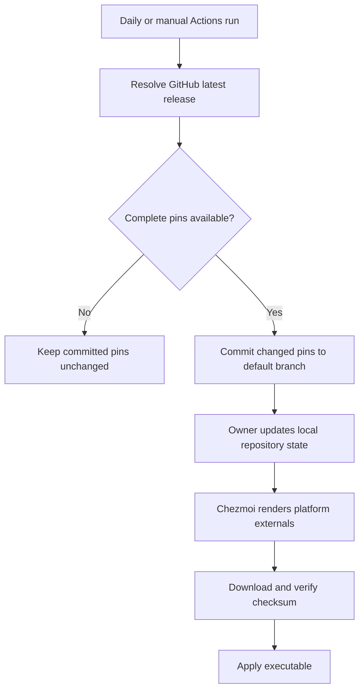
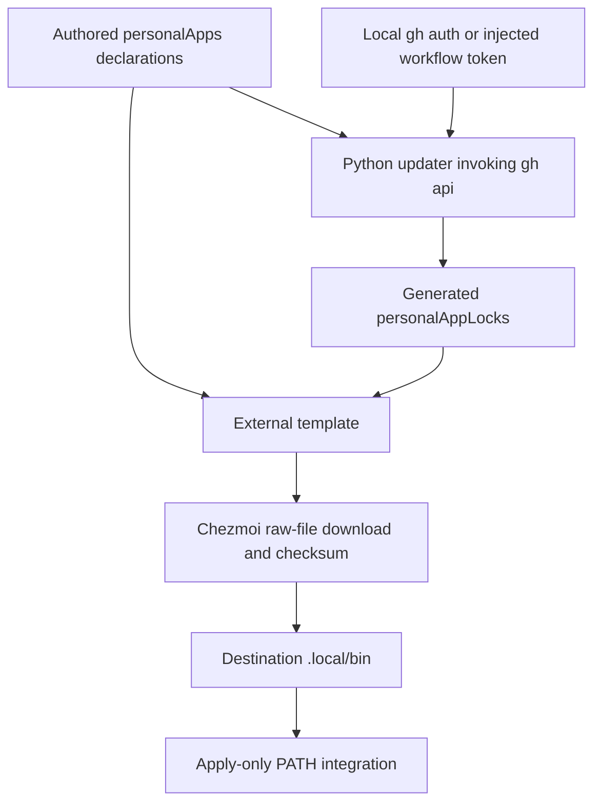
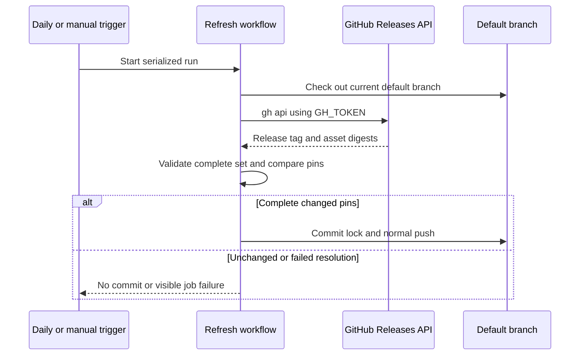

# Personal CLI Externals - Plan

## Goal Capsule

- **Objective:** The repository owner can install and update personal CLI applications from one repository-managed source across their supported devices, starting with omp.
- **Means:** Store lockfile-like application data in chezmoidata, render chezmoi externals from it, and let GitHub Actions refresh the committed pins.
- **Product authority:** The confirmed requirements below govern personal application installation. Mise remains an independent development-environment layer and is not being redesigned or migrated.
- **Open blockers:** None.
- **Execution profile:** One PR for this feature; implement, verify, review, and publish without merging. After merge, only the lock-refresh workflow commits and pushes pin updates directly to `main`.
- **Product Contract preservation:** Added R13 for the owner's later authentication instruction; existing R/A/F/AE IDs and their meaning are preserved.

---

## Product Contract

### Summary

Centralize personal CLI application installation in chezmoi with repository-pinned downloads and automated pin updates.
Deliver the complete flow for omp first, using GitHub release assets and one shared application-data convention that later applications can join.

### Problem Frame

The owner wants personal applications, primarily CLI tools, managed in one place rather than through separate installation procedures.
Claude Code, gh, and glab are expected future additions.
This is separate from configuring a repository's development environment with mise; reducing or replacing mise's role is not the motivation.

### Key Decisions

- **Chezmoi owns personal application installation.** Governs R1, R12. Centralizing personal apps takes priority over using mise as their installer. (session-settled: user-directed — chosen over managing personal apps through the development-tool layer: the owner wants one place for personal application installation.)
- **Use GitHub releases as omp's distribution authority.** Governs R3, R8. (session-settled: user-directed — chosen over the omp build service: release-specific GitHub assets avoid persisting expiring presigned download URLs.)
- **Publish updates without a PR.** Governs R9. (session-settled: user-directed — chosen over reviewed or automatically merged PRs: the owner selected direct commits to the default branch.)
- **Cover the three desktop OS families.** Governs R2. (session-settled: user-directed — chosen over Windows-only coverage and adding Linux musl: the owner selected Windows, macOS, and Linux on x64 and arm64.)
- **Check daily and allow manual refresh.** Governs R8. (session-settled: user-approved — chosen over leaving update cadence unspecified: the owner confirmed the proposed daily schedule and manual trigger.)
- **Reject incomplete updates and unverified downloads.** Governs R6, R10. (session-settled: user-approved — chosen over partial pin updates or replacing an existing binary on checksum failure: the owner confirmed retaining the existing usable state.)

### Actors

- A1. **Repository owner:** Chooses applications and applies repository state to personal devices.
- A2. **GitHub Actions:** Resolves upstream releases and commits changed application pins.
- A3. **Chezmoi:** Selects the local platform's locked download and applies the executable to the user's environment.

### Requirements

**Application data and coverage**

- R1. Personal application declarations and lockfile-like pins must live in chezmoidata and supply the rendered chezmoi externals used for installation.
- R2. The initial managed application must be omp, covering Windows, macOS, and Linux on x64 and arm64, excluding Linux musl.
- R3. An omp pin must identify one concrete release tag from `can1357/oh-my-pi` and its release-specific asset URLs and SHA-256 checksums for every target in R2.

**Local installation and reconciliation**

- R4. Chezmoi must download and install the matching platform's executable from committed pins, without resolving latest releases locally or invoking the upstream installer.
- R5. After application, omp must be runnable from a newly opened ordinary terminal outside a development project, without mise activation.
- R6. A checksum mismatch must fail installation without replacing an existing installed executable.
- R7. Reapplying the same pins must retain the same desired executable state; applying changed committed pins must reconcile the installation to those pins.

**Automated pin updates**

- R8. GitHub Actions must check `can1357/oh-my-pi`'s GitHub latest release once daily and on manual dispatch.
- R9. A successful refresh with changed pins must commit directly to the repository's default branch without a PR; unchanged pins must produce no commit.
- R10. A failed refresh or a release missing any required target asset or usable checksum must leave the existing committed pins unchanged rather than publish an incomplete set.
- R13. Initial pins must be resolved through the mise-installed gh CLI, and Actions must authenticate pin refresh with its automatically injected GitHub token.

**Layer boundaries and future additions**

- R11. Worktree preparation must remain read-only with respect to personal configuration and must not install personal applications; the existing mise development-environment layer remains unchanged.
- R12. The application-data and rendering convention must accommodate later CLI applications without a separate installation-management system for each app; only omp is added in this work.

### Key Flows

- F1. **Refresh pins.** Covers R3, R8, R9, R10.
  - **Trigger:** The daily schedule or a manual Actions dispatch.
  - **Outcome:** A complete changed pin set is committed, an unchanged set causes no commit, or an unsuccessful refresh leaves the committed set intact.
- F2. **Install or update omp.** Covers R4, R5, R6, R7.
  - **Trigger:** The owner applies local repository state, including through `chezmoi update`.
  - **Outcome:** Chezmoi installs the selected platform's verified pinned executable, which is available in a new ordinary terminal.
- F3. **Prepare a worktree.** Covers R11.
  - **Trigger:** Development-environment initialization.
  - **Outcome:** Preparation remains separate from applying personal application state.

### Acceptance Examples

- AE1. **Fresh installation. Covers R2, R4, R5.** Given a supported target without omp, applying committed state installs that target's pinned executable, and `omp --version` works in a new terminal outside the repository.
- AE2. **Upstream changes before local application. Covers R3, R4, R7.** Given a newer upstream release but unchanged local pins, applying still installs the committed release rather than upstream latest.
- AE3. **Normal update. Covers R7, R8, R9.** Given a complete newer latest release, a refresh commits its pins directly; after the owner obtains and applies that commit, omp reports the newly pinned version.
- AE4. **No change. Covers R7, R9.** Given unchanged upstream release data, refreshing creates no commit, and reapplying the existing pins leaves the desired executable unchanged.
- AE5. **Incomplete release or failed resolution. Covers R10.** Given a missing Windows arm64 asset, a missing usable checksum, or a failed release lookup, a refresh does not commit partial new pins.
- AE6. **Corrupted download. Covers R6.** Given an existing installation and downloaded bytes that do not match the pin, applying fails and the previous executable remains intact.
- AE7. **Preparation without application. Covers R11.** Given a prepared or unprepared worktree, running its initialization does not install omp or modify personal settings.

### Scope Boundaries

- Adding Claude Code, gh, glab, or other applications is deferred; their expected addition informs R12, not the initial application list.
- Migrating, removing, or replacing mise-managed development tools is outside this work.
- Linux musl, GUI applications, app authentication, and application preferences are outside the initial installation scope.
- A universal package manager, dependency solver, and support for every upstream distribution mechanism are not part of this work.
- Automatic application on the owner's devices is excluded; Actions changes repository pins, not device state.
- Replacing existing installations managed by another installer is not an automatic migration requirement; implementation must not silently uninstall unrelated software.

### Dependencies / Assumptions

- GitHub release assets remain downloadable at the release-specific URLs in R3; pinning a checksum does not guarantee upstream retention.
- Direct publication in R9 requires Actions write permissions and repository rules that permit the workflow's commit mechanism.
- The supported Linux target is a compatible non-musl distribution; minimum upstream runtime and CPU requirements must be checked during planning.
- Existing command-name conflicts on a particular device may affect R5; installation-path and PATH handling belong to planning, not a redesign of mise.

### Sources / Research

- [omp GitHub releases](https://github.com/can1357/oh-my-pi/releases): distribution authority selected by the owner.
- [Release v18.16.0](https://github.com/can1357/oh-my-pi/releases/tag/v18.16.0): inspected on 2026-11-04 through `mise exec -- gh api repos/can1357/oh-my-pi/releases/latest`; the response included the six selected target binaries, SHA-256 asset digests, and `SHA256SUMS.txt`. This is evidence for the distribution choice, not a permanent initial-version requirement.
- [Chezmoi externals reference](https://www.chezmoi.io/reference/special-files/chezmoiexternal-format/): platform-templated externals, executable files, and checksum verification.
- [omp installer](https://omp.sh/install): the inspected binary installer obtains presigned URLs from the build service; this is not the selected pin source.
- `STRATEGY.md`: personal multi-OS environment management and the separation of intended user actions from automated configuration.

---

## Planning Contract

### Key Technical Decisions

- KTD1. **Separate authored JSON declarations from generated JSON pins.** Use `home/.chezmoidata/personal-apps.json` with a `personalApps` root and `home/.chezmoidata/personal-app-lock.json` with a disjoint `personalAppLocks` root. Declarations map each application to its repository, command name, and platform-specific asset names; generated records contain a tag and target URL/checksum pairs. Explicit roots follow chezmoi's merge semantics instead of assuming filenames create namespaces. Implements R1, R3, R12.
- KTD2. **Use a small stdlib Python updater invoking gh.** `scripts/update-personal-app-lock.py` queries one release response per declared app through `gh api`, validates the complete declared target set, compares deterministic JSON, and atomically replaces the lock only after every record is ready. Use the GitHub asset `digest` field as the checksum authority and reject absent or malformed SHA-256 values rather than add a second resolution path. Implements R3, R9, R10, R13.
- KTD3. **Render raw-file externals from local data only.** `home/.chezmoiexternals/personal-apps.toml.tmpl` selects Go-style OS/architecture keys and installs commands to `.local/bin`, with `.exe` on Windows. Append a checksum-derived URL fragment when rendering so a changed digest selects a new chezmoi cache entry even when the release asset URL is unchanged. Let chezmoi own verification and reconciliation without a custom downloader, refresh interval, or pre-install deletion. Raw-file contents are lazy in chezmoi 2.74.0, unlike archive externals, so prove unchanged bootstrap remains download-free. Implements R2, R4, R6, R7, R11.
- KTD4. **Integrate PATH only during explicit apply.** Add OS-conditional, padded `run_after_` templates. Windows adds the destination's absolute `.local/bin` to the user PATH while preserving unrelated entries; POSIX shells source a managed PATH fragment from Bash's existing login profile and interactive rc plus Zsh login/interactive files. Preserve profile contents and avoid creating a higher-precedence Bash profile. Implements R5, R11.
- KTD5. **Use the injected workflow token, not a PAT.** The refresh workflow passes `secrets.GITHUB_TOKEN` as `GH_TOKEN`, grants job-level `contents: write`, explicitly checks out the repository default branch, and serializes refresh jobs with one concurrency group. Publish only the generated lock using a normal non-force push; concurrent human changes may cause a visible failure rather than an automatic rebase or overwrite. Implements R8, R9, R13. (session-settled: user-directed — chosen over a separately configured secret or personal token: the owner explicitly requested the automatically injected GitHub Actions token.)
- KTD6. **Verify installation in isolated destinations.** Reuse Python unittest and temporary home/config/cache/state fixtures. Existing global-update fixtures must replace production pins with local test payloads and exclude persistent PATH actions. Verify Windows user-PATH persistence only on disposable CI runners with restoration, never on the owner's host. Implements R5, R6, R7, R11.

### High-Level Technical Design

### Assumptions

- Standard Bash and Zsh startup behavior defines POSIX terminal coverage for R5; arbitrary profile early exits, later PATH resets, custom ZDOTDIR assignments inside startup files, and other shells are not silently reconfigured.
- Windows users fully restart their terminal host after a user-PATH update; a new tab in a stale host process may inherit the old environment.
- GNU/Linux runtime compatibility remains an upstream prerequisite; Linux musl is excluded by R2, not automatically inferred from GOOS/GOARCH.

### Risks and Operational Decisions

- Close running Windows omp sessions before updating their executable; do not add process termination or versioned launchers.
- Checksum-before-replacement satisfies R6, but chezmoi does not promise atomic Windows writes for unrelated disk failures.
- Leave corrupt-cache recovery to chezmoi's explicit refresh-externals option; automatic retries are not needed for the agreed outcome.
- Repository inspection found default branch `main`, admin access, read-only default workflow permissions, and no rulesets. KTD5 supplies the missing job write grant; successful direct publication still depends on policy at execution time.
- Existing local commands may precede the personal installation on PATH; document discovery and conflict resolution without uninstalling unrelated software.

### Research

- `tests/test_bootstrap.py` supplies sentinel-based bootstrap isolation and preserves mise's tool cache before replacing home variables.
- `tests/test_global_chezmoi.py` applies copied source through real update commands; local fixture pins and PATH-action isolation are required to keep it safe after this feature.
- [Chezmoi data directories](https://www.chezmoi.io/reference/special-directories/chezmoidata/) and [externals directories](https://www.chezmoi.io/reference/special-directories/chezmoiexternals/) govern KTD1 and KTD3.
- [Chezmoi external implementation](https://github.com/twpayne/chezmoi/blob/effc2627d47c472e67cb3e315ec55d4050eeeeec/internal/chezmoi/sourcestate.go) resolves file contents lazily and verifies checksums before returning content.
- [Bash startup files](https://www.gnu.org/software/bash/manual/html_node/Bash-Startup-Files.html), [Zsh startup files](https://zsh.sourceforge.io/Doc/Release/Files.html), and [Windows environment variables](https://learn.microsoft.com/en-us/dotnet/api/system.environment.setenvironmentvariable) govern KTD4.
- [GitHub token authentication](https://docs.github.com/en/actions/tutorials/authenticate-with-github_token) governs KTD5.
- [Hosted runner labels](https://docs.github.com/en/actions/reference/runners/github-hosted-runners) identify native runners for the selected target families.
- `.compound-engineering/artifacts/solutions/integration-issues/github-cli-windows-ca-override.md`: diagnose TLS trust overrides rather than disabling verification or persisting machine-specific CA settings.

---

## Implementation Units

### U1. Declare applications and generate complete release pins

- **Goal:** Deliver the shared application data and repeatable lock refresh.
- **Requirements:** R1, R2, R3, R10, R12, R13; F1.
- **Dependencies:** None.
- **Files:** `home/.chezmoidata/personal-apps.json`, `home/.chezmoidata/personal-app-lock.json`, `scripts/update-personal-app-lock.py`, `tests/test_personal_app_lock.py`.
- **Approach:** Apply KTD1 and KTD2; seed the real initial lock using the mise-installed gh, not hand-copied metadata.
- **Patterns:** Python stdlib and UTF-8 subprocess handling from existing tests.
- **Test scenarios:**
  1. Covers AE3. A complete release generates all six target records with their tag-specific URLs and checksums.
  2. Covers AE4. Identical normalized release data leaves existing lock bytes untouched.
  3. Covers AE5. Missing or duplicate required assets, missing or malformed digests, and a failed query preserve the existing lock.
  4. A same-tag asset checksum change updates the full record rather than being missed by tag-only comparison.
- **Verification:** Real API resolution creates the initial lock; deterministic failure tests prove no partial publication.

### U2. Install pinned executables and expose them in ordinary terminals

- **Goal:** Make explicit chezmoi application install usable personal commands without touching the development layer.
- **Requirements:** R2, R4, R5, R6, R7, R11; F2, F3.
- **Dependencies:** U1's data contract.
- **Files:** `home/.chezmoiexternals/personal-apps.toml.tmpl`, OS-conditional `home/run_after_10-personal-app-path.ps1.tmpl` and `home/run_after_10-personal-app-path.sh.tmpl`, `home/dot_config/dotfiles/path.sh`, `tests/test_personal_apps.py`, affected fixtures in `tests/test_global_chezmoi.py` and `tests/test_bootstrap.py`.
- **Approach:** Apply KTD3, KTD4, KTD6. A missing pin on a supported target is an error, not a silent skip. Keep unrelated profiles and user PATH entries intact.
- **Execution note:** Prefer actual chezmoi apply and shell/runtime smoke proof over source-text or forwarding tests.
- **Patterns:** Existing temporary-home and local-remote fixtures; padded script names and empty off-platform templates.
- **Test scenarios:**
  1. Covers AE1, AE2. Local payload pins install correctly without any upstream lookup; render each of the six target selections.
  2. Covers AE3, AE4. Changed pins replace the payload, including a checksum-only change at the same HTTP URL; unchanged reapply preserves desired contents.
  3. Covers AE6. A new corrupt download URL fails without changing an existing executable.
  4. Covers AE7. Bootstrap reads raw externals without requesting their bytes or applying PATH actions.
  5. POSIX startup integration preserves existing content and Bash profile precedence without duplicate source lines.
  6. On disposable Windows CI, repeated PATH integration retains unrelated user entries and a fresh child resolves the installed command.
- **Verification:** Exercise real chezmoi in a temporary destination and run the real pinned omp with `--version`; never modify the owner's registry or home.

### U3. Automate publication and verify the supported installation paths

- **Goal:** Refresh committed pins through Actions and provide reproducible operating instructions.
- **Requirements:** R8, R9, R10, R13; F1; acceptance examples AE1 through AE7.
- **Dependencies:** U1 and U2.
- **Files:** `.github/workflows/update-personal-app-lock.yml`, `.github/workflows/test.yml`, `tests/smoke_personal_apps.py`, `README.md`, `home/README.md`.
- **Approach:** Apply KTD5; run deterministic tests before publication and smoke actual binaries in temporary destinations on hosted runners. Keep a named distinction between unit coverage, six-target rendering, and native runtime evidence.
- **Patterns:** Existing `mise install` initialization and `mise exec --` CLI execution; no extra tool-installation scripts.
- **Test scenarios:**
  1. Covers AE3, AE4, AE5. Refresh publication is changed-lock-only and fails before committing incomplete output.
  2. Manual dispatch selects the default branch as the publication destination even when launched from another ref.
  3. Covers AE1. Native smoke runs report the committed omp version and command discovery outside the repository.
  4. Existing bootstrap and global-update tests retain their original isolation guarantees.
- **Verification:** Validate workflow syntax, run the existing suite plus the new behavioral cases, and inspect the PR's actual CI result.

---

## Verification Contract

| Surface | Method | Evidence required |
|---|---|---|
| Lock refresh | `mise exec -- python -m unittest discover -s tests -p test_personal_app_lock.py` | Complete records, no-change behavior, same-tag changes, and failed refresh preservation |
| External installation | `mise exec -- python -m unittest discover -s tests -p test_personal_apps.py` | Real chezmoi apply, update, checksum failure, target selection, and bootstrap no-download behavior |
| Existing contracts | `mise exec -- python -m unittest discover -s tests` | Existing preparation, Windows bootstrap, and global-source tests remain isolated |
| Real executable | `mise exec -- python tests/smoke_personal_apps.py` | Actual pinned binary runs in a temporary destination without applying persistent host settings |
| PATH persistence | Disposable CI runner only | Ordinary shell/child resolves the installed executable after integration |
| Automation | Workflow checks and actual PR checks | Default-branch targeting, injected token, changed-lock-only publication, and terminal CI outcome |

---

## Definition of Done

- U1 through U3 satisfy their cited requirements and acceptance examples.
- Initial committed pins originate from a real mise-installed gh API lookup.
- Local verification does not install into the owner's home, modify their persistent PATH, or run their personal chezmoi hooks.
- Documentation explains apply/update, adding an application, refreshing pins, supported terminals, stale Windows terminal environments, and running-executable update restrictions.
- Existing mise tool declarations and locked development-tool versions remain unchanged.
- Temporary experiments and abandoned approaches are removed; only production code, behavioral tests, documentation, and the unified plan remain in the change.
- The change is committed and published as an open PR with actual CI outcomes recorded; merging remains with the owner.
