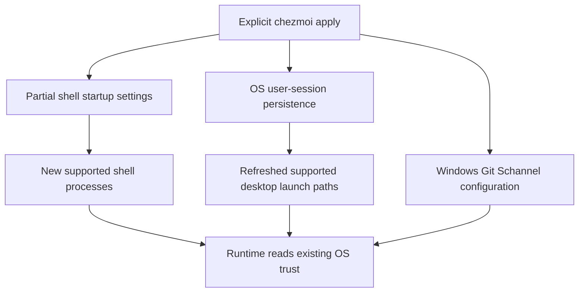

# Native System CA Trust - Plan

## Goal Capsule

- **Objective:** The repository owner can use supported developer applications behind DPI without manually setting certificate environment variables for each session.
- **Means:** Native runtime settings persisted through OS user-session configuration and partial shell-startup edits, as defined by KTD1–KTD4.
- **Product authority:** The confirmed native-only scope in this conversation and [STRATEGY.md](STRATEGY.md). CA-file integration and certificate provisioning belong to [issue #10](https://github.com/hyperlapse122/dotfiles/issues/10), not this plan.
- **Open blockers:** None. The required DPI CA must already be trusted by the target OS.
- **Execution profile:** One PR; LFG owns implementation, local verification, review, and publication.
- **Ownership:** Applying personal configuration to the owner's real account remains separate from isolated implementation verification.

---

## Product Contract

### Summary

Manage native system-CA trust settings for supported developer runtimes and tools at user scope on Windows, Linux, and macOS.
Cover CLI and GUI launch paths, with explicit support boundaries for runtime versions, TLS backends, and applications that override default trust.

### Problem Frame

The owner reports interrupted connections in applications such as omp while using DPI.
The current workaround is to set temporary environment variables and restart the affected applications.
Repeating that work across sessions and devices undermines the repository's purpose of reproducing the owner's working environment.

### Key Decisions

- **Three-OS, user-wide coverage.** Governs R1, R10. (session-settled: user-directed — chosen over Windows-only or terminal-only configuration: the owner selected Windows, Linux, and macOS user-wide coverage.)
- **Assess major developer runtimes rather than Node.js and Bun alone.** Governs R2, R5. (session-settled: user-directed — chosen over a two-runtime or named-app-only scope: the owner selected broader developer-tool coverage.)
- **Native support only for this work.** Governs R3, R4, R5. (session-settled: user-directed — chosen over native support plus CA-file integration: the owner deferred file integration and encrypted CA provisioning to issue #10.)
- **Preserve certificate validation.** Governs R6, R7. (session-settled: user-approved — chosen over bypassing TLS verification: the owner confirmed the native-only scope with verification retained.)

<!-- ce-section: work-relationships -->
### How This Work Fits Together

This plan owns native trust configuration only.
The broader separation below records the current understanding, not a committed roadmap.

- **Native trust configuration:** Can proceed independently of CA-file integration when the required CA is already trusted by the OS.
- **[Issue #10](https://github.com/hyperlapse122/dotfiles/issues/10):** Shares the goal of removing manual certificate workarounds, but covers clients that need CA files and encrypted CA-file provisioning for macOS and Linux.
  - **Still to decide in that issue:** Whether installation targets application-local files, OS trust stores, or both.

### Requirements

**Coverage and trust sources**

- R1. Persist the managed settings at user scope on Windows, Linux, and macOS so supported CLI and GUI launches outside this repository receive them.
- R2. Assess Node.js, Bun, Python standard-library TLS, Requests, pip, Java JSSE, Git HTTPS, curl, and Go-based tools, including omp as a required application-level check for its applicable runtime.
- R3. Use only native access to OS-managed trust sources; existing OS-maintained CA files or directories on Linux count as native support, but exporting or maintaining a separate CA copy does not.
- R4. Enable native trust where supported and necessary, leaving an already suitable native default unchanged.
- R5. Document each assessed target's platform, runtime or backend prerequisites, and support outcome, explicitly identifying cases that cannot be covered natively.

**Validation and coexistence**

- R6. Keep certificate-chain and hostname verification enabled, including rejection of certificates outside the effective trusted set.
- R7. Do not introduce a cross-runtime CA-file override or replace a working native trust path with a restricted trust source.
- R8. Keep changes within repository-managed user configuration, documenting conflicting inherited CA settings without broadly deleting machine-wide or unrelated application settings.

**Application lifecycle**

- R9. Change personal trust configuration only through explicit apply; worktree preparation and bootstrap remain read-only with respect to personal settings and OS trust stores.
- R10. Explain the restart or login-session refresh needed for supported CLI and GUI launch paths, without requiring repeated manual environment-variable commands after activation.
- R11. Repeated apply must converge to the same managed settings without duplicating entries or discarding unrelated configuration.

### Key Flows

- F1. **Apply and activate native trust. Covers R1, R3, R4, R6, R9, R10.** The owner starts with the required CA already trusted by the OS, explicitly applies the dotfiles, refreshes the relevant login or application process, and uses a supported application outside the checkout without setting certificate variables by hand.
- F2. **Use an already-native tool. Covers R4, R6, R7, R11.** The owner reapplies the dotfiles and continues using a tool whose native trust was already suitable; both enterprise-CA and ordinary public-CA connections continue to validate.
- F3. **Encounter a coverage limit. Covers R2, R5, R8.** A runtime version, backend, explicit application trust override, or inherited setting prevents native coverage; the documented support boundary identifies the limitation rather than treating environment-variable presence as proof of success.

### Acceptance Examples

- AE1. **Covers R1, R2, R3, R4, R6, R10.** Given a supported Node.js or Bun build and an OS-trusted DPI CA, after explicit apply and the documented process refresh, a TLS request through the affected network succeeds from an unrelated working directory without manually setting environment variables.
- AE2. **Covers R1, R5, R10.** Given a documented supported GUI launch path on each target OS, an application launched after the required login-session refresh receives the managed trust configuration without being started from a specially configured terminal.
- AE3. **Covers R2, R5, R6.** Given the supported omp executable used for verification, exercising its actual affected network operation succeeds with certificate validation enabled; a generic Node.js or Bun probe alone does not establish omp coverage.
- AE4. **Covers R4, R6, R7.** Given a tool that already uses OS trust, applying these settings preserves successful connections using public and enterprise roots, while an untrusted issuer or hostname mismatch still fails validation.
- AE5. **Covers R2, R3, R5.** Given a Requests or Java combination that cannot meet the intended trust coverage through native configuration, its support entry records that limitation and refers to issue #10 rather than generating a bundle or disabling verification.
- AE6. **Covers R5, R8.** Given a conflicting inherited CA-file setting, documentation identifies the affected trust path and scope; its existence does not authorize deleting unrelated configuration or claiming the affected application is verified.
- AE7. **Covers R8, R9, R11.** Given existing unrelated user settings, repeated explicit apply preserves them and produces no duplicate managed entries, while worktree preparation makes no personal trust changes.

### Scope Boundaries

- **Deferred to [issue #10](https://github.com/hyperlapse122/dotfiles/issues/10), per R3:** CA-file integration, exported or generated bundles, and macOS/Linux CA files committed as encrypted secrets and decrypted/installed during explicit apply.
- **Outside this plan, per R3 and R9:** Adding, removing, or distributing OS trust anchors; runtime/package installation or upgrades; proxy routing; and DPI administration.
- **Coverage limits, per R5:** Applications that pin certificates, construct independent trust stores, ignore default runtime settings, or sanitize their inherited environment are not promised universal coverage.
- **Lifecycle limit, per R10:** No automatic restart, process-environment injection, certificate hot reload, or background synchronization service.

### Dependencies and Assumptions

- The required enterprise CA is already installed and trusted for the relevant target user or device; provisioning is not implicit in a successful configuration apply.
- Linux support follows the target runtime's OS-maintained trust paths; it does not imply every distribution exposes the same paths or every desktop session propagates environment settings identically.
- Standalone applications depend on their embedded runtime and application trust behavior, not on the version of a separately installed runtime.
- Native trust-source selection does not imply identical validation or revocation behavior across runtimes.

### Outstanding Questions

**Deferred to Implementation**

- Select an observable, unauthenticated omp network operation using the installed executable's supported commands; do not use the owner's model-provider credentials as a verification shortcut.
- Record which native desktop-session checks are available on the execution host, without presenting cross-platform rendering as native GUI proof.

### Sources and Research

- [Repository strategy](STRATEGY.md): authority for reproducible cross-OS personal configuration and repository precedence.
- [Application/preparation workflow](mise.toml): the existing workflow boundary that R9 preserves.
- [Windows CA override lesson](.compound-engineering/artifacts/solutions/integration-issues/github-cli-windows-ca-override.md): evidence that a CA-file override can replace the intended platform path for an affected Go-based tool.
- [Node.js enterprise network configuration](https://nodejs.org/en/learn/http/enterprise-network-configuration) and [CLI CA settings](https://nodejs.org/api/cli.html#node_use_system_ca1): system-CA opt-in, version requirements, and trust-source behavior.
- [Bun 1.2.23](https://bun.com/blog/bun-v1.2.23): documented system-CA support through `NODE_USE_SYSTEM_CA=1` or `--use-system-ca`.
- [Python ssl](https://docs.python.org/3/library/ssl.html#ssl.SSLContext.load_default_certs), [Requests](https://requests.readthedocs.io/en/latest/user/advanced/#ssl-cert-verification), and [pip HTTPS certificates](https://pip.pypa.io/en/stable/topics/https-certificates/): distinct trust defaults and version-dependent native coverage.
- [Java JSSE](https://docs.oracle.com/en/java/javase/21/security/java-secure-socket-extension-jsse-reference-guide.html) and [JDK 25 providers](https://docs.oracle.com/en/java/javase/25/security/oracle-providers.html): default trust selection and native store/provider boundaries.
- [Git HTTPS configuration](https://git-scm.com/docs/git-config#Documentation/git-config.txt-httpsslCAInfo), [curl native CA options](https://curl.se/docs/manpage.html#--ca-native), and [libcurl environment variables](https://curl.se/libcurl/c/libcurl-env.html): backend-specific trust and CLI/library distinctions.
- [Go 1.27 crypto/x509 changes](https://go.dev/doc/go1.27#cryptox509) and [Go 1.27.3 root loading](https://github.com/golang/go/blob/go1.27.3/src/crypto/x509/root.go): version-specific filesystem override behavior on Windows and macOS.
- [Deferred CA integration issue #10](https://github.com/hyperlapse122/dotfiles/issues/10): the recorded follow-up boundary, including encrypted CA provisioning for macOS and Linux; implementation must follow the repository's current chezmoi-native GPG policy.

---

## Planning Contract

**Product Contract preservation:** Product Contract unchanged; its planning-owned questions are resolved below, with execution-environment checks retained above.

### Key Technical Decisions

- KTD1. **One runtime opt-in, no universal CA-file override.** Persist `NODE_USE_SYSTEM_CA=1` for supported Node.js/Bun applications and the Bun-compiled omp executable. Native defaults remain the path for compatible Python/pip, Go, and OS-native curl builds; Requests and generic Java configurations receive explicit support limits rather than injected trust managers or JVM-wide truststore replacement. Implements R2–R7 using the runtime sources above.
- KTD2. **Partial POSIX startup edits preserve shell precedence.** Use the existing `chezmoi:modify-template` pattern for `.profile`, `.bashrc`, and `.zshenv`; modify `.bash_profile` and `.bash_login` only when they already exist at the destination. A shared template owns one delimited export block and rejects malformed owned delimiters before deleting uncertain content. This avoids shadowing a user's existing Bash login file. Implements R1, R8, R11.
- KTD3. **Use native per-user persistence, not process injection.** Windows explicit apply updates only `HKCU\Environment\NODE_USE_SYSTEM_CA`; Linux installs an `environment.d` file for the systemd user manager; macOS installs an Aqua login LaunchAgent that runs `launchctl setenv`. Shell hooks complement, rather than replace, these desktop mechanisms. Implements R1, R9, R10.
- KTD4. **State the desktop launch boundary precisely.** Windows sign-out/sign-in is the reliable refresh baseline. Linux GUI coverage is limited to systemd-user services or desktop launchers that consume the manager environment. macOS coverage starts after the login setter completes and stale applications/launchers are restarted; login restoration ordering is not guaranteed. Implements R5, R10 without a background service, restart loop, or sleep-based ordering claim.
- KTD5. **Select Schannel for Git for Windows only.** Extend the existing Git template with Windows-only `http.sslBackend=schannel` and `http.schannelUseSSLCAInfo=false`, retaining TLS and revocation verification. Do not add a shared curlrc option: multiple curl executables and TLS backends can consume the same file, and option parsing does not prove native-CA support. Implements R4, R6, R7.
- KTD6. **Separate isolated persistence proof from account-wide activation.** Follow the real-chezmoi temporary-home fixtures in `tests/test_git_gpg.py`. Exercise shell startup behavior and registry mutation against disposable state; run actual TLS/application smokes separately and report unavailable macOS/Linux GUI methods. Implements R8–R11 and AE1–AE7.

### High-Level Technical Design

The configuration has two inheritance paths under KTD2–KTD4; neither changes trust anchors or modifies a running application's environment.
The diagram shows configuration ownership, not a promise that every desktop launcher consumes the same environment.

### Assumptions

- Default home-based Bash/POSIX/Zsh startup locations and the default Linux XDG configuration location are the supported baseline; nonstandard `ZDOTDIR`, custom rc-file switches, and desktop-specific environment paths are documented boundaries rather than silently guessed targets.
- Native CLI/GUI verification on macOS and Linux depends on available hosts; unavailable methods are disclosed in the PR and do not become fabricated passes.
- Runtime installation is not a product deliverable under R3/R9; any verification-only tooling remains isolated from the owner's application configuration.

### Risks and Research

- Existing inherited `NODE_EXTRA_CA_CERTS`, `SSL_CERT_FILE`, explicit per-request CA settings, or URL-specific Git options can select a different trust path. Document the conflict per R8; do not remove unrelated settings to make a smoke pass.
- The public [omp 18.16.0 build](https://github.com/can1357/oh-my-pi/blob/v18.16.0/packages/coding-agent/scripts/compile-binary.ts) uses Bun. Its [TLS wrapper](https://github.com/can1357/oh-my-pi/blob/v18.16.0/packages/utils/src/tls-fetch.ts) can supply explicit CA options when `NODE_EXTRA_CA_CERTS` is present, so a separate runtime probe does not prove AE3.
- [systemd environment.d applicability](https://www.freedesktop.org/software/systemd/man/latest/environment.d.html#Applicability) determines the Linux GUI boundary in KTD4.
- [Apple LaunchAgents](https://developer.apple.com/library/archive/documentation/MacOSX/Conceptual/BPSystemStartup/Chapters/CreatingLaunchdJobs.html) supply login persistence, not ordering before all other applications.
- [Microsoft process environments](https://learn.microsoft.com/en-us/windows/win32/procthread/environment-variables) establish why changing the user registry does not refresh existing parents.
- [Bash startup precedence](https://www.gnu.org/software/bash/manual/html_node/Bash-Startup-Files.html), [Zsh startup files](https://zsh.sourceforge.io/Doc/Release/Files.html), and [chezmoi stat](https://www.chezmoi.io/reference/templates/functions/stat/) govern KTD2's existing-only login-file selection.
- A competing implementation or new persistence framework is not warranted: these are documented OS mechanisms with separate launch domains, not an unresolved shared architecture.

---

## Implementation Units

### U1. Persist native trust in POSIX shells and Linux sessions

**Goal:** New supported shells receive the runtime opt-in without losing existing startup behavior.
**Requirements:** R1, R3, R4, R8–R11; F1, F2; AE1, AE2, AE6, AE7.
**Dependencies:** None.
**Files:** Create `home/.chezmoitemplates/native-ca-shell`, `home/modify_dot_profile`, `home/modify_dot_bashrc`, `home/modify_dot_bash_profile`, `home/modify_dot_bash_login`, `home/modify_dot_zshenv`, `home/dot_config/environment.d/60-native-system-ca.conf.tmpl`, and `tests/test_native_ca_shell.py`; extend `home/.chezmoiignore`.
**Approach:**

1. Implement KTD2's shared transformation and thin modify-template wrappers.
2. Select Unix files through the existing OS-conditional ignore mechanism; use destination-file existence for the optional Bash login files.
3. Install Linux's user-manager environment file under KTD3 and document its manager/session refresh under KTD4.

**Patterns:** `home/.chezmoitemplates/gpg-agent-config`, `home/private_dot_gnupg/modify_gpg-agent.conf`, and the isolated fixtures in `tests/test_git_gpg.py`.
**Execution note:** Prefer real startup-process smoke proof over tests that compare generated source text.
**Test scenarios:**

- Covers AE1 / AE7. Apply against a disposable home containing custom startup side effects, launch a supported shell with the variable absent from its parent, and observe both the opt-in and the preserved side effect after repeated apply.
- Preserve Bash's selected login-file behavior when only `.profile` exists and when a custom `.bash_profile` already exists.
- Reject an incomplete owned marker pair without removing the original startup content.
**Test seam:** `tests/test_native_ca_shell.py` catches reconciliation and startup behavior; it does not establish graphical-session inheritance.
**Verification:** Observe actual shell output from an unrelated working directory and report native Linux desktop coverage separately.

### U2. Persist native trust in Windows and macOS user sessions

**Goal:** OS-managed user-session configuration supplies the same opt-in to supported desktop launch paths.
**Requirements:** R1, R3, R8–R11; F1, F3; AE2, AE6, AE7.
**Dependencies:** None; the integration owner extends `home/.chezmoiignore` once for U1 and U2.
**Files:** Create `home/.chezmoitemplates/native-ca-windows`, `home/run_after_20-native-system-ca.cmd.tmpl`, `home/Library/LaunchAgents/com.hyperlapse.native-system-ca.plist.tmpl`, and `tests/test_native_ca_windows.py`.
**Approach:**

1. Follow the existing profile-free `.cmd`/PowerShell pattern for a single-value user-registry update; keep the shared PowerShell body directly exercisable against a disposable registry-provider root.
2. Install the macOS LaunchAgent with the direct `launchctl setenv` command, Aqua session selection, and login-time execution; no helper daemon or polling.
3. Apply KTD4's refresh boundary without claiming that already-running processes have changed.

**Patterns:** `home/run_after_10-reload-gpg-agent.cmd.tmpl` and OS-conditional script templates.
**Test scenarios:**

- Covers AE7. Execute the real registry-writing body using a child PowerShell process whose HKCU provider is redirected to a disposable subtree; observe the owned value and unchanged unrelated sentinels after repeated execution.
- Fail on a real registry-provider write error rather than reporting successful persistence.
- Confirm non-Windows script rendering is empty during the throwaway cross-OS rendering smoke.
**Test seam:** `tests/test_native_ca_windows.py` exercises actual Windows registry behavior without changing the owner's environment; macOS plist parsing is structural smoke only.
**Verification:** Inspect the isolated registry result, parse the rendered LaunchAgent, and distinguish those results from live Explorer/macOS GUI activation.

### U3. Select safe native tool defaults and publish the support matrix

**Goal:** Configure supported Git HTTPS trust and explain exactly which assessed runtime combinations benefit.
**Requirements:** R2, R4–R8, R10; F1–F3; AE1–AE6.
**Dependencies:** U1, U2 for integrated activation instructions.
**Files:** Modify `home/dot_gitconfig.tmpl`, `README.md`, `home/README.md`, and `tests/test_git_gpg.py`.
**Approach:**

1. Implement KTD5 within the existing Git configuration template.
2. Publish the R5 matrix with native/default/unsupported distinctions, runtime/backend prerequisites, desktop launch boundaries, and inherited override troubleshooting.
3. Link issue #10 as deferred work without adding its certificate files, decryption, or provisioning to the source state.
4. Isolate the existing Windows Unicode-home regression before running the suite: apply its fixture files with scripts excluded, then render and execute only its existing GPG reload hook under the disposable Unicode environment.

**Test scenarios:**

- Covers AE4. Use the installed Git for Windows against a public HTTPS Git endpoint under the generated user configuration, preserving TLS verification.
- Covers AE1 / AE3. Exercise an available supported runtime and an unauthenticated actual omp network operation outside the checkout, recording success or a concrete environment limitation.
- Covers AE4. Observe rejection of an untrusted issuer or hostname mismatch using an isolated TLS scenario; do not install test roots into the owner's OS stores.
**Test seam:** Existing Git/GPG tests protect the unrelated managed behavior; new generated-text assertions are not required.
**Verification:** Record actual network/application output and the exact methods not available on this host.

---

## Verification Contract

- Run `mise exec -- python -m unittest discover -s tests -v` once after implementation and integration.
- Run `mise install` to exercise hook-free preparation and confirm no personal trust configuration is applied.
- Use disposable homes, registry subtrees, shell processes, and temporary network fixtures; never apply to the owner's real home or install test trust anchors there.
- Audit existing full-apply fixture paths before the suite; temporary `HOME` and `USERPROFILE` values do not isolate HKCU, so the CA registry hook runs only in the disposable registry-provider scenario.
- Actual runtime/application smokes establish TLS behavior; template rendering, parsed plist content, and environment-variable presence establish only their respective structural/persistence facts.
- Preserve the existing Git/GPG, bootstrap, and global-chezmoi regressions, and report native GUI methods that could not run.
- Browser testing is not applicable to this CLI/dotfiles surface.

---

## Definition of Done

- U1–U3 implement the cited requirements and provide exercised verification or a named host-method limitation without false coverage claims.
- Documentation includes the complete assessed-tool matrix, activation boundaries, and issue #10's deferred scope.
- TLS verification remains enabled and personal account settings remain untouched during implementation verification.
- No abandoned attempts, throwaway fixtures, generated CA files, or unrelated changes remain in the shipped diff.
