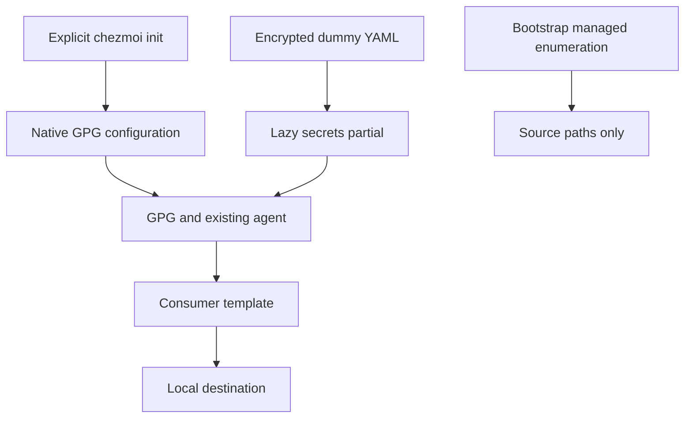

# Chezmoi GPG Secrets - Plan

## Goal Capsule

- **Objective:** The repository owner can safely store and maintain API-token secrets in the repository and reproduce their local configuration on another device.
- **Means:** Chezmoi's built-in GPG encryption, exercised with dummy API tokens before real-secret migration.
- **Product authority:** The confirmed conversation scope and `STRATEGY.md`; key-storage hardware and key provisioning are not active scope.
- **Open blockers:** None for planning. Access to the owner's decryption key is a prerequisite for owner-key runtime verification.
- **Execution profile:** One pull request; implement the environment, verify it in isolated destinations, then independently review and publish through the authorized autonomous workflow.

---

## Product Contract

### Summary

Build the secret-management environment around chezmoi's native GPG support and the owner's public key as the sole recipient.
Use dummy API tokens to prove the encrypted-source-to-local-configuration workflow, leaving private-key access to GPG.

### Problem Frame

The owner needs a repeatable secret-management workflow before migrating real API tokens.
The repository currently supplies GPG executable and pinentry settings, but does not configure native secret encryption or provide encrypted token consumption.

### Key Decisions

- **Native GPG rather than SOPS.** Governs R1, R5, R6. Native encrypted YAML already supports token extraction without another installed tool. (session-settled: user-approved — chosen over SOPS integration: the current dotfiles-only scope does not need SOPS interoperability or readable encrypted-document structure.)
- **Delegate key access to GPG.** Governs R3, R4. Application configuration must not depend on where GPG obtains private-key operations. (session-settled: user-directed — chosen over YubiKey-only validation: the user explicitly removed repository-level hardware assumptions.)
- **Reuse the prepared GPG environment.** Governs R4. This keeps environment integration separate from key provisioning. (session-settled: user-directed — chosen over new-PC GPG installation and key connection: existing GPG, pinentry, and key readiness are prerequisites.)
- **One recipient, no alternative recovery path.** Governs R2. Losing access to the selected private key makes existing ciphertext unavailable until the user restores that access; key recovery remains outside this delivery.

### Requirements

**Encryption and key authority**

- R1. Use chezmoi's built-in GPG encryption rather than SOPS or another encryption provider.
- R2. Encrypt only for the owner's public key with primary fingerprint `621512777E6933FEB4458FDC4945855D4F283F05`, without additional recipients or symmetric-passphrase fallback.
- R3. Delegate encryption-subkey selection and private-key access to GPG without detecting, requiring, or provisioning key-storage hardware.
- R4. Use the existing installed GPG and pinentry environment without generating or importing keys or changing key stores and trust databases.

**Secret authoring and consumption**

- R5. Demonstrate selecting a named dummy API token from encrypted structured data and inserting its exact value into a local configuration through chezmoi.
- R6. Provide a documented workflow to create, edit, re-encrypt, and explicitly apply managed secrets while keeping committed source content encrypted.
- R7. Support the same secret-management workflow on Windows, Linux, and macOS using the repository's existing GPG executable and pinentry selection conventions.

**Lifecycle and failure behavior**

- R8. Keep worktree preparation and bootstrap free of secret decryption, secret-driven PIN prompts, and personal-configuration application.
- R9. If required decryption fails, return an error without replacing the affected secret-bearing destination with empty, dummy-fallback, or partial content.
- R10. Repeated explicit application reconciles secret-bearing destinations to the encrypted source without changing recipient policy or key configuration.
- R11. Document plaintext exposure in generated destinations, previews, temporary files, and editing tools without claiming memory-only secret handling.

### Key Flows

- F1. Author and consume a dummy token. **Covers R1-R7, R11.**
  - **Prerequisites:** Existing tools, the selected public key, and GPG access to its private-key operations are ready.
  - **Steps:** Create encrypted dummy token data; edit and re-encrypt it; explicitly apply the source; inspect the chosen token in an isolated local destination.
  - **Outcome:** The selected value is correct and committed secret source remains encrypted.
- F2. Prepare and reconcile a checkout. **Covers R8, R10.**
  - **Steps:** Prepare the checkout without accessing secrets, then explicitly apply it twice; change the isolated destination and apply again.
  - **Outcome:** Preparation leaves personal configuration alone and application restores the managed value.
- F3. Encounter unavailable decryption. **Covers R9.**
  - **Steps:** Attempt explicit application when GPG cannot perform the required decryption.
  - **Outcome:** The command fails and the affected existing secret-bearing destination retains its prior content; no whole-apply rollback guarantee is implied.

### Acceptance Examples

- AE1. Named token selection and sole recipient. **Covers R1, R2, R5, R6.** Given two distinct dummy tokens, a template selecting the second emits exactly that token; neither plaintext token is present in the encrypted source, and the resulting ciphertext has exactly one recipient belonging to the R2 key even when local GPG configuration suggests an additional recipient.
- AE2. No decryption during preparation. **Covers R8.** Given ciphertext in the checkout and unavailable private-key access, the existing preparation entry point still completes without attempting secret decryption or writing personal configuration.
- AE3. Failure preserves the affected destination. **Covers R9.** Given an existing isolated configuration and unavailable private-key access, application fails and does not overwrite that configuration with missing or partially rendered secret content.
- AE4. Reconciliation. **Covers R10.** Given successful application, an unchanged rerun preserves the selected token; after local destination drift, another application restores the encrypted source's value.
- AE5. Hardware-independent GPG integration. **Covers R3, R7.** Given a supported OS and working GPG decryption, the workflow succeeds without a repository-level test for a particular hardware device or private-key storage location.

### Scope Boundaries

- This delivery establishes the environment using dummy data; real API-token migration and application-specific secret inventories are deferred.
- Tool installation, key creation, public-key distribution, recipient rotation, and key recovery are excluded under R4.
- No YubiKey provisioning, card checks, device policies, or hardware-presence requirements are introduced under R3.
- No SOPS integration, shared infrastructure-secret platform, or additional encryption provider is included under R1.
- No automatic personal apply or decryption during bootstrap is introduced under R8.

### Dependencies / Assumptions

- Public-key inspection on the current Windows device confirmed the R2 primary fingerprint and an encryption-capable subkey with fingerprint `4F185E264F6F3E15DA414D64BD494A273E310036`.
- That observation identifies the recipient; it does not prove private-key availability or authorize pinning a specific encryption subkey instead of allowing GPG selection under R3.
- `home/.chezmoidata/git.yaml` already records the same primary fingerprint for Git signing; signing configuration alone is not proof of working decryption.
- An isolated software-key smoke run with installed chezmoi 2.74.0 proved native GPG encryption and `include | decrypt | fromYaml` token selection on Windows. Owner-key decryption and native Linux/macOS execution remain unverified.
- Existing configuration initialization preserves local configuration and sets source paths in `home/.chezmoi.toml.tmpl`; planning must reconcile native encryption settings with that behavior without putting decrypted tokens into persistent chezmoi configuration.

### Sources / Research

- `STRATEGY.md`: current native-GPG policy and delegation of hardware concerns.
- `mise.toml`: hook-free preparation entry point and separate explicit apply task.
- `home/.chezmoitemplates/gpg-settings`, `home/.chezmoidata/gpg.yaml`, and `README.md`: existing executable selection, pinentry, and GPG prerequisites.
- [Chezmoi GPG encryption](https://www.chezmoi.io/user-guide/encryption/gpg/), [decrypt](https://www.chezmoi.io/reference/templates/functions/decrypt/), and [edit-encrypted](https://www.chezmoi.io/reference/commands/edit-encrypted/): supported authoring and template-consumption paths.
- [Chezmoi issue 3823](https://github.com/twpayne/chezmoi/issues/3823): maintainer confirmation of encrypted structured-data consumption and generic SOPS integration; native GPG does not require SOPS for token selection.
- [Chezmoi 2.74.0 GPG implementation](https://github.com/twpayne/chezmoi/blob/v2.74.0/internal/chezmoi/gpgencryption.go): external GPG invocation and temporary-plaintext handling relevant to R11.
- [Deferred CA provisioning issue 10](https://github.com/hyperlapse122/dotfiles/issues/10): its older SOPS/YubiKey wording predates this decision; any future CA plan must use the current strategy rather than revive those superseded constraints. Updating that separate issue or implementing CA provisioning is not part of this plan.

---

## Planning Contract

**Product Contract preservation:** Product Contract unchanged; the Problem Frame makes the existing motivation explicit.

### Key Technical Decisions

- KTD1. Configure native encryption during explicit chezmoi initialization, preserving unrelated existing TOML configuration. Own the encryption provider and all recipient-affecting GPG configuration instead of merging stale recipients, symmetric mode, or arbitrary arguments. Use the existing `gpg-settings` partial for executable selection and a separate recipient field in `home/.chezmoidata/gpg.yaml` for R2.
- KTD2. Use `--no-options` for chezmoi's GPG invocations so local `gpg.conf` cannot add recipients through `recipient`, `encrypt-to`, hidden variants, or groups. GPG still uses its standard home, key stores, and agent; `gpg-agent.conf` and hardware access remain GPG concerns under R3. The GnuPG manual states this option is detected before reading the default options file.
- KTD3. Store the encrypted dummy YAML in the ignored source directory `home/.secrets/`, with a lazy `home/.chezmoitemplates/secrets` partial returning its decrypted content. Consumers parse that content and select a field; neither source enumeration nor global configuration initialization invokes the partial. Do not install an unsolicited dummy configuration in the real home.
- KTD4. Exercise the actual tools in isolated fixture copies, following `tests/test_git_gpg.py`. Fixtures substitute their own generated key identity in the copied recipient data; production source retains R2. Test effective ciphertext recipients, destination preservation on errors, and preparation without private keys rather than asserting template source text.
- KTD5. Keep the configuration template's data and partial dependencies available in the global-registration test fixture. Update its source-copy seam rather than retaining an alternate configuration-generation path.

### High-Level Technical Design

### Risks and Implementation Discovery

- Per KTD2, personal `gpg.conf` options do not apply to chezmoi encryption operations; document that tradeoff rather than silently inheriting recipient-broadening options.
- Missing private-key access must not invalidate preparation under R8. Owner-key decryption may require an interactive PIN; report any unavailable owner-key verification separately from isolated software-key evidence.
- Verify initialization data availability and GPG argument ordering during implementation; do not claim these runtime details have already been exercised by planning.
- No custom encryption wrapper, pre-commit scanner, alternate recovery key, global secret injection, or whole-apply transaction is planned; native primitives and the established scope do not require them.

---

## Implementation Units

### U1. Configure native encryption and lazy token consumption

**Goal:** Supply the reusable environment and encrypted dummy source.

**Requirements:** R1-R8, R10-R11; F1-F2; AE1-AE2, AE5.

**Dependencies:** Existing GPG tools and the public key identified in R2.

**Files:** `home/.chezmoi.toml.tmpl`, `home/.chezmoidata/gpg.yaml`, `home/.chezmoiignore`, new `home/.chezmoitemplates/secrets`, new `home/.secrets/api-tokens.yaml.asc`; behavior coverage in `tests/test_secrets.py`.

**Approach:**
1. Apply KTD1-KTD2 while preserving source-path binding and unrelated configuration.
2. Encrypt two distinct dummy API tokens for R2 and add the lazy consumption seam from KTD3.
3. Keep the ignored source ciphertext out of destination enumeration.

**Patterns to follow:** Existing dictionary-based TOML preservation and shared GPG executable selection.

**Execution note:** Prefer a real-tool smoke proof before finalizing permanent regression coverage.

**Test scenarios:**
- Covers AE1. Generate ciphertext with a fixture owner key and local additional-recipient settings; only the fixture owner's selected encryption key can receive it.
- Covers AE2. Initialize and enumerate source without private keys; no secret destination or decryption occurs.
- Covers AE5. A configured GPG executable works without repository hardware checks.

**Verification:** Real chezmoi initialization produces working native encryption, and the encrypted source is ignored until a consumer requests it.

### U2. Protect lifecycle behavior with isolated integration coverage

**Goal:** Prove token selection, failure preservation, and existing initialization compatibility.

**Requirements:** R2-R10; F1-F3; AE1-AE5.

**Dependencies:** U1.

**Files:** New `tests/test_secrets.py`; update `tests/test_global_chezmoi.py` source fixture.

**Approach:** Follow KTD4-KTD5 and use temporary GPG homes, generated keys, source copies, and destinations without touching the owner's key stores or settings.

**Test scenarios:**
- Covers AE1. Consume the second of two dummy tokens into a local fixture configuration and assert its exact value.
- Covers AE1. Existing chezmoi recipients, symmetric mode, and recipient-affecting arguments do not survive explicit initialization as effective policy.
- Covers AE2. Preparation succeeds with ciphertext present and no private-key access.
- Covers AE3. Missing private-key access fails application and leaves the affected existing destination byte-for-byte intact.
- Covers AE4. Reapplication restores local destination drift without changing the recipient.
- Existing global registration preserves unrelated settings and continues to avoid personal application.

**Test seam:** Real-tool integration catches command, configuration, and destination-lifecycle defects; isolated software keys do not prove hardware access or native Unix execution.

**Verification:** Run the new integration coverage and the existing Python unittest suite once after implementation integration.

### U3. Document and smoke the owner workflow

**Goal:** Make the environment usable without inventing application-specific destinations.

**Requirements:** R4-R8, R11; F1-F3.

**Dependencies:** U1-U2.

**Files:** `README.md`, `home/README.md`, and the already updated `STRATEGY.md`.

**Approach:** Document explicit initialization, encrypted-source creation and editing, named token consumption, application, recipient enforcement, prerequisites, and plaintext exposure using the implemented paths.

**Test expectation:** No prose-text tests; validate the documented commands against isolated state.

**Verification:** Run the real CLI through initialization, encryption, named-token rendering, application, and failure handling; inspect the owner-key ciphertext recipient without requiring a specific storage device.

---

## Verification Contract

- Use `mise exec -- python -m unittest discover -s tests` for the repository's existing and new integration coverage after changes are integrated.
- Exercise real chezmoi and GPG in isolated homes and source copies; mocks or source-string assertions do not establish encryption behavior.
- Inspect GPG packet output for one public-key recipient and no symmetric session-key packet under R2, including additional-recipient local options.
- Run the existing preparation task with ciphertext present and private-key access unavailable; observe successful enumeration without decryption.
- Exercise actual owner-key decryption if available through ordinary GPG; record failure or unavailable interaction honestly without substituting a different production recipient.
- Native Linux/macOS execution is an environment-dependent check; do not claim it from Windows-only coverage.

---

## Definition of Done

- U1-U3 satisfy their cited requirements and acceptance examples with observed CLI evidence.
- Encrypted dummy source uses R2 and no real token or new key material is committed.
- Preparation remains independent of decryption and personal application.
- Documentation matches the implemented initialization and consumption paths, including KTD2's configuration tradeoff.
- Relevant integration coverage passes, temporary probes and abandoned approaches are removed, and any runtime verification limits are recorded.
- Changes receive independent code review before the authorized PR is published; no merge is authorized.
