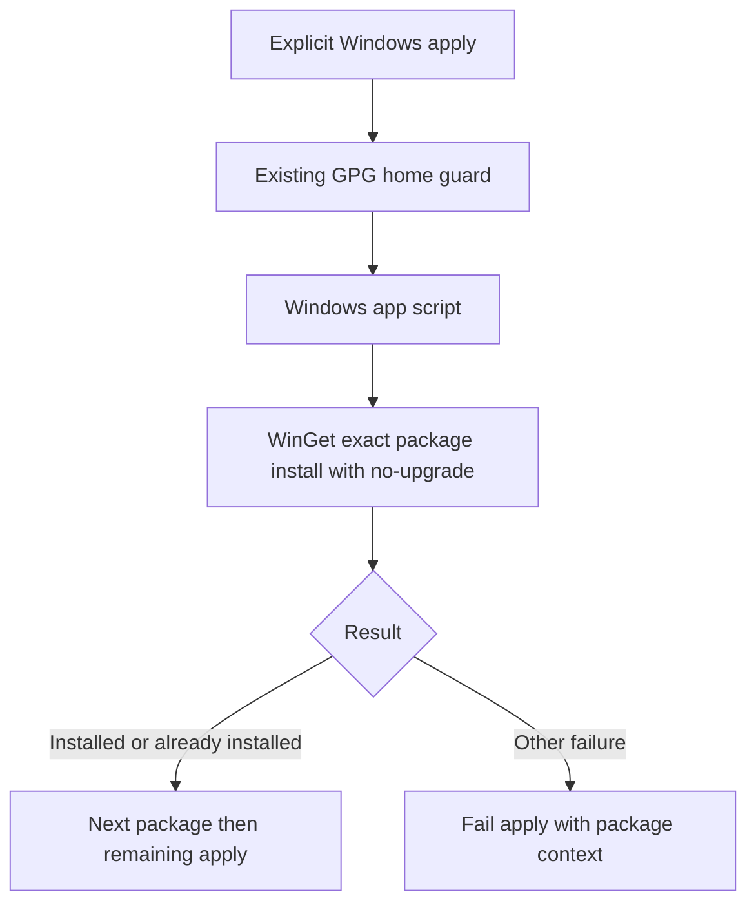

# Windows Apps Managed by Chezmoi - Plan

## Goal Capsule

- **Objective:** The Windows user can provision Chrome, 1Password, and 1Password CLI through their normal personal-configuration workflow.
- **Means:** A Windows-only chezmoi installation script using WinGet (KTD1–KTD3).
- **Authority:** Product Contract governs behavior; Planning Contract governs mechanism; units implement both.
- **Execution profile:** One PR, U1 followed by U2; implementation and shipping require a separate execution handoff.
- **Stop conditions:** Do not change bootstrap into an application installer or apply personal configuration during planning or automated verification.
- **Completion owner:** The implementing engineer verifies and documents the change; this artifact does not authorize installing applications on the current host.

## Product Contract

### Summary

Manage the three Windows host applications through explicit chezmoi application, separately from worktree preparation.
Preserve existing installations rather than managing their versions.

### Problem Frame

The user wants these host applications provisioned alongside personal configuration, without making worktree bootstrap responsible for personal software.
The repository already separates preparation from applying home source state.

### Key Decisions

- **Keep personal app installation outside bootstrap.** Governs R2. (session-settled: user-approved — chosen over installing apps during bootstrap: worktree preparation must not install personal applications.)

### Requirements

**Application provisioning**

- R1. Explicit chezmoi application on Windows ensures Google Chrome, 1Password, and 1Password CLI are installed through WinGet.
- R3. Existing installations are retained without a requested upgrade, downgrade, or reinstall.
- R4. Repeating application after an installation failure or a later uninstall can install the missing applications without undoing successful installations.
- R5. Missing WinGet or an installation failure is reported as a failed application with the failing package or prerequisite identified.

**Execution boundary**

- R2. Worktree initialization, bootstrap, and global-source registration do not install these personal applications.
- R6. The application-installation action does not execute on non-Windows platforms or during preview-only operations.

### Acceptance Examples

- AE1. **Covers R1, R3, R4.** With Chrome already installed, applying provisions the two missing 1Password packages; another apply preserves all installed versions, and an apply after removing the CLI restores it.
- AE2. **Covers R4, R5.** If the desktop installation fails after Chrome succeeds, apply fails visibly; rerunning can complete the remaining work without reinstalling Chrome.
- AE3. **Covers R2, R6.** Preparing a worktree or previewing source changes does not invoke an app installer; applying on Linux or macOS does not invoke WinGet.

### Scope Boundaries

- App preferences, default-browser selection, browser extensions, account sign-in, Windows Hello, CLI/app integration, vaults, secrets, and signing-key provisioning are not part of installation.
- Automatic updates, version pins, package removal, additional apps, and migrating existing installations between scopes are not included.
- No generic package-manager abstraction, retries, rollback, source repair, or automatic WinGet installation: failures remain visible through R5; reconsider only if real usage shows that manual remediation is insufficient.
- Preserve existing GPG prerequisites and validation; installing these apps does not make an otherwise unprepared machine ready for the repository's complete Git/GPG apply.

## Planning Contract

### Key Technical Decisions

- KTD1. **Use an ordinary OS-conditional `run_before_20-install-windows-apps.cmd.tmpl`.** It runs after the existing `run_before_10-check-gpg-home.cmd.tmpl` guard and on every apply, allowing R4 without resetting chezmoi's once/onchange state. Render empty outside Windows. Follow the existing profile-free Windows PowerShell launcher and propagate its failure through cmd. Governs R1, R4, R6.
- KTD2. **Keep the package list in `home/.chezmoidata/windows.yaml`.** A Windows-app-specific data key contains `Google.Chrome`, `AgileBits.1Password`, and `AgileBits.1Password.CLI`, in that order. The template consumes it without introducing a global package framework. Existing `.chezmoidata/git.yaml` and `gpg.yaml` establish the data convention. Governs R1.
- KTD3. **Delegate installed-state detection to WinGet's `install --no-upgrade`.** Invoke each exact ID separately from the `winget` source; do not parse localized `list` output or search GUI executable paths. Treat exit zero and WinGet's `APPINSTALLER_CLI_ERROR_PACKAGE_ALREADY_INSTALLED` (`0x8A150061`) as satisfied outcomes. Normalize the HRESULT's signed/unsigned representation before comparing; all other results fail with package context. This implements R3 and R5 without maintaining a second installed-state detector. Do not accept generic nonzero results as success.
- KTD4. **Keep installer consent and platform defaults intact.** Do not add agreement-acceptance, silent, force, scope, reboot, or security-bypass flags. Users approve WinGet agreements and UAC when needed, as in the existing bootstrap workflow. If WinGet is unavailable, report the existing App Installer prerequisite rather than repairing the host. Governs R5.
- KTD5. **Isolate every automated apply that reaches the new script.** Use a fixture-local executable command double and temporary HOME/config/cache/state; it must never fall through to real WinGet. Keep existing Git/GPG behavioral tests effective when adapting their environment. Test doubles validate state transitions and failure propagation, not argument echoes or source text. Governs R2, R4–R6.

### High-Level Technical Design

This flow sequences R1 and R5 under KTD1 and KTD3; it does not add a prerequisite installer or change the GPG guard.

### Sources and Dependencies

- `mise.toml`: preparation uses the hook-free config and `managed --exclude=scripts`; the apply task explicitly runs chezmoi.
- `home/README.md` and `home/run_before_10-check-gpg-home.cmd.tmpl`: OS-conditional scripts, padded ordering, and Windows PowerShell without personal profiles.
- `tests/test_bootstrap.py`: preparation isolation; `tests/test_git_gpg.py`: isolated source application and existing full-script execution cases.
- [Chezmoi script lifecycle](https://www.chezmoi.io/user-guide/use-scripts-to-perform-actions/) establishes the execution and empty-template behavior used by KTD1.
- [WinGet install](https://learn.microsoft.com/en-us/windows/package-manager/winget/install) establishes exact source selection and `--no-upgrade` for KTD3.
- [WinGet error definitions](https://github.com/microsoft/winget-cli/blob/master/src/AppInstallerSharedLib/Public/AppInstallerErrors.h) names the already-installed result used by KTD3.
- [1Password CLI installation](https://developer.1password.com/docs/cli/get-started/) confirms WinGet support and `op --version` as an installation check; sign-in is a separate step.
- [1Password package](https://winstall.app/apps/AgileBits.1Password) and [CLI package](https://winstall.app/apps/AgileBits.1Password.CLI) identify the selected packages; resolve the exact IDs against the live source before real installation verification.
- A current App Installer/WinGet supporting `--no-upgrade`, network access for missing packages, and permission to approve installer prompts are prerequisites.

## Implementation Units

### U1. Install Windows host apps during explicit application

**Goal:** Deliver the provisioning behavior without widening bootstrap.

**Requirements:** R1–R6; AE1–AE3.

**Dependencies:** Existing chezmoi and Windows PowerShell entry points.

**Files:** Create `home/.chezmoidata/windows.yaml`, `home/run_before_20-install-windows-apps.cmd.tmpl`, and `tests/test_windows_apps.py`; adapt `tests/test_git_gpg.py` for KTD5. Extend `tests/test_bootstrap.py` only if a focused installer-invocation assertion is needed to cover AE3.

**Approach:**
1. Add the package data and launcher following KTD1–KTD4; keep `bootstrap.ps1`, `configure-chezmoi.ps1`, `mise.toml`, and the bootstrap config behavior unchanged.
2. Implement contextual failure propagation without a persistent success marker or fallback installer.
3. Add fixture-backed application scenarios under KTD5 and isolate existing full-source apply tests from real installation.

**Patterns:** The existing Windows GPG launcher and Python unittest temporary-directory fixtures.

**Execution note:** Start with a rendered-script smoke against a disposable installed-package inventory, then retain regression tests for the uncertain state and HRESULT boundaries.

**Test scenarios:**
- Covers AE1. From a mixed inventory, a real chezmoi apply updates the disposable inventory to contain all three apps and preserves an existing older version; a second apply leaves versions unchanged, and removing the CLI then applying restores it.
- Covers AE2. An installer failure returns nonzero from chezmoi with the package identified; completed inventory entries remain, and another apply completes the missing entries.
- An already-installed HRESULT is accepted through the actual native-process boundary; an unrelated WinGet failure is not converted to success, including when it occurs on the last package.
- Covers AE3. Preparation and a chezmoi dry-run leave an installer sentinel untouched; a non-Windows rendering is empty and does not launch a package command.
- A missing WinGet command fails with an actionable prerequisite message rather than attempting source repair or an alternate download.

**Test seam:** `tests/test_windows_apps.py` exercises real rendering, script execution, inventory transitions, and exit propagation with a command double; it cannot prove real installer, source-correlation, or UAC behavior.

**Verification:** Observe actual chezmoi execution against the disposable fixture, not only direct PowerShell invocation; existing Git/GPG and bootstrap isolation behavior remains intact.

### U2. Document application management and prove the host boundary

**Goal:** Make explicit application and its prerequisites clear to the operator.

**Requirements:** R1–R6.

**Dependencies:** U1.

**Files:** Modify `README.md` and `home/README.md`.

**Approach:**
1. Add a Windows app-management section with the three package IDs, the normal apply/update entry points, KTD4's consent behavior, and R3–R5's maintenance semantics.
2. Clarify that the existing statement about tool-installation prerequisites refers to Git/GPG and is not a blanket exclusion of the newly managed apps.
3. Keep the existing bootstrap boundary statement and explain that app sign-in and app settings are separate from installation.

**Test expectation:** None — documentation adds no runtime behavior; U1 owns automated behavioral coverage.

**Verification:** A reader can distinguish bootstrap, registration, preview, and apply, and understands why applying may now prompt for app installation.

## Verification Contract

- During implementation, run `mise exec -- python -m unittest discover -s tests` once after integrating U1 and U2; automated tests must not install packages on the host.
- Observe a real chezmoi apply, repeat apply, and failure/rerun through the disposable inventory fixture described by U1. Keep HOME, config, cache, and persistent state isolated.
- Confirm Windows and non-Windows template rendering and a dry-run without executing real installers.
- Real-install acceptance requires an explicitly authorized disposable Windows host or VM: resolve the three IDs from the `winget` source, install missing packages through chezmoi, launch Chrome and 1Password, and check `op --version` in a fresh shell. Reapply with an older installed version to establish no requested upgrade. Report this boundary as unverified if no such host is available; fixture proof does not replace it.
- Do not run unrestricted `mise run apply` against the engineer's personal home as a smoke check.

## Definition of Done

- U1's scenarios establish R1–R6 with no real-host side effects in the automated suite.
- U2 describes the shipped behavior and retains the bootstrap/application separation.
- The actual script path has been exercised through chezmoi, and any real-installer verification limit is reported explicitly.
- No production-code changes occur as part of this planning run.
- Implementation removes throwaway probes, abandoned alternatives, and unused scaffolding before delivery.
