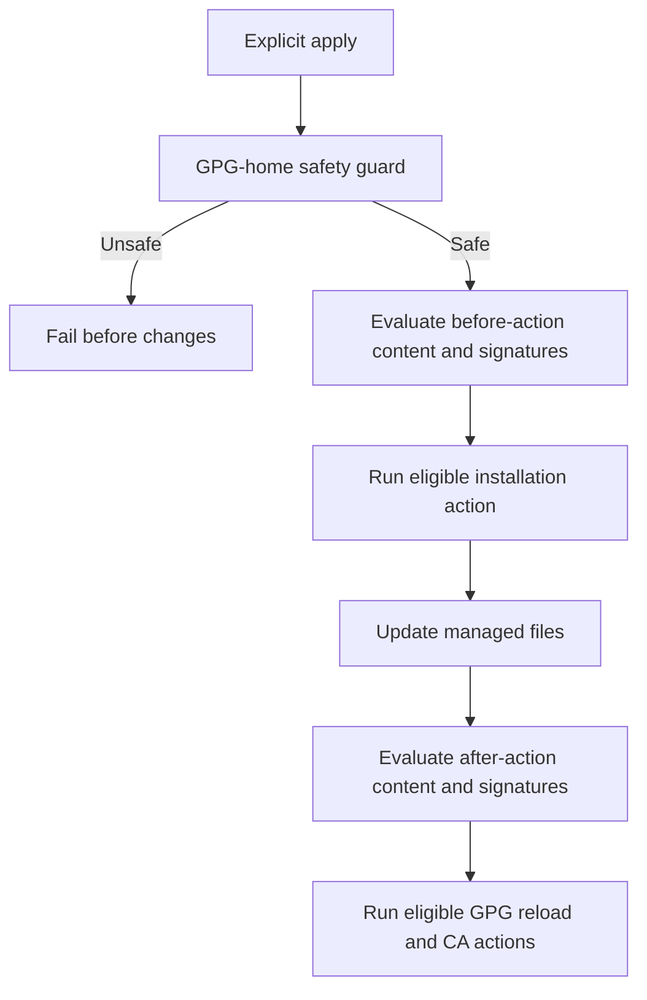

# Dependency-Aware Chezmoi Scripts - Plan

## Goal Capsule

- **Objective:** Repeated personal-configuration application avoids unnecessary GPG agent reloads, with predictable execution rules for existing and future scripts.
- **Means:** Centralize scripts in `.chezmoiscripts/`, use dependency-aware `onchange_` actions, and replace Windows cmd wrappers with PowerShell scripts.
- **Product authority:** This Product Contract governs the execution-policy changes, dependency signatures, and system PowerShell provisioning.
- **Open blockers:** None.
- **Authority hierarchy:** Product Contract governs behavior; Planning Contract governs mechanism; implementation units override neither.
- **Execution profile:** One PR containing U1–U3; U1 and U2 can be developed independently, with U3 integrating their verification.
- **Completion owner:** The implementing engineer verifies locally and ships the PR; merging remains with the owner.
- **Stop conditions:** Do not apply personal settings, invoke real WinGet, or write the real user environment during verification.

---

## Product Contract

### Summary

Organize chezmoi scripts around explicit file and data dependencies, keeping safety checks independent of change detection.
Use native PowerShell scripts on Windows and provision system PowerShell through the Windows application list.

### Problem Frame

The owner reports disruptive GPG agent activity on every apply, even when its settings have not changed.
The current reload scripts invoke `gpgconf --reload gpg-agent` unconditionally during explicit application.
Scripts currently sit alongside managed files, and Windows scripts wrap inline PowerShell in cmd launchers.
Existing guidance does not define how script execution should track dependencies on shared files and chezmoidata.

### Key Decisions

- **Classify execution by role.** Governs R2, R3, R4. (session-settled: user-directed — chosen over converting every script to onchange: retain GPG-home safety checks on every apply while accepting source-driven application and CA actions.)
- **Track consumed data rather than entire YAML files.** Governs R6, R7, R8. (session-settled: user-approved — chosen over file-only checksums and whole-data invalidation: data changes must trigger affected actions without rerunning unrelated ones.)
- **Remove cmd launchers without requiring system pwsh in advance.** Governs R10, R11, R12. (session-settled: user-approved — chosen over retaining cmd wrappers or requiring pwsh before its installer can run: keep first application possible through Windows PowerShell.)

### Requirements

**Organization and execution policy**

- R1. Move all six current `home/*.cmd.tmpl` and `home/*.sh.tmpl` action and guard scripts into `home/.chezmoiscripts/`, removing their old source-state entries.
- R2. Apply `run_onchange_` to the Windows and Unix GPG reload actions, Windows application installation, and Windows Native CA action, using chezmoi's rendered-content execution state.
- R3. Keep both GPG-home guards as ordinary `run_before_` scripts that validate current host conditions on every explicit apply.
- R4. Source-unchanged application does not restore manually uninstalled applications or externally changed Windows CA registry values after a successful action.
- R5. Preserve the existing before/after phases, padded within-phase ordering, OS-conditional execution, and script idempotence.

**File and data dependency signatures**

- R6. Add hash comments for each script's consumed non-data source files and shared templates, treating chezmoidata exclusively under R7–R8.
- R7. Add explicit hash comments for each script's consumed chezmoidata values, even when those values already appear in its rendered body.
- R8. Compute data signatures from deterministically serialized effective values for the current platform, excluding unrelated keys and YAML formatting or comments.
- R9. Dependency signatures must be stable for unchanged inputs and independent of mutable destination-file contents, timestamps, and prior execution results.

**Windows PowerShell execution and provisioning**

- R10. Convert all four Windows `.cmd.tmpl` scripts to `.ps1.tmpl`, removing cmd launchers while preserving profile-free execution and failure propagation.
- R11. Allow first application without system `pwsh` by supporting Windows PowerShell 5.1 for the Windows scripts when needed.
- R12. Add `Microsoft.PowerShell` to `home/.chezmoidata/windows.yaml` so explicit application provisions a system PowerShell installation usable outside mise.
- R13. Retain the existing Windows application's WinGet policy for all listed packages: preserve existing installations without requesting upgrades, and report installation failures.

**Lifecycle and contributor rules**

- R14. Failed onchange actions remain eligible on the next apply, and successful unchanged actions are skipped without globally clearing chezmoi state.
- R15. Worktree preparation and preview-only operations must not execute personal-configuration actions or install system applications.
- R16. Update the repository's script guidance to define placement, role-based execution attributes, file and data signature conventions, ordering, OS conditions, and Windows PowerShell execution.
- R17. Update affected callers, fixtures, and current user documentation for the new script paths, extensions, execution policy, and application list.

### Key Flows

- F1. **Explicit application.** Per R3 and R5, the current OS's GPG-home guard runs before installation or managed-file updates; an unsafe home fails application before those changes. Per R2 and R6–R9, each action uses its rendered content and dependency signatures to determine eligibility. Eligible before actions run before file updates, and eligible after actions run afterward.
- F2. **First Windows application.** Per R10–R13, the PowerShell scripts remain executable without system pwsh, and the installation action provisions the declared host applications, including PowerShell. Preparation remains separate per R15.
- F3. **Repeated application.** Per R3, R4, and R14, guards still inspect the host while unchanged successful actions are skipped; a failed action can run again without undoing successful work.

### Acceptance Examples

- AE1. **Covers R1, R2, R3, R5, R14.** After one successful application, an identical apply runs the current OS's guard but does not reload GPG, invoke WinGet, or apply the CA registry action; the old root-level scripts do not also execute.
- AE2. **Covers R6, R7, R8.** Changing the current platform's effective pinentry setting changes the GPG reload signature and causes a reload after application; changing a different platform's pinentry or only `gpgRecipient` does not cause that reload.
- AE3. **Covers R2, R7, R8, R12.** Adding `Microsoft.PowerShell` to the application data changes the install action's data signature and makes installation eligible without a script-body edit.
- AE4. **Covers R6, R7, R8, R9.** Changing a consumed helper's source changes its file signature; YAML comment or indentation changes that preserve consumed data values do not change the data signature, and unrelated Git identity changes do not schedule these actions.
- AE5. **Covers R3, R5.** After a successful apply, changing the effective GPG home to an unsupported path makes the next guard fail even though source files and chezmoidata are unchanged.
- AE6. **Covers R4, R14.** After successful installation, manually removing an app and applying unchanged source does not invoke installation; an actual failed installation remains eligible on the next apply.
- AE7. **Covers R4.** After a successful CA action, externally changing its owned registry value does not by itself schedule another CA action.
- AE8. **Covers R10, R11, R12, R13.** With no discoverable pwsh, first application executes the Windows scripts through Windows PowerShell without cmd wrappers and can provision `Microsoft.PowerShell`; an existing system installation is not requested to upgrade.
- AE9. **Covers R5, R10, R15.** On Linux and macOS, Windows scripts do not execute; on every OS, preparation and previews do not run personal actions, and a native-command failure still fails its action.
- AE10. **Covers R16, R17.** A contributor can identify where a new script belongs, whether it is a guard or change-driven action, which file and data dependencies need signatures, and how to preserve execution order from the updated repository guidance.

### Scope Boundaries

- This work changes script organization and execution triggers, not the managed Git, GPG, or CA values.
- Keep `bootstrap.ps1` and `configure-chezmoi.ps1` as existing entry points; they are not scripts to move into chezmoi source state.
- Keep mise responsible for repository development tools; R12 concerns an explicitly applied host application, not an additional bootstrap installer.
- Do not introduce a second execution-state database, repository-wide dependency hashing, automatic retries within an apply, rollback, or scheduled host-state reconciliation.
- This contract supersedes the every-apply application-restoration behavior in the earlier Windows-app plan through R2 and R4; the remaining installation policy is retained through R13.

### Dependencies and Assumptions

- Script moves and extension changes can introduce new chezmoi execution identities; initial execution after migration is expected, without resetting unrelated script state.
- Structural subdirectories, exact signature comment labels, and interpreter configuration belong to implementation planning, subject to R5 and R10–R11.

### Sources and Research

- [Chezmoi script directory](https://www.chezmoi.io/reference/special-directories/chezmoiscripts/) and [source attributes](https://www.chezmoi.io/reference/source-state-attributes/).
- [Chezmoi script lifecycle and dependency-checksum example](https://www.chezmoi.io/user-guide/use-scripts-to-perform-actions/).
- [Chezmoi interpreters](https://www.chezmoi.io/reference/configuration-file/interpreters/): PowerShell script handling and Windows fallback.
- `home/.chezmoitemplates/gpg-settings` and `home/.chezmoitemplates/gpg-agent-config`: platform selection and the owned pinentry setting.
- `home/.chezmoidata/windows.yaml` and `home/run_before_20-install-windows-apps.cmd.tmpl`: current package declaration and installation policy.
- `home/README.md`: existing script ordering and explicit-application boundaries.
- `.compound-engineering/artifacts/plans/2026-11-04-1650-feat-windows-chezmoi-apps-plan.md`: earlier every-apply restoration requirement superseded as noted above.

---

## Planning Contract

**Product Contract preservation:** Product Contract unchanged.

### Key Technical Decisions

- KTD1. **Use a flat script directory with existing phase and numeric names.** Keep both Unix scripts and all four Windows replacements directly under `home/.chezmoiscripts/`; extra directory levels could unintentionally change lexical ordering. Governs R1, R2, R3, R5.
- KTD2. **Write dependency comments directly in each script template.** Hash consumed template source with `include` and SHA-256; hash selected effective data through deterministic JSON serialization and SHA-256. Use `.windows.apps` for installation and the selected program/pinentry values from `gpg-settings` for reload. Do not hash entire `.chezmoidata` files. Governs R6–R9. (session-settled: user-approved — chosen over file-only checksums and whole-data invalidation: data changes must trigger affected actions without rerunning unrelated ones.)
- KTD3. **Track the GPG configuration producer, not its mutable destination.** Reload signatures include the consumed `gpg-settings` and `gpg-agent-config` template sources plus the applicable target wrapper; guards track `gpg-home`, `gpg-settings`, and only their consumed effective data. The Native CA script includes and fingerprints `native-ca-windows`. This avoids stdin-dependent modify-template rendering and destination-state signature changes. Governs R6–R9.
- KTD4. **Configure a stable system PowerShell interpreter.** Extend `home/.chezmoi.toml.tmpl` with the absolute built-in Windows PowerShell executable and profile-free, noninteractive `.ps1` arguments. Interpreter entries replace chezmoi defaults, so setting only arguments disables interpreter execution; selecting bare pwsh during mise initialization also breaks later non-mise application. Document explicit configuration regeneration for existing installations. Preserve unrelated configuration and keep bootstrap hook-free. Governs R10, R11, R15, R17.
- KTD5. **Keep Windows bodies readable and 5.1-compatible.** Replace cmd quoting and base64 command wrappers with direct PowerShell, preserving safe literal quoting, native exit-code checks, and GnuPG ANSI decoding under both PowerShell editions. Native CA uses its existing shared body rather than duplicating registry logic. Governs R10, R11, R13.
- KTD6. **Verify lifecycle through real chezmoi with isolated state.** Reuse Python unittest fixtures and fixture-local command doubles, not production installers or agent restarts. Restrict PATH where installation is reachable; use explicit interpreters when restricted PATH prevents discovery. Registry verification retains the existing disposable-provider boundary. Governs R14, R15, R17.

### Assumptions and Execution Constraints

- Existing installations regenerate the explicit chezmoi configuration as part of this migration; unregenerated interpreter settings are outside the new configuration contract.
- A move or extension change can schedule an initial execution; subsequent eligibility follows R14, not a repository-maintained migration database.
- Prefer a real isolated apply smoke before expanding permanent tests. Planning did not execute the application or tests.
- The single-pass behavior trace is source-grounded: guards fail before updates; installation checks each native exit result; after-actions currently run on every apply; fixtures isolate HOME and state, but HOME alone does not isolate HKCU.

### Risks and Dependencies

- Windows PowerShell 5.1 and pwsh differ in default text encoding; exercise non-ASCII home/tool paths instead of assuming cmd removal preserves decoding.
- The existing app fixture deliberately hides system tools in PATH; its interpreter must remain fixture-controlled without exposing real WinGet.
- Use process-local GitHub CLI CA adjustments only if needed, following `.compound-engineering/artifacts/solutions/integration-issues/github-cli-windows-ca-override.md`; never disable TLS verification.

---

## Implementation Units

### U1. Dependency-aware Unix GPG scripts

**Goal:** Preserve Unix safety checks while making reload eligibility reflect consumed inputs.
**Requirements:** R1–R9, R14; F1, F3.
**Dependencies:** None.
**Files:** Both existing Unix `.sh.tmpl` scripts, their replacements under `home/.chezmoiscripts/`, and lifecycle coverage in `tests/test_script_lifecycle.py`.
**Approach:** Apply KTD1–KTD3 using direct template comments and existing shell bodies; do not introduce a shared dependency framework.
**Patterns to follow:** `gpg-settings`, `gpg-home`, `gpg-agent-config`, and existing OS-conditional templates.
**Test scenarios:**

1. Covers AE1, AE2, AE4. Isolated chezmoi applies observe one initial reload, no unchanged reload, and renewed eligibility only for relevant file/data changes.
2. Covers AE5. A changed host GPG-home result still rejects application after prior successful execution.

**Verification:** Render Linux and macOS branches and exercise actual shell execution where a shell is available; disclose any native platform limits.

### U2. Native Windows PowerShell scripts and host application

**Goal:** Execute Windows actions directly in PowerShell and provision a system pwsh without a startup dependency cycle.
**Requirements:** R1–R13, R15; F1, F2.
**Dependencies:** None; follows the same KTD1–KTD3 conventions as U1.
**Files:** Four existing cmd templates and their `.ps1.tmpl` replacements in `home/.chezmoiscripts/`, `home/.chezmoi.toml.tmpl`, `home/.chezmoidata/windows.yaml`, `tests/test_global_chezmoi.py`, and Windows scenarios in `tests/test_windows_apps.py` and `tests/test_git_gpg.py`.
**Approach:**

1. Apply KTD4–KTD5 while retaining the guard-before-install ordering.
2. Add the requested host application under R12 without changing bootstrap entry points or development-tool declarations.
3. Preserve the current Native CA shared body and WinGet failure handling.

**Patterns to follow:** Existing registry-provider body, GPG-home checks, WinGet exit normalization, and configuration-preserving template transformation.
**Test scenarios:**

1. Covers AE8. Execute through Windows PowerShell with pwsh unavailable and through pwsh when available; neither path invokes cmd as a production wrapper.
2. Preserve Unicode GPG home/tool handling under a non-UTF-8 console.
3. Covers AE6, AE9. A failed package remains retryable, successful package versions survive, and native failures propagate.
4. Configuration regeneration preserves unrelated settings and selects profile-free interpreter execution.

**Verification:** Real isolated Windows chezmoi application observes install inventory and GPG invocation results without invoking host WinGet or changing the user environment.

### U3. Lifecycle regressions and contributor guidance

**Goal:** Prove change-driven behavior end to end and make the script policy usable for later additions.
**Requirements:** R1–R17; F1–F3, AE1–AE10.
**Dependencies:** U1 and U2 for final verification; fixtures and documentation can be prepared concurrently against their named paths.
**Files:** `tests/test_script_lifecycle.py`, `tests/test_windows_apps.py`, `tests/test_git_gpg.py`, affected isolated-source fixtures, `home/README.md`, and `README.md`.
**Approach:**

1. Apply KTD6 and replace the obsolete every-apply app-restoration expectation.
2. Exercise consumed file changes, selected data changes, irrelevant data changes, failed execution, and repeated safety checks through actual chezmoi state.
3. Document R16 with per-role examples, explicit file/data dependency comments, and the existing-installation interpreter migration.

**Execution note:** Exercise actual rendered scripts before the final suite; keep permanent tests for observable state transitions rather than template-source assertions.
**Patterns to follow:** `tests/test_windows_apps.py` inventory doubles and `tests/test_native_ca_windows.py` disposable registry-provider execution.
**Test scenarios:**

1. Covers AE1–AE4. Repeated applies and selective dependency changes produce exact action counts while unrelated data and formatting changes do not.
2. Covers AE5–AE7. Host-state guard failures remain visible, while source-unchanged app/CA drift does not schedule reconciliation.
3. Covers AE8, AE9. No-pwsh first application, platform filtering, dry-run isolation, and failure propagation remain effective.
4. Covers AE10. Documentation examples match the final names and supported interpreter settings.

**Verification:** Focused lifecycle suites and the existing full unittest suite pass; real smoke evidence records commands, observed state, and platform limitations.

---

## Verification Contract

- Run `mise exec -- python -m unittest discover -s tests -v` once after integration; use focused unittest selections to diagnose a failure rather than rerunning unrelated checks.
- Exercise real chezmoi applies against a disposable source, HOME, configuration, cache, and persistent state; observe the GPG reload count, app inventory, guard failures, and unchanged-action skips.
- Run Windows PowerShell 5.1 and pwsh scenarios, including Unicode paths and a fixture PATH without pwsh.
- Render Linux and macOS script branches and run their shell bodies where a compatible shell exists; do not claim native Linux/macOS execution from rendering alone.
- Keep the real HKCU environment and installed applications untouched; use disposable registry-provider roots for registry behavior.
- No web UI is changed; browser testing has no applicable surface.

---

## Definition of Done

- U1–U3 satisfy their cited requirements and acceptance examples with observed runtime evidence.
- No old root-level script or cmd launcher remains in the managed source, and affected fixtures use the new paths.
- File and effective-data signatures are explicit, deterministic, and limited to consumed dependencies.
- Current user documentation and contributor rules describe the final lifecycle and interpreter migration.
- Required checks pass or a genuine platform/tool limitation is named without claiming unexercised coverage.
- Remove throwaway probes and abandoned implementation attempts before delivery.
- Ship one reviewed PR with CI decided; do not merge it automatically.
