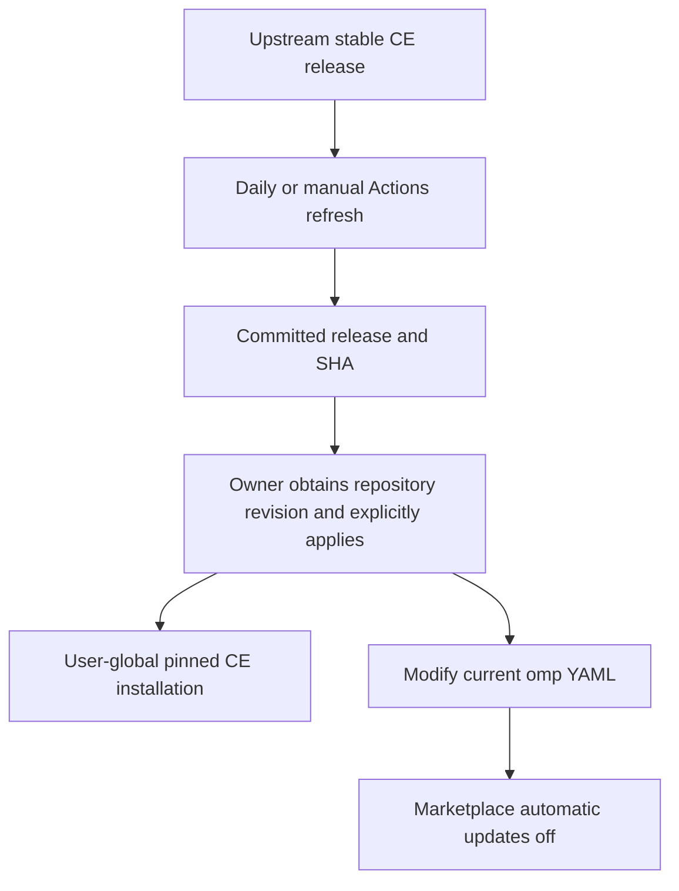
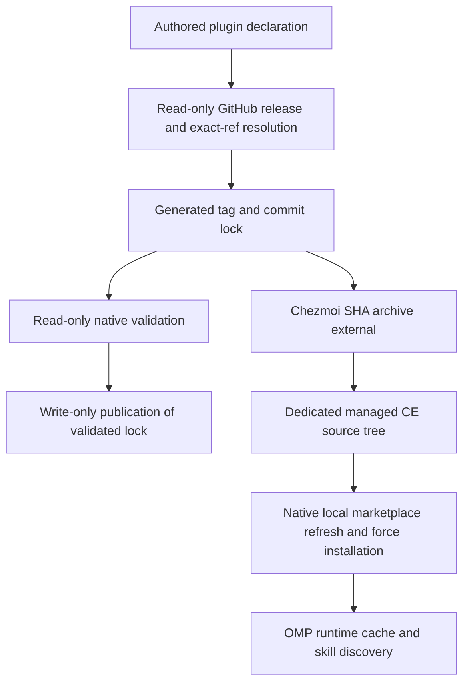

# Compound Engineering Plugin Management - Plan

## Goal Capsule

- **Objective:** The owner can reproduce their Compound Engineering working environment across devices without separately installing the plugin or aligning its version by hand.
- **Means:** Repository-owned CE release pins, automated pin refresh, explicit chezmoi application, and a partial update of omp's automatic-update setting.
- **Product authority:** The user-confirmed scope below and `STRATEGY.md` govern this work. The current integration is omp; reusable multi-format property management and integrations for other harnesses are separate work.
- **Open blockers:** None. Native installation and effective configuration-file selection are resolved in the Planning Contract.
- **Execution profile:** One PR; the autonomous workflow implements, verifies, reviews, commits, pushes, and opens the PR without merging or applying to the owner's real home.

---

## Product Contract

### Summary

Manage Compound Engineering as a user-global omp plugin from repository-pinned upstream content.
Refresh pins automatically, apply them explicitly, and use chezmoi's modify pattern to disable omp marketplace automatic updates without storing a complete personal configuration file.

### Problem Frame

The owner needs the same CE working environment on multiple devices.
The repository already reproduces the omp executable, but it does not yet declare the plugin dependency or control the mutable omp update setting.

### Key Decisions

- **Use user-global installation.** Governs R1. (session-settled: user-directed — chosen over project-specific installation and a global-plus-project exception system: the owner wants the plugin available across their projects.)
- **Automate pin refresh, not device-local version selection.** Governs R2, R3, R8, R9. This reuses the existing personal-application update model. (session-settled: user-directed — chosen over native automatic updates and manual pin refresh: repository pins retain reproducibility while automatic refresh avoids manual release tracking.)
- **Reuse native chezmoi modify support.** Governs R4–R7. A new parser engine or jq/yq dependency is not needed for the narrow setting. (session-settled: user-approved — chosen over a custom reconciler or native CLI setter as the current approach: modify supports property updates within the existing chezmoi workflow.)
- **Preserve values, not source formatting.** Governs R5. Parse-and-serialize transformations can remove comments and normalize layout. (session-settled: user-approved — chosen over requiring comment and formatting preservation: semantic preservation is sufficient for this work.)

<!-- ce-section: work-relationships -->
### How This Work Fits Together

This plan owns CE installation, version authority, and the omp property update needed to keep that authority effective.
The following relationships describe the current scope split, not a committed roadmap.

- **Existing personal application management:** Supplies the omp executable and the established automated-pin/explicit-apply workflow; its application-specific contract remains unchanged. See `.compound-engineering/artifacts/plans/2026-11-04-1446-feat-personal-cli-externals-plan.md`.
- **Reusable property management:** Can proceed independently of this plan. [Issue #17](https://github.com/hyperlapse122/dotfiles/issues/17) tracks common property declarations and management conventions across mutable YAML, JSON/JSONC, and TOML files; the narrow omp transformation does not depend on that work.
- **Future harness integrations:** Can reuse the CE source identity established by R2. Each later integration must establish its own native installation and pinning support; this plan does not implement those integrations or a universal harness installer.

### Requirements

**Installation and version authority**

- R1. Explicit application must install and enable CE for the owner's user-global omp environment on Windows, macOS, and GNU/Linux on x64 and arm64, matching the existing omp target coverage and excluding Linux musl.
- R2. A repository-owned plugin lock must identify an upstream stable CE release and its resolved full commit SHA, independently of secret-bearing host runtime state.
- R3. Application must reconcile the managed CE installation to the committed SHA, including restoring an older committed pin, without selecting upstream latest locally.

**Partial omp configuration management**

- R4. Explicit application must set the user-global `marketplace.autoUpdate` property to the string `off`, disabling startup automatic updates for all omp marketplace plugins rather than only CE.
- R5. Use chezmoi's `modify_` pattern and built-in structured-data functions to change the managed property while preserving unrelated property values; comments and formatting need not remain unchanged.
- R6. Reapplication must restore drift of the managed property while retaining intervening changes to unmanaged properties, and an unchanged desired result must produce no further content changes.
- R7. Configuration handling must use the effective user-global YAML file without introducing a competing file that shadows existing settings; an absent file may be initialized minimally, while malformed input must fail without replacing its contents.

**Automated refresh and explicit application**

- R8. A daily and manually dispatchable GitHub Actions refresh must resolve stable CE release pins and commit changed pins directly to the repository's default branch without a PR.
- R9. Failed or incomplete pin resolution must retain the previous committed pins, and an unchanged result must create no commit.
- R10. Device installation and configuration changes must occur only through explicit application, not during `mise install` or worktree bootstrap.

**Ownership boundaries**

- R11. The integration must leave unrelated plugin installations and unrelated configuration values intact, except for the shared marketplace automatic-update policy explicitly governed by R4.
- R12. The repository must not store the complete personal omp configuration or copy host runtime lockfiles and their potentially secret settings into the plugin pin data.

### Key Flows

- F1. **Refresh CE pins. Covers R2, R8, R9.** The daily schedule or owner-triggered Actions run resolves a complete stable-release identity; changed pins are committed, unchanged pins produce no commit, and resolution failure retains the previous pins.
- F2. **Apply the pinned environment. Covers R1, R3–R7, R10–R12.** The owner obtains the desired repository revision and explicitly applies it; the managed CE installation follows that revision and the current omp YAML is transformed at the owned property.
- F3. **Reconcile later drift. Covers R3, R5, R6, R11.** After local changes, another explicit apply restores the managed CE version and setting while retaining unrelated property changes.

### Acceptance Examples

- AE1. **Fresh device. Covers R1, R2, R3, R10.** Given a supported device and the repository-managed omp prerequisite, explicit apply makes the pinned CE skills discoverable and invocable in a new omp session outside this checkout, without a project-specific CE installation.
- AE2. **Upstream advances. Covers R2, R3.** Given unchanged committed pins and newer upstream content, another apply still selects the committed SHA rather than the newer content.
- AE3. **Pin changes or rolls back. Covers R3.** Given an installed CE revision and a different committed pin, including an older pin, explicit apply reconciles to that exact revision and a new omp session discovers its skills.
- AE4. **Mutable YAML. Covers R4, R5, R6, R11.** Given `marketplace.autoUpdate: auto`, an unrelated sibling, and unrelated nested or array values, apply changes the setting to the string `off` and retains the other values; later unmanaged edits survive reapplication while managed drift is corrected.
- AE5. **No further changes. Covers R3, R6.** Given an installation and YAML already at desired state, repeating apply leaves the desired content unchanged.
- AE6. **Missing or invalid configuration. Covers R7.** Given no global YAML, apply can create the minimal managed configuration; given an existing `config.yaml`, it must not create a higher-priority `config.yml` that hides its values; given malformed YAML, it fails without replacing that file.
- AE7. **Refresh outcomes. Covers R8, R9.** A complete newer release yields a direct default-branch pin commit; an unchanged release yields no commit; an unsuccessful release/SHA lookup retains the previous committed pins.
- AE8. **Preparation isolation and existing state. Covers R10, R11, R12.** Preparing a worktree does not install plugins or change personal settings; explicit apply does not remove unrelated plugins or commit personal configuration/runtime settings as pin data.

### Scope Boundaries

- Only the current user-global omp integration is active scope; project-specific CE installations and project setting overrides are not managed here.
- Other harness integrations and a universal installation/update framework are not included.
- Common multi-format property declarations, arbitrary array-path editing, and a custom reconciler are deferred to issue #17.
- Comment-preserving or byte-preserving configuration editing is not required under R5.
- Continuous enforcement during an active session and coordination with an application writing the same file concurrently are not provided by this work.
- No separate device update scheduler, automatic repository pull/apply, or unrelated omp settings migration is included.

### Dependencies and Assumptions

- The existing personal-application installation supplies omp; CE remains a separate plugin dependency rather than a mise development tool.
- Apply should run with omp closed, consistent with the existing Windows executable-replacement instructions; the modify pattern alone does not establish a shared lock with a running application.
- User-global settings may be superseded by explicit project or process overlays. This plan does not rewrite those independent sources.
- New sessions are the acceptance surface for loaded plugin changes; no hot-reload guarantee is assumed.
- The investigated host baseline is omp v18.16.0. Compatibility with later host versions must be checked when planning and implementing, not inferred from the plugin's support listing.

### Outstanding Questions

The planning questions are resolved by KTD1–KTD4 below.
Exact implementation details that do not change the Product Contract remain implementation-owned.

### Sources / Research

- `STRATEGY.md:14–24`: repository authority, owner-only environment reproduction, and reconciliation semantics.
- `README.md:312–370` and `.github/workflows/update-personal-app-lock.yml`: existing personal-application ownership, daily/manual direct pin publication, and explicit device application.
- `home/.chezmoitemplates/gpg-agent-config` and `home/README.md:13–14`: existing modify-template convention.
- `home/.chezmoi.toml.tmpl`: existing parse/update/serialize handling with `setValueAtPath`.
- [Omp v18.16.0 marketplace contract](https://github.com/can1357/oh-my-pi/blob/v18.16.0/docs/marketplace.md): user scope, separate catalog refresh/plugin upgrade, native automatic-update modes, and secret-bearing runtime state.
- [Omp v18.16.0 automatic updater](https://github.com/can1357/oh-my-pi/blob/v18.16.0/packages/coding-agent/src/extensibility/plugins/marketplace-auto-update.ts): background best-effort update behavior and the `off` mode.
- [Omp v18.16.0 configuration contract](https://github.com/can1357/oh-my-pi/blob/v18.16.0/docs/config-usage.md): effective global YAML selection and settings precedence.
- [CE native omp catalog at the researched revision](https://github.com/EveryInc/compound-engineering-plugin/blob/a3bcedfc7136d5db2262c8339e514b6fb15b8f81/.omp-plugin/marketplace.json): native marketplace content and version metadata; this is research evidence, not the required initial pin.
- [Chezmoi modify target contract](https://www.chezmoi.io/reference/target-types/#modify-file), [partial-file management](https://www.chezmoi.io/user-guide/manage-different-types-of-file/#manage-part-but-not-all-of-a-file), and [`setValueAtPath`](https://www.chezmoi.io/reference/templates/functions/setValueAtPath/): current target input, structured property updates, and nested key handling.
- [Deferred reusable property management, issue #17](https://github.com/hyperlapse122/dotfiles/issues/17).

Isolated Windows proof used actual omp 18.16.0 and chezmoi 2.74.0 with temporary homes and configuration state.
The native omp setter preserved unrelated values but removed a comment and normalized formatting.
Actual chezmoi modify applications succeeded for YAML, JSON, and TOML; repeated application produced no diff, later unmanaged YAML edits survived managed drift correction, and malformed YAML failed while retaining the original file.
These checks establish the partial-update primitive, not end-to-end pinned CE installation or native macOS/Linux execution.

---

## Planning Contract

**Product Contract preservation:** Product Contract unchanged; the Problem Frame clarifies the existing motivation and the technical questions are resolved below.

### Key Technical Decisions

- KTD1. **Declare harness-independent release identity in chezmoidata.** For R2, R8, R9, add authored `harness-plugins.json` and generated `harness-plugin-lock.json`. Resolve CE's repository-level latest stable release only when its tag matches `compound-engineering-vMAJOR.MINOR.PATCH`, then peel the exact Git ref through annotated tags to a full commit SHA. Follow the existing gh-based updater and same-directory atomic-replacement convention; reject incomplete resolution before writing.
- KTD2. **Materialize a SHA-addressed source archive in a dedicated managed directory.** For R1–R3, use a native chezmoi archive external at `.local/share/dotfiles/harness-plugins/compound-engineering`, with one stripped wrapper and exact reconciliation restricted to that tree. A restored SHA restores the source URL and removes files absent from the older tree. Do not invent an archive checksum: GitHub guarantees extracted commit content, not stable compressed bytes. Git-repo externals pull rather than declaratively checking out a commit.
- KTD3. **Use the native local-marketplace install path.** For R1, R3, R11, reconcile the CE marketplace registration to the managed source directory, refresh that local catalog, force-install the user-scoped plugin, and explicitly enable it. Force installation is needed because native cache keys use version rather than SHA, including same-version source changes and rollback. Native local installation needs neither external Bun nor dependency installation. Do not layer a direct link over an existing marketplace installation. Native commands must fail visibly; modify only CE's marketplace/plugin state and preserve other entries.
- KTD4. **Modify the existing effective global YAML rather than invoking a setter script.** For R4–R7, use `chezmoi:modify-template`, `fromYaml`, `setValueAtPath`, and `toYaml`. Prefer an existing `config.yml`; otherwise modify an existing `config.yaml`; create only `config.yml` when neither exists. Keep the ignored sibling out of the target state. Empty input starts from an empty mapping, and parse errors must propagate. This implements the settled modify choice without a new runtime utility. (session-settled: user-approved — chosen over a custom reconciler or native setter: built-in modify supports the required partial update and chezmoi diff.)
  If neither YAML exists but legacy `settings.json` or `agent.db` exists, fail before creating YAML and instruct the owner to complete omp's native first-start migration before applying again; this avoids hiding legacy settings without adding an unrelated migrator.
- KTD5. **Validate the resolved lock before publication without write credentials.** For R8–R10, mirror the existing resolve/validate/publish separation in a plugin-specific workflow. Publish only the generated plugin lock from the immutable resolved artifact and recorded base. Extend the existing six-target native matrix to run a real pinned CE installation/discovery smoke in an isolated home.

### Assumptions and Risks

- The managed baseline is omp's standard user-global configuration and default profile. Explicit project/process overlays and independently configured named profiles are not rewritten.
- Existing CE marketplace registrations must cut over to the local source rather than silently continue tracking the upstream branch.
- The archive/tree and native runtime cache are distinct surfaces; installation must consume the reconciled source after file application.
- Native cache replacement can affect another scope referencing the same CE version cache; project-scoped installations remain outside this plan's management boundary.
- No whole-operation transaction, concurrent-session coordination, custom retry system, or comment-preserving editor is added: apply runs with omp closed, and errors are surfaced for an explicit rerun.
- Native pin restoration and skill discovery are execution-time proof obligations, not claims established by documentation alone.

### High-Level Technical Design

### Implementation Evidence

- [Pinned omp local marketplace resolver](https://github.com/can1357/oh-my-pi/blob/v18.16.0/packages/coding-agent/src/extensibility/plugins/marketplace/fetcher.ts): absolute local sources read a catalog without cloning; the same path remains local during refresh.
- [Pinned omp install manager](https://github.com/can1357/oh-my-pi/blob/v18.16.0/packages/coding-agent/src/extensibility/plugins/marketplace/manager.ts): forced install replaces same-version content, preserves unrelated registry entries, and rejects unrelated package-name collisions.
- [Chezmoi external archive contract](https://www.chezmoi.io/reference/special-files/chezmoiexternal-format/) and [GitHub archive stability](https://docs.github.com/en/repositories/working-with-files/using-files/downloading-source-code-archives#stability-of-source-code-archives) establish KTD2.
- Native registration and discovery are reused rather than replaced by a new plugin framework; source materialization and publication remain repository-owned.

---

## Implementation Units

### U1. Resolve and publishable-lock CE release identity

**Goal:** Produce complete reproducible plugin pins without changing an existing lock on resolution failure.

**Requirements:** R2, R8, R9, R12; F1; AE2, AE7.

**Dependencies:** None.

**Files:** Create `home/.chezmoidata/harness-plugins.json`, `home/.chezmoidata/harness-plugin-lock.json`, `scripts/update-harness-plugin-lock.py`, and `tests/test_harness_plugin_lock.py`.

**Approach:** Implement KTD1 using the current application updater's injection and atomic-write patterns, keeping plugin release resolution separate from executable-asset resolution.

**Test scenarios:**
1. Covers AE7. A published stable CE release resolves a lightweight or annotated exact tag to the terminal commit rather than the tag-object SHA.
2. Nested annotated tags resolve; malformed references, wrong-component releases, prereleases, missing SHAs, non-commit targets, and gh failures retain the previous lock bytes.
3. Covers AE2 / AE7. Unchanged identity leaves the lock untouched, while a changed full SHA at the same tag is detected.

**Verification:** Resolve the initial real stable pin through the mise-installed gh CLI; deterministic tests exercise failures without network access.

### U2. Apply pinned source and partial omp configuration

**Goal:** Make explicit apply install the pinned CE and enforce the owned setting without replacing unrelated user state.

**Requirements:** R1, R3–R7, R10–R12; F2, F3; AE1–AE6, AE8.

**Dependencies:** U1's declaration/lock shape.

**Files:** Create `home/.chezmoiexternals/harness-plugins.toml.tmpl`, native OS-conditional `home/run_after_20-harness-plugins.cmd.tmpl` and `home/run_after_20-harness-plugins.sh.tmpl`, a shared omp YAML partial, private modify targets under `home/private_dot_omp/private_agent/`, and `tests/test_harness_plugins.py`; update `home/.chezmoiignore`.

**Approach:** Apply KTD2–KTD4 after managed files exist, invoke the repository-installed omp by absolute path, check every native exit code, and avoid relying on an activated mise shell. Keep native runtime records out of source control.

**Execution note:** Prefer real isolated chezmoi/native-plugin smoke evidence over mocks of CLI forwarding.

**Test scenarios:**
1. Covers AE2 / AE3. Local archive fixtures show unchanged pins, changed SHA, rollback, stale-file removal, and restoration of managed source drift.
2. Covers AE4 / AE5. Existing unrelated nested values and arrays survive setting reconciliation, later application edits survive, and repeat apply leaves no diff.
3. Covers AE6. Existing `.yaml` is not shadowed; missing config is initialized; malformed YAML fails without replacement.
4. Covers AE8. Bootstrap performs no installation or configuration writes, and unrelated plugin/config entries remain intact.
5. Covers AE6 / AE8. Missing YAML with legacy settings or database state fails before creating YAML and leaves the legacy files intact.

**Verification:** Exercise actual native local marketplace installation and skill discovery in a disposable home, including a preexisting remote CE registration and enabled-state reconciliation.

### U3. Integrate native proof, publication, and operating instructions

**Goal:** Validate candidate pins before publication and prove the user-facing installation path on supported native runners.

**Requirements:** R1–R12; F1–F3; AE1–AE8.

**Dependencies:** U1, U2.

**Files:** Create `.github/workflows/update-harness-plugin-lock.yml` and `tests/smoke_harness_plugins.py`; update `.github/workflows/test.yml`, affected full-source test fixtures, `README.md`, and `home/README.md`.

**Approach:** Implement KTD5; scope old fixtures to their own contracts so adding a plugin external does not trigger network access or real plugin actions in unrelated tests. Document explicit apply, global update-policy impact, comments/formatting behavior, rollback, and issue #17.

**Test scenarios:**
1. Covers AE1. An isolated real apply installs the locked native omp and CE, then discovery finds CE skills in a fresh process outside the checkout.
2. Covers AE3 / AE8. Native force installation repairs the managed CE while retaining an unrelated plugin entry and its settings.
3. Covers AE7. Candidate-lock native validation runs without write credentials; publication copies and commits only the validated lock.

**Verification:** Existing deterministic suite plus native smoke on Windows locally and the six-target CI matrix; do not claim an unavailable native platform was exercised locally.

---

## Verification Contract

- Run `mise exec -- python -m unittest discover -s tests` after integration, not while parallel edits are in flight.
- Run `mise exec -- python tests/smoke_harness_plugins.py` against the real committed omp and CE pins in a temporary destination; observe config, registration, pinned source, and discovered skills.
- Keep native application execution out of publication jobs and real user homes.
- Preserve the existing six-target executable/PATH smoke and extend its native jobs with plugin proof.
- Browser verification is not applicable to this CLI/dotfiles change; the delivery workflow must record that disposition.

## Definition of Done

- U1–U3 meet the cited Requirements and Acceptance Examples with deterministic coverage and actual native smoke evidence.
- The Product Contract and settled choices remain intact, with issue #17 still separate.
- All affected fixtures and documentation reflect the new external and script boundaries.
- Temporary smoke destinations and abandoned implementation attempts are removed.
- The branch is reviewed, committed, pushed, and presented as an open PR with CI decided; no merge or personal-home apply occurs.
