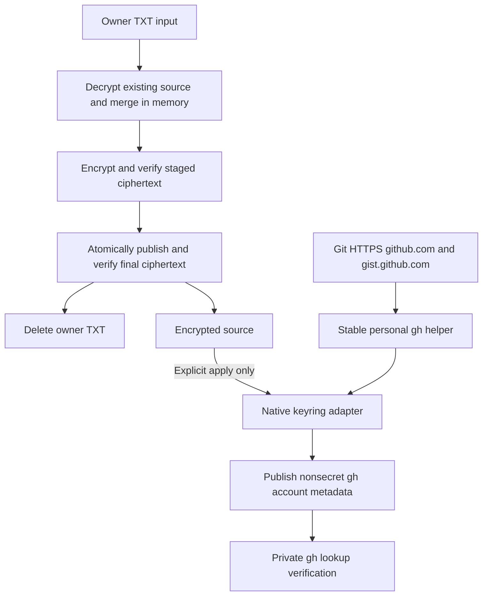

# GitHub CLI Installation and Keyring Authentication - Plan

## Goal Capsule

- **Objective:** The repository owner can restore GitHub CLI and Git HTTPS authentication on a supported device without re-entering the GitHub token.
- **Means:** Encrypted token import, native-keyring registration, and a host-specific gh credential helper (KTD1–KTD6).
- **Product authority:** The confirmed conversation governs the Product Contract, including subsequent explicit requirements for both mise files and the personal-app declaration.
- **Execution profile:** One implementation PR. Implementation, verification, and the requested one-time import belong to the implementing session; committing, pushing, and opening a PR require the selected execution workflow's authority.
- **Stop conditions:** Do not delete the input until R3 is satisfied; do not claim native-platform proof from rendering or mocked storage. Missing private-key access or native keyring access must be reported, not bypassed.
- **Application boundary:** Worktree preparation remains read-only for personal configuration. Installing the feature does not authorize a full personal-settings apply on the owner's machine.

---

## Product Contract

### Summary

Install gh through the existing development and personal-application layers, import the owner's supplied token into encrypted source state, and restore authentication during explicit chezmoi application.
Git HTTPS operations for github.com and gist.github.com share that authentication through gh.

### Problem Frame

The owner currently has a GitHub token in a plaintext download and wants repository-managed restoration of authentication across devices.
A successful setup must serve both gh commands and Git, without keeping the download or introducing a plaintext credential store.

### Key Decisions

- **Use encrypted source rather than recurring manual input or browser login.** Governs R2, R5. (session-settled: user-directed — chosen over interactive token entry and browser login: the owner selected the existing GPG-encrypted source.)
- **Use gh rather than a separate Git Credential Manager.** Governs R8. (session-settled: user-approved — chosen over a second credential manager: CLI and Git share one native-keyring credential.)
- **Fail rather than fall back to a plaintext token file.** Governs R6. (session-settled: user-approved — chosen over gh's documented plaintext fallback: authentication must remain in the system keyring.)

### Requirements

**Installation**

- R1. Keep gh declared in both `mise.toml` and generated `mise.lock`, and add gh to `home/.chezmoidata/personal-apps.json` with generated release pins in `home/.chezmoidata/personal-app-lock.json`.
- R9. Install the personal gh executable to the existing `.local/bin` destination on Linux and Windows x64/ARM64 and macOS ARM64, using the existing checksum-verified personal-app update flow.

**Token import**

- R2. Import the machine-local input `C:\Users\hyperlapse\Downloads\github-token.txt` into the existing encrypted API-token document while preserving its unrelated entries.
- R3. Delete that TXT only after the committed-source ciphertext has been replaced successfully and its decrypted token and preserved entries match the intended document; retain the TXT on any earlier failure.
- R4. Never expose the token in chat, logs, exception diagnostics, command arguments, rendered scripts, or additional plaintext files.

**Authentication application**

- R5. Only an explicit apply may decrypt the token and change authentication state; initialization, `mise install`, bootstrap, and script-excluding apply must not do so.
- R6. Store the managed account's token in the native system keyring, failing without plaintext fallback when that store is unavailable, locked, or denies access.
- R7. Repeated explicit application must converge on the repository token, including rotation and repair after external removal, while preserving unrelated hosts and accounts.
- R8. Configure Git HTTPS authentication for `github.com` and `gist.github.com` to use the personal gh executable and the same GitHub credential; leave SSH authentication and all other hosts' helper settings unchanged.

### Acceptance Examples

- AE1. **Covers R2, R3:** A successful import preserves the previous example/application mappings, round-trips the imported token through final ciphertext, and removes the supplied TXT. Encryption, comparison, or source-publication failure leaves the TXT available.
- AE2. **Covers R4–R6:** Rendering or bootstrap with inaccessible private keys performs no decryption. Explicit authentication apply with an unusable keyring fails without creating an `oauth_token` fallback or printing the token.
- AE3. **Covers R7, R8:** After rotation or deletion of the managed keyring entry, explicit apply restores authentication; Git's credential lookup retrieves the intended credential rather than an earlier generic helper's credential.

### Scope Boundaries

- Manage one repository-selected github.com account; GitHub Enterprise support, account-switching UX, token issuance/revocation, OAuth refresh, and SSH-key management are outside this change.
- Preserve the existing platform policy: macOS ARM64 only; no Intel Mac or Linux musl expansion.
- Do not remove unrelated `.git-credentials` files, migrate unrelated accounts, alter trust stores, or disable TLS verification.
- Ordinary filesystem deletion is required for the supplied TXT; secure erasure, swap/crash-dump protection, and same-user malware defenses are not promised.
- No background synchronization or generalized rollback framework: failures are visible and the next explicit apply repairs incomplete managed state.

---

## Planning Contract

### Key Technical Decisions

- KTD1. **Keep separate installation layers with a stable personal executable.** Implements R1, R8, R9. Existing mise state already contains `gh = "latest"` and gh 2.103.3 in the lock. Preserve both and generate lock changes with mise, not manual lock editing. Git and authentication verification use the absolute chezmoi destination `.local/bin/gh[.exe]`, avoiding caller-selected mise configuration and references to temporary worktrees. The two layers need not remain version-identical, but the personal release must satisfy KTD4's storage contract.
- KTD2. **Extend the existing resolver and chezmoi externals, not the installer ecosystem.** Implements R9. Migrate target declarations to one object form containing the asset-name pattern and installation kind; archive targets additionally carry archive format and member-path pattern. Migrate omp and every fixture/caller together, without a string-form compatibility branch. Support only the version placeholder needed by gh, derived from the release tag without its leading `v`. Resolve archive member paths into generated pins alongside URL/SHA-256 so rendering performs no release lookup. Use chezmoi `archive-file` for gh and retain `file` for omp. SHA-256 covers the downloaded archive, not its extracted executable.
- KTD3. **Use one stdlib Python orchestration script for import and apply.** Implements R2–R5, R7. Runtime chezmoi template evaluation converts the existing decrypted YAML to JSON in captured memory; merge `github.token`, then encrypt JSON, which is valid YAML, through chezmoi's native GPG command. This avoids a second YAML dependency. Stage only ciphertext, verify the staged payload, atomically replace source ciphertext, re-read/verify the published document, and only then unlink the TXT. Require repository-initialized encryption policy; do not silently rebind the user's global chezmoi source. Validate nonempty single-line input, accepting a text BOM and trailing line ending without rewriting the token's contents.
- KTD4. **Write gh-compatible native records directly through an explicitly selected backend.** Implements R6–R8. Do not call `gh auth login`: gh 2.103.3 has no secure-only login switch and may write plaintext after a keyring error. Add mise-managed `pipx` and pinned `pipx:keyring` 25.7.0 with pipx explicitly selected; generate their lock entries. Invoke the isolated keyring CLI with a trusted module path and explicit `gh_native.Keyring`, feeding secrets over stdin and capturing reads privately. Reconcile the same repository token for both managed hosts under the native contract below, rather than depending on Gist fallback. Do not assume the ordinary mise Python can import packages from the keyring tool environment. The adapter permits only native storage, with no automatic backend selection, chainer, file store, or null backend. Pipx locking pins tool versions, not a fully hashed transitive dependency graph. [Keyring CLI](https://github.com/jaraco/keyring/blob/v25.7.0/keyring/cli.py), [mise PyPI backend](https://mise.jdx.dev/dev-tools/backends/pypi.html).
- KTD5. **Update only nonsecret gh account metadata after native storage succeeds.** Implements R4, R6–R8. Resolve the GitHub login using an authenticated HTTPS `/user` request with the token only in an in-memory request header. Honor gh's effective config-directory rules, merge both managed hosts' selected-user metadata, and atomically publish it without new credential fields. Preserve unrelated metadata; remove superseded `oauth_token` values only at the two managed hosts' root/selected-account locations after verified native storage. Sanitize token/debug and backend-selection overrides in child verification processes, without changing the parent environment. Verify per-user and active-token lookup for each managed host through the personal gh binary. Ordinary later gh/Git commands retain gh's documented environment-token precedence; document that boundary rather than silently changing the caller's environment.
- KTD6. **Own both helper declarations in the existing Git template.** Implements R8. Add separate `https://github.com` and `https://gist.github.com` credential sections, each with an empty helper entry followed by the correctly Git-config-escaped and shell-quoted personal gh `auth git-credential` invocation. Each reset removes earlier inherited helpers from that host's effective chain. The helper prefers a Gist-specific credential over GitHub fallback, so KTD4–KTD5 reconcile both hosts instead of assuming a clean Gist store. This reuses the existing writer and avoids a custom Git-protocol bridge. Do not run `gh auth setup-git`, because its out-of-band edits would compete with the managed whole-file template. Later repository/command-line helper overrides remain normal Git behavior, not settings this change may silently rewrite. [Git helper semantics](https://git-scm.com/docs/gitcredentials), [gh helper implementation](https://github.com/cli/cli/blob/v2.103.3/pkg/cmd/auth/gitcredential/helper.go).

**Native storage contract for KTD4:** For each managed host (`github.com` and `gist.github.com`), use service `gh:<host>` with both the selected login and empty active-account slots, matching gh 2.103.3/go-keyring 0.2.8. All four records hold the same repository PAT.

- Windows: generic credentials at `gh:<host>:<login>` and `gh:<host>:`, with raw UTF-8 blobs through typed `CredWriteW`/`CredReadW`/`CredFree`. Stock Python Windows keyring uses incompatible naming and UTF-16 encoding.
- Linux: SecretStorage on the session bus, selecting the login collection when present, otherwise the default alias, with exact `service`/`username` attributes. Do not create an unlocked/passwordless fallback collection.
- macOS: the forced native macOS backend and generic-password service/account items; no token-bearing `security` command arguments.

The empty-account slot is supported but deprecated by the pinned Python keyring contract; reassess that compatibility before upgrading it.
The native record writes and metadata publication are not an atomic OS transaction: a failed step reports incomplete registration, keeps encrypted source available, and does not declare success.

### High-Level Technical Design

### Risks and Dependencies

- The existing GPG public key and private-key access remain device prerequisites. Reuse the repository's sole-recipient policy and normal pinentry rather than adding recovery recipients or hardware assumptions.
- Linux needs a usable user-session Secret Service; macOS may require separate permission for gh to read an item created by Python. A successful adapter self-read is not native gh compatibility proof.
- `HOME` and `GH_CONFIG_DIR` do not isolate a real OS keyring. Native tests must run in disposable OS accounts/runners or a genuinely isolated Secret Service; never write the owner's gh slots during ordinary tests.
- gh's native storage format is an external compatibility surface. Check the personal-app pinned release against its versioned sources, and retain cross-library native acceptance when updating pins.
- An earlier keyring preflight cannot prevent a later write failure. KTD4's direct writes remove plaintext fallback at its source rather than detecting it afterward.
- Follow `.compound-engineering/artifacts/solutions/integration-issues/github-cli-windows-ca-override.md` when diagnosing inherited CA overrides; no machine-specific workaround becomes committed authentication policy.

### Sources and Existing Patterns

- `home/.chezmoidata/personal-apps.json`, `home/.chezmoidata/personal-app-lock.json`, `home/.chezmoiexternals/personal-apps.toml.tmpl`, and `scripts/update-personal-app-lock.py`: authored declarations, atomic generated pins, and existing checksum/cache behavior.
- `home/.chezmoitemplates/secrets`, `home/.chezmoi.toml.tmpl`, and `tests/test_secrets.py`: lazy decryption and real disposable GPG/chezmoi fixtures.
- `home/dot_gitconfig.tmpl` owns the whole destination Git config; existing code has no credential-helper section.
- [gh v2.103.3 release assets](https://github.com/cli/cli/releases/tag/v2.103.3): Linux tar.gz, macOS ARM64 zip, Windows amd64/arm64 zip, with API SHA-256 digests. Inspected archives have a versioned top-level directory on Linux/macOS and a root `bin/` on Windows; verify the exact executable member before generating extraction metadata.
- [Chezmoi archive-file](https://www.chezmoi.io/reference/special-files/chezmoiexternal-format/), [runtime template evaluation](https://www.chezmoi.io/reference/commands/execute-template/), and [stdin encryption](https://www.chezmoi.io/reference/commands/encrypt/) govern KTD2–KTD3.
- [gh v2.103.3 auth configuration](https://github.com/cli/cli/blob/v2.103.3/internal/config/config.go), [go-keyring native providers](https://github.com/zalando/go-keyring/tree/v0.2.8), and [gh environment](https://cli.github.com/manual/gh_help_environment) govern KTD4–KTD5.

---

## Implementation Units

### U1. Install pinned personal gh alongside the development tool

**Goal:** Make the personal executable available through the existing application lifecycle.
**Requirements:** R1, R9.
**Dependencies:** None.
**Files:** `mise.toml`, `mise.lock`, `home/.chezmoidata/personal-apps.json`, `home/.chezmoidata/personal-app-lock.json`, `home/.chezmoiexternals/personal-apps.toml.tmpl`, `scripts/update-personal-app-lock.py`, `tests/test_personal_app_lock.py`, `tests/test_personal_apps.py`, `tests/smoke_personal_apps.py`, `.github/workflows/test.yml` only where native-smoke labeling/coverage needs updating.
**Approach:**
1. Apply KTD1–KTD2 and migrate the declaration consumers/fixtures together.
2. Resolve all five gh release assets and exact archive members, retaining the existing atomic complete-lock publication and SHA-256 authority.
3. Extend the native smoke from omp-only to exercise both installed commands and terminal discovery without executing authentication hooks.
**Patterns:** Existing local HTTP fixtures, all-or-nothing pin updater, and isolated destination/native runner smoke.
**Execution note:** Prefer real archive installation and executable smoke over source-text assertions.
**Test scenarios:**
- A versioned fixture release resolves archive asset/member patterns into the next lock, including a different version on a later refresh.
- Missing/ambiguous assets or invalid digests preserve the previous complete multi-app lock.
- Local tar.gz and zip fixtures install only the selected executable; a missing member or bad checksum fails without replacing an existing executable.
- Mixed raw omp and archived gh installation retains repeat-apply/cache/drift behavior and platform selection.
**Verification:** Existing tests remain isolated from production downloads; installed native gh reports its personal pin, and both required mise entries remain present. The test seam proves archive/lock behavior, not upstream binary compatibility on unexecuted platforms.

### U2. Implement verified encrypted import and conditional TXT deletion

**Goal:** Replace the temporary plaintext input with verified encrypted source state.
**Requirements:** R2–R4; AE1.
**Dependencies:** U1 for declared tool availability.
**Files:** New `scripts/github-auth.py`; `tests/test_secrets.py`; new `tests/test_github_auth.py`.
**Approach:** Apply KTD3 with explicit source/config/input paths and value-free errors. Use only ciphertext temporary files in the source directory; distinguish a successful source replacement followed by failed input deletion from a failed import. Do not hard-code the owner's Downloads path as a reusable default.
**Patterns:** Existing fixture-scoped GPG keys and atomic replacement in the pin updater.
**Test scenarios:**
- Covers AE1. Import a fixture TXT with a trailing line ending, preserve unrelated mappings, decrypt the final document, and verify the TXT is gone.
- Invalid/empty/multiline input, unavailable private keys, encryption failure, and comparison failure retain the source TXT and do not publish an unverified document.
- Publication failure retains the TXT; unlink failure reports incomplete cleanup while leaving the verified ciphertext intact.
- Secret-bearing child output and failures never expose the sentinel secret in diagnostics, argv, rendered content, or extra plaintext files.
**Verification:** Real temporary-key GPG/chezmoi integration proves the data-retention boundary. It does not exercise the owner's private key or import their actual token yet.

### U3. Reconcile native keyring authentication during explicit apply

**Goal:** Restore the managed credential without any plaintext fallback path.
**Requirements:** R4–R8; AE2, AE3.
**Dependencies:** U1, U2.
**Files:** `mise.toml`, `mise.lock`, `scripts/github-auth.py`; new `scripts/gh_native.py`; new `home/.chezmoiscripts/run_after_40-github-auth.ps1.tmpl` and `home/.chezmoiscripts/run_after_40-github-auth.sh.tmpl`; `tests/test_github_auth.py`, `tests/test_bootstrap.py`, and unrelated full-source fixture setup in `tests/test_secrets.py`, `tests/test_git_gpg.py` as needed.
**Approach:**
1. Implement KTD4–KTD5 with explicit native-only backend selection and captured subprocess pipes.
2. Use ordinary `run_after_` actions to check external state on every explicit apply, not `run_once_` or ciphertext-only onchange gating.
3. Keep wrappers entirely nonsecret and OS-conditional, with the existing Windows BOM/profile-free PowerShell 5.1 convention. Resolve repository helpers and mise tool context from the selected source; no runtime helper/config path may point to this planning worktree after deployment.
4. Perform decryption only inside the running orchestrator. Use the installed personal gh for compatibility verification after externals are applied.
5. Keep unrelated source-copy test fixtures from executing this real authentication hook, without weakening the production apply path.
**Test scenarios:**
- Covers AE2. Bootstrap, initialization, rendering, and script-excluding apply succeed with inaccessible fixture private keys and no keyring write.
- Missing token or backend denial fails visibly, with no new token-bearing gh config or secret diagnostics.
- A failure after a prior successful backend check still cannot reach a file fallback.
- Covers AE3. First application, unchanged repeat, rotation, and external deletion converge without duplicate metadata or loss of unrelated hosts/accounts.
- Native-only acceptance on disposable hosts writes synthetic credentials, then actual personal gh per-user and active lookup for each managed host returns the expected values privately, covering Windows byte encoding, Linux collection selection, and macOS cross-process permissions.
**Verification:** Ordinary tests use isolated policy/error seams and real fixture encryption; native gh retrieval is separately exercised on disposable native storage. Mocked storage is not reported as native compatibility proof.

### U4. Route GitHub and Gist Git credentials through personal gh

**Goal:** Let HTTPS Git commands use the restored authentication.
**Requirements:** R8; AE3.
**Dependencies:** U1, U3.
**Files:** `home/dot_gitconfig.tmpl`, `tests/test_git_gpg.py`, `tests/test_github_auth.py`.
**Approach:** Implement KTD6 in the managed template without adding a second configuration writer or a runtime mise wrapper.
**Test scenarios:**
- An inherited generic helper is not consulted or sent credentials for either managed HTTPS host after its host-specific reset.
- Other hosts and the HTTP forms of both managed hosts retain their existing routing; SSH remotes receive no rewrite.
- Paths containing spaces/non-ASCII characters work through Git's actual helper shell on each supported OS.
- On disposable native storage, real Git credential fill for both managed HTTPS hosts returns the same intended keyring value after rotation, with prompting/debug disabled and all credential output captured privately.
- Seed a different existing Gist credential before apply; both managed hosts must return the repository token afterward, including after rotation, while unrelated accounts remain intact.
**Verification:** Permanent tests target routing/precedence and leakage boundaries, not mock forwarding echoes. The native end-to-end smoke supplies evidence that real Git and gh share the credential; it does not claim write permissions or perform a push.

### U5. Document and perform the requested one-time import

**Goal:** Leave the supplied token in encrypted source state and remove its verified plaintext input.
**Requirements:** R2–R5.
**Dependencies:** U1–U4 and their isolated verification.
**Files:** `README.md`, `home/README.md`, `home/.secrets/api-tokens.yaml.asc`.
**Approach:** Document the two installation layers, repository initialization/import prerequisites, explicit apply boundary, native-keyring prerequisites, and safe verification. Then use U2 against the user-specified input in the implementing session; keep all plaintext/child results private. This is the requested operation, not a reason to run unrelated home/app configuration. A live keyring application remains an explicit personal action under R5.
**Test expectation:** None additional — U2 owns import regression coverage; this unit performs the real operator migration and documentation.
**Verification:** Report only that encrypted-source roundtrip succeeded and the supplied path no longer exists. If source deletion or private-key access fails, report the exact failed operation without displaying secrets or claiming completion.

---

## Verification Contract

- Initialize implementation with `mise install`; its bootstrap hook must remain non-mutating for personal settings and must not decrypt tokens.
- After integration, run `mise exec -- python -m unittest discover -s tests` once, with all new fixture paths isolated from the owner's keyring and application installation.
- Run the existing native personal-app smoke against the extended app set in a temporary destination. Authentication hooks remain excluded from that installation smoke.
- Exercise the changed import/apply/Git paths directly using a disposable GPG source and genuinely disposable native storage; compare secret-bearing outputs only in memory and publish fixed pass/fail labels.
- Native OS acceptance may require the existing hosted-runner workflow to provide a disposable Secret Service on Linux. Do not skip a backend failure and present the platform as verified; report missing native proof explicitly.
- Validate locked and personal gh versions independently. A mise gh version check alone does not prove installation of the personal app.
- Do not run `gh auth token` or `git credential fill` with output directed to the terminal, logs, or CI artifacts. No owner credential is used in CI.
- Planning executes no tests, imports, token reads, or personal authentication changes; these gates belong to implementation.

---

## Definition of Done

- R1–R9 are covered by implemented behavior and the cited units, including both mise files and both personal-app data files.
- Archive installation, failure retention, native-only authentication, repeated application, and host-scoped Git routing have the verification above, with native limits stated accurately.
- The user-supplied TXT has been imported and deleted only after verified encrypted publication, or the implementation is explicitly blocked on the exact failed prerequisite rather than called complete.
- README guidance reflects the real installation/authentication lifecycle; unrelated fixtures do not depend on the owner's private key or native credential store.
- No plaintext token, temporary plaintext, abandoned alternate backend, compatibility shim, dead experimental code, or throwaway verification script remains in the repository or logs.
