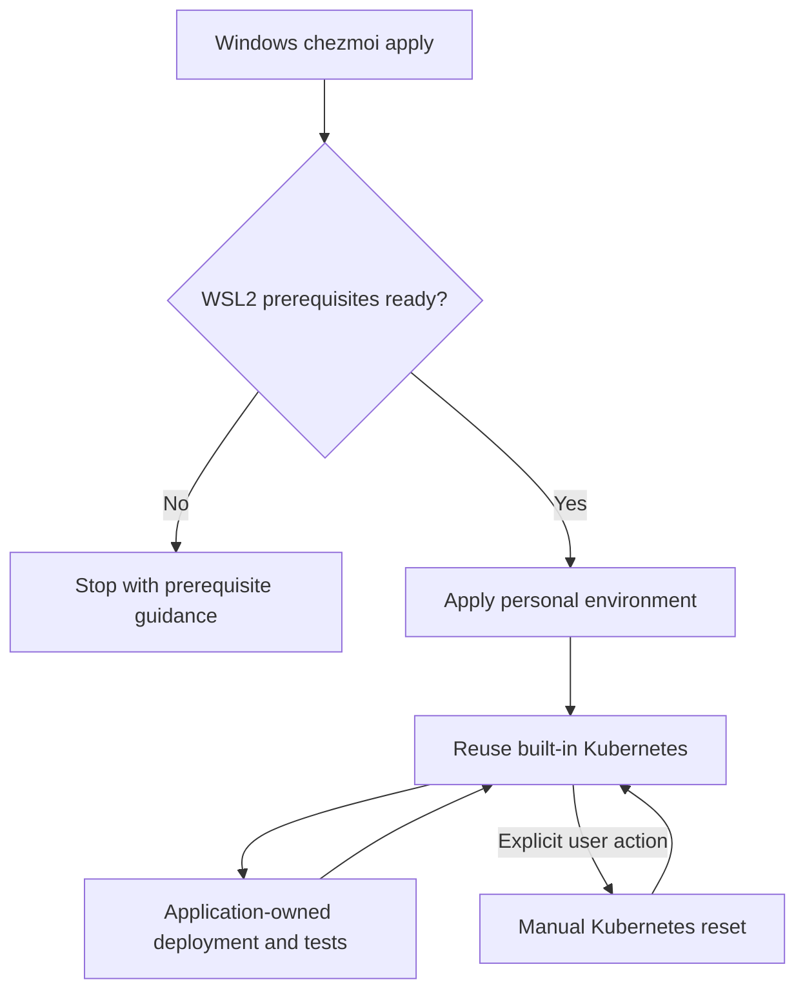
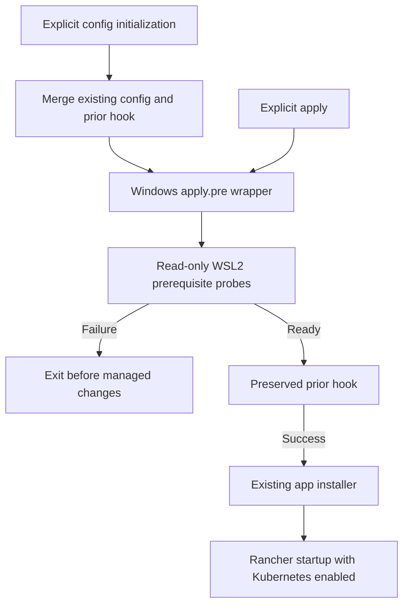

# Windows Rancher Desktop Kubernetes Environment - Plan

## Goal Capsule

- **Objective:** The repository owner can use a reusable local Kubernetes development environment from Windows PowerShell.
- **Means:** Rancher Desktop provisioning and a source-resident Windows apply gate (KTD1–KTD4).
- **Product authority:** The Product Contract governs behavior; the Planning Contract governs implementation within it.
- **Execution profile:** One PR covering U1–U3; local verification precedes review and shipping.
- **Stop conditions:** Do not enable Windows features, reboot, reset clusters, or implement authentication.
- **Completion owner:** The implementing engineer verifies the local paths and reports any unavailable live-cluster evidence.

---

## Product Contract

### Summary

Provide Rancher Desktop's built-in Kubernetes environment through the existing explicit personal-configuration workflow.
Reuse the cluster, leave full resets manual, and reject Windows apply operations when WSL2 prerequisites are not ready.

### Problem Frame

The owner develops applications deployed through Helm charts and needs a common Windows Kubernetes environment.
The confirmed scope excludes application-specific deployment and testing, and favors reusing Rancher Desktop's built-in cluster over maintaining disposable kind clusters.

### Key Decisions

- **Use the built-in stack.** Governs R1, R2. (session-settled: user-directed — chosen over Rancher Desktop plus kind: reduce the tools managed by this repository.)
- **Reuse the cluster.** Governs R3, R10. (session-settled: user-directed — chosen over resetting the whole cluster for every test: limit this work to a common development environment.)
- **Gate apply, not bootstrap.** Governs R4, R5, R7, R8. (session-settled: user-directed — chosen over checking during bootstrap: reject an unprepared environment immediately before applying personal configuration.)
- **Require WSL2 to be ready already.** Governs R5, R6. (session-settled: user-directed — chosen over automatic WSL2 preparation with a possible reboot: retain the no-reboot requirement.)
- **Track authentication separately.** Governs R11. (session-settled: user-directed — chosen over implementing authentication in this change: keep the Kubernetes environment scope small.)

### Requirements

**Environment and lifecycle**

- R1. Explicit personal-configuration application on Windows provides Rancher Desktop with its built-in Kubernetes enabled and its bundled kubectl usable from Windows PowerShell.
- R2. Do not introduce kind or separately provision or configure Helm; retain the utilities bundled with Rancher Desktop.
- R3. Ordinary repeated application reuses the existing cluster without resetting it or deleting its workloads.

**WSL2 prerequisite gate**

- R4. Configure a Windows-only, read-only WSL2 readiness check at chezmoi `hooks.apply.pre`, including unchanged applies and `apply --dry-run`.
- R5. If WSL2 is absent or not ready to support Rancher Desktop, fail apply before managed target changes or apply scripts run, identify the unmet prerequisite, and describe the action needed to resolve it.
- R6. The check must not install or activate WSL2, change Windows features or settings, initiate a reboot, or present pending activation as readiness.
- R7. Do not add this check to bootstrap, `mise install`, or non-Windows configuration.
- R8. The check must permit first-time Rancher Desktop installation on a WSL2-ready host without requiring an existing Rancher Desktop installation or its Linux distributions.

**Configuration and operating boundary**

- R9. Integrate the hook with repository-generated chezmoi configuration without discarding unrelated configuration or existing hook behavior.
- R10. Document the normal PowerShell workflow and manual Kubernetes reset; application repositories remain responsible for deployment, testing, and test-resource cleanup.

**Follow-up tracking**

- R11. Maintain a linked GitHub follow-up issue covering GitHub CLI provisioning/authentication integration and Docker Hub (`docker.io`) token authentication backed by the Windows keyring; implement neither in this change.

### Key Flows

- F1. **Personal application.** Windows `chezmoi apply` reaches the prerequisite gate before managed changes; R4–R8 determine whether application may proceed. Normal application then provides or maintains the environment under R1–R3 and R9.
- F2. **Development use.** The owner uses PowerShell and the shared local cluster; application repositories own the workload lifecycle under R10. A full reset remains an explicit manual operation rather than a test hook.

### Acceptance Examples

- AE1. **Covers R1, R4, R8.** On a Windows host with WSL2 prerequisites ready but no Rancher Desktop installation or Rancher distributions, the check permits the first apply to provision the environment; PowerShell can then reach the built-in Kubernetes API with bundled kubectl.
- AE2. **Covers R5, R6.** On a host where WSL2 is missing or activation remains pending, apply fails with actionable guidance before managed files or apply scripts change the environment; the check does not attempt to repair Windows or reboot it.
- AE3. **Covers R4, R5.** An unchanged Windows apply still runs the check. `apply --dry-run` also runs it and fails when the prerequisite is unmet, without changing the host.
- AE4. **Covers R7.** Bootstrap and `mise install` remain usable without WSL2, and Linux/macOS configuration does not gain a Windows prerequisite check.
- AE5. **Covers R2, R3, R9.** Reapplying an already configured Windows environment does not reset the Kubernetes cluster, provision kind or a separate Helm installation, or discard unrelated chezmoi settings and hook behavior.
- AE6. **Covers R10.** The documented manual Kubernetes reset identifies that it removes all workloads and cluster configuration; it is never invoked automatically by apply or a repository-managed test wrapper.
- AE7. **Covers R11.** [Issue #21](https://github.com/hyperlapse122/dotfiles/issues/21) records both authentication follow-ups, while this change does not collect tokens or configure registry or GitHub authentication.

### Scope Boundaries

- No per-test cluster creation, automatic reset, test runner, Helm release management, or application-chart changes; R3 and R10 govern the shared-cluster model.
- No WSL2 provisioning, OS-feature activation, reboot/resume machinery, or automatic repair; R6 governs prerequisite handling.
- No separate Kubernetes distribution, kind installation, or independently managed Helm installation; R1 and R2 govern tool selection.
- No authentication implementation, token acquisition, credential-helper configuration, Kubernetes image-pull secrets, or registry-login automation; R11 owns follow-up tracking.
- No new non-Windows Kubernetes environment.

### Dependencies and Assumptions

- Linux containers are the intended workload type. Reusing the cluster no longer guarantees a clean cluster for each test.
- Rancher Desktop's Windows requirements, including WSL and virtualization support, remain external prerequisites. Windows may require a reboot to establish them before this workflow can succeed.
- The owner accepts the scope of R4 and R5 even for Windows apply operations unrelated to Kubernetes.
- Under R2, bundled Helm remains present; excluding its separate management does not require removing the binary.
- Existing repository prerequisites, including Git/GPG setup, remain in force.

### Planning Resolutions

- WSL2 prerequisite validation is distinct from a successful VM or cluster launch; KTD1 defines the read-only evidence and verification limits.
- Hook initialization and existing-hook composition are owned by KTD2.
- `chezmoi update` does not run apply hooks in chezmoi 2.74.0; KTD3 defines the documented protected update flow.
- KTD4 uses the existing Windows application installer and Rancher Desktop's supported CLI.

### Sources and Follow-up

- `STRATEGY.md`: explicit personal-environment management and safe repeated application.
- `mise.toml`, `.chezmoi-bootstrap.toml`, `bootstrap.ps1`: preparation boundary to preserve.
- `home/.chezmoi.toml.tmpl`: repository-generated chezmoi configuration and Windows interpreter selection.
- `home/.chezmoidata/windows.yaml`, `home/.chezmoiscripts/run_onchange_before_20-install-windows-apps.ps1.tmpl`: existing Windows application-provisioning conventions.
- [Rancher Desktop installation](https://docs.rancherdesktop.io/getting-started/installation/): Windows prerequisites and bundled utilities.
- [Rancher Desktop Kubernetes settings](https://docs.rancherdesktop.io/1.24/ui/preferences/kubernetes/): built-in Kubernetes enablement.
- [Rancher Desktop troubleshooting](https://docs.rancherdesktop.io/ui/troubleshooting/): manual Kubernetes reset and its effects.
- [Chezmoi hooks](https://www.chezmoi.io/reference/configuration-file/hooks/): event hooks, command configuration, and dry-run behavior.
- [Chezmoi update](https://www.chezmoi.io/reference/commands/update/): source update and optional application.
- [Microsoft WSL installation](https://learn.microsoft.com/en-us/windows/wsl/install) and [manual platform enablement](https://learn.microsoft.com/en-us/windows/wsl/install-manual#step-3---enable-virtual-machine-feature): reboot constraints.
- [Issue #21: GitHub CLI and Docker Hub keyring-backed authentication](https://github.com/hyperlapse122/dotfiles/issues/21): created during this brainstorm; authentication implementation remains separate under R11.

---

## Planning Contract

**Product Contract preservation:** Product Contract unchanged; the former planning questions are resolved by KTD1–KTD4.

### Key Technical Decisions

- KTD1. **Use a source-resident PowerShell prerequisite check.** Add `scripts/check-wsl2.ps1`, compatible with Windows PowerShell 5.1. Use informational native WSL commands, invariant CIM properties for Virtual Machine Platform and the running hypervisor, and fail closed when required evidence cannot be obtained. Do not require the optional WSL1 component on Store WSL or any installed Linux distribution. Report observed unmet prerequisites rather than claiming a read-only probe proves VM startup. Governs R4–R8.
- KTD2. **Generate one composed pre-hook with native PowerShell.** Extend the existing configuration merge in `home/.chezmoi.toml.tmpl`; render an absolute checkout-resident hook path using the existing system PowerShell interpreter. Preserve the prior apply-pre command or script and its arguments, run it only after the gate succeeds, propagate its failure, and recognize the generated hook on reinitialization to avoid recursive wrapping. Resolve script interpreters from chezmoi's effective defaults and user overrides rather than relying on file associations. Other configuration and hooks remain untouched. Governs R4, R5, R8, R9.
- KTD3. **Make configuration migration and protected application separate operations.** Existing users initialize configuration without applying, then run `chezmoi apply` or `mise run apply`. Document `chezmoi update --apply=false` followed by `chezmoi apply`; do not silently broaden the hook to `update.pre` or claim `apply --init` protects the invocation that first installs it. Governs R4, R7, R9, R10.
- KTD4. **Provision Rancher through the existing WinGet action and supported startup CLI.** Add `SUSE.RancherDesktop` to the Windows package data, retain `--no-upgrade`, and use package-specific `--skip-dependencies` to avoid its Microsoft.WSL dependency. A subsequent Windows-only action resolves bundled `rdctl.exe` and requests only `--kubernetes.enabled=true --no-modal-dialogs`. Do not set engine, Kubernetes version, networking, or reset options. Use bundled kubectl rather than a separately managed client. Governs R1–R3, R6.
- KTD5. **Use isolated command-boundary tests plus native smoke evidence.** Keep installer and registry mutations out of the test host. Fixtures exercise the real PowerShell scripts and chezmoi dispatcher with controlled external observations; native probes exercise the actual host's blocked WSL path. A live successful Rancher cluster check is conditional on an already prepared host, not permission to enable WSL. Governs AE1–AE6.
- KTD6. **Wait for usable Kubernetes before completing provisioning.** Rancher startup is asynchronous. After starting it, use bundled kubectl with the explicit `rancher-desktop` context to wait, within a five-minute deadline, for a reachable API and at least one Ready node. Timeout fails visibly without reset or OS repair. Governs R1.

### High-Level Technical Design

The wrapper uses absolute source paths and keeps the hook's home-directory working directory for the preserved command.
No managed destination file is required for the first pre-hook invocation.

### Assumptions and Risks

- Read-only WSL state can establish prerequisites but cannot prove a distro-free VM will start. Live Kubernetes readiness is established separately when a WSL2-ready host is available.
- This host reports WSL as not installed. Successful live-cluster verification is unavailable without violating R6; the failure path and isolated success paths remain executable.
- The Rancher `rdctl` API is experimental. Use the documented dotted setting syntax and exercise the exact command boundary.
- WinGet's Rancher package is currently an x64 machine-scope MSI with a Microsoft.WSL dependency. Installation failures remain visible; no alternate installer or OS-repair fallback is added.
- Existing unrelated test fixtures that initialize the full config must isolate the new guard deliberately rather than acquiring a dependency on the test host's WSL installation.

### Research Basis

- Chezmoi 2.74.0 `internal/cmd/config.go` dispatches hooks by command name; `updatecmd.go` calls internal application without the apply hook. `initcmd.go` explicitly runs apply hooks for `init --apply`.
- [Chezmoi 2.74.0 configuration and hook implementation](https://github.com/twpayne/chezmoi/blob/v2.74.0/internal/cmd/config.go), [update implementation](https://github.com/twpayne/chezmoi/blob/v2.74.0/internal/cmd/updatecmd.go).
- [Store WSL requirements](https://devblogs.microsoft.com/commandline/the-windows-subsystem-for-linux-in-the-microsoft-store-is-now-generally-available-on-windows-10-and-11/), [Win32_OptionalFeature](https://learn.microsoft.com/en-us/windows/win32/cimwin32prov/win32-optionalfeature), [Win32_ComputerSystem](https://learn.microsoft.com/en-us/windows/win32/cimwin32prov/win32-computersystem).
- [Rancher 1.24.0 WinGet manifest](https://github.com/microsoft/winget-pkgs/blob/master/manifests/s/SUSE/RancherDesktop/1.24.0/SUSE.RancherDesktop.installer.yaml), [rdctl reference](https://docs.rancherdesktop.io/references/rdctl-command-reference/).
- `tests/test_windows_apps.py`, `tests/test_global_chezmoi.py`, and `tests/test_script_lifecycle.py` supply command-boundary and isolated-home test conventions.

---

## Implementation Units

### U1. Enforce WSL2 prerequisites at the Windows apply boundary

- **Goal:** Reject an unprepared host before applying personal state.
- **Requirements:** R4–R9; F1; AE1–AE5.
- **Dependencies:** None.
- **Files:** Create `scripts/check-wsl2.ps1` and a source-resident hook wrapper if composition needs one; modify `home/.chezmoi.toml.tmpl`; add `tests/test_wsl2_preflight.py`; adapt `tests/test_global_chezmoi.py` and `tests/test_secrets.py` only where their isolated fixtures initialize the full configuration.
- **Approach:** Implement KTD1 and KTD2, reusing native PowerShell discovery and existing TOML merging. Keep probe observations separable from the real apply dispatch so fixtures can control Windows state without a production bypass switch.
- **Patterns:** `configure-chezmoi.ps1`, existing Windows PowerShell interpreter configuration, and the isolated native executable fixture in `tests/test_global_chezmoi.py`.
- **Test scenarios:**
  - Covers AE1: ready WSL2 evidence with no distro or Rancher installation permits the real hook boundary.
  - Covers AE2: missing WSL, disabled or unknown VMP, absent running hypervisor, and probe failure prevent both a managed-file change and an apply-script marker.
  - Covers AE3: unchanged apply and dry-run invoke the gate; dry-run makes no target changes.
  - Covers AE4: config initialization and bootstrap remain ungated; non-Windows configuration has no generated WSL hook.
  - Covers AE5: a pre-existing command or script hook runs once after success, never after prerequisite failure; its nonzero exit prevents application.
  - Reinitialization neither nests the generated wrapper nor loses the original hook, unrelated data, or interpreter overrides.
  - Unicode/spaced checkout paths and an unrelated invocation directory retain correct resolution.
- **Verification:** Real chezmoi fixture application proves the pre-mutation boundary, not merely script exit codes. Actual host probes report the missing prerequisite without changing Windows.

### U2. Provision and enable the built-in Rancher Kubernetes environment

- **Goal:** Explicit Windows application provides the agreed reusable local stack.
- **Requirements:** R1–R3, R6, R10; F2; AE1, AE5, AE6.
- **Dependencies:** U1 before integration or personal application; isolated authoring and command-boundary fixtures can proceed independently.
- **Files:** Modify `home/.chezmoidata/windows.yaml` and `home/.chezmoiscripts/run_onchange_before_20-install-windows-apps.ps1.tmpl`; create `home/.chezmoiscripts/run_after_25-rancher-desktop.ps1.tmpl`; update `tests/test_windows_apps.py`; add `tests/test_rancher_desktop.py`.
- **Approach:** Implement KTD4 after the shared app-installation action. Resolve native bundled tools from the installation, including existing per-user installations, without persisting a second competing PATH convention. Start or update only Kubernetes enablement; do not reset or change unrelated Rancher preferences.
- **Execution note:** Treat this as packaging and application integration. Command-boundary fixtures must be complemented by an actual runtime smoke where prerequisites exist.
- **Test scenarios:**
  - Covers AE1: Rancher is included in the package set and receives dependency-skipping installation behavior, while the other packages retain their existing behavior.
  - Covers AE5: repeated configuration requests only Kubernetes enablement and does not invoke reset or install kind/Helm separately.
  - Existing app-installation failures and missing bundled tools fail visibly rather than claiming a usable environment.
  - Delayed API/node readiness completes within the deadline; a permanently unavailable API or absence of Ready nodes fails rather than reporting successful provisioning.
  - Machine and per-user installation paths, including spaces, resolve bundled tools; Linux/macOS render no Rancher action.
  - Dry-run does not execute the installer or Rancher startup action.
- **Verification:** Isolated PowerShell execution observes the supported startup command, bounded readiness, and failure propagation. On a WSL2-ready host, bundled kubectl reaches the `rancher-desktop` context and observes Ready nodes; repeated apply retains a sentinel workload.

### U3. Document protected application and finish regression verification

- **Goal:** Users can initialize the gate, apply safely, and operate the shared cluster without confusing it with the excluded disposable-cluster design.
- **Requirements:** R2–R11; F1, F2; AE3–AE7.
- **Dependencies:** U1, U2.
- **Files:** Modify `README.md`; update any directly affected existing tests; retain issue #21 as the authentication follow-up.
- **Approach:** Document KTD3, first-install and existing-config flows, all-Windows-apply and dry-run effects, the WSL prerequisite boundary, bundled tool use, and manual Reset Kubernetes consequences. Replace unsafe update recommendations where they would bypass the new gate.
- **Test scenarios:**
  - Covers AE4: the existing bootstrap isolation suite still proves preparation ignores personal hooks.
  - Covers AE7: follow-up tracking remains linked without adding authentication code.
  - Run the existing complete deterministic suite after all changes; fix regressions at their owning fixtures rather than weakening the new guard.
- **Verification:** README commands agree with actual hook dispatch. The final report separates tested blocked/fixture paths from any live-cluster verification that could not run.

---

## Verification Contract

- Run `mise exec -- python -m unittest discover -s tests` after integration; use existing CI's Windows and non-Windows matrix without introducing an installer-dependent hosted test.
- Exercise the real native PowerShell WSL check on this host and observe a nonzero, actionable result with no host mutation.
- Exercise a temporary chezmoi source with real apply, unchanged apply, and dry-run dispatch, controlling probe inputs and external application commands only within the fixture.
- If WSL2 prerequisites already exist, use bundled kubectl with explicit `rancher-desktop` context to check node readiness and workload survival across a repeated apply. If they do not, record that live success evidence is unavailable; do not enable features or reboot for verification.
- No browser UI is changed. Do not install unrelated tooling, collect credentials, or manipulate the user's cluster during tests.

## Definition of Done

- U1–U3 meet their cited requirements and acceptance examples, and the deterministic suite passes.
- Bootstrap remains hook-free; Windows apply uses the configured guard and preserves prior hook behavior.
- Rancher provisioning neither installs WSL as a dependency nor resets the cluster.
- Documentation distinguishes initial config generation, protected apply, source-only update, and manual cluster reset.
- Issue #21 remains the durable authentication follow-up.
- Abandoned scaffolds and temporary experiment files are removed; unavailable live-runtime evidence is explicitly reported.
