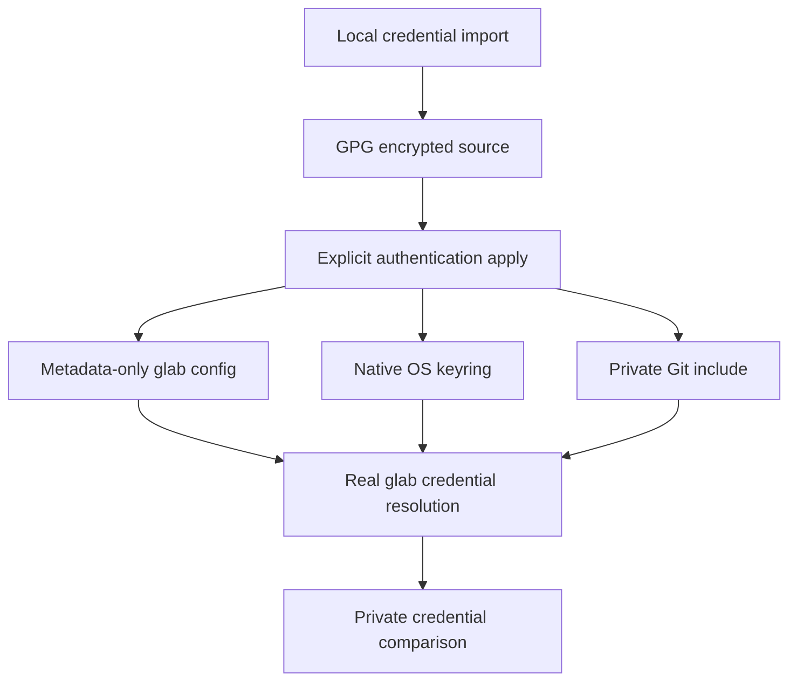

# GitLab Keyring Authentication - Plan

## Goal Capsule

- **Objective:** The repository owner can use the private GitLab CLI and Git HTTPS access on managed devices without manually reconfiguring credentials on each device.
- **Means:** Add glab and extend the existing encrypted-source, explicit-apply, native-keyring authentication pattern.
- **Product authority:** The owner confirmed this scope in dialogue; Docker/Podman registry login is separate work tracked in [issue #25](https://github.com/hyperlapse122/dotfiles/issues/25).
- **Open blockers:** None at the product-scope level; compatibility and verification details remain planning work.
- **Execution profile:** One PR; the autonomous workflow owns implementation, local verification, independent review, and shipping.
- **Stop conditions:** A settled constraint is infeasible, repository encryption cannot be used safely, or required verification cannot be established.

## Product Contract

### Summary

Add glab installation and keyring-backed authentication for the owner's private GitLab instance and its Git HTTPS access.
Manage the token and private connection metadata as encrypted source data, with registry login deferred to issue #25.

### Problem Frame

The owner needs private GitLab access across managed devices without exposing company connection information in the public dotfiles repository.
Private credentials and endpoint details must remain recoverable from encrypted source rather than depend on per-device manual login.

### Key Decisions

- **Protect connection metadata as well as the token.** Governs R3, R4. (session-settled: user-directed — chosen over token-only encryption: private hostnames and account identifiers must not be disclosed in tracked plaintext.)
- **Extend the gh-style authentication lifecycle.** Governs R1, R2, R7, R8, R9, R10. (session-settled: user-approved — chosen over default login with possible plaintext fallback: consistent native-keyring behavior is required.)
- **Import from the owner-supplied token file.** Governs R5, R6. (session-settled: user-approved — chosen over putting a token value into commands: the owner already supplied a local input file and confirmed the verified-publication cleanup flow.)
- **Leave registry login to the runtime follow-up.** See Scope Boundaries and issue #25. (session-settled: user-directed — chosen over adding registry login now: container-runtime changes are underway separately.)

### Requirements

**Installation and lifecycle**

- R1. Provide glab for both repository development and personal use on the project's supported Windows, Linux, and macOS targets, with a stable personal executable available outside a checkout.
- R2. Permit authentication-data decryption only for explicit credential import or personal application, and keyring reconciliation only for personal application; bootstrap, worktree preparation, initialization, and script-excluded application must do neither.

**Confidential source and local state**

- R3. Store the managed token, GitLab hostname, registry hostname, and account identifier in GPG-encrypted source data, with no actual values in tracked plaintext code, configuration, documentation, plans, or public issues.
- R4. Store the deployed token only in the native OS keyring; local application and Git configuration may contain the connection metadata needed to operate.
- R5. Accept the owner-supplied plaintext token file without exposing its token through process arguments, environment variables, logs, rendered scripts, or intermediate plaintext files.
- R6. Preserve unrelated encrypted mappings and retain the original input and prior ciphertext until encrypted publication is verified, then delete the input file and report any deletion failure.

**Authentication and reconciliation**

- R7. Use glab's credential-helper integration to authenticate Git HTTPS access to the managed private GitLab host using its keyring-backed token.
- R8. Reapplication must reconcile managed credentials from encrypted source data, including token rotation and repair after external keyring deletion.
- R9. Fail explicitly when required GPG access or native keyring access is unavailable, locked, or denied, without falling back to plaintext token storage.
- R10. Preserve existing GitHub authentication, unrelated hosts and accounts, unrelated configuration, and SSH-remote behavior.

### Key Flows

- F1. **Import credentials.** Covers R3, R5, R6.
  - **Trigger:** The owner supplies the local plaintext token file and private connection metadata.
  - **Outcome:** The encrypted source contains the intended data; input cleanup follows verified publication per R6.
- F2. **Apply and use credentials.** Covers R1, R2, R4, R7, R9, R10.
  - **Trigger:** The owner explicitly applies personal configuration with the required GPG and native-keyring prerequisites available.
  - **Outcome:** glab and Git HTTPS access use the managed credentials without another interactive token-entry step.
- F3. **Repair or rotate credentials.** Covers R8, R10.
  - **Trigger:** The encrypted token changes or the managed keyring entry is removed, followed by explicit reapplication.
  - **Outcome:** Managed authentication is restored without replacing unrelated credentials.

### Acceptance Examples

- AE1. **Prepared worktree without private-key access.** Covers R2. Bootstrap and worktree preparation complete without decrypting authentication data or writing credentials.
- AE2. **Successful explicit application.** Covers R4, R7. With a valid managed token and network access, glab can access the private instance and a Git HTTPS read succeeds without a login prompt; verification does not print credential-helper output.
- AE3. **Unavailable keyring.** Covers R9. Explicit application reports failure rather than publishing a plaintext token in glab or Git configuration.
- AE4. **Rotation or external deletion.** Covers R8, R10. Explicit reapplication restores the managed token while existing GitHub authentication and unrelated credentials continue to work.
- AE5. **Import publication failure.** Covers R6. The prior encrypted source and the original token file remain available if verified publication has not completed.
- AE6. **Cleanup failure after publication.** Covers R6. The new verified encrypted source remains available and the command reports incomplete input-file cleanup rather than claiming complete success.
- AE7. **Plaintext confidentiality review.** Covers R3, R5. Tracked changes, generated authentication scripts, and verification output contain neither the real private connection values nor the token.

<!-- ce-section: work-relationships -->
### How This Work Fits Together

This plan covers private GitLab CLI and Git HTTPS authentication only.
The relationships below describe the current understanding, not a committed roadmap.

- **Container runtime:** Changes are underway elsewhere; this plan does not depend on selecting or modifying that runtime.
- **Registry login:** [Issue #25](https://github.com/hyperlapse122/dotfiles/issues/25) depends on the runtime direction settling and may reuse this work's encrypted metadata and credentials where compatible.
- **Docker Hub:** [Issue #21](https://github.com/hyperlapse122/dotfiles/issues/21) is separate provider coverage, not a substitute for the private registry follow-up.

### Scope Boundaries

- Defer Docker/Podman login, container-client credential-helper configuration, and registry pull/push verification to issue #25.
- Do not install, replace, or reconfigure the container runtime.
- Do not provision Kubernetes image-pull secrets or add registry credentials to unrelated clients.
- Token issuance, OAuth sign-in automation, GPG-key provisioning, and native-keyring service provisioning are not part of this work.

### Dependencies / Assumptions

- The owner has supplied the token-file location in the invoking conversation; its contents have not been read or imported during brainstorming.
- The owner supplies private connection values through a local input path rather than adding them to this plan.
- The supplied token must have permissions for the intended GitLab API and Git HTTPS operations; its validity and permissions have not been verified.
- Managed devices need working GPG private-key access and an accessible native OS keyring.
- Ordinary deletion of the input file is not secure erasure and cannot remove editor backups or historical copies.

### Deferred to Follow-Up Work

Container-client authentication remains in issue #25 until the separately managed runtime direction settles.

### Deferred to Implementation

- Live private-host verification depends on network access and the supplied token's actual permissions.
- Cross-OS native-keyring interoperability is verified with synthetic credentials on disposable hosted runners.

### Sources / Research

- [Upstream glab project](https://gitlab.com/gitlab-org/cli).
- [glab authentication commands](https://docs.gitlab.com/cli/auth/).
- [glab login behavior and storage fallback](https://docs.gitlab.com/cli/auth/login/); R9 deliberately rejects the documented plaintext fallback.
- [Registry login follow-up, issue #25](https://github.com/hyperlapse122/dotfiles/issues/25).

---

## Planning Contract

**Product Contract preservation:** Product Contract unchanged in scope; planning questions are resolved below or classified as execution-time verification.

### Key Technical Decisions

- KTD1. **Pin official GitLab release assets.** Extend the existing personal-app declaration and generated lock with an explicit GitLab release source, defaulting existing declarations to GitHub; select glab v1.128.0 and consume its official checksum manifest. Governs R1. Reusing the installer avoids a second installation path, while a GitHub-only resolver cannot fetch the requested upstream.
- KTD2. **Share only encrypted transport and native encoding.** Extract the existing streaming GPG, verified publication, and metadata-file utilities needed by both authentication commands into `scripts/auth_common.py`; migrate the native adapter to `scripts/cli_native.py` and update every consumer. Preserve the GitHub CLI entry point and provider-specific reconciliation rather than introduce a provider framework. Governs R3–R6, R9, R10.
- KTD3. **Provision glab natively rather than call login.** Match v1.128.0's `glab:<host>:token` service with empty keyring account, host-local `use_keyring: "true"`, and explicit `is_oauth2: "false"`; preserve unrelated hosts while removing managed PAT/job/OAuth plaintext and obsolete OAuth expiry fields. Governs R4, R7–R10. Explicit PAT selection prevents inherited OAuth mode from outranking the managed credential; the configured GitLab username is Git's username, not the keyring account.
- KTD4. **Publish private metadata only at runtime.** Add a static generic include path to `home/dot_gitconfig.tmpl`, and atomically generate `.local/share/dotfiles/gitlab.gitconfig` during authentication apply with a host-scoped helper-chain reset and the stable personal glab executable. Governs R2, R3, R7, R10. Never decrypt inside the tracked Git template.
- KTD5. **Import connection metadata through a local file.** `scripts/gitlab-auth.py import` accepts a token-file path and a connection-file path carrying `host`, `registry`, and optional `user`; derive a missing account identifier from the private GitLab user API before publication. Merge under an encrypted `gitlab` mapping and preserve all other mappings. Governs R3, R5, R6. Only the token input is deleted under R6; the connection file is retained and documented as confidential local input.
- KTD6. **Prove the credential actually selected by glab.** Capture real `glab auth git-credential get` output privately and compare its username/token to the intended managed values before declaring success. Strip token, host, OAuth, CI-auto-login, trace, and backend overrides from verification subprocesses without changing the user's environment. Governs R7–R9. Normal user-invoked glab keeps upstream override precedence.

### High-Level Technical Design

KTD2 owns the shared transport boundary; KTD3–KTD6 own provider-specific runtime behavior.
Bootstrap renders the generic include reference without traversing the encrypted-data branch, per R2.

### Assumptions

- Supported personal targets match the existing gh target set: Windows amd64/arm64, Linux amd64/arm64, and macOS arm64.
- The managed instance uses HTTPS API and Git access on the supplied hostname, without a separate API port or subfolder.
- Preserve the current default glab host rather than silently selecting the private instance for commands run outside a repository.
- One managed PAT identity per private host matches glab's single host-local PAT selection.

### Risks and Dependencies

- glab tries legacy `glab:<host>` keyring state after current-key lookup errors; verify the current entry directly and remove managed plaintext fallback fields before checking actual glab selection.
- Native keyrings are not isolated by HOME alone; automated native writes use disposable hosted runners and synthetic identities, while owner-directed local provisioning uses only the managed identity.
- Effective glab config resolution honors `GLAB_CONFIG_DIR`, an existing legacy `~/.config/glab-cli/config.yml`, then the platform XDG config location; match that order.
- A failure after encrypted replacement but before final readback must retain a ciphertext-only recovery copy of the previous source and the plaintext input until publication is verified, per R6; automatic rollback is not promised.
- No bake-off is needed: the established shared transport and upstream credential contracts determine the mechanism without an unresolved storage or ownership fork.

### Research Basis

- `scripts/github-auth.py` establishes streaming encryption, ciphertext-only staging, verified publication, fixed diagnostics, and explicit-apply reconciliation.
- `scripts/gh_native.py` implements the same go-keyring native formats glab v1.128.0 consumes; its existing GitHub/Gist service restriction needs a deliberate shared adapter contract.
- `scripts/update-personal-app-lock.py` and `home/.chezmoiexternals/personal-apps.toml.tmpl` own lock generation and stable personal application installation.
- [glab v1.128.0 release](https://gitlab.com/api/v4/projects/34675721/releases/v1.128.0) and [checksums](https://gitlab.com/gitlab-org/cli/-/releases/v1.128.0/downloads/checksums.txt) shape KTD1.
- [Versioned config and keyring resolution](https://gitlab.com/gitlab-org/cli/-/blob/v1.128.0/internal/config/config.go) and [config-path selection](https://gitlab.com/gitlab-org/cli/-/blob/v1.128.0/internal/config/config_file.go) shape KTD3 and KTD6.
- [Versioned Git helper](https://gitlab.com/gitlab-org/cli/-/blob/v1.128.0/internal/commands/auth/login/helper.go) and [helper setup](https://gitlab.com/gitlab-org/cli/-/blob/v1.128.0/internal/commands/auth/authutils/git_credentials.go) shape KTD4 and KTD6.

---

## Implementation Units

### U1. Install pinned glab from its official release

- **Goal:** Make the real glab binary available through the existing development and personal installation paths.
- **Requirements:** R1, R2; KTD1.
- **Dependencies:** None.
- **Files:** `mise.toml`, `mise.lock`, `home/.chezmoidata/personal-apps.json`, `home/.chezmoidata/personal-app-lock.json`, `scripts/update-personal-app-lock.py`, `tests/test_personal_app_lock.py`, `tests/test_personal_apps.py`, `tests/smoke_personal_apps.py`.
- **Approach:** Add a GitLab-source declaration; normalize official release links and checksum manifests into the existing locked target schema without changing GitHub resolution.
- **Patterns:** Existing resolver validation and local archive fixtures.
- **Test scenarios:**
  1. Official-shaped GitLab release and checksum fixtures resolve exact declared targets and reject missing, duplicate, malformed, or untrusted asset data.
  2. Installed archive fixtures produce an executable at the declared stable path for ZIP and tar.gz targets.
  3. Existing GitHub resolution and unsupported-target behavior remain unchanged.
- **Verification:** Install and invoke pinned glab; the generated lock uses official URLs and declared digests.
- **Execution note:** Prefer actual install/runtime smoke over new tests that merely copy manifest fields.

### U2. Reuse encrypted transport and native keyring encoding

- **Goal:** Allow GitHub and GitLab authentication to share proven low-level operations without duplicating credential transports.
- **Requirements:** R3–R6, R9, R10; KTD2.
- **Dependencies:** None.
- **Files:** `scripts/auth_common.py`, `scripts/cli_native.py`, `scripts/github-auth.py`, removal of `scripts/gh_native.py`, `tests/test_github_auth.py`, `tests/test_github_auth_import.py`, `tests/smoke_github_auth.py`.
- **Approach:** Extract only common operations, update all existing callers/tests, and retain provider-specific GitHub account handling and CLI behavior.
- **Patterns:** Existing import tests and native GitHub interoperability smoke.
- **Test scenarios:**
  1. Covers F1 / AE5. Verified publication preserves arbitrary unrelated mappings and retains both input and previous ciphertext through final verification, including failure after replacement.
  2. Covers AE6. Post-publication input-deletion failure reports incomplete cleanup while preserving published ciphertext.
  3. Covers AE3. Denied native operations never publish a plaintext fallback.
  4. Covers AE4. Existing GitHub/Gist repeated apply, rotation, and repair remain correct.
- **Verification:** Existing GitHub behavioral tests and native smoke still prove their original contracts after extraction.
- **Test seam:** Unit tests isolate state transitions; native smoke catches real backend encoding and CLI lookup incompatibility.

### U3. Reconcile private GitLab authentication

- **Goal:** Import private metadata and deploy working glab/Git HTTPS authentication from encrypted source.
- **Requirements:** R2–R10; F1–F3; KTD3–KTD6.
- **Dependencies:** U1, U2.
- **Files:** `scripts/gitlab-auth.py`, `home/dot_gitconfig.tmpl`, `home/.chezmoiscripts/run_after_45-gitlab-auth.ps1.tmpl`, `home/.chezmoiscripts/run_after_45-gitlab-auth.sh.tmpl`, `tests/test_gitlab_auth.py`, `tests/test_gitlab_auth_import.py`, `tests/test_secrets.py`, `tests/test_git_gpg.py`.
- **Approach:**
  1. Implement private-file import and provider-specific metadata validation using U2.
  2. Resolve the account, reconcile the current native service, and publish metadata-only glab and host-scoped Git configuration.
  3. Verify actual glab selection through privately captured helper output.
  4. Attach ordinary run-after hooks with path-only rendered content.
- **Patterns:** Existing GitHub hooks, fixed diagnostics, atomic metadata publication, and scoped helper resets.
- **Test scenarios:**
  1. Covers AE1. Invalid ciphertext and missing private keys do not prevent preparation or script-excluded apply.
  2. Covers F1 / AE7. Imported synthetic endpoint/account values remain only in ciphertext; errors, scripts, and intermediate files do not disclose them.
  3. Covers AE3. Missing or denied native storage fails without publishing token fields.
  4. Covers AE4. Repeat, rotation, and deletion repair converge while unrelated GitLab hosts, GitHub authentication, and SSH routing remain unchanged.
  5. Host-local PAT selection overrides stale host, top-level, or repository-local OAuth mode without changing those unrelated inherited settings.
  6. Ambient glab token/host/CI/debug overrides cannot make verification pass against another credential.
- **Verification:** Real glab helper selection matches the encrypted intended credential; an authorized private-host API/Git read succeeds without showing its credential.
- **Test seam:** Isolated tests cover merge/precedence/failure boundaries; the runtime check proves real native consumption rather than mock forwarding.

### U4. Verify supported native paths and document operation

- **Goal:** Keep the new authentication behavior verifiable on supported operating systems and usable without disclosing private values.
- **Requirements:** R1–R10; AE1–AE7.
- **Dependencies:** U1–U3.
- **Files:** `tests/smoke_gitlab_auth.py`, `.github/workflows/test.yml`, `README.md`, `home/README.md`, encrypted `home/.secrets/api-tokens.yaml.asc`.
- **Approach:** Extend hosted native smoke coverage with synthetic GitLab identities and update operation docs with `.invalid` examples; import the owner-supplied file only after implementation verification.
- **Test scenarios:**
  1. Covers AE2 / AE4. Native fixture applies, rotates, repairs, and routes Git through the real glab executable on supported hosted targets.
  2. Covers AE7. Credential-bearing helper output remains captured and no private connection values appear in tracked plaintext.
  3. Docker/Podman configuration remains untouched throughout current-work verification.
- **Verification:** Targeted tests, native smoke, private provisioning results, and hosted CI evidence distinguish exercised behavior from platform or network limits.

---

## Verification Contract

- Run the repository's Python unittest discovery through mise after integration, including existing GitHub, secrets, bootstrap, Git, personal-app, and lock-resolver contracts.
- Run `tests/smoke_personal_apps.py` for actual pinned application extraction and execution.
- Run native GitHub and GitLab authentication smoke on disposable hosted Windows amd64/arm64, Linux amd64/arm64 with Secret Service, and macOS arm64 as defined by `.github/workflows/test.yml`.
- Locally install and invoke the pinned glab binary without synthetic credential writes; prove local native consumption through authorized managed-identity provisioning and private credential comparison.
- After verified encrypted import, perform only targeted GitLab provisioning and credential-safe API/Git reads; do not invoke unrelated personal-application hooks or change the container runtime.
- Scan tracked changes for the actual confidential values in memory, printing only pass/fail; never put those values into a search command or report.
- A local test suite does not replace real glab/native-keyring proof; remote native coverage may be established by the PR's hosted workflow.

---

## Definition of Done

- U1–U4 deliver their stated outcomes and preserve the Product Contract's requirements.
- The owner-supplied token and private metadata are published as verified ciphertext; input cleanup follows R6.
- Required local tests and real-CLI smoke have observed results, and hosted CI is decided before final shipping completion.
- Existing GitHub authentication remains covered; no Docker/Podman or container-runtime settings are changed.
- Documentation reflects the actual import/apply workflow, using synthetic connection examples only.
- Obsolete adapter paths, temporary scaffolding, abandoned attempts, and plaintext intermediate files are absent.
