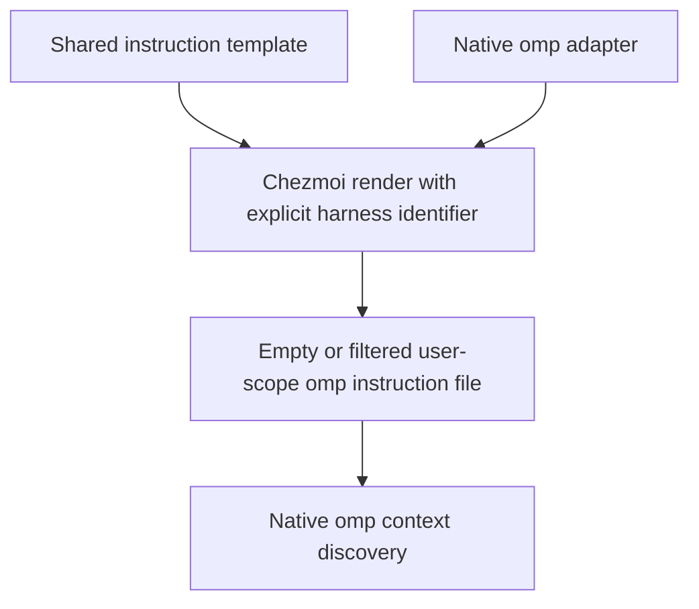

# Harness User Instructions - Plan

## Goal Capsule

- **Objective:** The owner can maintain shared user-scope agent instructions once without showing a harness instructions intended only for another harness.
- **Means:** A shared chezmoi template with render-time harness branches and native destination adapters (KTD1).
- **Product authority:** The Product Contract below captures the conversation, including the requirement that every repository-managed harness must be connected.
- **Execution profile:** One bounded change, delivered in one PR if shipping is subsequently authorized. This plan authorizes no application to the owner's home, commit, or push.
- **Completion owner:** The implementing agent completes U1 and U2 and supplies the Verification Contract evidence.
- **Stop conditions:** Stop for a scope decision if the managed harness inventory has changed or a pinned harness no longer supports the planned native destination; do not silently omit a managed harness.

## Product Contract

### Summary

Create the empty structure for shared user-scope instructions and connect the repository's currently managed harness, omp.
Require the same connection whenever another harness enters repository management.

### Problem Frame

Maintaining separate instruction copies makes common guidance drift and can expose agents to irrelevant descriptions of another harness.
The owner wants the management and branching structure before writing any instruction content.

### Requirements

**Authoring and rendering**

- R1. Shared instruction content has one editable repository source for all managed harnesses.
- R2. Each harness receives the common content plus only its matching harness-specific content; conditional selection happens before the harness reads the result.
- R3. Ship no substantive instruction content, example policies, or placeholder prose in the generated user-scope instruction files in this change.

**Coverage and maintenance**

- R4. Connect every harness currently managed by this repository through its native user-scope instruction location; the verified current inventory contains only omp.
- R5. Add a repository instruction requiring every managed harness, including every future addition, to wire its user-scope instructions to the common source as part of onboarding that harness.
- R6. Keep future additions connected without copying the common body into a harness-specific source.

### Key Decisions

- **Repository management defines coverage, not an illustrative list of products.** Governs R4, R5, R6. (session-settled: user-directed — chosen over adding Claude Code or Codex solely because they were mentioned: the user selected currently managed harnesses and required the same connection for future additions.)

### Acceptance Examples

- AE1. **Covers R1, R2.** Given temporary common text and distinct omp/other-harness text, rendering for omp includes the common and omp text but excludes the other text; rendering for the other harness includes the common and its own text but excludes omp text.
- AE2. **Covers R3, R4.** Given the committed empty structure, isolated apply creates an empty native omp instruction file and creates no Claude Code or Codex instruction destination.
- AE3. **Covers R5, R6.** When a future change adds a managed harness, its native adapter and onboarding verification are part of that change; an independent copy of the common body does not satisfy the repository rule.

### Scope Boundaries

- Native standard user-global omp configuration is the deployment scope, matching the existing plugin/settings integration. Named profiles and relocated agent directories are not added here.
- This change does not install or configure an unmanaged harness, migrate existing personal instruction content, or add project-local harness instruction destinations. The root repository-maintenance rule required by R5 is in scope.
- No custom prompt replacement, sticky-rule layer, subagent-inheritance workaround, automatic installed-command detection, harness registry, or new generator is introduced. Native user-context loading is sufficient for the requested structure; broader session propagation would need its own requirement.
- No permanent tests pin an empty template's source text or echo fixture forwarding. Rendering and application proof use disposable fixtures instead.

## Planning Contract

### Key Technical Decisions

- KTD1. **Use one shared template and thin native adapters.** Create `home/.chezmoitemplates/agent-instructions`; its context contains an explicit harness identifier and the existing chezmoi context. Keep the common region unconditional and place the initially empty omp-specific region inside a harness equality branch. Adapters contain the invocation, not instruction bodies. Template comments mark editing regions without reaching the rendered file. A new harness identifier receives the common region unless its own branch adds content. This implements R1, R2, R3, R6 using the repository's existing `.chezmoitemplates` convention rather than introducing a second rendering system.
- KTD2. **Create an explicitly empty native omp target.** Add `home/private_dot_omp/private_agent/private_empty_AGENTS.md.tmpl`, rendering KTD1 with the identifier `omp`. Chezmoi's `empty_` attribute preserves the empty destination instead of removing it; `private_` retains the existing owner-only directory/file convention. The destination is the standard user agent directory's `AGENTS.md`, not `SYSTEM.md`, so no built-in system prompt is replaced. Existing `.chezmoiignore` already excludes the entire omp tree on unsupported application targets. Governs the mechanism for R3, R4.
- KTD3. **Use an onboarding rule, not runtime harness discovery.** Update the existing root `AGENTS.md` with the mandatory wiring rule in R5 and document its editing/verification procedure in `home/README.md`. The rule applies to all managed harnesses, not only omp. A future harness change must add its native adapter, use the same shared template, and exercise common-content inclusion and branch exclusion. No additional inventory is needed for the single currently managed harness.
- KTD4. **Keep repository ownership and explicit apply semantics.** The instruction target is a normal managed file, not `create_`, `modify_`, or an append-only merge. Reapply reconciles it to the repository version, including replacing existing local content with the empty result in this initial change. Document that consequence before users apply. Verification uses a disposable home and a hook-free config; worktree bootstrap continues to enumerate without applying personal settings.

### Native Loading Boundary

Pinned omp v18.16.0 discovers `~/.omp/agent/AGENTS.md` as user context for main sessions and advisors; task subagents deliberately exclude files with this basename.
An empty file contributes no context, so discovery proof needs temporary content rather than an assertion that an empty file appears in the prompt.
Once non-empty, the native file has priority over other user-context conventions.
These are upstream semantics to document, not behavior to override in this change.

### High-Level Technical Design

### Sources and Patterns

- `home/.chezmoitemplates/omp-config` and `home/private_dot_omp/private_agent/modify_private_config.yml`: existing shared partial/native adapter convention.
- `home/.chezmoidata/personal-apps.json`, `home/.chezmoidata/harness-plugins.json`, and `README.md`, Personal applications / Harness plugins: current managed harness inventory and standard user-global scope.
- `home/.chezmoiignore`: existing supported-target boundary for `.omp`.
- `tests/test_powershell_profile.py`: real chezmoi invocation with isolated configuration and destination.
- `tests/smoke_harness_plugins.py`: isolated home/config environment and native pinned-binary inspection; preserve this existing smoke's behavior when its copied source gains the new target.
- [Chezmoi templates](https://www.chezmoi.io/user-guide/templating/): explicitly pass context into a shared template; `if` is evaluated before output.
- [Chezmoi source-state attributes](https://www.chezmoi.io/reference/source-state-attributes/): `private_` precedes `empty_`; empty targets otherwise disappear.
- [Pinned omp context files](https://github.com/can1357/oh-my-pi/blob/v18.16.0/docs/context-files.md): user path, empty-content behavior, provider precedence, task-subagent boundary, and `/extensions` inspection.
- [Pinned omp system prompt customization](https://github.com/can1357/oh-my-pi/blob/v18.16.0/docs/system-prompt-customization.md): normal context does not replace the built-in prompt; `/dump` inspects assembled prompts.

## Implementation Units

### U1. Connect the empty shared source to omp

**Goal:** Deliver R1–R4 and R6 with the mechanisms in KTD1, KTD2, KTD4.

**Dependencies:** None.

**Files:** Create `home/.chezmoitemplates/agent-instructions` and `home/private_dot_omp/private_agent/private_empty_AGENTS.md.tmpl`. Existing `.chezmoiignore` and app/plugin declarations should remain unchanged.

**Approach:** Add the shared editing regions and the native adapter together. Keep only template comments and the branch structure in the empty source, with whitespace control that yields no instruction body. Reuse existing OS/architecture eligibility rather than adding another enablement switch.

**Execution note:** Prefer real chezmoi rendering and disposable-home application over permanent tests of this content-free structure.

**Test expectation:** No new permanent test file: this unit is template/configuration scaffolding. Use throwaway scenarios below; existing regression coverage remains applicable.

**Smoke scenarios:**

1. Covers AE1. In a temporary source copy, add distinguishable common and harness-specific markers and render with two identifiers; observe exact inclusion/exclusion, preserving ordinary multiline text.
2. Covers AE2. Apply the untouched empty source adapter into a disposable destination with a hook-free config and isolated state/cache; observe the empty regular file, and owner-only permissions where POSIX mode bits apply.
3. Seed local text in that disposable destination, apply twice, and observe repository reconciliation followed by an unchanged second result under KTD4.
4. Render the existing ignore boundary for supported and unsupported app targets; observe that the adapter follows the same eligibility as the rest of the managed omp tree.
5. In the disposable source only, insert a non-empty marker, apply it, then open a fresh pinned omp session outside this checkout and use `/extensions` and `/dump` to observe the native user file and marker without a model request. Restore the empty source and verify the committed result remains empty.

**Verification:** Evidence distinguishes template rendering, filesystem deployment, and actual native context discovery. No owner's home or personal instruction content changes.

### U2. Make shared wiring mandatory for harness onboarding

**Goal:** Deliver R5 and make R1, R2, R4, R6 maintainable through KTD3.

**Dependencies:** U1.

**Files:** Update the existing root `AGENTS.md`, `home/README.md`, and the relevant Harness plugins section of `README.md`.

**Approach:** Add the all-managed-harness wiring rule to the repository instructions. Document the common editing region, explicit harness branches, native adapter location, future onboarding obligation, and KTD4's overwrite consequence. Link the pinned native loading boundary rather than promising task-subagent inheritance. Keep documentation in English and do not add instruction policies.

**Test expectation:** None — documentation and repository-instruction changes. Review the proposed rule against AE3 and the real U1 layout; do not add source-text assertion tests.

**Verification:** A future implementer can add a harness by following the documented adapter/branch/verification procedure without duplicating the common body. The rule makes that connection a required part of every managed-harness addition.

## Verification Contract

Implementation runs these checks after the change; planning does not execute them.

- Run the U1 throwaway rendering/application/native-discovery scenarios with a disposable source, destination, config, cache, state database, and sanitized native user environment. Do not use `mise run apply` against the real home for proof.
- Run `mise run bootstrap` to confirm normal hook-free preparation still recognizes the source without applying settings.
- Run the existing Python suite through `mise exec -- python -m unittest discover -s tests`. No source-text or empty-default test should be introduced for this work.
- Run `mise exec -- python tests/smoke_harness_plugins.py` on a supported native target to check that the existing harness smoke still handles the expanded copied source tree.
- Report which operating systems were actually exercised; target-data rendering is not native runtime proof for another OS.

## Definition of Done

- U1 meets R1–R4 and R6, with AE1/AE2 smoke evidence and native discovery of temporary content.
- U2 makes R5 explicit in the existing repository instructions and documents AE3's future onboarding obligation.
- The final instruction output remains empty, and neither production source nor deployment contains smoke markers or sample policies.
- Existing bootstrap/app/plugin/settings behavior remains intact under the exercised verification.
- Remove disposable fixtures and abandoned experimental code; no personal apply, commit, push, or PR is implied by completing this plan.
