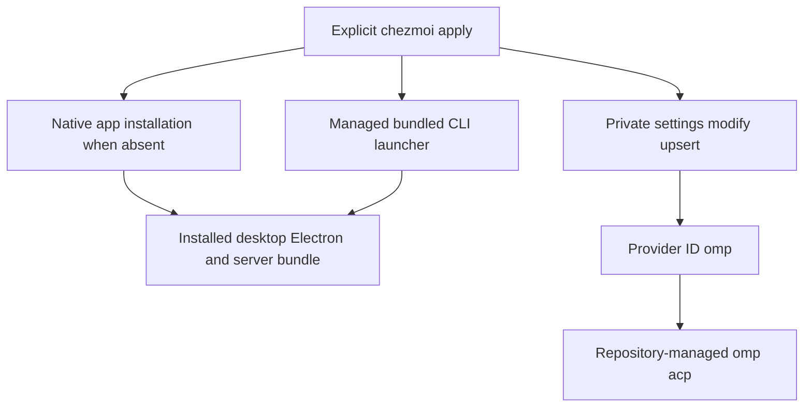

# T3 Code Desktop and omp Integration - Plan

## Goal Capsule

- **Objective:** The repository owner can launch T3 Code and use the repository-managed omp agent on a newly configured supported computer without manually registering the provider or exposing the terminal command.
- **Means:** Native desktop packages, desktop-bundled CLI launchers, and a partial settings transformation (KTD1–KTD3).
- **Authority:** Product Requirements own behavior; technical decisions select mechanisms within them; existing repository bootstrap and privacy rules remain binding.
- **Execution profile:** One PR, native implementation with independent installation/CLI and settings units; local verification and repository CI precede delivery. LFG owns review, push, PR, and CI follow-through; merging remains with the user.
- **Stop conditions:** A required platform cannot implement the selected behavior, unrelated personal state would be overwritten, or a user-reserved decision is invalidated.

---

## Product Contract

### Summary

Provision the T3 Code desktop app, expose its bundled `t3` command, and reconcile the `omp` ACP provider through explicit chezmoi application.

### Problem Frame

The owner currently installs T3 Code and registers an oh-my-pi ACP provider manually.
That setup must be repeated when preparing another computer, and the current manual Windows provider points outside the repository-managed omp installation.

### Requirements

**Desktop installation**

- R1. Support Windows and Ubuntu on x64/ARM64, and macOS on Apple Silicon only.
- R2. Explicit chezmoi application installs a stable desktop release when the application is absent, retains recognized existing versions, and leaves subsequent updates to the application.
- R3. Worktree initialization remains read-only with respect to personal configuration; `mise install` must not install the desktop app or alter PATH/settings.

**Terminal command**

- R4. Expose the desktop-bundled CLI as `t3` in a fresh ordinary terminal, including before the first GUI launch.
- R5. Do not install a separate standalone CLI or require manual Settings/About CLI installation.

**omp integration**

- R6. Every apply reconciles exactly provider ID `omp` to an enabled local ACP integration using the repository-managed executable and the `acp` subcommand, creating the provider when missing.
- R7. Use a chezmoi `modify_` transformation to preserve unrelated providers, unrelated top-level settings, and unowned fields inside the omp provider and its config.
- R8. Missing settings initialize minimally; malformed JSON or incompatible existing object shapes fail without replacing the original contents.
- R9. Repeated application produces no duplicate provider and no semantic changes after convergence.

### Key Decisions

- **Desktop rather than standalone server.** Governs R2, R4, R5. (session-settled: user-directed — chosen over standalone CLI or dual installations: the owner selected the desktop app and later requested its bundled command.)
- **Retain installed versions.** Governs R2. (session-settled: user-directed — chosen over upgrade-on-apply and repository version pinning: subsequent updates belong to the app.)
- **Apple Silicon macOS.** Governs R1. (session-settled: user-directed — chosen over Intel-only or dual-architecture coverage: Intel support removal is a separate follow-up.)
- **Declarative provider upsert.** Governs R6–R9. (session-settled: user-directed — chosen over requiring prior manual provider registration: the owner requires reconciliation even when the provider does not exist.)

### Acceptance Examples

- AE1. **Covers R2, R4–R6.** On a new supported desktop, an eligible install action followed by normal managed-file application leaves an executable bundled command and an enabled omp provider without first opening the GUI.
- AE2. **Covers R6, R7, R9.** Existing Codex, an unrelated top-level preference, and extra omp configuration survive reconciliation; stale omp launch fields converge and a second apply leaves the same semantic state.
- AE3. **Covers R8.** A malformed settings file causes apply to fail and its bytes remain unchanged.
- AE4. **Covers R2.** A recognized existing desktop installation is retained without fetching an Ubuntu payload or upgrading through its package manager.

### Scope Boundaries

- No credentials, provider login automation, background services, remote access, or changes to T3 conversation databases.
- Apply settings while T3 Code is closed; transactional coordination with simultaneous UI writes and interruption-free replacement of running agents are not implemented.
- Default T3 home `~/.t3` is managed; arbitrary relocated T3 state directories are not a new configuration surface.
- Use existing change-driven install/PATH lifecycle conventions where applicable; do not promise continuous repair of a manually removed app or PATH entry after an unchanged successful action.
- No general structured-data reconciliation framework or standalone CLI installer is introduced.

#### Deferred to Follow-Up Work

- Repository-wide Intel Mac support removal: [issue #29](https://github.com/hyperlapse122/dotfiles/issues/29), already created; unrelated Intel ghq and development lock entries remain unchanged here.

---

## Planning Contract

### Key Technical Decisions

- KTD1. **Native packages with declarative Debian staging.** Implements R1–R3. Extend the existing Windows app list with `T3Tools.T3Code`; use `brew install --cask t3-code` only when no existing bundle is recognized; stage the architecture-matched latest stable Debian asset through a chezmoi external and install it with apt only when absent. Ubuntu staging is conditional on installed-package/executable detection and happens before an after-install script; scripts do not download or extract payloads.
- KTD2. **Managed desktop-dependent launchers.** Implements R4, R5. Create `.local/bin/t3.cmd` on Windows and executable `.local/bin/t3` on POSIX, reusing existing PATH integration. Make the shared `.config/dotfiles/path.sh` fragment available on macOS while retaining Linux-only configuration exclusions; its current parent-directory ignore prevents fresh Mac discovery. Discover installed native bundles and invoke their Electron executable with the packaged server entry, matching the released desktop shim environment contract. This avoids depending on GUI-generated `~/.t3/bin` artifacts that may not exist before first launch. Preserve cwd, arguments, and exit status; report a missing installation instead of silently switching to a standalone CLI.
- KTD3. **Private narrow JSON transformation.** Implements R6–R9. A private `.t3/userdata/modify_private_settings.json` wrapper delegates to a shared template, mirroring the existing omp YAML modify convention. Set driver `acpRegistry`, `enabled: true`, config source `local`, absolute destination-home `.local/bin/omp[.exe]`, and `commandArgs: [acp]`; seed presentation metadata from the inspected local provider without overriding existing presentation choices. Validate object boundaries before modifying; never reset the provider map or discard unknown config fields.
- KTD4. **Isolated behavioral proof and native smoke.** Tests use temporary source/home/config/cache/state and selected managed paths, not a full personal apply. Exercise missing/existing/drifted settings and malformed-input preservation through real chezmoi. Smoke the managed CLI against an actual installed desktop bundle and use the repository-managed omp ACP initialize exchange; serialized settings alone are not proof of a successful model conversation.

### High-Level Technical Design

### Dependencies and Assumptions

- Existing Git/GPG and Windows WSL2 apply prerequisites remain unchanged.
- Homebrew is a macOS prerequisite; apt and Debian package tooling are Ubuntu prerequisites. Package-manager prompts remain interactive outside CI.
- Released v0.1.7 source establishes the initial bundle/JSON contracts; installed older or future releases may require compatibility investigation rather than a forced upgrade.
- Upstream package-derived Ubuntu path is `/opt/T3 Code (Beta)/t3code`; macOS cask bundle is `T3 Code (Beta).app`. Discovery should retain manually installed bundles in normal application locations as well as package-manager registrations.
- Dynamic latest-stable release lookup must not run for already-installed Ubuntu applications. Its offline test seam is existing chezmoi override data, not a production test-only flag.

### Sources

- `home/.chezmoiscripts/run_onchange_before_20-install-windows-apps.ps1.tmpl`: no-upgrade lifecycle and package-manager exit handling.
- `home/.chezmoiexternals/personal-apps.toml.tmpl`: declarative downloads and checksum conventions.
- `home/.chezmoitemplates/omp-config`, `home/private_dot_omp/private_agent/modify_private_config.yml`, `home/README.md`: narrow semantic modification, private attributes, and script ownership.
- `tests/test_script_lifecycle.py`, `tests/test_personal_apps.py`, `tests/test_harness_plugins.py`: isolated chezmoi and runtime smoke patterns.
- [Released desktop shim](https://github.com/pingdotgg/t3code/blob/v0.1.7/apps/desktop/src/app/DesktopCliShim.ts), [desktop package builder](https://github.com/pingdotgg/t3code/blob/v0.1.7/scripts/build-desktop-artifact.ts), [ACP settings](https://github.com/pingdotgg/t3code/blob/v0.1.7/packages/provider-acp-registry/src/settings.ts), and [ACP user documentation](https://github.com/pingdotgg/t3code/blob/v0.1.7/docs/user/providers-acp.md).
- [Homebrew cask](https://github.com/Homebrew/homebrew-cask/blob/master/Casks/t/t3-code.rb) and [chezmoi latest-release function](https://www.chezmoi.io/reference/templates/github-functions/gitHubLatestRelease/).

---

## Implementation Units

### U1. Install desktop and expose bundled command

- **Goal:** Deliver the app and an immediately usable desktop-dependent terminal entrypoint.
- **Requirements:** R1–R5; AE1, AE4; KTD1, KTD2.
- **Dependencies:** None.
- **Files:** `home/.chezmoidata/windows.yaml`; new T3-specific `.chezmoiexternals`, `.chezmoitemplates`, and `.chezmoiscripts` files; new `home/dot_local/bin/executable_t3.tmpl` and `home/dot_local/bin/t3.cmd.tmpl`; `tests/test_t3_code_desktop.py` if a permanent behavioral seam is warranted.
- **Approach:** Keep app metadata and target decisions in a focused shared partial; separate package installation from CLI invocation and reuse existing PATH actions. Select Ubuntu amd64/arm64 release assets with release integrity metadata; do not mark staged Debian files executable. Discover native install paths at launch where stable lookup is available, including ordinary user/system installation locations.
- **Patterns:** Existing Windows apps script, personal externals, OS-enclosed scripts and fingerprinting of consumed immutable inputs.
- **Execution note:** Packaging/configuration work is smoke-first; permanent tests must protect consumer-visible retention/selection boundaries, not assert source strings or mock forwarding.
- **Test scenarios:**
  1. Recognized existing app skips package download/install and retains its version.
  2. Native CLI works before a generated upstream shim exists, with no GUI startup or separate CLI install.
  3. Missing app fails visibly without launching another `t3` command.
  4. Ubuntu release selection matches the target architecture; unsupported macOS x64 does not acquire the new integration.
- **Verification:** Run managed `t3 --version`/help against the actual desktop bundle; foreign platform execution is verified by native CI where available, not claimed from template rendering alone.

### U2. Reconcile private omp ACP settings

- **Goal:** Make the desired omp provider exist after every apply without losing unrelated settings.
- **Requirements:** R1, R6–R9; AE1–AE3; KTD3.
- **Dependencies:** None; provider settings reference the pre-existing personal omp external.
- **Files:** New `home/private_dot_t3/private_userdata/modify_private_settings.json`, `home/.chezmoitemplates/t3-code-settings`, `tests/test_t3_code_settings.py`; `home/.chezmoiignore` owns exclusions for this target and U1 launcher filenames on unsupported OS/architecture combinations.
- **Approach:** Apply a narrow object-preserving transformation independently of app/shim existence. Use the literal destination path rather than shell tilde expansion. Seed absent metadata only; restore owned launch drift on every apply. Own the shared ignore-file adjustment from KTD2, allowing the macOS PATH fragment without exposing Linux-only `.config/environment.d` contents.
- **Patterns:** Existing private omp modify wrapper and JSON object checks in `harness-plugin-marketplaces`.
- **Test scenarios:**
  1. Missing file, empty file, or absent provider map creates one enabled omp instance.
  2. Existing provider with stale launch fields converges while unknown fields, another provider, and top-level preferences survive.
  3. Repeated apply is idempotent; owned drift is restored without duplicating IDs.
  4. Malformed JSON, scalar root/map/config shapes fail and preserve original bytes.
  5. Destination homes with spaces/apostrophes render valid absolute command paths for supported targets; private POSIX permissions remain intact.
  6. A macOS source apply includes the shared PATH fragment and excludes Linux-only environment configuration, so the existing fresh-shell action can expose the launcher.
- **Verification:** Real chezmoi apply/diff in isolated destinations; JSON semantic comparisons and error byte preservation, plus ACP initialization using the resulting executable/arguments.

### U3. Integrate verification and operator documentation

- **Goal:** Prove the integrated contract and document how it is used and maintained.
- **Requirements:** R1–R9 and AE1–AE4; KTD4.
- **Dependencies:** U1, U2.
- **Files:** `README.md`, `home/README.md`, `.github/workflows/test.yml` if native integration coverage needs an explicit command, and a narrowly scoped `tests/smoke_t3_code.py` when reusable native smoke is justified.
- **Approach:** Integrate native CLI and settings checks without changing unrelated application setup or user settings. Document prerequisites, install-only lifecycle, fresh-terminal requirement, owned settings, and the closed-app operational boundary.
- **Test scenarios:**
  1. A temporary home apply creates the provider and managed command; a fresh child resolves the bundled command and ACP initialize succeeds.
  2. Existing unrelated provider/config values remain after a second integrated apply.
  3. Bootstrap rendering remains non-mutating and existing lifecycle tests pass.
- **Verification:** Specific T3 tests, full existing unittest suite, actual Windows desktop CLI smoke, and observed CI results; report macOS/Ubuntu native verification limits precisely.

---

## Verification Contract

- Use `mise exec -- python -m unittest discover -s tests` for the existing suite after integration; targeted T3 tests run before that authoritative pass.
- Render each scoped platform and the excluded Intel macOS target through the repository's template-wrapper pattern.
- Run the actual managed CLI against the existing Windows v0.1.7 desktop without modifying personal T3 settings; use temporary homes and state for apply evidence.
- Run an ACP initialize request using the reconciled repository-managed executable and arguments, without creating a model conversation or changing credentials.
- Native CI owns macOS/Ubuntu execution evidence when available; a missing runtime is recorded, never replaced by a claim that rendering proves native installation.
- Keep tests isolated from real HKCU and personal app settings. PATH mutation tests use disposable CI or explicitly restored registry state according to existing repository conventions.

---

## Definition of Done

- U1 and U2 satisfy their traced requirements; U3 provides observed integrated verification and operator documentation.
- Permanent tests catch behavioral boundaries rather than wording, forwarding, or source layout.
- No production code, temporary harness, or compatibility shim remains from an abandoned approach.
- Existing unrelated user configuration and Intel support declarations are unchanged; issue #29 remains the separate removal task.
- Implementation is committed, independently reviewed, and shipped through an open PR with CI decided; no automatic merge.
