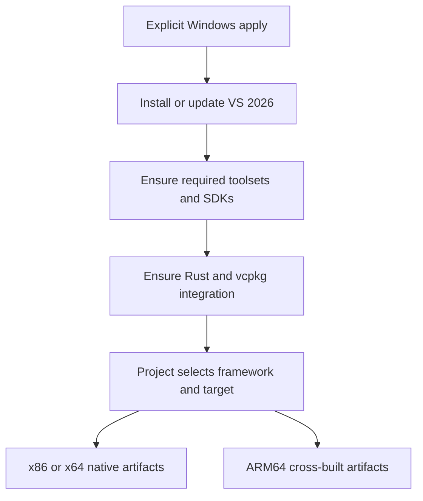
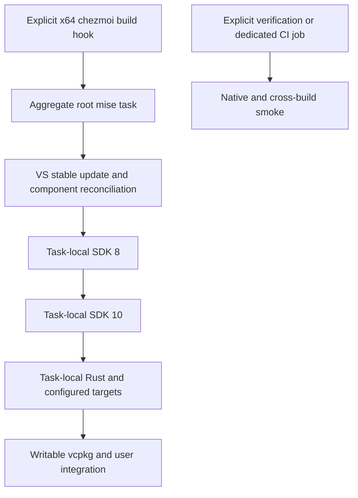
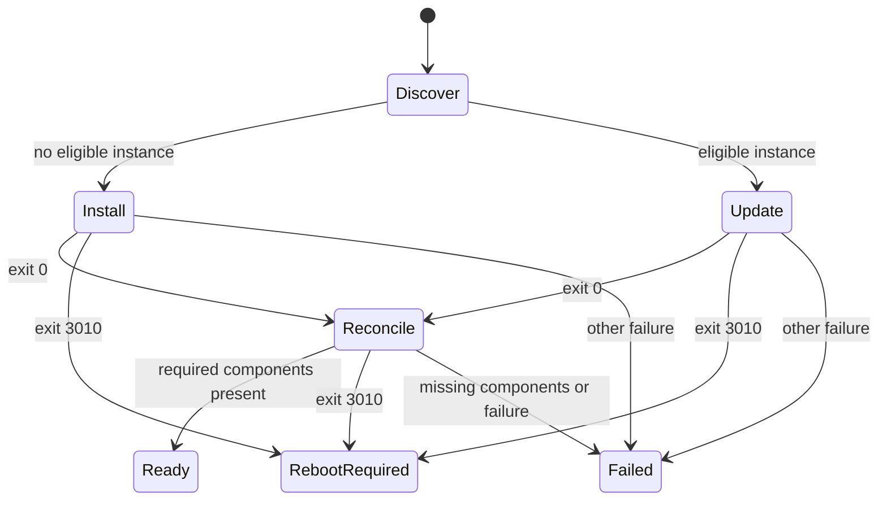

# Windows Native Build Environment - Plan

## Goal Capsule

- **Objective:** After applying this repository on a Windows x64 PC, the owner can build Rust, WPF, and MFC projects locally and produce Windows ARM64 binaries without manually assembling the build environment.
- **Means:** Task-scoped mise tools and native installer orchestration through a thin explicit-apply hook (KTD1-KTD4).
- **Product authority:** The Product Contract below records the scope confirmed by the repository owner, including ARM64 cross-compilation.
- **Execution profile:** One pull request; native Windows provisioning and runtime integration can be implemented independently before wiring the apply entry point.
- **Delivery owner:** The autonomous workflow implements, verifies, reviews, and opens the pull request; merging remains with the repository owner.
- **Stop conditions:** An unavailable required component, failed privileged installer, or unresolvable build failure prevents reporting the environment as ready.

---

## Product Contract

### Summary

Provision a Windows build environment through explicit repository application, with VS 2026 serving both current and compatibility builds.
Include the requested .NET versions, Rust stable, and user-wide vcpkg integration, with ARM64 cross-compilation from an x64 host.

### Problem Frame

The owner needs both current and compatibility Windows development targets on the same PC.
Selecting a Visual Studio product alone does not establish the compiler libraries, framework reference assemblies, Rust targets, or dependency integration needed by those projects.

### Key Decisions

- **One Visual Studio product, multiple compiler toolsets.** Older project toolsets do not require installing older Visual Studio products. Governs R3, R4. (session-settled: user-directed — chosen over installing VS 2019/2022 products: the owner wants VS 2026 Build Tools with v142/v143 compatibility components.)
- **Update Build Tools during explicit application.** Initial-install-only behavior would not maintain the requested latest environment. Governs R3. (session-settled: user-directed — chosen over retaining the initially installed version: the owner selected latest-stable updates on every apply.)
- **Provision Rust itself.** Native prerequisites alone do not make a fresh PC able to compile Rust. Governs R7. (session-settled: user-directed — chosen over separately managed Rust installation: the owner selected installation of Rust stable.)
- **Enable user-wide MSBuild integration.** The selected vcpkg instance becomes available to existing and future MSBuild C++ projects. Governs R8, R9. (session-settled: user-directed — chosen over command/environment setup only: the owner selected user-wide integration after its effect on existing integration was explained.)
- **Include ARM64 cross-compilation.** The build host remains x64; target coverage is not limited to that architecture. Governs R4, R5, R7, R9. (session-settled: user-directed — chosen over x86/x64-only coverage: the owner explicitly requires ARM64 cross-builds.)

### Requirements

**Application lifecycle**

- R1. Installation and personal-environment changes for this feature occur only during explicit application through the repository's chezmoi workflow, including `mise run apply`, not during worktree bootstrap or preparation.
- R2. These Windows build-environment actions do not run on Linux or macOS.
- R3. Each explicit apply ensures VS 2026 Build Tools is installed at the latest stable release available in its 2026 channel, without installing another Visual Studio generation, IDE, or Preview product.

**Build coverage**

- R4. On Windows x64, provide the latest stable MSVC toolset and v142/v143, each with the matching MFC/ATL libraries and Windows SDK prerequisites for x86, x64, and ARM64 target builds.
- R5. Provide .NET 10 SDK and .NET 8 SDK side by side for WPF builds, including ARM64-targeted builds from the x64 host.
- R6. Provide both .NET Framework 4.8 and 4.8.1 SDKs and targeting packs for WPF builds; a runtime-only installation does not satisfy this requirement.
- R7. Provide Rust stable with `rustc`, `cargo`, and the MSVC targets `x86_64-pc-windows-msvc` and `aarch64-pc-windows-msvc` for native x64 and cross-compiled ARM64 builds.

**vcpkg integration and project ownership**

- R8. Provide a usable vcpkg command, persistent user-level `VCPKG_ROOT` and command discovery, and user-wide MSBuild integration pointing to the same managed vcpkg instance.
- R9. Support vcpkg dependency builds for the target architectures in R4 while leaving libraries, manifests, baselines, triplets, and per-project toolset selection under project ownership.
- R10. Environment provisioning does not retarget application projects, rewrite their source or build configuration, or preinstall an arbitrary shared library collection.

**Repeat application and observable outcomes**

- R11. Reapplying reconciles missing required components and managed integration without removing unrelated installed software or replacing unrelated environment values.
- R12. Installation or configuration failures stop successful completion with an actionable diagnostic; a required reboot is reported rather than performed without consent.
- R13. Readiness is demonstrated through actual representative builds using the requested frameworks, toolsets, and target architectures, with ARM64 artifact validation distinguished from execution on ARM64 hardware.

### Key Flows

- F1. First explicit application. **Covers R1, R3-R8, R12.**
  - **Trigger:** The owner explicitly applies the repository on a Windows x64 PC.
  - **Outcome:** Required toolchains and user integration are installed and configured, or the failed prerequisite/action is reported without declaring readiness.
- F2. Repeat application. **Covers R3, R11, R12.**
  - **Trigger:** The owner explicitly applies again after a VS 2026 update becomes available or required local state is missing.
  - **Outcome:** The 2026 installation is updated, missing required components/integration are reconciled, and unrelated software remains installed.
- F3. Project build. **Covers R4-R10, R13.**
  - **Trigger:** The owner builds a project with its selected framework, toolset, architecture, and dependencies.
  - **Outcome:** The prepared environment supplies those build prerequisites without requiring the provisioning workflow to rewrite the project.

### Acceptance Examples

- AE1. Bootstrap remains separate. **Covers R1, R2.** Given a worktree preparation run, no feature-specific host build tools or user integration are applied; on non-Windows systems, the Windows actions are inactive.
- AE2. New Windows PC. **Covers R3-R8.** Given no managed build environment, explicit apply provides the requested tools and a fresh supported shell can discover Rust, .NET, and the selected vcpkg instance.
- AE3. Toolset-specific MFC builds. **Covers R4, R10, R13.** Representative MFC projects selecting latest MSVC, v142, and v143 compile and link for x86, x64, and ARM64 without silently switching their selected toolset.
- AE4. WPF SDK coexistence. **Covers R5, R13.** Representative WPF projects selecting .NET 8 and .NET 10 build using the corresponding installed SDK; their x64 and ARM64-targeted build outputs are produced on the x64 host.
- AE5. Framework targeting. **Covers R6, R13.** WPF projects targeting .NET Framework 4.8 and 4.8.1 build against the corresponding reference assemblies without changing their target frameworks.
- AE6. Rust native and cross builds. **Covers R7, R13.** A representative Rust program compiles and links for both named MSVC targets; the native x64 program runs and the cross-built output is identified as ARM64.
- AE7. vcpkg consumption. **Covers R8-R10, R13.** A representative MSBuild C++ project consumes a project-selected vcpkg dependency for x64 and ARM64 using the managed integration, without a separately provisioned global library collection.
- AE8. Existing configuration. **Covers R8, R11.** Given an existing user-wide vcpkg integration, explicit apply selects the managed instance consistently for the command, environment, and MSBuild while preserving unrelated user environment values.
- AE9. Update and reconciliation. **Covers R3, R11, R12.** Given an older VS 2026 installation or a missing required component, reapply updates/reconciles it; a failed installer or required reboot is not misreported as a verified build-ready state.

### Scope Boundaries

- The host scope is Windows x64; provisioning an ARM64 host is not included.
- R3 governs the Visual Studio product boundary; pre-existing unrelated Visual Studio installations are not an uninstall target.
- ARM64EC, non-Windows cross-compilation, and additional legacy compiler generations are outside the requested target coverage.
- R9 and R10 govern project-owned dependency and build choices; no application-repository migration is included.
- No remote ARM64 runner, emulator, or device provisioning is included; R13 distinguishes cross-built artifact validation from target execution.
- .NET Framework 4.8/4.8.1 coverage is framework targeting, not a promise of native ARM64 execution for every legacy application.

### Dependencies and Assumptions

- Downloads require network access and permission to install development tools; the owner can approve elevation and installation agreements.
- Microsoft must continue to publish the requested compatibility components for the selected product; unavailable components are failures under R12, not permission to silently drop a requirement.
- .NET Framework 4.x runtimes are in-place updates, whereas developer/targeting packs provide framework-specific build references; R6 does not require parallel 4.8 and 4.8.1 runtimes.
- Repository instructions remain authoritative for mise tool declarations, generated lockfiles, chezmoi ownership, and bootstrap safety.

### Sources and Research

- [VS Build Tools workload and component IDs](https://learn.microsoft.com/en-us/visualstudio/install/workload-component-id-vs-build-tools?view=visualstudio): use the VS 2026 section, including compatibility toolsets and the unaffiliated architecture-specific MFC/ATL components.
- [Install the .NET Framework developer pack or redistributable](https://learn.microsoft.com/en-us/dotnet/framework/install/guide-for-developers): distinguishes SDK/targeting packs from runtime servicing.
- [Rust Windows MSVC target support](https://doc.rust-lang.org/rustc/platform-support/windows-msvc.html): names the x64 and ARM64 targets and the requirement for architecture-appropriate Visual Studio components.
- [vcpkg in MSBuild projects](https://learn.microsoft.com/en-us/vcpkg/users/buildsystems/msbuild-integration): documents user-wide integration, instance selection, and project-level manifest/triplet behavior.

---

## Planning Contract

**Product Contract preservation:** Product Contract unchanged in scope and IDs; its planning-owned questions are resolved below.

### Key Technical Decisions

- KTD1. **Keep host tool acquisition task-scoped in the root mise configuration.** Declare separate SDK 8, SDK 10, and Rust task tools and generate their records in `mise.lock`; the ordinary bootstrap has no dependency on those tasks. A thin x64-only chezmoi hook invokes the aggregate task. This uses documented task-only installation rather than adding eager base tools or a second bootstrap. Implements R1, R2, R5, R7.
- KTD2. **Service a specifically selected Build Tools 18.x stable instance through Microsoft's bootstrapper.** Use the documented stable bootstrapper and channel, with product/version/channel filtering in vswhere; update every apply, then add missing components from a tracked additive `.vsconfig`. Validate the downloaded executable's Microsoft signature before elevation, wait for completion, and preserve reboot-required as a non-ready outcome. Implements R3, R4, R6, R11, R12.
- KTD3. **Use one explicitly owned shared .NET root.** Native mise `core:dotnet` tasks install the two SDK lines sequentially into the same directory with isolated mode disabled; user-level discovery points to that directory. Projects retain their `global.json` choices. Native `core:rust` supplies the configured MSVC targets, with user Rust/Cargo homes respected and no persistent `RUSTUP_TOOLCHAIN` override. Implements R5, R7, R10, R11.
- KTD4. **Own a writable standalone vcpkg checkout through a mise task.** Declare its upstream and revision in `mise.toml`, acquire the matching full checkout, bootstrap its executable, and invoke that absolute executable for user integration. The revision is a native task input, not falsely represented as a mise backend lock entry. The VS-bundled read-only instance and an executable-only download cannot supply the required writable full instance. Implements R8-R11.
- KTD5. **Keep installed state and user integration in their proper privilege scopes.** Elevate only the VS machine installer when necessary; run mise, Rust, vcpkg, and HKCU changes as the intended user. Preserve raw user PATH entries and registry value types while placing owned tool paths before competing user entries. Extend the managed PowerShell startup path narrowly so those tools also precede machine PATH entries in supported fresh shells, without changing machine PATH; verify actual command resolution. Implements R8, R11, R12.
- KTD6. **Separate isolated behavioral tests from real installation/build proof.** Command doubles and isolated registry keys exercise transitions and failure propagation without installing tools during the ordinary suite; a dedicated disposable Windows x64 job applies only the build hook and runs real native/cross-builds. Machine-local verification may run the same smoke in verify-only mode without triggering all personal settings. Implements R1, R2, R13.

### High-Level Technical Design

The existing bootstrap remains unchanged in purpose.
The aggregate mise task runs its stages sequentially because SDK installation shares a root and later stages require the native prerequisites.

VS instance existence and component completeness are distinct queries.
A partial installation is repaired rather than mistaken for absence.
Only the VS subprocess crosses the elevation boundary; state beneath the user home remains user-owned.

### Component Selection

The tracked VS config selects the C++ and managed desktop build prerequisites, Windows 11 SDK 26100, Framework 4.8/4.8.1 SDKs and targeting packs, and the following compiler-library matrix.
No blanket optional-component switch is used because it could add Preview components or unrelated workloads.

| Family | x86/x64 component suffix | ARM64 component suffix |
| --- | --- | --- |
| Latest compiler | `VC.Tools.x86.x64` | `VC.Tools.ARM64` |
| Latest ATL | `VC.ATL` | `VC.ATL.ARM64` |
| Latest MFC | `VC.ATLMFC` | `VC.MFC.ARM64` |
| v143 compiler | `VC.14.44.17.14.x86.x64` | `VC.14.44.17.14.ARM64` |
| v143 ATL | `VC.14.44.17.14.ATL` | `VC.14.44.17.14.ATL.ARM64` |
| v143 MFC | `VC.14.44.17.14.MFC` | `VC.14.44.17.14.MFC.ARM64` |
| v142 compiler | `VC.14.29.16.11.x86.x64` | `VC.14.29.16.11.ARM64` |
| v142 ATL | `VC.14.29.16.11.ATL` | `VC.14.29.16.11.ATL.ARM64` |
| v142 MFC | `VC.14.29.16.11.MFC` | `VC.14.29.16.11.MFC.ARM64` |

Every suffix in this table has the prefix `Microsoft.VisualStudio.Component.`.
Validate the current catalog and actual installer response rather than treating the table as proof that installation succeeded.

### Assumptions and Execution-Time Details

- The current mise executable supports native Rust/.NET and task-scoped lock resolution; verify its version before relying on those capabilities.
- The chosen SDK root and vcpkg checkout live under the owner's user-local data directory, not under a disposable worktree.
- Installer signature identity, actual installed instance state, and whether a reboot is needed are execution-time observations.
- Select the current stable vcpkg release revision before implementation and record it as a native task input; do not follow a moving Git branch silently.
- Do not add retry frameworks, downloads of unrelated tools, an automatic reboot mechanism, or application-project rewrites.

### Existing Patterns and Sources

- `mise.toml`: bootstrap/apply separation; task-scoped tools preserve this separation while keeping tool ownership in mise.
- `home/.chezmoiscripts/run_onchange_after_10-personal-app-path.ps1.tmpl`: raw HKCU PATH preservation and notification; `home/.chezmoitemplates/powershell-mise-profile` provides the existing supported fresh-shell startup path used by KTD5.
- `tests/test_windows_apps.py`: isolated native command doubles and repeat-apply/failure behavior.
- `tests/smoke_personal_apps.py`: disposable-host mutation checks, persistent environment restoration, and fresh-shell discovery.
- `.github/workflows/test.yml`: retain supported hosted runner choices and pinned action references; add a dedicated Windows x64 build-environment job, not installation in every native job.
- [Mise task tools](https://mise.jdx.dev/tasks/task-configuration.html#tools): lockable task-local tool declarations do not enter plain `mise install`.
- [Mise .NET](https://mise.jdx.dev/lang/dotnet.html) and [Rust](https://mise.jdx.dev/lang/rust.html): native Windows installation, shared SDK root, and Rust target options.
- [VS command-line parameters](https://learn.microsoft.com/en-us/visualstudio/install/use-command-line-parameters-to-install-visual-studio?view=visualstudio): bootstrapper-only `--wait`, additive configuration, elevation, and installer exit codes.
- [VS command-line examples](https://learn.microsoft.com/en-us/visualstudio/install/command-line-parameter-examples?view=visualstudio): stable channel selection.

---

## Implementation Units

### U1. Native Visual Studio provisioning

**Goal:** Install, update, and reconcile the selected stable Build Tools instance without touching unrelated products.

**Requirements:** R3, R4, R6, R11, R12; F1, F2; KTD2, KTD5.

**Dependencies:** None.

**Files:** Create `scripts/windows-visual-studio.ps1` and `tests/test_windows_visual_studio.py`.

**Approach:** Accept a tracked component-config path and declared installer/channel inputs from the task owner; separate discovery, machine installation/servicing, component checks, and completion status.
Only elevate the machine-installer subprocess, and stop on a reboot-required result instead of proceeding to dependent setup.

**Patterns:** Native exit handling in the existing Windows app action and isolated command doubles in `tests/test_windows_apps.py`.

**Test scenarios:**

- Covers AE9. Existing eligible instance is updated even when component inventory is complete; missing components are added rather than skipped.
- A partial Build Tools instance is not confused with absence or an unrelated IDE.
- Failed signature verification prevents execution.
- Covers AE9. Installer failure and reboot-required are propagated without a ready result or dependent actions.
- Paths containing spaces and non-ASCII characters reach the native command intact.

**Verification:** Isolated installer/discovery fixtures demonstrate these transitions; U4 provides actual compiler/library proof that command fixtures cannot establish.

### U2. Language tools and writable dependency integration

**Goal:** Make installed SDKs, Rust targets, and the managed vcpkg instance usable from normal user sessions.

**Requirements:** R5, R7-R12; F1, F3; KTD3-KTD5.

**Dependencies:** None; tool installation itself is wired by U3.

**Files:** Create `scripts/windows-build-environment.ps1` and `tests/test_windows_build_environment.py`.

**Approach:** Provide phase-specific checks/integration for SDK installation, Rust readiness, and vcpkg acquisition plus user integration.
Use task-provided paths and revisions, preserve existing Rust project overrides, and bind vcpkg command discovery and MSBuild to the same full writable root.

**Patterns:** Existing personal-app raw registry PATH handling and temporary-key isolation used by `tests/test_personal_apps.py` and `tests/test_native_ca_windows.py`.

**Test scenarios:**

- Covers AE8. Replace the managed vcpkg selection while preserving unrelated user environment values and PATH type.
- A repeated integration adds no duplicate paths and repairs a missing managed path.
- A checkout with unrelated local modifications is not destructively reset.
- Failed checkout/bootstrap/integration or missing expected SDK/target prevents a success result.
- A user without an existing Rust default gets usable native tools without persisting a project-overriding toolchain environment variable.

**Verification:** Isolated registry and command fixtures prove integration ownership and failure handling; U4 proves real SDK selection and vcpkg consumption.

### U3. Wire explicit apply and task-only declarations

**Goal:** Connect the complete environment to explicit apply without changing ordinary bootstrap behavior.

**Requirements:** R1-R12; F1, F2; KTD1-KTD5.

**Dependencies:** U1, U2.

**Files:** Modify `mise.toml`, regenerate `mise.lock`, and update affected bootstrap tests, `home/.chezmoitemplates/powershell-mise-profile`, and `tests/test_powershell_profile.py`; create `scripts/windows-build-tools.vsconfig`, `home/.chezmoiscripts/run_after_25-windows-build-environment.ps1.tmpl`, and `tests/test_windows_build_apply.py`.

**Approach:**

1. Declare the aggregate task and native installer/vcpkg inputs in `mise.toml`.
2. Run VS, SDK 8, SDK 10, Rust, and final vcpkg/user integration sequentially with task-scoped language tools.
3. Render the hook only for Windows amd64, with the existing native PowerShell encoding/quoting conventions and current-worktree source binding.
4. Regenerate locked task-tool resolutions without adding those tools to base bootstrap installation.

**Test scenarios:**

- Covers AE1. Plain bootstrap cannot invoke host provisioning, while every explicit build-hook apply invokes the aggregate task.
- Covers AE1. Linux, macOS, and Windows ARM64 render no build action.
- Covers AE9. Failed aggregate provisioning causes apply failure.
- Covers AE8. A fresh supported PowerShell resolves managed dotnet and vcpkg before conflicting machine/user paths without rewriting machine PATH.
- Dry-run and script-excluding operations do not execute the build task.
- Canonical component selection covers each requested compiler/library architecture without Preview selection.

**Verification:** Render/apply fixtures and the existing bootstrap suite remain safe and prove the lifecycle boundary; real use is exercised by U4.

### U4. Prove real builds and document operation

**Goal:** Demonstrate the complete native/cross-build environment and explain its update and activation boundaries.

**Requirements:** R1-R13; F1-F3; AE1-AE9; KTD6.

**Dependencies:** U3.

**Files:** Create `tests/smoke_windows_build_environment.py`; modify `.github/workflows/test.yml`, `README.md`, and `home/README.md`.

**Approach:** Provide an explicitly selected, disposable-Windows-x64 provisioning smoke and a verify-only mode for an existing local environment.
Create representative projects in temporary directories, select each framework/toolset deliberately, inspect ARM64 PE machine types, and run native outputs.
Use a project-owned vcpkg dependency and triplets to prove both x64 and ARM64 integration.

**Test scenarios:** Execute AE3-AE7 against real binaries, plus repeat application/component reconciliation where installation is permitted; isolate the selected hook from Git/GPG/auth and unrelated personal app actions.

**Verification:** The dedicated hosted job records actual SDK versions, compiler selections, successful build/run output, and ARM64 artifact checks; a skipped or unavailable target is reported as missing proof rather than success.

---

## Verification Contract

- Run `mise exec -- python -m unittest discover -s tests` once after integration; targeted tests may be used while correcting a specific failed boundary.
- Run `mise exec -- python tests/smoke_windows_build_environment.py --verify-only` against an existing prepared Windows x64 host without applying unrelated personal settings.
- The dedicated Windows x64 CI job runs the smoke with explicit provisioning enabled, then builds the complete requested matrix and verifies reapplication.
- Keep all machine installation outside generic unit/native jobs, and retain existing repository hosted-runner policy.
- Real smoke records .NET SDK enumeration, framework reference availability, native executable output, and ARM64 PE architecture.
- Actual ARM64 execution is outside this x64-host contract; do not claim it from a successful cross-build.

---

## Definition of Done

- Every implementation unit is complete and all required toolsets, frameworks, targets, and integration in the Product Contract have evidence.
- The normal bootstrap remains free of feature-specific host installations and user-state mutations.
- Tests and real build smoke pass, or a specific missing prerequisite is reported as a blocker rather than narrowing coverage.
- Documentation describes explicit application, latest-stable VS updates, SDK selection, vcpkg ownership, environment activation, and reboot-required behavior.
- Experimental scaffolds and temporary projects are removed; no abandoned implementation paths remain.
- Independent review findings are resolved or recorded with evidence before the pull request is delivered.
