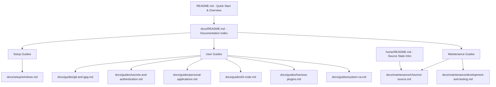

# docs: organize user and maintainer guides under docs/

## Goal Capsule

- **Objective:** Reorganize maintained documentation out of oversized monolithic README files into dedicated, authoritative guides under `docs/`, with a concise quick start in `README.md`, clear task-based navigation in `docs/README.md`, and pure source-context explanation in `home/README.md`.
- **Means:** Extract, consolidate, and structure existing operational and maintainer knowledge into task-focused guides grouped by setup, user operations, and repository maintenance. Eliminate duplicated descriptions across READMEs while preserving all substantive operational knowledge.
- **Authority:** Resolves GitHub Issue #28 (`docs: organize user and maintainer guides under docs/`).
- **Execution profile:** Single branch and pull request, implemented across 5 cohesive units.
- **Stop conditions:** All operational and maintainer facts have one authoritative location under `docs/`, `README.md` is a focused quick start, `home/README.md` contains only source-directory orientation, all cross-links resolve, and the existing test suite passes.

---

## Product Contract

### Summary

`README.md` (877 lines) and `home/README.md` (246 lines) currently combine bootstrap walkthroughs, daily operations, source-authoring constraints, implementation details, migration history, and verification reports. Unrelated features modify the same sections, producing merge conflicts and factual drift (e.g. Podman Desktop listed in root README but omitted from `home/README.md`).

This change restructures repository documentation under `docs/`, establishing one authoritative home per topic, separating setup, user guides, and maintenance, and providing a clean quick-start experience in `README.md`.

### Problem Frame

Contributors and operators encounter cognitive overload and frequent merge conflicts when working in `README.md` or `home/README.md`. Information is duplicated between files, making it easy for one copy to become stale. Finding the right operational procedure requires reading through hundreds of lines of mixed user and maintainer content.

### Requirements

#### Structure and Organization

- R1. Detailed documentation lives under `docs/`, organized into `docs/setup/`, `docs/guides/`, and `docs/maintenance/`.
- R2. `README.md` provides a concise quick start, essential prerequisites, common commands, and links to the documentation index.
- R3. `home/README.md` explains the chezmoi source directory purpose and links to its authoring guide in `docs/maintenance/chezmoi-source.md`, without duplicating feature guides or script lifecycle rules.
- R4. `docs/README.md` serves as the documentation index, grouping guides by reader task (Setup, User Guides, Maintenance).

#### Content Preservation and Accuracy

- R5. Every substantive operational and maintainer topic from existing READMEs is preserved, consolidated, or deliberately removed as obsolete.
- R6. Each operational fact has exactly one authoritative location; duplicated descriptions across README files are eliminated.
- R7. All retained commands, paths, flags, prerequisites, and platform claims match current repository implementation and test behavior.
- R8. All internal relative Markdown links resolve to existing files and valid anchors.
- R9. Documentation guidelines from Issue #28 are honored: descriptive headings, language-tagged code blocks, security/data-loss warnings placed next to relevant actions, plain English prose, no external static-site generator or doc framework.

### Scope Boundaries

- **In Scope:**
  - Creating `docs/README.md`.
  - Creating setup guide: `docs/setup/windows.md`.
  - Creating user guides: `docs/guides/git-and-gpg.md`, `docs/guides/secrets-and-authentication.md`, `docs/guides/personal-applications.md`, `docs/guides/t3-code.md`, `docs/guides/harness-plugins.md`, `docs/guides/system-ca.md`.
  - Creating maintainer guides: `docs/maintenance/chezmoi-source.md`, `docs/maintenance/development-and-testing.md`.
  - Refactoring `README.md` into a concise quick start and navigation hub.
  - Refactoring `home/README.md` into a source-directory explanation linking to `docs/maintenance/chezmoi-source.md`.
  - Updating references in `AGENTS.md` to point to the new authoritative maintainer guide.
  - Verifying all internal links and running the repository test suite.

- **Out of Scope (Non-goals):**
  - Modifying bootstrap scripts, chezmoi templates, apply logic, or test fixtures.
  - Introducing a documentation website or publishing pipeline (no VitePress, MkDocs, Docusaurus).
  - Modifying or moving historical Compound Engineering plans and solution records in `.compound-engineering/artifacts/`.

### Acceptance Examples

- AE1. A new user reading `README.md` finds repository purpose, prerequisites, quick-start steps for Windows bootstrap, worktree initialization, applying personal settings, and a direct link to `docs/README.md`, without having to scroll through 800+ lines.
- AE2. A developer inspecting `home/` reads `home/README.md`, understands that `home/` is the chezmoi source state selected by `.chezmoiroot`, and finds a direct link to `docs/maintenance/chezmoi-source.md` for source-authoring rules and script lifecycle.
- AE3. An operator configuring Git signing or GPG pinentry opens `docs/guides/git-and-gpg.md` and finds complete platform executable tables, GPG home constraints, configuration overrides, and verification steps in one place.
- AE4. An operator importing GitHub or GitLab API tokens opens `docs/guides/secrets-and-authentication.md` and finds encryption prerequisites, token import commands, native keyring integration details, and security boundaries.
- AE5. A maintainer adding a chezmoi script opens `docs/maintenance/chezmoi-source.md` and finds script lifecycle phases (`run_before_`, `run_onchange_`, `run_once_`), numeric ordering conventions, dependency signatures, Windows PowerShell BOM requirements, and modify-template rules.
- AE6. A maintainer writing or running tests opens `docs/maintenance/development-and-testing.md` and finds test suite execution commands, smoke check instructions, and the CI runner support matrix.
- AE7. A link verification check over all repository `.md` files verifies that every internal relative link resolves to a valid existing file.

---

## Planning Contract

### Key Technical Decisions

- KTD1. **Task-based directory taxonomy under `docs/`.** Group documentation into three intuitive subdirectories:
  - `docs/setup/`: Platform bootstrap and initial environment provisioning.
  - `docs/guides/`: Day-to-day user operations and feature workflows.
  - `docs/maintenance/`: Source authoring, script lifecycles, and testing/CI maintenance.
  This directly mirrors the reader's role and intent.

- KTD2. **Dedicated T3 Code guide (`docs/guides/t3-code.md`).** Rather than cramming cross-platform desktop application packaging, launchers, and omp ACP integration into `personal-applications.md`, give T3 Code its own dedicated guide. This isolates desktop GUI / ACP concerns from lightweight CLI tooling (omp, gh, ghq).

- KTD3. **Keep `README.md` functional and concise (< 150 lines).** The root `README.md` should contain:
  1. Repository Purpose & Architecture Summary.
  2. Quick Start (Windows PC bootstrap, Worktree preparation via `mise install`, Applying personal settings via `mise run apply`).
  3. Common Commands cheatsheet (`chezmoi apply`, `chezmoi update`, `chezmoi diff`).
  4. Documentation directory overview linking to `docs/README.md`.
  All lengthy platform tables, deep troubleshooting paragraphs, and implementation minutiae are moved to dedicated guides.

- KTD4. **Keep `home/README.md` minimal (< 30 lines).** State that `./home` is the source state selected by `.chezmoiroot`, note that it is excluded by `.chezmoiignore`, and provide links to `docs/maintenance/chezmoi-source.md` (authoring guide) and `docs/README.md` (all documentation).

- KTD5. **Update `AGENTS.md` harness onboarding pointer.** `AGENTS.md` line 24 currently points to `home/README.md` for the harness onboarding procedure. Update this to `docs/maintenance/chezmoi-source.md#shared-user-scope-harness-instructions` to keep maintainer instructions authoritative.

### High-Level Technical Design



### Assumptions

1. The target audience uses standard Markdown readers on GitHub and local editors. No HTML pre-processors or doc frameworks are desired.
2. Code and test behavior remains identical; documentation restructuring must not modify code, scripts, templates, or test assertions.
3. Compound Engineering artifacts in `.compound-engineering/artifacts/` are historical plans and solutions and must not be touched or renamed.

### Sequencing and Dependencies

1. **U1:** Create `docs/setup/windows.md`.
2. **U2:** Create user guides: `docs/guides/git-and-gpg.md`, `docs/guides/secrets-and-authentication.md`, `docs/guides/personal-applications.md`, `docs/guides/t3-code.md`, `docs/guides/harness-plugins.md`, `docs/guides/system-ca.md`.
3. **U3:** Create maintainer guides: `docs/maintenance/chezmoi-source.md`, `docs/maintenance/development-and-testing.md`.
4. **U4:** Create `docs/README.md`, refactor `README.md` and `home/README.md`, update `AGENTS.md`.
5. **U5:** Audit cross-references and internal links, check command accuracy, and run regression tests.

---

## Implementation Units

### U1. Windows Setup Guide

- **Goal:** Create `docs/setup/windows.md` covering Windows PC bootstrap, chezmoi source registration, host applications (WinGet), virtualization and WSL2 readiness checks, Windows native build environment, and Podman / Kubernetes onboarding.
- **Files:** `docs/setup/windows.md`
- **Dependencies:** None
- **Approach:**
  - Consolidate Windows bootstrap instructions from `README.md` lines 7–86.
  - Document registration with `configure-chezmoi.ps1` and everyday `chezmoi apply` / `update` commands.
  - Document Windows host applications from `home/.chezmoidata/windows.yaml` (Chrome, 1Password, 1Password CLI, PowerShell, Podman Desktop, T3 Code) and WinGet `--no-upgrade` policy.
  - Document the read-only `run_before_05` virtualization guard (WSL2, VirtualMachinePlatform, HypervisorPlatform).
  - Document Windows native build environment from `README.md` lines 184–268 (VS 2026 Build Tools, MSVC v143/v142, ATL/MFC, SDK 26100/22621, .NET 8/10, Framework 4.8/4.8.1, Rust, vcpkg, terminal restart, and smoke verify).
  - Document Podman Desktop, kind on WSL rootful requirement, compose, and context verification from `README.md` lines 308–339.
  - Add standard task flow: prerequisites, step-by-step procedures, verification, and troubleshooting.
- **Verification:** Markdown formatting check, heading readability, link verification.

### U2. User Guides for Daily Operations

- **Goal:** Create authoritative guides under `docs/guides/` for Git & GPG, secrets and authentication, personal applications, T3 Code, harness plugins, and system CA trust.
- **Files:**
  - `docs/guides/git-and-gpg.md`
  - `docs/guides/secrets-and-authentication.md`
  - `docs/guides/personal-applications.md`
  - `docs/guides/t3-code.md`
  - `docs/guides/harness-plugins.md`
  - `docs/guides/system-ca.md`
- **Dependencies:** U1
- **Approach:**
  - `git-and-gpg.md`: Git identity (`Joosung Park`), automatic OpenPGP commit signing (`621512777E6933FEB4458FDC4945855D4F283F05`), platform executable table (Windows, Linux, macOS), TOML config overrides (`gpgProgram`, `pinentryProgram`), GPG home safety guards (%USERPROFILE%/AppData/Roaming/gnupg vs ~/.gnupg), reparse point rejection, agent reload, `git verify-commit HEAD`, and ghq repository cloning (`ghq.root = ~/src`).
  - `secrets-and-authentication.md`: Chezmoi built-in GPG encryption, single recipient key, editing with `edit-encrypted`, external file `encrypt --output`, secrets template partial (`secrets`), security boundaries (plaintext exposure, temporary files); GitHub CLI personal binary vs mise development binary, `scripts/github-auth.py import`, native keyring integration (Windows Credential Manager, macOS Keychain, Linux Secret Service), credential helper config, verification with `gh auth status`; GitLab CLI (`glab`), `scripts/gitlab-auth.py import`, private connection JSON format, native credential storage, Git include file (`gitlab.gitconfig`), verification.
  - `personal-applications.md`: Managed personal CLIs (omp, gh, ghq), installation directory `~/.local/bin`, Windows user PATH modification, POSIX profile sourcing (`.config/dotfiles/path.sh`), updating with `chezmoi update`, pin architecture (`personal-apps.json`, `personal-app-lock.json`), manual refresh with `scripts/update-personal-app-lock.py`, automated daily workflow at 06:23 UTC, adding new applications, `--refresh-externals` recovery; PowerShell mise activation in CurrentUserAllHosts profile, replacement policy, and runtime startup requirements.
  - `t3-code.md`: T3 Code desktop installation (WinGet, macOS cask, Ubuntu deb external), bundled CLI launchers (`~/.local/bin/t3`, `t3 app`), omp ACP provider configuration in `~/.t3/userdata/settings.json`, closed-app requirement, and smoke verification (`smoke_t3_code.py`).
  - `harness-plugins.md`: Compound Engineering plugin for omp, archive extraction to `~/.local/share/dotfiles/harness-plugins/compound-engineering`, local marketplace registration, force installation and enabling, disabling auto-updates (`marketplace.autoUpdate: "off"`), mutable YAML settings modification (`config.yml` / `config.yaml`), pin updates with `scripts/update-harness-plugin-lock.py` (daily at 06:43 UTC), rollback, and smoke verification (`smoke_harness_plugins.py`); shared user-scope instructions overview (`~/.omp/agent/AGENTS.md` and `home/.chezmoitemplates/agent-instructions`).
  - `system-ca.md`: `NODE_USE_SYSTEM_CA=1` environment variable, runtime support table (Node, Bun, omp, Python, pip, Requests, Java JSSE, Git HTTPS, curl, Go), OS activation methods (Windows HKCU\Environment, Linux environment.d, macOS LaunchAgent, Unix shell export block), verifying effective trust with `omp update --check`, and troubleshooting conflicting environment variables.
- **Verification:** Markdown formatting, code block language tags, accuracy against existing codebase and tests.

### U3. Maintainer Guides

- **Goal:** Create maintainer guides under `docs/maintenance/` covering chezmoi source architecture, script lifecycles, and development & testing workflows.
- **Files:**
  - `docs/maintenance/chezmoi-source.md`
  - `docs/maintenance/development-and-testing.md`
- **Dependencies:** U1, U2
- **Approach:**
  - `chezmoi-source.md`: Source layout (`.chezmoiroot` selecting `./home`), `.chezmoiignore`, `.chezmoidata/` files (`git.yaml`, `gpg.yaml`, `windows.yaml`, `personal-apps.json`, `harness-plugins.json`, locks), externals (`.chezmoiexternals/`), script lifecycle phases (`run_before_`, `run_onchange_`, `run_once_`), padded numeric naming (`run_before_10-...`), dependency signatures (`# file ... sha256: ...`, `# data ... sha256: ...`), Windows PowerShell execution (BOM requirement `\ufeff`, `-NoProfile`, non-interactive), modify-template conventions (`chezmoi:modify-template`, no `.tmpl`, preserving unowned properties), repeat application and idempotency rules, and shared user-scope harness onboarding procedure (connecting `home/.chezmoitemplates/agent-instructions`, native adapter creation, verification in disposable home).
  - `development-and-testing.md`: Worktree preparation (`mise install`, `postinstall` hook, hook-free `.chezmoi-bootstrap.toml`), manual bootstrap inspection (`mise run bootstrap`), test suite execution (`mise exec -- python -m unittest discover -s tests`), unit test architecture (isolation, Windows bootstrap, global chezmoi, git/gpg, secrets, native CA, PowerShell profiles, Windows apps, script lifecycle, personal apps, harness plugins), standalone smoke scripts (`smoke_windows_build_environment.py`, `smoke_t3_code.py`, `smoke_personal_apps.py`, `smoke_harness_plugins.py`, `smoke_gitlab_auth.py`), CI runner support matrix policy (Ubuntu 24.04/26.04 x64 & ARM64, macOS Xcode 27 ARM64, Windows 2025 x64, Windows 11 ARM64 limits), and verification limits.
- **Verification:** Verify against repo configuration (`mise.toml`, `tests/`, `.github/workflows/test.yml`).

### U4. Navigation Hubs: Index, READMEs, and AGENTS.md

- **Goal:** Create `docs/README.md`, rewrite root `README.md` and `home/README.md` into clean hubs, and update `AGENTS.md` cross-links.
- **Files:**
  - `docs/README.md`
  - `README.md`
  - `home/README.md`
  - `AGENTS.md`
- **Dependencies:** U1, U2, U3
- **Approach:**
  - `docs/README.md`: Create structured documentation index organized by reader task:
    - **Setup Guides**: Windows Bootstrap & Environment (`docs/setup/windows.md`).
    - **User Guides**: Git and GPG Signing (`docs/guides/git-and-gpg.md`), Secrets and Keyring Authentication (`docs/guides/secrets-and-authentication.md`), Personal CLI Applications (`docs/guides/personal-applications.md`), T3 Code Desktop & ACP (`docs/guides/t3-code.md`), Harness Plugins (`docs/guides/harness-plugins.md`), Native System CA Trust (`docs/guides/system-ca.md`).
    - **Maintenance Guides**: Chezmoi Source Architecture (`docs/maintenance/chezmoi-source.md`), Development, Testing, and CI (`docs/maintenance/development-and-testing.md`).
  - `README.md`: Streamline into a concise (< 150 lines) entry point:
    - Repository purpose & scope.
    - Essential prerequisites.
    - Quick Start (Windows bootstrap, worktree initialization with `mise install`, applying personal settings with `mise run apply`).
    - Everyday commands table (`chezmoi apply`, `chezmoi update`, `chezmoi diff`).
    - Direct links to `docs/README.md` and individual guides.
  - `home/README.md`: Streamline into a concise source-directory notice (< 30 lines) explaining that `./home` is the chezmoi source state, excluded by `.chezmoiignore`, with direct links to `docs/maintenance/chezmoi-source.md` and `docs/README.md`.
  - `AGENTS.md`: Update line 24 to point to `docs/maintenance/chezmoi-source.md#shared-user-scope-harness-instructions`.
- **Verification:** Check rendered links, ensure no dead ends exist.

### U5. Integrity Verification and Link Audit

- **Goal:** Audit all cross-references across all `.md` files in the repository to guarantee zero broken links, verify command accuracy, and run regression tests.
- **Files:** All modified and newly created `.md` files
- **Dependencies:** U1, U2, U3, U4
- **Approach:**
  - Run an automated link verification script to check every relative link in `README.md`, `home/README.md`, `AGENTS.md`, and all `docs/**/*.md`.
  - Check that all referenced headings/anchors exist.
  - Run the full test suite (`mise exec -- python -m unittest discover -s tests`).
  - Verify `git status` shows only documentation files created or modified.
- **Verification:** All tests pass, zero broken links.

---

## Verification Contract

### Automated Checks

1. **Test Suite:**

   ```sh
   mise exec -- python -m unittest discover -s tests
   ```

   Must pass with 0 failures and 0 errors, proving that documentation reorganization has not perturbed any chezmoi execution, isolation, or test discovery.

2. **Link & Anchor Integrity Check:**
   Write and execute a verification script checking:
   - Every `[label](path)` relative markdown link targets an existing file.
   - Any targeted anchor `#anchor` matches a valid heading in the target file.
   - Zero broken links exist in `README.md`, `home/README.md`, `AGENTS.md`, and `docs/**/*.md`.

### Manual and Semantic Checks

1. Verify that `README.md` is under 150 lines and contains only essential quick-start and navigation content.
2. Verify that `home/README.md` is under 30 lines and focuses purely on explaining the chezmoi source directory role.
3. Verify that `docs/README.md` lists every guide under `docs/`.
4. Verify that all operational commands (`powershell.exe ...`, `mise install`, `mise run apply`, `chezmoi apply`, `omp update --check`, etc.) are verbatim accurate to repository source.

---

## Definition of Done

- [ ] All 9 new documentation files under `docs/` exist and are populated with comprehensive, accurate content.
- [ ] `README.md` is refactored into a concise quick start and navigation hub.
- [ ] `home/README.md` no longer duplicates feature descriptions or source-authoring rules.
- [ ] `AGENTS.md` points to `docs/maintenance/chezmoi-source.md`.
- [ ] Every substantive topic from previous READMEs is preserved in its authoritative guide.
- [ ] Every relative internal link resolves without error.
- [ ] The full test suite passes.
