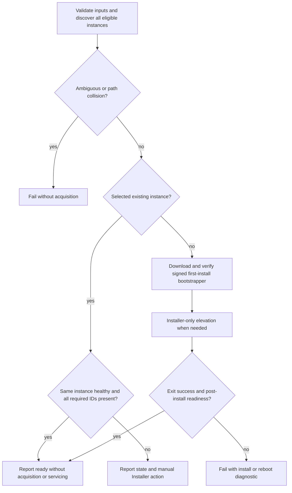
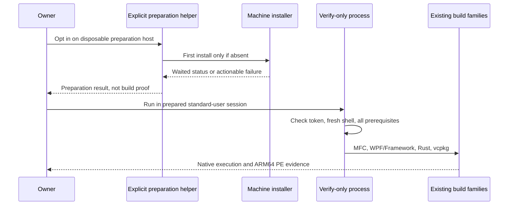

# Standard-User Windows Verification and Build Tools Reuse - Plan

## Goal Capsule

- **Objective:** The owner can test the repository and verify the complete Windows build environment from an ordinary, non-elevated session without an installation or UAC prompt.
- **Means:** Reuse ready Build Tools and separate verification from explicit machine preparation (R1-R8; KTD1-KTD4).
- **Authority:** Issues [#43](https://github.com/hyperlapse122/dotfiles/issues/43) and [#40](https://github.com/hyperlapse122/dotfiles/issues/40), including the owner's manual-maintenance decision, govern this change. This plan changes the earlier VS servicing policy, not the required toolchain coverage.
- **Execution profile:** One pull request containing U1-U4. U1 and U2 can begin independently; U3 integrates their boundaries and U4 documents and proves the result.
- **Delivery owner:** The implementation workflow integrates, verifies, and reviews the work. The calling workflow owns commits and delivery; this planning run does not implement or push.
- **Stop conditions:** Missing required prerequisites, failed installation, required reboot, an elevated verification token, or missing build evidence prevents a readiness claim. Hosted provisioning remains unverified until its own lane succeeds.

---

## Product Contract

### Summary

Ordinary tests and the existing full build verifier run without machine provisioning.
Explicit apply reuses a ready stable VS 2026 Build Tools installation, installs only when absent, and reports existing installations needing manual maintenance.

### Problem Frame

The current explicit-apply task downloads a bootstrapper and updates an existing eligible installation before checking components.
A standard-user apply can therefore request elevation even when the build environment is sufficient.
The build smoke's provisioning mode also combines machine preparation with verification, obscuring which activity needs administrator rights.
The owner wants to choose Visual Studio updates and component maintenance without losing the requested native and cross-build coverage.

### Key Decisions

- **The owner maintains existing Visual Studio installations manually.** Governs R1-R3. (session-settled: user-directed — chosen over automatic existing-instance update, repair, and component reconciliation: the owner explicitly requests Visual Studio Installer maintenance.)
- **Keep verification and privileged preparation separate.** Governs R5-R8. The existing verify-only implementation supplies the build checks rather than a reduced replacement.

### Requirements

**Visual Studio lifecycle**

- R1. Discover and inspect the intended stable VS 2026 Build Tools instance before any bootstrapper download, installer launch, update, or elevation request; reuse it unchanged when ready, regardless of a newer available release.
- R2. Existing incomplete, unhealthy, reboot-pending, or missing-component installations fail with the selected instance/path, concrete known state, missing component IDs where determinable, and actionable manual Visual Studio Installer instructions; apply never services them automatically.
- R3. Preserve selection of product `Microsoft.VisualStudio.Product.BuildTools`, version range `[18.0,19.0)`, stable channel `VisualStudio.18.Release`, and non-Preview instances; reject ambiguity and preserve unrelated products and installations.
- R4. Only absent Build Tools enters the explicit first-install path, retaining the official stable URI/channel, valid Microsoft Authenticode signature, protected install-path collision, proper installer-only elevation, waited exit status, temporary-download cleanup, and no automatic restart; failures and reboot-required results cannot report ready.

**Standard-user verification and preparation**

- R5. Expose documented standard-user commands for the ordinary unit suite and complete existing `--verify-only` build matrix; neither verification path invokes a machine installer, `RunAs`, self-elevation, or persistent environment preparation.
- R6. Before the first representative build, verification diagnoses missing VS components/toolsets/SDKs, .NET SDKs and targeting packs, Rust toolchain/targets, vcpkg prerequisites, and managed command discovery, with explicit preparation or manual-maintenance instructions; no missing required target is skipped or installed automatically.
- R7. Record an explicitly non-elevated native Windows token for the relevant unit-suite and real-build receipts; an administrator-capable runner label does not prove this requirement.
- R8. Keep real first-install and repeat-preparation work in a distinct, explicitly opt-in privileged preparation lane, with installer failures and reboot outcomes covered separately; preserve legitimate production elevation and cover non-admin elevation selection and cancelled-elevation propagation behaviorally.

**Coverage and repository boundaries**

- R9. Preserve latest/v143/v142 MFC for Win32/x86, x64, and ARM64; SDKs 26100 and 22621 with 22621 used for v142 ARM64; .NET 8/10 WPF x64/ARM64; Framework 4.8/4.8.1 WPF; Rust MSVC x64/ARM64; vcpkg consumption x64/ARM64; and managed fresh-shell command-discovery proof. Execute native outputs and inspect ARM64 PE architecture without claiming ARM64 execution.
- R10. Keep bootstrap free of machine/personal provisioning and leave non-Visual-Studio provisioning unchanged; documentation distinguishes first install, ordinary apply, manual maintenance, standard-user verification, and explicit privileged preparation without rewriting historical plans.

### Acceptance Examples

| ID | Covers | Given / action / expected outcome |
| --- | --- | --- |
| AE1 | R1, R3 | A ready stable 18.x instance exists and a newer release is available; repeated apply reports that same instance ready with no download, installer launch, elevation, or version change. |
| AE2 | R2, R3 | The selected existing instance lacks a tracked component or is incomplete/unlaunchable; apply fails with manual-maintenance guidance, identifies the state and component details, and leaves installed state untouched. |
| AE3 | R3, R4 | Only unrelated IDEs, older generations, or Preview instances exist; first install targets stable Build Tools without modifying those installations, while ambiguity or an occupied proposed path fails before download. |
| AE4 | R4, R8 | No eligible instance exists; a signed explicit first install may request elevation, and cancellation, failed exit, or reboot-required exit produces failure rather than a readiness message. |
| AE5 | R5-R7, R9 | A prepared Windows x64 user session has a non-elevated token; ordinary tests and verify-only complete all required checks without machine provisioning or UAC. |
| AE6 | R5, R6 | A prerequisite is absent; verify-only fails before any representative build, names what is missing and how the owner prepares it, and neither elevates nor silently skips a matrix member. |

### Scope Boundaries

- In scope: VS reuse/manual-maintenance policy, deterministic installer-boundary tests, the existing build verifier's read-only preflight, a distinct disposable preparation entry point, and operational documentation.
- No automatic update checks, installer self-update, repair, component installation, or alternative product fallback for existing VS instances; R1-R3 own the policy.
- No generic process framework, retry system, new Windows account/token-launcher infrastructure, or suppression of production installer UI. These are unnecessary for the requested separation and available local standard-user proof.
- Project-local NuGet/vcpkg dependency restores remain allowed in temporary build projects; R5 does not promise offline builds or zero user-cache writes.
- Issue [#44](https://github.com/hyperlapse122/dotfiles/issues/44) owns visible-console/focus behavior in test subprocesses. Integrate its completed test-only wrapper change without undoing it or changing production installer UI.

#### Deferred to Follow-Up Work

- Issue [#39](https://github.com/hyperlapse122/dotfiles/issues/39) owns diagnosis of the cancelled hosted provisioning run and restoration of the dedicated hosted build job. Its future real-build CI must use a prepared environment and prove a non-elevated verification token under R7; this plan does not claim that hosted proof already exists.

---

## Planning Contract

### Key Technical Decisions

- KTD1. **Split the current provisioner before acquisition.** Keep `Get-VisualStudioInstances` and `Select-VisualStudioInstance` as the discovery/identity seams, branch existing versus absent before creating the download directory, and remove existing-instance `update`/`modify` execution. The ready path uses a complete/launchable all-components query matched by the initially selected `instanceId`, not another instance's aggregate inventory. Implements R1-R4. (session-settled: user-directed — chosen over automatic existing-instance servicing: the owner requires manual Visual Studio Installer maintenance.)
- KTD2. **Use vswhere for readiness and targeted missing-component diagnostics.** A normal `-requires` query supplies complete/launchable eligibility, while `-all` establishes existence independently. On failure, query individual tracked IDs and match the selected identity to report missing IDs without confusing health filtering with missing components. Report incomplete/unlaunchable state separately; do not assume vswhere's ordinary JSON contains an installed `components` array. Missing/unknown health evidence must not become a ready result. The official vswhere [defaults](https://github.com/microsoft/vswhere/wiki) and [component-query semantics](https://github.com/microsoft/vswhere/wiki/Examples#components) support this small extension of the current seam. Implements R2-R4, R6.
- KTD3. **Keep `--verify-only` as the sole build-verification path.** Move the existing `--provision` branch out of `tests/smoke_windows_build_environment.py` into a separate preparation helper in U3, removing the obsolete verifier flag rather than leaving an alias. Add a read-only preflight ahead of all four existing build families and retain the fresh-shell implementation. The verifier checks and prints its native Windows administrator/elevation state and refuses an elevated verification run, directing the user to an ordinary terminal. Implements R5-R7, R9.
- KTD4. **Separate preparation evidence from readiness evidence.** A disposable preparation helper explicitly invokes the existing `mise run windows-build` twice, streams output, and reports preparation only. It preserves the current GitHub-hosted/disposable-host restriction and performs no build verification. A successful first install followed by unchanged reuse replaces the former automatic-update expectation; existing missing-component/health cases are negative manual-action tests under R2. Real manual update/repair workflows remain owner-operated rather than reintroduced through a test-only automatic servicing path. Implements R1, R2, R8, R10.
- KTD5. **Exercise privilege decisions without requesting real elevation.** Retain the native executable double and intercepted `Start-Process` in `tests/test_windows_visual_studio.py`. Extend the existing seam to select non-admin/admin results deterministically, assert the requested verb, and simulate launch cancellation as an exception. If needed, extract only the existing token predicate into a small production helper that the wrapper can shadow; retain a separate actual-token receipt. This tests control flow, not a real UAC dialog. Implements R4, R7, R8.

### High-Level Technical Design

The following decision flow defines the VS lifecycle under KTD1-KTD2.

The execution boundary below separates preparation from the standard-user verification protocol under KTD3-KTD4.

### Existing Behavior Trace

- Explicit Windows x64 apply invokes `mise run windows-build` through `home/.chezmoiscripts/run_after_25-windows-build-environment.ps1.tmpl`; the task runs VS before language tools and vcpkg. `tests/test_windows_build_apply.py` proves task failure prevents later completion actions.
- `Invoke-VisualStudioProvisioning` selects an existing instance with `-all`, then unconditionally downloads, checks its signature, updates, and conditionally modifies that instance. Its production `Invoke-VisualStudioInstaller` requests `RunAs` only for a non-admin token and treats nonzero/3010 exits as non-ready failures.
- The smoke helper's current `--provision` branch calls the aggregate task twice before joining the same verification functions as `--verify-only`. The latter does not call preparation, but several prerequisite checks occur inside build-family functions after earlier families have already built.
- `fresh_environment` reads HKLM/HKCU values, renders the managed profile into a temporary file, and resolves commands in a fresh Windows PowerShell process outside the repository. It does not write persistent environment values.
- The historical native-build plan explicitly chose automatic updates. Issue #43 deliberately replaces that choice. The cause of the cancelled hosted run in #39 remains unknown; neither UAC nor output capture establishes its cause.

### Assumptions

- A prepared Windows x64 workstation is available for real verification. The caller reports an observed native token result of `IsAdministrator=False`; implementation must record its own execution receipts rather than reuse that observation as proof of changed code.
- The existing `.vsconfig` remains the single required-inventory source. Component coverage is unchanged, so no lockfile or component-catalog change is expected.
- Native default vswhere readiness filtering is sufficient for complete/launchable state, with exposed reboot-pending state checked when present. Exact health fields available on the installed version are an implementation-time detail; fail closed rather than inventing affirmative health data.

### System-Wide Impact and Risks

- Existing apply remains an explicit preparation entry point, but an unhealthy VS instance stops before .NET/Rust/vcpkg stages. This is intentional under R2, not permission to alter those later stages.
- The verifier currently chooses the maximum complete version without channel/ambiguity enforcement. Align its stable-channel and identity rules with R3 so it cannot approve a different product/channel than apply.
- Per-ID diagnostic queries run only on a non-ready path. A failed discovery query remains a discovery error, never evidence of absence or a missing-component list.
- The native test fixture currently models `isComplete` but not all health states. Update its semantics alongside production checks so a simplified double cannot certify an unhealthy instance.
- Removing `--provision` changes the deferred #39 entry point. Update current docs and inform that issue of the replacement command during delivery; preserve the historical plan unchanged.
- The repository's only solution record concerns GitHub CLI CA overrides and does not affect this implementation. No relevant Compound Packs were declared.

---

## Implementation Units

### U1. Reuse existing VS and report manual maintenance

**Goal:** Implement R1-R4 without weakening the first-install boundary.

**Requirements:** R1-R4, R8, R9; AE1-AE4; KTD1, KTD2, KTD5.

**Dependencies:** None. Use the finalized #44 wrapper rather than overwriting its console/focus fix.

**Files:** Modify `scripts/windows-visual-studio.ps1`, `tests/test_windows_visual_studio.py`, and the Visual Studio task description in `mise.toml`; preserve `scripts/windows-build-tools.vsconfig` unchanged.

**Approach:**
1. Add the existing-instance readiness/manual-action branch before temporary acquisition and remove automatic existing-instance servicing.
2. Use identity-scoped health/component diagnostics under KTD2 and include the selected path, relevant state, exact missing IDs, and tracked config path in actionable errors.
3. Keep signed first installation and post-install inventory validation, using the same readiness rule as reuse.
4. Extend native-double health fields and request receipts for downloads, launches, requested verbs, and cancellation; remove obsolete update/modify fixture behavior and expectations that no longer correspond to production behavior.

**Patterns to follow:** Current UTF-8 vswhere invocation, Windows argv quoting, installer exit propagation, temporary cleanup, and the isolated native-double wrapper.

**Test seam:** `tests/test_windows_visual_studio.py` proves PowerShell/native argv and orchestration behavior against disposable binaries, not Microsoft's installer UI or actual UAC approval.

**Test scenarios:**
- Covers AE1. A complete, launchable stable instance is reused on two applies with zero download and launch receipts, identical installed state/version, and the same ready path.
- Covers AE1. An older usable 18.x instance remains unchanged despite an available-newer-version fixture; no update-discovery or servicing process runs.
- Covers AE2. One and several tracked IDs are missing; diagnostics list those IDs and the selected path/config, no unrelated IDs are reported missing, and installed components are unchanged.
- Covers AE2. Incomplete, unlaunchable, and exposed reboot-pending instances fail without download, launch, or false readiness; health failures do not falsely label every component missing.
- Covers AE3. Preview, IDE, older-generation, and wrong-channel instances are neither selected nor changed; multiple eligible stable instances and occupied unregistered install paths fail before acquisition.
- Covers AE4. Genuine absence, including missing vswhere on an empty machine, downloads only for first install and validates the resulting same instance/inventory.
- Covers AE4. Invalid signature, null/wrong signer, installation failure, exits 1641/3010, and successful install with ineffective config never report ready; temporary downloads are cleaned up.
- Covers AE4. A forced non-admin token requests `RunAs`, a forced admin token does not, and a cancelled Start-Process exception becomes an actionable installation failure with no subsequent operation.
- Discovery nonzero exit never enters first install; spaces/Unicode in config/install paths reach the native double unchanged; a repeated apply after first install adds no second installer call.

**Verification:** Deterministic native tests establish request/installed-state invariants, including zero acquisition/elevation on every existing-instance path. No production UI suppression is introduced.

### U2. Make the existing verifier preflight the complete standard-user matrix

**Goal:** Verify every required target without preparing the host or waiting for earlier builds to expose a missing prerequisite.

**Requirements:** R3, R5-R7, R9; AE5, AE6; KTD2, KTD3.

**Dependencies:** None for implementation; integration uses U1's identity/readiness policy.

**Files:** Modify `tests/smoke_windows_build_environment.py`; create `tests/test_windows_build_smoke.py` for behavioral verifier coverage.

**Approach:**
1. Retain the existing build families and fresh-environment proof; add a read-only preflight ahead of the first representative build.
2. Check native Windows token state, stable VS identity and required inventory, actual toolset/SDK/reference paths, .NET SDK 8/10 availability in the managed root, installed stable MSVC Rust targets, and vcpkg executable/checkout/user-wide integration.
3. Reuse existing SDK/toolset/reference queries by moving checks ahead of build loops rather than creating a second, drifting inventory list.
4. Include missing prerequisites and the appropriate manual VS maintenance or explicit preparation step in failures; never run an installer, toolchain/target install, integration mutation, or fallback build target.

**Patterns to follow:** Existing `run`, `visual_studio`, `fresh_environment`, `latest_toolset`, native output checks, and `check_pe`.

**Test seam:** Import the smoke module and invoke its orchestration with disposable command doubles and recorded child processes. This proves sequencing/no preparation but does not replace the real native build matrix.

**Test scenarios:**
- Covers AE5. A prepared, non-elevated fixture reaches all four existing build families and the fresh-profile check, with no preparation command or elevation request recorded.
- Covers AE6. Missing vswhere/eligible stable instance, v142/v143/ARM64 tools or ATL/MFC, SDK 22621/26100, Framework 4.8/4.8.1 targeting files, SDK 8/10, stable Rust/one required target, and vcpkg integration each produce an actionable failure before any build family begins.
- Covers AE6. A diagnostic query fails: preserve its failure rather than claiming missing state was successfully inspected.
- A recorded installer, `RunAs`, self-elevation helper, Rust install/target-add, or persistent integration action from the verifier causes a behavioral test failure.
- An elevated token fails with instructions to use an ordinary terminal, while unknown/unreadable token state cannot pass as non-elevated.
- Wrong stable channel and ambiguous eligible instances cannot be silently selected; no required matrix member is skipped when discovery fails.
- Preserve native execution versus ARM64 PE-inspection distinction and the fresh-shell command-resolution assertions.

**Verification:** Negative fixtures prove preflight precedes compilation and cannot repair the machine; real verify-only execution proves the unchanged complete matrix under an observed non-elevated token.

### U3. Extract the explicit disposable preparation lane

**Goal:** Make machine preparation impossible to invoke through the build-verification mode.

**Requirements:** R1, R2, R5, R8, R10; KTD3, KTD4.

**Dependencies:** U1 and U2 for integration.

**Files:** Modify `tests/smoke_windows_build_environment.py` and `tests/test_windows_build_smoke.py`; create `tests/prepare_windows_build_environment.py` and `tests/test_windows_build_prepare.py`.

**Approach:**
1. Move the existing guarded two-apply preparation branch to the new helper, requiring explicit `--provision` opt-in and the current disposable GitHub-hosted environment checks.
2. Keep streamed aggregate-task output and native exit propagation; stop immediately on failed apply/reboot-required outcomes and report preparation distinctly from build readiness.
3. Remove `--provision` from the verifier. The preparation helper never invokes builds; verification always uses the existing `--verify-only` command afterward in the intended prepared user's non-elevated session.
4. Keep `.github/workflows/test.yml` ordinary test jobs free of this preparation entry point; do not restore the deferred #39 build job or create a privileged default job.

**Patterns to follow:** Current smoke-host guard, streamed preparation subprocess, and `tests/test_windows_build_apply.py` failure-order assertions.

**Test seam:** `tests/test_windows_build_prepare.py` uses a disposable task executable/command recorder, not real machine preparation. Existing apply tests continue to prove explicit-apply/ordinary-bootstrap separation.

**Test scenarios:**
- Without the explicit opt-in or outside the disposable-host guard, preparation fails before any task invocation.
- An opted-in disposable fixture invokes only the aggregate preparation task twice; it never runs the representative builds or emits the verifier's full-matrix PASS message.
- A first or second preparation failure stops immediately, preserves output/status, and never invokes verification or an automatic restart.
- The verifier rejects its removed provisioning flag before any side effect; ordinary unit discovery imports helpers without running either preparation or builds.
- First-install/reuse expectations use the new U1 policy, not a hidden update/modify compatibility path; bootstrap/dry-run/script-exclusion tests remain unchanged in meaning.

**Verification:** Preparation and verification command traces are disjoint, opt-in is enforced, and no default test job gains a machine-provisioning dependency.

### U4. Document the changed policy and collect standard-user proof

**Goal:** Give the owner distinct commands and evidence for maintenance, preparation, and verification.

**Requirements:** R1-R10; AE1-AE6.

**Dependencies:** U1-U3.

**Files:** Modify `docs/setup/windows.md` and `docs/maintenance/development-and-testing.md`; preserve `.compound-engineering/artifacts/plans/2026-11-05-0919-feat-windows-native-build-environment-plan.md` unchanged.

**Approach:**
1. Describe the new ordinary-apply behavior and manual Visual Studio Installer Update/Modify/repair actions. Point missing-component users to the tracked `.vsconfig` and Microsoft's maintenance documentation.
2. Publish the ordinary-test, verify-only, and opt-in disposable preparation commands from the Verification Contract; distinguish machine install permissions from non-admin compilation.
3. Explain required prepared-user environment/integration, allowed project-local restores, non-elevated receipts, full coverage, and the deferred hosted lane without claiming hosted success or attributing its earlier stall to UAC.
4. Identify this plan/#43 as a policy change from the preserved historical plan; provide the changed preparation entry point to the #39 owner during delivery.

**Test expectation:** None for documentation-only changes; execution proof uses the existing and newly extended tests, not source-text assertions about prose.

**Verification:** The commands match implemented CLI behavior, the historical plan remains intact, and the final report distinguishes actual non-admin build evidence from deterministic installer tests and unrun privileged/hosted preparation.

---

## Verification Contract

Planning does not execute any of these checks. After implementation and integration, the execution owner runs the checks once and records what actually ran.

| Check | Command or evidence | Required outcome |
| --- | --- | --- |
| Native token receipt | Native Windows `WindowsPrincipal.IsInRole(Administrator)` from the same ordinary session used for tests, plus verifier token output | `False`; no inference from runner labels or subprocess flags. |
| Ordinary unit suite | `mise exec -- python -m unittest discover -s tests` | Existing suite plus reuse, preflight, preparation, privilege-selection, and cancellation tests pass without real installer/elevation calls. |
| Complete real matrix | `mise exec chezmoi python -- python tests/smoke_windows_build_environment.py --verify-only` | Every R9 build/discovery proof passes with a non-elevated token and no machine preparation; native outputs execute, ARM64 outputs are PE-inspected only. |
| Explicit user preparation | `mise run windows-build` | Intended user's explicit preparation only; first VS install may elevate, existing VS follows R1-R2. Never present this as the verification command. |
| Disposable opt-in preparation | `mise exec chezmoi python -- python tests/prepare_windows_build_environment.py --provision` | Guarded preparation-only lane; real execution requires a disposable hosted environment and is recorded separately, never simulated as hosted success. |
| Bootstrap isolation | Existing `tests/test_bootstrap.py`, `tests/test_windows_bootstrap.py`, and `tests/test_windows_build_apply.py` within the unit suite | No machine/personal provisioning from worktree preparation, dry-run, or script exclusion; explicit apply stays the preparation boundary. |

Real hosted preparation/CI restoration is tracked by #39 and is not a prerequisite to starting these implementation units.
A missing local prerequisite blocks the real-build completion claim until the owner manually maintains VS or explicitly prepares the intended user's environment; it is not permission to narrow R9.
The script-level process receipts prove attempted actions, not the absence of all visible windows; issue #44's visual proof is separate.
There is no release-validation task or behavioral skill artifact in this change.

---

## Definition of Done

- U1 replaces automatic existing-instance servicing with reuse/manual-action behavior and preserves first-install security and exit handling.
- U2 proves actionable preflight and the complete unchanged build matrix from a genuinely non-elevated Windows x64 session.
- U3 supplies a distinct guarded opt-in preparation entry point, removes the obsolete verifier provisioning flag, and leaves default bootstrap/tests unprivileged.
- U4 updates current operating guidance without rewriting historical policy or claiming unobserved hosted/UAC causes.
- Every relevant #43 and #40 acceptance criterion has code/test/documentation evidence, including non-admin elevation selection and cancelled-elevation failure propagation.
- Existing #44 test-launch isolation is retained; production installer UI and legitimate `RunAs` remain intact.
- No abandoned code, compatibility servicing paths, temporary scripts, or experimental project files remain in the change.
- Independent document/code review findings are resolved or explicitly reported with evidence; verification reports distinguish deterministic tests, real non-admin builds, and any privileged/hosted work not exercised.

---

## Sources and Research

- [Issue #43](https://github.com/hyperlapse122/dotfiles/issues/43) and [issue #40](https://github.com/hyperlapse122/dotfiles/issues/40): complete bodies and comment endpoints retrieved on 2026-11-05; both comment threads were empty.
- [Issue #39](https://github.com/hyperlapse122/dotfiles/issues/39): hosted provisioning remains undiagnosed and the dedicated build job was deliberately removed. Coordinate the new preparation command without adopting the obsolete automatic-servicing expectation.
- `STRATEGY.md`: safe repeated application and work-readiness verification serve the owner; this explicit VS lifecycle exception does not change general configuration ownership.
- `scripts/windows-visual-studio.ps1`, `scripts/windows-build-tools.vsconfig`, `mise.toml`: current acquisition, identity, component, elevation, and sequencing boundaries.
- `tests/test_windows_visual_studio.py`, `tests/smoke_windows_build_environment.py`, and `tests/test_windows_build_apply.py`: native boundary doubles, complete existing matrix, and lifecycle/isolation evidence to extend.
- `.github/workflows/test.yml`: current unit/native application jobs; no dedicated full Windows-build provisioning job is present.
- `docs/setup/windows.md` and `docs/maintenance/development-and-testing.md`: current operational commands and places requiring policy clarification.
- `.compound-engineering/artifacts/plans/2026-11-05-0919-feat-windows-native-build-environment-plan.md`: historical automatic-update decision, intentionally preserved.
- [Microsoft vswhere wiki](https://github.com/microsoft/vswhere/wiki) and [component examples](https://github.com/microsoft/vswhere/wiki/Examples#components): native complete/launchable defaults and all-required-components matching.
- [Microsoft Visual Studio maintenance](https://learn.microsoft.com/en-us/visualstudio/install/modify-visual-studio?view=visualstudio): owner-operated maintenance and administrator permissions support the manual-maintenance handoff rather than automated servicing.
