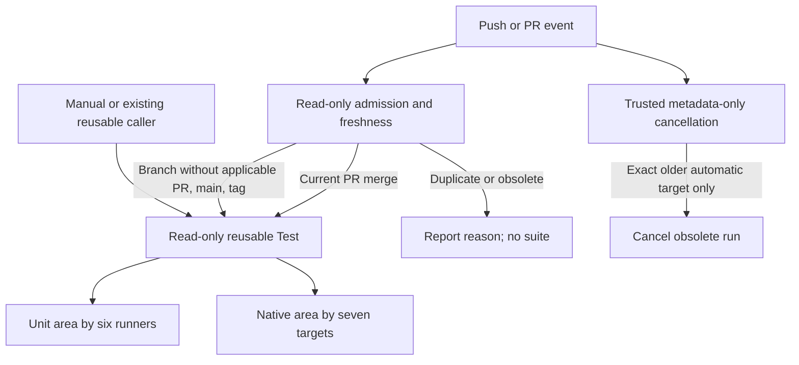

# Parallel CI areas and event policy - Plan

## Goal Capsule

- **Objective:** The owner receives independent test-area results without paying for redundant complete push and PR suites.
- **Means:** Explicit suite ownership and isolated native jobs, with event admission separate from the read-only reusable suite (KTD1–KTD4).
- **Authority:** User instructions and issues #41/#42 govern outcomes; requirements govern behavior; technical decisions govern implementation within them.
- **Execution profile:** One PR; implementation and local verification precede review, publication, and observed hosted validation. The owner retains merge authority.
- **Stop conditions:** Do not weaken coverage or execute untrusted code with write credentials. Surface any unresolved acceptance criterion instead of claiming completion.

---

## Product Contract

### Summary

Split Test into independently reported areas and route automatic events so PR merge-result validation replaces redundant branch-head validation.
Keep manual and reusable validation independent of automatic event cancellation.

### Problem Frame

The six unit runner variants each execute all unit modules together, while seven native runner variants execute five smoke areas sequentially.
An early native failure hides later results, and push plus PR events duplicate complete suites for the same head.
The owner needs attributable failures and shorter feedback without losing platform coverage or fixture safety.

### Key Decisions

- **Exclude Windows build restoration.** Governs R8. (session-settled: user-directed — chosen over continuing hosted provisioning diagnosis and restoration: the owner closed #39 as wontfix and requested only the remaining issues.)

### Requirements

**Independent coverage**

- R1. Every independently runnable native area has its own named check and hosted runner for every existing runner/target pair, with no cross-area ordering dependency.
- R2. Unit shard selection covers baseline discovered test IDs exactly once on each of the six existing unit platforms; unknown modules, missing assignments, duplicate assignments, loader errors, and duplicate IDs fail validation.
- R3. Preserve sibling imports, class fixtures, platform guards, optional-shell coverage, and portable rendering in Windows-named modules; omitted tools must not create new skips.
- R4. Each job owns complete prerequisites and disposable state, including checksummed native Windows GPG, selective Windows ARM tool acquisition, separate Linux credential sessions, and restored macOS keychain state.

**Inputs and execution policy**

- R5. Preserve action/tool/application/plugin pins, immutable candidate artifact selection, nonpersistent checkout credentials, and the checkout expression using base-sha or github.sha in every suite job.
- R6. Retain branch-without-PR, default-branch, tag, PR opening/update/reopening, fork PR, manual, and reusable validation; PR checks validate the merge result with an unprivileged execution path.
- R7. Avoid duplicate complete suites on ordinary open-PR updates and cancel obsolete automatic work only for its exact logical target; no push may replace the required PR merge check or cancel unrelated targets or explicit invocations.
- R8. Keep privileged Windows preparation and real build-environment verification outside these workflows; #39 is closed not planned.

**Evidence and maintenance**

- R9. Record before/after critical-path and aggregate runner time on comparable runs, including setup and queue effects; use measured area runtimes to choose physical unit shards.
- R10. Preserve meaningful area timeouts, independent failures, and reusable base-sha/lock-artifact inputs; expose these inputs for manual invocation as well.
- R11. Document module-to-area ownership, each area's local invocation and prerequisites, trigger/cancellation policy, check-name migration, and observed hosted run links.
- R12. Exercise the resulting workflow across all supported combinations and actual event transitions, including PR-open/update overlap, and distinguish observed proof from unavailable scenarios.

### Scope Boundaries

No Visual Studio installer changes, Windows build lane, personal configuration application, test-method parallelism, lock refresh, or unrelated fixture refactor.
No pull_request_target execution, external CI service, persistent scheduling store, or replacement of native credential backends.
A distributed atomic push-to-PR ownership protocol is not built: GitHub offers no conditional run-cancellation transaction; admission plus bounded cleanup must be reported honestly under R7/R12.

---

## Planning Contract

### Key Technical Decisions

- KTD1. **Explicit module ownership and whole-module execution.** A Python runner owns the mapping, keeps the entire tests directory importable, independently discovers baseline IDs, and validates assignment before selecting a shard. Keep fixture classes intact. Follow the existing unittest conventions rather than adding a test framework (R2–R3).
- KTD2. **Measure before fixing physical shard count.** Start from three coherent candidates: applications (personal apps, CE, T3), security (secrets/Git/GPG/credentials), and platform (shell/bootstrap/Windows fixture contracts, plus CI tests). Report module/area elapsed time and refine grouping only if measured setup or imbalance justifies it. Native jobs remain the five requested areas regardless of unit grouping (R1/R9).
- KTD3. **Event entry separate from reusable suite.** Keep .github/workflows/test.yml read-only, callable, and manually dispatchable. Move push/PR admission into .github/workflows/test-events.yml, calling the same-commit suite. The existing personal-lock updater retains its reference and read-only permission graph (R5–R7/R10).
- KTD4. **Admission is primary; cancellation is scoped reconciliation.** A read-only policy helper suppresses branch push fan-out only with applicable same-head PR merge validation; default branches and tags retain coverage. Conflict, unknown mergeability, and lookup failure retain branch verification with an explicit reason. A metadata-only, no-checkout controller with job-local actions:write cancels identified obsolete event-entry runs; no write token reaches test code. Fork events omit this controller. Run-number bounds, exact full-ref/event identity, and freshness checks protect newer runs. An unchanged PR head still admits its event's immutable merge SHA after base-only advancement; report that drift rather than discarding the only scheduled integration check. Destructive cancellation uses the stricter current snapshot check (R6–R7).
- KTD5. **Isolate invocation identity.** Automatic branch and PR targets never share cancellation identity with tags, manual runs, or called runs. Do not use arrival-order workflow cancellation as a substitute for semantic freshness; GitHub does not guarantee arrival order. Preserve independent explicit invocations, including distinct candidate inputs (R7/R10).
- KTD6. **Minimize native setup by dependency.** Apps and CE need chezmoi/Python; T3 additionally needs gh and its existing scoped token; credential jobs need chezmoi/Python/uv/keyring and native GPG/backend setup. Preserve all six unit runner tool environments initially because bootstrap tests invoke the complete root tool set (R3–R5).

### High-Level Technical Design



```mermaid
stateDiagram-v2
  [*] --> BranchValidation: branch push without applicable PR
  BranchValidation --> MergeValidation: PR opens; admit merge check and cancel replaceable push
  MergeValidation --> MergeValidation: update; obsolete same-target work canceled
  MergeValidation --> BranchValidation: merge conflict prevents PR event validation
  BranchValidation --> MergeValidation: conflict resolved and synchronize event validates merge
```

### Existing Behavior Trace

Test currently responds to unrestricted push and pull_request plus dispatch/call.
Each suite checkout selects inputs.base-sha or github.sha; ordinary PR github.sha is the merge commit.
The personal-lock workflow calls Test with an artifact ID and pinned base SHA under contents:read, then gates publication on its result.
Native smoke shares helper imports but no installed state is a valid inter-area dependency.
Failure currently stops later steps in each combined job; fail-fast:false protects only other runner variants.
Sources: .github/workflows/test.yml, .github/workflows/update-personal-app-lock.yml, tests/smoke_*.py.

### Assumptions

- Three unit shards are provisional until local per-module and hosted setup measurements are available; grouping can change without changing logical coverage.
- PR-open handoff cleanup may briefly overlap admitted push work because list/read/cancel are separate API operations. Do not describe this as atomic zero-overlap scheduling.
- Retaining branch validation on uncertain mergeability favors coverage over speculative suppression; record any duplicate fallback explicitly.
- No current main branch protection or repository rulesets were returned by GitHub APIs. Document the new check names and required-check recommendation without changing repository settings.
- Hosted event evidence is collected after publication; local policy tests cannot prove actual Actions merge refs, cancellation, permissions, or queue behavior.

### Sources and Research

- Issues <https://github.com/hyperlapse122/dotfiles/issues/41> and <https://github.com/hyperlapse122/dotfiles/issues/42>.
- Existing successful same-head PR run <https://github.com/hyperlapse122/dotfiles/actions/runs/41959406936>: 13 jobs, elapsed 309 seconds, aggregate job duration 1532 seconds.
- Corresponding push run <https://github.com/hyperlapse122/dotfiles/actions/runs/41959146646>: 13 jobs, elapsed 283 seconds, aggregate job duration 1599 seconds. Durations exclude billing rounding; elapsed includes queue delay through run update.
- PR baseline Windows ARM native job: 305 seconds overall; setup/action/tool/GPG stages approximately 83 seconds, then apps 41, T3 62, CE 67, GitHub 32, GitLab 12 seconds. Windows x64 unit execution took 158 seconds; macOS took 41 seconds.
- <https://docs.github.com/en/actions/how-tos/reuse-automations/reuse-workflows> — nested permissions can only be maintained or reduced; local workflow calls use the caller commit.
- <https://docs.github.com/en/actions/reference/workflows-and-actions/events-that-trigger-workflows#pull_request> — merge ref semantics, merge-conflict suppression, fork read-only credentials.
- <https://docs.github.com/en/actions/how-tos/write-workflows/choose-when-workflows-run/control-workflow-concurrency> — ordering is not guaranteed.
- .compound-engineering/artifacts/solutions/integration-issues/github-cli-windows-ca-override.md — retain native CA/environment behavior; do not remove credential coverage to reduce setup.

### Risks and System-Wide Impact

Check names change from combined unit/native names to named areas. Existing updater callers must still start successfully with the original permission/input contract.
Separate native runners repeat setup; measure aggregate time as well as feedback latency before claiming a cost improvement.
API state is eventually available. Failures retain visible branch coverage, never silently suppress verification.
Current workflow code is trusted only to the extent of its event permissions; write-capable cancellation must never checkout or execute repository code.

---

## Implementation Units

### U1. Exact-once unit area runner

**Goal:** Select independent unit areas without losing or duplicating baseline tests.
**Requirements:** R2, R3, R9, R11.
**Dependencies:** None.
**Files:** scripts/run-test-area.py; tests/test_ci_areas.py; docs/maintenance/development-and-testing.md.
**Approach:** Define the complete existing module map from the research inventory; keep applications, security, and platform candidates. Discover baseline with the full import path, reject loader/assignment/ID errors, and run selected modules with existing unittest fixture semantics. Provide list/validate and timed execution entry points; report selected/executed/skipped IDs for comparison.
**Patterns to follow:** Existing unittest discovery; sibling imports in test_gitlab_auth_import.py and test_github_auth_import.py.
**Execution note:** Characterize baseline discovered IDs and existing outcomes before switching selection. Keep timing output separate from semantic assertions.
**Test scenarios:**

1. Disjoint synthetic modules collectively select each baseline case once, without scheduling imported fixture cases twice.
2. An unassigned new module or multiply assigned module fails before execution.
3. Missing/extra/duplicate IDs and loader import errors fail validation.
4. Selected whole classes preserve class setup/teardown and skipped cases.

**Test seam:** tests/test_ci_areas.py proves ownership and fixture selection; it cannot prove hosted tool availability or runtime improvement.
**Verification:** Real list/validate and timed area invocations cover the local baseline exactly once with unchanged platform skips; measured timings justify physical grouping.

### U2. Isolated native and unit workflow fan-out

**Goal:** Every area reports independently across the preserved platform matrix.
**Requirements:** R1–R5, R8–R11.
**Dependencies:** U1.
**Files:** .github/workflows/test.yml; docs/maintenance/development-and-testing.md.
**Approach:** Add unit area dimension, native five-area dimension, explicit job/step timeouts, and per-area prerequisites. Preserve all original pins and candidate inputs. Restrict GPG/backend setup to credential areas; keep full unit mise setup where its coverage requires it. Each Linux credential execution owns its session.
**Patterns to follow:** Existing native GPG fixture, immutable artifact selection, selective ARM installation, smoke argument conventions.
**Test scenarios:**

1. All six unit platforms validate and execute the same applicable baseline ID union.
2. All five native areas pass independently on every existing target, including Windows ARM.
3. Fresh T3 jobs acquire their own pinned omp fixture rather than depending on apps.
4. A failed area leaves unrelated jobs able to report their own result.

**Test seam:** Hosted job executions prove setup/isolation; no source-text workflow tests are added.
**Verification:** Local runner smoke plus actual full hosted matrix; compare setup/area/job durations against baseline.

### U3. Event admission and safe obsolete-run cancellation

**Goal:** Prefer current PR integration checks without redundant ordinary branch suites or cross-target cancellation.
**Requirements:** R5–R7, R10–R12.
**Dependencies:** U2.
**Files:** .github/workflows/test-events.yml; .github/workflows/test.yml; scripts/ci-event-policy.py; tests/test_ci_event_policy.py; scripts/run-test-area.py.
**Approach:** Implement KTD3–KTD5. Keep admission decisions testable with explicit event/API data. Preserve full ref identity in event run metadata so tags cannot be mistaken for branches. Keep write cancellation inline in a no-checkout metadata controller, with bounded exact-target candidate selection and freshness checks. Add manual input declarations. Cancellation complements admission, never chooses push over PR.
**Patterns to follow:** Existing job-local permissions in lock publishers; gh/API metadata without shell interpolation of branch names.
**Test scenarios:**

1. Same-head mergeable PR suppresses nondefault push; absent/conflicted/unknown PR retains branch coverage with reason.
2. Main and tag pushes always validate, including branch/tag short-name collisions.
3. PR uses merge SHA; fork path executes with no write controller.
4. An obsolete PR head cannot admit stale required checks or cancel a newer run; an unchanged head still validates its original event merge SHA after base-only advancement, even when its push was suppressed and no replacement PR event exists.
5. Manual/called validation and distinct artifact inputs remain isolated.
6. API failure reports fallback rather than silently dropping coverage.

**Test seam:** tests/test_ci_event_policy.py proves policy decisions from realistic data; actual hosted runs prove permission/ref/cancellation semantics.
**Verification:** Actual no-PR push, PR opening, update, rapid pushes, unrelated target, tag, dispatch, and read-only reusable caller evidence; record unexercised scenarios explicitly.

### U4. Hosted evidence and operating guide

**Goal:** The owner can audit coverage and runner-use tradeoffs and invoke areas locally.
**Requirements:** R9, R11, R12.
**Dependencies:** U2, U3.
**Files:** docs/maintenance/development-and-testing.md; PR validation record.
**Approach:** Document final module mapping and prerequisites, corrected Windows ARM native coverage, trigger table and race/fallback limits, check migration, baseline/after run links, elapsed/aggregate measurements and queue effects. Keep hosted results in the PR validation record when they are produced after publication.
**Test expectation:** None — documentation and measured evidence only; do not assert CI behavior from source text.
**Verification:** Guide commands match exercised invocations; PR links expose full platform outcomes and measurements without presenting predictions as observations.

---

## Verification Contract

- Baseline and area runner: use mise exec -- python -m unittest discover -s tests for existing coverage, and the new runner's documented validation/timed area invocations after implementation.
- Focused ownership/policy tests must exercise behavior and boundary decisions, not YAML copies or mock call forwarding.
- Smoke the actual area CLI locally; do not apply personal state or run hosted-only PATH/desktop flags on this workstation.
- Hosted Test must execute all six unit runner variants and all five native areas on all seven target pairs with existing pins and fixture boundaries.
- Observe event run links, merge checkout SHA, controller permission separation, stale-run cancellation and explicit invocation isolation after publication.
- Record critical-path and aggregate job runtime before/after using the same API timestamp definitions. Shard selection must be justified by measurements, not job count alone. A slower or more expensive result is reported and grouping adjusted when the independent-area contract permits it.
- No browser surface changes; browser test skill should classify applicability rather than invent UI coverage.

---

## Definition of Done

All active units are implemented and locally verified; code review covers committed additions and working changes.
Every requested platform/area runs with complete prerequisites, assignment validation is fail-closed, and PR merge-result validation remains authoritative.
Actual hosted matrix and event evidence, measured tradeoffs, check migration and race limits are visible in the PR; missing evidence is not called complete.
Abandoned experiments and throwaway scripts are removed.
The change is committed, pushed, in an open PR, and CI has a decided outcome; merging remains the owner's action.
