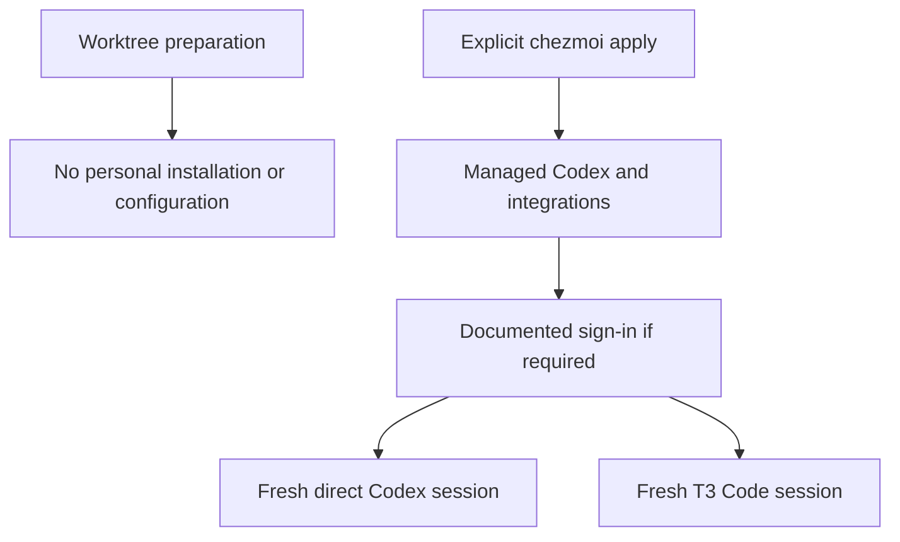
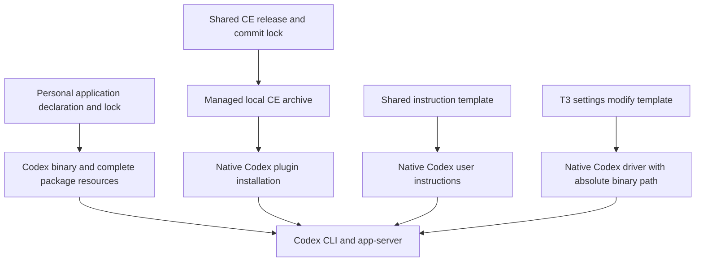

# Codex Managed Harness - Plan

## Goal Capsule

- **Objective:** The repository owner can use Codex directly and from T3 Code on eligible devices after applying dotfiles and completing any documented sign-in.
- **Means:** Onboard Codex as one managed harness, including its shared instructions, Compound Engineering integration, and T3 Code provider.
- **Product authority:** [Issue #31](https://github.com/hyperlapse122/dotfiles/issues/31), its [CE and T3 Code requirements](https://github.com/hyperlapse122/dotfiles/issues/31#issuecomment-6646014188), and the scope confirmed by the user in this conversation.
- **Open blockers:** No unresolved product decisions block planning; upstream installation, native CE support, and T3 Code launch compatibility require technical verification before implementation can be considered complete.
- **Execution profile:** One feature PR; implement, verify, review, and publish through the authorized autonomous workflow.

---

## Product Contract

### Summary

Manage Codex through explicit chezmoi apply, with reproducible installation, repository-owned settings, shared user-scope instructions, native Compound Engineering integration, and an enabled T3 Code provider.
Treat direct and T3 Code usage as one onboarding outcome, verified in disposable homes.

### Problem Frame

The owner needs repeatable Codex setup across devices without manually recreating instructions, plugins, and editor connections.
Installation alone leaves those everyday-use dependencies unconfigured.

### Key Decisions

- **Complete onboarding rather than a CLI-only installation.** Governs R7, R9, R12, R16, R17; installation alone does not satisfy the requested everyday-use outcome. (session-settled: user-approved — chosen over treating CE and T3 Code as optional follow-ups: the user confirmed they are completion requirements.)

### Requirements

**Installation and lifecycle**

- R1. Establish and document Codex's eligible OS/architecture combinations from upstream-supported installation options within the repository's platform policy.
- R2. Explicit chezmoi apply must install the repository-managed Codex executable under the destination home's `.local/bin` directory, using the Windows home equivalent and executable suffix where applicable.
- R3. Codex installation must use a repository-owned version pin with documented update and rollback procedures.
- R4. Worktree preparation must remain read-only for personal settings; personal Codex installation and configuration must occur only through explicit chezmoi application.

**Settings, instructions, and credentials**

- R5. Declare repository-owned Codex settings in the chezmoi source under `home/`.
- R6. Repeated apply must reconcile managed settings to repository intent while preserving unrelated settings, plugins, credentials, and application state.
- R7. Connect Codex's native user-scope instruction file to `home/.chezmoitemplates/agent-instructions`, rendering with the explicit `codex` harness identifier.
- R8. Document required sign-in or credential provisioning without automating excluded OAuth login flows or storing secrets in tracked plaintext configuration.

**Compound Engineering**

- R9. Register, install, and enable Compound Engineering at Codex user scope through Codex's supported native integration.
- R10. Use the repository-owned CE release and commit pin rather than an independently selected latest release.
- R11. Apply CE installation and configuration under R4 and preserve unrelated plugins and settings under R6.

**T3 Code integration**

- R12. Explicit apply must add and enable the Codex provider in repository-managed T3 Code configuration while preserving unrelated providers and settings.
- R13. The provider executable must be the fully expanded absolute path to the Codex binary installed under R2, without relying on `PATH`, a bare command name, or literal `~` expansion.
- R14. Select and verify the T3 Code driver/protocol and launch arguments supported by Codex, without assuming omp's `acp` subcommand applies.
- R15. Repeated apply must retain the absolute executable path and a single Codex provider entry.

**Verification and documentation**

- R16. Verify initial setup, repeated apply, managed-setting reconciliation, and direct Codex launch in a disposable home on each eligible platform established under R1.
- R17. In those disposable homes, verify common-instruction inclusion, foreign-harness branch exclusion, native user-scope instruction discovery, and actual native CE skill discovery and invocation.
- R18. Verify provider enablement and launch from a fresh T3 Code session with the managed binary directory absent from `PATH` on each eligible T3 Code platform.
- R19. Document usage, supported platforms, platform limitations, and any required manual actions; an unverified required integration remains incomplete rather than being reported as supported.

### Key Flows

- F1. First use. **Covers R1–R4, R7–R14, R16–R18.** The owner explicitly applies dotfiles, completes any documented sign-in, and starts a fresh Codex or T3 Code session using the managed installation.
- F2. Reconciliation. **Covers R3, R6, R11, R12, R15.** After a managed setting is changed locally, the owner reapplies dotfiles and obtains repository intent without losing unrelated state; update and rollback follow the documented pin lifecycle.

### Acceptance Examples

- AE1. **Covers R2–R4, R16.** In a disposable destination home, worktree preparation leaves personal Codex configuration untouched; explicit apply provisions the pinned executable, and direct launch succeeds after any required sign-in.
- AE2. **Covers R5, R6, R11, R15, R16.** With a managed setting changed and unrelated application state present, repeated apply restores the managed value, preserves unrelated state, and leaves one Codex provider with its absolute executable path intact.
- AE3. **Covers R7, R17.** With representative common and harness-specific instruction content, Codex discovers the native user-scope file containing the common content and only the Codex-specific branch.
- AE4. **Covers R9–R11, R17.** A fresh Codex session discovers and invokes a native CE skill from the repository-pinned release while an unrelated installed plugin remains available.
- AE5. **Covers R12–R15, R18.** With the managed binary directory removed from `PATH`, a fresh T3 Code session shows an enabled Codex provider and launches it using the verified protocol and arguments.
- AE6. **Covers R3, R10, R19.** Applying an updated pin and then the documented rollback returns Codex to the selected earlier version; the CE integration continues to follow the repository's shared CE pin.
- AE7. **Covers R1, R14, R19.** If upstream support or native launch verification fails for a required combination, the limitation is documented and that acceptance case is not marked complete or replaced by an assumed compatibility mode.

### Scope Boundaries

- No onboarding of additional harnesses or redesign of the shared harness-management system.
- No new OS/architecture policy beyond R1 and no claim that Codex and T3 Code have identical coverage.
- No automatic OAuth sign-in or tracked plaintext credentials, per R8.
- No optional deferral of CE or T3 Code integration; the decision above governs their inclusion.

### Dependencies / Assumptions

- Upstream Codex installation and integration capabilities are not established by this brainstorm; planning must verify them rather than treating the requirements as evidence of support.
- T3 Code's supported desktop platforms bound R18; direct Codex coverage is determined separately under R1.

### Planning Questions

- Installation and release selection: resolved by KTD1.
- Native settings, instruction discovery, and CE integration: resolved by KTD2 and KTD3.
- T3 Code driver and launch contract: resolved by KTD4.
- Credential and native verification boundaries: resolved by KTD5; execution must report any unavailable authenticated verification honestly.

### Sources / Research

- [Issue #31](https://github.com/hyperlapse122/dotfiles/issues/31) and its [onboarding requirement comment](https://github.com/hyperlapse122/dotfiles/issues/31#issuecomment-6646014188): product authority.
- `STRATEGY.md`: repository precedence, device-readiness goals, and credential boundaries.
- `docs/guides/personal-applications.md`: installation, platform, and pin-lifecycle reference for planning.
- `docs/guides/harness-plugins.md`: CE pin, native integration, and state-preservation reference for planning.
- `docs/maintenance/chezmoi-source.md#shared-user-scope-harness-onboarding`: shared-template onboarding procedure.
- `docs/guides/t3-code.md`: existing desktop/provider integration and application-state boundaries; Codex protocol compatibility still requires verification.

---

## Planning Contract

Product Contract preserved: no scope change; planning questions now reference their technical decisions.

### Key Technical Decisions

- KTD1. **Use the complete canonical Codex package with the existing release lock.** Implements R1–R3. Pin `openai/codex` release `rust-v0.166.0` and its `codex-package-*` assets for Windows x64/ARM64, Linux x64/ARM64, and macOS ARM64. Linux assets use musl triples even on the repository's supported glibc hosts; this does not expand the host policy to musl distributions. Keep the main executable in the generic personal-app external and add a Codex-specific supplemental external for package helpers, manifest, and exact-owned resource directories under `.local`, preserving the canonical `bin`, `codex-path`, and `codex-resources` relationship. Never mark the shared `.local` or `.local/bin` tree exact. Use the same URL and checksum for every member. This preserves the native binary path without privileged links, shell wrappers, or the stock installer's competing PATH/update lifecycle.
- KTD2. **Own only Codex's update check and CE settings.** Implements R4–R8. A private `.codex/config.toml` modify template merges `check_for_update_on_startup = false`, the local managed CE marketplace, and the CE enabled entry while preserving unrelated TOML values. A thin private `.codex/AGENTS.md` adapter invokes the shared template with `harness = codex`. Leave credentials and `AGENTS.override.md` untouched; document native override precedence rather than silently deleting the override. Default home is the managed scope; custom `CODEX_HOME` locations are not redirected.
- KTD3. **Use native Codex plugin installation against the shared pinned archive.** Implements R9–R11. Reuse CE commit `42f9745ea0a4b70f8dde059aa8cf7f974d2991f1` and its `.agents/plugins/marketplace.json` / `.codex-plugin/plugin.json`. Codex supports `plugin marketplace add` and `plugin add`, which enables the installed plugin; there is no separate `plugin enable` command. Reconcile Codex separately from omp, with destination `HOME`, `USERPROFILE` on Windows, and `CODEX_HOME` explicit. Native failures must fail apply. Ensure repeated apply restores CE activation and applies the selected archive revision without disturbing other plugins.
- KTD4. **Configure the existing-login native T3 driver.** Implements R12–R15. Under `providerInstances.codex`, use driver `codex`, enable the instance, set `config.setupMode = existing`, and set `config.binaryPath` to the expanded R2 path. T3 appends `app-server`; do not place that subcommand in `launchArgs` and do not use `acpRegistry`. Preserve unowned Codex options and unrelated providers. The managed provider must not select T3's separate managed-installation/account mode.
- KTD5. **Prove native parsing, discovery, invocation, and T3-driven launch in isolated state.** Implements R16–R19. Exercise the actual pinned CLI and actual T3 server, not mocks or a direct Codex subprocess presented as T3 integration. Start T3 with the managed bin absent from `PATH`, request its provider snapshot/refresh, and observe the native Codex handshake. Exercise CE through the Codex app-server skill surface and explicit native skill selection. No OAuth automation or fabricated model completion; any authentication-dependent portion not exercised remains explicit, incomplete evidence.
- KTD6. **Keep the existing platform matrix and acquisition ownership.** Implements R1, R4, R16–R19. Add Codex checks to the existing native CI matrix, including Windows ARM64. Keep mise for development dependencies and chezmoi for personal applications. Do not change unrelated application pins, defaults, or bootstrap actions.

### High-Level Technical Design

### System-Wide Impact

The personal-app smoke must recognize Codex's `rust-v` release tag and isolate `CODEX_HOME`.
CE archive ownership is shared, but native registration and caches remain harness-specific.
T3's `codex` entry becomes managed, so preservation fixtures must use a genuinely unrelated instance.
The existing instruction, plugin, and T3 acquisition policies remain authoritative.

### Risks and Dependencies

- Canonical packages include large platform-specific helper/resource trees; a single executable download is not an equivalent installation.
- Windows locks running executables; document closing Codex and T3 before application or rollback.
- Existing `AGENTS.override.md` suppresses the managed global instruction file by native precedence.
- Native model execution can require sign-in and consume account resources; automated verification must not use personal credentials implicitly.
- T3 versions predating the verified native driver contract are not established by this plan; verify the actual installed version and report incompatible versions instead of silently replacing the desktop.

### Sources

- [Codex pinned release](https://github.com/openai/codex/releases/tag/rust-v0.166.0) and [package checksums](https://github.com/openai/codex/releases/download/rust-v0.166.0/codex-package_SHA256SUMS).
- [Canonical package installation layout](https://github.com/openai/codex/blob/rust-v0.166.0/scripts/install/install.sh#L1112-L1131).
- [Codex native plugin commands](https://github.com/openai/codex/blob/rust-v0.166.0/codex-rs/cli/src/plugin_cmd.rs) and [native marketplace commands](https://github.com/openai/codex/blob/rust-v0.166.0/codex-rs/cli/src/marketplace_cmd.rs).
- [Pinned CE Codex plugin](https://github.com/EveryInc/compound-engineering-plugin/blob/42f9745ea0a4b70f8dde059aa8cf7f974d2991f1/.codex-plugin/plugin.json).
- [T3 v0.1.7 Codex settings](https://github.com/pingdotgg/t3code/blob/v0.1.7/packages/contracts/src/settings.ts#L631-L686), [native driver](https://github.com/pingdotgg/t3code/blob/v0.1.7/apps/server/src/provider/Drivers/CodexDriver.ts), and [launch arguments](https://github.com/pingdotgg/t3code/blob/v0.1.7/apps/server/src/provider/codexLaunchArgs.ts).
- [Chezmoi archive members, include filters, and exact ownership](https://www.chezmoi.io/reference/special-files/chezmoiexternal-format/).

---

## Implementation Units

### U1. Install the complete pinned Codex package

**Goal:** Provide the native CLI and required package resources without changing unrelated binaries.

**Requirements:** R1–R4, R16; F1, F2; AE1, AE6.

**Dependencies:** None.

**Files:** `home/.chezmoidata/personal-apps.json`, `home/.chezmoidata/personal-app-lock.json`, new `home/.chezmoiexternals/codex-package.toml.tmpl`, `tests/test_personal_apps.py`, `tests/test_personal_app_lock.py`, `tests/smoke_personal_apps.py`; update `scripts/update-personal-app-lock.py` only if upstream tag handling requires it.

**Approach:**

1. Add the five KTD1 target mappings using canonical package archives and the existing checksum lock mechanism.
2. Install supplemental package members using the same locked archive, exact ownership only for Codex-specific directories.
3. Update version matching for `rust-v` tags and isolate Codex state in the native app smoke.

**Patterns:** Existing generic `archive-file` acquisition and all-or-nothing pin publication.

**Execution note:** This is packaging work; inspect the actual archive and prove native launch before extending integration.

**Test scenarios:**

- Covers AE1. Apply a fixture package and prove the CLI, helpers, manifest, and nested resources appear at the canonical relative paths.
- Covers AE6. Apply a changed package then roll back; managed bytes converge while an unrelated `.local/bin` executable survives.
- A bad package checksum fails without substituting an unverified download.

**Verification:** Real pinned CLI version and helper/resource availability on the selected native target; deterministic target rendering covers all declared targets.

### U2. Wire native instructions and Compound Engineering

**Goal:** Codex discovers shared instructions and the repository-pinned CE plugin.

**Requirements:** R4–R11, R16, R17; F1, F2; AE2–AE4.

**Dependencies:** U1.

**Files:** New `home/private_dot_codex/modify_private_config.toml`, new `home/private_dot_codex/private_empty_AGENTS.md.tmpl`, new `home/.chezmoitemplates/codex-config`, new Codex plugin hooks/partials under `home/.chezmoiscripts/` and `home/.chezmoitemplates/`, `home/.chezmoidata/harness-plugins.json`, `home/.chezmoiexternals/harness-plugins.toml.tmpl`, `home/.chezmoiignore`, new `tests/test_codex.py`, new `tests/smoke_codex.py`.

**Approach:**

1. Follow KTD2 for private instructions and partial TOML ownership.
2. Follow KTD3 for native installation and explicit destination-home scoping; reuse the shared archive without changing omp behavior.
3. Exercise a neutral workspace so project instruction overrides cannot masquerade as global discovery.

**Patterns:** Existing private modify templates, platform-conditional PowerShell/BOM scripts, and disposable-home harness smoke.

**Test scenarios:**

- Covers AE2. Reapply after CE is disabled and verify activation while preserving an unrelated plugin and configuration table.
- Covers AE3. Native discovery includes common and Codex-specific instruction markers, excluding foreign harness markers.
- Covers AE4. Native plugin listing and skill discovery identify the pinned CE source; explicit native selection invokes that skill surface.
- Malformed existing TOML fails without discarding credentials or unrelated configuration.

**Verification:** Native Codex reads the generated state, discovers CE, and accepts explicit CE invocation; authenticated completion limits are reported per KTD5.

### U3. Add the native T3 Code provider

**Goal:** A fresh T3 session launches the repository-managed Codex installation without PATH dependence.

**Requirements:** R12–R15, R18; F1, F2; AE2, AE5.

**Dependencies:** U1; U2 supplies the shared runtime state.

**Files:** `home/.chezmoitemplates/t3-code-settings`, `tests/test_t3_code_settings.py`, `tests/smoke_t3_code.py`.

**Approach:**

1. Add the KTD4 native driver entry inside the existing preservation-oriented modify template.
2. Rename preservation fixtures that currently use `codex` as an unrelated instance.
3. Extend smoke verification with an actual fresh T3 server and provider refresh, using isolated homes and an absolute managed binary path.

**Test scenarios:**

- Covers AE5. T3 launches native Codex with the managed binary directory removed from PATH.
- Covers AE2. Wrong executable path and disabled managed instance are reconciled on reapply without duplicating the provider.
- Preserve unrelated provider settings, user display choices, and unowned Codex options.
- Invalid provider or config object shapes fail without replacing the settings file.

**Verification:** Native T3 sees the enabled Codex provider and completes its app-server initialization through the configured executable.

### U4. Verify supported platforms and document operation

**Goal:** Make the onboarding contract reproducible and accurately documented.

**Requirements:** R1–R19; AE1–AE7.

**Dependencies:** U1–U3.

**Files:** `.github/workflows/test.yml`, `.github/workflows/update-harness-plugin-lock.yml`, `docs/guides/personal-applications.md`, `docs/guides/harness-plugins.md`, `docs/guides/t3-code.md`, `docs/maintenance/chezmoi-source.md`, `README.md` where inventory needs updating.

**Approach:** Add the native Codex smoke to existing CI and CE candidate verification; document installation/update/rollback, required sign-in, native instruction precedence, package layout, T3 driver, and actual platform limits without claiming unrun cases passed.

**Test scenarios:**

- Covers AE7. Unsupported or unverified cases remain explicit rather than silently weakening the completion condition.
- CI runs the relevant native package, CE, and T3 scenarios on every declared eligible target.

**Verification:** Documentation matches exercised behavior; no personal-home apply, secret file, or temporary scaffold enters the change.

---

## Verification Contract

- Run deterministic repository coverage with `mise exec -- python -m unittest discover -s tests`.
- Run `tests/smoke_personal_apps.py`, `tests/smoke_codex.py`, `tests/smoke_harness_plugins.py`, and `tests/smoke_t3_code.py` through mise in disposable state on the local native platform.
- Use existing hosted native CI targets for remaining eligible platforms; observe their results rather than treating rendered templates as native proof.
- Preserve the existing omp native smoke and validate the T3-driven Codex path separately from the direct app-server handshake.
- Native CE selection must have concrete runtime evidence; discovery alone and failed authenticated completion are reported separately.

---

## Definition of Done

- U1–U4 and AE1–AE7 have observed passing evidence; any unresolved blocker keeps its required case and overall onboarding incomplete.
- The complete package, private settings, instructions, CE integration, and T3 provider work together after explicit apply.
- Reapply and rollback honor owned settings and preserve unrelated state.
- Existing repository contracts pass, and the PR reports native platform and authentication coverage accurately.
- Abandoned code and temporary scaffolding are removed; credentials and personal application state remain outside the commit.
