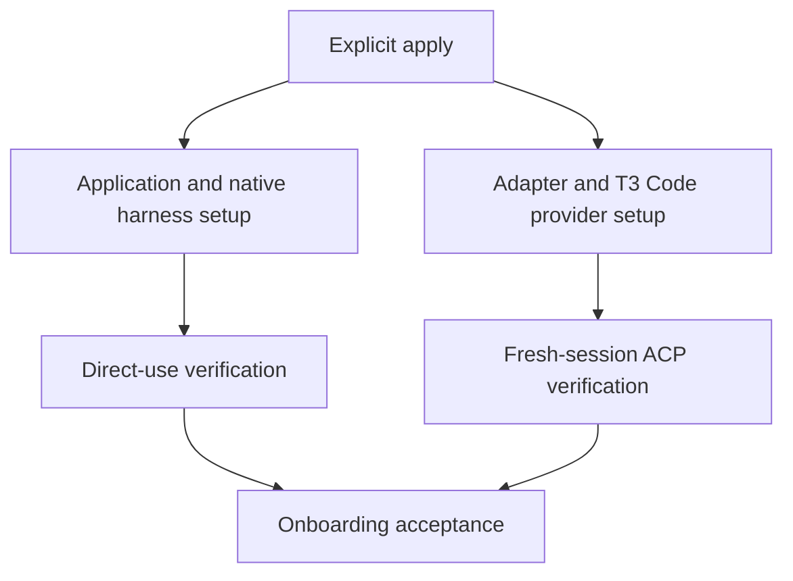
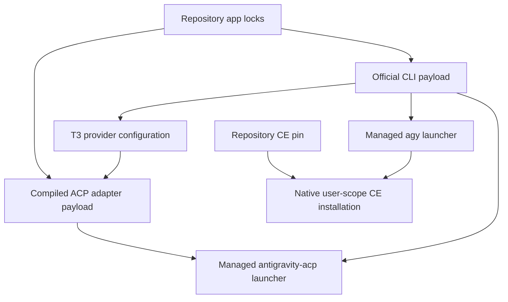

# Antigravity Managed Harness - Plan

## Goal Capsule

- **Objective:** The dotfiles user can prepare Antigravity for everyday direct use and use it as a working provider in T3 Code.
- **Means:** Repository-managed Antigravity onboarding through explicit chezmoi application.
- **Product authority:** Issue #32, including both onboarding additions in its comment, and the scope confirmed in the brainstorm conversation.
- **Open blockers:** None for the revised integration scope. Authenticated CE invocation is explicitly deferred to [issue #52](https://github.com/hyperlapse122/dotfiles/issues/52).
- **Execution profile:** One pull request; implement and verify locally, then run independent review and ship through the authorized autonomous workflow.

---

## Product Contract

### Summary

Add complete Antigravity onboarding to the dotfiles repository.
Explicit apply prepares the application, managed settings, shared instructions, native Compound Engineering integration, and the separate Antigravity ACP adapter used by T3 Code.

### Problem Frame

The owner needs repeatable Antigravity setup for direct work and T3 Code use without manual setting corrections.
Model credentials are not available in this run, so the user separated authenticated CE execution from installation and integration acceptance.

### Key Decisions

- **One end-to-end onboarding outcome, not an installation-only milestone.** Application installation alone does not meet the confirmed daily-use goal. Governs R1–R19.
- **Reuse repository conventions without assuming harness compatibility.** Existing omp and T3 Code integrations are reference patterns; Antigravity's supported mechanisms must be established independently. Governs R6–R13.
- **Unsupported required integration is a feasibility blocker, not permission to omit it.** Planning must surface evidence if the full contract cannot be satisfied. Governs R1, R7, R8, R17, R19.
- **Defer authenticated CE invocation, not CE integration.** Installation, enablement, native discovery, and state preservation remain in this change. Governs R8, R9, R17. (session-settled: user-directed — chosen over blocking onboarding on model credentials: the user requested integration now and CE verification in a follow-up issue.)

### Requirements

**Platform coverage and version lifecycle**

- R1. Establish upstream Antigravity installation options and supported platforms against the repository's existing OS/architecture policy, and document the eligible platform set and limitations.
- R2. Manage Antigravity installation with a defined repository-owned version-pinning, update, and rollback policy.
- R3. Manage `antigravity-acp` as a separate dependency, resolving its latest published stable release at implementation time and committing that exact version in the repository-owned lock.
- R4. Device application must install the locked adapter version rather than resolve a floating `latest` release.

**Application boundary and state ownership**

- R5. Perform Antigravity and adapter installation and configuration only through explicit chezmoi application; worktree preparation must remain read-only for personal settings.
- R6. Declare repository-owned Antigravity settings in the chezmoi source under `home/`, reconcile those settings on repeated apply, and preserve unrelated application state and settings.

**Shared instructions and Compound Engineering**

- R7. Connect Antigravity's native user-scope instruction file to `home/.chezmoitemplates/agent-instructions` using an explicit Antigravity harness identifier, with common content included and foreign harness branches excluded.
- R8. Register, install, and enable Compound Engineering at user scope through Antigravity's supported native integration, using the repository-owned CE release and commit pin.
- R9. Preserve unrelated plugins and settings during CE integration and subsequent application.

**T3 Code ACP integration**

- R10. Install the pinned `antigravity-acp` adapter, or its platform-appropriate managed launcher, under the destination home's `.local/bin` directory.
- R11. Add and enable the Antigravity ACP provider in repository-managed T3 Code configuration without duplicating the provider or changing unrelated settings.
- R12. Set the provider executable to the fully expanded absolute path of the managed adapter or launcher, not the Antigravity application binary, a bare command, or a path containing literal `~`.
- R13. Configure launch arguments and any Antigravity executable setting required by the pinned adapter release, selecting the Antigravity binary by its absolute repository-managed path rather than `PATH` lookup or omp's `acp` subcommand.

**Credentials, usage, and verification**

- R14. Document required sign-in or credential provisioning and keep secrets out of tracked plaintext configuration.
- R15. Document usage, the version lifecycle from R2–R4, and the platform limitations established under R1.
- R16. Verify initial setup, repeated apply, managed-setting reconciliation, and Antigravity launch in a disposable home on each eligible platform.
- R17. Verify native shared-instruction and CE skill discovery plus native plugin installation validation in disposable homes; authenticated CE skill invocation is deferred to [issue #52](https://github.com/hyperlapse122/dotfiles/issues/52).
- R18. Verify actual ACP initialization and launch from a fresh T3 Code session in a disposable home with the managed binary directory absent from `PATH`.
- R19. Verify that repeated apply retains the locked adapter version, enabled provider, and absolute executable paths while preserving unrelated plugins and settings.

### Key Flows

- F1. Initial preparation. **Covers R1–R18.** On an eligible platform, the user explicitly applies the dotfiles, completes the documented sign-in steps, and verifies both native Antigravity use and the T3 Code provider in a disposable home.
- F2. Reconciliation. **Covers R4–R13, R16, R19.** After a repository-owned setting is changed locally, the user reapplies the dotfiles and observes restoration of managed values without loss of unrelated state.
- F3. Version maintenance. **Covers R2–R4, R15.** The maintainer follows the documented update or rollback procedure, and subsequent device application uses the repository-selected versions.

### Acceptance Examples

- AE1. **Covers R5.** Given an unprepared worktree and a destination home, when worktree preparation runs, personal settings remain unchanged and onboarding installation is not performed.
- AE2. **Covers R2–R4, R10, R16.** Given a disposable home on an eligible platform, when explicit apply completes, Antigravity launches and the managed adapter or launcher is installed under that home's `.local/bin` at the locked version.
- AE3. **Covers R6, R9, R11, R19.** Given changed managed settings and unrelated settings and plugins, when explicit apply runs twice, managed values are reconciled, unrelated state is preserved, and exactly one enabled Antigravity provider remains.
- AE4. **Covers R7, R8, R17.** Given a disposable home after explicit apply, when Antigravity discovers its native user-scope instructions and installed CE plugin, common instructions are present, foreign harness branches are absent, the plugin is enabled and valid, and its skills are discoverable without claiming authenticated execution.
- AE5. **Covers R12, R13, R18.** Given a fresh T3 Code session with the managed binary directory absent from `PATH`, when the Antigravity provider starts, the configured adapter completes actual ACP initialization and launches using the required absolute executable paths.
- AE6. **Covers R3, R4, R19.** Given a newer upstream adapter release after the repository lock was committed, when explicit apply runs again without a lock update, the installed adapter version remains the locked version.
- AE7. **Covers R1, R15–R18.** Given the eligible platform set established during planning, when onboarding is accepted, each eligible platform has the required disposable-home verification evidence and any limitations are documented.

### Scope Boundaries

- This work adds Antigravity onboarding, not a redesign of other managed harness integrations or T3 Code.
- Application-only delivery, shared instructions without working CE integration, and a configured but uninitialized ACP provider do not satisfy the contract.
- Repository OS/architecture policy is not broadened by this feature.
- The credential boundary in R14 does not expand into a new credential-management system.
- No personal configuration is applied merely to prepare a worktree, per R5.
- Authenticated native CE invocation is deferred under R17; this does not remove installation, enablement, discovery, or repeated-apply checks.

### Dependencies / Assumptions

- Official Antigravity CLI is the selected managed surface; the distinct desktop App and standalone IDE are not required by the confirmed scope.
- Native shared rules and pinned CE plugin installation are documented upstream, but runtime discovery and invocation have not been exercised.
- Adapter 1.2.0 targets the official CLI and reads its persisted conversation data, so compatibility with the selected CLI version requires runtime verification.

### Outstanding Questions

**Deferred to Implementation**

- Resolve and commit exact app and adapter artifacts at implementation time, per R2 and R3.
- Establish the selected CLI's native plugin state locations and repeated-apply preservation behavior.
- Exercise R18 through a fresh real T3 Code session with the managed binary directory absent from `PATH`; direct adapter handshakes are not equivalent evidence.

### Sources / Research

- [Issue #32: Add Antigravity as a managed harness](https://github.com/hyperlapse122/dotfiles/issues/32) — original goal, platform and credential boundaries, and completion criteria.
- [Onboarding additions](https://github.com/hyperlapse122/dotfiles/issues/32#issuecomment-6646014570) — mandatory CE integration and the separate pinned `antigravity-acp` adapter with T3 Code verification.
- [Shared-instruction onboarding procedure](https://github.com/hyperlapse122/dotfiles/blob/main/docs/maintenance/chezmoi-source.md#shared-user-scope-harness-onboarding) — repository policy referenced by the active project instructions.
- [Harness plugin reference pattern](https://github.com/hyperlapse122/dotfiles/blob/main/home/README.md#harness-plugin-data-and-partial-settings) and [T3 Code reference pattern](https://github.com/hyperlapse122/dotfiles/blob/main/home/README.md#t3-code-desktop-integration) — issue-provided planning references, not evidence that Antigravity already supports the same mechanisms.

---

## Planning Contract

Product Contract changed: R17 and AE4 defer authenticated invocation to issue #52 at the user's direction; all other integration requirements remain active.

### Key Technical Decisions

- KTD1. **Use the official Antigravity CLI (`agy`) as the managed harness.** The required adapter launches CLI commands, while official Antigravity documentation treats terminal use as a first-class surface. This implements R2 and R10–R13 without introducing a separate GUI dependency.
- KTD2. **Install CE from the existing repository-pinned root package.** The pinned root contains the supported Antigravity `plugin.json` and `skills/`; the excluded `.agy/` compatibility entry point is not required. Native local installation supplies registration, followed by explicit enablement, for R8 and R9.
- KTD3. **Keep payloads separate and bind the CLI explicitly.** Adapter 1.2.0 prefers an adjacent `agy` over `AGY_BIN`, so place its compiled payload in a dedicated directory without an adjacent CLI. Terminal launchers remain under `.local/bin`. T3 launches the native payload directly because its local ACP validation rejects Windows batch wrappers; its provider `environment` entries select absolute `AGY_BIN`, suppress adapter auto-download with `AGY_SKIP_DOWNLOAD=1`, and disable CLI self-update with `AGY_CLI_DISABLE_AUTO_UPDATE=true`, per R2–R4 and R10–R13.
- KTD4. **Reuse the personal-app declaration and lock pipeline.** Add official Google manifest resolution and an optional declared installation directory so the two payloads live separately under `.local/share/dotfiles/`, while managed shell/batch launchers remain under `.local/bin`. Existing apps retain their default destination and lock entries.
- KTD5. **Keep settings ownership minimal.** Render `~/.gemini/GEMINI.md` through the shared instruction template, reconcile only plugin registration/enablement and the Antigravity T3 provider's owned fields, and do not change security presets or the user's chosen model/auth settings.

### Research Findings

- The published stable adapter is 1.2.0, with compiled standalone artifacts for the repository's Windows, Linux, and macOS architecture intersection; R3 still requires resolution at implementation time.
- The official Windows amd64 CLI manifest currently reports 1.5.0, while the download page reports 1.4.12; pinning must use verified versioned artifact metadata rather than the page label.
- Official native global rule locations include `~/.gemini/GEMINI.md` and `~/.gemini/AGENTS.md`; R7 needs a thin shared-template adapter at a supported location.
- CE's pinned installation guide names `~/.gemini/antigravity-cli/plugins/`, whereas current Antigravity documentation names `~/.gemini/config/plugins/`; runtime discovery must establish the selected CLI's actual state locations rather than hard-code the older guide.
- The adapter's `initialize`, `authenticate`, and `session/new` paths do not validate model credentials. Their success is credential-free ACP evidence, not the authenticated CE invocation deferred under R17.
- Adapter 1.2.0 unconditionally passes `--dangerously-skip-permissions` to prompt subprocesses. Document this upstream behavior before enabling everyday ACP use.
- A real fresh T3 0.1.7 session rejected the Windows `.cmd` wrapper before ACP initialization. A generic Windows spawn helper supporting batch files does not imply local ACP accepts them. T3's supported environment overrides are provider-level `environment` rows, not `config.env`; use them with the native adapter payload.
- Existing T3 smoke directly launches the adapter and prepends managed bin to `PATH`; it does not provide R18 evidence.
- Existing harness-plugin smoke reads skill content through native discovery; authenticated invocation remains explicitly deferred under R17.

### Credentials and Runtime Boundaries

The official API-key route requires both `modelProvider: "gemini"` in CLI settings and process `GEMINI_API_KEY`; ADC is another documented route.
These are user-provisioned credentials under R14, not onboarding-time secrets.
Do not reuse or clear the owner's keyring during smoke verification.
Use non-authenticated version/help/plugin-validation paths for CLI and CE smoke, and exercise actual T3-created ACP initialization without submitting a model prompt.
Authenticated CE execution belongs to issue #52.

### High-Level Technical Design

The existing personal-app lock remains the artifact authority.
The native plugin commands own runtime registration and enablement.
T3 launches the native adapter directly and supplies its absolute CLI path through provider-level environment entries.

### Sources

- [Official Antigravity downloads](https://antigravity.google/download) and [CLI Windows amd64 manifest](https://antigravity-cli-auto-updater-974169037036.us-central1.run.app/manifests/windows_amd64.json).
- [Native global rules](https://antigravity.google/docs/rules#global-rules) and [native CLI plugin commands](https://antigravity.google/docs/plugins#cli-shell-subcommands-agy-plugin).
- [Pinned CE Antigravity installation guide](https://github.com/EveryInc/compound-engineering-plugin/blob/42f9745ea0a4b70f8dde059aa8cf7f974d2991f1/.agy/INSTALL.md) and [root manifest](https://github.com/EveryInc/compound-engineering-plugin/blob/42f9745ea0a4b70f8dde059aa8cf7f974d2991f1/plugin.json).
- [Adapter 1.2.0 release](https://github.com/shubzkothekar/antigravity-acp/releases/tag/v1.2.0), [executable precedence](https://github.com/shubzkothekar/antigravity-acp/blob/d10aa13c932236ef241863f2c8b3afdda2a2be12/src/agy/binary.ts), and [prompt arguments](https://github.com/shubzkothekar/antigravity-acp/blob/d10aa13c932236ef241863f2c8b3afdda2a2be12/src/agy/process.ts).
- [Official authentication routes](https://antigravity.google/docs/install#using-a-gemini-api-key), [headless authentication requirement](https://antigravity.google/docs/cli/headless/), [self-update control](https://antigravity.google/docs/cli/troubleshooting/#resolve-self-updater-locks-and-failures), and [additional terms, clause 6](https://antigravity.google/terms).
- Existing seams: `home/.chezmoidata/personal-apps.json`, `home/.chezmoidata/personal-app-lock.json`, `home/.chezmoidata/harness-plugins.json`, `home/.chezmoidata/harness-plugin-lock.json`, `home/.chezmoitemplates/t3-code-settings`, `tests/smoke_t3_code.py`, and `tests/smoke_harness_plugins.py`.

---

## Implementation Units

### U1. Lock and install Antigravity executables

- **Goal:** Explicit apply installs immutable CLI and adapter payloads with PATH-independent launchers.
- **Requirements:** R1–R5, R10, R12–R15; F3; AE1, AE2, AE6.
- **Dependencies:** None.
- **Files:** `home/.chezmoidata/personal-apps.json`, `home/.chezmoidata/personal-app-lock.json`, `home/.chezmoiexternals/personal-apps.toml.tmpl`, `scripts/update-personal-app-lock.py`, new launchers under `home/dot_local/bin/`, `tests/test_personal_app_lock.py`, `tests/test_personal_apps.py`.
- **Approach:** Extend existing source resolution for official Google CLI manifests, retain their published SHA-512 artifact digests, and retain atomic lock replacement. Declare payload directories `.local/share/dotfiles/antigravity/bin` and `.local/share/dotfiles/antigravity-acp/bin`. Add POSIX and Windows terminal launchers with the environment selection owned by KTD3. Resolve the latest stable adapter release during this unit without upgrading unrelated committed apps.
- **Patterns:** Existing GitHub/GitLab lock resolver, archive-file external, and `t3` shell/batch launchers.
- **Test scenarios:** Reject incomplete or invalid official manifests without replacing the lock; preserve unrelated app entries; install payloads into declared locations; exercise reapply and drift reconciliation with checksum enforcement.
- **Execution note:** Packaging needs real disposable-home runtime smoke rather than tests of copied declarations.
- **Verification:** Locked CLI and adapter report exact versions, managed launchers work with spaces in the destination path, and bootstrap performs no installation.

### U2. Connect shared instructions and native CE

- **Goal:** Explicit apply renders native instructions and installs/enables the repository-pinned CE plugin without replacing unrelated state.
- **Requirements:** R6–R9, R17, R19; F2; AE3, AE4.
- **Dependencies:** None for authoring; runtime verification consumes U1's executables.
- **Files:** New thin native instruction adapter under `home/private_dot_gemini/`, new Antigravity native reconciliation helper and apply hook templates, `home/.chezmoitemplates/agent-instructions`, applicable harness plugin declarations/externals, `tests/test_harness_plugins.py`, existing instruction tests discovered from the shared-template references.
- **Approach:** Use the managed CLI from U1, local pinned CE root, and native plugin install/enable/list/validate. Follow existing apply-only hook conventions and propagate native failures. Keep plugin source ownership separate from the user's native registry and settings. Reapply must restore managed enablement and retain unrelated plugins.
- **Patterns:** Existing shared instruction adapters and native omp plugin integration, adapted to Antigravity commands rather than copied.
- **Test scenarios:** Synthetic common and foreign instruction branches; valid local CE registration with unrelated plugins present; malformed native settings remain untouched; repeated explicit apply repairs managed state without duplicating registrations.
- **Verification:** Native plugin listing and validation identify CE at the repository pin in an isolated home. Authenticated invocation is excluded by the settled R17 decision.

### U3. Enable T3 integration and prove onboarding

- **Goal:** A freshly launched T3 session initializes the managed Antigravity adapter without PATH lookup.
- **Requirements:** R6, R11–R19; F1, F2; AE1–AE7.
- **Dependencies:** U1 and U2.
- **Files:** `home/.chezmoitemplates/t3-code-settings`, `home/.chezmoiignore`, `tests/test_t3_code_settings.py`, `tests/smoke_t3_code.py` or a dedicated Antigravity smoke entry point, `.github/workflows/test.yml`, affected full-source test fixtures, existing user and maintenance guides.
- **Approach:** Add one keyed `antigravity` provider using the existing local ACP registry driver, the fully expanded native adapter payload path, and three owned provider-level environment entries. Preserve unknown settings, unrelated environment rows, and other providers. Add real fresh-T3-session probing in isolated state without model prompts or owner keyring access; keep direct handshake diagnostics separate. Include native CLI/plugin validation, reapply/drift checks, and platform-appropriate launch in the native CI matrix. Update usage/version/rollback and security limitations after runtime proof.
- **Patterns:** Existing T3 provider merging, disposable-home smoke helpers, and supported-target CI matrix.
- **Test scenarios:** Convergent provider repair preserving unrelated nested settings and environment/secret references; invalid provider boundaries fail without replacement; Windows and POSIX absolute native executable paths; real native T3 ACP initialization with managed bin absent from PATH; stable locked versions over repeated apply.
- **Verification:** Local deterministic suite passes, real Windows runtime smoke passes, and native CI supplies eligible-platform evidence. Deferred authenticated CE verification is linked rather than claimed.

---

## Verification Contract

- Run the affected deterministic tests and the repository suite with `mise exec -- python -m unittest discover -s tests` after integrating the changes.
- Exercise real binaries through a disposable chezmoi destination with a space-containing path, isolated home/config/cache/state, and no production apply.
- Verify plugin native listing/validation and shared instruction discovery per R17; do not require or claim a model request.
- Launch a real fresh T3 process/session and initialize the configured provider with managed bin absent from `PATH`, per R18.
- Run native smoke in the existing supported-platform CI jobs; report any unexercised platform explicitly rather than replacing runtime proof with rendering.

---

## Definition of Done

- All active R1–R19 requirements and AE1–AE7 are covered, with R17's authenticated invocation tracked separately in issue #52.
- Managed installation, state reconciliation, native CE integration, and actual T3 ACP initialization have exercised verification evidence.
- User-facing documentation names CLI-only onboarding, exact version maintenance and rollback, credentials, platform eligibility, and adapter permission/OAuth limitations.
- Existing callers and fixtures remain compatible, unrelated settings and plugins are preserved, and abandoned experimental artifacts are removed.
- Independent review findings are resolved or recorded before the authorized PR is opened.
