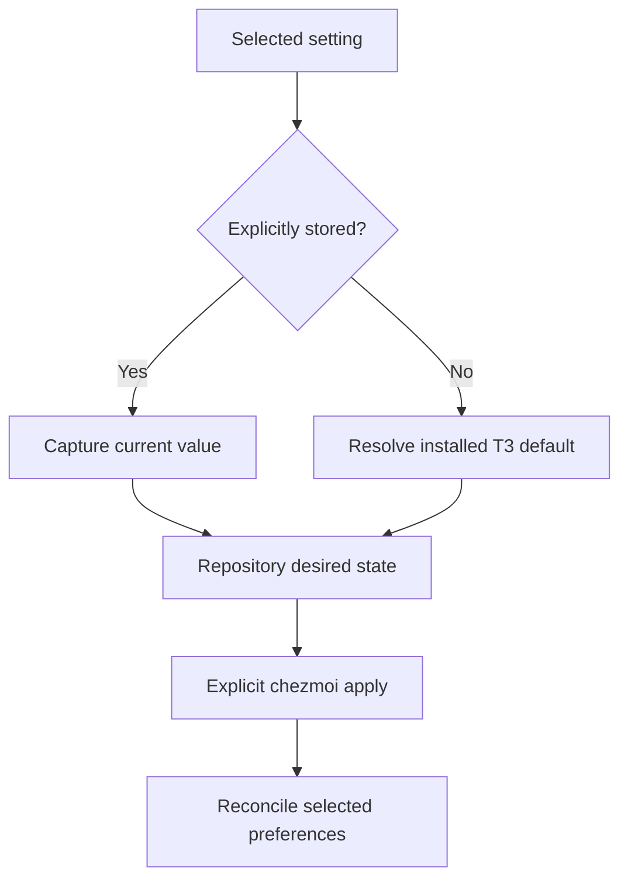
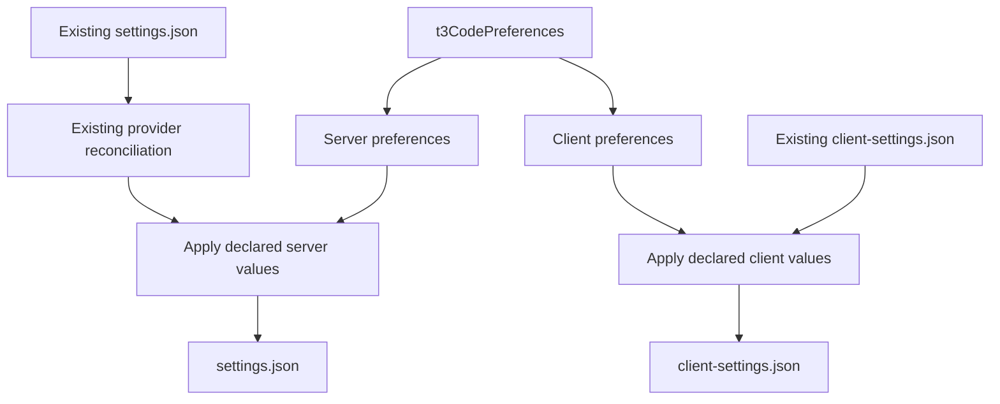

# T3 Code Managed Preferences - Plan

## Goal Capsule

- **Objective:** The repository owner can reproduce selected T3 Code preferences on new and existing devices.
- **Means:** Declare preferences in chezmoidata and reconcile them through chezmoi modify templates.
- **Product authority:** The Product Contract below records the selected settings and value-selection rule confirmed by the owner.
- **Implementation authority:** The Product Contract governs behavior; the Planning Contract governs implementation choices.
- **Execution profile:** One PR with sequential implementation and disposable-home verification; LFG owns review and shipping.
- **Stop conditions:** Stop on a settled-decision conflict or a failed required verification.
- **Open blockers:** None.

---

## Product Contract

### Summary

Extend existing T3 Code configuration management to the owner's selected preferences.
Capture explicitly configured values first and fill absent settings from the installed T3 version's defaults.
Keep the existing provider integration and preserve settings outside the selected scope.

### Problem Frame

The owner has configured T3 Code preferences locally that the repository cannot yet reproduce on another device.
The current modify template owns provider connections only.

### Key Decisions

- **Manage a selected set of preferences.** Governs R1, R2, R7. (session-settled: user-directed — chosen over the broader proposal covering display preferences and keybindings: the owner supplied the exact UI settings to preserve.)
- **Capture current values with default fallback.** Governs R3, R4. (session-settled: user-directed — chosen over relying on unstored application defaults: the owner specified existing values first and defaults for absent settings.)
- **Retain the current provider mechanism.** Governs R6. The owner explicitly requested the existing approach rather than migrating provider ownership into the new preference payload.

### Requirements

**Managed preference scope**

- R1. Manage the following selected UI settings, including the complete model selection options and the inactive-worktree cleanup period where applicable.

| Settings page | Section | Selected items |
| --- | --- | --- |
| General | Notifications | Thread notifications; In-app notifications |
| General | Sidebar | Working section |
| SnapShots | SnapShots | Enabled |
| Threads | New projects | Add project starts in |
| Threads | New threads | Model; Fallback model; Permissions; Workspace |
| Threads | Usage limits | Resume after usage limits; Snooze until limits reset |
| Threads | Auto-settle | All elements in this section |
| Threads | Text generation | Text generation model |
| Source Control | Repositories | Automatic pull |
| Source Control | Writing & review | Source control writing style |
| Worktrees | Branches | Worktree branch renaming |
| Worktrees | Cleanup | Delete worktrees with deleted threads; Delete inactive worktrees; Delete unchanged worktrees |

- R2. Store the desired values for R1 in repository-owned chezmoidata under a distinct top-level namespace.

**Value selection and reconciliation**

- R3. When forming the initial desired state, use each selected setting's explicit current value when its key is present and use the installed T3 version's effective default only when absent.
- R4. Record the resolved R3 values explicitly so subsequent application uses repository intent rather than recapturing destination-device preferences or following changing application defaults.
- R5. Explicit chezmoi application must create missing preference files and restore managed values after local changes; repeated application without changes must be stable.
- R6. Preserve the current Codex and omp provider reconciliation, executable-path derivation, and ownership boundaries.
- R7. Preserve unowned settings, nested fields, unrelated provider instances, and project-specific overrides while applying R5.
- R8. Invalid JSON or incompatible object shapes must fail without replacing the affected original file.

**Application boundary**

- R9. Worktree bootstrap must remain read-only for personal settings; configuration changes occur only through explicit chezmoi application.
- R10. Support the repository's existing eligible T3 desktop platforms without copying this device's absolute user-home paths into shared preferences.

### Initial Capture Evidence

These observations identify the source values for R3; they are not an additional managed-settings list.
Recheck selected values before implementation because the running application can update its files.

| UI setting | Observed stored value | Storage key |
| --- | --- | --- |
| Thread notifications | `notifications` | `client-settings.json`: `notificationMode` |
| In-app notifications | `true` | `client-settings.json`: `inAppNotificationsEnabled` |
| Working section | `true` | `client-settings.json`: `sidebarWorkingShelfEnabled` |
| SnapShots enabled | `true` | `client-settings.json`: `snapShotEnabled` |
| Add project starts in | `~/src` | `settings.json`: `addProjectBaseDirectory` |
| Model | Codex `gpt-6.1-sol`, effort `high`, service tier `default` | `settings.json`: `defaultModelSelection` |
| Fallback model | `claudeAgent` / `claude-opus-5-5` | `settings.json`: `fallbackModelSelection` |
| Permissions | Absent; resolve through R3 | `settings.json`: `defaultRuntimeMode` |
| Workspace | `worktree` | `settings.json`: `defaultThreadEnvMode` |
| Resume after usage limits | `true` | `settings.json`: `autoResumeLimitedThreads` |
| Snooze until limits reset | `true` | `settings.json`: `snoozeLimitedThreads` |
| Auto-settle: keep threads with a PR | `true` | `settings.json`: `sidebarAutoSettleKeepPullRequests` |
| Auto-settle: merged threads | Absent; resolve through R3 | `settings.json`: `sidebarAutoSettleOnMerge` |
| Auto-settle: inactive threads | Absent; resolve through R3 | `settings.json`: `sidebarAutoSettleAfterDays` |
| Text generation model | Codex `gpt-6-luna` | `settings.json`: `textGenerationModelSelection` |
| Automatic pull | `true` | `settings.json`: `defaultAutoPull` |
| Source control writing style | `conventional_commits` | `settings.json`: `sourceControlWritingStyle.mode` |
| Worktree branch renaming | `semantic` | `settings.json`: `branchNamingMode` |
| Delete worktrees with deleted threads | `true` | `settings.json`: `storageCleanup.worktreeOnDelete` |
| Delete inactive worktrees | 5 days | `settings.json`: `storageCleanup.worktreeAfterDays` |
| Delete unchanged worktrees | `true` | `settings.json`: `storageCleanup.worktreeUnchanged` |

### Key Flow

- F1. **Covers R1–R10.** Capture the selected settings using R3, record the resolved desired state, then explicitly apply it on a device. Subsequent applications reconcile repository-owned preferences under R5–R8 while retaining the provider behavior from R6.

### Acceptance Examples

- AE1. **Covers R1, R3, R4.** Given the observed text generation model, capture retains Codex `gpt-6-luna` even when T3's built-in default selects another model.
- AE2. **Covers R3, R4.** Given an absent Permissions key, capture records the installed version's verified effective default; later application restores that recorded value on another device.
- AE3. **Covers R3.** Given an explicitly stored `false`, zero, empty string, or supported `null`, capture preserves that value instead of treating it as an absent key.
- AE4. **Covers R5–R7.** Given a missing destination preference file, explicit application creates the selected preferences and keeps the existing provider contract; a second application produces no further changes.
- AE5. **Covers R5, R7.** Given drift in a managed value and an unrelated local setting, reapplication restores the former and preserves the latter, including unrelated nested fields and project overrides.
- AE6. **Covers R8.** Given malformed JSON or an incompatible managed object shape, application fails with the affected file's original bytes retained.
- AE7. **Covers R9.** Given a new worktree, `mise install` prepares tools without applying personal T3 configuration.
- AE8. **Covers R6, R10.** Given an eligible platform and disposable home, provider paths resolve against that home and selected preferences render without the original device's absolute home path.

### Scope Boundaries

- No new ownership of keybindings, desktop window state, themes, other display preferences, SnapShots options beyond enabled, onboarding records, or per-project configuration.
- No import of credentials, sessions, connection catalogs, device identifiers, or application databases.
- No automatic capture of later GUI edits; desired-state updates are repository edits under R4.
- No change to existing installation policy, custom `T3CODE_HOME` coverage, provider authentication, or fallback-model behavior when a referenced provider is unavailable.
- This work does not apply configuration to the real home as part of development verification.

### Dependencies and Assumptions

- Existing modify-template conventions and T3 provider integration remain authoritative.
- Settings files are observed in the default `~/.t3/userdata` location.
- T3 may write these files while running; retain the existing documented requirement to close it before actual application.

### Sources / Research

- `STRATEGY.md`: repository precedence and cross-platform environment reproduction.
- `docs/maintenance/chezmoi-source.md`: global chezmoidata namespace and preservation-oriented modify conventions.
- `home/private_dot_t3/private_userdata/modify_private_settings.json` and `home/.chezmoitemplates/t3-code-settings`: existing provider adapter and reconciliation.
- `tests/test_t3_code_settings.py`: existing disposable-home preservation, validation, repeatability, platform-path, and permission coverage.
- `docs/guides/t3-code.md`: installation coverage, provider boundaries, and concurrent-write guidance.
- `mise.toml` and `.chezmoi-bootstrap.toml`: explicit application separated from hook-free bootstrap.
- Owner's current default-home settings files: read-only capture evidence above; these files are machine-local and are not committed source inputs.

---

## Planning Contract

**Product Contract preservation:** Product Contract unchanged in scope and stable IDs; planning-owned questions resolved below and the motivation made explicit.

### Key Technical Decisions

- KTD1. **Use one checked-in JSON preference declaration.** Add `home/.chezmoidata/t3-code.json` with unique namespace `t3CodePreferences`, separated into `server` and `client` desired maps. This implements R1–R4 without a capture command or an apply-time dependency on T3's installation. Store capture version `0.1.7` as metadata outside the applied maps.
- KTD2. **Keep the existing provider partial and add a thin client adapter.** Extend `home/.chezmoitemplates/t3-code-settings` after its existing provider reconciliation and create `home/private_dot_t3/private_userdata/modify_private_client-settings.json` with a small `t3-code-client-settings` partial. Both retain the repository's modify-template marker and private permissions. Implements R5–R10.
- KTD3. **Own model selections atomically and other nested maps by selected leaves.** For the three model selections, replace the complete selected value, including options or their intentional absence, so stale destination options cannot alter the captured choice. For `storageCleanup` and `sourceControlWritingStyle`, update only declared child keys and retain undeclared children. All other preference fields are top-level leaf replacements. A small T3-local merge partial may share these two-level rules between adapters; do not introduce a general configuration framework. Implements R3–R8.
- KTD4. **Resolve missing values from the installed native contracts once.** The installed T3 0.1.7 server bundle defines `defaultRuntimeMode = full-access`, `sidebarAutoSettleAfterDays = 3`, and `sidebarAutoSettleOnMerge = true`. These values fill the currently absent selected keys. A stored model-selection object is already complete when optional options are absent; do not borrow options from another default model. Implements R3, R4.
- KTD5. **Use actual chezmoi in isolated homes as the primary proof.** Extend existing `tests/test_t3_code_settings.py`; retain the existing native T3 smoke for provider compatibility. This tests the source-to-destination boundary directly and keeps real personal settings untouched. Implements R5–R10.

### Capture and Ownership Map

Use the current values in Initial Capture Evidence, rechecked immediately before declaring the data file.
The missing values resolved by KTD4 are explicit declaration values, not template fallback behavior.

- Client map: only `notificationMode`, `inAppNotificationsEnabled`, `sidebarWorkingShelfEnabled`, and `snapShotEnabled`.
- Server top-level leaves: `addProjectBaseDirectory`, `defaultRuntimeMode`, `defaultThreadEnvMode`, `autoResumeLimitedThreads`, `snoozeLimitedThreads`, `sidebarAutoSettleOnMerge`, `sidebarAutoSettleAfterDays`, `sidebarAutoSettleKeepPullRequests`, `defaultAutoPull`, and `branchNamingMode`.
- Atomic selected values: `defaultModelSelection`, `fallbackModelSelection`, and `textGenerationModelSelection` under KTD3.
- Selected cleanup leaves: `storageCleanup.worktreeOnDelete`, `storageCleanup.worktreeAfterDays`, and `storageCleanup.worktreeUnchanged`.
- Selected writing-style leaves: `sourceControlWritingStyle.mode` and its conditional `customInstructions`; the latter is absent now and defaults to the empty string in 0.1.7.
- `sourceControlWritingStyle.followChangeRequestTemplates` is a separate UI setting and stays unowned. Branch prefix and custom naming instructions are separate controls and stay unowned; the selected branch-renaming selector maps to `branchNamingMode`.
- Auto-settle's entire section maps to the three `sidebarAutoSettle*` keys above; its enabled/disabled state is encoded by nullable `sidebarAutoSettleAfterDays`, and its period uses that same key. Idle compaction is a different section and stays unowned.

### High-Level Technical Design

The two preference maps feed two file-specific adapters; existing providers remain in the server path.

### Assumptions and Constraints

- Preserve only the default T3 home coverage already documented; no relocation feature is added.
- Capture is a development-time operation, not part of bootstrap or repeated application.
- Keep the existing malformed-JSON failure behavior and reject non-object managed parent maps before writing that affected file.
- No cross-file transaction is promised: R8 protects the malformed file, not previously completed writes to another file.
- No runtime app shutdown automation, file-lock service, schema migration, or continuous synchronization is added; these are unnecessary for the existing explicit-apply workflow.

### Research Evidence

Installed T3 0.1.7 `server.asar` was inspected read-only. Its `ManagedEndpointRuntime-olGvALiB.mjs` contains native defaults; `SettingsPanels-DlgpwmCH.js` confirms the Auto-settle section; `_chat.settings.worktrees-g7dxvUbi.js` and `_chat.settings.source-control-BJIv1UWT.js` identify branch and writing-style controls.
The installed bundle is authoritative for this capture, so no external option survey is needed.
Existing provider, Codex TOML, omp YAML, and shell modify templates supply established local preservation patterns.

---

## Implementation Units

### U1. Declare and reconcile selected preferences

**Goal:** Apply the selected current preferences from repository data while preserving unowned state.

**Requirements:** R1–R10; F1; KTD1–KTD4.

**Dependencies:** None.

**Files:** New `home/.chezmoidata/t3-code.json`, new `home/private_dot_t3/private_userdata/modify_private_client-settings.json`, new `home/.chezmoitemplates/t3-code-client-settings`, existing `home/.chezmoitemplates/t3-code-settings`, optional small T3-local shared merge partial, `tests/test_t3_code_settings.py`.

**Approach:**

1. Recheck the selected live values and record the declaration using the capture/ownership map and KTD4.
2. Apply the server declaration after existing provider reconciliation, and add the private client adapter with the same root-shape validation.
3. Implement KTD3 merge boundaries and validate each selected nested parent when present.
4. Update fixture setup to copy the data declaration and every required T3 partial; pass the preference namespace into synthetic render contexts that currently contain only `chezmoi`.
5. Update expected settings helpers and existing preservation cases to reflect newly owned preferences.

**Execution note:** Prove convergence and preservation through real chezmoi in disposable homes; do not create tests that merely echo the literal data file.

**Test scenarios:**

- Covers AE1–AE3. Assert the captured declaration contains the observed model selections and the verified default-only fields, without borrowing text-model options; include a fixture with explicit false, empty string, and supported null preferences.
- Covers AE4. Apply each adapter to missing, blank, and minimal JSON files; both files contain desired values and the second apply is byte-stable with an empty diff.
- Covers AE5. Seed stale managed fields, stale model options, unknown nested cleanup/writing-style fields, unrelated provider instances, appearance settings, and project overrides; only owned values converge.
- Covers AE6. Malformed JSON and non-object roots or managed nested parents fail while preserving that file's bytes.

**Verification:** The selected data changes determine the rendered result; unknown settings survive and existing provider tests pass.

### U2. Verify platform integration and document ownership

**Goal:** Establish supported-target selection, native compatibility, and the maintenance workflow for selected preferences.

**Requirements:** R1–R10; AE4–AE8; KTD5.

**Dependencies:** U1.

**Files:** `tests/test_t3_code_settings.py`, `tests/smoke_t3_code.py` only if its current assertions need adjustment, `docs/guides/t3-code.md`.

**Approach:**

1. Extend existing platform rendering and managed-target cases to cover `client-settings.json` with the same `.t3` selection boundary.
2. Verify private permissions for both files and include the client file in disposable-home reapplication proof.
3. Retain native provider smoke assertions; its fixture already copies all chezmoidata and templates.
4. Document the selected owned fields, capture-version/default rule, data editing procedure, model-value ownership, and existing close-before-apply requirement.

**Test scenarios:**

- Covers AE8. Render the supported Windows, Ubuntu, and Apple Silicon target contexts; both files contain the shared preferences and provider paths resolve to the disposable destination.
- Unsupported target contexts continue to omit the entire managed `.t3` tree.
- Both files and parent directories retain the existing private chezmoi modes.
- Covers AE7. The existing bootstrap contract remains unchanged and no new apply-time hooks enter worktree preparation.
- Native T3 smoke continues to observe the enabled providers and complete the existing initialization checks using isolated application state.

**Verification:** Focused tests and existing native smoke pass locally; CI runs native coverage on its existing platform matrix. Documentation matches the data's ownership boundary.

---

## Verification Contract

| Check | Command / method | Required evidence |
| --- | --- | --- |
| Preference reconciliation | `mise exec -- python -m unittest discover -s tests -p test_t3_code_settings.py` | Managed creation, convergence, unknown-value preservation, model-option replacement, malformed-input protection, selection, and permissions |
| Existing application contracts | Existing applications unit area in `.github/workflows/test.yml` | No fixture regression from the added data/template dependency |
| Native provider integration | `mise exec -- python tests/smoke_t3_code.py` | Existing T3 CLI discovery, omp ACP handshake, and T3-driven Codex initialization in disposable state |
| Source preparation | Existing `mise install` / bootstrap contract | Tools prepared through hook-free config without personal application |
| Patch hygiene | `git diff --check` and source inspection | No abandoned code, sensitive state, or device-specific absolute paths |

Focused reconciliation tests must run before broad verification.
Local Windows native verification does not establish Linux or macOS runtime results; those remain the existing CI matrix's responsibility.
Browser interaction is not needed for this configuration-only change; native contracts and file reconciliation are the relevant seams.

---

## Definition of Done

- U1 and U2 satisfy their cited requirements and acceptance examples.
- The data file contains only selected preferences and capture metadata, with current values taking precedence over verified defaults.
- The existing provider contract remains intact and unowned settings survive repeated application.
- Required local checks pass, and any platform checks not run locally are reported accurately.
- Real personal settings and running application state have not been modified by development verification.
- Documentation describes how to edit and apply the managed preferences.
- Abandoned experimental code and scratch artifacts are absent from the patch.
