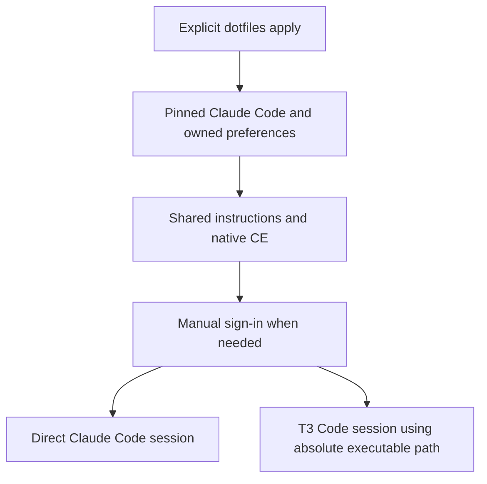
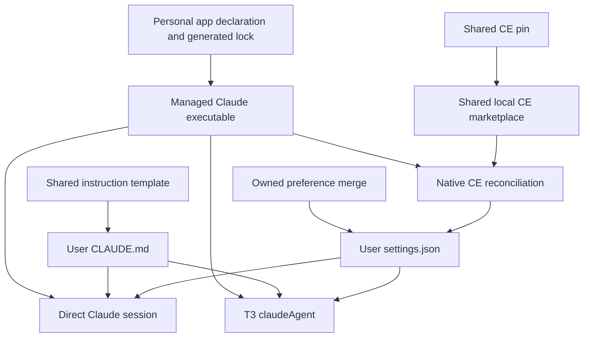
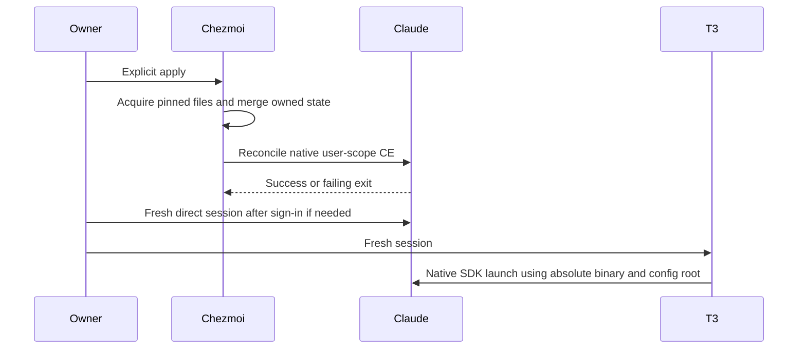

# Claude Code Managed Harness - Plan

## Goal Capsule

- **Objective:** The repository owner can use Claude Code directly and through T3 Code after applying dotfiles and completing sign-in.
- **Product authority:** Issue #30, its onboarding comment, and the confirmed scope in this brainstorm, including Korean responses and disabled automatic memory.
- **Means:** Extend pinned personal applications, native Claude settings/CE, and the T3 native Claude driver (KTD1-KTD4).
- **Authority:** Product behavior follows the R-IDs; technical mechanisms follow the KTDs; units and examples do not override either.
- **Execution profile:** One PR with U1-U4 in dependency order; native smoke verification leads packaging/configuration proof.
- **Finish and ship:** The LFG caller implements, reviews, verifies, commits, pushes, and opens the PR; merging remains with the owner.
- **Stop conditions:** A required native integration cannot satisfy its contract, a settled decision becomes infeasible, or evidence remains missing under R18. Runtime tests belong to implementation.
- **Product Contract preservation:** Clarified with a Problem Frame and planning-question destinations; R1-R18, F1-F3, AE1-AE7 and settled scope are unchanged.

---

## Product Contract

### Summary

Manage Claude Code installation, preferences, shared instructions, Compound Engineering, and T3 Code provider onboarding through explicit dotfiles application.
Default responses use Korean and automatic memory is disabled.

### Problem Frame

The owner needs the same ready-to-use Claude environment after setting up a new PC or reapplying configuration on an existing one.
Separate manual installation, instruction, plugin, and T3 configuration would leave those entry points dependent on machine-local setup.

### Key Decisions

- **Complete onboarding is the deliverable.** Governs R7, R10, R13-R15; installing the CLI alone does not meet the issue's everyday-use goal. (session-settled: user-approved — chosen over a CLI-only milestone: the confirmed scope includes shared instructions, CE, and T3 Code.)
- **The repository controls version changes.** Governs R2-R4; reproducing and rolling back the environment takes precedence over background upgrades. (session-settled: user-approved — chosen over upstream automatic updates: the user confirmed repository-owned pinning and updates.)
- **Own Korean response and automatic-memory preferences.** Governs R8-R9; these are explicit additions to the managed settings scope. (session-settled: user-approved — chosen over leaving those preferences to local defaults: the user requested both settings and confirmed their inclusion.)
- **Disable automatic memory without deleting its files.** Governs R9; this changes runtime behavior while retaining existing local data. (session-settled: user-approved — chosen over deleting existing memory data: the user confirmed the proposed non-deleting scope.)

### Requirements

**Installation and lifecycle**

- R1. Determine and document Claude Code's eligible OS/architecture combinations from upstream support within the repository's existing platform policy.
- R2. Install a repository-pinned Claude Code executable under the destination home's `.local/bin`, with the native Windows suffix where applicable.
- R3. Define repository-owned version updates and rollback to a previously pinned version.
- R4. Disable Claude Code's background automatic updates so normal use retains the repository-selected version.
- R5. Perform personal installation and configuration only through explicit chezmoi application; worktree preparation must leave personal settings unchanged.

**Settings and instructions**

- R6. Declare owned settings in the chezmoi source under `home/`, preserving unrelated settings, plugins, credentials, and application state.
- R7. Connect Claude Code's native user-scope instructions to `home/.chezmoitemplates/agent-instructions` using the explicit `claude` harness identifier, including common content and excluding foreign harness branches.
- R8. Set the native user-scope `language` preference to `korean` for Korean responses by default.
- R9. Set the native user-scope `autoMemoryEnabled` preference to `false` to disable automatic-memory reading and writing, preserving existing memory files and the R7 instruction connection.

**Compound Engineering and credentials**

- R10. Register, install, and enable CE at user scope through Claude Code's supported native integration, reusing the repository-owned CE release and commit pin.
- R11. Verify native CE skill discovery and invocation in a disposable home on each eligible platform, preserving unrelated plugins and settings.
- R12. Document manual sign-in or supported credential provisioning without committing secrets to tracked plaintext configuration.

**T3 Code**

- R13. Add and enable the Claude Code provider in repository-managed T3 Code configuration while preserving unrelated providers and settings.
- R14. Verify Claude Code's supported T3 driver/protocol and required launch arguments rather than assuming omp's `acp` command applies.
- R15. Configure the provider with the fully expanded absolute path of the R2 executable and verify T3-driven launch in a fresh session with the managed binary directory absent from `PATH`.

**Reconciliation and evidence**

- R16. Make repeated apply idempotent, restoring owned preferences and CE activation while retaining a single provider with its managed absolute path.
- R17. Verify initial setup, repeated apply, owned-setting reconciliation, native instruction discovery, and launch in disposable homes on eligible platforms.
- R18. Document usage, manual actions, supported platforms, and limitations; an unverified required integration must remain incomplete.

### Key Flows

- F1. **First use. Covers R1-R2, R5-R15, R17-R18.** The owner explicitly applies dotfiles, completes documented authentication, and starts a fresh Claude Code or T3 Code session with the managed preferences and integrations.
- F2. **Reapply. Covers R4-R11, R13, R15-R17.** After changing owned preferences or disabling CE locally, the owner applies dotfiles again; managed values and activation return while unrelated state remains intact.
- F3. **Update or rollback. Covers R2-R4, R10, R16-R18.** The owner changes the repository pin and explicitly applies it; the executable and native integrations are verified for the selected version.

### Acceptance Examples

- AE1. **Covers R5.** Given a fresh worktree, running its preparation installs development tools and checks source state without installing or configuring Claude Code in the real user home.
- AE2. **Covers R1-R2, R7-R15, R17.** Given a disposable home on an eligible platform, explicit apply produces the pinned executable, natively discovered instructions and CE, owned preferences, and an enabled T3 provider that launches without the managed bin directory on `PATH`.
- AE3. **Covers R4, R6, R8-R9, R16.** Given local drift in the language, automatic-memory, and update preferences, repeated apply restores the managed values while preserving unrelated settings and existing memory files.
- AE4. **Covers R7, R9, R17.** Given representative common and harness-specific instruction content, native Claude Code discovery includes the common and Claude content, excludes foreign branches, and remains available with automatic memory disabled.
- AE5. **Covers R6, R10-R11, R13, R15-R16.** Given CE is disabled and unrelated plugins and providers exist, repeated apply restores CE activation without removing unrelated state or duplicating the Claude provider.
- AE6. **Covers R2-R4, R16-R18.** Given a previously supported repository pin, reverting to it and applying restores that executable version and passes its required onboarding checks.
- AE7. **Covers R11-R12, R15, R17-R18.** If a native integration or authentication-dependent invocation cannot be verified, report the exact missing evidence rather than claiming discovery alone proves successful invocation or T3 launch.

### Scope Boundaries

- Authentication follows R12; OAuth automation is outside this change.
- Model selection, permission policies, and plugins beyond CE are outside this change.
- The language preference governs responses; repository documentation remains English under `AGENTS.md`.
- R9 concerns Claude Code automatic memory; the shared instruction files remain governed by R7.
- Platform expansion beyond R1 is outside this change; direct CLI and T3 desktop coverage need not be identical.

### Outstanding Questions

The planning-owned questions are resolved by KTD1-KTD5. Runtime discovery and platform evidence are deferred to implementation under those decisions and R18.

### Sources / Research

- [Issue #30](https://github.com/hyperlapse122/dotfiles/issues/30) and [required CE and T3 onboarding comment](https://github.com/hyperlapse122/dotfiles/issues/30#issuecomment-6646013859): scope authority.
- `AGENTS.md` and `STRATEGY.md`: bootstrap, platform, ownership, documentation, and credential boundaries.
- `docs/maintenance/chezmoi-source.md#shared-user-scope-harness-onboarding`: shared instruction and native integration requirements.
- `docs/guides/personal-applications.md`, `docs/guides/harness-plugins.md`, and `docs/guides/t3-code.md`: adjacent operational patterns to assess during planning.
- [Claude Code setup](https://code.claude.com/docs/en/setup): installation options, version selection, and automatic-update controls; verify against the selected pin during planning.
- [Language setting](https://code.claude.com/docs/en/settings-reference#language) and [automatic-memory setting](https://code.claude.com/docs/en/settings-reference#automemoryenabled): upstream preference semantics.

---

## Planning Contract

### Key Technical Decisions

- KTD1. **Acquire the official raw native executable through existing checksum-locked externals.** Implements R1-R5. Add a Claude-specific source resolver to the personal-app updater rather than inventing GitHub release assets or invoking the mutable upstream installer. Read the official `https://downloads.claude.ai/claude-code-releases/latest` metadata once and resolve the matching versioned `manifest.json`; normalize its per-platform binary names and SHA-256 into the existing lock shape. The observed initial version is `2.1.318`. Map `windows-amd64/arm64` to `win32-x64/arm64`, `linux-amd64/arm64` to `linux-x64/arm64`, and `darwin-arm64` to `darwin-arm64`. Retain the repository's glibc Linux host and ARM64-only macOS harness policy. The manifest root has `version` and `platforms`; each platform entry has `binary`, `checksum`, and `size`. Validate version, required platforms, binary names, checksum shape, and fixed-host versioned URLs before atomically replacing the lock; leave other application pins and source resolvers unchanged. Existing `kind=file` externals can install the executable. This instantiates the repository-control decision without adding a second installer lifecycle.
- KTD2. **Merge only owned user settings and generate a thin CLAUDE.md adapter.** Implements R4, R6-R9, R16. Add a private `~/.claude/settings.json` modify template that preserves unrelated keys and fails on malformed input or invalid owned container shapes. Own `env.DISABLE_AUTOUPDATER=1`, `language=korean`, `autoMemoryEnabled=false`, and the CE settings in KTD3. Generate private `~/.claude/CLAUDE.md` from the shared template with `harness=claude`. Do not own the whole directory or touch authentication, sessions, memory files, or other local content. This instantiates the Korean/memory decision while retaining native instruction discovery.
- KTD3. **Use the shared local marketplace and Claude's native user-scope plugin lifecycle.** Implements R6, R10-R11, R16. Extend shared archive eligibility and plugin declarations for Claude while retaining CE `compound-engineering-v3.35.1` / commit `42f9745ea0a4b70f8dde059aa8cf7f974d2991f1`. Set only the CE `extraKnownMarketplaces` entry to a directory source at the absolute shared archive path with `autoUpdate=false`, and its `enabledPlugins` entry to true. An unconditional OS-guarded after hook uses the absolute managed Claude executable and explicit destination `CLAUDE_CONFIG_DIR`, `HOME`, and Windows `USERPROFILE` for local marketplace registration, user-scope installation, and enablement. Use native `--json` outcomes, parsing the last stdout line; accept the documented already-enabled `failureCode=already_in_goal_state` with `alreadyInGoalState=true` as convergence, and propagate genuine failures. Repeat marketplace-add and plugin-install already-present cases are documented exit-zero successes. Preserve unrelated native registries; verify same-name stale marketplace source reconciliation with the pinned CLI rather than assuming repeat add changes it. The CE marketplace's relative plugin source loads in place from a local marketplace, so pin movement follows the shared archive rather than needing uninstall or destructive cache deletion. Verify this with the pinned native CLI and retain any runtime discrepancy as a blocker, not an assumed repair.
- KTD4. **Use T3's native `claudeAgent` driver against the managed executable and config root.** Implements R7-R9, R13-R16. Merge `providerInstances.claudeAgent` with native driver `claudeAgent`, enable it, and set `config.enabled=true`, `config.binaryPath` to the expanded destination `.local/bin/claude[.exe]`, and `config.homePath` to the expanded destination `.claude`. T3's Claude environment maps homePath to `CLAUDE_CONFIG_DIR` without replacing HOME. Do not add `acp` arguments or an ACP wrapper. Preserve other provider options and instances. Existing custom homePath is intentionally reconciled because retaining it would bypass the managed instructions, CE, and preferences. T3's existing fallback selection already names `claudeAgent`; this change makes that instance available without changing model policy.
- KTD5. **Prove the native boundaries with isolated real artifacts.** Implements R11-R12, R15, R17-R18. Follow the existing Codex smoke's disposable source/home, ambient credential removal, real pinned plugin, request capture, and explicit evidence limits. Claude smoke must demonstrate native settings/instruction consumption and explicit CE selection/expansion, not just plugin metadata or `--version`. Use a localhost rejecting capture endpoint where the pinned CLI supports deterministic request expansion; do not use real credentials or fabricate a successful model completion. T3 verification starts the actual desktop-bundled server, disables unrelated runtime providers, excludes the managed bin directory from PATH, and exercises the native Claude capability initialization path. Its Agent SDK initialization can obtain native command/capability metadata without a model completion. Separate configuration parsing, direct invocation expansion, T3 protocol initialization, and authenticated completion in evidence.

### High-Level Technical Design

The same repository authorities feed both execution surfaces; KTD1-KTD4 own the mechanisms.

The apply lifecycle keeps preparation separate from personal application and reports failure at the native boundary that failed.

### Assumptions and Deferred Runtime Details

- The default destination `.claude` is the managed user scope; custom direct-session `CLAUDE_CONFIG_DIR` locations remain unmanaged.
- Current official docs describe local relative-source plugins as loaded in place. U2 verifies that behavior against the selected CLI and CE archive.
- Exact capture-endpoint API handling and platform-specific native SDK behavior require runtime discovery in U4; required invocation or protocol evidence cannot be replaced with an authentication error.
- The native executable may be locked by active Windows processes. Documentation asks the owner to close Claude/T3 before application; no process-killing mechanism is added.

### System-Wide Impact and Risks

- The app updater now consumes a third native source while retaining its atomic all-app lock publication and candidate-pin CI workflow.
- CE remains one shared archive/pin. Its Claude integration must leave existing omp and Codex registrations and plugins unchanged.
- T3's managed Claude homePath is an owned field under KTD4; existing custom providers remain unowned, but custom state on the managed default instance is redirected to the repository-managed scope.
- Apply is not transactional across all files. Download, rendering, or native command errors stop at their owning boundary; rerunning after correction converges through R16.
- Signed upstream manifest metadata is available, but this work retains the existing HTTPS-acquisition plus committed SHA-256 trust model rather than introducing a new signature-verification toolchain. A change in repository artifact-trust policy would justify that separate work.

### Sources That Shape the Implementation

- [Official native setup and binary integrity](https://code.claude.com/docs/en/setup#binary-integrity-and-code-signing) and [versioned manifest](https://downloads.claude.ai/claude-code-releases/2.1.318/manifest.json): KTD1.
- [Native plugin loading](https://code.claude.com/docs/en/plugins/loading#in-place-and-copied-plugins) and [CLI outcomes](https://code.claude.com/docs/en/plugins/cli-reference#plugin-enable): KTD3 local-source loading and idempotent reconciliation.
- [T3 v0.1.7 settings](https://github.com/pingdotgg/t3code/blob/v0.1.7/packages/contracts/src/settings.ts), [Claude driver](https://github.com/pingdotgg/t3code/blob/v0.1.7/apps/server/src/provider/Drivers/ClaudeDriver.ts), and [Claude home handling](https://github.com/pingdotgg/t3code/blob/v0.1.7/apps/server/src/provider/Drivers/ClaudeHome.ts): KTD4.
- `home/.chezmoiexternals/personal-apps.toml.tmpl`, `scripts/update-personal-app-lock.py`, `home/.chezmoitemplates/codex-config`, and `tests/smoke_codex.py`: existing acquisition, preservation, and native-evidence patterns.

---

## Implementation Units

### U1. Add Claude native distribution pins

**Goal:** Install the exact selected Claude executable through the personal-application lifecycle.

**Requirements:** R1-R5; F1, F3; AE1, AE2, AE6.

**Dependencies:** None.

**Files:** `home/.chezmoidata/personal-apps.json`, `home/.chezmoidata/personal-app-lock.json`, `scripts/update-personal-app-lock.py`, `tests/test_personal_apps.py`, `tests/test_personal_app_lock.py`, `tests/smoke_personal_apps.py`.

**Approach:**
1. Add the Claude declaration and source normalization per KTD1, reusing the existing raw-file external and atomic lock writer.
2. Populate only Claude's initial locked targets from the observed version, retaining unrelated application pins.
3. Extend the existing fixture/resolver and native application coverage for the new source and target mapping.

**Patterns to follow:** Existing GitLab normalization and file external checks; preserve the updater's failed-resolution behavior.

**Execution note:** Favor a real isolated install/version smoke over tests that merely mirror declaration text.

**Test scenarios:**
- Covers AE2. A valid Claude manifest resolves the declared native targets into versioned fixed-host URLs and checksums, then the native external executes the selected version.
- Missing required platform, unexpected binary name, malformed checksum, or version mismatch fails before the existing lock is replaced.
- Covers AE1. Worktree preparation renders/enumerates source with the hook-free config without personal Claude installation.
- Covers AE6. Reapplying a previous locked executable restores its version without updater drift.

**Verification:** The unchanged generic external installs Claude from a committed lock; other source resolvers and pins retain their behavior.

### U2. Wire native preferences, instructions, and CE

**Goal:** Make fresh Claude sessions consume the managed user settings and pinned CE.

**Requirements:** R4, R6-R12, R16-R18; F1-F3; AE2-AE5, AE7.

**Dependencies:** U1.

**Files:** New `home/private_dot_claude/modify_private_settings.json`, `home/private_dot_claude/private_empty_CLAUDE.md.tmpl`, `home/.chezmoitemplates/claude-settings`, `home/.chezmoitemplates/claude-plugins-posix`, `home/.chezmoitemplates/claude-plugins-windows`, `home/.chezmoiscripts/run_after_26-claude-plugins.sh.tmpl`, `home/.chezmoiscripts/run_after_26-claude-plugins.ps1.tmpl`, `tests/test_claude.py`, `tests/smoke_claude.py`; modify `home/.chezmoidata/harness-plugins.json`, `home/.chezmoiexternals/harness-plugins.toml.tmpl`, `home/.chezmoiignore`.

**Approach:**
1. Follow KTD2's private preserving adapter and thin instruction template, with target eligibility matching the Claude declaration.
2. Register Claude under the shared CE declaration and extend archive eligibility without changing its lock or other harness behavior.
3. Add OS-conditional native hooks with consistent padded phase names and explicit destination scope per KTD3.
4. Keep plugin registries under native CLI ownership; change only the declared user settings and CE registration/activation.

**Patterns to follow:** Codex modify-template shape validation, unconditional native after hooks, and shared-instruction marker fixtures.

**Test scenarios:**
- Covers AE3. Local language/memory/update drift is restored; unrelated env/settings, credentials, sessions, and existing memory files survive.
- Malformed JSON or owned object containers fail without replacing the existing settings.
- Covers AE4. Seeded shared and harness branches reach native Claude as intended with automatic memory disabled.
- Covers AE5. Native CE installation and enablement repair a disabled CE entry and follow selected shared archive content while retaining an unrelated plugin/marketplace.
- Covers AE3, AE5. Reapplying with CE already enabled accepts its structured goal-state result, while malformed output and genuine enable/install/marketplace failures still fail application.
- Covers AE7. Actual native explicit CE invocation expands the pinned skill content; distinguish rejection by a test endpoint from completed inference.

**Verification:** The selected CLI natively loads the expected preferences, instructions, and CE content in disposable state and repeated apply converges.

### U3. Add the native T3 Claude provider

**Goal:** T3 launches Claude with the same managed executable and user context as the direct CLI.

**Requirements:** R7-R9, R13-R16; F1-F2; AE2, AE5, AE7.

**Dependencies:** U1, U2.

**Files:** `home/.chezmoitemplates/t3-code-settings`, `tests/test_t3_code_settings.py`, `tests/smoke_t3_code.py`.

**Approach:**
1. Extend the current preserving provider merge with KTD4's owned native fields and path handling.
2. Cover blank state, existing custom fields, owned-field drift, and malformed provider containers.
3. Extend the real T3 runtime smoke to exercise KTD5's Claude boundary without replacing the direct smoke in U2.

**Patterns to follow:** Native Codex settings merge and actual T3 server snapshot/refresh smoke.

**Test scenarios:**
- Covers AE2. Fresh T3 loads the enabled managed Claude provider and completes native initialization with managed bin absent from PATH.
- Covers AE5. Reapply repairs an incorrect executable/config root and disabled state without duplicates or changes to unrelated providers.
- Windows paths and paths containing spaces, apostrophes, and Korean characters remain expanded absolute paths.
- Native T3 discovery reports the managed version and CE command metadata; a version-only result is insufficient protocol evidence.

**Verification:** A fresh actual T3 server invokes Claude's native SDK path from the declared executable and config home.

### U4. Complete platform evidence, CI, and operation guides

**Goal:** Keep required native verification in the existing platform matrix and document the resulting workflow.

**Requirements:** R1-R18; F1-F3; AE1-AE7.

**Dependencies:** U1-U3.

**Files:** `.github/workflows/test.yml`, `scripts/run-test-area.py`, `tests/test_ci_areas.py`, `tests/smoke_claude.py`, `tests/smoke_t3_code.py`, `docs/guides/personal-applications.md`, `docs/guides/harness-plugins.md`, `docs/guides/t3-code.md`, `docs/maintenance/development-and-testing.md`, `docs/maintenance/chezmoi-source.md`, `README.md`, `docs/README.md` as applicable to existing ownership/links.

**Approach:**
1. Add Claude contract tests to the existing application test area and a native Claude lane to the current eligible runner matrix.
2. Keep the native CI tool subset scoped to the lane and retain candidate personal-app/CE-lock validation through the reusable workflow.
3. Run meaningful local native smoke and existing adjacent integration regression checks; use CI for other eligible native platforms.
4. Document install/update/rollback, default managed scope, close-and-restart behavior, Korean responses, memory semantics, manual authentication, and verification limits in English.

**Test scenarios:**
- Covers AE1-AE7. The native matrix exercises the real pinned CLI and CE in disposable homes, and the actual T3 server path remains covered.
- Existing omp/Codex plugin, personal application, and T3 provider smoke still passes after the shared changes.
- CI area ownership includes the new module exactly once; its workflow installs required tools and preserves the current OS/architecture policy.
- Guides distinguish native discovery/expansion/protocol proof from authenticated model completion and keep unverified required cases incomplete.

**Verification:** Appropriate local checks and remote native jobs provide evidence for every required case or explicitly leave the affected requirement and overall onboarding incomplete.

---

## Verification Contract

- Run targeted application/Claude/T3 contract tests through the repository's test-area runner, then the complete unit suite appropriate to the shared changes.
- Native local proof uses `mise exec -- python tests/smoke_personal_apps.py`, `mise exec -- python tests/smoke_claude.py`, `mise exec -- python tests/smoke_harness_plugins.py`, `mise exec -- python tests/smoke_codex.py`, and `mise exec -- python tests/smoke_t3_code.py` with each script's existing applicability/options.
- Add the Claude native smoke to `.github/workflows/test.yml`; eligible native CI jobs must prove R11/R17 while the T3 lane proves R15 on its supported desktop coverage.
- No real personal credentials, OAuth automation, home configuration application, or paid completion is needed for the isolated native capture/init proof in KTD5.
- Record direct native discovery, CE invocation expansion, settings/instruction consumption, and T3 initialization separately; no configuration-only test substitutes for a native boundary.
- The owner may complete authentication manually for everyday use; any required native evidence unavailable to this run remains visible under R18.

---

## Definition of Done

- U1-U4 meet their verification outcomes and preserve the Product Contract.
- Claude is pinned and reproducible, private owned settings reconcile, shared instructions load, native CE works, and T3 uses the managed executable and config root.
- AE1-AE7 have concrete evidence; missing required native evidence keeps onboarding incomplete rather than reducing scope.
- Unrelated settings, plugins, providers, credentials, sessions, and memory files survive the preserving paths.
- Repository documentation is English and identifies manual authentication and runtime/platform limits.
- Abandoned experimental code and unused fixtures are removed before shipping; no temporary credentials or generated user state enters the diff.
