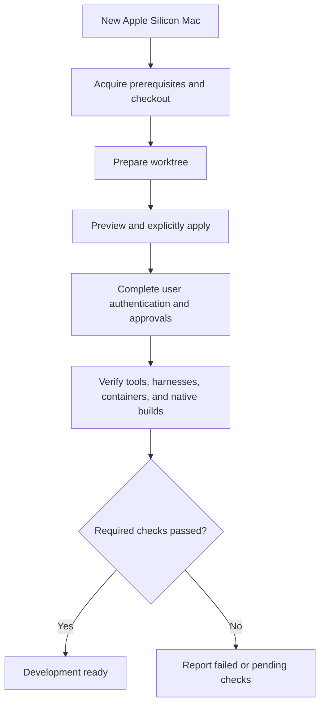
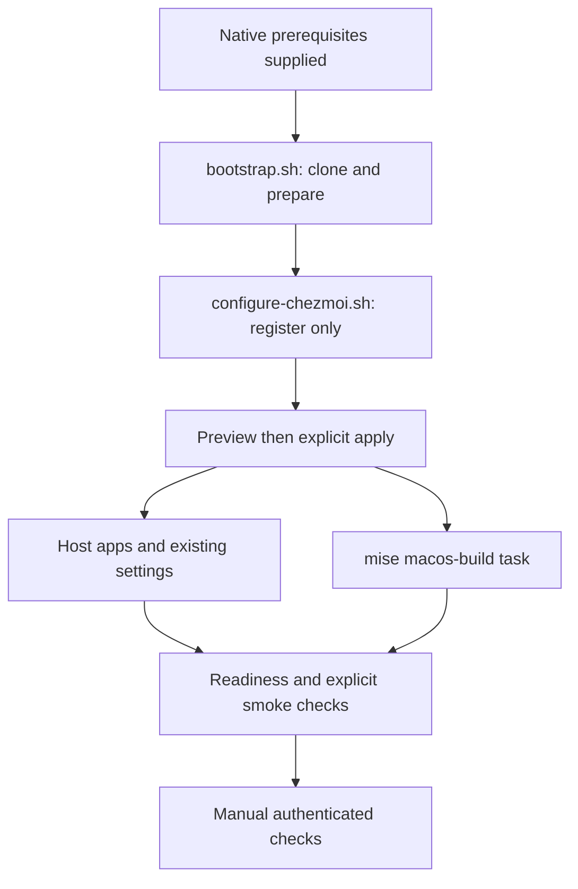

# macOS Full Environment Readiness - Plan

## Goal Capsule

- **Objective:** The owner can configure an Apple Silicon Mac from this repository and immediately use the managed development environment to build macOS applications.
- **Product authority:** The owner confirmed coverage of all currently managed capabilities, including AI harnesses and native build tools, and chose macOS builds without Windows cross-compilation.
- **Means:** Native prerequisite checks, explicit chezmoi application and task-scoped mise build provisioning (KTD2-KTD7).
- **Execution profile:** One pull request; U1 and U2 can be implemented independently before U3 integrates documentation and CI.
- **Delivery owner:** The autonomous pipeline implements, verifies, reviews, commits and opens the PR; the owner controls merge.
- **Stop conditions:** Invalidating scope conflicts or unsafe existing-state migration stop implementation; unavailable account/device checks remain explicit pending evidence under R17.
- **Open blockers:** None block implementation; Mac access and user authentication remain prerequisites for full device-readiness evidence.

---

## Product Contract

### Summary

Complete the repository's macOS setup path from a new device to a usable development environment.
Audit existing managed capabilities, fill macOS gaps, and verify first application, repeated application, worktree preparation, and native builds.

### Problem Frame

The repository already manages Apple Silicon application assets, harness configuration, Git/GPG, credentials, and shell integration.
Its first-device setup documentation and native build provisioning are Windows-specific, so existing macOS support does not establish that a new Mac can reach full development readiness.
The owner wants the entire managed environment available before starting work on the Mac, without discovering missing prerequisites during the first project build.

### Key Decisions

- **Complete capability coverage.** A CLI-only setup would leave the requested applications, harness integration, and build readiness incomplete. Governs R2, R7-R14. (session-settled: user-approved — chosen over a narrower CLI and configuration check: the owner confirmed the full environment scope.)
- **macOS-native builds.** Windows build outputs are unnecessary for this device. Governs R13, R14. (session-settled: user-directed — chosen over generating Windows artifacts from the Mac: the owner only needs Mac builds.)
- **Apple Silicon target.** Retain the existing complete-host support boundary rather than adding Intel support. Governs R1. (session-settled: user-approved — chosen over broadening Mac architecture support: the owner confirmed the proposed Apple Silicon scope.)
- **Reuse existing lifecycle boundaries.** Extend the repository's existing preparation and explicit-apply model instead of introducing a second settings authority. Governs R4-R6, R15.

### Requirements

**Coverage and device setup**

- R1. The supported host for this work is native Apple Silicon macOS.
- R2. Account for every capability currently managed by the repository, identifying its macOS implementation, required gap closure, or Windows-only behavior with no macOS counterpart.
- R3. Provide a documented first-device path covering prerequisites, checkout acquisition, worktree initialization, permanent source registration, change preview, explicit application, and readiness checks.

**Preparation and application**

- R4. Worktree preparation uses `mise install` and the project `postinstall` hook with the repository's hook-free chezmoi configuration, without applying personal settings or decrypting secrets.
- R5. Personal configuration and host provisioning occur only through explicit application, including `mise run apply`, with chezmoi bound to the selected worktree and `home/` source state.
- R6. Development tools remain declared in `mise.toml` with generated `mise.lock` entries usable on the supported Mac, without duplicate installation in chezmoi scripts.

**Managed environment**

- R7. Provide the currently managed CLI applications on macOS: Codex, omp, Antigravity, its ACP adapter, GitHub CLI, GitLab CLI, and ghq.
- R8. Each managed AI harness must discover its native user-scope instructions rendered from the shared template, including common content and only its own harness branch.
- R9. Each managed AI harness must register, install, and enable the repository-pinned CE plugin through its native user-scope mechanism while preserving unrelated plugin state.
- R10. Provide T3 Code, its managed preferences and command launcher, and the currently managed native/ACP harness connections on macOS.
- R11. Provide macOS counterparts for the current host application capabilities: Chrome, 1Password and its CLI, PowerShell, Python, and Podman Desktop with a working local container environment.
- R12. Complete macOS Git identity/signing, GPG/pinentry, encrypted-secret application, GitHub/GitLab Keychain authentication, shell/PATH and mise activation, and native system CA integration under existing repository policies.

**Native development**

- R13. Provision Rust stable, C/C++ compiler and SDK prerequisites, .NET 8 and .NET 10 SDKs, and usable vcpkg support for native macOS ARM64 development.
- R14. Demonstrate native compile, link, and execution for representative Rust, C/C++, and .NET 8/10 programs, including a C/C++ program consuming a project-selected vcpkg dependency.

**Repeatability and verification**

- R15. Repeated explicit application reconciles managed state while preserving unrelated applications, settings, and plugins according to existing ownership rules.
- R16. Verify shared instructions and native CE skill discovery and invocation for each eligible harness in disposable homes on macOS.
- R17. Report installation, configuration, discovery, authenticated invocation, and actual runtime checks separately, with failed or pending required checks preventing an unqualified full-readiness claim.
- R18. Document user-operated authentication, GPG private-key availability, required approvals, and terminal/session restarts as explicit steps with checks for successful completion.
- R19. Validate a new development worktree on the configured Mac and retain existing supported Windows and Linux behavior.

### Coverage Baseline

This inventory scopes R2; it identifies outcomes rather than prescribing installers or script structure.

| Area | macOS outcome | Owning requirements |
| --- | --- | --- |
| Device entry path | A new Mac can reach explicit application with prerequisites explained | R1-R6 |
| Personal CLI and shells | Managed commands resolve from a fresh supported shell | R7, R12 |
| AI harnesses | Native instructions and CE work for Codex, omp, and Antigravity | R8, R9, R16, R17 |
| Desktop integration | T3 launches and uses managed preferences and providers | R10 |
| Host apps and containers | Managed application counterparts and a runnable local container | R11 |
| Identity, secrets, and trust | Signing, encrypted settings, Keychain credentials, and CA integration work | R12, R18 |
| Native builds | Mac ARM64 programs build and run with the requested toolchains | R13, R14 |
| Maintenance | Reapplication and worktree preparation remain usable | R4-R6, R15, R19 |

### Key Flows

- F1. **First device setup. Covers R1-R6, R18.** The owner follows the macOS entry path on a new Mac, prepares the checkout, completes required user prerequisites, previews changes, and explicitly applies the environment.
- F2. **Start development. Covers R7-R14, R16-R19.** From a fresh shell, the owner opens a project in T3, uses the managed harnesses and authentication, runs a container, and builds representative native programs.
- F3. **Maintain the environment. Covers R4-R6, R15, R19.** The owner reapplies an existing setup and initializes another worktree; managed state is reconciled without preparation applying personal changes.
- F4. **Incomplete prerequisite or verification. Covers R17, R18.** A missing key, sign-in, approval, tool, or runtime check is identified with the remaining action instead of reporting the complete environment as ready.

### Acceptance Examples

- AE1. **Fresh device. Covers R1-R3, R5-R14, R18.** Given a new supported Mac without the managed environment, the setup instructions lead to the complete coverage baseline after explicit application and documented user steps.
- AE2. **Preparation isolation. Covers R4-R6, R19.** Given another worktree and a personal chezmoi config containing hooks, `mise install` verifies the source without running those hooks, decrypting secrets, applying dotfiles, or changing global source registration.
- AE3. **Native harness behavior. Covers R8, R9, R16, R17.** In disposable homes, each harness discovers its own instruction file and CE integration; common-content inclusion, foreign-branch exclusion, and invocation have distinct evidence.
- AE4. **Authenticated check pending. Covers R17, R18.** If a harness installs and lists CE skills but has not completed an authenticated invocation, the result states that invocation is pending rather than treating discovery as proof.
- AE5. **Real native output. Covers R13, R14.** Rust, C/C++, and each requested .NET SDK produce ARM64 executables that run on the Mac; the vcpkg example resolves and consumes its project-owned dependency.
- AE6. **Desktop and container use. Covers R10, R11.** A fresh session resolves `t3`, opens a project with managed preferences/providers, and starts a representative container through the configured local container environment.
- AE7. **Identity and credentials. Covers R12, R18.** After the owner supplies the required key access and authentication, a representative signed commit and authenticated Git operation succeed without plaintext secrets entering tracked source.
- AE8. **Repeat application. Covers R15, R19.** Applying twice and repairing a missing managed component leave unrelated state intact and keep the native builds and managed commands functional.
- AE9. **Missing prerequisite. Covers R3, R17, R18.** If GPG access or a required host prerequisite is absent, setup identifies the missing action and does not report full readiness.

### Scope Boundaries

- R1 governs architecture coverage; Intel Macs, Rosetta-based development, and additional cross-compilation targets are excluded.
- R13 and R14 cover Mac outputs; MSVC, MFC, WPF, .NET Framework targeting packs, Windows SDKs, and Windows-target build outputs remain Windows concerns.
- Full Xcode IDE, iOS development, and additional application-specific SDKs are not requested.
- Project source migration, retargeting existing applications, and preinstalling an arbitrary global library collection are excluded.
- Existing exclusions for Intune-provisioned applications, automated OAuth login, private GPG key distribution, and installation of organization root certificates remain in force.
- New harnesses, replacement editors, and unrelated Windows/Linux feature expansion are excluded; R19 covers compatibility.

### Dependencies / Assumptions

- The entry path assumes a new Mac with ordinary interactive user access and network access; required OS approvals remain visible user actions.
- GPG key access, account credentials, and organization trust prerequisites are supplied by the owner under R18.
- macOS runtime verification requires access to an eligible Mac or runner; Windows-side source inspection alone cannot satisfy R14 or R16.
- Current repository documentation distinguishes Antigravity installation/discovery from deferred authenticated CE invocation; R16-R18 require that gap to remain explicit until evidence closes it.

### Planning Inputs Resolved

The former minimum-OS, provisioning and verification questions are resolved by KTD1-KTD8 below.

### Sources / Research

- `AGENTS.md`: preparation, tool ownership, shared instructions, native CE integration, and platform verification requirements.
- `STRATEGY.md`: full development-environment scope and personal-authentication exclusions.
- `README.md`, `bootstrap.ps1`, `mise.toml`, `.chezmoi-bootstrap.toml`: current first-device entry and preparation/application boundaries.
- `home/.chezmoidata/windows.yaml`: existing host application baseline for R11.
- `home/.chezmoidata/personal-apps.json`, `home/.chezmoidata/harness-plugin-lock.json`: supported application targets and shared CE pin.
- `home/.chezmoiscripts/run_after_25-windows-build-environment.ps1.tmpl`, `scripts/windows-build-environment.ps1`: existing Windows-only native build provisioning.
- `home/.chezmoiscripts/run_onchange_after_30-install-t3-code.sh.tmpl`: existing macOS T3 installation path and Homebrew prerequisite when the app is absent.
- `docs/guides/harness-plugins.md`: native integration and the documented Antigravity authenticated-invocation gap.
- `docs/guides/git-and-gpg.md`, `docs/guides/secrets-and-authentication.md`, `docs/guides/system-ca.md`, `docs/guides/personal-applications.md`: existing macOS policies and behavior.
- `docs/maintenance/development-and-testing.md`, `.github/workflows/test.yml`: Apple Silicon CI coverage and existing test organization.

---

## Planning Contract

### Key Technical Decisions

- KTD1. **Native Apple Silicon baseline: macOS 15 or later.** This matches Homebrew's supported minimum and the supported .NET 8/10 range; reject Intel and Rosetta execution before mutation. Governs R1, R3, R13.
- KTD2. **Prerequisites precede repository preparation.** Document native Command Line Tools, Homebrew, Git, mise, standalone chezmoi, GnuPG and pinentry-mac as explicit first-device prerequisites; acquire them through their normal native installers before running the repository entry point. `bootstrap.sh` only validates, clones/reuses the permanent checkout, trusts it, runs `mise install`, and checks `mise run bootstrap`. It never applies or registers a source. Governs R3-R6, R18.
- KTD3. **Explicit permanent-source registration.** Add a macOS counterpart to `configure-chezmoi.ps1`, accepting a standalone repository-root checkout with the expected origin. Use standalone Homebrew chezmoi, reject linked worktrees and conflicting existing sources/config formats, preserve compatible TOML settings, and initialize without applying. Ordinary worktree commands remain source-bound. Governs R3-R5, R15.
- KTD4. **Homebrew owns Mac host applications; mise owns development tools.** Declare native Mac formulae/casks in repository data and install missing host applications only during explicit apply. Use Chrome, 1Password, 1Password CLI, Podman Desktop and its engine through one Homebrew-owned path; retain the existing T3 installer. PowerShell and Python remain mise-owned instead of gaining duplicate host installers. Governs R6, R10, R11.
- KTD5. **Do not mix Podman engine ownership.** Homebrew is an upstream-documented alternative, although upstream recommends the bundled installer. Choose it for this repository's existing native Homebrew application lifecycle; detect an existing bundled `/opt/podman` installation and retain it rather than layering a second engine. Create/start a machine only when needed through explicit apply, reuse existing machines/connections, and never reset or delete them. A mixed ownership state is actionable failure rather than an automatic migration. Governs R11, R15, R17.
- KTD6. **Task-scoped native build tools and persistent user discovery.** Model `macos-build` after `windows-build` with Darwin-only task tools for .NET 8/10, Rust stable ARM64, CMake and Ninja. Validate Apple's selected compiler/SDK. Publish usable SDK/tool roots and a managed user-level vcpkg checkout at the repository's existing vcpkg revision, with POSIX and PowerShell discovery available outside a mise task. Keep project manifests and dependency selection project-owned. Governs R6, R13, R14.
- KTD7. **Readiness is evidence, not an installer exit code.** Add a read-only command that reports passed, failed or pending per capability and leaves authenticated/manual checks pending without fabricating success. Keep expensive build and container execution in explicit smoke verification; the checker does not apply settings, log in, import keys or create containers. Governs R16-R19.
- KTD8. **Reuse existing Mac smoke coverage and add one native build lane.** Keep the existing `xcode-27` runner policy, all six Linux/Windows/macOS unit areas/platform coverage, native harness/app/auth smoke lanes, immutable checkout behavior, and candidate-pin handling. Add native ARM64 build evidence without claiming CI proved real account login or physical key access. Governs R14, R16, R17, R19.

### Lifecycle and Ownership

The first-device path requires prerequisites before GPG-dependent source initialization or encrypted-state evaluation.
The repository entry point is separate from personal settings application and source registration.
A missing key or login remains a user action under R18; it is never hidden behind a successful installer result.

### System-Wide Impact

The owner gains a macOS device entry path without changing Windows bootstrap or the common worktree preparation contract.
New Darwin hooks must render empty on other systems; common shell/profile changes must preserve existing PATH content and remain idempotent.
The shared harness instruction template, CE release pin, native registries and existing app downloads remain their current authorities.
The existing repository-managed default SSH identity is restored on explicit application after GPG decryption, including on the Mac.
The former MS-7D91 host name records key provenance, not an application restriction; pre-apply instructions must direct the owner to review any existing default SSH identity under `docs/guides/secrets-and-authentication.md`.
Documentation must correct the stale bootstrap example to match `mise.toml`'s hook-free root configuration and root source selection.

### Assumptions and Execution-Time Checks

- Homebrew and CLT installation may need the owner's OS approval; scripts must diagnose missing prerequisites and the guide supplies native installation steps.
- Homebrew application availability and the selected mise backend's multi-SDK behavior must be confirmed during implementation against official tooling; alternate installation must not duplicate tool ownership.
- Existing Podman state is reused without modifying its resources or deleting data; fresh default-machine creation is the only new machine setup this work needs.
- Authenticated harness invocation, real signing-key access and organization trust are manual verification when credentials/devices are unavailable in CI; they remain pending in readiness results.
- The Windows checkout can run portable shell-double tests through Git Bash; macOS execution is established by a native Mac/runner rather than emulation.

### Considered and Not Built

- No automatic CLT GUI completion, Homebrew system bootstrap, key import or login automation: explicit prerequisite instructions make these user-operated actions visible without violating R4/R18.
- No Podman machine reset, deletion or ownership migration: none is required to configure a fresh machine, and existing machine state is retained.
- No new harness adapter or new shared instruction policy: this work validates existing integration instead of inventing another harness surface.
- No unrequested package upgrade policy or continuous readiness service: explicit application and a read-only check satisfy the current maintenance goal.

### Research Basis

- [Homebrew installation](https://docs.brew.sh/Installation): native Apple Silicon prefix, macOS 15+ supported baseline, CLT and shell activation prerequisites.
- [Microsoft .NET on macOS](https://learn.microsoft.com/en-us/dotnet/core/install/macos): .NET 8/10 support macOS 14, 15 and 26; SDK rather than runtime installation is required for development.
- [Podman Desktop on macOS](https://podman-desktop.io/docs/installation/macos-install): engine and machine requirements, Homebrew alternative and installer-ownership conflict.
- [Podman machine creation](https://podman-desktop.io/docs/podman/creating-a-podman-machine): local containers require a Linux VM on Mac.
- Existing pattern authorities are `configure-chezmoi.ps1`, `mise.toml`, `scripts/windows-build-environment.ps1`, `home/dot_config/dotfiles/path.sh`, `home/run_after_30-powershell-mise-profile.sh.tmpl`, and `tests/test_bootstrap.py`.
- `.compound-engineering/artifacts/solutions/integration-issues/github-cli-windows-ca-override.md` is Windows-specific; retain its CA behavior unchanged rather than porting its Windows override to Mac.

---

## Implementation Units

### U1. Add macOS device entry and host applications

**Goal:** A new Mac reaches a prepared permanent checkout and can explicitly register/apply its host application environment.

**Requirements:** R1-R5, R10, R11, R15, R18; F1, F3, F4; AE1, AE2, AE6, AE8, AE9.

**Dependencies:** None. Can proceed alongside U2.

**Files:** Create `bootstrap.sh`, `configure-chezmoi.sh`, `home/.chezmoidata/macos.yaml`, `home/.chezmoiscripts/run_onchange_before_15-install-macos-apps.sh.tmpl`, `scripts/macos-apps.sh`, `tests/test_macos_bootstrap.py`, and `tests/test_macos_apps.py`.

**Approach:**

1. Implement KTD1-KTD3 with native prerequisite checks, quoted Unicode/space-safe paths, expected-origin validation, safe existing-checkout reuse, and a registration-only step.
2. Implement KTD4-KTD5 using a Darwin-only early apply script and declared host application data; make host commands available before downstream scripts need them.
3. Treat an existing Podman machine as owned by the user; reuse it, and report unsupported/conflicting states without reset or uninstall.

**Patterns to follow:** `bootstrap.ps1`, `configure-chezmoi.ps1`, the Windows host-app template, and existing native T3 installation.

**Test scenarios:**

- Covers AE1/AE9. Given wrong OS/architecture/version or missing native prerequisites, bootstrap diagnoses the specific prerequisite before clone, install or personal mutation.
- Covers AE2. Existing and new standalone checkouts prepare successfully without apply, decryption, registry updates or user-home settings changes.
- Registration accepts the correct standalone checkout and preserves unrelated TOML data; conflicting source, linked worktree and unsupported config format leave the original unchanged.
- Covers AE8. Repeated app application skips installed packages and reuses a running/existing Podman machine; native command failure propagates and no reset/delete command is issued.
- Covers AE6. Fresh Podman provisioning reaches a usable machine, with the bundled-engine and Homebrew-engine cases never combined.

**Verification:** Shell-double tests catch mutation sequencing and failure propagation; native macOS apply/container smoke catches installer and actual virtualization behavior that doubles cannot prove.

### U2. Provision macOS native builds and persistent tool paths

**Goal:** Fresh shell sessions build native Rust, C/C++, .NET 8/10 and project-selected vcpkg dependencies.

**Requirements:** R6, R12-R15, R17, R19; F2, F3; AE5, AE8.

**Dependencies:** None. U1's prerequisite contract is the setup precondition, not a code dependency.

**Files:** Modify `mise.toml`, `mise.lock`, `home/dot_config/dotfiles/path.sh` and the existing PowerShell profile installation template as needed; create `scripts/macos-build-environment.sh`, `home/.chezmoiscripts/run_after_25-macos-build-environment.sh.tmpl`, `tests/test_macos_build_environment.py`, and `tests/smoke_macos_build_environment.py`.

**Approach:**

1. Add Darwin-only task declarations under KTD6; common `mise install` must not run host build provisioning.
2. Validate the selected Apple compiler/SDK and provision each managed tool using mise, then publish persistent SDK/Rust/vcpkg paths and environment integration without replacing unrelated PATH values.
3. Reuse the existing pinned vcpkg source revision; use a writable managed clone and project-level CMake toolchain consumption, without Windows MSBuild integration.
4. Build smoke fixtures in disposable directories with project-selected SDKs/targets and an explicit vcpkg manifest, then run and identify ARM64 outputs.

**Execution note:** Prefer actual native build proof over tests that only assert declaration text.

**Patterns to follow:** Task-scoped Windows .NET/Rust provisioning, shared native build root publication, common POSIX path helper, and existing temporary-destination cleanup utilities.

**Test scenarios:**

- Covers AE2. Preparation and non-Darwin templates do not execute new host provisioning.
- Missing compiler/SDK, failed mise tool acquisition and failed vcpkg bootstrap propagate errors without reporting readiness.
- Covers AE8. A second apply reuses the selected managed roots, preserves unrelated PATH settings and repairs missing managed discovery.
- Covers AE5. Each .NET major resolves its matching SDK/runtime from a fresh shell; native Rust and C/C++ link/run; vcpkg's project-selected dependency is actually consumed.
- Existing Windows and Linux shell/profile outcomes remain unchanged.

**Verification:** Native macOS smoke proves ARM64 compile/link/run and coexistence of both SDKs; portable tests prove command failure and lifecycle guards only.

### U3. Integrate readiness evidence, documentation and CI

**Goal:** The owner can identify exactly what is ready and finish the remaining manual steps, while CI validates the new native behavior.

**Requirements:** R2-R4, R7-R12, R14-R19; F1-F4; AE1-AE9.

**Dependencies:** U1, U2. Owns shared CI/test-manifest and documentation integration.

**Files:** Create `scripts/macos-readiness.py`, `tests/test_macos_readiness.py` and `docs/setup/macos.md`; modify `README.md`, `docs/README.md`, `docs/maintenance/development-and-testing.md`, `docs/guides/personal-applications.md`, `scripts/run-test-area.py`, `.github/workflows/test.yml`, and CI-contract tests affected by new coverage.

**Approach:**

1. Implement KTD7 with actionable capability checks and a clear exit result; no credentials, tokens or decrypted content enter output.
2. Document prerequisites, permanent-source registration, preview/application, first-shell activation, account/key steps and the entire coverage baseline, including intentional Windows/host-only items.
3. Wire new tests into exactly one ownership area and add an ARM64 native build smoke job per KTD8, keeping candidate pins and runner policy intact.
4. Reuse existing native app/harness/credential smoke tests; record actual authenticated/manual proof separately from fixture-level discovery.

**Test scenarios:**

- Covers AE4. Discovery with no authenticated invocation reports pending; a missing command reports failed; neither produces full-ready success.
- Covers AE7. The checklist distinguishes fixture authentication from real key-backed signing and account operations.
- Covers AE2/AE8. A new worktree prepares with personal-hook sentinels unchanged and a second apply keeps managed commands functional.
- Readiness executes no apply, install, login, key import, machine creation or destructive command and redacts secret-bearing output.
- Unit ownership validation catches any unassigned module; CI-contract tests retain immutable checkout/candidate-lock behavior and platform coverage.

**Verification:** A cold reader follows the guide without unstated prerequisites, all native checks have evidence or an explicit pending reason, and CI executes the new macOS build lane.

---

## Verification Contract

- Run `mise install` once for the current worktree, then `mise run bootstrap` explicitly so hook failures cannot hide behind install's warning behavior.
- Run `mise exec -- python scripts/run-test-area.py --validate-only` after ownership changes and `mise exec -- python -m unittest discover -s tests` for repository regression coverage.
- Run focused Mac shell tests through native `/bin/bash` on macOS and Git Bash on Windows; do not accidentally invoke the Windows WSL launcher as Bash.
- On `xcode-27` ARM64, execute `tests/smoke_macos_build_environment.py` after explicit isolated provisioning and retain compiler/SDK versions, target architecture and build/run outcomes.
- Preserve and run the existing Mac native apps, T3/Antigravity, CE, Codex, GitHub auth and GitLab auth smoke coverage from `.github/workflows/test.yml`.
- On an eligible real Mac, follow the guide and verify installed apps, container execution, fresh-shell discovery, first apply/reapply, and another development worktree.
- Record real sign-in, signing-key access, account authentication and authenticated CE invocation as passed only when actually performed; otherwise record pending without blocking implementation/PR delivery or claiming full device readiness.
- Run `git diff --check`; inspect generated Darwin scripts for POSIX quoting and verify non-Darwin output isolation.

---

## Definition of Done

- U1-U3 are implemented, reviewed and committed with no product scope drift.
- The coverage inventory identifies each managed capability and each intentional platform/host exclusion, including SSH identity ownership.
- New preparation remains personal-settings read-only and standalone source registration never applies implicitly.
- Required Mac packages/toolchains are declared under the correct owner, repeated apply is idempotent, and managed paths work outside task scope.
- Native macOS ARM64 build evidence and existing Mac regression evidence are available, or unavailable methods are explicitly reported without fabrication.
- No required pending or failed device check is presented as full environment readiness.
- The English macOS setup guide includes user authentication/key/approval steps and a complete readiness checklist.
- One pull request contains the plan, implementation, tests and documentation; merging remains with the owner.
