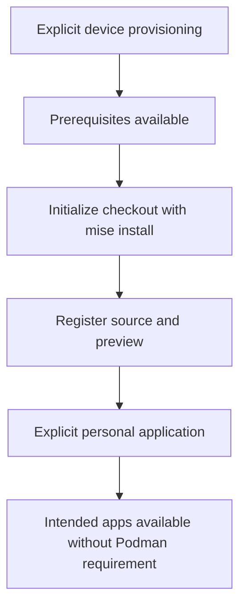
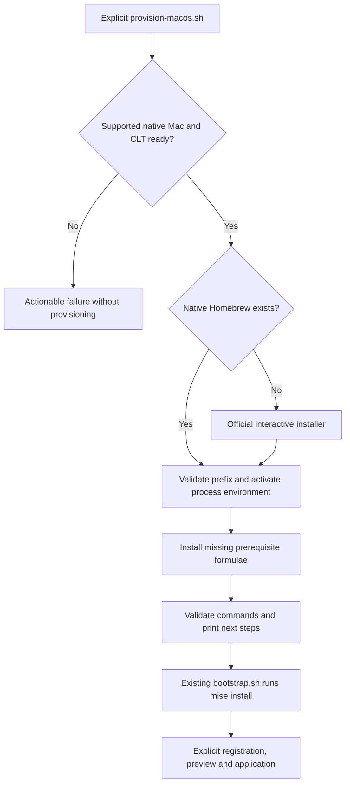

# macOS Homebrew Provisioning and Applications - Plan

## Goal Capsule

- **Objective:** The owner can prepare a new Mac and install the intended applications without manually assembling a sequence of package installation commands.
- **Product authority:** The owner confirmed Homebrew preparation automation and Windows app parity with Podman excluded from macOS.
- **Means:** A standalone explicit host-prerequisite command followed by the existing bootstrap and chezmoi lifecycle (KTD1-KTD3).
- **Execution profile:** One PR containing U1-U3.
- **Delivery owner:** LFG implements, verifies, reviews, commits and opens the PR; the owner controls merge.
- **Stop conditions:** Invalidating settled-decision conflicts or unsafe host changes stop execution; unavailable native device checks remain explicitly unverified.
- **Open blockers:** None.

---

## Product Contract

### Summary

Automate Homebrew and prerequisite preparation for a new Mac, and reconcile the macOS application configuration with the intended Windows counterparts.
Exclude Podman from macOS provisioning and readiness while retaining the existing separation between worktree preparation and personal application.

### Problem Frame

The repository owner already uses a declared WinGet application list on Windows.
The current macOS path requires manually preparing Homebrew and several prerequisite packages before repository bootstrap can run.
Its existing app installer also provisions Podman and starts a container VM, which the owner does not want on the Mac.

### Key Decisions

- **Cover first-device preparation and application parity together.** These form one outcome: a Mac ready to use the intended applications. Governs R2, R5. (session-settled: user-directed — chosen over addressing only prerequisites or only the app list: the owner selected both.)
- **Exclude macOS Podman.** Existing container provisioning exceeds the owner's intended Mac environment. Governs R7, R8. (session-settled: user-directed — chosen over retaining the current Podman-inclusive app set: the owner explicitly excluded Podman.)
- **Extend the current lifecycle.** Reuse the existing configuration authority and installation paths. Governs R3, R4, R6. (session-settled: user-approved — chosen over introducing a parallel package-management workflow: the owner confirmed the proposed scope.)
- **Retain installed application versions.** This preserves the repository's current installation policy. Governs R9. (session-settled: user-approved — chosen over automatic upgrades on repeated application: the owner confirmed that installed apps remain in place.)

### Requirements

**First-device preparation and execution boundaries**

- R1. Support native Apple Silicon Macs running macOS 15 or later with Homebrew at `/opt/homebrew`.
- R2. The explicit first-device provisioning flow installs missing Homebrew and the prerequisite Git, mise, standalone chezmoi, GnuPG and pinentry-mac components needed to reach repository initialization and application.
- R3. Host provisioning requires an explicit user invocation distinct from ordinary worktree initialization.
- R4. New and existing worktree initialization continues through `mise install` and the project `postinstall` hook using hook-free chezmoi inspection, without applying personal settings or provisioning host applications.

**Application ownership and Podman exclusion**

- R5. Explicit personal application ensures Chrome, 1Password, 1Password CLI and T3 Code are available on macOS.
- R6. Python, PowerShell and the existing native development tools remain mise-owned rather than receiving duplicate Homebrew application declarations.
- R7. macOS application no longer installs Podman Desktop or its engine, creates or starts Podman VMs, or requires Podman in readiness checks.
- R8. Applying the revised macOS configuration preserves any existing Podman installation and VM state.

**Repeated application and compatibility**

- R9. Repeated provisioning and application reuse installed applications and prerequisite packages without requesting package upgrades.
- R10. Provisioning failures remain visible and allow a later invocation to resume by reusing components already installed successfully.
- R11. Existing Windows provisioning and application declarations remain unchanged.
- R12. The documented Mac setup path identifies the explicit provisioning and application steps and any required installer approvals, authentication or Apple developer-tool preparation.
- R13. Personal application remains bound to the selected checkout's chezmoi source under `home/` and the actual user home destination.

### Key Flows

- F1. **First Mac setup:** The owner explicitly starts device provisioning, completes required native approvals, initializes and registers the checkout, previews changes, and explicitly applies personal configuration. **Covers R1-R6, R12, R13.**
- F2. **Existing Mac update:** The owner applies the updated configuration; existing apps remain usable and the setup no longer depends on Podman. **Covers R7-R10.**

### Acceptance Examples

- AE1. **Missing Homebrew:** Given a supported Mac without Homebrew, when the owner invokes explicit first-device provisioning and completes required approvals, then the prerequisites needed for repository initialization become available. **Covers R1-R3, R12.**
- AE2. **Worktree preparation:** Given an existing checkout, when `mise install` initializes it, then source inspection completes without installing host applications or applying personal settings. **Covers R4.**
- AE3. **Missing applications:** Given prepared prerequisites and missing intended apps, when the owner explicitly applies personal configuration, then the R5 app set becomes available and R6 tool ownership is preserved. **Covers R5, R6, R13.**
- AE4. **No Podman:** Given a Mac without Podman, when personal application and readiness checks run, then they succeed without installing Podman or creating a VM. **Covers R7.**
- AE5. **Existing Podman:** Given installed Podman with a stopped VM, when the revised Mac configuration is applied, then that installation and stopped VM remain in place without being started. **Covers R7, R8.**
- AE6. **Repeated or interrupted provisioning:** Given some or all intended packages are installed, when provisioning runs again, then it installs only missing components and reports any failure rather than treating partial setup as complete. **Covers R9, R10.**
- AE7. **Windows compatibility:** Given the revised repository on Windows, when its normal application path runs, then the existing Windows app set and behavior are preserved. **Covers R11.**

### Scope Boundaries

- Intel Macs, Rosetta toolchains and Linux Homebrew support are outside this change.
- Adding further Mac apps, adopting Brewfile as a second source of truth, and adding a package upgrade or removal policy are deferred.
- Account sign-in, private-key distribution and unattended bypass of native approvals are outside this change.
- Other harness, native build and credential capabilities retain the existing macOS readiness plan's scope; this plan changes its Podman expectations per R7.

### Dependencies / Assumptions

- The owner can approve Homebrew and application installers and complete Apple developer-tool preparation where required.
- Existing GPG key access and account authentication remain prerequisites for the corresponding personal configuration steps.
- Native macOS execution is required to establish actual device readiness; Windows-based inspection alone cannot establish it.

### Sources / Research

- `AGENTS.md`: worktree bootstrap, tool ownership and explicit chezmoi application boundaries.
- `bootstrap.sh:13`: existing prerequisite checks before checkout initialization.
- `mise.toml`: hook-free bootstrap and development-tool declarations.
- `home/.chezmoidata/windows.yaml` and `home/.chezmoidata/macos.yaml`: existing host application sets.
- `scripts/macos-apps.sh`: installed-app detection and existing Podman provisioning side effects.
- `scripts/macos-readiness.py:17`: current Podman command requirement.
- `home/.chezmoiscripts/run_onchange_after_30-install-t3-code.sh.tmpl`: separate T3 cask installation.
- `docs/setup/macos.md`: existing first-device preparation and application flow.
- `.compound-engineering/artifacts/plans/2026-11-05-1830-feat-macos-full-environment-readiness-plan.md`: broader macOS environment scope; this contract supersedes its Podman requirements for macOS.
- [Homebrew installation](https://docs.brew.sh/Installation): supported prefix, installer interaction and native prerequisites.
- [Homebrew Bundle](https://docs.brew.sh/Brew-Bundle-and-Brewfile): a possible package-list mechanism; its default upgrade behavior differs from R9.

---

## Planning Contract

**Product Contract preservation:** Product Contract unchanged; its two planning-owned questions are resolved by KTD1-KTD4.

### Key Technical Decisions

- KTD1. **Add `provision-macos.sh` as an explicit host operation.** It runs from a downloaded file using stock macOS shell/curl, installs prerequisites, and stops before checkout initialization. `bootstrap.sh`, the mise bootstrap hook and global source registration keep their current responsibilities under R2-R4. A mise task cannot be the only entry point because mise itself is a missing prerequisite on a fresh Mac.
- KTD2. **Use the official Homebrew installer only when native Homebrew is absent.** Require R1's host before mutation and preserve interactive installer approvals; run the installer as the normal user. Reject an incompatible existing Homebrew prefix rather than changing its ownership or migrating it. Download to a temporary file, fail on download/installer errors, and clean the temporary file. Apple's Command Line Tools remain an explicit prerequisite whose absence receives an actionable diagnostic, consistent with the existing setup guide. Governs the implementation of R1-R3, R10, R12; see [Homebrew installation](https://docs.brew.sh/Installation).
- KTD3. **Activate Homebrew for this process and ensure only missing prerequisite formulae.** Use `/opt/homebrew/bin/brew`, its `shellenv`, and package-presence checks for Git, mise, chezmoi, gnupg and pinentry-mac. Validate required executables after provisioning and print the fresh-shell/bootstrap handoff without changing startup files, applying dotfiles or registering a source. This implements R2-R4, R6, R9, R10, R13. The installer remains unpinned like the documented upstream first-device installation; adding a private installer mirror or release refresh mechanism is outside scope.
- KTD4. **Remove the existing Podman behavior rather than adding a disable flag.** Keep the current macOS formula/cask data and T3's separate installer; delete the Podman engine/VM branches and readiness command, bundle and pending container-runtime checks. Existing Podman state is never queried or modified. Implements R5, R7, R8, R11. (session-settled: user-directed — chosen over retaining the current Podman-inclusive app set: the owner explicitly excluded Podman.)
- KTD5. **Use isolated command doubles for prerequisite provisioning.** Reuse `MacFixture` from `tests/test_macos_bootstrap.py` in a dedicated module registered in `scripts/run-test-area.py`, without changing the shared fixture. Rebind native absolute locations only in the test copy, as the existing app tests do, and keep real host tools/installers unreachable. Native CI still exercises shell compatibility; a mocked installer cannot prove actual first-device readiness.

### High-Level Technical Design

The first-device lifecycle follows KTD1-KTD3; worktree initialization remains its own boundary under R4.

### Assumptions and Risk Decisions

- A normal administrator-capable account and interactive terminal are available for first-device provisioning; account sign-in and private-key handling remain outside this operation.
- Homebrew is the authority for the prerequisite formulae, including the standalone chezmoi needed by registration; project development-tool versions retain R6 ownership.
- No automatic network retry, rollback, installer mirror, package cleanup, forced adoption or Podman removal is added. Visible failure and rerun satisfy R8-R10 without a second state-management system.
- The shell installer and casks can require native approvals; successful isolated tests do not claim those approvals or real app launches were exercised.

### Research Basis

`bootstrap.sh` establishes the existing read-only preparation boundary; `tests/test_macos_bootstrap.py` supplies isolated shell fixtures.
The current `scripts/macos-readiness.py` has three separate Podman surfaces, so removing only the app declaration would leave readiness incomplete.
The official Homebrew installation documentation supports the native prefix and interactive installer in KTD2.

---

## Implementation Units

### U1. Provision missing macOS host prerequisites explicitly

**Goal:** A new Mac can reach the existing bootstrap prerequisites through one explicit operation.

**Requirements:** R1-R4, R6, R9, R10, R12, R13; F1; AE1, AE2, AE6.

**Dependencies:** None.

**Files:** Create `provision-macos.sh` and `tests/test_macos_provision.py`; register the new test module in `scripts/run-test-area.py`. Keep `tests/test_macos_bootstrap.py` unchanged.

**Approach:** Implement KTD1-KTD3 and use KTD5's fixture boundary. Keep `bootstrap.sh` and mise initialization unchanged. Start with the first-device and repeat-run shell fixture cases before expanding the installer logic.

**Patterns to follow:** `bootstrap.sh` native-host diagnostics; `MacFixture` call/state tracking and Unicode paths in `tests/test_macos_bootstrap.py`.

**Test scenarios:**

1. Covers AE1. With Homebrew absent, supported host and CLT ready, the explicit operation invokes the official installer and then installs each missing prerequisite.
2. Covers AE6. With Homebrew and all prerequisite formulae installed, rerun performs no installer, install or upgrade operation.
3. With only some prerequisites installed, install only missing formulae and validate the resulting executables.
4. Unsupported OS/architecture/version, Rosetta, incompatible Homebrew prefix and missing CLT stop before provisioning; normal installer prompts remain enabled.
5. Covers AE6. Failed download, cancelled/failed installer, failed formula installation or missing final executable returns a failure; a later run reuses successful prior work.
6. Covers AE2. Existing bootstrap still initializes through `mise install` without calling the new host operation, chezmoi apply or global registration.
7. Spaces and Unicode paths work, and the test fixture cannot execute the real Homebrew installer or change real host files.

**Verification:** Tests prove calls and persistent-state boundaries through KTD5's seam. Shell syntax and platform CI cover portability; native initial installer behavior remains a separate device check.

### U2. Remove macOS Podman installation and readiness requirements

**Goal:** macOS setup completes without installing, invoking or requiring Podman.

**Requirements:** R5-R9, R11; F2; AE3-AE5, AE7.

**Dependencies:** None.

**Files:** `home/.chezmoidata/macos.yaml`, `scripts/macos-apps.sh`, `scripts/macos-readiness.py`, `tests/test_macos_apps.py`, `tests/test_macos_readiness.py`. Leave the shared bootstrap fixture unchanged during this work.

**Approach:** Implement KTD4. Retain generic missing-package checks, selected manually installed application detection and the separate T3 cask hook. Replace obsolete Podman provisioning tests with assertions that application succeeds with no Podman command and never calls existing Podman installations.

**Patterns to follow:** Current formula/cask loop in `scripts/macos-apps.sh` and readiness `collect()`/`exit_code()` test seams.

**Test scenarios:**

1. Covers AE3, AE4. Missing intended apps install successfully with Podman absent, and no Podman package or command is requested.
2. Covers AE5. A fixture with an installed Podman command and stopped VM receives no Podman invocation and retains its state.
3. Covers AE4. Readiness has no Podman executable, Desktop bundle or pending container-execution requirement while retaining other readiness/manual evidence checks.
4. Already installed apps and manually installed recognized bundles are reused; a failing Homebrew install still propagates its error.
5. Covers AE7. Windows app declarations and WinGet behavior remain unchanged; platform guards still emit only native macOS scripts where eligible.

**Verification:** App and readiness modules pass in the existing platform area; the diff has no remaining active macOS Podman dependency.

### U3. Document the complete explicit provisioning and application path

**Goal:** The owner can follow the new first-device flow without inventing prerequisite commands.

**Requirements:** R2-R4, R7-R13; F1, F2; AE1-AE7.

**Dependencies:** U1, U2.

**Files:** `docs/setup/macos.md`, relevant current app/setup references in `docs/guides/personal-applications.md`, and `docs/maintenance/development-and-testing.md` only if the test entry or fixture contract changes.

**Approach:** Replace manual formula preparation with an inspect-then-run download of the explicit host operation. Retain CLT preparation, permanent checkout registration, preview/apply and fresh-shell activation instructions. Remove the Podman engine/VM/container readiness instructions and describe existing-state preservation under R8. Match final command names and behavior from U1 and U2 rather than adding a parallel setup route.

**Test expectation:** None -- documentation follows the behavioral cases owned by U1 and U2; inspect commands and links against the final files.

**Verification:** The English guide starts with stock macOS prerequisites and reaches app availability through the existing registration/application lifecycle without requiring Podman.

---

## Verification Contract

- Initialize this worktree with `mise install` under the existing hook-free bootstrap before implementation; it must not apply personal configuration.
- Run the focused Mac bootstrap, app and readiness modules with `mise exec -- python -m unittest discover -s tests -p 'test_macos_*.py'`; this also checks the adjacent native-build contract module.
- Run `mise exec -- python scripts/run-test-area.py --validate-only` to verify complete module ownership, especially if U1 adds a module.
- Run `mise exec -- python scripts/run-test-area.py --area platform` to cover U1/U2 and existing Windows compatibility. Broaden only when failures or changed shared seams require it.
- Run `git diff --check` and syntax-check new/changed shell scripts using the repository's Bash discovery; render the macOS chezmoi hook through its existing template test.
- Existing `.github/workflows/test.yml` platform jobs provide macOS ARM64 execution of the isolated tests. Native initial Homebrew installation, administrator prompts and desktop app launches require a real Mac; report them as unverified when no eligible device is available.
- Browser testing is not applicable: this change has no browser surface. Release validation and behavioral skill evaluation are not repository checks for these shell/config changes.

---

## Definition of Done

- U1 supplies the explicit first-device operation and isolated first-run, repeated-run, failure and host-boundary coverage.
- U2 removes all active macOS Podman provisioning/readiness dependencies and preserves existing state and Windows behavior.
- U3 documents the final entry operation, remaining native approvals and the existing bootstrap/register/preview/apply handoff.
- The Verification Contract's applicable checks pass; skipped native device checks and their limits are stated in the delivery report.
- The final diff contains no abandoned experimental code, duplicate package authority or unrequested personal-setting changes.
- Independent code review findings are applied or recorded, and the change is committed and delivered through an open PR with CI decided by the shipping workflow.
