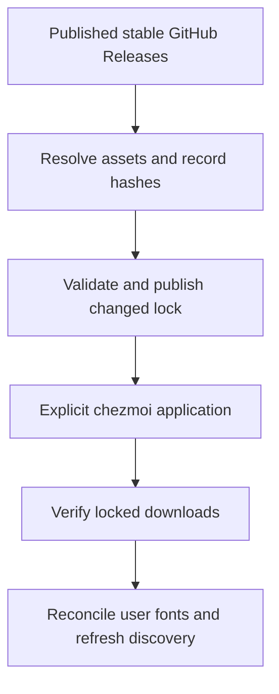
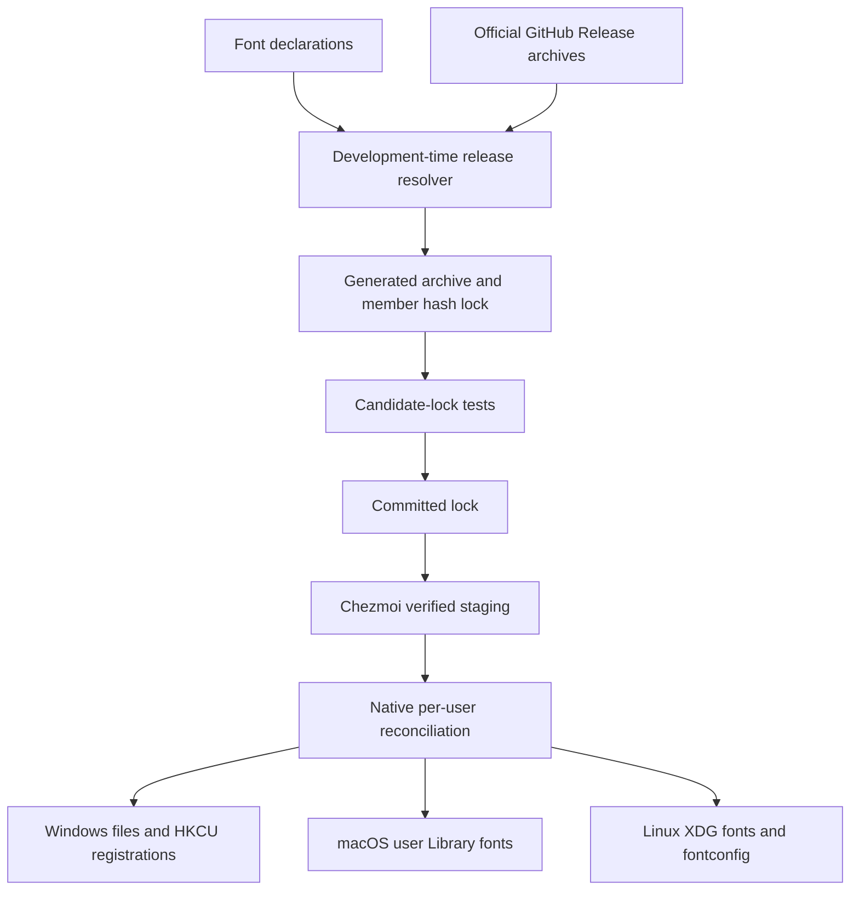
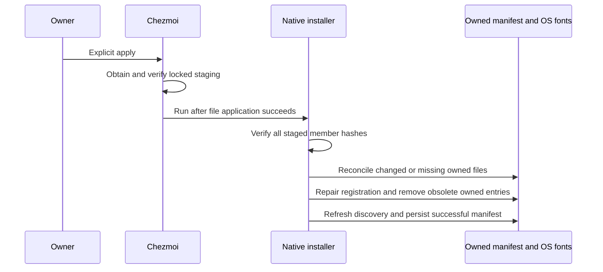

# User-scope fonts across three operating systems - Plan

## Goal Capsule

- **Objective:** The repository owner can reproduce the same selectable desktop font collection on supported Windows, Linux, and macOS machines.
- **Means:** GitHub Release assets pinned in a committed lock and applied through chezmoi.
- **Product authority:** The confirmed font scope and application behavior in this Product Contract govern implementation planning.
- **Open blockers:** None.
- **Execution profile:** One pull request; LFG implements, verifies, reviews, and publishes it without changing personal settings on the development machine.
- **Stop conditions:** Stop on an invalidated settled font choice or an unverified prerequisite that prevents native installation.

---

## Product Contract

### Summary

Provide a reproducible user-scope font collection through explicit chezmoi application.
Use a generated release lock for downloads and integrity verification, with scheduled and manual refresh following the repository's existing pin-update workflow.

### Problem Frame

The owner uses multiple operating systems and wants a consistent font collection when preparing a new device or updating an existing one.
Manually choosing releases and installing their desktop variants leaves machines with different versions and available faces.

### Key Decisions

- **Keep both Pretendard forms.** Governs R2. (session-settled: user-directed — chosen over static fonts only: the owner wants both static and variable fonts available.)
- **Include every requested Nerd Font width variant.** Governs R3. (session-settled: user-directed — chosen over Mono only or excluding Propo: the owner wants Nerd Font, Mono, and Propo available.)
- **Follow the existing release-lock workflow.** Governs R5–R8; this preserves reproducibility while keeping installation separate from release discovery.

### Requirements

**Font collection**

- R1. Install the original JetBrains Mono and D2Coding desktop font families, including their supplied weights and styles.
- R2. Install Pretendard, Pretendard JP, Pretendard Std, and Pretendard GOV with their supplied static weights and desktop variable fonts.
- R3. Install the JetBrains Mono and D2Coding derivatives distributed by Nerd Fonts in Nerd Font, Nerd Font Mono, and Nerd Font Propo forms.
- R4. Exclude webfont files and redundant copies of the same desktop face in alternative static formats; R2's static and variable forms remain distinct selections.

**Release pins and updates**

- R5. Record each selected published stable GitHub Release's repository, tag, exact asset URL, and SHA-256 in a committed generated lock.
- R6. When GitHub omits an asset digest, the lock refresh must download the selected asset and calculate its SHA-256.
- R7. Installation must use and verify the locked asset rather than resolving a latest release at application time.
- R8. Support scheduled and manual lock refresh with validation before publishing changed pins, following the existing repository workflow.

**Application and reconciliation**

- R9. Install into the current user's font scope on the repository's supported Windows, Linux, and macOS environments without administrator privileges.
- R10. Perform font installation only during explicit chezmoi application; worktree bootstrap must remain read-only for personal settings.
- R11. Reapplying an unchanged lock must leave an equivalent installation without duplicate faces, and applying changed pins must remove obsolete files previously installed by this feature.
- R12. Reconciliation must preserve unrelated user-installed fonts.
- R13. Finish installation with the managed families discoverable through the operating system's normal font discovery mechanism.
- R14. A download or integrity failure must report failure without replacing installed fonts with unverified content.

### Key Flows

- F1. **Apply fonts:** The owner applies the current worktree through chezmoi; assets are obtained and verified per R7, reconciled per R11–R12, and made discoverable per R13.
- F2. **Update fonts:** A scheduled or manual refresh resolves stable assets and produces validated pins per R5–R8; the next explicit application follows F1.

### Acceptance Examples

- AE1. **Fresh user profile:** After F1 on each supported OS, the original families, all four Pretendard families in both requested forms, and all requested Nerd Font forms are discoverable. Covers R1–R4, R9, R13.
- AE2. **Repeat application:** Applying the same lock twice produces no duplicate faces and preserves an unrelated user font. Covers R11–R12.
- AE3. **Version change:** After a lock refresh changes a font release, the next F1 replaces the managed version and removes its obsolete managed files. Covers R7–R8, R11.
- AE4. **Invalid download:** A mismatched SHA-256 causes application to fail without installing the invalid font content. Covers R7, R14.
- AE5. **Worktree preparation:** Running mise install does not install fonts or change the user's font registration. Covers R10.
- AE6. **Missing upstream digest:** A stable release asset without a GitHub-provided digest can still produce a lock with a locally computed SHA-256. Covers R5–R6.

### Scope Boundaries

- Application-specific font selection, system font replacement, webfont hosting, and building or patching font binaries are outside this work.
- Raising the macOS support baseline and adding Intel Mac support are outside this work.

<!-- ce-section: work-relationships -->
### How This Work Fits Together

This plan covers user-scope fonts only.
The separately tracked [macOS 26 baseline follow-up](https://github.com/hyperlapse122/dotfiles/issues/65) can proceed independently and does not block font planning.
Until that issue is implemented, macOS eligibility follows the repository's current native Apple Silicon, macOS 15-or-later baseline.

### Outstanding Questions

**Resolve Before Planning:** None.

**Deferred to Implementation:** Exact helper names and native discovery-test API selection; the decisions below resolve archive selection, native installation ownership, and reconciliation.

### Sources / Research

- Repository policy: `AGENTS.md`, `mise.toml`, and `.chezmoi-bootstrap.toml`.
- Existing patterns: `home/.chezmoidata/personal-apps.json`, `home/.chezmoidata/personal-app-lock.json`, `scripts/update-personal-app-lock.py`, and `.github/workflows/update-personal-app-lock.yml`.
- Source layout and supported setup: `docs/maintenance/chezmoi-source.md`, `README.md`, and `docs/setup/macos.md`.
- Official upstream releases checked on 2026-11-06: [JetBrains Mono](https://github.com/JetBrains/JetBrainsMono/releases), [Pretendard](https://github.com/orioncactus/pretendard/releases), [D2Coding](https://github.com/naver/d2-coding-font/releases), and [Nerd Fonts](https://github.com/ryanoasis/nerd-fonts/releases).
- At research time, the JetBrains Mono and Pretendard release assets lacked GitHub-provided digests; R6 covers this observed case.

---

## Planning Contract

**Product Contract preservation:** Unchanged in scope; the Problem Frame is made explicit and planning-owned questions are resolved below without changing R/F/AE IDs.

### Key Technical Decisions

- KTD1. **Separate font pins from executable application pins.** Create font declarations and a generated font lock under `home/.chezmoidata/`; retain `personal-app-lock.json` and its strict upstream-digest policy unchanged. Fonts require archive-member selection and a download/hash fallback that executable declarations do not currently model. Governs R5–R8.
- KTD2. **Pin eight upstream archives and select desktop TTFs explicitly.** Resolve one JetBrains archive, four Pretendard archives, one D2Coding archive, and two Nerd Fonts archives; record exact selected member paths and their SHA-256 values alongside each archive pin. Use archive-file externals or filtered archive externals to stage those selected files under an owned `.local/share/dotfiles/font-assets` tree. The implementation may choose the cheaper native chezmoi representation after checking member filtering against the downloaded layout. Governs R1–R7.
- KTD3. **Apply with native shell and PowerShell only.** A regular `run_after_` script reconciles staged fonts on every explicit apply, repairing deleted files and missing Windows registrations while making unchanged runs cheap. Python is a development-time lock-generation dependency only. Governs R9–R14.
- KTD4. **Own filenames and registry labels, not the entire user font directory.** Install flat filenames prefixed with a stable `dotfiles-<package>-` namespace and maintain a manifest of exactly the files and Windows registry values this feature installed. Remove only previously recorded owned entries, validate manifest paths as basenames in the owned namespace, and preserve unowned copies even when their face family matches a requested family. Governs R11–R12.
- KTD5. **Use native per-user discovery mechanisms.** Windows copies to `%LOCALAPPDATA%/Microsoft/Windows/Fonts`, persists absolute paths in HKCU Fonts, calls AddFontResourceExW with flags zero, and broadcasts WM_FONTCHANGE; macOS copies to `~/Library/Fonts`; Linux copies to `${XDG_DATA_HOME:-$HOME/.local/share}/fonts/dotfiles` and runs fontconfig's `fc-cache`. A missing Linux fontconfig prerequisite produces a clear dependency error, without elevating privileges or installing OS packages. Governs R9, R13.
- KTD6. **Verify staging before native mutation.** Verify every staged selected file against its member hash before copying or unregistering existing fonts. Copy replacements through temporary files and report native locked-file failures with an actionable close-apps/reapply message; do not claim success while cleanup or registration fails. A general multi-font rollback transaction is not required. Governs R7, R14.
- KTD7. **Keep font updates independently validated.** Add a dedicated scheduled/manual font-lock workflow following `update-personal-app-lock.yml`; test the exact candidate lock artifact before publishing only that generated lock. This avoids coupling new font policies to unrelated executable refreshes. Governs R8.

### Selected Archive Members

The current researched releases yield 178 selected font files; this count is evidence for the first lock, not a permanent cap on later supported releases.

| Collection | Current tag | Selection | Current files |
| --- | --- | --- | ---: |
| JetBrains Mono | `v2.304` | `fonts/ttf/*.ttf`, including supplied NL faces; omit JetBrains variable files | 32 |
| Pretendard / JP / Std / GOV | `v1.3.9` | Each archive's `public/static/alternative/*.ttf` plus `public/variable/*Variable.ttf`; omit OTF, webfonts, and duplicate Std variable location | 40 |
| D2Coding | `VER1.4.0` | `D2Coding/*.ttf` and `D2CodingLigature/*.ttf`; omit TTC collections | 4 |
| JetBrains Mono Nerd Font | `v3.5.1` | Root TTFs in `JetBrainsMono.tar.xz`, including all three width forms | 96 |
| D2Coding Nerd Font | `v3.5.1` | Root TTFs in `D2Coding.tar.xz`; upstream face filenames use `D2KodingLigature` | 6 |

R2's labeled choice is realized by the two distinct Pretendard selections; R3's labeled choice is realized by retaining every supplied Nerd width form.
Select against actual archive member names, validate nonempty matches for each requested family/form, and fail refresh rather than silently publishing a reduced collection when upstream packaging changes.
Reject duplicate destination names and unsafe or nonregular archive members in lock generation.

### High-Level Technical Design

The declaration owns upstream repository and selection intent; the generated lock owns exact release and member identity.
Chezmoi verifies downloads while producing staged files, and native scripts own only user-scope installation and discovery.

### Assumptions and Risks

- Current macOS coverage remains native Apple Silicon on macOS 15+, per the Product Contract; issue #65 is independent.
- Existing unowned copies of the requested families remain in place under KTD4. They can still cause OS-level duplicate-face resolution; automatic cleanup of fonts this feature did not install is outside R11's ownership boundary.
- Windows can retain loaded font files across sessions. KTD6 reports this condition instead of hiding incomplete reconciliation; a logoff or reboot may be necessary before a retry can remove a loaded old file.
- Linux desktop font discovery requires fontconfig. Document the native prerequisite and provision it only in CI fixtures when absent, preserving R9.
- Do not add a general font manager, transactional rollback engine, upstream font patcher, or application font selector; the requested installation does not require them.

### Research Basis

- `home/.chezmoiexternals/personal-apps.toml.tmpl` establishes verified cached external downloads; `scripts/update-personal-app-lock.py` establishes stable GitHub release validation and atomic generated-lock writes.
- `tests/test_personal_apps.py` copies the complete external/data directories into its fixture. New font externals must be excluded or locally overridden there and in any similar fixture to prevent network access or personal-setting changes in existing tests.
- [Chezmoi external reference](https://www.chezmoi.io/reference/special-files/chezmoiexternal-format/) defines checksum, archive-file, selected-member, and exact-directory behavior; whole native font directories must never become exact directories.
- [Apple Font Book installation settings](https://support.apple.com/guide/font-book/change-font-book-settings-fntbk1004/mac) identifies `~/Library/Fonts` as the current-user location.
- [Fontconfig user documentation](https://fontconfig.pages.freedesktop.org/fontconfig/fontconfig-user.html) defines XDG user font paths and discovery configuration.
- [Microsoft AddFontResource documentation](https://learn.microsoft.com/en-us/windows/win32/api/wingdi/nf-wingdi-addfontresourcew) distinguishes session registration from persistent registration and requires notifying other applications of font changes; [font installation and deletion](https://learn.microsoft.com/en-us/windows/win32/gdi/font-installation-and-deletion) describes loaded-file limitations.

---

## Implementation Units

### U1. Resolve and lock the desktop collection

**Goal:** Produce reproducible archive and selected-member pins for the agreed collection.

**Requirements:** R1–R8, F2, AE6; R2 and R3 carry the settled product choices.

**Dependencies:** None.

**Files:** Create `home/.chezmoidata/fonts.json`, `home/.chezmoidata/font-lock.json`, `scripts/update-font-lock.py`, and `tests/test_font_lock.py`.

**Approach:** Implement KTD1–KTD2 with Python standard-library HTTP/archive/hash support and the existing generated-lock conventions. Check supplied GitHub digests when available; download for member selection and missing-digest computation; publish the lock atomically only after every collection resolves successfully.

**Test scenarios:**

- Covers AE6. A stable release without a supplied digest yields the calculated archive SHA-256 and selected-member hashes.
- A supplied digest that disagrees with downloaded bytes fails and preserves the previous lock.
- ZIP and tar.xz fixtures containing static, variable, webfont, and duplicate-format entries produce only the intended desktop selections.
- Missing requested forms, ambiguous asset names, unsafe members, duplicate destinations, drafts, and prereleases fail instead of narrowing the collection.
- An unchanged release set does not rewrite the generated lock.

**Verification:** The initial lock accounts for all researched requested families/forms with fixed release URLs; fixture tests require no upstream network access.

### U2. Stage the locked font payload through chezmoi

**Goal:** Materialize only verified selected font files in an owned staging tree.

**Requirements:** R4, R7, R10, R14, F1, AE4–AE5.

**Dependencies:** U1.

**Files:** Create `home/.chezmoiexternals/fonts.toml.tmpl` and `tests/test_fonts.py`; update fixture exclusions in `tests/test_personal_apps.py` and any tests that copy all externals.

**Approach:** Follow the existing checksum-qualified external URLs and cache behavior. Render only on eligible OS/architecture combinations, fail for missing declared pins, and keep all paths within the owned staging tree. Audit fixture cloning before enabling the new external.

**Test scenarios:**

- A local HTTP fixture is applied through real chezmoi and only the locked selected font files appear in the disposable home.
- Covers AE4. A corrupt archive fails before the native after-script runs or any installed-font sentinel changes.
- Covers AE5. Bootstrap/source enumeration produces no native installation or registry changes.
- Existing personal-app fixture tests do not request public font URLs.

**Verification:** Real chezmoi fixtures prove checksums and archive-member handling; template inspection alone is insufficient.

### U3. Reconcile native user fonts and discovery

**Goal:** Make the selected families available to normal applications on each eligible OS.

**Requirements:** R9–R14, F1, AE1–AE4.

**Dependencies:** U2.

**Files:** Create `scripts/install-fonts.sh`, `scripts/install-fonts.ps1`, OS-conditional `home/.chezmoiscripts/run_after_30-install-fonts.sh.tmpl` and `run_after_30-install-fonts.ps1.tmpl`; extend `tests/test_fonts.py` and add native smoke verification if needed.

**Approach:** Apply KTD3–KTD6 with a generated selection/index consumed by native scripts. Validate all staged member hashes first. Use manifest-bounded ownership for cleanup, preserve unrelated native-directory contents, and repair missing files/registrations on regular application. Native scripts must receive paths safely when homes or worktrees contain spaces and apostrophes.

**Execution note:** Prefer disposable-home native smoke verification for actual discovery, with focused doubles for failure branches that cannot safely be triggered through real user settings.

**Test scenarios:**

- Covers AE1. Native discovery sees representative original, static/variable Pretendard, and all three Nerd forms after installation.
- Covers AE2. A second application has no duplicate managed files or registry entries; an unrelated sentinel remains.
- Missing installed files and missing owned registry values are repaired without changing the lock.
- Covers AE3. A changed selection removes only previously manifest-owned files and Windows values.
- Covers AE4. A staged-file digest mismatch preserves installed sentinels and fails before mutation.
- A locked Windows replacement or failed native discovery refresh reports failure rather than writing a successful manifest.
- Malformed or escaped manifest entries cannot remove files outside the owned namespace.

**Verification:** Linux uses `fc-list`/`fc-match`, macOS uses native font enumeration, and Windows checks HKCU persistence plus native enumeration from a fresh process. Test cleanup restores temporary font registrations and never applies the real personal source.

### U4. Validate and publish refreshes with user documentation

**Goal:** Maintain the lock automatically and document explicit installation and recovery.

**Requirements:** R8–R10, F2, AE1–AE6.

**Dependencies:** U1–U3.

**Files:** Create `.github/workflows/update-font-lock.yml`; update `.github/workflows/test.yml`, `scripts/run-test-area.py`, `docs/maintenance/development-and-testing.md`, `docs/maintenance/chezmoi-source.md`, `README.md`; create `docs/guides/fonts.md`; extend `tests/test_ci_areas.py` or relevant workflow-contract tests.

**Approach:** Model candidate font-lock artifact transfer and immutable validation after the personal-app updater without changing its current artifact contracts. Assign new test modules to the applications area. Document the collection, explicit apply, Linux fontconfig prerequisite, selected formats, ownership boundary, cache refresh, Windows loaded-file recovery, and issue #65.

**Test scenarios:**

- Candidate lock validation checks out the resolver's immutable base and applies the exact downloaded font-lock artifact.
- Publishing depends on successful validation and stages only the generated font-lock file.
- Ownership validation includes every new test module exactly once.
- Native font smoke runs only in disposable scope and cleans up its registrations and files.

**Verification:** The repository test-area ownership check passes, the changed workflow contracts pass, and documentation matches actual command behavior.

---

## Verification Contract

- Run `mise exec -- python -m unittest discover -s tests -p 'test_font*.py'` for lock generation, local-HTTP chezmoi staging, and native installer fixtures.
- Run `mise exec -- python scripts/run-test-area.py --validate-only` after adding test modules.
- Run the applications area and directly affected platform/bootstrap/CI-contract modules, then use the existing CI matrix for eligible Linux, Windows, and Apple Silicon macOS native evidence.
- Verify the real generated lock against downloaded release archives without installing the collection into the developer's actual home.
- Prove native font discovery on each eligible OS in a disposable home or fixture-controlled registration scope; report unavailable local platforms as CI-owned validation rather than claiming local execution.
- Run `git diff --check`; review the final branch diff and remove exploratory code and temporary artifacts.

---

## Definition of Done

- U1 yields a committed release lock covering R1–R6 and the selected collection.
- U2 proves verified staging and bootstrap isolation through real chezmoi fixtures.
- U3 satisfies the native user-scope installation, repair, cleanup, preservation, and discovery requirements.
- U4 provides tested candidate-lock publication and English documentation.
- Every applicable AE has passing local or CI evidence, with platform limitations stated accurately.
- No launch-blocking question, unapplied review fix, abandoned experiment, or unintended personal-home/OS change remains.
- The implementation and plan are committed and published in one reviewable PR; merging remains with the owner.
