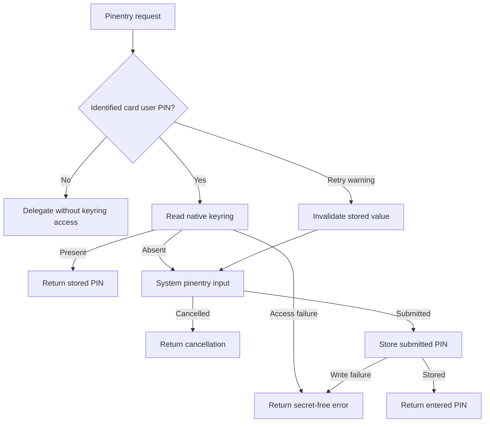
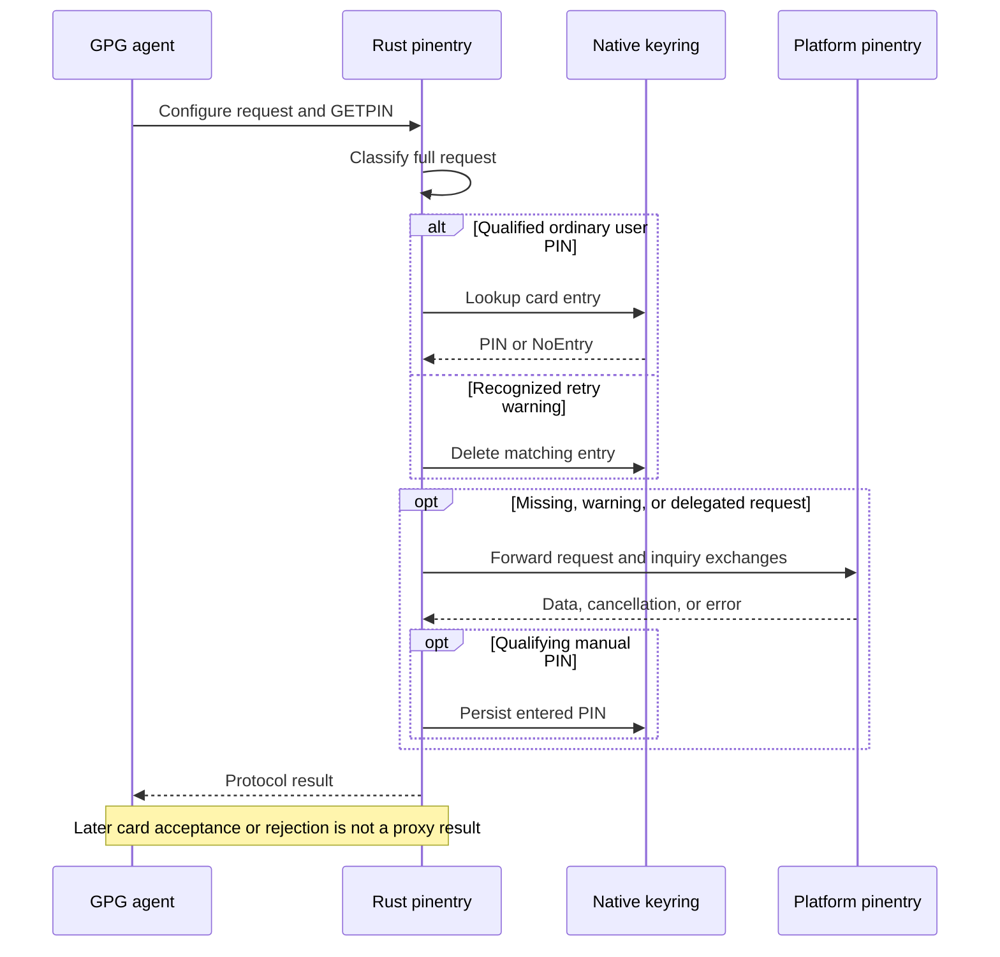

# Rust Keyring Pinentry - Plan

## Goal Capsule

- **Objective:** The repository owner can use a YubiKey's OpenPGP operations without repeatedly entering a PIN already held in the host's native keyring.
- **Means:** A Rust custom pinentry that reuses the platform's existing pinentry for manual entry.
- **Product authority:** The user-approved scope recorded in this Product Contract; repository bootstrap and explicit-apply boundaries remain binding.
- **Open blockers:** None. Recovery is limited to recognized retry warnings and explicit deletion; card rejection is not directly observable by standalone pinentry.

---

## Product Contract

### Summary

Provide card-specific OpenPGP user PIN lookup and automatic enrollment through native OS keyrings, retaining the existing platform pinentry for manual entry.
Disable ordinary agent passphrase caching while accepting the separate smartcard PIN cache and the card's existing authentication behavior.

### Key Decisions

- **Keep card behavior unchanged.** Governs R10. (session-settled: user-directed — chosen over forcing a fresh PIN lookup for every operation: the user wants the card's default behavior.)
- **Accept the smartcard-specific agent cache.** Governs R10. (session-settled: user-directed — chosen over extending the work into GnuPG/scdaemon changes: prioritize custom pinentry and keyring integration.)
- **Use warning-based recovery and manual deletion.** Governs R6, R7, R17. (session-settled: user-directed — chosen over extending GnuPG result delivery: recover when a supported retry warning is visible and provide explicit deletion, without promising detection of every rejection.)
- **Reuse native dialogs and stores on all three platforms.** Governs R1, R2, R8. (session-settled: user-approved — chosen over a new input UI or alternative secret store: preserve the existing platform entry experience and use OS keyring protection.)

### Actors

- A1. The repository owner uses a configured YubiKey and supplies a PIN when enrollment or recovery requires it.
- A2. GnuPG invokes the custom pinentry for a PIN or another supported dialog request.
- A3. The host's native keyring holds the managed PIN entries.
- A4. The existing platform pinentry displays manual entry and other delegated dialogs.

### Requirements

**Coverage and routing**

- R1. Implement the custom pinentry in Rust for Windows, macOS, and Linux.
- R2. Use Windows Credential Manager, macOS Keychain, and Linux Secret Service respectively as the only persistent PIN stores.
- R3. Scope automatic lookup and storage to a reliably identified card's OpenPGP user PIN, keeping different cards isolated even when they contain the same OpenPGP keys.
- R4. Delegate administrator PINs, PIN creation or change, ordinary key passphrases, and requests with uncertain card identity or PIN type to the configured platform pinentry without custom keyring lookup or storage.

**Lookup, enrollment, and recovery**

- R5. Return a matching stored PIN without displaying a manual PIN dialog when the request qualifies under R3.
- R6. When a qualifying entry is absent, obtain the PIN through the platform pinentry and save the submitted value to the matching native entry.
- R7. When a recognized remaining-attempt warning accompanies a qualifying request, invalidate its stored PIN before lookup and obtain a replacement through R6; do not claim immediate detection of every card rejection.
- R8. Preserve platform pinentry cancellation, confirmation, message, and error behavior for delegated requests without treating non-PIN responses as secrets to save.
- R9. Distinguish a missing entry from keyring read or write failures, surface secret-free errors, and fail the affected request instead of silently treating an inaccessible store as empty.

**Caching and personal settings**

- R10. Disable ordinary GPG agent passphrase caching while permitting its smartcard-specific PIN cache and preserving card authentication state, touch policy, and retry configuration.
- R11. Install and select the custom pinentry, retain the selected platform fallback, and reconcile managed agent settings only through explicit chezmoi application.
- R12. Keep worktree initialization read-only for personal settings and declare development tools through mise with a committed lockfile.
- R13. Preserve unrelated GPG configuration and existing executable overrides through repeat application.

**Secret handling and verification**

- R14. Never persist PINs outside the native keyring or include them in logs, command arguments, environment variables, repository files, or diagnostic output.
- R15. Do not describe an entered or stored PIN as card-validated unless acceptance was actually observed.
- R16. Verify automatic lookup, enrollment, rejection recovery, delegation, and keyring errors on each supported platform using disposable identities and stores rather than the owner's PIN or keyring.
- R17. Provide an explicit card-specific PIN deletion command that never prints the PIN and treats an absent entry as successful deletion.

### Key Flows

- F1. **Known card and stored PIN.** Covers R3, R5, R10. GnuPG requests the user PIN; the custom pinentry identifies the card and returns its native-keyring entry. If the card or permitted smartcard cache avoids a pinentry request entirely, the operation proceeds normally.
- F2. **First entry.** Covers R6, R8, R9, R15. A qualifying lookup reports absence; the platform pinentry obtains the PIN; the custom pinentry stores the submitted value and returns it. Cancellation stores nothing. A keyring failure follows R9.
- F3. **Retry warning or explicit deletion.** Covers R6, R7, R15, R17. A supported retry warning invalidates the matching entry before manual input; the owner can also delete a card entry explicitly before the next operation. Storage alone does not establish successful card validation.
- F4. **Delegated request.** Covers R4, R8. An administrator, change-PIN, passphrase, or unidentifiable request uses the platform pinentry; its outcome is returned without custom PIN enrollment.

### Acceptance Examples

- AE1. **Covers R3, R5.** Given a stored PIN for card A, a qualifying request for A returns it without the manual PIN dialog; card B does not receive A's PIN even if their OpenPGP keys match.
- AE2. **Covers R6, R8, R15.** Given no entry for A, submitting a PIN in the system dialog creates A's entry; cancelling leaves the store unchanged. A saved input is not reported as card-validated without acceptance evidence.
- AE3. **Covers R6, R7, R17.** Given a qualifying request with a recognized remaining-attempt warning, the stored PIN is invalidated and the system dialog supplies a replacement for only that entry. Explicit deletion also makes the next lookup miss; unobservable rejection is not promised to trigger recovery.
- AE4. **Covers R2, R9, R14.** Given a denied, locked, or unavailable keyring, the request fails with a secret-free error and no plaintext substitute is created; a failed write is reported as a failure, not successful enrollment.
- AE5. **Covers R4, R8.** Given an administrator PIN, PIN change, ordinary passphrase, or ambiguous card request, the platform pinentry handles it with no custom keyring access; cancellation and confirmation propagate unchanged.
- AE6. **Covers R10.** Ordinary agent passphrase reuse is disabled, while an operation satisfied by the permitted smartcard cache or card authentication state does not force another keyring read or modify the card.
- AE7. **Covers R11-R13.** Worktree initialization changes no personal configuration; explicit apply selects the wrapper and fallback, reconciles the cache policy, and preserves unrelated options. Reapplying converges without duplicate managed directives or recursive fallback selection.
- AE8. **Covers R1, R16.** Disposable native-platform checks demonstrate AE1-AE6 on Windows, macOS, and Linux without touching owner credentials.

### Scope Boundaries

- GnuPG/scdaemon patches and disabling the smartcard-specific PIN cache are excluded by R10.
- Key provisioning, trust changes, card resets, changes to touch or retry policy, and support for PIV/FIDO PIN storage are outside this work.
- A new dialog UI, keyring replacement, plaintext fallback, and cross-device PIN synchronization are outside this work.
- Administrator PIN and ordinary passphrase enrollment are excluded by R4.

### Dependencies and Assumptions

- The owner's GnuPG installation, platform pinentry, configured OpenPGP keys, and YubiKey remain prerequisites; this is an optional card-aware capability, not a new requirement that all repository secrets use hardware keys.
- Native keyring access supplies the persistent protection boundary for R2; the feature does not promise independent manual PIN confirmation on every operation.
- Current repository configuration only reconciles `pinentry-program` and preserves existing cache settings; R10 deliberately extends that management boundary.
- Upstream GnuPG treats `CACHE_MODE_PIN` separately from ordinary cache TTLs. Its inspected smartcard caller passes no key information to `agent_askpin`, which can result in `SETKEYINFO --clear`; the planner must not assume this field supplies a stable card identifier.

### Outstanding Questions

The planning decisions below resolve these questions; implementation owns only exact dependency patch pins and runtime proof against the stated fixtures.

- Establish how supported GnuPG versions expose card identity, user-versus-administrator PIN type, and rejection feedback to pinentry, including localization, retries, and repeated requests. Demonstrate the automatic path without reentrant calls that block on the same agent. Recovery follows the revised R7 rather than requiring direct rejection feedback.
- Determine enrollment timing and rejection propagation without assuming that a completed input dialog means card acceptance, per R15.
- Select and verify the ordinary cache settings for R10 while keeping custom keyring integration compatible with GnuPG's external-cache protocol; ordinary TTL settings must not be claimed to disable `CACHE_MODE_PIN`.
- Choose Rust protocol and native-store dependencies, supported versions, installation paths, release/build delivery, and disposable native test environments for R1, R11-R16.
- Specify how effective wrapper, fallback, and managed cache changes participate in the existing apply/reload lifecycle without recursively selecting the wrapper as its own fallback, per R11-R13.

### Sources and Research

- `home/.chezmoitemplates/gpg-agent-config:1-7`, `home/.chezmoitemplates/gpg-settings:1-2`, and `home/.chezmoidata/gpg.yaml:3-12`: existing shared configuration, overrides, and platform defaults.
- `tests/test_git_gpg.py:108-124`: current cache-preservation expectations that will need deliberate revision for R10.
- `scripts/cli_native.py`: existing native-store integration for other credential domains; not a PIN identity or protocol contract.
- `mise.toml:24-33` and `.chezmoi-bootstrap.toml`: hook-free preparation and separate explicit application.
- `STRATEGY.md:22-28`: existing hardware-neutral key-access boundary.
- [GnuPG agent cache implementation](https://github.com/gpg/gnupg/blob/master/agent/cache.c): `CACHE_MODE_PIN` expiration and insertion behavior.
- [GnuPG smartcard caller](https://github.com/gpg/gnupg/blob/master/agent/call-scd.c) and [pinentry caller](https://github.com/gpg/gnupg/blob/master/agent/call-pinentry.c): PIN requests and conditional key information.
- [Pinentry protocol manual](https://github.com/gpg/pinentry/blob/master/doc/pinentry.texi): external-cache permission, opaque key identifiers, and cache status signaling.

Upstream links were inspected on 2026-11-06 and refer to moving branches; planning must verify the versions selected for delivery.

---

## Planning Contract

Product Contract changed: R7, R17, F3 and AE3 reflect the user-directed warning-based recovery and explicit deletion choice; other product scope is preserved.

### Key Technical Decisions

- KTD1. **Use a bounded Assuan proxy with a strict request classifier.** Implements R3-R8 and R14. Keep a platform pinentry child for protocol compatibility; intercept only qualified GETPIN calls and leave confirmations, messages, cancellations and inquiries to the existing frontend. Decode Assuan escaping once, bound line size, and keep secrets out of error text. RESET and changes of request context clear classifier state.
- KTD2. **Recognize verified English OpenPGP unlock descriptions only.** Implements R3, R4, R7. Parse the GnuPG 2.5.24 unlock text, tabbing markers, YubiKey display serial format and exact user PIN prompt as a single allowlisted structure. Reject duplicate/ambiguous identifiers, unrecognized locales, new/repeated PIN requests and generic passphrases into delegation. Do not call back into gpg-agent for card discovery while it waits on pinentry. Known low-attempt text suspends automatic lookup for this request and deletes the matching entry before manual input. Governs the narrowed recovery decision, not a claim of card validation.
- KTD3. **Use explicitly selected native Rust keyring backends and zeroized buffers.** Implements R2, R9, R14, R17. Pin keyring 4.2.0 with default-features disabled and only its v1 feature, plus zeroize 1.9.1; the selected native stores are Windows Credential Manager, Apple Keychain and zbus Secret Service, with no keyutils/file/null fallback. Namespace by this application, OpenPGP user PIN and normalized card identity; errors distinguish NoEntry from inaccessible storage. Store before returning manually entered data so a failed write cannot report successful enrollment. A `forget <card-id>` action removes one record idempotently and prints no secret.
- KTD4. **Build during explicit apply before selecting the wrapper.** Implements R11-R13. Declare Rust through mise and lock it, with a repository build task producing the binary. An OS-conditional before-phase script, ordered after GPG-home safety checks, installs the repository-built binary to the personal bin directory. Keep pinentryProgram as the native fallback override, select the wrapper as agent pinentry, and emit a private non-secret sidecar configuration beside the installed binary with the absolute fallback path. On Windows, run the existing windows-build:visual-studio readiness/provisioning task before compilation, still only during explicit apply. Include wrapper/config/fallback settings in the agent lifecycle dependencies. Source builds do not run in postinstall/bootstrap.
- KTD5. **Manage only the ordinary cache directives.** Implements R10, R13. Reconcile default-cache-ttl and max-cache-ttl to zero, preserving unrelated settings and the smartcard cache. Preserve the existing external-cache permission policy; the requested cache change concerns the agent memory cache rather than a ban on every native frontend external store. Honor external-cache permission and status signaling where the protocol provides them, and never claim that TTL zero disables a delegated frontend store. Leave SSH-specific cache policy outside the ordinary OpenPGP change.
- KTD6. **Prove protocol behavior without hardware and native stores only in disposable CI.** Implements R16. Deterministic fake-frontends and fake stores cover routing and fault cases; a native smoke validates real backends using synthetic PINs and CI-owned accounts/isolated collections. Native storage is never selected by ordinary tests against the owner's account.

### High-Level Technical Design

Request routing, enrollment, and recovery follow F1-F4. The sequence shows the process boundary that prevents immediate card-result observation; the product flow diagram carries the routing decisions.

### Assumptions and Limits

- Supported automatic input is deliberately narrower than GnuPG's complete prompt surface; all unknown forms preserve manual entry under R4.
- Prompt matching is a compatibility classifier, not hardware authentication. Processes able to invoke the helper or the same user's GPG agent can synthesize matching prompts and obtain an enrolled PIN; trusted local callers are inside this automation's boundary. Per-process authorization and protection against a compromised same-user process are not promised.
- A warning can indicate a prior failure without proving which stored value caused it. Deleting the matching entry is conservative and intentional.
- Configured retry counts above three can hide failed attempts before a warning appears; explicit deletion is the owner's escape hatch under R17.
- Ordinary cache TTL zero must be verified against the installed agent's ordinary passphrase path, not by observing card authentication reuse.
- Native store access can require an OS unlock/access approval, including renewed macOS approval after replacing the built executable; R5 avoids a manual PIN dialog, not native store authorization. Windows native-store persistence follows OS policy; this feature adds no synchronization mechanism.
- Source build delivery requires mise and Rust at explicit application time; no project release asset is assumed to exist.

## Implementation Units

### U1. Rust protocol proxy and request classification

**Goal:** Route known user PIN requests while preserving platform pinentry behavior.
**Requirements:** R1, R3-R8, R14, R15; F1-F4; KTD1-KTD2.
**Dependencies:** None.
**Files:** `pinentry/Cargo.toml`, `pinentry/Cargo.lock`, `pinentry/src/main.rs`, `pinentry/src/protocol.rs`, `pinentry/src/request.rs`, `pinentry/tests/protocol.rs`, `pinentry/tests/fixtures/`.
**Approach:** Separate protocol transport from request classification and store access so tests cannot accidentally select personal native storage. Support existing options, data/status framing, RESET, termination and inquiry forwarding. Preserve exact frontend errors while removing secret-bearing context from custom diagnostics.
**Patterns:** Existing subprocess isolation and secret-free error handling in `scripts/cli_native.py` and credential smoke tests.
**Test scenarios:**
- Covers AE1. Known card A and B descriptions route to distinct identities, including identical key material.
- Covers AE5. Admin/new/repeat/passphrase, translated, malformed and ambiguous descriptions delegate without store access.
- Covers AE2, AE3. Missing entry prompts and stores; supported retry warning deletes first and prompts; cancellation writes nothing.
- Covers AE5. A fake frontend's inquiry/data/status exchange reaches the caller intact.
- Covers AE4. Read/write/delete errors terminate without leaking PINs; malformed escapes and oversized lines do not desynchronize transport.
**Verification:** Rust protocol and classifier tests pass without accessing OS credential stores.

### U2. Native keyring and deletion command

**Goal:** Persist and remove only the intended card's PIN through native backends.
**Requirements:** R2, R9, R14, R17; KTD3.
**Dependencies:** U1's store seam.
**Files:** `pinentry/src/store.rs`, `pinentry/src/main.rs`, `pinentry/Cargo.toml`, `pinentry/Cargo.lock`, `pinentry/tests/protocol.rs`.
**Approach:** Explicit native backend selection, one stable namespace and canonical card ID format shared by classifier and forget. Guard unsupported targets. Native errors expose no record value; buffers are zeroized after use.
**Test scenarios:**
- Covers AE3. Forget removes only A, repeated deletion succeeds, and subsequent A lookup misses.
- Covers AE4. NoEntry is the sole missing-record outcome; denied/unavailable stores propagate errors.
- Invalid card IDs are rejected before native lookup; logs and command output never contain synthetic PIN values.
**Verification:** Unit tests validate store-independent semantics; real backend proof belongs to U4.

### U3. Explicit apply integration and cache policy

**Goal:** Install the wrapper before agent selection and retain native fallback overrides.
**Requirements:** R10-R13; F1, F4; KTD4-KTD5.
**Dependencies:** U1, U2.
**Files:** `mise.toml`, `mise.lock`, `.gitignore`, `home/.chezmoitemplates/gpg-settings`, `home/.chezmoitemplates/gpg-agent-config`, `home/.chezmoiscripts/run_before_20-install-pinentry.sh.tmpl`, `home/.chezmoiscripts/run_before_20-install-pinentry.ps1.tmpl`, `home/dot_local/bin/private_dotfiles-pinentry.json.tmpl`, reload scripts, `tests/test_git_gpg.py`, `tests/test_script_lifecycle.py`.
**Approach:** Use current worktree source, explicit before-phase build/install and a private sidecar config next to the installed executable. Reuse Windows Visual Studio readiness/provisioning before the build. Reconcile exactly one wrapper pinentry directive and zero ordinary cache TTLs, preserving unrelated options. Retain the selected native pinentry separately and prevent recursive fallback.
**Test scenarios:**
- Covers AE6, AE7. Rendering reconciles duplicate cache/pinentry directives, preserves comments/other options and converges on repeat apply.
- Covers AE7. Bootstrap/script-excluded rendering does not build/install or touch personal settings; safety failure occurs before install.
- Covers AE7. Changing effective fallback/wrapper config schedules reload; unrelated platform data does not.
- Covers AE5. A disposable installed wrapper finds the configured absolute fallback and rejects self-selection.
**Verification:** Security and lifecycle Python test areas pass with fixture installers; mise lock includes declared Rust tool versions.

### U4. Disposable native smoke and CI

**Goal:** Prove actual backend behavior and cross-platform compilation.
**Requirements:** R1, R16; AE8; KTD6.
**Dependencies:** U1-U3.
**Files:** `.github/workflows/test.yml`, `tests/smoke_pinentry.py`, `pinentry/tests/`.
**Approach:** Add a dedicated native pinentry job using existing runner and isolation patterns. Run Rust formatting, lint, tests and real backend smoke. CI-only native smoke must refuse to run against the owner's normal session; Linux uses isolated session bus/keyring, macOS a disposable Keychain, Windows a disposable hosted account. Verify synthetic enrollment, hit, warning recovery, deletion and namespace isolation; no real card is needed.
**Test scenarios:**
- Covers AE8. Native store survives separate proxy processes, separates A/B, and forget causes a miss on all three OS families.
- Covers AE4. Isolated backend failure cannot become a false NoEntry or plaintext fallback.
- Covers AE2, AE3, AE5. Real native storage plus fake system frontend exercises enrollment, warning recovery and manual delegation end to end.
**Verification:** Native CI passes on Linux, Windows and macOS; local native tests are limited to genuinely isolated environments.

### U5. Operator documentation

**Goal:** Explain apply prerequisites, supported automatic prompts and recovery limits.
**Requirements:** R3, R4, R7, R10-R17.
**Dependencies:** U1-U4.
**Files:** `docs/guides/git-and-gpg.md` and relevant guide index references only if needed.
**Approach:** Document OS stores, source-build prerequisites, fallback overrides, ordinary-versus-smartcard cache distinction, warning-based limitations, card ID format and forget usage. Do not promise card verification on PIN storage.
**Test expectation:** No separate prose tests; compare command examples and supported prompt description with the actual CLI and fixtures.
**Verification:** Instructions work against disposable setup and match the final implementation.

## Verification Contract

- Run `cargo fmt --manifest-path pinentry/Cargo.toml -- --check`, `cargo clippy --manifest-path pinentry/Cargo.toml --all-targets -- -D warnings` and `cargo test --manifest-path pinentry/Cargo.toml --locked` through the mise Rust environment.
- Run `mise exec -- python scripts/run-test-area.py --area security` and directly affected lifecycle/bootstrap tests; use disposable homes and fixture installers.
- Run the dedicated native pinentry CI checks for each OS family; report any platform method unavailable locally and rely on its actual CI result, not a mock claim.
- Check `chezmoi managed --exclude=scripts` with repository bootstrap config without executing apply against the owner's home.

## Definition of Done

- U1-U5 implement the revised R1-R17 and acceptance examples with no unstated auto-recovery guarantee.
- Required Rust and affected repository checks pass; native backend proof exists for all supported OS families.
- No real PIN, personal keyring, card setting, or owner GPG configuration was accessed or modified during verification.
- The reviewed change is committed and pushed as an open PR with the recovery limitations and actual verification evidence in its description.
