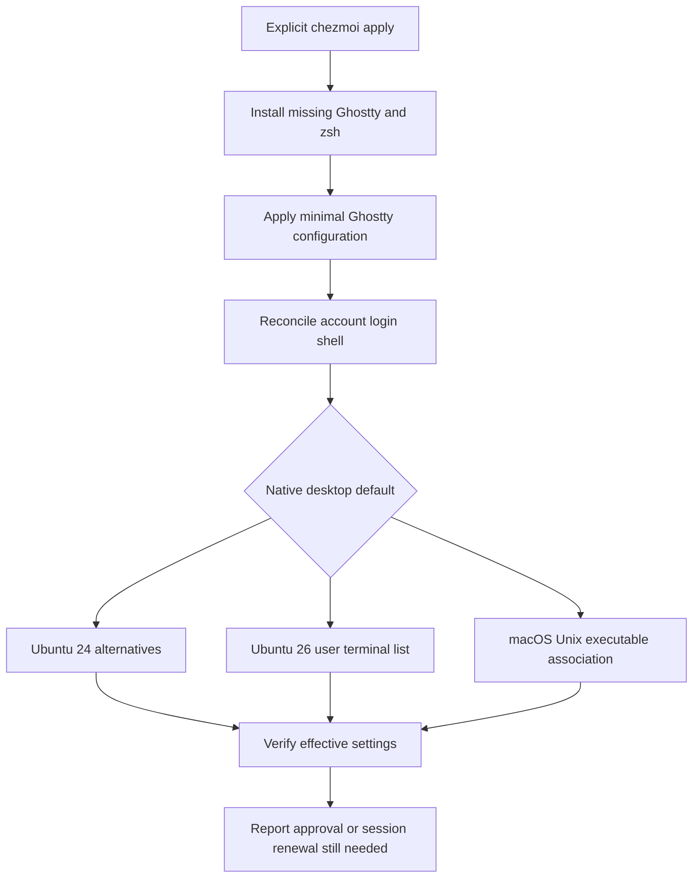

# Ghostty Default Terminal on Ubuntu and macOS - Plan

## Goal Capsule

**Objective:** The repository owner can open their normal desktop terminal and start working in a consistent shell environment after applying this repository on supported Ubuntu and macOS devices.

**Means:** Ghostty as the default terminal, using the account's zsh login shell.

**Product authority:** The confirmed Product Contract below defines the scope and acceptance behavior.

**Open blockers:** None.

**Authority:** Product requirements govern behavior; technical decisions below govern implementation within those requirements.

**Execution profile:** One PR, with smoke-oriented package/configuration checks and isolated account/desktop command fixtures. The host owns verification, commits, review, and publication; merging remains with the owner.

---

## Product Contract

### Summary

Manage Ghostty installation and native default-terminal connections on the repository's supported Ubuntu and Apple Silicon macOS devices.
Set the account login shell to zsh when necessary and let Ghostty discover the system default shell.
Use the existing explicit personal-configuration application lifecycle.

### Key Decisions

- **Use Ghostty on Ubuntu and macOS.** Governs R1 and R2. (session-settled: user-directed — chosen over the original three-OS Kitty request: Kitty lacks native Windows support, and the owner switched to Ghostty while excluding Windows.)
- **Follow the repository's platform coverage.** Governs R1. (session-settled: user-approved — chosen over surveying other Linux distributions and desktop environments: the owner selected repository-managed Ubuntu and confirmed the GNOME baseline.)
- **Use native default-terminal connections.** Governs R5 and R6. (session-settled: user-approved — chosen over replacing every application's terminal invocation: the owner confirmed OS-provided integration boundaries.)
- **Start with Ghostty defaults.** Governs R12. (session-settled: user-approved — chosen over adding appearance and shell customizations: the owner confirmed deferring those choices.)

### Problem Frame

The owner maintains the same personal environment across multiple devices.
Terminal selection and login-shell setup currently require additional machine-specific configuration after repository application.

### Requirements

**Supported environment and installation**

- R1. Support Ubuntu 24.04 and 26.04 on amd64 and arm64 with the standard Ubuntu Desktop GNOME environment, plus the repository-managed Apple Silicon macOS environment.
- R2. Explicit personal-configuration application installs Ghostty when it is absent on a supported device.
- R3. Reapplication reuses an existing Ghostty installation without forcing an application upgrade, following the repository's current macOS application policy.

**Shell and default-terminal behavior**

- R4. Ensure zsh is installed and is the applying user's account login shell, changing that shell only when it differs.
- R5. Ghostty uses system-default shell discovery rather than a terminal-specific zsh command override.
- R6. After the required session restart, managed desktop default-terminal entry points launch Ghostty; macOS coverage follows Ghostty's native Unix-executable default association.
- R7. Preserve the repository's existing Unix PATH integration and respect exported `ZDOTDIR` when reconciling zsh startup files.

**Application lifecycle**

- R8. Perform application installation, account-shell changes, and default-terminal changes only through explicit personal-configuration application, preserving read-only worktree preparation.
- R9. Repeated application converges on the same managed shell and terminal settings without duplicating startup-file entries.
- R10. Report any required user authentication, OS approval, or session restart needed to finish applying the terminal environment.
- R11. Verify effective shell and terminal selection, distinguishing completed configuration from any remaining user-operated step.

**Initial configuration**

- R12. Use Ghostty's default appearance and key bindings without adding zsh plugins or a shell framework.
- R13. Keep all repository-managed Windows settings and behavior outside this change.

### Acceptance Examples

- AE1. **Covers R1, R2, R4-R8, R10, R11.** Given a supported Ubuntu GNOME desktop without Ghostty and with Bash as its login shell, when the owner explicitly applies personal configuration and completes required authentication and session renewal, Ghostty is installed, managed default-terminal entry points open it, and new terminal shells run the account's zsh with the repository-managed tools available.
- AE2. **Covers R1-R8, R10, R11.** Given a supported Mac with zsh already selected, when the owner applies configuration and completes any required OS approval, Ghostty is available through the native default association, uses the existing login shell, and retains the repository's shell PATH behavior.
- AE3. **Covers R3, R4, R7, R9.** Given an already configured device using an exported `ZDOTDIR`, when configuration is applied again, the existing Ghostty installation is reused, the login shell remains zsh, and startup integration is not duplicated or moved to the wrong directory.
- AE4. **Covers R8, R13.** Given a worktree on any managed OS, when `mise install` prepares it, no Ghostty installation, account-shell change, or default-terminal change occurs; applying Windows configuration introduces none of these new integrations.
- AE5. **Covers R10, R11.** Given an application that cannot finish because user authentication or OS approval is outstanding, its result identifies the remaining step and does not claim that the terminal environment is fully configured.

### Scope Boundaries

- Other Linux distributions, KDE, custom window managers, Intel Macs, and Windows terminal configuration are excluded per R1 and R13.
- Native default selection under R6 does not replace Terminal.app paths hardcoded by individual applications, IDE-integrated terminals, or unrelated application settings.
- Server-only and headless Ubuntu sessions are outside the desktop acceptance scope of R1.
- Theme selection, font overrides, custom key bindings, zsh frameworks, plugins, and broader shell customization are deferred per R12.
- Windows terminal work has no delivery dependency on this plan.

### Dependencies / Assumptions

- The owner uses Ubuntu's standard GNOME desktop; this is a confirmed baseline for this work, not a previously established repository policy.
- Account login-shell changes may require the owner's password and a new login session before the environment reflects them.
- macOS default-terminal coverage is narrower than a universal replacement for Terminal.app; the native association targeted by R6 concerns Unix executables.

### Sources / Research

- `.github/workflows/test.yml` and `docs/maintenance/development-and-testing.md`: Ubuntu release/architecture and Apple Silicon macOS coverage; Intel Macs are excluded.
- `home/.chezmoidata/macos.yaml`, `home/.chezmoiscripts/run_before_15-install-macos-apps.sh.tmpl`, and `scripts/macos-apps.sh`: declared macOS packages and installation of missing applications.
- `home/.chezmoiscripts/run_onchange_after_10-personal-app-path.sh.tmpl`: Bash/zsh startup-file PATH reconciliation with `ZDOTDIR` support; this does not establish interactive mise activation.
- `mise.toml`, `.chezmoi-bootstrap.toml`, and `AGENTS.md`: preparation/application separation and source-management constraints.
- [Ghostty Linux documentation](https://ghostty.org/docs/linux): Linux desktop and package compatibility considerations.
- [Ghostty configuration reference: command](https://ghostty.org/docs/config/reference#command): default shell discovery consults `SHELL` and account information.
- [Ghostty native macOS default-terminal implementation](https://github.com/ghostty-org/ghostty/pull/10810/files): Unix-executable association and native default selection.

---

## Planning Contract

**Product Contract preservation:** Product Contract unchanged in scope; planning-owned questions are resolved below.

### Key Technical Decisions

- KTD1. **Use native package ownership and retain installations.** Implements R2 and R3. Add the Ghostty cask to the existing macOS owner and recognize its manual app bundle. On Ubuntu 26.04 install the official archive package; on 24.04 use the upstream-documented community release `mkasberg/ghostty-ubuntu` version `1.3.1-0-ppa2` with repository-recorded per-architecture SHA-256 hashes. Verify the download before privileged local APT installation. Avoid a persistent third-party repository or remote installer execution.
- KTD2. **Reconcile settings on every explicit apply.** Implements R8 and R9. Use padded, OS-conditional `run_before` installation and `run_after` terminal reconciliation hooks, leaving mise bootstrap and the existing onchange PATH policy intact.
- KTD3. **Query and change the current account through native tools.** Implements R4, R5, R7, R10, and R11. Read Ubuntu account state through `getent passwd` and macOS through native account lookup. Retain any executable zsh listed in `/etc/shells`, including equivalent usrmerge paths and registered Homebrew zsh; otherwise select a stable system zsh and invoke `chsh`. Refuse root execution of user settings. Re-read account state after mutation and always report session renewal after a shell change. On Ubuntu, compare both the inherited shell and available systemd user-manager environment with the account shell; unavailable desktop evidence remains pending.
- KTD4. **Use release-specific Ubuntu defaults.** Implements R6. On 24.04 inspect and select the registered Ghostty executable through `update-alternatives` for `x-terminal-emulator`. On 26.04 put Ghostty first in the effective XDG `ubuntu-xdg-terminals.list`, preserving other terminal entries, and verify native dispatcher selection. Do not add Nautilus extensions or replace hardcoded application commands.
- KTD5. **Use AppKit's current default-association API.** Implements R6, R10, and R11. A small Swift helper discovers a usable Ghostty bundle with identifier `com.mitchellh.ghostty` and an executable payload, then queries/sets only `UTType.unixExecutable` through `NSWorkspace`; wait for its asynchronous completion and verify the effective result. Use existing Command Line Tools prerequisites and retain unrelated associations.
- KTD6. **Manage a minimal Ghostty configuration.** Implements R5 and R12. Own the documented primary Ghostty configuration files at the effective XDG directory and macOS Application Support directory, using shared default-only content without shell command or include overrides. Neutralize existing legacy `config` files so later-loaded content cannot win over `config.ghostty`. This intentionally replaces Ghostty customization with the confirmed defaults; unrelated OS/application settings remain untouched.
- KTD7. **Separate pending actions from execution failures.** Implements R10 and R11. Apply exits zero after reporting a pending login/approval step so subsequent auth hooks run; real command/configuration failures exit nonzero. A read-only status command distinguishes ready, pending, and failed results with documented exit codes. A shell change always emits the pending state regardless of the current process environment.

### Assumptions

- Ubuntu 24.04's native alternatives selection affects the machine, while account-shell and Ubuntu 26.04 preferences concern the applying user; narrow privilege to package/alternatives commands.
- Native GNOME launchers honoring the platform dispatcher are the Ubuntu entry points covered by R6; Nautilus 24.04's gnome-terminal-specific extension remains outside that boundary.
- The macOS native helper needs existing Command Line Tools. An unavailable desktop service or declined native approval is pending; a missing execution prerequisite or failed native command is an error per KTD7.

### High-Level Technical Design

### Risks and Verification Boundaries

- A temporary HOME cannot isolate account databases, alternatives, dconf, or LaunchServices. Ordinary tests must intercept mutation tools; real desktop checks require a disposable OS account or VM.
- The Ubuntu 24.04 payload is community-built, not authenticated by Ubuntu archive signatures; reviewed release hashes authenticate the selected bytes. Independently download and hash both architecture assets during implementation.
- Ghostty 1.3.x has reported existing-instance working-directory issues; do not claim file-manager directory correctness from preference inspection alone.
- Do not introduce an application upgrade service, automatic rollback framework, or general default-app abstraction; immediate failure reporting and repeatable application meet this request.

### Sources for Technical Decisions

- [Official Ghostty installation](https://ghostty.org/docs/install/binary) and [configuration precedence](https://ghostty.org/docs/config).
- [Ubuntu 24.04 native default terminal](https://documentation.ubuntu.com/desktop/en/24.04/how-to/change-the-default-terminal/) and [Ubuntu 26.04 native default terminal](https://documentation.ubuntu.com/desktop/en/26.04/how-to/change-the-default-terminal/).
- [Ubuntu package availability](https://packages.ubuntu.com/ghostty) and [community 24.04 release](https://github.com/mkasberg/ghostty-ubuntu/releases/tag/1.3.1-0-ppa2).
- [Current AppKit association API](https://developer.apple.com/documentation/appkit/nsworkspace/setdefaultapplication(at:toopen:completion:)).

---

## Implementation Units

### U1. Install supported terminal prerequisites

**Goal:** Make Ghostty and system zsh available through existing explicit application paths.

**Requirements:** R1-R4, R8, R13; AE1, AE2, AE4.

**Dependencies:** None.

**Files:** `home/.chezmoidata/macos.yaml`, `scripts/macos-apps.sh`, new `home/.chezmoidata/ghostty.yaml`, new `scripts/install-ghostty.sh`, new OS-conditional `home/.chezmoiscripts/run_before_16-install-ghostty.sh.tmpl`, `tests/test_macos_apps.py`, new `tests/test_ghostty_install.py`, `scripts/run-test-area.py`.

**Approach:** Follow KTD1 and KTD2, with template-selected Ubuntu release and architecture arguments. Preserve supported-host checks and existing install-only-if-missing behavior. Register the new test module in the platform area.

**Patterns to follow:** The existing macOS application helper and Ubuntu T3 package installation hooks.

**Test scenarios:**

- Covers AE1 and AE2. Missing supported installations acquire the right package and system shell; existing installations do not download or upgrade.
- The selected 24.04 payload hash mismatch prevents privileged installation.
- Unsupported OS/release/architecture renders no installation action; Windows remains untouched.
- Covers AE4. Worktree bootstrap never invokes terminal installation.

**Verification:** Independent asset hashing, isolated shell fixtures, real chezmoi template rendering, and existing macOS application tests pass.

### U2. Reconcile account and desktop terminal selection

**Goal:** Apply and verify the intended native shell and terminal defaults.

**Requirements:** R4-R12; AE1-AE3, AE5.

**Dependencies:** U1.

**Files:** New `scripts/terminal-environment.sh`, new `scripts/ghostty-default-terminal.swift`, new `home/.chezmoiscripts/run_after_35-terminal-environment.sh.tmpl`, minimal shared Ghostty configuration under `home/.chezmoitemplates/`, new `tests/test_terminal_environment.py`, `scripts/run-test-area.py`.

**Approach:** Implement KTD3-KTD7 through native commands and a narrow AppKit helper. Reconcile only supported targets, use the intended non-root user, check effective state before and after writes, and report remaining approvals/session renewal. Reuse existing startup-file PATH integration rather than replacing user shell files. Keep a read-only status path for verification on a live account without mutation.

**Patterns to follow:** Existing isolated POSIX command fixtures and explicit-apply hooks; native read-only readiness reporting.

**Test scenarios:**

- Covers AE1 and AE2. A non-zsh account changes to an eligible system zsh; an already-zsh account does not invoke chsh.
- A missing/non-allowed zsh or failed chsh cannot report success; a changed shell always requires session renewal, and a stale systemd user-manager SHELL prevents a ready result.
- An existing valid registered zsh is retained even when its path differs from the preferred system zsh.
- Covers AE3. Reapply repairs native preference drift, preserves alternate terminal entries and unrelated startup content, and honors XDG_CONFIG_HOME and ZDOTDIR.
- Ubuntu 24.04 verifies the active alternative; 26.04 verifies the dispatcher desktop ID and preserves argument/directory semantics of the upstream desktop entry.
- macOS queries and updates only the Unix-executable association, handles declined approval, and reuses a valid manually installed bundle.
- Covers AE5. Missing desktop prerequisites, command failures, and pending session actions are distinguishable from completion.
- A pending apply exits zero and a following auth-hook sentinel still runs; a real command failure exits nonzero.
- Legacy/local Ghostty shell overrides cannot win over the managed default-shell configuration.
- Root invocation and foreign-platform template rendering cannot mutate account or desktop settings.

**Verification:** Run isolated behavior tests and affected PATH/lifecycle tests. Compile/typecheck the Swift helper only on native macOS when available; do not equate mocks with native GUI proof.

### U3. Document and expose verification boundaries

**Goal:** Make installation trust, native default coverage, and remaining desktop checks clear to the owner.

**Requirements:** R1, R6-R11, R13; AE1-AE5.

**Dependencies:** U1, U2.

**Files:** New `docs/guides/terminal.md`, `docs/setup/macos.md`, `docs/maintenance/development-and-testing.md`, `README.md`, affected fixture/test ownership files if needed.

**Approach:** Document the normal apply/status commands, supported OS matrix, 24.04 community pin and manual update procedure, system-wide alternatives impact, password/consent flow, logout/login, native default boundaries, and preservation of Windows behavior. Explain that ordinary APT upgrades do not update the standalone 24.04 community package. Include a concrete desktop checklist for shortcut/association launch and selected working directory with an existing Ghostty instance.

**Test expectation:** No standalone documentation tests; verify documented commands against the implemented entry points and run existing bootstrap/lifecycle regressions.

**Verification:** Documentation matches runtime behavior, including partial/pending results and unavailable native checks.

### U4. Prove native installation and configuration interfaces in CI

**Goal:** Exercise actual native package and helper interfaces on every supported hosted OS/architecture.

**Requirements:** R1-R11; AE1-AE5.

**Dependencies:** U1, U2.

**Files:** New `tests/smoke_ghostty.py`, `.github/workflows/test.yml`, associated CI ownership tests if their declared area list needs updating.

**Approach:** Add a `ghostty` native area restricted to Ubuntu and macOS targets. Install actual packages on disposable runners, verify executable/version and upstream desktop metadata, inspect/select native alternatives or the 26.04 dispatcher, and typecheck the AppKit helper. Any account mutation uses a temporary test account and a narrow native probe, never the runner owner. Query macOS associations without changing the runner's defaults. Keep full interactive approval and actual desktop launch in the documented manual checklist.

**Test scenarios:**

- Both Ubuntu architectures and releases install and expose a working Ghostty executable; 24.04 payload hashes match the recorded pins.
- Native alternatives or XDG dispatch selection resolves Ghostty and retains the supplied working-directory/command flags.
- A disposable Ubuntu account can change its login shell through the same native mechanism used by apply.
- macOS installs/reuses the actual cask, typechecks the helper against the current SDK, and runs its read-only association query.
- Windows native lanes do not execute Ghostty smoke or install its dependencies.

**Verification:** Supported native lanes pass in CI; real GUI launches remain explicitly unverified until checked on a desktop.

---

## Verification Contract

- Focused unit tests: `mise exec -- python -m unittest discover -s tests -p test_ghostty_install.py` and the corresponding `test_terminal_environment.py` invocation.
- Affected regressions: `test_macos_apps.py`, `test_personal_apps.py`, `test_bootstrap.py`, and `test_script_lifecycle.py` through unittest discovery.
- CI ownership: `mise exec -- python scripts/run-test-area.py --validate-only`.
- Broader relevant areas: `mise exec -- python scripts/run-test-area.py --area platform` and `--area applications` when shared startup behavior changes.
- Native evidence: `mise exec chezmoi python -- python tests/smoke_ghostty.py` runs through the supported hosted matrix. Verify pinned hashes, inspect package maintainer scripts, install real native packages, exercise disposable account/default selection, and typecheck AppKit. Desktop launches remain a separate manual check.
- Read-only repository preparation must still pass and personal settings must not be applied on the working machine.
- Record missing native OS/GUI execution as a validation limitation; headless Windows or Linux test results cannot establish macOS or GNOME GUI readiness.

---

## Definition of Done

- U1-U4 satisfy their linked requirements and acceptance examples with local fixture and hosted native verification evidence; interactive GUI launch remains an explicit validation limitation.
- The Product Contract's confirmed scope and decision provenance remain intact.
- Tests are isolated from actual account/default-app mutation, and all new unittest modules have exactly one CI area owner.
- Existing unrelated OS/application settings remain untouched per KTD6, bootstrap remains read-only, and abandoned implementation attempts are removed.
- Local verification, simplification, independent review, and any resulting eligible fixes are complete before PR publication.
