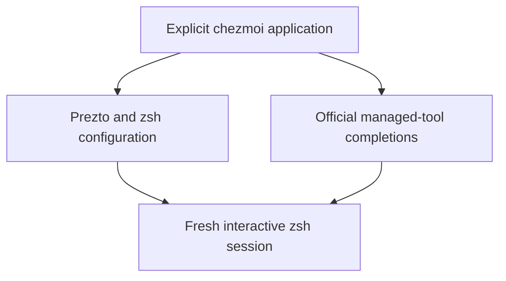
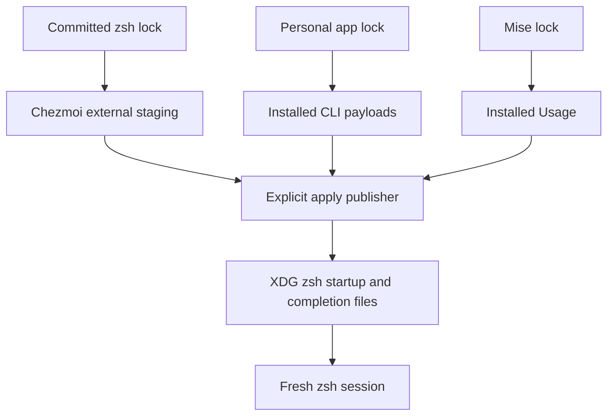
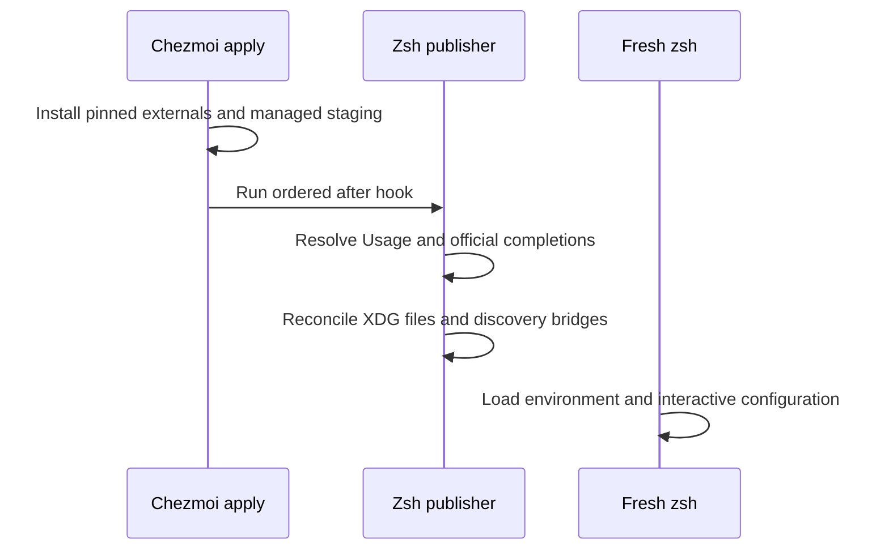

# XDG Prezto and managed zsh completions - Plan

## Goal Capsule

- **Objective:** The repository owner can reproduce a consistent interactive zsh environment with completion for supported managed tools on Linux and macOS.
- **Means:** Prezto under XDG configuration, repository-owned zsh settings, official completion providers, and Usage.
- **Product authority:** The user-confirmed scope in this Product Contract governs implementation planning; changing the default login shell remains separate work.
- **Open blockers:** None.
- **Execution profile:** One pull request; LFG implements, verifies in disposable homes, reviews, commits, and opens the PR.
- **Stop conditions:** Stop on an invalidated settled product decision or an unverified prerequisite that prevents the required native integration.

---

## Product Contract

### Summary

Manage Prezto and zsh configuration through chezmoi on Linux and macOS.
Extend the upstream defaults with autosuggestions, syntax highlighting, relevant repository-tool modules, and official completions for externally managed binaries.
Include Usage and preserve the repository's existing shell environment integrations.

### Problem Frame

The owner maintains Linux and macOS environments through this repository.
Zsh startup currently has managed CA and PATH behavior but requires manual mise activation, and external CLI installation does not provide a shared completion setup.

### Key Decisions

- **Cover both Unix platforms.** Governs R1. (session-settled: user-directed — chosen over Linux-only or macOS-only coverage: the owner selected both platforms.)
- **Extend the defaults.** Governs R3, R4. (session-settled: user-directed — chosen over upstream defaults alone: the owner requested autosuggestions, syntax highlighting, and modules corresponding to repository-managed tools.)
- **Use official completion providers.** Governs R7, R8. (session-settled: user-directed — chosen over handwritten completions: the owner selected official support and excluded both implementation and documentation of unsupported tools.)
- **Add Usage.** Governs R9; the owner explicitly requested this completion-related dependency.

### Requirements

**Platforms and startup**

- R1. Support Linux and macOS within the repository's existing eligible platform and architecture coverage.
- R2. Install Prezto at `${XDG_CONFIG_HOME:-$HOME/.config}/zsh/.zprezto` and make zsh discover its configuration under the corresponding `zsh` directory.
- R3. Use the upstream default Prezto modules and `sorin` prompt as the baseline, with autosuggestions and syntax highlighting enabled.
- R4. Enable additional Prezto modules that integrate tools managed by this repository and available on the target platform.
- R5. Preserve existing native CA and managed PATH behavior through the startup relocation, including CA availability in noninteractive zsh.
- R6. Manage mise activation for interactive zsh so project environments work without a manual startup edit.

**Completion coverage**

- R7. Connect official zsh completion scripts or official completion generators for every eligible chezmoi-external binary that provides them.
- R8. Exclude tools without official completion support from custom completion implementation and from an unsupported-tool documentation inventory.
- R9. Add `usage` as a managed tool available in ordinary zsh sessions outside the checkout, and use it where an official completion integration requires a Usage specification.
- R10. Keep installed completion definitions compatible with the managed tool versions when those versions change.
- R11. Install or refresh completion definitions during explicit application; ordinary shell startup must not download or regenerate them.

**Application and ownership**

- R12. Apply Prezto and zsh configuration through explicit worktree-bound chezmoi application, while worktree initialization remains read-only for personal settings.
- R13. Follow repository tool ownership conventions, including mise declarations and the generated lock for development tools, without duplicate installation mechanisms.
- R14. Make repeated application idempotent, without accumulating duplicate startup entries, module initialization, or completion registration.

<!-- ce-section: work-relationships -->
### How This Work Fits Together

This plan covers the interactive zsh environment and its managed completions.
Default-shell migration is separate work and can proceed independently; this work can be used by launching zsh explicitly.
The relationship does not commit either task to the other's implementation or release timing.

### Key Flows

- F1. **Trigger:** The owner explicitly applies the current worktree on a supported host. **Steps:** Reconcile the managed environment, install Prezto and supported completions, and connect the active startup files. **Outcome:** A fresh interactive zsh session provides the configured modules and completions. **Covers R1-R7, R9, R12-R14.**
- F2. **Trigger:** Managed tool versions change and the owner explicitly reapplies. **Steps:** Reconcile completion definitions with the selected versions. **Outcome:** The next shell uses matching completions without startup-time installation. **Covers R10, R11, R14.**

### Acceptance Examples

- AE1. **Covers R1-R3, R12.** Given either eligible OS with `XDG_CONFIG_HOME` unset, explicit application followed by a fresh interactive zsh session loads the configured environment from the fallback XDG location.
- AE2. **Covers R2, R5, R6.** Given a custom absolute `XDG_CONFIG_HOME`, explicit application connects startup and PATH integration to the effective zsh configuration location, and a fresh shell retains CA and mise behavior.
- AE3. **Covers R5.** Given the relocated startup configuration, a noninteractive zsh invocation still receives the managed native CA setting without loading interactive Prezto features.
- AE4. **Covers R4, R7, R9.** Given a managed tool with a relevant Prezto module or official zsh completion provider, a fresh interactive session exposes the applicable integration, including Usage-backed completion when required.
- AE5. **Covers R8.** Given a managed tool with no official completion provider, this feature adds neither handwritten completion code nor an unsupported-tool documentation entry for it.
- AE6. **Covers R9-R11.** Given previously installed settings and no network access, a new shell can find Usage and use installed completion definitions without a download or regeneration attempt.
- AE7. **Covers R12, R14.** Given an unchanged configuration, repeating explicit application adds no duplicate initialization; `mise install` alone does not apply the personal configuration.

### Scope Boundaries

- Default-shell changes, including `chsh`, are outside this plan.
- Windows zsh integration and expansion of the repository's supported platform matrix are outside this plan.
- Additional prompt themes, third-party module collections, and unrelated shell customization are deferred.
- Usage is not a means to invent specifications for arbitrary command help output; R8 governs unsupported completion providers.
- General relocation of unrelated application configuration to XDG paths is outside this plan; startup coordination required by R2 and R5 remains in scope.

### Dependencies and Assumptions

- zsh is already available on each eligible host; OS shell provisioning belongs to the separate setup work.
- Official completion capabilities must be checked against the repository's selected tool versions, rather than inferred from current upstream documentation.
- Preserve the current separation between mise-owned development tools and checksum-pinned chezmoi personal applications when satisfying R9 and R13.

### Outstanding Questions

The planning-owned questions are resolved by KTD1-KTD6 below.
No product question blocks implementation; final native generator behavior is verified during implementation against the installed pinned executables.

### Sources and Research

- [Prezto XDG installation and customization](https://github.com/sorin-ionescu/prezto#installation) and [upstream default modules and prompt](https://github.com/sorin-ionescu/prezto/blob/master/runcoms/zpreztorc).
- [Prezto completion module](https://github.com/sorin-ionescu/prezto/blob/master/modules/completion/README.md) documents completion initialization ordering.
- [Usage CLI](https://usage.jdx.dev/cli/) describes official specification-based completion generation and installation options.
- [mise completion](https://mise.jdx.dev/cli/completion.html) documents native zsh completion generation; planning must verify the installed version's interface.
- `mise.toml:25` and `.chezmoi-bootstrap.toml:1` establish hook-free worktree preparation without personal application.
- `home/modify_dot_zshenv:1` and `home/.chezmoitemplates/native-ca-shell:1` establish existing native CA block management.
- `home/.chezmoiscripts/run_onchange_after_10-personal-app-path.sh.tmpl:30` selects startup files using apply-time `ZDOTDIR`; its PATH fragment is currently fixed at `$HOME/.config/dotfiles/path.sh`.
- `docs/setup/macos.md:107` currently documents manual mise activation, which R6 replaces.
- `home/.chezmoidata/personal-apps.json` declares `claude`, `codex`, `agy`, `antigravity-acp`, `ghq`, `gh`, `glab`, and `omp`; `home/.chezmoiexternals/personal-apps.toml.tmpl:4` requires URL and checksum pins.
- `tests/test_personal_apps.py:611` and `tests/test_native_ca_shell.py:203` cover existing startup preservation and noninteractive CA behavior.

---

## Planning Contract

**Product Contract preservation:** Product Contract unchanged; planning-owned questions resolved above, with all R/F/AE IDs and settled decisions preserved.

### Key Technical Decisions

- KTD1. **Stage immutable Prezto payloads through chezmoi externals.** Add a repository-owned zsh manifest and lock with the Prezto full commit and the gitlink commits for its required module submodules. Use immutable checksum-verified archives, following `home/.chezmoiexternals/harness-plugins.toml.tmpl`, rather than `git-repo`, whose native update behavior has no revision pin. Archive extraction alone omits submodules, so include every gitlink required by the enabled modules, including nested dependencies. This realizes R2-R4, R12, R13 without an uncontrolled upstream updater.
- KTD2. **Separate managed staging from the effective XDG destination.** Stage the Prezto tree, runcom snippets, completions, and Usage link beneath `~/.local/share/dotfiles/zsh`; publish the shell entry files and `.zprezto` link at the effective XDG zsh root during explicit apply. Chezmoiexternal target paths must remain inside the destination HOME, while R2 also accepts absolute XDG roots outside HOME. Do not escape chezmoi targets with `..`. Repository-owned marked blocks in existing startup files preserve unrelated contents and give repository settings precedence; reject conflicting unmanaged directories at reserved payload links rather than deleting their contents.
- KTD3. **Reconcile both discovery entry points and PATH.** Keep native CA handling in `modify_dot_zshenv` and in the effective XDG `.zshenv`, since nested shells inherit ZDOTDIR; add the XDG redirect without sourcing itself recursively. Reconcile a bridge in the known inherited `ZDOTDIR` entry as well, because that variable can make zsh bypass `~/.zshenv`. Update the existing PATH hook to use the same effective zsh root; retain its existing `$HOME/.config/dotfiles/path.sh` payload rather than relocating unrelated configuration. Add completion paths before the single Prezto completion initialization and keep all interactive work out of noninteractive startup. This implements R2, R5, R6, R14.
- KTD4. **Choose modules without competing version managers.** Extend the upstream module set with `git` and Darwin `homebrew` when their corresponding command is available, plus the requested highlighting and suggestion modules. Enable `gpg` only when the existing agent configuration and module cache are compatible with the current SSH-agent lifecycle; skip it when `enable-ssh-support` or cached exports would introduce unrelated SSH-agent management, retaining repository signing/pinentry settings and local GPG terminal integration. Preserve repository GPG/pinentry settings and any existing SSH socket; do not turn on unrelated SSH-agent management or language-version-manager initialization alongside mise. Follow upstream ordering: tool completion definitions before `completion`, then `syntax-highlighting`, `history-substring-search`, `autosuggestions`, and `prompt`. Use the pinned source to resolve any dependency ordering. This instantiates the settled product choice governing R3 and R4.
- KTD5. **Install Usage with mise and publish its resolved executable.** Declare `usage` in `mise.toml` for eligible Unix targets and regenerate `mise.lock`. During explicit apply, resolve its selected executable through worktree-bound mise and publish a persistent link in the managed zsh bin directory, which startup adds to PATH. Shell startup must not depend on the worktree remaining present, a global mise configuration change, or auto-installation. This delivers R6, R9, R13 with one version authority.
- KTD6. **Use a positive official-provider manifest and reconcile every explicit apply.** Generate completions after external binaries and Usage are available, using absolute installed binary paths. Supported provider candidates are `codex completion zsh`, `omp completions zsh`, `gh completion -s zsh`, `glab completion -s zsh`, and upstream `ghq`'s `misc/zsh/_ghq`; verify each against its locked version before publishing. Acquire the ghq script at the same locked application tag, with URL and checksum metadata generated alongside that app's lock entry by the existing personal-app lock updater. Generate `mise completion zsh` and Usage's own `usage --completions zsh` output where supported by the selected versions. Record only supported providers in tracked configuration and user documentation, per R7-R9. Generate supported definitions on every explicit apply, repair missing owned files, and atomically replace only changed nonempty successful output; a failed provider names the error and fails apply without installing truncated output. Do not add provider-version or freshness caching solely to avoid apply-time generator calls. This satisfies R10, R11, R14 without a new scheduler or retry framework.

### High-Level Technical Design

The staging tree is managed by chezmoi, and the apply-time publisher connects it to the selected XDG root.
The existing personal-app lock remains the version authority for external command completions.

### Assumptions and Boundaries

- An XDG location change is reconciled by another explicit application; startup never moves or installs files.
- Native upstream completion output is executable shell code, so acquire only from the selected official binaries or pinned verified script metadata.
- Git, GPG, and Homebrew integration follows command availability on the eligible host; it does not provision new OS packages or change default shells.
- A global rollback or backup system, startup self-healing downloader, and an independent automatic Prezto-update workflow are considered and not built: explicit apply already exposes failures, and existing version control supplies the rollback authority.
- The existing Windows CA learning is not applicable to this Unix-only change; existing Windows shell and application behavior remains covered by regressions.

### System-Wide Impact and Risks

Startup discovery changes affect login, non-login interactive, and noninteractive zsh, so all three must be exercised in disposable homes.
Tests that copy selected templates need the new `.zshenv` dependencies, and fixtures that copy all external declarations need to exclude unrelated zsh downloads.
The application pin updater must preserve its complete-candidate atomicity when a supported completion artifact cannot be resolved.
The new lock and external metadata must not silently expand eligible OS/architecture targets.

### Sources for Technical Decisions

- [Chezmoi external format](https://www.chezmoi.io/reference/special-files/chezmoiexternal-format/) constrains target paths and `git-repo` updates; this determines KTD1 and KTD2.
- [Prezto module ordering](https://github.com/sorin-ionescu/prezto/blob/master/modules/syntax-highlighting/README.md) and its pinned gitlinks determine KTD1 and KTD4.
- [ghq v1.12.0 completion](https://github.com/x-motemen/ghq/blob/v1.12.0/misc/zsh/_ghq), [Codex pinned CLI](https://github.com/openai/codex/blob/rust-v0.166.0/codex-rs/cli/src/main.rs), and [omp pinned completion command](https://github.com/can1357/oh-my-pi/tree/v18.16.0/packages/coding-agent/src/cli) ground KTD6; final exact paths are verified against installed payloads.
- `scripts/update-personal-app-lock.py` and `.github/workflows/update-personal-app-lock.yml` own candidate personal-app versions and native validation; KTD6 extends that authority rather than creating another release source.
- `scripts/run-test-area.py` and `.github/workflows/test.yml` supply the verification ownership and native matrix used by U4.

---

## Implementation Units

### U1. Declare pinned Prezto dependencies and Usage

- **Goal:** Establish the immutable input payloads and a single Usage tool declaration.
- **Requirements:** R1-R4, R9, R12, R13; prepares F1.
- **Dependencies:** None.
- **Files:** Create `home/.chezmoidata/zsh.json`, `home/.chezmoidata/zsh-lock.json`, `home/.chezmoiexternals/zsh.toml.tmpl`, `scripts/update-zsh-lock.py`, `tests/test_zsh_lock.py`; modify `mise.toml`, `mise.lock`, `home/.chezmoiignore`, `scripts/run-test-area.py`.
- **Approach:** Implement KTD1 and the declaration portion of KTD5. Follow existing atomic JSON lock generation and fail-on-missing-pin external templates. Keep the payload source separate from rendered startup snippets. Include complete gitlink payloads needed by the chosen modules rather than relying on archives to recurse.
- **Patterns to follow:** Harness plugin external archives and personal-app lock tests with local HTTP fixtures.
- **Execution note:** This is packaging work; begin with rendered external metadata and actual payload smoke proof rather than a large unit suite mirroring templates.
- **Test scenarios:**
  1. Given eligible Linux and macOS fixture targets, external entries select the same pinned Prezto tree and all required nested gitlink payloads; Windows renders no zsh installation.
  2. Given a missing commit/checksum or failed dependency resolution, generation fails without replacing the prior complete lock.
  3. Given the same manifest and lock, repeated rendering is stable and no mutable `latest` URL enters an external.
- **Verification:** `tests/test_zsh_lock.py` catches pin and dependency metadata failures, while U4's native smoke proves the actual module payloads are sufficient.

### U2. Connect XDG startup, environment, and modules

- **Goal:** A fresh zsh discovers the desired interactive environment at the selected XDG location.
- **Requirements:** R1-R6, R12-R14; F1; AE1-AE3, AE7.
- **Dependencies:** U1.
- **Files:** Modify `home/modify_dot_zshenv`, `home/.chezmoiscripts/run_onchange_after_10-personal-app-path.sh.tmpl`, `tests/test_native_ca_shell.py`, `tests/test_personal_apps.py`; create shared zsh template helpers under `home/.chezmoitemplates/`, managed snippets under `home/dot_local/share/dotfiles/zsh/`, ordered `home/.chezmoiscripts/run_after_40-zsh.sh.tmpl`, and `tests/test_zsh.py`.
- **Approach:** Implement KTD2-KTD5 through shared path calculation and idempotent owned-block updates. Publish source snippets and the persistent Usage link only during explicit apply. Keep shell startup local and independent of the source checkout. Preserve unrelated existing startup text and coordinate the existing PATH hook with the selected root. Do not copy the whole upstream runcom set, whose environment behavior could override repository integrations.
- **Patterns to follow:** Native CA marker validation, quoted POSIX destination handling, and isolated fixture HOME/XDG setup.
- **Test scenarios:**
  1. Covers AE1, AE2. Given fallback or custom absolute XDG paths, including spaces and apostrophes and a path outside HOME, fresh login and non-login interactive shells select the same zsh root and managed PATH.
  2. Covers AE3. Given noninteractive zsh, native CA remains set without loading Prezto modules or evaluating mise activation.
  3. Given an inherited old `ZDOTDIR`, apply installs the bridge and a fresh shell reaches the new XDG configuration without recursion or duplicate source blocks.
  4. Given unmanaged startup text, apply preserves it while reconciling repository-owned blocks; an unmanaged directory at a reserved payload link fails visibly without deletion.
  5. Given an existing `enable-ssh-support` GPG configuration or incompatible cached SSH exports, the Prezto GPG module is excluded while existing signing/pinentry and SSH socket behavior is retained.
  6. Covers AE7. Reapply produces no duplicate initialization, and Usage remains discoverable after changing to a directory outside the checkout.
- **Verification:** `tests/test_zsh.py` proves reconciliation with disposable fixtures; actual zsh startup and module registration are proved by U4 rather than inferred from file text.

### U3. Publish version-matched official completions

- **Goal:** Every supported managed command has registered completion definitions matching its selected version.
- **Requirements:** R7-R11, R14; F2; AE4-AE6.
- **Dependencies:** U1, U2.
- **Files:** Modify `home/.chezmoidata/zsh.json`, zsh after-hook/helpers, `scripts/update-personal-app-lock.py`, `home/.chezmoidata/personal-app-lock.json`, `tests/test_personal_app_lock.py`, `tests/test_zsh.py`; add any required checksum-backed completion external entries to `home/.chezmoiexternals/zsh.toml.tmpl`.
- **Approach:** Implement KTD6 after target payloads and Usage are available. Providers are explicit positive declarations; do not probe arbitrary tools with undocumented commands or synthesize specs from help. Extend the ghq lock entry using the existing selected tag and updater atomicity. Register generated definitions before Prezto's `completion` module; there is one completion initialization, and no unconditional startup generator invocation.
- **Test scenarios:**
  1. Covers AE4. A versioned fixture binary emits official completion output; apply publishes it and the next shell registers its command.
  2. Covers F2. Updating a binary pin refreshes completion content; an unchanged reapply may invoke generators but does not rewrite equal output.
  3. Removing an owned completion file causes reapply to recreate it despite unchanged version metadata.
  4. A failed or empty generator fails apply with the provider named and preserves the previous complete output.
  5. The ghq completion URL and checksum follow the same selected tag as its binary, and a failed artifact resolution leaves the existing app lock untouched.
  6. Covers AE5, AE6. A tool without a positive official provider gets no custom completion or documentation entry; shell startup issues no network or completion-generation command.
- **Verification:** Fixture tests catch lifecycle and atomicity; native generator and zsh function registration checks in U4 catch CLI contract and load-order errors that mocks miss.

### U4. Prove native behavior and document supported setup

- **Goal:** Verify the finished environment on real Linux and macOS zsh without personal host changes.
- **Requirements:** R1-R14; F1, F2; AE1-AE7.
- **Dependencies:** U1-U3.
- **Files:** Create `tests/smoke_zsh.py` and `docs/guides/zsh.md`; modify `.github/workflows/test.yml`, `scripts/run-test-area.py`, `tests/test_ci_areas.py`, relevant fixture external-exclusion/copy lists, `docs/setup/macos.md`, `docs/guides/personal-applications.md`.
- **Approach:** Add new unit modules to the existing `applications` ownership area. Reuse native `apps` jobs on eligible Unix targets for a standalone zsh smoke, with explicit Linux zsh and mise Usage prerequisites; Windows keeps its existing path without a zsh smoke. Use real pinned Prezto payloads and supported external binaries in disposable HOME/XDG/cache/state roots. Cover startup modes and repeated apply; inspect actual completion registration in a real interactive shell and validate generated shell syntax. Update the macOS guide to replace its manual mise edit, and document only supported integrations and normal explicit apply/update operations.
- **Execution note:** Prefer fresh native-shell smoke evidence; static source assertions cannot prove zsh discovery, compinit ordering, or official generator compatibility.
- **Test scenarios:**
  1. Covers AE1-AE4. Native Linux AMD64/ARM64 and Darwin ARM64 jobs load Prezto, expected modules, and official completions after explicit application.
  2. Covers AE2. A custom XDG root outside disposable HOME and inherited old ZDOTDIR still produce working CA/PATH/mise activation and registered completions.
  3. Covers AE6, AE7. After installation, deny network/generator calls, change outside the checkout, and open fresh interactive/noninteractive shells; installed configuration works and repeated apply is idempotent.
  4. Existing personal-app/native-CA fixtures stay offline and retain their prior behavior after helper/external additions.
  5. The reusable workflow's existing candidate personal-app lock path exercises the new completion metadata without adding duplicate push/PR workflows.
- **Verification:** Local Linux disposable-container smoke supplies immediate native evidence; the repository's existing native CI matrix supplies macOS and ARM64 evidence before merge.

---

## Verification Contract

Run no actual-home apply or default-shell changes during development.
Use explicit temporary chezmoi config, destination, cache, and state paths for every fixture; keep all generated tools/settings inside disposable test environments.

| Check | Command or method | Units | Pass signal |
|---|---|---|---|
| Test ownership | `mise exec -- python scripts/run-test-area.py --validate-only` | U1-U4 | Every discovered test module has one owner |
| New feature fixtures | `mise exec -- python -m unittest discover -s tests -p "test_zsh*.py"` | U1-U3 | Pinning, XDG, startup, and completion lifecycle scenarios pass |
| App and CA regressions | `mise exec -- python scripts/run-test-area.py --area applications` | U1-U4 | Existing fixture behavior and new modules pass together |
| Bootstrap read-only regression | `mise exec -- python -m unittest discover -s tests -p test_bootstrap.py` | U1, U2 | Hook-free initialization leaves personal settings untouched |
| Native startup and providers | `mise exec chezmoi python usage -- python tests/smoke_zsh.py --expected-target <eligible-target>` in disposable Unix environment | U1-U4 | Real modules and official completions load in fresh zsh sessions |
| Repository hygiene | `git diff --check` and tracked-diff review | U1-U4 | No whitespace defects, generated scratch, personal state, or unsupported inventory |

Native Windows local execution may skip real-zsh checks because zsh is unavailable there; report that limitation and use the disposable Linux container for immediate native proof.
Do not claim macOS or ARM64 passed locally when only rendering or AMD64 container tests ran.
No browser test or release validation applies to this shell/configuration feature.

---

## Definition of Done

- U1 pins every required Prezto dependency and declares Usage in mise with its generated lock.
- U2 delivers AE1-AE3 and AE7 through correct XDG discovery and preserved environment behavior.
- U3 delivers AE4-AE6 with official provider registration, version-following refresh, deleted-output repair, and failure-safe publication.
- U4 registers all tests, runs the applicable verification, and documents only supported setup.
- Product Contract decisions and scope boundaries remain intact; implementation observations that would invalidate a settled choice stop the pipeline.
- The diff contains no abandoned experiments, debug scaffolding, unsupported-tool inventory, or personal machine changes.
- The LFG caller completes independent code review, authorized fixes, commits, push, PR publication, and applicable CI handling; merge remains with the owner.
