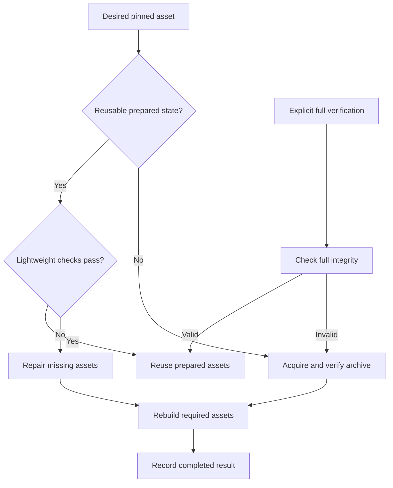

# Reuse verified external assets across repeated chezmoi runs - Plan

## Goal Capsule

- **Objective:** Reduce the wait before scripts and managed files are applied during repeated `chezmoi update --verbose` runs.
- **Product authority:** The user's confirmed cache, extraction, and verification scope; `AGENTS.md`; and `STRATEGY.md`.
- **Open blockers:** None.
- **Means:** Prepare external assets through an isolated native chezmoi cache and reconcile explicit owned roots (KTD1).
- **Execution profile:** One PR; LFG owns implementation, verification, review, and publication. Personal application remains explicit.

---

## Product Contract

### Summary

Reuse downloaded archives and verified extracted assets across unchanged runs.
Perform expensive extraction and full integrity checks when assets are first acquired, their pins change, or recovery is requested.
Keep missing-file recovery and an explicit full-verification path.

### Problem Frame

The user reports a long pause before scripts and file application during `chezmoi update --verbose`.
The repository's hook-free bootstrap also remained in `chezmoi managed --exclude=scripts` until it was stopped during investigation.
Neither observation establishes whether downloading, archive traversal, checksum work, or another operation dominates the wait.

The current external templates omit `refreshPeriod`, which already defaults to no automatic re-download.
They expose individual font archive members, personal application payloads, Codex package resources, and the pinned harness plugin archive.
Download caching alone therefore does not establish that repeated archive work has been avoided.

### Key Decisions

- **Optimize the complete external-asset preparation path.** Governs R1–R5. The scope includes repeated extraction and validation costs rather than only an explicit download-cache setting. (session-settled: user-approved — chosen over download-cache configuration alone: the user requested extraction and verification optimization and confirmed the expanded scope.)
- **Use lightweight checks on unchanged runs.** Governs R4, R6, R7. Immediate detection of every content modification is traded for less repeated work. (session-settled: user-approved — chosen over full hashing on every run: the user confirmed after the reduced guarantee for same-size modifications was explained.)

### Requirements

**Cache reuse and preparation**

- R1. Reuse a cached download indefinitely for the same declared URL unless an explicit refresh is requested.
- R2. A changed asset pin must invalidate any cached result that no longer represents the desired asset.
- R3. Extract the selected members of a given archive together and reuse the completed extraction on subsequent unchanged runs.
- R4. Verify declared archive checksums on initial acquisition, changed pins, and explicit recovery; unchanged runs must avoid repeating full archive and extracted-file hashing.
- R5. A successful unchanged run with intact cached assets must perform no asset downloads or archive extraction.

**Recovery and integrity**

- R6. Normal application must use lightweight state checks to detect missing managed asset files and repair them from a usable cache or a fresh download.
- R7. Provide an explicit operation that fully revalidates managed assets and rebuilds invalid extracted state, including modifications missed by lightweight checks.
- R8. Failed verification or incomplete extraction must not be recorded as a reusable successful result.

**Compatibility and contributor workflow**

- R9. Preserve existing supported platforms, managed asset locations, executable permissions, selected archive members, and removal of obsolete repository-owned files.
- R10. Preserve native font and harness-plugin installation behavior and unrelated user files and settings.
- R11. Worktree preparation must remain read-only with respect to personal settings; installation and configuration changes require explicit chezmoi application.

### Key Flows

- F1. **Initial or changed asset:** Resolve the desired pin, obtain the archive, verify its declared integrity, extract the required members, and make only a completed result reusable. Covers R1–R4, R8.
- F2. **Unchanged application:** Confirm reusable state with lightweight checks, reuse prepared assets, and continue normal application. Covers R5, R6, R9, R10.
- F3. **Recovery:** Repair missing files during normal application; use the explicit full-verification operation to detect and rebuild otherwise undetected corruption. Covers R6–R8.

### Acceptance Examples

- AE1. **Covers R1, R3–R5.** Given a successful first application and unchanged pins and assets, a second application makes zero asset download requests, performs zero archive extractions, and does not repeat full payload hashes.
- AE2. **Covers R2–R4.** Given an updated application or font checksum, or a changed plugin commit, application prepares the new desired content instead of trusting the old result.
- AE3. **Covers R6, R9.** Given one deleted managed font asset or Codex helper file, normal application restores it while preserving unrelated files.
- AE4. **Covers R7.** Given altered content that still passes lightweight checks, the explicit full-verification operation detects the alteration and restores the desired content.
- AE5. **Covers R8.** Given a bad declared checksum or interrupted extraction, the next run cannot treat the failed attempt as a completed cached result.
- AE6. **Covers R9, R10.** Given a pin that removes an owned resource, application removes the obsolete resource and retains unrelated settings and files.
- AE7. **Covers R11.** Given a fresh worktree, `mise install` completes preparation without installing fonts, enabling plugins, or applying home configuration.

### Success Criteria

Compare asset-preparation duration before and after the change using equivalent inputs on the same machine.
Record cold and unchanged runs separately, and distinguish network time from extraction and verification time.
The unchanged run must satisfy AE1 and reduce measured asset-preparation time; no percentage target is assumed before a baseline exists.

### Scope Boundaries

- Active assets are the existing font, personal application, Codex package, harness plugin, and applicable T3 desktop external declarations.
- Changing upstream version selection or adding managed applications is outside this work.
- The warm path does not promise immediate detection of same-size content modifications; R7 owns full integrity recovery.
- Native plugin registration and font discovery remain governed by R10; optimizing those separate operations is outside this work.
- This work does not promise to eliminate Git pull latency or all template-rendering delays.

### Dependencies and Assumptions

A declared URL is assumed to return immutable content.
Existing checksum and commit pins remain authoritative; pin or extraction-selection changes must not reuse incompatible results under R2.
Moving large assets out of native archive externals may be necessary to achieve R3–R5.
The exact cache storage, lightweight checks, extraction mechanism, script phase ordering, and recovery command are implementation-planning decisions.

### Outstanding Questions

No product blockers remain. Implementation discovery and verification are specified below.

### Sources / Research

- `home/.chezmoiexternals/`: current font, personal application, Codex package, harness plugin, and T3 desktop declarations.
- `tests/test_fonts.py` and `tests/test_personal_apps.py`: existing asset integrity, extraction, and reconciliation coverage.
- `docs/guides/fonts.md`: font reconciliation and cached-download recovery.
- `docs/guides/personal-applications.md`: application layout and external refresh instructions.
- `docs/guides/harness-plugins.md`: native plugin installation and reapplication behavior.
- [Chezmoi external reference](https://www.chezmoi.io/reference/special-files/chezmoiexternal-format/): default download-cache refresh policy.
- [Chezmoi external guide](https://www.chezmoi.io/user-guide/include-files-from-elsewhere/): repeated external validation and recommendation to handle large archives through scripts.

---

## Planning Contract

### Key Technical Decisions

- KTD1. **Reuse native chezmoi on the cold path.** Move external definitions into manifest templates consumed by an isolated nested chezmoi source, cache, destination, configuration, and persistent state. Native PowerShell and POSIX wrappers prepare a cache generation and mirror only declared managed roots. This retains native download/checksum/archive behavior without adding an apply-time Python dependency. A standalone download/extraction framework is unnecessary. Governs R1–R5, R8, R11.
- KTD2. **Snapshot file metadata.** Identify generations by the rendered manifest and owned-root selection. Compare deterministic path, file type, size, modification time, and executable metadata for cached and installed files. A changed or missing snapshot triggers preparation or reconciliation; same-size modifications with preserved metadata remain subject to R7. Snapshot publication follows successful preparation and reconciliation. Governs R2, R4–R8.
- KTD3. **Batch archive selection.** Render fonts as one selected archive per collection and Codex as one selected package archive in the isolated cache. The broad Codex staging root is non-exact; mirroring uses the original narrow binary, package, and resource roots. Only previously exact roots may prune unrelated-to-pin members. Verify native overlapping-directory merging before integration. Governs R3, R9, R10.
- KTD4. **Prepare before native consumers.** An always-run, numerically ordered before-script prepares assets ahead of GPG, native builds, font installation, and plugin consumers. Bootstrap has no native externals and never executes this script. Existing font installers use metadata to avoid unchanged payload hashes while retaining native registration repair. Governs R4, R6, R10, R11.
- KTD5. **Make full recovery explicit.** Add `mise run assets:verify` to force cache integrity verification and installed-asset reconciliation, and `mise run assets:refresh` to additionally force downloads. Both bind to this worktree and are explicit personal application. Explain that outer `--refresh-externals` no longer owns these migrated assets. `diff` and `verify` continue to cover native managed files; the explicit asset verification task covers script-managed assets. Governs R7, R11.

### Boundaries and Risks

The same native manifest and root list feed both OS wrappers; installation destinations and plugin lifecycle commands remain unchanged.
No new runtime is installed by apply or bootstrap.
Do not mirror an entire `.local` tree: unrelated tools and settings share it.
The nested source must contain no personal hooks, scripts, or user configuration, and must never reuse the parent's locked state database.
Native archive validation must succeed before copying into installed locations.
Preserve supported archive symlinks and permissions; handle errors without publishing completion state.
Do not add eviction, background refresh, a daemon, or a separate package manager.

### Implementation Discovery

Measure a representative multi-member archive before and after the change during U1/U4, using synthetic local HTTP payloads rather than applying to the owner's home.
Confirm Codex staging-root merging and actual native executable permission behavior before relying on KTD3.
Use the existing test matrix for native Linux, macOS, and Windows evidence; report unavailable local platforms honestly.
No unresolved consequential architecture fork requires a bake-off: native chezmoi already owns the required archive semantics.

---

## Implementation Units

### U1. Render batched manifests and native cache preparation

- **Goal:** Implement the reusable asset preparation boundary and remove heavy native externals from ordinary source evaluation.
- **Requirements:** R1–R9, R11; F1, F2.
- **Dependencies:** None.
- **Files:** `home/.chezmoiexternals/`, new `home/.chezmoitemplates/external-assets*`, new before-scripts, `scripts/prepare-external-assets.ps1`, `scripts/prepare-external-assets.sh`, `tests/test_external_assets.py`.
- **Approach:** Preserve existing pin validation and platform gating in shared templates. Use native chezmoi only for changed or invalid cached preparation, then reconcile explicit roots with exact pruning limited to owned resource directories.
- **Patterns:** Existing hook-free `.chezmoi-bootstrap.toml`, native `install-fonts` scripts, and local HTTP fixtures in `tests/test_personal_apps.py`.
- **Test scenarios:** Covers AE1, AE2, AE3, AE5, AE6: cold and warm runs, changed checksum at the same URL, missing selected members, failed checksum, interrupted preparation, owned-resource pruning, unrelated files, and paths containing spaces/apostrophes.
- **Verification:** Fixture instrumentation shows no child extraction/download/full content scan on an intact warm run; cold content and permissions match existing layouts.

### U2. Preserve consumers and skip unchanged font hashes

- **Goal:** Keep native font and plugin behavior working after asset preparation moves.
- **Requirements:** R4, R6, R9, R10; F2.
- **Dependencies:** U1.
- **Files:** `scripts/install-fonts.ps1`, `scripts/install-fonts.sh`, `home/.chezmoiscripts/`, `tests/test_fonts.py`, affected plugin and personal-application fixtures and native smoke scripts.
- **Approach:** Use lightweight font source/installed metadata for unchanged payloads while preserving registry repair, font discovery, removal, and hash verification when state changes. Update selective fixture source assembly to execute only the asset preparation script without enabling unrelated personal scripts.
- **Test scenarios:** Covers AE3, AE6: missing font file or registration repairs, unchanged payload checks are skipped, changed pins and obsolete resources reconcile, native plugin discovery and invocation remain valid.
- **Verification:** Existing application/font/plugin contracts pass in disposable homes; no user-home settings are changed by local verification.

### U3. Add explicit recovery tasks and operational documentation

- **Goal:** Expose full asset verification and refresh without changing implicit bootstrap permissions.
- **Requirements:** R7, R10, R11; F3.
- **Dependencies:** U1, U2.
- **Files:** `mise.toml`, `docs/guides/fonts.md`, `docs/guides/personal-applications.md`, `docs/guides/harness-plugins.md`, `docs/maintenance/chezmoi-source.md`, `docs/maintenance/development-and-testing.md`, `tests/test_external_assets.py`.
- **Approach:** Worktree-bound explicit apply tasks select full verification or download refresh; document command coverage and the accepted warm integrity tradeoff.
- **Test scenarios:** Covers AE4, AE7: same-size/preserved-metadata corruption is repaired explicitly; a poisoned personal hook never runs during bootstrap.
- **Verification:** Recovery uses an isolated fixture home and bootstrap lists source files without downloading asset payloads or installing settings.

### U4. Complete regression and performance evidence

- **Goal:** Prove integration and the intended warm-path reduction.
- **Requirements:** R1–R11 and Success Criteria.
- **Dependencies:** U1–U3.
- **Files:** `tests/test_external_assets.py`, affected existing tests, `scripts/run-test-area.py`, relevant existing CI smoke scripts/workflow selections if needed.
- **Approach:** Keep new behavioral tests in the existing applications test area. Compare equivalent cold/warm archive fixtures on the same machine and preserve the native CI matrix.
- **Test scenarios:** Covers AE1–AE7 using real native chezmoi and a local HTTP server; mock counters alone do not establish extraction correctness.
- **Verification:** Relevant application, platform/bootstrap, and test-ownership checks pass; measured timings and unavailable-platform limitations are recorded in the PR.

---

## Verification Contract

- Run `mise install` after removing outer externals and confirm the hook-free source check finishes without asset downloads or personal application.
- Run `mise exec -- python -m unittest discover -s tests -p test_external_assets.py` for cache, integrity, recovery, and performance fixtures.
- Run `mise exec -- python scripts/run-test-area.py --area applications` for application, font, and plugin regression coverage.
- Run relevant global chezmoi/bootstrap and test-partition checks, including `mise exec -- python scripts/run-test-area.py --validate-only`.
- Use native Windows PowerShell locally; exercise POSIX code through available native/CI runners rather than claiming Git Bash proves macOS/Linux behavior.
- Run `git diff --check` and inspect the final diff for unrelated changes.

---

## Definition of Done

All units implement the confirmed Product Contract without changing installation ownership or supported platforms.
AE1–AE7 have concrete evidence, and cold/warm timings show reduced unchanged asset-preparation time.
Explicit verification repairs corruption outside the lightweight-check guarantee.
Bootstrap remains hook-free and read-only for personal configuration.
Independent review findings are fixed or recorded durably, and the branch is committed and published as one PR.
