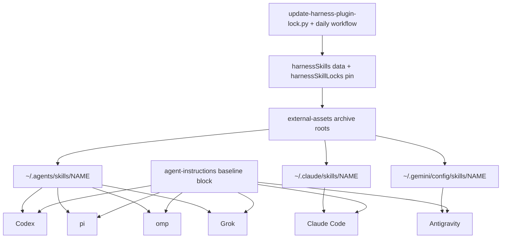

# Language Writing Skills and Account Source Isolation - Plan

## Goal Capsule

- **Objective:** Every repository-managed AI harness polishes Korean and English prose with the same repository-pinned writing skills, and Claude Code and Codex load only skills and MCP servers supplied by the repository, the harness itself, local registration, or T3.
- **Means:** Pinned plain skill directories in three shared skill roots (KTD1, KTD4), one common instruction block (KTD5), and account-source settings in the Claude and Codex user-scope templates (KTD6-KTD8).
- **Authority:** This Product Contract, then this Planning Contract, then the repository `AGENTS.md` and `STRATEGY.md`. The T3 delegation preference from the same request is not active scope; issue #97 tracks it.
- **Stop conditions:**
  - A T3 Claude launch loses its `mcp__t3-code__*` tools under the KTD6 settings. R10 and R12 then conflict, and the owner decides.
  - The pinned Codex no longer honors the `[plugins._default]` allowlist (KTD7).
  - A harness at its pinned version does not discover a shared root the way KTD1 records.
- **Execution profile:** One PR with seven units. Unit and Windows-local native evidence come first; the remaining platforms come from the CI native lanes. The executor implements, verifies, reviews, and opens the PR; merging stays with the owner.
- **Open blockers:** None.

---

## Product Contract

### Summary

Install the three DaleSeo/korean-skills skills (grammar-checker, humanizer, style-guide) at a pinned version as user-scope skills in all six managed harnesses.
Add one common instruction that sends Korean prose through those skills and English prose through `ce-noslop`.
Turn off account-provided skills, plugins, and MCP connectors in Claude Code and Codex.

### Problem Frame

The owner's Korean writing skills reach only Claude Code, and only through the claude.ai account, where they appear as `anthropic-skills:*`.
Codex, pi, Grok, omp, and Antigravity have none of them.

Claude Code and Codex also load skills, plugins, and connectors from the signed-in account, outside repository control.
Claude Code therefore lists two `ce-noslop` skills (`compound-engineering:ce-noslop` and `anthropic-skills:ce-noslop`), and Codex on the owner's Windows machine enables 16 remote plugins from the ChatGPT account.
What an agent can load depends on the signed-in account, which works against the strategy boundary that repository-managed settings take precedence.

The only writing rule today is the repository-level `AGENTS.md` line that sends reports through `ce-noslop`.
It does not reach other repositories and says nothing about Korean.

<!-- ce-section: work-relationships -->
### How This Work Fits Together

This plan covers the language writing skills and account source isolation.
The original request contained one more area; the list below is the current understanding, not a committed roadmap.

- T3 delegation preference (issue #97): a T3-only instruction telling agents to prefer T3 Code's delegation tools over the harness's native subagent tools.
  - Can proceed independently of this plan.
  - Shares the shared instruction template, but edits its `context = t3` branch rather than the common region.

### Requirements

**Korean writing skills**

- R1. All three skills from DaleSeo/korean-skills (grammar-checker, humanizer, style-guide) are installed at user scope in Claude Code, Codex, pi, Grok, omp, and Antigravity through each harness's supported native mechanism.
- R2. The installed skills come from release v1.0.0 pinned to commit `fe6432e95f6675f7e411eacb2e1c36f1de54f962`, and the pin is refreshed through the same path as the Compound Engineering pin.
- R3. Each harness discovers each of the three skills exactly once, including when several harnesses read a shared skills location.
- R4. Installation runs only during explicit personal-configuration apply and preserves unrelated skills, plugins, and settings.

**Common writing instruction**

- R5. The common region of the shared instruction template tells every managed harness, in CLI and T3 launches alike, to pass in-scope Korean prose through the korean-skills and in-scope English prose through `ce-noslop`.
- R6. In-scope prose is reports, summaries, and handoffs the top-level agent writes to the user; persistent artifacts such as documents, commit messages, PR descriptions, and issues; and natural-language text inside code, such as string resources and user-visible messages.
- R7. Out of scope are subagent-to-caller reports, short progress notes and questions, code and config themselves, code comments and docstrings, verbatim quotes, and text the user asked to post as written.
- R8. The language is the dominant language of the text being written: Korean text containing English technical terms counts as Korean, and text in any other language uses neither skill set.
- R9. For Korean prose, humanizer and grammar-checker apply to all in-scope text, and style-guide applies additionally when writing a multi-section document or editing an existing document.

**Account source isolation (Claude Code and Codex)**

- R10. Claude Code loads no skills, plugins, or MCP connectors provided by the claude.ai account.
- R11. Codex loads no plugins, skills, apps, or connectors provided by the ChatGPT account, including remote plugins that are already installed and enabled.
- R12. Harness-bundled skills and plugins with their local MCP servers, locally registered MCP servers, project MCP configuration, and the MCP server T3 injects into its launches stay available; a connector that a bundled plugin reaches through the account-hosted ChatGPT apps server is account-provided and is blocked with the rest.
- R13. Isolation is set in user-scope settings, so it applies to every launch that reads those settings, including CLI and T3 launches.

### Key Decisions

- **Split off the T3 delegation preference.** (session-settled: user-directed — chosen over covering it in this plan: the owner moved it to follow-up issue #97.)
- **Include MCP connectors in the isolation.** Governs R10, R11. (session-settled: user-directed — chosen over blocking account skills only: the owner extended the block to external MCP.)
- **Block account-provided sources only.** Governs R10, R11, R12. (session-settled: user-approved — chosen over also disabling harness-bundled skills and plugins: bundled tools such as Codex browser and computer use keep working, and both harnesses expose switches for account sources.)
- **Apply the writing rule to reports, summaries, handoffs, and artifacts, including text in code.** Governs R6, R7. (session-settled: user-directed — chosen over applying it to every reply: loading skills on every reply adds token cost and latency; the owner added string resources in code to the artifact scope.)
- **Keep the rule in the common instruction only, with no routing skill or hook.** Governs R5. One owner for the rule matches the shared-template design every harness already renders.
- **Split the Korean skills by role.** Governs R9. humanizer and grammar-checker are per-text checks; style-guide checks consistency across a document, so it only pays off on longer or edited documents.
- **Read "text in code" as user-facing strings.** Governs R6, R7. String resources and user-visible messages reach end users; comments and docstrings do not, and checking them would add cost to every code change.
- **Pin v1.0.0.** Governs R2. `main` is three commits ahead, all documentation and CI changes with nothing under `skills/`.

### Acceptance Examples

- AE1. **Covers R5, R6, R9.** **Given** a Codex CLI session in any repository, **when** the agent writes its final Korean report to the user, **then** it runs humanizer and grammar-checker on the report before sending it.
- AE2. **Covers R6, R8.** **When** an agent writes an English commit message or PR description, **then** it passes the text through `ce-noslop`.
- AE3. **Covers R6, R7.** **When** a change adds a Korean UI string to a resource file and a Korean comment in the same file, **then** the UI string goes through the korean-skills and the comment does not.
- AE4. **Covers R7.** **When** a subagent returns findings to its caller, or the top-level agent posts a one-line progress note, **then** no writing skill runs.
- AE5. **Covers R8.** **Given** a Korean summary that mentions `chezmoi apply` and a PR number, **then** it is treated as Korean; **given** a Japanese message, **then** neither skill set runs.
- AE6. **Covers R9.** **When** the agent edits an existing multi-section Korean document, **then** style-guide runs in addition to humanizer and grammar-checker; a short Korean final report gets only humanizer and grammar-checker.
- AE7. **Covers R3.** **Given** pi and another harness both read a shared skills location, **then** each harness lists each Korean skill exactly once.
- AE8. **Covers R10, R12, R13.** **Given** Claude Code launched by T3 while signed in to claude.ai, **then** no `anthropic-skills:*` skill or claude.ai connector is available, while `compound-engineering:*` skills, the korean-skills, built-in skills, and T3's MCP tools are.
- AE9. **Covers R11, R12.** **Given** Codex signed in to a ChatGPT account with `github@openai-curated-remote` installed and enabled, **then** that plugin and the other account plugins do not load, and neither does the account-hosted `codex_apps` connector server, while `openai-bundled` and `openai-primary-runtime` plugins still do.

### Scope Boundaries

- The T3 delegation preference (issue #97).
- Response-language settings for harnesses other than Claude Code, which alone sets `language: korean` today.
- Account source isolation for pi, Grok, omp, and Antigravity.
- Disabling harness-bundled skills and plugins: Claude Code built-in skills, Codex `openai-bundled` and `openai-primary-runtime` plugins, and Codex `.system` skills.
- Writing skills for languages other than Korean and English (per R8).
- Changing or forking korean-skills content.
- The repository-level `AGENTS.md` `ce-noslop` rule stays unchanged and still applies inside this repository, so Korean reports written here pass through both rules.
- Connectors that the Claude desktop app delivers itself, and Codex desktop builds newer than the pinned CLI, are outside what the user-scope settings control (per R13).

**Considered and not built**

- Cleanup of retired skill roots. A copy left at an old path keeps loading after an upstream rename, but KTD3 makes any rename fail the refresh, so a person edits the data at that moment and can remove the old copy. Build it if renames become routine.
- A reviewed pull request for korean-skills refreshes. R2 keeps the CE path, which validates through CI and then pushes directly; KTD3's capability-frontmatter and file-type checks catch the riskiest upstream changes. Revisit if upstream instruction changes start to need human review.
- Handling same-named copies in other roots of one harness, such as a `~/.codex/skills/humanizer` written by Codex's own skill installer. Codex would list both copies. U7 documents the case; build detection if it shows up in practice.
- An apps allowlist (`[apps._default]` plus kept connector IDs) instead of `features.apps = false`. It would hardcode an opaque connector ID and keep an account-hosted channel open (KTD8).

### Dependencies / Assumptions

- The owner did not state why account sources should be blocked; duplicate skills and account-dependent environments are the inferred motivation.
- The owner accepts losing account-provided capabilities: in Claude Code, account skills such as `anthropic-skills:pdf`, `docx`, `pptx`, `xlsx`, `jpi-deck`, and `docs`, and claude.ai connectors such as Claude Docs, Figma, Exa, GitLab, Microsoft 365, JPI NAS, and T3 Connect; in Codex, remote plugins such as GitHub, GitLab, Outlook, Teams, SharePoint, OneNote, 1Password, and iCloud.
- T3 launches of Claude Code and Codex use the same user-scope homes as the CLI. T3 0.1.7 launches Claude through the Agent SDK with default `settingSources`, which include `user`. A user-set `CODEX_HOME` or provider `homePath` would break this.

### Sources / Research

- `home/.chezmoitemplates/agent-instructions` — the shared template; its common region and `context = t3` branch hold no content today.
- `docs/maintenance/chezmoi-source.md` (Shared user-scope harness onboarding) — adapter layout and the disposable-home verification rules this work must follow.
- `home/.chezmoidata/harness-plugin-lock.json`, `scripts/update-harness-plugin-lock.py`, `home/.chezmoitemplates/external-assets/harness-plugins.toml.tmpl` — the Compound Engineering release-plus-commit pin and archive download that R2 reuses.
- `home/.chezmoitemplates/claude-settings` — sets `language: korean` and no account-source settings.
- `home/.chezmoitemplates/codex-config` — merges into `config.toml` and sets no `features.*` keys.
- `home/.chezmoitemplates/grok-config` — disables Claude/Cursor skill compatibility scanning, an existing guard against duplicate discovery.
- `tests/smoke_pi.py:303`, `tests/smoke_grok.py:262-264` — exactly-once skill discovery checks that R3 can extend.
- `docs/guides/t3-code.md:70`, `docs/guides/t3-code.md:108`, `scripts/t3-instructions.py:87` — T3 launches share the native homes.
- `AGENTS.md:5` — the repository-level `ce-noslop` rule whose exclusions R7 mirrors.
- <https://github.com/DaleSeo/korean-skills> — MIT license; tag v1.0.0 is `fe6432e`; `main` is three commits ahead with no change under `skills/`.
- Claude Code docs: <https://code.claude.com/docs/en/settings-reference.md>, <https://code.claude.com/docs/en/skills.md>, <https://code.claude.com/docs/en/mcp.md> — `syncClaudeAiSkills`, `syncClaudeAiPlugins` (2.1.273 or later), `disableClaudeAiConnectors`, and `ENABLE_CLAUDEAI_MCP_SERVERS`. The managed version is 2.1.318.
- Codex source at `rust-v0.166.0` and `rust-v0.167.0` (<https://github.com/openai/codex>), `core-plugins/src/loader.rs`, `core-plugins/src/manager.rs`, `core-plugins/src/remote.rs`, `config/src/types.rs` — remote plugin loading, the `[plugins._default]` policy, and the six remote marketplaces.
- T3 Code `v0.1.7` (<https://github.com/pingdotgg/t3code>), `apps/server/src/orchestration-v2/Adapters/ClaudeAdapterV2.ts` and `CodexAdapterV2.ts` — default `settingSources`, `t3-code` registration through `setMcpServers()`, and per-thread `mcp_servers` for Codex.
- Pinned-binary discovery runs on Windows x64 for all six harnesses — the shared roots, duplicate handling, and invocation names KTD1 records.

---

## Planning Contract

**Product Contract preservation:** changed: R12, R13, AE9, and one Scope Boundaries line — research showed Codex bundled plugins reach a connector through the account-hosted `codex_apps` server, and that Claude Code settings cannot control connectors the Claude desktop app delivers; the `AGENTS.md` boundary now states that both rules apply inside this repository. The resolved Outstanding Questions were removed and answered by KTD1, KTD5, KTD6, and KTD7. No other requirement changed.

### Key Technical Decisions

- KTD1. **Plain skill directories in three shared roots.** `~/.agents/skills` serves Codex, pi, omp, and Grok; `~/.claude/skills` serves Claude Code; `~/.gemini/config/skills` serves the Antigravity CLI and app. Pinned-binary runs show each harness reads a plain copy without registration, and one copy per discovery group gives exactly-once discovery (R1, R3). A Claude plugin install would add a second mechanism and a `korean-skills:` prefix. The harness-native roots duplicate `~/.agents/skills`: Codex lists both copies and calls `~/.codex/skills` deprecated. `~/.gemini/skills` is avoided because Gemini CLI also reads it.
- KTD2. **Declare korean-skills apart from `.harnessPlugins`, but lock it in the same file.** A new `harnessSkills` data map keeps the omp, Claude, and Codex plugin installers from treating it as a plugin; the omp marketplace template reads `$plugin.omp` for every entry without a guard. The pin goes under a `harnessSkillLocks` key in `home/.chezmoidata/harness-plugin-lock.json`, so the existing updater and daily workflow publish both pins through one path (R2).
- KTD3. **A skill refresh is rejected when the upstream skill set, capability frontmatter, or file types differ from what was reviewed.** R1 means every upstream skill. Without the check, a removed skill breaks every apply after an unreviewed push, and a new skill goes missing with no signal. Every top-level SKILL.md frontmatter key must be in the declared `frontmatterKeys`, so a new capability field such as `hooks` or `shell` cannot arrive unreviewed; `allowed-tools` must match its declared value; and a declared skill may contain only plain files and directories, with no nested `SKILL.md`. A rejected pack with a reviewed pin keeps that pin while the CE pin still refreshes, and the workflow publishes the CE pin and then fails visibly; a pack with no reviewed pin fails the whole refresh. Review found the first version checked only `allowed-tools`, and the owner chose not to let a skill drift hold back CE updates.
- KTD4. **One exact archive root per skill per location.** Every root uses the same pinned archive URL, so the download is fetched once, and an `include` filter keeps only that skill's subtree. An exact root at a shared parent would delete the owner's unrelated skills (R4). A location renders only when one of the harnesses that read it is targeted for the current OS and architecture. A same-named directory at a managed path is replaced, per the strategy's repository-precedence boundary.
- KTD5. **One English instruction block in the baseline region, with no harness branches.** Governs R5-R9. Every harness loads skills from their descriptions, so a bare skill name is enough; the block qualifies the generic names as "the korean-skills `humanizer` skill". It runs humanizer before grammar-checker so a rewrite cannot reintroduce errors. It tells agents to apply the skills silently: deliver only the corrected text, leave out the skills' analysis sections, and do not pause for confirmation inside a skill. Without that, the upstream skills print reports and humanizer stops when it changes more than half the text, which breaks AE1 in autonomous runs. A "report" is the message that delivers completed work, an answer, or a summary. The block excludes comments and docstrings by name, because grammar-checker's description invites them. It states that it adds to project instructions, so a repository rule that names another writing skill applies as well. (session-settled: user-directed — chosen over applying it to every reply: loading skills on every reply adds token cost and latency; the owner added string resources in code to the artifact scope.)
- KTD6. **Claude isolation through three user-scope settings.** Governs R10, R12, R13. `syncClaudeAiSkills = false`, `syncClaudeAiPlugins = false`, and `disableClaudeAiConnectors = true` in the claude-settings modify template. The sync keys move synced content to `.trash` instead of deleting it. The settings key also covers Agent SDK sessions, so T3 inherits it; the `ENABLE_CLAUDEAI_MCP_SERVERS=false` environment variable is per session and adds nothing. T3 registers `t3-code` through `setMcpServers()`, which the docs do not cover; U6 checks it, and a loss is a stop condition. (session-settled: user-directed — chosen over blocking account skills only: the owner extended the block to external MCP.)
- KTD7. **Codex isolation through the `[plugins._default]` allowlist.** Governs R4, R11, R12. `[plugins._default] enabled = false` stops every remote plugin that has no config entry, and remote sync never writes `config.toml`, so the setting holds across re-syncs. An explicit entry overrides that default, so the template also turns off every existing entry whose marketplace is not local, including marketplace names Codex adds later. `features.remote_plugin = false` does not stop installed remote plugins and starts a legacy git sync. A per-plugin blocklist is ignored without `_default`. The entry rules in the High-Level Technical Design keep every local plugin that works today. Plugin IDs are set as whole map keys, because IDs can contain dots. (session-settled: user-approved — chosen over also disabling harness-bundled skills and plugins: bundled tools such as Codex browser and computer use keep working, and both harnesses expose switches for account sources.)
- KTD8. **`features.apps = false` for ChatGPT-hosted connectors.** Governs R11, R12. The flag removes only the `codex_apps` server; locally configured `[mcp_servers]`, plugin MCP servers, and T3's per-thread `mcp_servers.t3-code*` stay. (session-settled: user-directed — chosen over blocking account skills only: the owner extended the block to external MCP.) This also removes the `connected_documents` connector that the bundled `spreadsheets@openai-primary-runtime` plugin reaches through `codex_apps`; the plugin and its local skills keep loading. The owner confirmed this trade-off after review: only locally declared sources may load. R12 and AE9 say so.
- KTD9. **Verify exactly-once discovery in each harness's existing native smoke.** Governs R3. Each smoke counts the three names with that harness's own listing. Grok lists the Claude-compat copies as `disabled`, so its count ignores disabled entries. On Windows, Codex resolves `~/.agents/skills` from the OS profile and ignores `HOME`, so the Codex discovery count runs on Linux and macOS. The Windows Codex smoke checks placement and records the reason for skipping the count.

### High-Level Technical Design

The pin fans out to three roots and six harnesses:

The Codex template decides each existing `[plugins."<id>"]` entry on every apply:

| Entry | Result |
| --- | --- |
| `compound-engineering@compound-engineering-plugin` | `enabled = true` |
| Local marketplace (configured under `[marketplaces]`, `openai-bundled`, `openai-primary-runtime`, or the personal marketplace manifest in the home directory) without an `enabled` key | `enabled = true`, other keys kept |
| Local marketplace with an explicit `enabled` | kept as is |
| Any other marketplace, including `openai-curated-remote`, `created-by-me-remote`, the `workspace-*` marketplaces, and names Codex adds later | `enabled = false`, other keys kept |
| `[plugins._default]` | `enabled = false` |

### Assumptions

- The Codex desktop app writes the bundled plugin entries with an explicit `enabled = true`, as the owner's Windows config shows today. A bundled entry it later writes without `enabled` stays off until the next apply.
- The `t3-code` server that T3 registers through `setMcpServers()` survives `disableClaudeAiConnectors`. U6 verifies this before merge, and a failure is a stop condition.
- korean-skills refreshes push directly after CI, like CE (R2). Changed upstream SKILL.md text reaches every harness without human review, and the upstream `allowed-tools` field pre-approves Write and Edit in Claude Code for the rest of the turn that invokes a skill, in sessions that use the default permission mode.
- On Windows, a symlink or junction at a managed skill path, or a linked parent directory, aborts the asset step with an error. That failure is visible during apply, so no special handling is added.

### Risks

| Risk | Mitigation |
| --- | --- |
| A later Codex release changes the `_default` policy or adds marketplaces | Unknown marketplaces fail closed under KTD7. A new bundled marketplace stays off until it is added to the local list. The Codex native smoke proves CE still loads under the allowlist, and a lock refresh reruns it |
| The account-source settings silently stop working after a harness update | Unit tests pin the owned keys; the docs name each key so a changed default is easy to diagnose |
| Upstream renames or removes a skill, or adds capability frontmatter | KTD3 keeps the reviewed skill pin, still refreshes the CE pin, and fails the refresh workflow |
| A user exports `CLAUDE_CONFIG_DIR` globally and omp starts reading `~/.claude/skills` | omp drops byte-identical copies; U7 documents the case |
| In Claude Code sessions that use the default permission mode, the first Korean writing-skill call in a turn lets later Write and Edit calls in that turn run without a prompt, because of the upstream `allowed-tools` field | Accepted: the boundary against changing korean-skills content rules out editing the frontmatter, and the owner's T3 sessions already run with full access. A frontmatter-only exception that drops `allowed-tools` from the delivered copies would remove it |

---

## Implementation Units

### U1. Pin korean-skills and refresh it with the CE pin

- **Goal:** Declare korean-skills, record its pin, and keep the pin current through the existing updater.
- **Requirements:** R1, R2; KTD2, KTD3.
- **Dependencies:** None.
- **Files:** `home/.chezmoidata/harness-skills.json` (new), `home/.chezmoidata/harness-plugin-lock.json`, `scripts/update-harness-plugin-lock.py`, `.github/workflows/update-harness-plugin-lock.yml` (only if it names the lock keys), `tests/test_harness_plugin_lock.py`.
- **Approach:**
  1. Declare `harnessSkills."korean-skills"` with the repository, tag prefix `v`, the three skill names with each one's expected `allowed-tools` value, and archive excludes for the root `CLAUDE.md` symlink and `AGENTS.md`.
  2. Add `harnessSkillLocks."korean-skills"` with tag `v1.0.0` and commit `fe6432e95f6675f7e411eacb2e1c36f1de54f962`.
  3. Teach the updater to resolve both maps and write both keys in its existing sorted format.
  4. Before writing, compare the declared names with the `skills/*/SKILL.md` directories at the resolved commit, and each declared `allowed-tools` value with that SKILL.md's frontmatter; fail with the differing values when either comparison differs (KTD3).
- **Patterns to follow:** `resolve` and `update_lock` in `scripts/update-harness-plugin-lock.py`; the two-entry fixture in `tests/test_harness_plugin_lock.py`.
- **Test scenarios:**
  - An update with both maps writes both lock keys and leaves an unchanged CE pin byte-identical.
  - A lock file without `harnessSkillLocks` gains the key on the first run.
  - A korean-skills release that is a draft, a prerelease, or a tag outside `v<MAJOR>.<MINOR>.<PATCH>` is rejected the same way CE releases are.
  - Upstream adds a fourth skill: the refresh fails, names the new skill, and writes no lock.
  - Upstream removes `style-guide`: the refresh fails, names it, and writes no lock.
  - Upstream adds `Bash` to `humanizer`'s `allowed-tools`: the refresh fails, names the skill with the declared and upstream values, and writes no lock.
- **Verification:** The lock file carries both pins, and the updater tests cover a normal refresh and both drift failures.

### U2. Deliver the skill directories to the shared roots

- **Goal:** Every explicit apply places the pinned skill copies in the three shared roots.
- **Requirements:** R1, R3, R4; KTD1, KTD4.
- **Dependencies:** U1.
- **Files:** `home/.chezmoitemplates/external-assets/harness-skills.toml.tmpl` (new), `home/.chezmoitemplates/external-assets-manifest`, `home/.chezmoitemplates/external-asset-roots` (only if root derivation needs it), `tests/test_harness_skills.py` (new), `scripts/run-test-area.py`, and the smoke callers of `tests/asset_fixtures.py` (`tests/smoke_claude.py`, `tests/smoke_codex.py`, `tests/smoke_antigravity.py`, `tests/smoke_harness_plugins.py`, `tests/smoke_pi.py`, `tests/smoke_grok.py`, `tests/smoke_t3_code.py`, `tests/smoke_t3_instructions.py`).
- **Approach:**
  1. Render one archive root per declared skill per location, with `stripComponents` set so `SKILL.md` lands directly in `<location>/<skill>`, an `include` for that skill's subtree, `exact = true`, and `refreshPeriod = "0"`.
  2. Map locations to the apps that read them: `.agents/skills` to codex, pi, omp, and grok; `.claude/skills` to claude; `.gemini/config/skills` to antigravity. Render a location only when one of its apps has a target for the current OS and architecture.
  3. Fail rendering when the pin lacks a 40-character commit, as the CE template does.
  4. Add the template to the manifest and to every smoke fixture tuple that loads `harness-plugins`, so CI catches a broken refresh before it is published.
  5. Register the new test module in `scripts/run-test-area.py` under `applications`.
- **Patterns to follow:** `home/.chezmoitemplates/external-assets/harness-plugins.toml.tmpl`, the `include` usage in `cli-completions.toml.tmpl`, and the root checks in `tests/test_harness_plugins.py`, whose single CE-root assertion stays as is.
- **Test scenarios:**
  - On a target where all six apps are targeted, rendering yields nine roots, each exact, each using the pinned commit URL and a single-skill include.
  - On a target where only Claude is targeted, rendering yields only the three `.claude/skills` roots.
  - A pin without a commit fails rendering with a message naming korean-skills.
  - Preparing a fixture archive puts `SKILL.md`, `references/`, and `examples/` directly under `<location>/<skill>`, with nothing from `.claude-plugin`, `CLAUDE.md`, or the README files.
  - A second apply leaves an unrelated sibling skill under `~/.agents/skills` untouched.
  - A pre-existing real directory at `~/.claude/skills/humanizer` is replaced by the pinned copy.
- **Verification:** An apply to a disposable home places nine skill directories, and the new unit tests pass in the `applications` area.

### U3. Add the common writing instruction

- **Goal:** Every managed harness renders the language-based writing rule in its baseline instructions.
- **Requirements:** R5, R6, R7, R8, R9; KTD5. Covers AE1-AE6 through instruction content.
- **Dependencies:** U2, because the block names the skills U2 installs.
- **Files:** `home/.chezmoitemplates/agent-instructions`, `tests/test_agent_instructions.py` (new), `scripts/run-test-area.py`.
- **Approach:** Insert the block after the common placeholder comment in the baseline branch. Leave the `context = t3` branch, the omp branch, and both placeholder comment lines unchanged, because `tests/test_t3_code_settings.py` matches those comments verbatim.
- **Technical design:** Directional draft of the block; the final wording passes through `ce-noslop`:

  > **Writing skills.** Before sending in-scope prose, run the matching skills.
  > In scope: the message that delivers completed work, an answer, or a summary to the user; handoffs; documents, commit messages, PR descriptions, issues, and other persistent artifacts; and user-facing strings in code, such as string resources and UI or error messages.
  > Out of scope: progress notes, questions to the user, reports a subagent returns to its caller, code and config, code comments and docstrings, verbatim quotes, and text the user asked to post as written.
  > Korean prose (Korean is the dominant language, even with English technical terms): run the korean-skills `humanizer` skill, then the korean-skills `grammar-checker` skill. Also run the korean-skills `style-guide` skill when writing a multi-section document or editing an existing document.
  > English prose: run the `ce-noslop` skill. Other languages: run neither.
  > Apply the skills silently: deliver only the corrected text, without the skills' analysis or change reports, and do not pause for confirmation inside a skill.
  > These rules add to project instructions; when a project instruction names another writing skill, apply both.

- **Test scenarios:**
  - Rendering the real template for each of `claude`, `codex`, `pi`, `grok`, `omp`, and `antigravity` includes the block exactly once, with identical text.
  - Rendering with `context = t3` for `claude`, `codex`, and `pi` contains no part of the block.
  - The rendered block names `ce-noslop`, `humanizer`, `grammar-checker`, and `style-guide`, and names every R7 exclusion.
  - `tests/test_t3_code_settings.py` still finds both placeholder comments and passes unchanged.
- **Verification:** All six adapters render the block, and the T3 addition files stay empty.

### U4. Turn off claude.ai account sources in Claude Code

- **Goal:** Claude Code stops syncing and loading account skills, plugins, and connectors.
- **Requirements:** R10, R12, R13; KTD6.
- **Dependencies:** None.
- **Files:** `home/.chezmoitemplates/claude-settings`, `tests/test_claude.py`.
- **Approach:** Add the three keys to the existing top-level `setValueAtPath` chain. They are scalars, so the container-shape checks stay unchanged.
- **Patterns to follow:** `assert_owned` and the reapply test in `tests/test_claude.py`.
- **Test scenarios:**
  - An initial apply writes `syncClaudeAiSkills: false`, `syncClaudeAiPlugins: false`, and `disableClaudeAiConnectors: true`.
  - A reapply over the opposite values resets all three and keeps unowned keys.
  - A second apply produces byte-identical output.
- **Verification:** The rendered settings carry the three keys, and the existing Claude tests still pass.

### U5. Turn off ChatGPT account sources in Codex

- **Goal:** Codex stops loading account plugins and hosted connectors while local plugins keep working.
- **Requirements:** R4, R11, R12, R13. Covers AE9; KTD7, KTD8.
- **Dependencies:** None.
- **Files:** `home/.chezmoitemplates/codex-config`, `tests/test_codex.py`.
- **Approach:**
  1. Own `[plugins._default] enabled = false` and apply the entry table in the High-Level Technical Design to every existing `[plugins]` entry.
  2. Merge `apps = false` into an existing `[features]` table, keeping sibling flags.
  3. Fail without replacing the file when `features` or `plugins._default` is not a table, following the existing owned-table checks.
  4. Set plugin entries by whole ID, never by dotted path.
- **Patterns to follow:** The owned-table loop in `home/.chezmoitemplates/codex-config` and the reapply and invalid-shape tests in `tests/test_codex.py`.
- **Test scenarios:**
  - An initial apply writes `[plugins._default] enabled = false`, CE `enabled = true`, and `features.apps = false`.
  - A reapply turns `github@openai-curated-remote` from `enabled = true` to `false`, and does the same for an entry from `workspace-directory`.
  - An entry from an unknown marketplace such as `x@future-remote`, with `enabled = true`, becomes `enabled = false`.
  - `browser@openai-bundled` without `enabled` becomes `enabled = true`; the same entry with `enabled = false` stays `false`.
  - A local entry such as `mine@local-market`, whose marketplace is configured under `[marketplaces]`, that has other keys but no `enabled` gains `enabled = true` and keeps its other keys.
  - A plugin ID containing a dot stays a single key.
  - An existing `[features]` table keeps its unrelated flags; `features = false` fails without replacing the file.
  - A second apply produces byte-identical output.
- **Verification:** The rendered config matches the entry table, and the existing Codex tests still pass.

### U6. Verify native discovery and T3 launches

- **Goal:** Native evidence shows each harness discovers each Korean skill once, CE still loads under the new settings, and T3 keeps its tools.
- **Requirements:** R3, R10, R11, R12, R13; KTD6, KTD7, KTD9. Covers AE7, AE8.
- **Dependencies:** U2, U3, U4, U5.
- **Files:** `tests/smoke_pi.py`, `tests/smoke_grok.py`, `tests/smoke_harness_plugins.py`, `tests/smoke_antigravity.py`, `tests/smoke_claude.py`, `tests/smoke_codex.py`, `tests/smoke_t3_instructions.py`.
- **Approach:** Extend each smoke's existing discovery probe rather than adding a new lane. Use pi RPC `get_commands`, `grok inspect --json`, `omp skill list --json`, `codex debug prompt-input`, and the captured outgoing request for Claude and Antigravity.
- **Execution note:** Smoke-first. Run the Windows-eligible smokes locally, and leave the hosted-only desktop-install modes to CI.
- **Test scenarios:**
  - Covers AE7. pi lists `skill:humanizer`, `skill:grammar-checker`, and `skill:style-guide` once each.
  - Grok lists each name once among entries that are not `disabled`.
  - omp lists each name once.
  - The captured Antigravity and Claude requests list each name once.
  - On Linux and macOS, Codex lists each name once; on Windows the smoke checks the three directories exist and records why it skips the count.
  - Codex with the rendered `[plugins._default]` config still lists `compound-engineering:ce-noslop`.
  - Covers AE8's retention half. A T3 Claude launch with the rendered settings sends a request that includes `mcp__t3-code__*` tools, CE skills, the Korean skills, and the baseline writing block.
  - A T3 Codex launch with the rendered config still lists the CE skill.
- **Verification:** Every native lane that runs passes; the T3 Claude tool check passes before merge.

### U7. Document shared skills and account isolation

- **Goal:** The guides describe the new skills, the instruction, the isolation settings, and how to onboard a harness.
- **Requirements:** R1-R13.
- **Dependencies:** U1-U6.
- **Files:** `docs/guides/harness-plugins.md`, `docs/guides/personal-applications.md`, `docs/guides/t3-code.md`, `docs/guides/grok.md`, `docs/guides/pi.md`, `docs/maintenance/chezmoi-source.md`, `README.md`, `docs/README.md`, `AGENTS.md`.
- **Approach:**
  1. In `harness-plugins.md`, add sections on the shared user-scope skills (roots, pin, refresh, exactly-once rule, same-named copies in other roots) and on account source isolation. Update the Codex section's list of owned config keys, and replace the sentence saying the shared template has no policies.
  2. Add the three Claude keys to the Claude preferences in `personal-applications.md`.
  3. In `t3-code.md`, note that claude.ai connectors, including T3 Connect, no longer load, while the per-launch `t3-code` server stays.
  4. In `chezmoi-source.md`, add the new data file and asset template, and add an onboarding step: a new harness must discover the shared skills exactly once.
  5. Add the same onboarding requirement to the harness bullets in `AGENTS.md`, without touching the existing `ce-noslop` line.
  6. Refresh the summary lines in `README.md` and `docs/README.md`, plus the Grok and pi guides where they list installed content.
- **Test expectation:** none -- documentation only.
- **Verification:** The docs match the shipped behavior, and every key and path they name exists in the change.

---

## Verification Contract

| Check | Command or method | Proves |
| --- | --- | --- |
| Area map | `mise exec -- python scripts/run-test-area.py --validate-only` | New test modules are registered |
| Unit area | `mise exec -- python scripts/run-test-area.py --area applications` | U1-U5 behavior and existing harness tests |
| Focused units | `mise exec -- python -m unittest tests.test_harness_plugin_lock tests.test_harness_skills tests.test_agent_instructions tests.test_claude tests.test_codex tests.test_t3_code_settings` | Fast loop while implementing |
| Native, local Windows x64 | `tests/smoke_claude.py`, `tests/smoke_codex.py`, `tests/smoke_harness_plugins.py`, `tests/smoke_antigravity.py`, and `tests/smoke_t3_instructions.py` per `docs/maintenance/development-and-testing.md` | U6 on the owner's platform in disposable homes |
| Native, CI | The `codex`, `claude`, `ce`, `pi`, `grok`, `t3-instructions` lanes and the Antigravity step in `.github/workflows/test.yml` | U6 on the other platforms, including the Codex count on Linux and macOS |
| Hygiene | `git diff --check` | No whitespace damage |

The native fixtures run without a claude.ai or ChatGPT sign-in: Claude uses an inert API key, which already turns off claude.ai MCP, and Codex has no account to sync remote plugins from. They therefore prove that local sources survive, not that account sources are blocked. The isolation half of AE8 and AE9 rests on the U4 and U5 key tests plus the documented semantics of the pinned versions. The signed-in half was checked on 2026-11-07 against the owner's real accounts with the settings passed per run, leaving the home unchanged: the Codex app-server dropped all 33 remote-plugin skills while keeping CE and bundled skills, and a Claude Code session dropped all 19 `anthropic-skills:*` skills, all 13 claude.ai connectors, and the synced GitHub plugin while keeping CE.
Do not run `mise run apply` against the owner's real home; every apply-level check uses a disposable home.
Pi and Grok desktop-install modes are hosted-only and run in CI, not on the workstation.
Browser testing does not apply.

## Definition of Done

- U1-U7 are complete, and R1-R13 hold with the AE coverage cited in the units.
- The `applications` unit area passes, and every native lane that ran passes, including the T3 Claude tool-retention check (AE8 retention half).
- No stop condition in the Goal Capsule fired, or the owner resolved it.
- The docs describe the shipped behavior.
- No experimental code, abandoned approaches, or unrelated changes remain in the diff.
