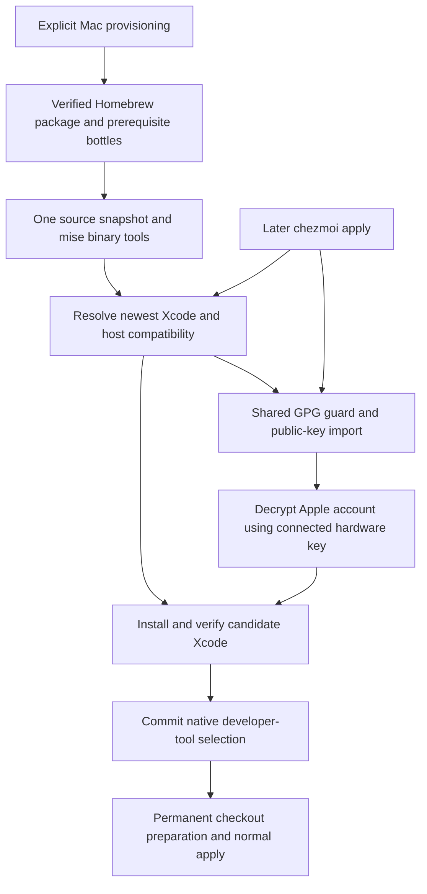
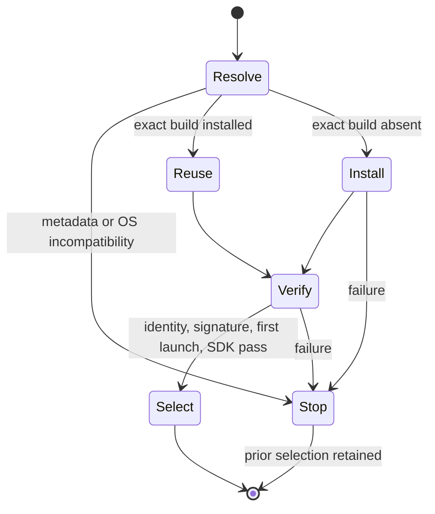

# macOS Xcode Installation and Updates - Plan

## Goal Capsule

**Objective:** The repository owner can prepare a new Mac for development without manually installing standalone Command Line Tools, then keep Xcode current through normal dotfile application.

**Means:** Install Xcode during explicit Mac initialization, prepare GPG access before consuming encrypted Apple credentials, and update Xcode during explicit chezmoi application.

**Product authority:** The confirmed brainstorm conversation governs this Product Contract alongside repository bootstrap and encryption policies in `AGENTS.md` and `STRATEGY.md`.

**Stop conditions:** Stop on invalidated product decisions, unavailable encrypted credentials, or an unverified installer artifact. Native cold-start verification requires a disposable Mac and is reported separately from source and fixture evidence.

**Execution profile:** One PR, implemented and verified locally through the authorized autonomous workflow; merging remains with the owner.

---

## Product Contract

### Summary

Explicit Mac initialization will prepare GPG and install the newest Xcode across release channels using encrypted Apple-account credentials.
Subsequent chezmoi application will check for and install newer Xcode versions while worktree preparation remains read-only for personal state.

### Problem Frame

The current Mac provisioning entry point requires Apple developer tools before installing Homebrew and GPG.
Public-recipient preparation currently happens during dotfile application, too late for an earlier installer that needs encrypted credentials.
The owner wants one initial setup path and an existing update action rather than manually maintaining a separate CLT installation and Xcode version.

### Key Decisions

- **Use explicit machine initialization and application as the lifecycle boundary.** Governs R1, R2, R14. (session-settled: user-directed — chosen over changing personal state during mise install: initial installation belongs to Mac setup and updates belong to chezmoi apply.)
- **Stop on an unsupported host OS.** Governs R6, R7. (session-settled: user-directed — chosen over installing an older compatible Xcode or upgrading macOS: report the required OS version.)
- **Use the owner's existing hardware key.** Governs R10, R11. (session-settled: user-directed — chosen over importing a private key or provisioning one: the owner connects an existing YubiKey and enters its PIN.)
- **Compare version precedence across channels.** Governs R4, R5. (session-settled: user-approved — chosen over sorting by publication date: latest means the newest Xcode version, including prereleases.)
- **Enroll credentials once and consume encrypted repository state afterward.** Governs R8, R9. (session-settled: user-approved — chosen over requiring live 1Password access on every installation: the requested encrypted account must be usable during later setup.)

### Requirements

**Installation and updates**

- R1. Explicit Mac initialization must install and select the chosen Xcode before developer tools are required by subsequent setup.
- R2. Every explicit `chezmoi apply` must check current Xcode availability and update when the chosen version is newer; an already installed chosen version must be reused.
- R3. Initial setup must work on a supported native Apple Silicon Mac without existing Xcode or standalone CLT, including the prerequisites needed to decrypt Apple credentials.
- R4. Select the highest available Xcode version across stable, RC, and beta releases using refreshed release metadata rather than a fixed channel or repository-pinned Xcode version.
- R5. Compare numeric version components first and prerelease precedence within the same version, with a final release newer than its RC and beta variants.
- R6. If the selected latest Xcode does not support the host macOS version, stop and report the required macOS version without choosing an older release or upgrading the OS.
- R7. A failed installation or update must leave an existing usable Xcode and its active selection intact.
- R8. Initial credential enrollment must retrieve the Apple-account username and password from 1Password item `7qtqghyfcstvy4xijdgorbzvki` and persist their repository copy only as repository-policy GPG ciphertext.
- R9. Setup and updates must consume the enrolled ciphertext without requiring live 1Password access or exposing credentials in tracked plaintext, diagnostic output, or command arguments.

**Early GPG readiness**

- R10. Mac initialization must validate the effective GPG home and the pinned public-recipient fingerprint, then import that public key before attempting credential decryption.
- R11. Decryption must use the owner's existing hardware key through native GPG, allowing PIN entry and stopping with an actionable error when key access fails.
- R12. GPG preparation must preserve unrelated keys and ownertrust and be safe to repeat from initialization and application.
- R13. The pre-Xcode decryption path must not depend on compiling the repository's Rust pinentry wrapper with the developer tools it is about to install.

**Developer-tool and workflow integration**

- R14. Worktree initialization through `mise install` must continue to inspect source without importing personal keys, decrypting credentials, installing Xcode, or changing OS configuration.
- R15. A successful installation must select Xcode's developer directory and complete required first-launch preparation so clang and the macOS SDK are usable without a separate CLT installation.
- R16. Installation and update must allow required Apple-account 2FA and administrator authentication through native interactive flows.
- R17. macOS build checks and setup documentation must recognize the selected full Xcode as satisfying Apple developer-tool readiness.
- R18. Keep tool declarations and their generated lock entries in mise where repository policy requires them, while resolving the installed Xcode version dynamically under R4.

### Key Flows

- F1. **First-time account enrollment:** Retrieve the designated 1Password item, encrypt it under the existing recipient policy, and verify that the owner can decrypt it before publishing the ciphertext. **Covers R8, R9, R11.**
- F2. **New Mac:** Start explicit machine initialization, obtain the prerequisites for GPG and Xcode installation, resolve the latest Xcode and check OS compatibility, validate/import the public recipient, decrypt with the connected hardware key, install and select Xcode, and continue normal setup. **Covers R1, R3-R6, R9-R13, R15, R16.**
- F3. **Existing Mac:** Explicit application refreshes availability, compares the selected version, installs a newer candidate when needed, and selects it after successful preparation. **Covers R2, R4-R7, R9, R12, R15-R17.**
- F4. **Worktree preparation:** Initialize development tools and inspect the worktree's chezmoi source through the repository's hook-free configuration. **Covers R14, R18.**

### Acceptance Examples

- AE1. **Cold start:** Given no Xcode, CLT, Homebrew, or GPG installation and an available enrolled ciphertext, a supported Mac plus the connected hardware key can complete initialization without a manual standalone CLT installation. **Covers R1, R3, R9-R11, R13, R15.**
- AE2. **Version ordering:** Given stable 27.0 and beta 27.1, select beta 27.1; given beta, RC, and final variants of 27.1, select final 27.1 even if an older branch received a later publication date. **Covers R4, R5.**
- AE3. **Unsupported OS:** Given that the chosen latest release requires a newer macOS, initialization or application stops with that requirement and retains the existing developer-tool selection. **Covers R6, R7.**
- AE4. **Update and rerun:** Given a newer compatible candidate, application installs and selects it; a subsequent application with unchanged availability reuses that installation. **Covers R2, R4, R15.**
- AE5. **Missing hardware key:** Given a valid public recipient but unavailable hardware-key access, credential decryption stops with an actionable error and does not replace an existing usable Xcode. **Covers R7, R10, R11.**
- AE6. **Interrupted update:** Given a usable current Xcode and a failed download, extraction, verification, or first-launch step, the update fails without removing or switching away from the usable installation. **Covers R7, R15.**
- AE7. **Fresh worktree:** Given a new worktree with an enrolled Apple-account ciphertext, `mise install` does not decrypt it or change the personal GPG keyring or Xcode installation. **Covers R14.**
- AE8. **Repeat GPG preparation:** Given an already imported pinned recipient and unrelated keys, another initialization/application preserves those keys and ownertrust without duplicate enrollment. **Covers R10, R12.**
- AE9. **Native authentication:** Given an Apple 2FA challenge or required administrator approval, setup permits the native interaction and resumes after success; cancellation fails without replacing an existing usable installation. **Covers R7, R16.**

### Scope Boundaries

- This work covers the Mac lifecycle under R1-R18; it does not redesign Windows or Linux initialization.
- macOS upgrades, private-key distribution, new key generation, simulator runtimes, signing certificates, and automatic deletion of older Xcode installations are outside scope.
- A one-time credential enrollment is in scope; ongoing synchronization from 1Password is deferred.
- Existing CLT installations do not need to be uninstalled to satisfy R15.

### Dependencies and Assumptions

- The repository's native Apple Silicon and macOS 26-or-later platform boundary remains in effect; individual Xcode releases may require a newer OS under R6.
- The owner supplies the existing hardware key, PIN, Apple authentication approvals, and any administrator authorization required by R11 and R16.
- Credential enrollment occurs on a host with authenticated access to the specified 1Password item and usable GPG; a fresh Mac subsequently consumes the committed ciphertext under R9.
- The existing encryption policy uses native chezmoi GPG with recipient `621512777E6933FEB4458FDC4945855D4F283F05`; implementation must preserve that policy under R8.
- The `xcodes` CLI is a researched candidate, not a settled dependency. Its release binary can run without an existing Xcode installation, but the complete GPG-first cold-start sequence still needs proof under R3.

### Sources and Research

- `provision-macos.sh:15-38` and `bootstrap.sh:11-21`: current Apple-tools prerequisites and Homebrew/GPG installation checks.
- `mise.toml:36-45` and `.chezmoi-bootstrap.toml`: current postinstall source inspection and explicit application boundary.
- `home/.chezmoiscripts/run_before_10-check-gpg-home.sh.tmpl` and `home/.chezmoiscripts/run_before_15-import-gpg-recipient.sh.tmpl`: current home guard and public-key verification/import before later apply scripts and ordinary target-template rendering.
- `home/.chezmoiscripts/run_before_20-install-pinentry.sh.tmpl`, `mise.toml:57-60`, and `docs/guides/git-and-gpg.md:19`: compiler dependency of the current custom pinentry installation.
- `scripts/auth_common.py:104-109,154-164` and `docs/guides/secrets-and-authentication.md`: existing encryption-policy checks, secret consumption, and verified ciphertext publication patterns.
- `scripts/macos-build-environment.sh:20-22`: compiler/SDK readiness checks do not require the standalone CLT directory, although their error message still names CLT.
- `.compound-engineering/artifacts/solutions/integration-issues/ca-enrollment-gpg-recipient-validity.md`: recipient presence and encryption trust are distinct; preserve ownertrust under R12.
- [Apple: Installing the command-line tools](https://developer.apple.com/documentation/xcode/installing-the-command-line-tools): full Xcode and standalone CLT relationship.
- [xcodes documentation](https://github.com/XcodesOrg/xcodes): standalone release binaries, separate latest/prerelease selectors, credential environment variables, Keychain behavior, and native authentication.
- [Homebrew installation](https://docs.brew.sh/Installation) and [installer source](https://github.com/Homebrew/install/blob/main/install.sh): developer-tool and Git dependencies relevant to R3.

---

## Planning Contract

**Product Contract preservation:** Clarified R8 as repository persistence and aligned F2 with compatibility checking before credential use; no scope change. Technical questions are resolved below.

### Key Technical Decisions

- KTD1. **Use the official Homebrew package before developer tools.** Pin `Homebrew.pkg` 7.0.12 and SHA256 `a9825310dce8d94bc97f70140700089183c3a894b1048501d933865d7c2441bd`, verify the hash and native package signature, and install through native administrator authorization. Unlike the shell installer, this package can install without Git or CLT. Install existing prerequisite formulae from bottles at `/opt/homebrew` with `HOMEBREW_NO_AUTO_UPDATE=1`; avoid taps and source builds before Xcode. Governs R1, R3, R13. Source: [Homebrew package support](https://github.com/Homebrew/brew/pull/24062), [package postinstall](https://github.com/Homebrew/brew/blob/main/package/scripts/postinstall), and [ARM preinstall checks](https://github.com/Homebrew/brew/blob/main/Library/Homebrew/extend/os/mac/diagnostic.rb).
- KTD2. **Expose existing POSIX GPG preparation as shared chezmoi partials.** Retain thin apply adapters and render the same home guard/import logic using the hook-free repository config during Mac initialization. Before decrypting, resolve the controlling terminal and pass GPG_TTY with inherited terminal stdin while capturing decrypted stdout privately. The default Homebrew terminal pinentry can then prompt before the Rust wrapper exists. No private key or ownertrust enrollment is added. Governs R10-R14.
- KTD3. **Keep Apple credentials in a dedicated encrypted JSON document.** Add an importer that reads the specified 1Password item privately, verifies the pinned recipient policy, encrypts in memory, verifies decryption, and atomically publishes `home/.secrets/apple-account.json.asc`. Bootstrap reads repository-owned encryption settings through hook-free chezmoi template evaluation rather than requiring prior personal chezmoi initialization. Governs R8-R12. Follow `scripts/auth_common.py` transport and ciphertext-publication patterns without broadening its existing token schema.
- KTD4. **Use Xcode Releases metadata and a mise-pinned xcodes binary.** Resolve numeric versions and channel precedence from `https://xcodereleases.com/data.json`, including build identity and minimum OS. Pin `aqua:XcodesOrg/xcodes` 2.1.0 for macOS in `mise.toml` and regenerate `mise.lock`. Reject malformed highest-candidate metadata instead of silently falling back. This follows the metadata source used by xcodes and avoids parsing human CLI lists. Governs R4-R6, R18. Sources: [catalog](https://github.com/xcodereleases/data), [xcodes CLI](https://github.com/XcodesOrg/xcodes/blob/2.1.0/Sources/xcodes/App.swift).
- KTD5. **Commit developer-tool selection last.** Install an explicit version without `--select`, resolve the versioned app path, validate its marketing/build identity and Apple signature, complete first-launch preparation, and probe clang/SDK with a child-only `DEVELOPER_DIR`. Use native `xcode-select --switch` only after success, preserving prior bundles and clearing inherited developer-directory overrides for global selection checks. Reuse still requires readiness verification, because an app can remain after failed postinstall. Governs R2, R7, R15. Sources: [archive installer](https://github.com/XcodesOrg/XcodesKit/blob/v1.1.0/Sources/XcodesKit/Services/XcodeArchiveInstallService.swift), [selection side effects](https://github.com/XcodesOrg/XcodesKit/blob/v1.1.0/Sources/XcodesKit/Services/XcodeSelectionFilesystemService.swift).
- KTD6. **Preserve interactive authentication while filtering child output.** Decrypt credentials privately, pass them only in the xcodes child environment, keep stdin attached for native authentication, and attach stdout/stderr to a pseudo-terminal before redacting both credential values, including matches split across reads. Forward every byte that cannot begin a credential match promptly. Set raw execution on the apply and asset-apply mise tasks so upstream line buffering cannot hide prompts. Do not apply the existing 180-second private-command timeout to a large Xcode download. The native installer may persist successful authentication in macOS Keychain; document that behavior rather than claiming ciphertext is the only runtime storage. Governs R9, R16.
- KTD7. **Use an immutable source snapshot for standalone provisioning.** A downloaded provisioning script must fetch a source archive before Git is usable; an invocation from a checkout uses that source directly. Resolve the GitHub branch to a commit and fetch that commit's archive, then consume its GPG data, encrypted account, templates, and tool declarations together. Continue permanent checkout preparation through the existing bootstrap entry point after Xcode. Governs R1, R3, R9, R18.

### High-Level Technical Design

The cold-start components and their data dependencies are:

The update lifecycle keeps the selected installation usable until the candidate is ready:

### Assumptions and Verification Limits

- Native package and bottle support is established from upstream source, not a newly initialized physical Mac. Fixture tests will enforce command ordering and failure behavior; a disposable Mac/VM is needed for a full cold-start smoke.
- Cold-start GPG uses Homebrew's terminal pinentry with an explicit GPG_TTY until personal application installs the managed agent configuration. Existing incompatible personal GPG configuration produces an actionable failure rather than being silently replaced.
- Account enrollment is a real authorized operation from the original request; its plaintext must never enter tool output or repository files. If 1Password or hardware-key authorization is unavailable, preserve the implementation and report the blocker without fabricating ciphertext.
- No competing mechanism remains that needs a bake-off: the current Homebrew package keeps the existing native GPG prefix and avoids a second GPG distribution.

---

## Implementation Units

### U1. Share early GPG preparation and enroll Apple credentials

**Goal:** Make the existing recipient preparation usable before personal application and publish verified Apple-account ciphertext.

**Requirements:** R8-R14; F1, F2; KTD2, KTD3, KTD6.

**Dependencies:** None.

**Files:** `home/.chezmoitemplates/gpg-home-check.sh`, `home/.chezmoitemplates/gpg-import-recipient.sh`, POSIX GPG before-script adapters, `scripts/apple_account.py`, `tests/test_apple_account.py`, `tests/test_git_gpg.py`, and `home/.secrets/apple-account.json.asc`.

**Approach:** Extract the existing shell bodies without changing verification/trust behavior. The importer and consumer share a small module interface for hook-free settings lookup and private JSON encryption/decryption; credential parsing validates one usable username and password from the named 1Password item.

**Patterns:** Native GPG settings; fixed private diagnostics and ciphertext-only staging from `auth_common`. Decryption uses a dedicated terminal-aware transport rather than the unchanged piped-input `run_private` helper.

**Test scenarios:**

- Covers AE5, AE8: repeated import preserves unrelated keys, and public-key presence without private-key access does not permit decryption.
- A cold-start decrypt child receives the controlling input terminal and matching GPG_TTY while its plaintext stdout remains private.
- Covers F1: a disposable GPG identity encrypts and round-trips an imported fake account; only ciphertext is published.
- A failed 1Password read, malformed account, wrong fingerprint, or failed verification leaves prior ciphertext unchanged and prints no credential values.
- Existing POSIX and Windows GPG lifecycle tests continue to pass.

**Verification:** Disposable homes/keyrings establish the shared logic and encryption contract without personal-state mutation.

### U2. Resolve, install, and select the latest Xcode

**Goal:** Implement one explicit Xcode operation shared by provisioning and application.

**Requirements:** R2, R4-R7, R9, R15, R16, R18; F3; KTD4-KTD6.

**Dependencies:** U1.

**Files:** `scripts/macos-xcode.py`, `mise.toml`, `mise.lock`, `tests/test_macos_xcode.py`.

**Approach:** Resolve release metadata before credential use, validate OS requirements, then reuse or install the exact build. Keep selection as the final operation and use credential-filtered interactive child execution.

**Test scenarios:**

- Covers AE2: stable/beta/RC ordering, numeric minor/patch ordering, architecture matching, publication-date independence, and malformed highest-candidate metadata.
- Covers AE3: unsupported host OS stops before decryption/install/selection and reports the required version.
- Covers AE4, AE6: exact-build reuse, changed availability, interrupted install, invalid signature, failed first-launch/SDK probes, and prior-selection preservation.
- Covers AE9: stdin remains interactive and split-output credential values are redacted. A child that writes an unterminated prompt and waits for input exposes that prompt before receiving its response.
- An inherited `DEVELOPER_DIR` cannot falsify candidate/global readiness checks.

**Verification:** Fixtures use real orchestration with fake native tools and local catalog data; no real Xcode download or global selection occurs.

### U3. Wire cold-start provisioning and apply-time updates

**Goal:** Replace the manual CLT prerequisite with the shared Xcode lifecycle while preserving worktree inspection behavior.

**Requirements:** R1-R3, R10-R18; F2-F4; KTD1, KTD2, KTD7.

**Dependencies:** U2.

**Files:** `provision-macos.sh`, `bootstrap.sh`, macOS Xcode before-script adapter, `scripts/macos-build-environment.sh`, `tests/test_macos_provision.py`, `tests/test_macos_bootstrap.py`, `tests/test_bootstrap.py`, and relevant lifecycle fixture lists.

**Approach:** Verify/install the pinned Homebrew package, provision bottles without Git updates, prepare one source snapshot and its mise tools, invoke shared GPG/Xcode setup, then allow the existing permanent-checkout flow. Use an ordinary before-script for updates so unchanged source does not suppress availability checks; order it before compiler-dependent pinentry installation.

**Test scenarios:**

- Covers AE1: no developer tools are initially available; package verification, GPG readiness, Xcode installation, and selection precede developer-tool-dependent commands without any CLT install command.
- Package checksum/signature failures stop before privileged installation; partial provisioning is retryable.
- Covers AE7: `mise install`, source inspection, and dry-run rendering never decrypt Apple credentials or run the updater.
- Covers AE4: repeated explicit application still checks availability while platform guards keep the adapter inactive elsewhere.

**Verification:** Existing provisioning/bootstrap/lifecycle tests plus the new fixture enforce ordering and isolation; native cold-start limitations remain explicit.

### U4. Document the new lifecycle and complete enrollment

**Goal:** Leave a usable documented setup with the requested encrypted Apple-account artifact.

**Requirements:** R8, R9, R16, R17; F1-F4.

**Dependencies:** U3.

**Files:** `docs/setup/macos.md`, `docs/guides/git-and-gpg.md`, `docs/guides/secrets-and-authentication.md`, and relevant README setup references.

**Approach:** Describe initial setup, repeated updates, supported host checks, YubiKey/2FA/admin interaction, Keychain persistence, credential enrollment/rotation, and failure recovery. Enroll the real named account privately only after the importer is tested.

**Test expectation:** Documentation itself needs no new tests; U1-U3 carry behavior coverage.

**Verification:** Commands and source paths match the implementation, and only verified ciphertext is included in the PR.

---

## Verification Contract

- Run focused unittest discovery for `test_apple_account.py`, `test_macos_xcode.py`, `test_macos_provision.py`, `test_macos_bootstrap.py`, `test_bootstrap.py`, and `test_git_gpg.py` as their units change.
- Run `python -m unittest discover -s tests` after integration, plus repository test-area ownership validation if a new test module requires classification.
- Run `mise install` using the repository's hook-free postinstall task and `git diff --check`.
- Use disposable homes, temporary keyrings, fixture tool paths, and fake native installers. Record source/fixture evidence separately from any real disposable-Mac smoke; do not install Xcode or change the current Mac's developer selection to simulate a clean host.
- Verify real ciphertext enrollment privately without printing credentials, PINs, or decrypted content.

---

## Definition of Done

- U1-U4 and their requirement-linked scenarios are implemented, and relevant local checks pass.
- Credential enrollment publishes verified ciphertext or the run explicitly stops on the unmet account/hardware authorization prerequisite.
- No plaintext credentials, experimental installers, or abandoned implementation code remain in the diff.
- The PR describes native verification limits, receives independent code review with eligible fixes applied, and is pushed without merging.
