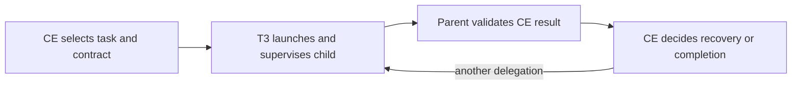

# T3-managed CE delegation - Plan

## Goal Capsule

- **Objective:** The owner can track and manage CE-delegated work inside T3 Code, including Codex-to-Claude and Claude-to-Codex reviews.
- **Means:** Extend the existing T3-only instruction addition to replace CE dispatch mechanisms.
- **Product authority:** The confirmed dialogue and this Product Contract govern scope; repository instructions govern integration.
- **Execution profile:** One PR. LFG owns implementation, verification, review, and publication; merging remains with the owner.
- **Stop conditions:** A settled decision proves infeasible, or a required check is refused. Do not apply personal configuration.
- **Open blockers:** None.

---

## Product Contract

### Summary

Route CE delegations through T3 Code while retaining CE's task semantics and recovery decisions.
Apply the rule to cross-model calls and ordinary skill subagents, including scouts.

### Problem Frame

The owner observed Codex/Claude cross-model reviews attempt direct CLI execution, leaving those reviews outside T3 task management.
The existing instruction prefers T3 delegation but exempts explicit tool requirements; CE's adversarial peer reference explicitly requires acpx and describes the peer as a shell-out rather than a subagent.

### Key Decisions

- **Replace dispatch through T3-only instructions.** Governs R1, R2, R6. (session-settled: user-approved — chosen over a preference that leaves CE's explicit CLI routes intact: delegated work must remain manageable in T3.)
- **Retain CE recovery behavior.** Governs R3, R4. (session-settled: user-directed — chosen over a new stop-and-notify or permission policy: the owner wants CE's existing handling of failures.)

### Requirements

**Delegation routing**

- R1. In T3-launched sessions receiving the addition, CE cross-model calls must use T3 delegation instead of acpx, direct provider CLI invocation, or CE scripts that launch those routes.
- R2. Ordinary CE skill subagents, including scouts and same-provider children, must also use T3 delegation; the rule applies to delegated descendants when their CE task calls for further delegation.

**CE behavior**

- R3. Preserve each invoked CE skill's rules for whether to delegate, provider/model/effort selection, role brief, context, access constraints, output contract, and result interpretation.
- R4. Preserve the invoked CE skill's retry, recovery, inline fallback, skip, and reporting decisions; any resulting delegation still follows R1 and R2, without adding a separate T3 failure policy or permission step.
- R5. Use T3's capability discovery and task lifecycle for execution, completion, and cancellation while preserving the CE workflow's substantive completion requirements.

**Integration and evidence**

- R6. Deliver this behavior through the existing shared T3-only addition for supported harnesses, preserving ordinary CLI instructions, shared homes and credentials, and the repository-owned CE installation.
- R7. Validate representative routing behavior as well as instruction delivery, and distinguish observed execution from assertions about the prompt's presence.

### Acceptance Examples

- AE1. **Covers R1, R3, R5, R7.** Given a Codex-hosted CE review selecting Claude, the independent peer appears as a T3 child task and returns the review result to the parent without a host-launched acpx or Claude CLI job. Repeat with Claude hosting and Codex as peer. Requested identity is not reported as verified serving identity without evidence.
- AE2. **Covers R2, R3, R5, R7.** Given a Standard CE brainstorm that calls for a scout, T3 manages the child and the scout retains CE's brief and output limits. An inline Lightweight scan does not acquire an unnecessary child task.
- AE3. **Covers R1, R2, R4.** Given a failed peer attempt, CE determines the applicable retry, recovery, skip, or inline outcome. Any replacement delegated attempt remains in T3; the addition introduces no separate confirmation or failure notice.
- AE4. **Covers R1, R3, R4.** Given an activated CE implementation-engine or reasoning-elevation delegation, the same dispatch rule applies without changing the conditions that activate it or the skill's intended outcome.
- AE5. **Covers R2, R6.** Given a CE child whose assigned task authorizes further delegation, those children remain T3-managed. A direct CLI session receives only its ordinary instruction baseline.

### Scope Boundaries

The change owns the T3 instruction policy and the documentation and verification needed for R6 and R7.
It does not fork CE, modify cached plugin scripts, introduce another orchestrator, add shadow homes, or expand harness support beyond the existing supported addition mechanisms.
It does not force CE to delegate work that its skill would perform inline.
Higher-priority host constraints remain binding; a prompt addition is not tool-level enforcement.

### Sources / Research

- Owner's observed Codex/Claude review escape and confirmed scope in the brainstorm dialogue.
- `home/.chezmoitemplates/agent-instructions:1–8`: current T3 preference, explicit-tool exception, and conditional native fallback.
- `docs/guides/t3-code.md:72–86`: supported additions, CLI isolation, and the delivery-versus-compliance evidence boundary.
- Installed Compound Engineering 3.36.1, plugin-relative `skills/ce-code-review/references/cross-model-review.md:7,70–96,186–191`: acpx route, model selection, shell-out distinction, and review reporting.
- Installed CE 3.36.1, `skills/ce-brainstorm/references/dialogue.md:37–43` and `model-tiers.md:3–13`: scout dispatch, brief, output, and model selection.
- Installed CE 3.36.1, `skills/ce-work/references/execution-engines.md:44–51`, `cross-model-execution.md:42–70`, and `skills/ce-brainstorm/references/reasoning-elevation.md:23–36`: separate implementation and elevation dispatch/recovery contracts.

---

## Planning Contract

### Key Technical Decisions

- KTD1. Replace the T3 branch's soft preference and explicit-tool exception together. Cover CE shell-outs, launcher scripts, scouts, review, implementation, and reasoning elevation without changing baseline adapters. Implements R1, R2, R6.
- KTD2. Replace transport-specific runners, polling, cancellation, and receipts with T3 task tools and observed results. Preserve substantive CE checks and never synthesize legacy controller receipts. If the substantive contract cannot be met, use CE's existing unavailable-route handling before initializing a legacy controller. Implements R3–R5.
- KTD3. Supply self-contained child briefs, including applicable T3 routing instructions and any authorized further delegation. Preserve workspace visibility, selected model/effort, access limits, and artifact expectations rather than relying on inherited conversation history. Implements R2, R3.
- KTD4. Extend the existing render and native-request checks, then run bounded live routing probes. These provide different evidence: injected text, provider ingestion, and observed tool choice. Implements R7.

### High-Level Technical Design

This sketch describes ownership rather than an API implementation:

T3 replaces the execution mechanism. Existing CE scripts that start or supervise external processes are not run alongside a T3 task. CE's substantive validation, scope controls, and result interpretation remain with the parent. T3 completion is not proof that the requested model served or that the result satisfies CE.

### Assumptions and Limits

- The existing T3-only addition is the supported integration point; its priority cannot defeat higher-priority host rules. No application-code enforcement is proposed.
- Preserve CE inline fallback when the skill allows it. Transport unavailability does not authorize a new provider/model or direct CLI escape.
- A bounded live probe can show representative choices, not guarantee future model compliance. Use current task evidence without applying these settings to the owner's home.
- No CE plugin modifications or controller adapter are needed for this instruction policy. Successful implementation-engine controller parity is not claimed when only CE preflight recovery is observed.

## Implementation Units

### U1. Replace the T3 dispatch policy and rendering coverage

- **Goal:** Deliver the agreed CE transport override through all existing supported additions.
- **Requirements:** R1–R6; Product Contract Key Decisions governing R1–R4 and R6.
- **Files:** `home/.chezmoitemplates/agent-instructions`, `tests/test_agent_instructions.py`, `tests/smoke_t3_instructions.py`.
- **Approach:** Keep the baseline branch unchanged. State the CE transport override, self-contained briefs, substantive checks, and CE-owned recovery concisely. Preserve T3's own evolving lifecycle instructions instead of copying a protocol. Update assertions to cover the new contract and reject the former native/explicit-tool escape wording.
- **Test scenarios:** All Codex/Claude/pi additions carry the policy exactly once; all baseline adapters exclude it. Native request capture includes the replacement policy while retaining existing options, baseline equality, CE discovery, and later CLI isolation. Covers AE1, AE2, AE5 at the delivery boundary.
- **Verification:** Focused instruction, composer, and T3-settings unit tests; native instruction smoke in a disposable home.

### U2. Document and verify actual routing

- **Goal:** Show how the policy behaves and state the limits of the available evidence.
- **Requirements:** R1–R7; Product Contract Key Decisions governing R1–R4 and R6.
- **Dependencies:** U1.
- **Files:** `docs/guides/t3-code.md`; this plan only if execution evidence changes an assumption.
- **Approach:** Describe the CE override, ordinary CLI isolation, CE recovery, and replacement of transport-specific machinery. Add a concise reproducible manual probe procedure using the rendered addition and CE briefs, without a new test framework. Record actual bounded probe results in the PR.
- **Test scenarios:** Codex-to-Claude peer, Claude-to-Codex peer, same-provider scout, inline-work preservation, and authorized descendant delegation. Inspect the requested provider/model/effort and the returned result. For a recovery probe, classify an unavailable route before sending work and confirm CE's applicable recovery without CLI dispatch; do not consume quota merely to force a failure. Cover AE1–AE5, distinguishing routed execution from scenario-only or unavailable coverage.
- **Verification:** T3 child task/activity evidence plus the focused automated checks from U1. No personal apply, account changes, or new top-level threads.

## Verification Contract

Run `python3 -B -m unittest discover -s tests -p test_agent_instructions.py`, then the same command for `test_t3_instructions.py` and `test_t3_code_settings.py`.
Run `python3 tests/smoke_t3_instructions.py` on the local supported platform using disposable homes and the hook-free fixture.
Use available native binaries/assets through the fixture's existing flags if needed; record unavailable platform or runtime checks explicitly.
Inspect bounded T3 routing activity under U2 and record the evidence separately from native request capture.
Run `git diff --check`, simplify the change, complete independent code review, and apply eligible findings before publication.

## Definition of Done

U1's policy and tests agree, U2's guide accurately describes the observed behavior and limitations, and representative routing evidence is reported without claiming universal enforcement.
Required local checks pass or unavailable methods are named with their cause; no personal settings were applied.
No abandoned experiments or unrelated files remain in the diff.
The reviewed change is committed and published in one open PR, with CI resolved or handed to T3's PR watcher while checks run.
