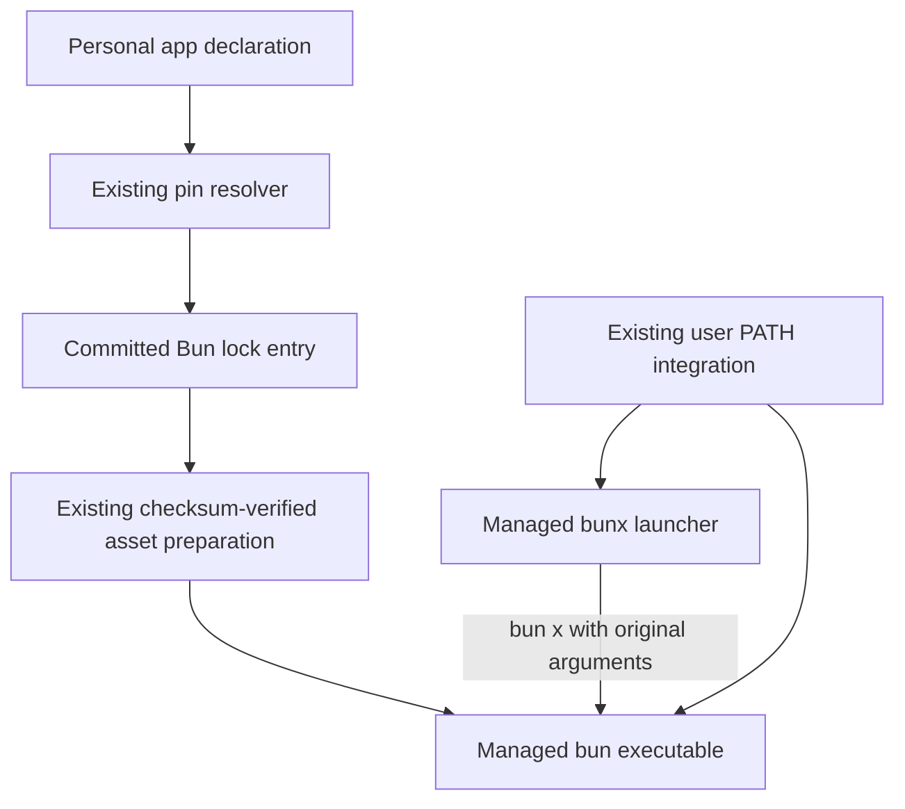

# Add Bun as a Personal CLI Application - Plan

## Goal Capsule

- **Objective:** The repository owner can use Bun and bunx from a fresh terminal on each supported device after explicitly applying dotfiles.
- **Means:** Extend the existing personal CLI application pipeline (KTD1) and provide bunx through the managed Bun binary (KTD2).
- **Authority:** Product requirements govern behavior; technical decisions govern implementation within those requirements; repository instructions remain binding.
- **Execution profile:** One PR, with U1 followed by U2 and U3. This document authorizes planning only; implementation and shipping require the next instruction.
- **Stop conditions:** Stop if a required stable release asset or digest cannot be verified, or native validation reveals that the selected release cannot support a declared target.
- **Completion owner:** The implementing agent completes verification and the repository's shipping workflow when implementation is authorized.

## Product Contract

### Summary

Add Bun to the existing personal CLI applications, with bun and bunx discoverable through the managed user PATH.
Use the same installation, pin refresh, repair, and rollback workflow as the other personal applications.

### Problem Frame

The repository does not currently provision Bun as a personal application, so setting up a device leaves its installation to the owner.
The requested addition makes Bun available through the existing device setup and update workflow.

### Requirements

**Availability**

- R1. Explicit chezmoi application installs a working Bun under `~/.local/bin` on macOS ARM64, Linux glibc x64/ARM64, and Windows x64/ARM64.
- R2. Fresh managed shells discover both bun and bunx outside the repository; bunx forwards arguments and the child exit status to the same managed Bun installation.

**Lifecycle**

- R3. Bun uses a committed stable release tag, immutable download URLs, and verified SHA-256 digests; the existing personal-app pin refresh automation includes it.
- R4. Repeated apply reuses valid prepared assets, restores missing managed commands, and supports rollback by restoring the Bun lock entry and applying again.
- R5. Preparation remains read-only for personal settings; unrelated programs, existing Bun installations elsewhere, and user package caches remain intact.

### Scope Boundaries

Project package-manager migration, global npm packages, Bun shell completions, Intel macOS, Linux musl, and removal of existing installations are outside this change.
Do not add Bun to the repository's mise toolchain: this request concerns a personal application.
Do not introduce a new installer, update service, CPU-detection layer, or recovery mode; the existing asset pipeline and upstream release compatibility cover this addition.
A newly demonstrated incompatibility with a supported target would require revisiting that decision.

## Planning Contract

### Key Technical Decisions

- KTD1. **Use the generic GitHub archive-file integration.** Add `bun` to `home/.chezmoidata/personal-apps.json` with repository `oven-sh/bun`, then generate its entry in `personal-app-lock.json` through the existing resolver. The verified stable release `bun-v1.4.4` has uploaded SHA-256-bearing assets for all five targets. No new release-source adapter is needed (R1, R3).
- KTD2. **Provide small platform-specific bunx launchers.** Add a POSIX executable template and a Windows PowerShell template that invoke the adjacent managed Bun with the `x` subcommand. Follow the existing agy/pi launcher and ignore patterns, including quoting and Windows encoding. This avoids duplicate binary pins and link-creation privileges. Windows bunx follows the repository's PowerShell launcher convention; cmd.exe discovery is outside R2. Do not run `bun completions` to create bunx, since that upstream setup path also edits shell configuration (R2, R5).
- KTD3. **Reuse installation and PATH plumbing.** The generic asset template already supports extracting one executable from a checksum-pinned ZIP. Keep the shared PATH scripts unchanged. Normalize the known `bun-v` prefix in the smoke version comparison while retaining existing tag handling and version-boundary checks (R1–R4).
- KTD4. **Use existing test and automation entry points.** Extend the personal-app tests and native apps smoke rather than adding a new test area or CI matrix. Existing daily pin updates run that matrix before publishing candidate locks (R3, R4).

### Target Mapping

All entries use ZIP `archive-file` extraction. Paths are relative to the archive root.

| Chezmoi target | Release asset | Archive member |
| --- | --- | --- |
| darwin-arm64 | bun-darwin-aarch64.zip | bun-darwin-aarch64/bun |
| linux-amd64 | bun-linux-x64.zip | bun-linux-x64/bun |
| linux-arm64 | bun-linux-aarch64.zip | bun-linux-aarch64/bun |
| windows-amd64 | bun-windows-x64.zip | bun-windows-x64/bun.exe |
| windows-arm64 | bun-windows-aarch64.zip | bun-windows-aarch64/bun.exe |

### High-Level Technical Design

The existing pipeline remains the owner of release resolution and asset preparation; only declarations and bunx launchers are added.

### Assumptions and Execution-Time Checks

The platform scope and bunx behavior come from the preceding chat brief; no separate requirements artifact exists.
The release metadata and official installers establish the selected asset names; implementation must confirm archive members and native behavior before accepting the generated pins.
Select the current stable release at implementation time if it has advanced, rechecking the same target and digest contract.
Bun's documented OS/CPU requirements still apply; do not silently emulate an unsupported target.

## Implementation Units

### U1. Declare and pin Bun

- **Goal:** Install the pinned native Bun through the existing asset pipeline.
- **Requirements:** R1, R3, R4, R5.
- **Dependencies:** None.
- **Files:** `home/.chezmoidata/personal-apps.json`, `home/.chezmoidata/personal-app-lock.json`, `tests/test_personal_app_lock.py`, `tests/test_personal_apps.py`.
- **Approach:** Add the five targets from Target Mapping under KTD1. Generate the lock using the existing resolver; keep unrelated application pins unchanged in the final diff. Exercise the existing archive-file template rather than changing it.
- **Patterns:** The ghq ZIP declaration and the generic resolver's immutable URL/digest checks in `scripts/update-personal-app-lock.py`; extraction tests in `tests/test_personal_apps.py`.
- **Test seam:** Resolver fixtures prove metadata validation and atomic lock preservation; local ZIP fixtures prove installation and repair, but neither proves upstream binary compatibility.
- **Test scenarios:**
  1. A stable `bun-v` release with all five named assets resolves to matching ZIP members, tag, URLs, and checksums; no Intel macOS target appears.
  2. A missing target asset or malformed digest rejects the update without changing the previous complete lock.
  3. A disposable apply installs the extracted command, unchanged reapply reuses preparation, and deleting the command restores it from cache.
  4. Restoring an older fixture pin replaces the managed command while preserving unrelated files; a checksum mismatch preserves the last valid command.
- **Verification:** Declaration and generated pins agree for every target; fixture tests pass without writing to the real home.

### U2. Expose bunx through the managed Bun

- **Goal:** Make bunx usable in the repository's managed shells without a second runtime install.
- **Requirements:** R2, R4, R5.
- **Dependencies:** U1.
- **Files:** New `home/dot_local/bin/executable_bunx.tmpl`, new `home/dot_local/bin/bunx.ps1.tmpl`, `home/.chezmoiignore`, `tests/test_personal_apps.py`, `tests/smoke_personal_apps.py`.
- **Approach:** Implement KTD2 and gate each launcher by the Bun target declaration and operating system. Include those templates in disposable test sources. Check the launcher explicitly; the application manifest enumerates Bun, not the companion bunx command.
- **Patterns:** `home/dot_local/bin/executable_agy.tmpl`, `home/dot_local/bin/agy.ps1.tmpl`, and their platform ignore entries.
- **Test seam:** A recording fake Bun catches quoting, dispatch, and exit propagation; native smoke proves that real Bun accepts the forwarded invocation.
- **Test scenarios:**
  1. A home path containing spaces and an apostrophe still selects the managed Bun even when PATH contains a competing Bun.
  2. Arguments containing spaces, empty strings, and option-like text reach Bun after exactly one `x` argument; a nonzero child exit reaches the caller.
  3. Each supported platform renders only its intended launcher, unsupported targets expose neither launcher, and deleting the launcher followed by apply restores it.
  4. Real bunx executes a disposable local package bin with `--bun --no-install`, prints a known marker, and forwards a chosen nonzero exit without registry access or Node installation.
- **Verification:** POSIX shells and Windows PowerShell discover the expected launcher outside the checkout and execute the local fixture successfully.

### U3. Complete native validation and usage documentation

- **Goal:** Keep Bun covered by normal pin updates and document its lifecycle.
- **Requirements:** R1–R5.
- **Dependencies:** U1, U2.
- **Files:** `tests/smoke_personal_apps.py`, `tests/test_personal_apps.py`, `docs/guides/personal-applications.md`.
- **Approach:** Apply KTD3 and KTD4. Add regression coverage for `bun-v` version normalization. Extend the native smoke's copied-source set and post-apply checks for both commands, including repair and rollback in a disposable destination. Reuse the existing `apps` matrix in `.github/workflows/test.yml` and candidate-lock workflow in `.github/workflows/update-personal-app-lock.yml` without workflow changes.
- **Execution note:** This is packaging work; real install/runtime smoke is the decisive proof, backed by focused fixture tests.
- **Test seam:** Native smoke proves each hosted OS/architecture and shell integration; it does not establish compatibility with older OS releases or CPUs outside the hosted matrix.
- **Test scenarios:**
  1. The version matcher accepts the pinned Bun version for `bun-v1.4.4`, rejects partial/suffixed versions, and retains existing `v` and `rust-` cases.
  2. On each existing apps matrix target, a fresh shell resolves managed Bun, reports the pinned version, and runs the U2 local-package fixture through bunx.
  3. Native repeated apply, deletion/repair of each command, and rollback to an explicitly verified older stable fixture pin leave the disposable installation usable; Windows processes are closed before replacement.
- **Documentation:** Add Bun to the managed-app table, explain the Windows PowerShell bunx launcher, and document pin refresh and rollback. Clarify that managed updates use the lock workflow; manual `bun upgrade` bypasses that ownership and may require full asset verification to restore pinned bytes. Retain the statement that provisioning other applications does not require Bun.
- **Verification:** Focused tests and existing native apps jobs pass; documented commands and paths match the final implementation.

## Verification Contract

The following checks run during implementation, not during planning.

- Run the focused `test_personal_app_lock` and `test_personal_apps` unittest modules through the existing mise Python/chezmoi environment.
- Run `mise exec -- python scripts/run-test-area.py --area applications` for the established application integration checks.
- Run `tests/smoke_personal_apps.py` in a disposable home on the local eligible host, then use the existing native apps CI matrix for the remaining targets.
- Restrict `--path-integration --expected-target` smoke to disposable GitHub-hosted accounts, as the existing script requires; never alter the owner's Windows PATH for verification.
- Verify lock rollback with a known previous stable Bun release whose assets and digests were checked explicitly. This is test-only data and does not change production update selection.
- Confirm the production diff contains no user-home application, global settings change, unrelated pin refresh, or change to `mise.toml`/`mise.lock`.

## Definition of Done

All U1–U3 verification outcomes hold on the supported matrix.
Both commands work outside the repository, repair and rollback are demonstrated, the daily candidate-lock path includes Bun through its normal declaration loop, and documentation describes the actual ownership and shell behavior.
Only the plan is produced at planning time; implementation test results must be reported by the implementing agent.

## Sources

- `home/.chezmoitemplates/external-assets/personal-apps.toml.tmpl` and `scripts/update-personal-app-lock.py`: existing extraction and lock ownership.
- `tests/test_personal_apps.py`, `tests/test_personal_app_lock.py`, and `tests/smoke_personal_apps.py`: fixture and native verification seams.
- [Official installation documentation](https://bun.sh/docs/installation): direct downloads and platform requirements.
- [Official bunx documentation](https://bun.sh/docs/pm/bunx): bunx aliases bun x, local bin lookup, and runtime selection.
- [Official POSIX installer](https://bun.sh/install) and [PowerShell installer](https://bun.sh/install.ps1): archive layout and completions side effects.
- [Official stable release metadata](https://api.github.com/repos/oven-sh/bun/releases/latest): `bun-v1.4.4` and five SHA-256-bearing target assets observed on 2026-11-09.
