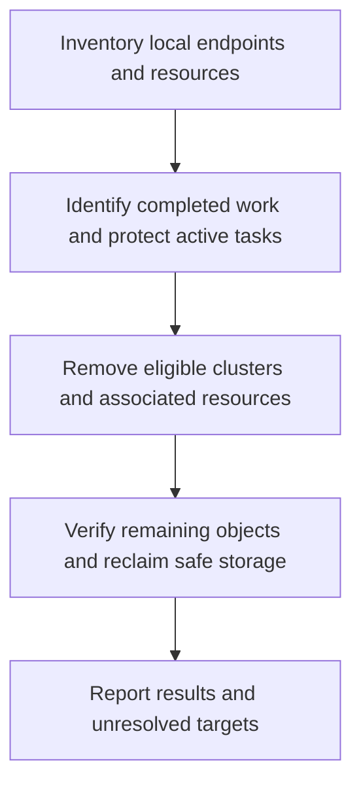

# Ephemeral Container Cleanup - Plan

## Goal Capsule

- Objective: Keep this PC's SSD free of container and local Kubernetes data left behind by completed development work.
- Means: Shared agent cleanup instructions and a one-time local cleanup (KTD1, KTD2).
- Authority: The user's agreed scope governs requirements; repository instructions govern implementation and shipping.
- Execution profile: One PR for the instruction and test changes, plus a local operational cleanup. The implementing agent finishes both and reports any protected or unreachable resources.
- Stop conditions: Do not delete remote resources or resources belonging to another active task. An uncertain target remains unresolved, not silently counted as cleaned.

## Product Contract

### Summary

Require development containers and local Kubernetes clusters to be temporary, and clean up this PC's completed local development environments once.

### Problem Frame

Development deployments were left running and accumulated container data. A previous cleanup thread also required reclaiming space from a Podman WSL virtual disk. Merely stopping services or pruning unused objects does not establish that development data is gone.

### Requirements

**Shared instructions**

- R1. All managed harnesses receive the same cleanup policy through their existing native user-scope instruction adapters, including their T3 launches.
- R2. Before provisioning, identify task-owned resources so cleanup can remove all task-created or downloaded clusters, containers, images, volumes, networks, build caches, and temporary data without deleting another active task's resources.
- R3. Volumes are temporary. After use, delete them regardless of whether they predate the current cleanup; age, reuse, and debugging are not reasons to keep them. A different active task's resources remain that task's cleanup responsibility.
- R4. Clean up after success, failure, and orderly cancellation. On resuming after a forced interruption, resolve leftover task resources. Verify zero remaining task-owned volumes and other disposable resources before reporting cleanup complete; report any failures precisely.
- R5. Check storage reclamation separately from object deletion. Report unreclaimed virtual-disk space and reclaim it only without interrupting another active task.

**One-time local cleanup**

- R6. Inventory this PC's local runtimes and clusters afresh, remove completed development clusters and their associated disposable resources, and report the before/after inventory and SSD free space.
- R7. Protect other active tasks, remote clusters, installed runtime binaries, credentials, and unrelated host files. Neither a running container nor an old volume alone establishes active-task ownership.

### Key Decisions

- **Task-scoped cleanup with active-task protection.** Governs R2, R7. (session-settled: user-directed — chosen over indiscriminate whole-environment deletion: preserve other ongoing work.)
- **No retained development volumes.** Governs R3, R4. (session-settled: user-directed — chosen over preserving existing volumes by default: finished development work must not retain its storage.)

### Scope Boundaries

No automatic cleanup daemon, storage quota, unrelated build-directory cleanup, runtime uninstallation, remote-cluster deletion, or broad personal dotfile application. Instructions cannot guarantee cleanup after a process is killed; R4 makes recovery explicit. The one-time cleanup is executed on this PC, not installed as a recurring bootstrap hook.

## Planning Contract

### Key Technical Decisions

- KTD1. Add an English section after the writing policy in the baseline branch of `home/.chezmoitemplates/agent-instructions`. Keep the T3-only branch separate. Existing adapters already include the shared template; no adapter duplication is needed. Implements R1-R5.
- KTD2. Use the installed runtime and cluster managers' native inventory and removal mechanisms for R6-R7. Inspect endpoint locality and resource labels before mutation. Enumerate distinct reachable local stores, including Podman rootless/rootful stores when present, without treating an unreachable store as empty. Bind each destructive operation to an identified local endpoint and resource; avoid a blanket prune where protected resources share storage.
- KTD3. Extend `tests/test_agent_instructions.py` using its disposable rendering fixture. Verify distribution and T3 exclusion rather than attempting to prove model obedience with string checks.

### Operational Sequence

### Assumptions and Execution-Time Checks

Live cluster names, runtime availability, ownership evidence, and disk allocation must be discovered during execution. Prior thread observations are background, not current inventory. If virtual-disk compaction needs exclusive access that cannot be established, record it as unfinished storage reclamation. Keep any machine-specific inventory in a local scratch report rather than publishing private configuration in the PR.

## Implementation Units

### U1. Add and verify the shared policy

- Goal: Deliver R1-R5 through KTD1 and KTD3.
- Dependencies: None.
- Files: `home/.chezmoitemplates/agent-instructions`, `tests/test_agent_instructions.py`.
- Approach: Add a concise baseline section, retaining the existing writing section and harness routing. Extend the existing test fixture to extract and compare the new section.
- Test scenarios: Render each baseline adapter and require exactly one identical cleanup section. Render each T3 addition and require no duplicate cleanup section. Retain existing writing and delegation policy checks.
- Verification: The isolated rendering tests pass. Review the policy against R2-R5, including failure and interruption handling. These tests catch template distribution errors, not actual agent behavior.

### U2. Clean this PC's completed local environments

- Goal: Execute R6-R7 using KTD2 and verify R5.
- Dependencies: U1.
- Files: No production cleanup script; local scratch report only.
- Approach: Collect a fresh inventory, establish local targets and activity, remove eligible clusters before remaining dependent objects, then check object inventory and host disk space. Remove stale local context entries only when tied to a deleted cluster; preserve remote contexts and credentials.
- Test expectation: No new automated test for a one-time operational action. Re-query native inventories and connection health after cleanup; record protected or inaccessible resources explicitly.
- Verification: Every identified eligible local cluster and associated disposable resource is removed, or named as unresolved. No protected active-task resource is removed. Report whether disk reclamation completed independently of logical deletion.

## Verification Contract

Run `python -m unittest discover -s tests -p test_agent_instructions.py` for the real adapter renderings in a disposable home. Check the diff for unrelated changes and whitespace errors. Do not apply personal chezmoi configuration during validation. For U2, capture fresh native inventory evidence and host free-space readings; never infer success solely from a command's exit code. There is no browser surface in this change.

## Definition of Done

The shared policy is present in all baseline renderings exactly once and excluded from T3 additions. The required isolated tests pass. The one-time cleanup has verified outcomes and a truthful report of anything protected or unresolved. The PR contains only the plan, policy, and relevant tests. No temporary cleanup scripts, abandoned implementation attempts, or unrelated tool-lock changes remain in the diff.
