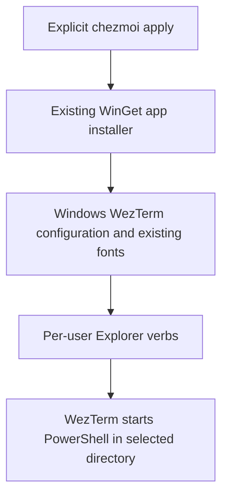

# Windows WezTerm - Plan

## Goal Capsule

Make WezTerm the Windows user's terminal launcher, with Jetendard and PowerShell 7, while Linux and macOS retain Ghostty.
Deliver one PR through the existing chezmoi application lifecycle.
Personal settings change only during explicit application; bootstrap and verification leave personal settings untouched.
Stop if native configuration cannot be loaded or Explorer commands cannot preserve the selected directory.

## Product Contract

### Requirements

**Windows terminal**

- R1. Explicit application installs WezTerm through the existing Windows application owner without upgrading an existing installation.
- R2. WezTerm uses Jetendard and launches PowerShell 7 with its normal profile; other preferences retain WezTerm defaults.
- R3. Explorer offers Open WezTerm Here for a selected directory and a directory background, forwarding that directory to WezTerm.

**Boundaries**

- R4. Leave Windows system default-terminal delegation and unrelated registry settings unchanged.
- R5. Keep Linux/macOS Ghostty unchanged and worktree bootstrap read-only for personal settings.
- R6. Reapplication repairs managed Explorer entries without duplicating them or removing unrelated verbs.

### Scope Boundaries

System console redirection, COM adapters, WSL defaults, themes, shared key bindings, and terminal retirement are excluded.
Windows 11 may expose classic Explorer verbs under Show more options.
Existing alternative WezTerm configuration files or explicit config overrides can take precedence; document this instead of deleting personal files.

## Planning Contract

### Key Technical Decisions

- KTD1. Add `wez.wezterm` to `home/.chezmoidata/windows.yaml`, using the existing WinGet owner and its no-upgrade policy (R1).
- KTD2. Manage Windows-only `~/.wezterm.lua` with Jetendard and `pwsh.exe` (R2). (session-settled: user-directed — chosen over appearance and shortcut parity: only the font needs to match Ghostty.)
- KTD3. Select PowerShell 7 rather than WezTerm's COMSPEC/cmd default (R2). (session-settled: user-approved — chosen over cmd.exe: use the PowerShell already managed by this repository.)
- KTD4. Register classic per-user Explorer verbs through an idempotent PowerShell helper after applications and fonts are installed (R3, R6). Resolve WezTerm through application discovery or standard install locations so first apply does not require a refreshed PATH. Quote executable and directory arguments, including drive roots.
- KTD5. Leave `HKCU\Console\%%Startup` untouched (R4). (session-settled: user-approved — chosen over registry default-terminal replacement: WezTerm lacks the required COM handoff implementation.)

### Design

The following describes ownership and ordering, not implementation syntax.

Use a registry-root parameter for disposable test keys, following `scripts/windows-long-paths.ps1` and `tests/test_windows_long_paths.py`.
Use the upstream verb name where practical to avoid duplicate HKLM/HKCU installer entries.
A missing executable must fail clearly before registering a broken launcher.

### Assumptions and Risks

The managed Windows desktop supports the upstream WinGet package.
No actual personal apply is part of implementation; installer tests use command doubles and native runtime checks use a disposable home.
An existing XDG, portable, or explicitly selected configuration can take precedence over `~/.wezterm.lua`.

## Implementation Units

### U1. Add Windows WezTerm configuration

- Files: `home/.chezmoidata/windows.yaml`, `home/dot_wezterm.lua`, `home/.chezmoiignore`.
- Implements R1, R2, R5 and KTD1-KTD3.
- Use the upstream Lua configuration API; exclude the file on non-Windows platforms.
- Test disposable Windows configuration rendering and POSIX exclusion. Reuse WinGet tests for existing installation retention and failure reporting.

### U2. Add Explorer launch integration

- Files: `scripts/windows-wezterm.ps1`, `home/.chezmoiscripts/run_after_35-windows-wezterm.ps1.tmpl`, `tests/test_windows_wezterm.py`, `scripts/run-test-area.py`.
- Implements R3-R6 and KTD4-KTD5.
- Test fresh and repeated disposable registry application, repair, preservation of unrelated verbs and values, paths with spaces/Unicode, drive-root quoting, and missing-executable failure without partial registration.
- Verify both command forms launch native WezTerm with a disposable config and a PowerShell probe reporting its working directory.

### U3. Document and verify the terminal boundary

- Files: `docs/guides/terminal.md`, Windows tests from U2.
- Implements R1-R6.
- Document explicit apply, managed preference replacement, Explorer menu location, configuration precedence, and the system-default limitation with upstream references.
- Run focused Windows tests, lifecycle/bootstrap tests, and CI ownership validation.

## Verification Contract

Run `python -m unittest discover -s tests -p test_windows_wezterm.py -v` and existing Windows apps, bootstrap, script lifecycle, and CI ownership suites.
Use native PowerShell 5.1 for helper compatibility checks.
Use native WezTerm to load generated Lua and start PowerShell in a temporary directory when its executable is installed or a portable upstream build can be staged outside personal configuration.
Do not install applications or update the user's actual registry for testing.
Run `mise install` and confirm its hook remains hook-free and only enumerates managed files.

## Definition of Done

Requirements have observable verification, tests belong to the platform CI area, and documentation describes the system-default limitation accurately.
The implementation is committed, reviewed, pushed as an open PR, and CI is reported with unavailable native checks explicitly named.

## Sources

- `home/.chezmoiscripts/run_onchange_before_20-install-windows-apps.ps1.tmpl`: Windows installation ownership.
- `home/.chezmoitemplates/ghostty-config`: existing Jetendard setting.
- [WezTerm Windows installation](https://wezterm.org/install/windows.html): WinGet package.
- [WezTerm configuration discovery](https://wezterm.org/config/files.html): locations and precedence.
- [WezTerm program launching](https://wezterm.org/config/launch.html): shell selection and cwd forwarding.
- [WezTerm default-terminal request](https://github.com/wezterm/wezterm/issues/7534): missing COM handoff support.
