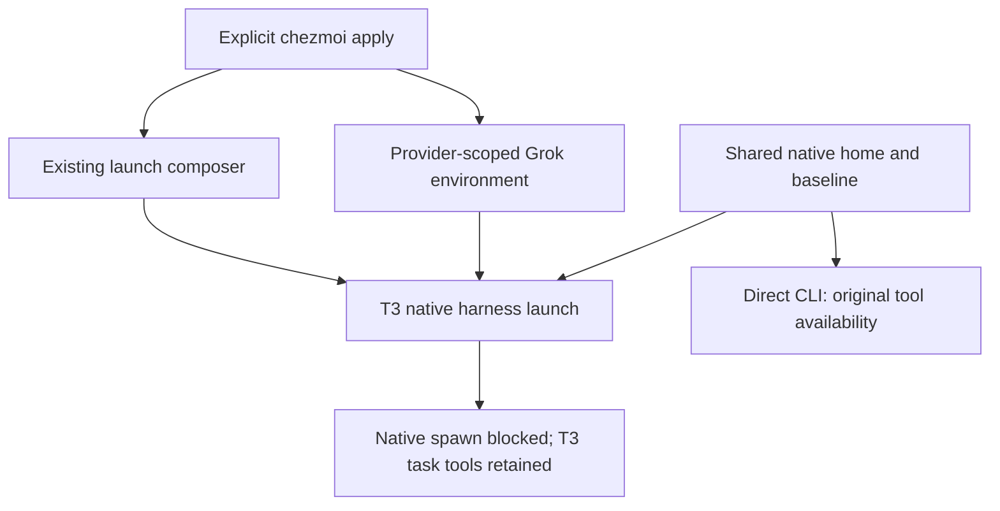

# T3 native subagent controls - Plan

## Goal Capsule

- **Objective:** The owner keeps delegated work under T3 Code task management by preventing native subagent spawning in supported T3-launched harnesses.
- **Means:** Extend native launch reconciliation and provider environment management (KTD1-KTD3).
- **Product authority:** The confirmed brainstorm scope and this Product Contract govern behavior; repository instructions govern integration.
- **Execution profile:** One PR; LFG owns implementation, verification, review, and publication. Merging remains with the owner.
- **Stop conditions:** A settled decision proves infeasible or required verification is refused; do not apply personal settings.
- **Open blockers:** None; native enforcement and adapter compatibility remain execution-time verification work.

---

## Product Contract

### Summary

Add T3-only native subagent controls for Codex, Claude Code, and Grok where their supported launch mechanisms permit them.
Keep existing prompt instructions, skip pi, and retain Antigravity's current behavior.

### Problem Frame

The repository already instructs T3-launched agents to delegate through T3 tools.
That instruction does not remove native subagent tools, leaving a competing delegation route available to the model.
The owner wants stronger enforcement within T3 while retaining ordinary terminal CLI behavior.

### Key Decisions

- **T3-only enforcement.** Governs R1, R4. (session-settled: user-directed — chosen over global CLI disablement: direct terminal sessions must retain their current behavior.)
- **Native controls supplement prompts.** Governs R2, R5. (session-settled: user-directed — chosen over replacing existing prompt restrictions: the owner explicitly wants the current instructions retained.)
- **Apply controls to Codex, Claude Code, and Grok where supported.** Governs R1, R8. (session-settled: user-directed — chosen over limiting investigation to Codex and Claude: supported repository-managed T3 harnesses should be covered and limitations recorded.)
- **Skip pi and retain Antigravity's current restrictions.** Governs R6. (session-settled: user-directed — chosen over extending controls to every harness: pi has no built-in subagents, and Antigravity remains constrained through its current prompt-based behavior.)

### Requirements

**Native enforcement and T3 delegation**

- R1. Configure native subagent suppression only for T3-launched Codex, Claude Code, and Grok sessions on eligible managed platforms, using supported per-launch CLI or equivalent environment options.
- R2. Prevent spawning through each covered harness's native subagent tools rather than relying solely on instructions to avoid them.
- R3. Keep T3's delegation tools available and usable, including `delegate_task` and its task lifecycle.

**Isolation and preservation**

- R4. Leave directly launched terminal CLI behavior, native account homes, credentials, and shared harness configuration unchanged by these controls.
- R5. Preserve all existing prompt instructions and their delivery behavior, including the T3-only delegation policy.
- R6. Add no pi subagent controls or new Antigravity enforcement or prompt-delivery mechanism; preserve their existing behavior.
- R7. Preserve unrelated provider launch options and environment entries, and reconcile the managed controls idempotently through explicit chezmoi application.

**Evidence and limitations**

- R8. Record exact harness, adapter, version, and platform limitations whenever native suppression cannot be delivered or verified; distinguish supported configuration from observed enforcement.
- R9. Verify R2-R5 with effective native tool or request evidence for fresh and resumed T3 sessions, plus concurrent and subsequent direct CLI sessions.

### Acceptance Examples

- AE1. **Covers R1-R3, R8-R9.** Given a fresh T3 session for each covered harness, native subagent spawning is unavailable or rejected while a bounded T3 child task can still run and return its result; unavailable checks are reported with their cause.
- AE2. **Covers R4, R9.** Given the same baseline home and configuration, direct CLI sessions run concurrently with and after the controlled T3 session retain their original native subagent availability.
- AE3. **Covers R2-R3, R8-R9.** Given a resumed T3 session, native spawning remains blocked and T3 delegation remains usable; lifecycle states that cannot be verified are identified rather than assumed covered.
- AE4. **Covers R5-R7.** Given existing launch arguments, provider environment entries, and prompt additions, repeated application preserves unrelated values and prompt delivery without duplicating managed controls.
- AE5. **Covers R6.** Given pi or Antigravity provider configuration, applying this change introduces no new suppression controls and leaves the current prompt behavior intact.

### Scope Boundaries

- R1 defines the active harness and launch scope; R6 defines the pi and Antigravity exclusions.
- This work blocks native subagent tools; it does not sandbox shell execution or prevent an agent from invoking another CLI through a general command tool.
- User-installed pi extension subagents, new harness onboarding, T3 application forks, and new orchestration systems are outside this work.
- Personal configuration is applied only through the repository's explicit apply workflow; bootstrap remains read-only with respect to personal settings.
- This is a launch policy rather than a new user workflow; Requirements and Acceptance Examples define the behavior without a separate flow model.

### Dependencies / Assumptions

- Native controls are candidates supported by documentation and installed CLI help; no disabled native request or successful T3 delegation under those controls has been observed in this brainstorm.
- Codex exposes `multi_agent` and alternate multiagent feature entries; planning must establish which active paths need suppression rather than assume one flag covers every path.
- Claude's documented `Agent` tool and legacy `Task` alias require effective SDK tool-list and option-precedence verification.
- Grok's documented `GROK_SUBAGENTS=0` is a candidate provider-scoped alternative to CLI arguments because the recorded T3 0.1.7 Grok adapter lacks `launchArgs` support.
- Antigravity's prompt-based behavior is retained at its current level, not upgraded or newly verified; the repository documents no supported T3-only native prompt addition for that adapter.

### Outstanding Questions

**Deferred to Implementation**

- Confirm the candidate native controls in KTD1-KTD3 against effective native requests, including alternate Codex multiagent modes.
- Establish the supported lifecycle and platform coverage through U3; record unavailable methods under R8.

### Sources / Research

- `scripts/t3-instructions.py:158` and `tests/test_t3_instructions.py:35`: existing provider-scoped launch composition, override handling, and idempotence.
- `tests/smoke_t3_instructions.py:494` and `docs/guides/t3-code.md:82`: shared baseline homes, direct CLI isolation, native request capture, and adapter limitations.
- `home/.chezmoitemplates/t3-code-settings:45`: managed Codex, Claude, pi, and Grok provider configuration, provider environment handling, and preserved Antigravity configuration.
- `home/.chezmoitemplates/agent-instructions:1`: existing T3-only delegation instructions.
- `home/private_dot_pi/private_agent/private_dotfiles-policy.ts:1`: the managed pi policy adds provider/model constraints rather than a subagent tool.
- `.compound-engineering/artifacts/plans/2026-11-09-0127-fix-t3-managed-ce-delegation-plan.md`: prior prompt-routing requirements and the boundary between instruction delivery and tool enforcement.
- [OpenAI configuration reference](https://developers.openai.com/codex/config-reference/): `features.multi_agent`; installed Codex 0.167.0 help also exposes per-invocation feature disablement for app-server.
- [Claude CLI reference](https://code.claude.com/docs/en/cli-reference) and [subagent documentation](https://code.claude.com/docs/en/sub-agents): tool deny options and `Agent`/`Task` semantics.
- [Grok subagent documentation](https://github.com/xai-org/grok-build/blob/main/crates/codegen/xai-grok-pager/docs/user-guide/16-subagents.md#disabling-subagents): CLI/environment/config precedence and applicability to stdio execution.
- [pi coding-agent README](https://github.com/earendil-works/pi/blob/main/packages/coding-agent/README.md): no built-in subagents; extensions can add features.

---

## Planning Contract

**Product Contract preservation:** No behavior or scope change; the technical questions now point to the execution-time checks below.

### Key Technical Decisions

- KTD1. **Extend the existing composer for Codex and Claude.** Add suppression after Codex selects its effective launch override, and merge Claude native tool denials without replacing other deny rules; this reuses the proven prompt/environment boundary instead of another launcher. Implements R1-R5, R7.
- KTD2. **Keep control ownership separate from prompt ownership.** Retain suppression when an addition file is absent or empty, while preserving existing prompt removal behavior; track the managed argument contribution alongside schema-1 base/last state so later user edits do not duplicate controls or consume pre-existing values. Implements R2, R5, R7.
- KTD3. **Use Grok provider environment.** Reconcile exactly one `GROK_SUBAGENTS=0` entry with Windows-aware name matching in the existing template; its stdio semantics are documented upstream, while the current T3 adapter has no launch-argument path. Implements R1, R4, R6-R8.
- KTD4. **Prove effective tools at the native request boundary.** Extend existing disposable-home loopback fixtures, preserving their context assertions and adding direct-CLI native-tool baselines; tool advertising and actual T3 task execution are separate evidence. Implements R3-R5, R8-R9.

### High-Level Technical Design

### Assumptions and Execution-Time Decisions

- Start with Codex `features.multi_agent=false` and verify alternate active multiagent modes before fixing the supported control set; removed feature entries are not usable options.
- Start with Claude's bare `Agent` denial; establish alias and repeated-option behavior using the installed native binary before selecting its merged spelling.
- Managed suppression wins conflicting provider-local edits on repeated apply, per repository precedence; unrelated flags, denied tools, and environment entries remain user-owned.
- Saved launch changes take effect on a new native process after the documented T3 close/apply/relaunch workflow; they do not cancel running native children.
- Prefer fixture model responses and inert loopback credentials; authenticated model behavior and other eligible platforms require separate evidence rather than inferred passes.
- This is a narrow extension of existing composition, not a new launcher or shared abstraction; no costly unresolved mechanism warrants a bake-off.

## Implementation Units

### U1. Compose native Codex and Claude controls

- **Goal:** Add suppression at the existing native launch boundary with ownership-safe reapplication.
- **Requirements:** R1-R5, R7; AE1-AE4; KTD1-KTD2.
- **Files:** `scripts/t3-instructions.py`, `tests/test_t3_instructions.py`.
- **Approach:** Preserve effective override and prompt composition; extend saved contribution tracking compatibly with existing schema-1 records and keep prompt cleanup independent of suppression.
- **Test scenarios:** Pre-existing feature enable/config spellings still resolve to disabled spawning; provider overrides beat inherited arguments without bypassing controls; Claude retains pre-existing deny rules and append text; two applies are identical; unrelated later edits survive; empty/missing additions remove only prompt contributions; old state migrates without duplicated controls; failed publication remains retryable.
- **Verification:** Focused composer tests and native candidate-control request characterization under U3.
- **Execution note:** Inspect the existing tests and characterize native option semantics before committing to the final spellings.

### U2. Reconcile Grok suppression environment

- **Goal:** Add provider-local suppression without adding unsupported launch arguments.
- **Requirements:** R1, R4, R6-R8; AE1-AE2, AE4-AE5; KTD3.
- **Files:** `home/.chezmoitemplates/t3-code-settings`, `tests/test_grok.py`, `tests/test_t3_code_settings.py`.
- **Approach:** Extend the existing updater environment transformation to own only the suppression name and preserve unrelated entries, including secret references.
- **Test scenarios:** Existing conflicting and duplicate suppression entries converge to one zero value; Windows case variants converge; unrelated entries survive; repeated apply is identical; pi and Antigravity remain unchanged; the Grok provider gains no launchArgs.
- **Verification:** Grok and T3 settings-template tests, then effective adapter delivery under U3.
- **Dependencies:** Integrate after U1 so the combined native-fixture checks have a stable control contract.

### U3. Verify native tools and document exact coverage

- **Goal:** Establish supported enforcement, T3 delegation, CLI isolation, and lifecycle evidence.
- **Requirements:** R2-R9; AE1-AE5; KTD4.
- **Files:** `tests/smoke_t3_instructions.py`, `tests/smoke_grok.py`, focused assertion tests as needed, `docs/guides/t3-code.md`, `docs/maintenance/development-and-testing.md` when commands or coverage change.
- **Approach:** Add effective native-tool checks to the existing fresh/mode/resume/compaction requests; compare concurrent and later direct CLI requests with native tools enabled. Extend Grok's readiness-only fixture to capture an actual provider request. Exercise a bounded T3 child and result when the fixture transport supports it, otherwise name the exact missing execution evidence.
- **Test scenarios:** Native spawn tools absent or native invocation rejected while T3 task tools remain discoverable; a bounded T3 task returns a validated result; older pre-control and newly controlled conversations resume under controls after relaunch; tool state persists after completed compaction; direct CLI retains baseline tools; existing instruction/CE assertions still pass; every process and disposable home is cleaned up.
- **Verification:** Run native disposable-home smokes on the current eligible platform and report precise adapter/version/platform gaps under R8.
- **Dependencies:** U1 and U2.

---

## Verification Contract

Run `python3 -B -m unittest discover -s tests -p test_t3_instructions.py`, then the same command for `test_grok.py`, `test_t3_code_settings.py`, and `test_agent_instructions.py`.
Run `mise exec chezmoi python gh -- python tests/smoke_t3_instructions.py` and `mise exec chezmoi python gh -- python tests/smoke_grok.py --t3`, using their existing local-asset flags if downloads are unavailable.
The native fixtures must retain baseline/prompt and CE assertions while adding tool-state evidence; a configured flag or a ready provider is not enforcement evidence.
Record actual binaries, platform, lifecycle states, completed task evidence, and unavailable checks in the guide or PR.
Run `git diff --check`, simplify the implementation, complete independent code review, and resolve eligible findings before publication.
No personal apply, shadow home, account modification, or container runtime is needed.

---

## Definition of Done

U1-U2 reconcile controls without altering existing prompts, unrelated settings, pi, or Antigravity behavior.
U3 establishes observed native tool suppression and CLI isolation for supported local adapters, with T3 execution and unverified coverage reported separately under R8.
Focused checks pass, temporary fixture processes and homes are removed, and abandoned experimental code is absent from the diff.
The reviewed change is committed and published as one open PR; CI is decided or handed to T3's PR watcher while checks run.
