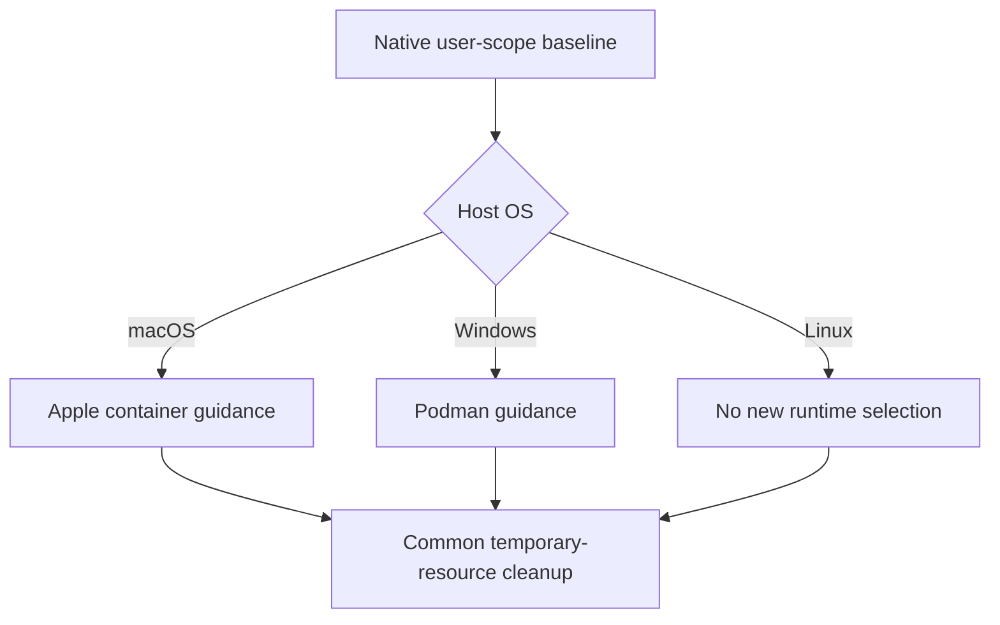

# macOS Container and OS-Specific Harness Instructions - Plan

## Goal Capsule

- **Objective:** The repository owner can use temporary container environments with each managed harness choosing the runtime appropriate to the host OS.
- **Means:** Install Apple container on supported macOS hosts and provide OS-specific runtime guidance through the shared harness instructions.
- **Authority:** The confirmed user scope governs behavior; `AGENTS.md` governs repository integration and bootstrap boundaries.
- **Execution profile:** One PR; the implementing agent verifies and ships the complete change.
- **Open blockers:** None.

---

## Product Contract

### Summary

Add Apple container to macOS provisioning and make it the default for temporary container work on macOS.
Provide Windows-only Podman guidance while retaining the common cleanup policy for every OS.
Report unsupported work and agree on an alternative before changing runtimes or adding compatibility tools.

### Problem Frame

macOS provisioning currently omits a container runtime, and the common harness policy only governs cleanup.
The owner needs consistent runtime selection for temporary work across native and T3 launches.

### Key Decisions

- **Broad temporary workload coverage.** Governs R3, R7. (session-settled: user-directed — chosen over limiting use to one-off test containers: the owner wants container used across container-related work, without persistent services.)
- **Discuss compatibility gaps before switching.** Governs R5. (session-settled: user-directed — chosen over automatic Docker/Podman fallback or adding compatibility layers now: the owner selected reporting the limitation and agreeing on an alternative.)
- **OS-specific selection, shared cleanup.** Governs R4, R7, R9. Runtime choice varies by host, while the existing cleanup obligations remain common.

### Requirements

**Provisioning**

- R1. Explicit configuration application must make Apple container available on native Apple Silicon macOS 26 or later, with repeat applications following the existing host-package update policy.
- R2. Worktree bootstrap and configuration previews must remain read-only for personal configuration and container runtime state.

**Runtime guidance**

- R3. On macOS, shared harness instructions must select Apple container by default for container-related development work, including image builds, execution, testing, and supported image, network, and volume operations.
- R4. Podman runtime guidance must be Windows-only, with neither OS-specific runtime selection imposed on Linux.
- R5. When the installed container version cannot perform a required operation, the harness must explain the concrete limitation and agree on an alternative with the user before using another runtime or installing compatibility tools.

**Runtime lifecycle and preservation**

- R6. Runtime startup must be driven by an active task's needs; configuration application must neither start it nor enable startup at login.
- R7. All container work must remain temporary under the existing common cleanup policy in `home/.chezmoitemplates/agent-instructions`, including its task ownership, active-task protection, volume removal, and storage-reclamation obligations.
- R8. Adding container must not uninstall or reset existing Docker/Podman setups, credentials, or machine data; existing package updates and optional credential reconciliation remain unchanged.

**Instruction distribution**

- R9. Each managed harness must receive the applicable OS guidance exactly once through its native user-scope baseline, with T3 launches inheriting that same baseline without duplicating it in T3-only additions.

### Key Flows

- F1. **Configuration application.** The owner explicitly applies configuration on a supported macOS host, receives the tool and applicable instructions, then repeats application successfully. **Covers R1, R6, R8, R9.**
- F2. **Container task.** The harness selects the host's runtime, checks whether the requested operation is supported, starts the runtime when needed, performs the work, and completes task-owned cleanup. A capability gap invokes the agreement required by R5. **Covers R3-R7.**
- F3. **Native or T3 launch.** The harness loads its native baseline and, for a T3 launch, receives the separate T3 additions. **Covers R9.**

The host-selection boundary in R3, R4, and R9 is:

### Acceptance Examples

- AE1. **Covers R1, R6, R8.** On a supported macOS home with an existing Podman installation, apply makes the container CLI available and succeeds again on reapply. It starts no runtime, enables no login startup, and preserves the existing Podman configuration and machine data.
- AE2. **Covers R2.** Preparing a new worktree with `mise install`, or previewing the configuration, performs no personal configuration application, container host-package installation, or runtime operation.
- AE3. **Covers R3, R4, R9.** Disposable-home renderings for all five managed baseline adapters show container guidance only on macOS and Podman guidance only on Windows. Linux receives neither selection; the three T3 additions contain no copy of that guidance, and native/T3 baseline content remains identical for a given host.
- AE4. **Covers R5.** A project requires a Compose or Docker API feature unavailable through the installed container version. The harness reports that gap and discusses alternatives instead of silently invoking Docker/Podman, installing a compatibility layer, or claiming the operation succeeded.
- AE5. **Covers R6, R7.** Two tasks share a running runtime. When one finishes, it removes and verifies its own disposable resources under the common policy while protecting the other task's resources and runtime availability.

### Scope Boundaries

- Linux runtime selection remains unchanged under R4.
- Additional Compose/Docker API compatibility layers and fallback runtimes are deferred under R5.
- New orchestration tooling, persistent workload setup, and a one-time cleanup of existing host resources are outside this change.
- Windows Podman provisioning and manual engine initialization remain unchanged.
- Apple-native registry credential enrollment is a separate integration; this change does not extend the existing Docker/Podman helper-enrollment feature.

### Dependencies and Assumptions

Apple container's published support requirements match the repository's current native Apple Silicon macOS 26+ boundary.
Feature availability must be checked against the installed release; upstream documentation for the main branch is not proof that a shipped version supports an operation.

The current shared template has OS-neutral cleanup rules but no Podman runtime-selection instruction.
R4 therefore adds an explicit Windows selection rather than moving an existing Podman-specific block.

The optional registry-enrollment path currently requires a Docker or Podman client and writes their credential-helper configuration.
That behavior does not establish Apple-native registry authentication support, and a container-only host with enrollment needs that limitation documented without silently adding an alternate runtime, per R5.

### Sources

- [Homebrew container formula](https://raw.githubusercontent.com/Homebrew/homebrew-core/HEAD/Formula/c/container.rb) and [upstream service teardown](https://raw.githubusercontent.com/apple/container/1.7.1/scripts/ensure-container-stopped.sh): package maintenance unloads container services across current-user launchd domains; KTD4 protects active work.

- `scripts/macos-apps.sh`, `home/.chezmoidata/macos.yaml`, and `docs/setup/macos.md`: current host-package lifecycle, platform boundary, and existing Podman exclusion.
- `home/.chezmoidata/windows.yaml` and `docs/setup/windows.md`: Podman Desktop installation and manual engine setup.
- `home/.chezmoitemplates/agent-instructions` and `tests/test_agent_instructions.py`: common cleanup, native adapters, and separation of T3 additions; current rendering tests use the executing host OS.
- `scripts/macos-readiness.py`: current read-only checks require neither Podman nor container; command availability is distinct from execution evidence.
- `scripts/container-auth.py`: optional Docker/Podman credential-helper enrollment and client prerequisite.
- [Apple container requirements](https://github.com/apple/container#requirements), [Homebrew formula](https://formulae.brew.sh/formula/container), and [Apple command reference](https://github.com/apple/container/blob/main/docs/command-reference.md): platform support, installation availability, and native operations, checked 2026-11-09.
- [Apple maintainer API discussion](https://github.com/apple/container/discussions/855): context for treating Docker API compatibility as a separate capability rather than assuming it.

---

## Planning Contract

Product Contract unchanged; a Problem Frame was added without changing R/F/AE meanings or IDs.

### Key Technical Decisions

- KTD1. **Extend the existing host-package declaration.** Add the Homebrew `container` formula to `home/.chezmoidata/macos.yaml` and the command to the read-only readiness inventory. The existing macOS application hook already handles platform checks, installation, and updates; no new installer, service hook, or mise tool declaration is needed. Implements R1, R2, R6, R8.
- KTD4. **Require quiescent container services before package mutation.** Homebrew's formula runs `ensure-container-stopped.sh -a` after installation or upgrade. Inspect the same current-user launchd domains before container installation and global package upgrade, and refuse application when container services are registered or domain inspection fails. Treat a positively identified absent domain as empty. This prevents package maintenance from interrupting another task under R7; do not automatically stop services or silently exclude container from updates. The check is not a lock against an unrelated task starting afterward, so document keeping the runtime stopped throughout application.
- KTD2. **Branch once in the common baseline.** Select macOS and Windows instructions in `home/.chezmoitemplates/agent-instructions` using the native chezmoi OS value, leaving the cleanup section common. Normalize the Grok adapter's context to the same `.chezmoi` object used by the other baseline adapters; keep T3-only additions separate. Implements R3-R7, R9.
- KTD3. **Prove distribution through real adapter renderings.** Extend `tests/test_agent_instructions.py` to feed explicit macOS, Windows, and Linux contexts through all five real baseline and three T3 adapters. Keep the native-host assertions as regression coverage. This seam detects template/context mistakes, not model obedience. Implements R4, R9.

### Assumptions

The existing Homebrew formula lifecycle is sufficient for installing the CLI; first-use runtime startup and any kernel acquisition remain explicit task operations under R6.
Native execution evidence depends on an eligible installed runtime and an isolated account or established task ownership; missing evidence must be disclosed rather than inferred from fixture tests.

## Implementation Units

### U1. Provision container without runtime side effects

- **Goal:** Add the macOS host tool and read-only command detection.
- **Requirements:** R1, R2, R6, R8; F1; KTD1.
- **Dependencies:** None.
- **Files:** `home/.chezmoidata/macos.yaml`, `scripts/macos-apps.sh`, `scripts/macos-readiness.py`, `tests/test_macos_apps.py`, `tests/test_macos_bootstrap.py`, `tests/test_macos_readiness.py`.
- **Approach:** Reuse the existing formula loop and readiness command inventory, adding the read-only preflight in KTD4. Extend the current fake-Homebrew fixture rather than introducing a second provisioning path.
- **Test scenarios:**
  - Covers AE1. Fresh application installs the declared container formula once; repeat application uses the existing update policy and never invokes runtime lifecycle commands.
  - Covers AE5. Loaded container services in either affected launchd domain, or an inspection error, prevent the corresponding package mutation without stopping services; a positively absent GUI domain permits headless application.
  - A service appearing after package-metadata refresh is detected by the check before upgrade.
  - Covers AE1. Existing Podman executable and machine state remain intact.
  - Covers AE2. Existing bootstrap tests continue to prove that preparation does not run personal apply hooks.
  - Readiness detects present or absent container by PATH lookup without invoking it or marking runtime execution proven.
- **Verification:** The macOS application and readiness fixtures pass without changing the real account.

### U2. Distribute host-specific runtime instructions

- **Goal:** Make every baseline select the host runtime consistently.
- **Requirements:** R3-R7, R9; F2, F3; KTD2, KTD3.
- **Dependencies:** None.
- **Files:** `home/.chezmoitemplates/agent-instructions`, `home/private_dot_grok/private_empty_AGENTS.md.tmpl`, `tests/test_agent_instructions.py`.
- **Approach:** Add concise OS branches after the shared cleanup policy. Cover on-demand startup and unsupported-operation reporting in the macOS branch, and Podman selection in the Windows branch; reuse the common cleanup authority.
- **Test scenarios:**
  - Covers AE3. All five baseline adapters contain identical applicable runtime guidance exactly once for each of macOS, Windows, and Linux.
  - Covers AE3. All three T3 additions contain no runtime or cleanup baseline copy on any OS, while retaining their delegation policy.
  - Covers AE4. macOS guidance requires capability checking and agreement before fallback.
  - Covers AE5. The common cleanup section remains identical across all hosts and protects other active tasks.
- **Verification:** Real chezmoi renderings exercise the actual adapters with isolated source/config/home paths and retain the existing writing/delegation checks.

### U3. Document first use and verification boundaries

- **Goal:** Explain installation, task startup, compatibility limits, and cleanup.
- **Requirements:** R1-R9; F1-F3.
- **Dependencies:** U1, U2.
- **Files:** `docs/setup/macos.md`, `docs/setup/windows.md` only if its existing Podman guidance needs clarification.
- **Approach:** Update the macOS package description, fresh-shell command list, and readiness checklist. Document KTD4's application precondition, manual runtime startup, a task-scoped smoke example, and the difference between deleting task resources and stopping a shared runtime. Identify the optional registry-enrollment limitation without changing its implementation.
- **Test expectation:** No documentation-only test; check commands against the official reference and preserve the setup guide's bootstrap/apply boundary.
- **Verification:** The guide agrees with the installed-command checks and R5-R8, and makes no claim of native execution from fixture results.

---

## Verification Contract

Run the targeted Python unittest modules `test_agent_instructions`, `test_macos_apps`, and `test_macos_readiness` through the repository's mise environment.
Then run `scripts/run-test-area.py` for `applications` and `platform` to cover the affected shared adapters and bootstrap/application contracts.
Check whitespace and the final diff.
The existing CI platform matrix supplies additional host coverage.

Do not apply personal settings or install a real host runtime for fixture verification.
If native execution is available safely, inventory the endpoint and task ownership first, exercise a disposable workload, remove all task-owned resources, and verify cleanup under R7.
Otherwise report native execution as unperformed; passing fixtures establish declaration, rendering, and invocation behavior only.
There is no browser surface.

---

## Definition of Done

- U1-U3 satisfy the cited R/F/AE contracts with no personal configuration applied during development.
- OS renderings and affected test areas pass; native execution evidence and any unavailable methods are reported separately.
- The final diff contains no abandoned experiments, new persistent services, or changes to optional registry credential management.
- All task-created disposable resources are removed; no task-owned containers or volumes remain.
