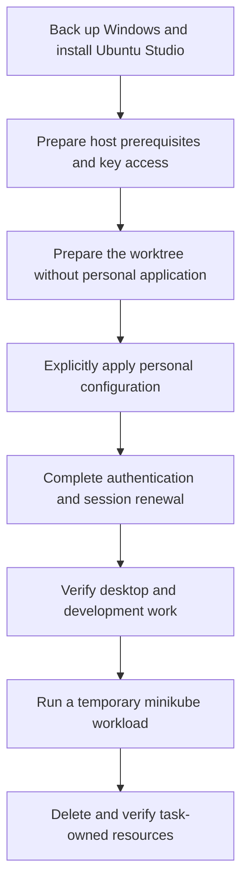
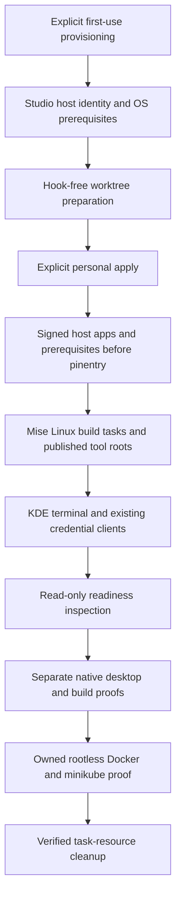
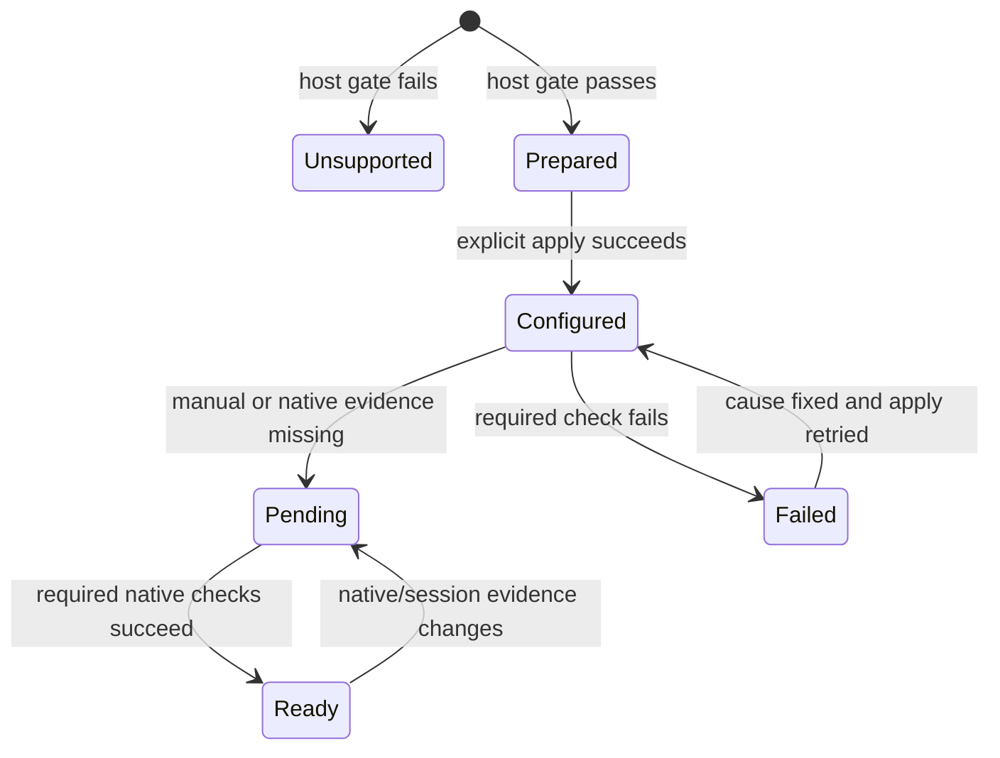

# Ubuntu Studio Workstation - Plan

## Goal Capsule

- **Objective:** Replace one Windows development machine with Ubuntu Studio and continue the work supported by the repository's current macOS environment, including local minikube development.
- **Means:** Prepare and maintain equivalent software and configuration on Ubuntu Studio's native desktop.
- **Product authority:** The owner confirmed the current macOS environment plus minikube as the scope; Windows-only capabilities and OS-specific SDKs are excluded.
- **Execution profile:** One PR, implemented and shipped by the autonomous workflow; the owner performs physical OS installation and account approvals.
- **Open blockers:** None for code implementation. Native Studio GUI/hardware and runtime acceptance remain unverified until performed on an eligible host; an implementation PR is not a workstation-readiness certificate.

---

## Product Contract

### Summary

Support the latest Ubuntu Studio LTS as the repository's only supported Linux workstation environment.
Provide the software and configuration needed for the current macOS work environment, plus minikube, with an installation guide and checks for the machine being migrated.

### Problem Frame

The owner will move one Windows development machine to Ubuntu Studio.
Existing Linux support covers several shared tools, but desktop acceptance is documented for GNOME and Linux lacks the macOS-style native build provisioning flow.
Changing distribution names would leave gaps between a prepared checkout and a workstation ready for daily work.

### Key Decisions

- **Use macOS as the functional baseline.** Governs R3–R8. (session-settled: user-directed — chosen over the union of Windows and macOS capabilities: the owner said the current macOS level is sufficient.)
- **Provide equivalent software without OS-specific SDKs.** Governs R3, R5, R7. (session-settled: user-directed — chosen over reproducing OS-bound build environments: the owner excluded Windows SDK and Xcode while retaining equivalent software.)
- **Include minikube in workstation readiness.** Governs R9–R11. (session-settled: user-approved — chosen over tool installation alone: the owner confirmed cluster execution and verification in the final scope.)
- **Replace the Linux support baseline.** Governs R1–R2. (session-settled: user-approved — chosen over retaining the previous Ubuntu GNOME support matrix: the owner confirmed latest Ubuntu Studio LTS support.)

### Requirements

**Supported platform**

- R1. Support only the latest validated Ubuntu Studio LTS release line for Linux workstation use, starting with 26.04.1 and subsequent 26.04 point releases.
- R2. Replace the supported LTS line after validating the next Ubuntu Studio LTS, without automatically upgrading the installed operating system.

**Equivalent work environment**

- R3. Account for every current macOS-managed capability as a Linux equivalent, an OS-specific SDK exclusion, or an explicit unresolved limitation rather than silently omitting it.
- R4. Provision the shared CLI applications, AI harnesses, native Compound Engineering integrations, shared skills, and user-scope instructions to the same functional level as macOS.
- R5. Provide native Linux versions or functionally equivalent software for the macOS host applications and application-launch workflows, distinguishing installed apps from references in the managed Dock configuration.
- R6. Reconcile Ghostty, the zsh login shell, Prezto, completions, fonts, and default terminal behavior in the Ubuntu Studio KDE Plasma session.
- R7. Provide the native Linux build capabilities corresponding to macOS's .NET 8/10, Rust, C/C++, CMake, Ninja, Python, PowerShell, and vcpkg environment, excluding Xcode and Apple SDKs.
- R8. Support the existing Git, GPG, SSH, 1Password, CLI credentials, registry credentials, and optional CA workflows with working native Linux credential storage.

**Containers and local Kubernetes**

- R9. Prepare a supported Linux container runtime and the tools required to build and run images and use minikube.
- R10. Verify minikube cluster creation, workload deployment, host access, and cluster deletion on the target environment.
- R11. Apply the shared temporary-resource ownership and cleanup rules to Linux container and minikube work, including verification that no task-owned volumes remain.
- R12. Keep Linux runtime and cluster startup demand-driven; configuration application must not create clusters, start the runtime, or enable runtime startup at login.

**Preparation, application, and migration**

- R13. Preserve the hook-free, source-bound worktree bootstrap boundary, with host provisioning and personal configuration applied only through explicit setup or application actions.
- R14. Make repeated application converge without damaging unrelated settings, credentials, or resources belonging to active tasks.
- R15. Document a complete migration path covering Windows backup, Ubuntu Studio installation, host prerequisites, key access, repository preparation, explicit application, and work-readiness verification, identifying manual authentication and machine-specific steps.
- R16. Preserve existing macOS and Windows behavior while removing obsolete Linux support declarations and integrations without deleting existing user data or uninstalling software.
- R17. Report blocking prerequisites and remaining manual actions separately from successful readiness, without silently skipping required capabilities.

### Baseline Coverage

The baseline is the repository at commit `b477f7f7b7179faf52b9a0246f8860288b3c5a9a`.
This inventory locates the scope of R3; it is not a commitment to install every app mentioned in a document.

| Capability | Current macOS evidence | Linux planning obligation |
| --- | --- | --- |
| Host applications | `home/.chezmoidata/macos.yaml`, `docs/guides/t3-code.md` | Cover Chrome, 1Password and CLI, Ghostty, Claude, ChatGPT, T3 Code, and aria2. |
| Application access | `home/.chezmoidata/macos-dock.json`, `docs/guides/macos-dock.md` | Account for browser, personal, work, and development app groups; distinguish references to OS or organization-provided apps from repository installations. |
| Development tools | `mise.toml`, `docs/setup/macos.md` | Cover R7 with native Linux tools and discovery from a fresh shell outside the checkout. |
| Shell and fonts | `docs/guides/terminal.md`, `docs/guides/zsh.md`, `docs/guides/fonts.md` | Cover the native desktop behavior in R6, not only configuration rendering. |
| AI tools and integrations | `home/.chezmoidata/personal-apps.json`, `home/.chezmoidata/harness-skills.json`, `docs/guides/harness-plugins.md` | Preserve R4, including native skill discovery and T3-only addition isolation. |
| Credentials and trust | `docs/guides/git-and-gpg.md`, `docs/guides/secrets-and-authentication.md`, `docs/guides/system-ca.md` | Validate R8 against Ubuntu Studio's actual credential provider and desktop session. |
| Containers | `docs/setup/macos.md`, `home/.chezmoitemplates/agent-instructions` | Provide R9–R12 without requiring Apple's runtime on Linux or changing macOS runtime behavior. |

### Key Flows

- F1. **Prepare the replacement machine.** The owner follows R15, verifies hardware and key access, and prepares the checkout under R13 before explicitly applying personal configuration.
- F2. **Begin daily work.** After any required login-session renewal, the owner opens the native terminal and uses the applications and development tools covered by R3–R8 outside the repository directory.
- F3. **Run a local Kubernetes task.** The owner or agent identifies the runtime endpoint and task-owned resources, performs R9–R10, and completes R11 when the task ends.
- F4. **Maintain the workstation.** The owner reapplies configuration under R14 and receives actionable failures under R17 or pending manual actions rather than an incorrect ready result.

### Acceptance Examples

- AE1. **Fresh Ubuntu Studio workstation. Covers R1, R4–R10, R15.** Given the supported desktop and required authentication, preparation and explicit application make the native tools discoverable in a fresh shell, desktop apps usable, credential operations functional, and a minikube workload reachable from the host.
- AE2. **Equivalent app is unavailable. Covers R3, R5.** If no Linux option performs an in-scope macOS task, the coverage inventory identifies the remaining limitation; merely installing a similarly named app does not satisfy that capability.
- AE3. **Worktree preparation only. Covers R12–R13.** Running `mise install` on a new or existing worktree does not apply personal files, import credentials, install GUI apps, start the runtime, or create a cluster.
- AE4. **Credential provider is unavailable or locked. Covers R8, R17.** An affected credential operation fails with an actionable prerequisite or unlock instruction and does not fall back to plaintext storage.
- AE5. **Existing workstation with unrelated work. Covers R11, R14.** Reapplication and task cleanup preserve unrelated configuration and active workloads while leaving zero task-owned disposable resources, including volumes.
- AE6. **Older Ubuntu GNOME installation. Covers R1, R16.** It is no longer advertised as a supported workstation, and changing the repository's support policy does not uninstall its tools or delete its user data.
- AE7. **No-op repeat application. Covers R6, R12, R14.** An already configured workstation retains working desktop defaults and tools without creating a cluster or enabling runtime startup.

### Scope Boundaries

- Windows-only tools and capabilities do not expand the macOS baseline in R3.
- Windows SDKs, Xcode, Apple SDKs, and their OS-bound build targets are excluded by R7; native Linux development remains included.
- Existing macOS and Windows configuration is covered only by the preservation requirement R16, not by new feature parity work on those platforms.
- Performing the physical OS installation, erasing Windows, transferring private keys, and completing account logins remain owner actions under R15.
- Per-project dependencies, application source migration, and a persistent local production cluster are outside workstation provisioning.
- Recreating the macOS Dock's visual appearance is not a prerequisite for the application access covered by R5.

### Dependencies and Assumptions

- The replacement machine is expected to be an x86-64 PC; confirm its architecture and required Ubuntu Studio image before selecting install assets.
- Hardware virtualization, GPU drivers, networking, storage capacity, and peripherals need checks on the actual machine; their readiness has not been established by repository inspection.
- KDE Plasma session testing is required; a stock Ubuntu CI runner is not evidence that Ubuntu Studio desktop integration works.
- The owner supplies private-key access and completes native authentication; the repository's encrypted-secret model and existing authentication boundaries remain authoritative.
- An available Secret Service provider must be verified for native credential operations; GPG-encrypted repository secrets are a separate storage mechanism.
- Vendor Linux packages may be beta or preview releases; installation support alone does not prove functional equivalence under R3.

### Outstanding Questions

**Deferred to Implementation**

- Verify actual installed release/session evidence, Ghostty desktop identifiers, native package solver results and rootless cgroup behavior on the target host.
- Record hardware and authenticated application acceptance before declaring the migration machine ready; KTD7 governs unavailable native evidence.
- Investigate any capability gap found by the R3 inventory and report it without silently narrowing the confirmed scope.

### Sources and Research

- `docs/guides/terminal.md`: the current documented GNOME matrix and native-terminal acceptance boundaries.
- `docs/setup/macos.md`: the current preparation/application split, build environment, and container workflows.
- `docs/maintenance/development-and-testing.md`: existing CI runners and native smoke-test responsibilities.
- `docs/maintenance/chezmoi-source.md#shared-user-scope-harness-onboarding`: instruction and native integration constraints for R4.
- [Ubuntu Studio 26.04.1 images](https://cdimages.ubuntu.com/ubuntustudio/releases/resolute/release/): starting release and official installation assets.
- [Ubuntu Studio 26.04 release notes](https://discourse.ubuntu.com/t/ubuntu-studio-26-04-lts-release-notes/79113): desktop baseline, supported upgrades, and known issues.
- [minikube drivers](https://minikube.sigs.k8s.io/docs/drivers/): Linux driver support for the choice deferred to planning.
- [Claude Desktop installation](https://support.claude.com/en/articles/10065433-install-claude-desktop) and [ChatGPT Linux installation](https://learn.chatgpt.com/docs/linux/linux-app): vendor Linux packaging leads, subject to target-desktop verification.

---

## Planning Contract

**Product Contract preservation:** Product Contract requirements, scope and stable IDs unchanged; planning-owned questions resolved in place.
The technical decisions below govern implementation choices within those requirements.

### Key Technical Decisions

- KTD1. **Use one Studio host probe for workstation actions.** Require Linux, Ubuntu 26.04, dpkg amd64, and an installed `ubuntustudio-desktop` or `ubuntustudio-desktop-core` metapackage. Check KDE session evidence separately for desktop acceptance, so a missing GUI remains pending rather than a false unsupported-OS result. This avoids inventing an os-release flavor identifier. Implements R1–R2; retain generic Linux binary assets and compatibility test infrastructure without advertising other workstation support.
- KTD2. **Provision system prerequisites before before-20 consumers.** Add an explicit Ubuntu Studio first-use provisioner and a Linux before-12 host-package hook; package installation must precede the Rust pinentry build. Keep worktree initialization unchanged under R13. Use native APT for OS dependencies and signed vendor application channels, with mise owning development tools.
- KTD3. **Extend the macOS build-publication pattern to Linux.** Add Linux task-scoped .NET 8/10, stable native GNU Rust, CMake/Ninja and shared tool publication, then enable the existing POSIX build-root loader for Linux. Reuse the repository's vcpkg revision and preserve project-local SDK/toolchain precedence. Implements R7 without copying Apple preflight or targets.
- KTD4. **Use native KDE configuration and Secret Service interfaces.** Preserve unrelated `kdeglobals` keys while managing `[General]` terminal application/service keys through KDE tools. Retain the existing credential clients and verify the real provider, default collection and unlock behavior rather than forcing a second daemon. Covers R6, R8; native shortcuts and launcher behavior require separate acceptance.
- KTD5. **Use rootless Docker Engine with minikube's Docker driver and containerd.** Prefer the non-experimental Docker driver over Podman. Install Docker's official Ubuntu stable packages without running the rootless setup helper or changing global client contexts. APT service startup must be inhibited for the transaction and any pre-existing startup policy restored on every exit. Reject package/source conflicts without removing existing packages. Covers R9, R12, R14.
- KTD6. **Make native minikube proof own its endpoint and state.** An explicit smoke uses a uniquely named transient user service with delegated cgroups, rootless Docker socket/data/exec state, isolated Docker configuration, minikube state, kubeconfig and profile. This makes ownership decidable without operating on a shared engine. Deploy a small workload and reach it through loopback port-forwarding; finally delete the profile, remove all task-owned runtime resources, stop only the owned service, remove owned state, and verify absence. No global prune, shared-runtime shutdown, or disk-compaction claim. Implements R10–R12.
- KTD7. **Separate inspection from native proof.** Add a read-only Linux readiness report with `passed`, `failed`, and `pending` checks, mirroring the macOS readiness contract and exit codes 0/1/2. It never installs, decrypts, authenticates, starts a daemon or creates a cluster. GUI, hardware, authenticated app behavior and workload proof remain pending unless separately evidenced. Implements R15, R17.

### Assumptions

- These are unconfirmed implementation choices made under autonomous execution, not additional user decisions: initial amd64 acceptance, signed vendor native packages, KDE wallet as the preferred existing Secret Service provider, and rootless Docker. Their governing evidence is cited below.
- Current macOS-level software means the functional software categories managed by the repository, not emulation of Apple hardware/services or a promise that vendor Linux apps expose every macOS feature. R3 and AE2 still govern any task that lacks an equivalent; record and escalate such a gap rather than reducing scope silently.
- Claude Linux lacks computer use and dictation; ChatGPT Linux lacks computer use. Installation will not be reported as proof of those functions. These are vendor limitations, not an established finding that the owner's required workflows depend on them.
- .NET 8 compatibility remains required by R7 even though its support ends on 2026-11-10. Document that lifecycle limit and retain .NET 10 as the supported default rather than silently removing the compatibility SDK.
- No eligible Ubuntu Studio desktop or spare migration machine has been supplied in this session. Native checks may be unavailable here; code and synthetic checks can still ship with exact pending acceptance recorded.

### High-Level Technical Design

### System-Wide Impact

The new Studio probe owns workstation eligibility; generic Linux artifact targets remain reusable.
Linux package and build hooks must run in padded numeric order without changing the hook-free bootstrap command.
The POSIX path loader is shared with macOS, so fresh-shell regression coverage must include both operating systems.
Linux runtime guidance joins the existing harness template; baseline/T3 selection, CE pins and exactly-once skill discovery retain their current implementations.

The checked-in macOS runtime policy currently starts its API during explicit application, while this session's runtime instructions forbid such startup.
This work does not execute that path or rewrite it: R12 governs new Linux behavior and R16 preserves the existing macOS implementation.

### Evidence and Risks

- Official [Studio images](https://cdimage.ubuntu.com/ubuntustudio/releases/26.04/release/) and the [manifest](https://cdimage.ubuntu.com/ubuntustudio/releases/26.04/release/ubuntustudio-26.04.1-desktop-amd64.manifest) support KTD1's initial architecture and package evidence, not live-session acceptance.
- KDE's [Plasma 6.6 terminal chooser](https://raw.githubusercontent.com/KDE/plasma-workspace/Plasma/6.6/kcms/componentchooser/components/componentchooserterminal.cpp) grounds KTD4; it does not establish shortcut redirection.
- [Rootless Docker lifecycle](https://docs.docker.com/engine/security/rootless/tips/), [Ubuntu installation](https://docs.docker.com/engine/install/ubuntu/), and the [minikube Docker driver](https://minikube.sigs.k8s.io/docs/drivers/docker/) ground KTD5–KTD6. Verify cgroup delegation and packaged rootlesskit AppArmor support instead of weakening host security.
- The live image includes both KWallet and GNOME Keyring. Verify Secret Service ownership and default alias; do not delete wallets, disable a provider, or change PIN-cache policy to force readiness. The [KWallet 6.24 warning](https://github.com/KDE/kwallet/blob/v6.24.0/README.md) makes password-wallet guidance preferable to an automatic GPG-wallet conversion.
- `.compound-engineering/artifacts/solutions/integration-issues/ca-enrollment-gpg-recipient-validity.md` separates decrypt readiness from recipient validity. Keep ownertrust and key import manual.
- `.compound-engineering/artifacts/solutions/integration-issues/mise-lock-conflict-command-context.md` informs lock inspection; installation must not silently include unrelated activation-generated changes.
- Package channel updates and application beta limitations remain vendor-owned. Install missing declared packages and preserve existing installations; do not add a global APT upgrade or uninstall conflicting software.

---

## Implementation Units

### U1. Establish Studio identity and first-use setup

**Goal:** Give explicit setup and workstation actions a shared, testable host boundary.
**Requirements:** R1–R2, R13, R15–R17; F1, AE3, AE6.
**Dependencies:** None.
**Files:** Create `scripts/linux-platform.py`, `provision-ubuntu-studio.sh`, `bootstrap-ubuntu-studio.sh`, `tests/test_linux_platform.py`, `tests/test_linux_bootstrap.py`; extend `scripts/run-test-area.py` and bootstrap guards.
**Approach:** Implement KTD1 with injectable metadata/package/session probes. Mirror the permanent-checkout validation in `bootstrap.sh` without changing its macOS behavior. Keep explicit first-use prerequisite provisioning separate from `mise install`, registration and personal application. A downloaded standalone entry point must obtain only a verified repository-owned companion snapshot, following `provision-macos.sh`, or clearly require an inspected checkout.
**Patterns:** `bootstrap.sh`, `provision-macos.sh`, `.chezmoi-bootstrap.toml`, `tests/test_bootstrap.py`.
**Test scenarios:**

1. Studio 26.04 amd64 with metapackage evidence qualifies; ordinary Ubuntu GNOME, 24.04, 26.10 and arm64 do not qualify as supported workstations.
2. A supported host with no live KDE session reports pending desktop evidence without executing desktop or package actions during inspection.
3. Covers AE3. A hostile personal chezmoi hook cannot run through new worktree preparation, including repeat initialization.
4. Covers AE6. An unsupported existing home remains unchanged and no uninstall/deletion operation is offered.

**Verification:** Host eligibility and preparation boundaries pass under disposable fixtures, with no personal apply or runtime side effect.

### U2. Provision signed host applications and prerequisites

**Goal:** Supply native host dependencies and the declared macOS-equivalent applications before dependent apply hooks.
**Requirements:** R3, R5, R8–R9, R12–R14; AE2–AE4.
**Dependencies:** U1.
**Files:** Create `home/.chezmoidata/linux.yaml`, `scripts/linux-apps.py`, a Linux `run_before_12-...sh.tmpl` hook and `tests/test_linux_apps.py`; update applicable Ghostty/aria2/T3 hooks, templates and `.chezmoiignore` gates.
**Approach:** Follow KTD2 and KTD5. Use Ubuntu packages for native prerequisites, vendor signed sources for Chrome/1Password/Claude/ChatGPT and Docker, and the existing T3 installer. Pin verification keys or signed package authority; never bind a mutable latest URL to a permanent checksum. Reuse existing personal credential-helper assets rather than adding a second competing helper install. Missing compiler/linker, GPG frontend, fontconfig and libsecret prerequisites must be supplied before their lifecycle consumers.
**Patterns:** `scripts/macos-apps.sh`, `scripts/install-ghostty.sh`, T3 desktop template and package checks.
**Test scenarios:**

1. Covers AE1. An eligible fresh fixture installs the intended missing packages and verifies vendor key/source and package identity before use.
2. Reapplying preserves unrelated APT sources and installed apps without an unconditional distribution upgrade.
3. Conflicting source files, signing keys or runtime packages fail with an actionable diagnostic rather than overwrite or uninstall.
4. Covers AE3. Non-Linux and unsupported hosts produce no Linux package operations.
5. Covers AE7. Successful and failed APT transactions restore the prior service-start policy, never start/enable Docker/containerd, and never invoke rootless setup, context switching or cluster creation.

**Verification:** Synthetic subprocess fixtures prove package selection, authenticated-source handling, ordering and restoration on failure; live package installation remains a separate eligible-host check.

### U3. Prepare native builds and fresh-shell discovery

**Goal:** Make Linux native development usable outside repository task activation.
**Requirements:** R7, R13–R14; F2, AE1, AE3.
**Dependencies:** U1–U2.
**Files:** Extend `mise.toml`, generated `mise.lock`, `home/dot_config/dotfiles/path.sh`; create `scripts/linux-build-environment.sh`, a Linux after-25 build hook, `tests/test_linux_build_environment.py`, `tests/smoke_linux_build_environment.py`.
**Approach:** Implement KTD3 using the existing shared SDK root and native GNU Rust target. Publish roots and executable links using the macOS layout, preserve existing rustup defaults and project overrides, and consume the repository-owned vcpkg revision without changing unrelated macOS/Windows behavior.
**Patterns:** `scripts/macos-build-environment.sh`, `tests/test_macos_build_environment.py`, `tests/smoke_macos_build_environment.py`.
**Test scenarios:**

1. Paths containing spaces publish correctly, repeated runs converge, and missing SDK/native compiler or wrong Rust host fail before readiness.
2. Dirty or unrelated vcpkg directories are preserved and reported; the correct clean checkout uses the existing revision.
3. Covers F2 / AE1. A fresh external-directory shell resolves Python, PowerShell, CMake/Ninja, both .NET SDK majors, Rust and vcpkg without task activation.
4. The opt-in native smoke compiles and runs C++, Rust and .NET 8/10 programs plus a vcpkg-backed CMake/Ninja sample, and removes disposable projects.

**Verification:** Unit fixtures prove publication and safety; a native GNU Linux smoke proves compiler/linker/runtime behavior when an eligible host is available.

### U4. Integrate KDE terminal and credential readiness

**Goal:** Reconcile native Plasma terminal behavior without replacing unrelated desktop or wallet state.
**Requirements:** R4, R6, R8, R14, R17; F2, AE1, AE4, AE7.
**Dependencies:** U1–U2.
**Files:** Update `scripts/terminal-environment.sh`, `scripts/install-ghostty.sh`, terminal/Ghostty hooks and `home/.chezmoidata/ghostty.yaml`; extend `tests/test_terminal_environment.py`, `tests/test_ghostty_install.py`, `tests/test_agent_instructions.py`; create native desktop acceptance guidance.
**Approach:** Implement KTD4, remove the obsolete Ubuntu 24.04 package path, and retain account-shell/session checks. Determine Ghostty's installed desktop entry and update only the KDE terminal keys. Preserve shared credential clients; fix a demonstrated KDE incompatibility only at their existing protocol boundary. Keep CE and skills wired through existing templates.
**Patterns:** Existing terminal apply/status contract and native credential smoke fixtures.
**Test scenarios:**

1. Covers AE7. Repeated apply changes only managed KDE terminal keys and Ghostty defaults, preserving unrelated settings and the macOS branch.
2. Pending shell/session renewal remains pending; headless inspection cannot claim a GUI launch succeeded.
3. Covers AE4. Missing/default-less/locked Secret Service fails securely and never writes plaintext or starts a competing daemon.
4. Eligible native acceptance checks default-terminal UI, shortcut, Dolphin and `Terminal=true` launch, followed by a disposable Secret Service round trip and real user authentication checks.
5. Native harness listings and existing integration smokes retain baseline/T3 isolation and exactly-once shared skill discovery.

**Verification:** Fixture tests prove preserving modifications and failure behavior; actual Plasma and wallet acceptance remain distinct native evidence.

### U5. Add isolated minikube proof and Linux runtime guidance

**Goal:** Provide a reproducible, explicitly invoked Kubernetes development proof with complete cleanup.
**Requirements:** R4, R9–R12, R14; F3, AE1, AE5.
**Dependencies:** U1–U3.
**Files:** Declare `minikube` and `kubectl` through task-scoped mise tools and generated lock; create `tests/smoke_linux_minikube.py`, `tests/test_linux_minikube.py`; extend `home/.chezmoitemplates/agent-instructions` with Linux-only guidance.
**Approach:** Implement KTD6. Use explicit `--driver=docker --container-runtime=containerd` for the owned profile, record endpoint/version/ownership evidence, and bind the test workload to a high loopback port. Keep all state disposable and close port-forward processes before teardown. A failed cleanup must retain and report the exact remaining owned resources rather than claim success.
**Patterns:** Shared temporary-resource rules, subprocess smoke conventions and native ownership checks.
**Test scenarios:**

1. Covers F3 / AE1. The native smoke proves node/workload readiness and an actual host HTTP response.
2. Covers AE5. Success, workload failure and ordinary interruption remove only owned resources and leave zero task-owned volumes; pre-existing user contexts and profiles are untouched.
3. Missing rootless prerequisites or unsupported host fails before starting any daemon or cluster.
4. Cleanup failure yields a nonzero result naming the owned endpoint/profile/state left for recovery; it never invokes global prune or all-profile deletion.
5. Harness rendering adds only Linux runtime guidance and preserves macOS/Windows and T3-baseline isolation.

**Verification:** Command fixtures prove lifecycle and teardown ordering; the opt-in native smoke proves Kubernetes behavior only on a supported Linux host.

### U6. Expose readiness and migration coverage

**Goal:** Let the owner distinguish a prepared checkout, configured workstation and verified daily-work environment.
**Requirements:** R3, R15–R17; F1–F4, AE1–AE7.
**Dependencies:** U1–U5.
**Files:** Create `scripts/linux-readiness.py`, `tests/test_linux_readiness.py`, `docs/setup/ubuntu-studio.md`; update `README.md`, `docs/README.md`, `docs/guides/terminal.md`, applicable authentication/build guidance and `docs/maintenance/development-and-testing.md`.
**Approach:** Implement KTD7 and a capability inventory tied to R3. Map Dock references to existing Linux/browser options or explicit limitations without enrolling organization apps or reimplementing Apple services. Document exact native acceptance procedures, .NET 8 lifecycle and vendor Linux feature gaps. Keep runtime-starting proof separate from default inspection.
**Patterns:** `scripts/macos-readiness.py`, `tests/test_macos_readiness.py`, `docs/setup/macos.md`.
**Test scenarios:**

1. Covers AE3. Readiness inspection never invokes an installer, decryption, authentication, daemon start, cluster creation or destructive command.
2. Missing tools fail; missing GUI/hardware/authentication/native evidence is pending; only fully evidenced readiness is successful.
3. Output contains no credential values or captured secret-bearing command output.
4. Coverage distinguishes package installation from usable native work and records every unmet R3 capability.

**Verification:** JSON/exit-code fixtures and documentation review agree on failed versus pending status, while macOS/Windows setup remains unchanged.

### U7. Integrate regression and native verification lanes

**Goal:** Keep the new Linux support testable without relabeling generic CI as Studio desktop acceptance.
**Requirements:** R13–R17; AE3, AE5–AE7.
**Dependencies:** U1–U6.
**Files:** Update `scripts/run-test-area.py`, relevant `.github/workflows/test.yml` jobs, `tests/test_ci_areas.py`, `tests/test_ci_workflows.py`, and bootstrap tests where needed.
**Approach:** Assign every new test module exactly once. Retain useful generic Linux unit runners as compatibility infrastructure, add eligible native CLI proof only where its actual requirements are available, and keep GUI/manual evidence explicitly separate. Do not create permanent development deployments or run rootless smoke on macOS through another runtime.
**Test scenarios:**

1. Every new unittest module is assigned once and the area/discovery ID sets match.
2. Existing macOS/Windows bootstrap, apps, build, credential and harness regressions continue passing.
3. Unsupported native smoke execution fails or clearly reports unavailable eligibility without mutating the host.

**Verification:** Required unit areas, generated lock integrity and targeted native smokes pass where eligible; every unavailable native check has its reason and exact owner acceptance procedure recorded.

---

## Verification Contract

| Scope | Method | Required outcome |
| --- | --- | --- |
| Source boundaries and ownership | `mise exec -- python scripts/run-test-area.py --validate-only` | Complete, unique test-area assignments and unchanged hook-free bootstrap. |
| Platform and build behavior | `mise exec -- python scripts/run-test-area.py --area platform` and `--area build-contracts` | Studio gates, no-start installation, KDE preservation, build publication and existing OS regressions pass. |
| Shared apps and credentials | `mise exec -- python scripts/run-test-area.py --area applications` and `--area security` | Existing asset/harness/credential behavior remains functional and secure. |
| Source hygiene | `git diff --check`, generated TOML/JSON/YAML parsing and `mise.lock` inspection | No malformed configuration or unrelated lock drift. |
| Native Linux builds | `tests/smoke_linux_build_environment.py` on an eligible Linux host | Real native compilation/execution and fresh-shell discovery; no prerequisite installation by the verifier. |
| Native Kubernetes | `tests/smoke_linux_minikube.py` on an eligible Studio host | Actual host workload response and verified full task cleanup under R11. |
| Native desktop and identity | The Ubuntu Studio setup acceptance procedure | Real flavor/session evidence, KDE launches, wallet operation, required authentication and hardware checks recorded. |
| Existing integrations | Existing eligible shell/font/harness/credential smokes | No loss of native CE discovery, skill uniqueness, instruction isolation or shared security behavior. |

Native proof unavailable on this host must be reported as unverified, not converted into a pass.
Do not use a different container runtime or install a compatibility layer to bypass the session's Apple-container limitation; cross-platform fixtures do not require a runtime.

---

## Definition of Done

- U1–U7 implement their cited requirements, with meaningful fixture coverage and all available repository checks passing.
- The checked-in plan and code retain the confirmed scope and stable requirement IDs; any actionable residual is recorded in the PR.
- The migration guide accounts for macOS-managed software categories, OS-bound exclusions, known vendor limitations, manual actions, and native acceptance still required before replacing the Windows machine.
- Explicit application does not start a Linux runtime or create a cluster, and worktree bootstrap does not apply personal state.
- Every native proof that ran reports its actual result and has zero task-owned disposable resources, including volumes; unavailable checks remain explicitly unverified.
- Dead-end implementation, temporary tracked artifacts and abandoned approaches are removed before shipping.
- Existing macOS and Windows behavior remains covered by regression checks.
