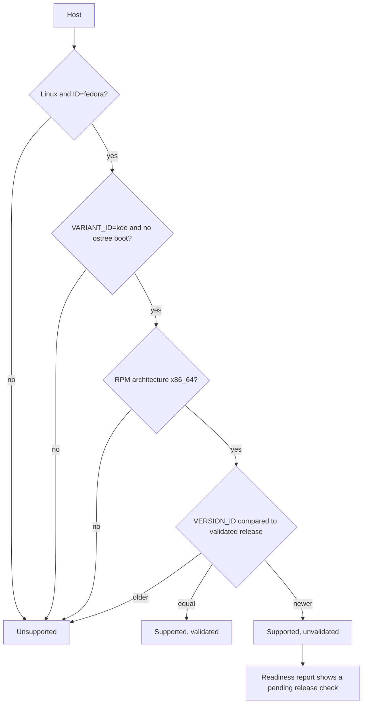

# Fedora KDE Workstation - Plan

## Goal Capsule

- **Objective:** The owner can prepare, apply, re-apply and check the repository's Linux workstation environment on Fedora KDE Plasma Desktop, the distribution and desktop the owner already knows, and the repository no longer claims or gates on Ubuntu.
- **Means:** Rewrite the Ubuntu-specific host probe, entry points, package provisioning, desktop integration, container proof, readiness report and documentation for Fedora in place (KTD1–KTD12).
- **Product authority:** The owner directed the replacement, the Fedora edition, the container runtime, the minikube runtime, the version policy and the Ghostty source in the brainstorm and planning dialogue, and confirmed the scoping summary.
- **Execution profile:** One PR, implemented and shipped by the autonomous workflow. The owner performs OS installation and native acceptance on the Fedora host.
- **Stop conditions:** Stop if the change would require installing a Docker engine, supporting a second distribution, or breaking the hook-free bootstrap boundary in `AGENTS.md`.
- **Open blockers:** None for code implementation. Native KDE desktop, hardware, credential, build and minikube acceptance stay unverified until the owner runs them on a Fedora host.

---

## Product Contract

**Product Contract preservation:** changed: R8, AE1 and new R23, R24 — the owner allowed a community repository for Ghostty after planning found no official Fedora package, and R8 now says that a vendor's own Linux artifact counts as official; the owner moved Linux CI onto a Fedora image during implementation (R24); the Outstanding Questions were resolved into KTD1–KTD12.

### Summary

Replace Ubuntu Desktop 26.04 LTS on GNOME with Fedora KDE Plasma Desktop on amd64 as the only supported Linux workstation.
The host check, the provisioning and bootstrap entry points, the package and signed-repository declarations, the terminal and pinentry integration, the readiness report and the documentation all move to the Fedora KDE target.
Containers run on rootless Podman with a Docker compatibility layer and no Docker engine, and minikube runs on rootless Podman.
The target follows the latest Fedora stable release instead of one pinned release.

### Problem Frame

The Linux target has changed twice already: PR #121 added Ubuntu Studio, and PR #123 replaced it with Ubuntu Desktop on GNOME.
Neither is the environment the owner works in by habit.
The owner is familiar with Fedora and KDE, so an Ubuntu GNOME baseline leaves manual adjustment after every setup, which is the cost `STRATEGY.md` exists to remove.

Every Linux gate in the repository rejects a Fedora host today.
The host check requires `ID=ubuntu`, `VERSION_ID=26.04` and an `ubuntu-desktop` metapackage.
Packages are declared as APT packages and APT repositories, the terminal integration targets Ubuntu's terminal dispatcher, and the container setup installs rootless Docker from Docker's Ubuntu repository.

### Key Decisions

- **Fedora KDE replaces Ubuntu GNOME as the single Linux target.** Governs R1–R5, R19–R21. (session-settled: user-directed — chosen over supporting both distributions with Fedora first, and over keeping Ubuntu as an unmaintained target: one target keeps the maintenance cost the repository has accepted twice before.)
- **The edition is the dnf-based Fedora KDE Plasma Desktop, not an atomic desktop.** Governs R1, R6. (session-settled: user-directed — chosen over Fedora Kinoite and over supporting both editions: the existing model installs signed packages on the host, which carries over to dnf and not to image layering.)
- **Rootless Podman with a Docker compatibility layer is the only container runtime.** Governs R10–R13. (session-settled: user-directed — chosen over Podman with no compatibility layer, and over installing rootless Docker next to Podman: the owner first chose both runtimes, then changed to one runtime plus compatibility.)
- **minikube runs on rootless Podman.** Governs R14–R15. (session-settled: user-directed — chosen over keeping rootless Docker for minikube and over dropping minikube from the baseline: the owner chose it with the driver's experimental status in view.)
- **The target is the latest Fedora stable release, tracked by a validated release the owner raises.** Governs R3–R4. (session-settled: user-directed — chosen over one pinned validated release and over validating the current and previous releases: the owner runs the latest release and does not want the repository to block an OS upgrade.)
- **A failed minikube proof on rootless Podman is recorded as a limitation.** Governs R15. (session-settled: user-approved — chosen over falling back to a Docker engine: a fallback would reintroduce the second runtime the owner removed.)
- **Applications without an official Fedora package are not installed.** Governs R8. (session-settled: user-approved — chosen over unofficial repackaging or converted packages: the repository installs from signed vendor or distribution sources.)
- **A vendor's own Linux artifact counts as official when no RPM exists.** Governs R8. (session-settled: user-approved — chosen over recording T3 Code as unavailable on Fedora: the owner saw the AppImage plan for T3 Code and named it as the model for the Claude Desktop follow-up in #124.)
- **Ghostty is the one community-source exception.** Governs R23. (session-settled: user-directed — chosen over using Konsole on Fedora and over building Ghostty from its signed source: the owner accepted either COPR or Terra, asked for the one that follows Ghostty releases fastest, and then named COPR.)
- **Linux CI runs in a Fedora image.** Governs R24. (session-settled: user-directed — chosen over keeping hosted Ubuntu runners as generic Linux hosts: once Ubuntu stopped being a supported host, the owner asked for CI on Fedora.)
- **No distribution abstraction layer.** The Linux scripts are rewritten for Fedora in place. (session-settled: user-approved — chosen over a data-driven multi-distribution seam: this is the third target change, but one target is still the scope.)

### Requirements

**Host eligibility**

- R1. A host is supported when it is Linux on amd64 and identifies as Fedora with the KDE Plasma Desktop edition installed through dnf.
- R2. Every other host is unsupported, including Ubuntu in any flavor, Fedora Kinoite and other atomic desktops, other Fedora editions and spins, and arm64.
- R3. A Fedora release older than the release the repository last validated is unsupported.
- R4. A Fedora release newer than the last validated release is supported, and the readiness report marks it as not yet validated.
- R5. Desktop session evidence is reported separately from host support and passes for a KDE Plasma session on Wayland or X11.

**Provisioning and packages**

- R6. Provisioning and bootstrap run from Fedora-named entry points with the same stages, ordering and hook-free bootstrap boundary the Ubuntu entry points have today; the Ubuntu-named entry points no longer exist.
- R7. Explicit application installs the Fedora equivalents of the current host packages, and third-party applications come from signed vendor repositories whose signing keys are pinned by fingerprint.
- R8. An application from the current Linux inventory is installed only from a source its vendor or Fedora publishes: a Fedora package, the vendor's signed repository, or the vendor's digest-verified Linux artifact. Otherwise it is not installed and the setup guide records it as a limitation; R23 is the only community-source exception.
- R9. Explicit provisioning of native build tools and of minikube and kubectl works on Fedora with the same task names and the same no-runtime-start rule.

**Containers and Kubernetes**

- R10. Explicit application provides rootless Podman for building and running containers under the owner's account, with no system-wide service and no root-owned socket.
- R11. A `docker` command and a user-scoped Docker-compatible API socket are available for projects that expect Docker.
- R12. Nothing starts a container runtime, the compatibility socket or a cluster at login, and application does not enable user linger.
- R13. No Docker engine is installed or required on Fedora, and Buildx-only features are not guaranteed.
- R14. The minikube proof builds and runs an image, starts a cluster, deploys a workload, reaches it from the host and deletes everything it created, all on rootless Podman with isolated state that never touches the owner's default container storage or kubeconfig.
- R15. When the minikube proof cannot pass on rootless Podman, the result is recorded as an unresolved limitation and no other runtime is installed in its place.

**KDE desktop integration**

- R16. Explicit application makes Ghostty the default terminal for the KDE session, and status reports a pending action without writing when another terminal is selected.
- R17. GPG passphrase and PIN prompts use the Qt pinentry.
- R18. Credential acceptance checks the Secret Service provider the KDE session already runs and never starts a second provider or migrates wallets.
- R23. Ghostty installs from the community repository that follows Ghostty releases fastest, with its signing key pinned by fingerprint and no other package from that repository made installable.

**Readiness and documentation**

- R19. The read-only readiness report checks Fedora and KDE evidence and commands, names KDE acceptance checks in its pending items, and keeps the current exit-code meanings.
- R20. The setup guide, README, guides, maintenance notes and harness instructions describe Fedora KDE Plasma Desktop, including verified installation media and the capability inventory against macOS.
- R21. No managed file, test or guide outside historical plan records names Ubuntu, GNOME, APT or rootless Docker as current Linux behavior.

**Continuous integration**

- R24. Linux unit and native CI lanes run on amd64 in a Fedora image of the validated release, and lanes that need a KDE desktop host stay excluded on Linux.

**Existing hosts**

- R22. Applying the new source on a host configured under Ubuntu support removes nothing: installed packages, repositories, terminal settings and Docker state stay as they are.

### Acceptance Examples

- AE1. **Covers R3, R4.** Given the repository last validated Fedora release N, when the owner applies on release N-1, the host check reports the host unsupported; when the owner applies on release N+1, the host check passes, application proceeds until a vendor source that has no pin for that release reports its failure, and the readiness report shows the release as not yet validated.
- AE2. **Covers R2.** Given a Fedora Kinoite host with a KDE Plasma session, when the owner runs provisioning, it stops at the host check and leaves the home directory unchanged.
- AE3. **Covers R11, R12.** Given a fresh login after application, when the owner inspects the session, no container runtime process or compatibility socket is active; when the owner enables the socket for a project, a `docker` command in that project reaches Podman.
- AE4. **Covers R15.** Given the minikube proof fails on rootless Podman on the owner's host, when the owner records acceptance, minikube is listed as an unresolved limitation and the host has no Docker engine.
- AE5. **Covers R8.** Given a vendor ships only a Debian package for an application in the Linux inventory, when the owner applies on Fedora, that application is absent and the setup guide names it under limitations.

### Scope Boundaries

- Ubuntu in any flavor, Fedora Kinoite and other atomic desktops, and arm64 are outside the supported target.
- A GNOME session on a supported host is not a supported desktop; R5 reports it as pending desktop evidence and host support is unchanged.
- CI gains no Fedora KDE desktop host. R24 moves the Linux lanes into a Fedora container image, which is not a KDE Plasma Desktop installation, so native acceptance stays with the owner.
- Cleanup of Ubuntu-era packages, repositories, GNOME terminal settings or Docker state on previously configured hosts is not built, per the retirement rule in `AGENTS.md`.
- Migrating existing Docker images, volumes or credentials into Podman is not built.
- The repository does not upgrade the installed OS and does not detect the latest Fedora release over the network.
- The earlier plan records under `.compound-engineering/artifacts/plans/` for Ubuntu Studio and GNOME Ubuntu are kept unchanged as history.
- Considered and not built: a multi-distribution abstraction, and a Docker engine fallback for minikube.
- Considered and not built: exporting `DOCKER_HOST` in the managed shell. A permanent export points Docker clients at a socket that R12 keeps inactive; a report that the owner's projects need the socket in every session would change this.
- Considered and not built: a managed systemd drop-in that widens cgroup delegation for the user session. The minikube proof reports missing controllers and the setup guide gives the owner-approved fix, the same split the Ubuntu guide used for subordinate IDs.
- Considered and not built: a guard that inhibits service starts during package installation. RPM scriptlets do not start services and Fedora's presets leave Podman units disabled, so the Debian `policy-rc.d` machinery has nothing to block.

#### Deferred to Follow-Up Work

- Installing Claude Desktop on Fedora from Anthropic's official apt package, extracted the way T3 Code is installed: [#124](https://github.com/hyperlapse122/dotfiles/issues/124). This plan does not build it, and the setup guide records Claude Desktop as unavailable on Fedora until that issue lands.
- NVIDIA GPU driver provisioning: [#125](https://github.com/hyperlapse122/dotfiles/issues/125).

### Dependencies / Assumptions

- "Latest Fedora stable release" is tracked by the last-validated release recorded in the repository, which the owner raises after validating each new release.
- Third-party vendor repositories can lag a new Fedora release. On a newer-than-validated release, application can fail at a vendor repository, and that failure is reported, not hidden.
- The KDE integration PR #121 shipped for Ubuntu Studio is a usable starting point for Fedora KDE.
- The functional baseline stays the managed macOS environment plus local minikube, as `docs/setup/ubuntu.md` defines it today.

### Sources / Research

- `.compound-engineering/artifacts/plans/2026-11-10-1257-feat-gnome-ubuntu-lts-workstation-plan.md` — the previous target swap; its unit list names every file the Linux target touches.
- `.compound-engineering/artifacts/plans/2026-11-10-0927-feat-ubuntu-studio-workstation-plan.md` and PR #121 — the earlier KDE integration.
- `git show 'ef08e30:scripts/terminal-environment.sh'` — the KDE default-terminal code: `kreadconfig6` and `kwriteconfig6` on `kdeglobals` keys `TerminalApplication` and `TerminalService`.
- `scripts/linux-platform.py` — the single host probe every Linux action calls.
- `home/.chezmoidata/linux.yaml` — the APT package and repository declarations.
- `tests/smoke_linux_minikube.py`, `tests/test_linux_minikube.py` — the rootless Docker proof that U7 replaces.
- `scripts/container-auth.py` — already writes `containers/auth.json` and accepts a Podman client, so registry credentials need no new mechanism.
- `AGENTS.md` — the hook-free bootstrap boundary and the retirement rule behind R6 and R22.
- External, read 2026-11-10: Fedora 45 released 2026-11-03 with Plasma 6.8, which is Wayland-only.
- External: [Ghostty binary install docs](https://ghostty.org/docs/install/binary) list only community sources for Fedora, COPR `scottames/ghostty` and Terra. Queried 2026-11-10 for Fedora 45 x86_64: the COPR publishes `ghostty-1.4.0-2`, Terra publishes `ghostty-1.3.1-3`.
- External: [minikube Podman driver](https://minikube.sigs.k8s.io/docs/drivers/podman/) is labeled experimental; rootless use is `--driver=podman --rootless` with the containerd runtime.
- External: [Claude Desktop install](https://support.claude.com/en/articles/10065433-install-claude-desktop) covers Ubuntu and Debian only; [ChatGPT for Linux](https://learn.chatgpt.com/docs/linux/linux-app) ships an RPM and a signed dnf repository for Fedora 43 and 44.
- External: [mise install docs](https://mise.jdx.dev/installing-mise.html) point Fedora at the COPR `jdxcode/mise`, owned by the mise author.

---

## Planning Contract

### Key Technical Decisions

- KTD1. **Identify the edition from `os-release` and the absence of an ostree boot.** The probe requires `ID=fedora`, `VARIANT_ID=kde`, no `/run/ostree-booted`, and RPM architecture `x86_64`. Kinoite reports `VARIANT_ID=kinoite` and boots through ostree, so both tests reject it; a Fedora install that added Plasma to another edition keeps that edition's `VARIANT_ID` and is rejected by R2. Implements R1, R2.
- KTD2. **Record the last-validated release as one constant in `scripts/linux-platform.py`, set to 45.** Provisioning runs the probe with system `python3` before mise or chezmoi exist, so the value cannot live in chezmoi data. The probe compares the integer `VERSION_ID` to it and reports `validated` or `unvalidated` next to the support verdict. The chezmoi templates gate only on `ID=fedora` and amd64 and leave the release decision to the probe. Implements R3, R4.
- KTD3. **Rewrite `scripts/linux-apps.py` for dnf and RPM, keeping its fail-closed repository checks.** Installed state comes from `rpm -q`. Each repository is written to `/etc/yum.repos.d/` with `gpgcheck=1` and a `gpgkey=file://` path under `/etc/pki/rpm-gpg/`, after the downloaded key's fingerprint matches the pin. A missing package installs only when its dnf candidate comes from the declared repository. Each repository file takes the name and content the vendor's own package writes, so the package leaves one source in place: ChatGPT's RPM ships `/etc/yum.repos.d/chatgpt.repo` with repository ID `openai-chatgpt` and its key under `/etc/pki/rpm-gpg/`, and Chrome's RPM adds `google-chrome.repo` unless `/etc/default/google-chrome` sets `repo_add_once="false"`. The `policy-rc.d` and unit-mask machinery is removed (see Scope Boundaries). Implements R7.
- KTD4. **Install Ghostty from the COPR `scottames/ghostty`, restricted to Ghostty packages.** (session-settled: user-directed — chosen over Terra: the owner asked for the source that follows Ghostty releases fastest and then named COPR. For Fedora 45 the COPR publishes Ghostty 1.4.0 while Terra still publishes 1.3.1.) The COPR signs every Fedora release with one project key, fingerprint `2DEFB319CCC3F393B6DAEAB297C83CA0FEB5DAFB`, and the Ghostty install docs name it. The repository file carries `includepkgs=ghostty*`. Implements R23.
- KTD5. **Let dnf skip a COPR that has no build for the host release.** COPR builds per Fedora release, so a newer release can lack the repository for a while. Both COPR entries set `skip_if_unavailable`, so system upgrades proceed and an installed Ghostty or mise stays. A first install on such a release fails with the missing candidate named, which is the reported vendor-lag failure the Product Contract assumes. Implements R4, R23.
- KTD6. **Provision mise from the COPR `jdxcode/mise` through the same repository writer.** The COPR is the vendor's own Fedora channel, its key is per project and stable across releases, and its fingerprint is `9504792D1F9CCA1514FD1DEC8497A816C83E991C`. `provision-fedora.sh` calls `scripts/linux-apps.py` with system `python3` for this one repository; the script uses only the standard library. Implements R6, R7.
- KTD7. **Declare the vendor repositories that exist for Fedora and drop the rest.** Chrome, 1Password and ChatGPT keep their current key URLs and fingerprints with RPM base URLs. Claude Desktop has no Fedora package and Docker is removed, so both leave the declaration. Implements R7, R8, R13.
- KTD8. **Provide Docker compatibility with `podman-docker`, `podman-compose` and the stock user `podman.socket`, left disabled.** The shim needs no socket. The setup guide gives the two commands that start the socket and export `DOCKER_HOST` for one project session. Provisioning fails when a Docker engine package is installed, as it failed on conflicting runtimes before. Implements R10–R13.
- KTD9. **Install T3 Code on Fedora from the vendor's AppImage, extracted into the user's data directory.** The release publishes `T3-Code-<version>-x86_64.AppImage` with a SHA-256 digest and no RPM. Extraction needs no FUSE library and no sudo, and it yields the same `t3code` binary and `resources/app.asar` layout the `t3` launcher already resolves under `/opt`. The AppImage is the vendor's digest-verified artifact, which R8 accepts. Implements R8.
- KTD10. **Isolate the minikube proof through Podman's own configuration, not a private daemon.** Podman has no daemon to own. The proof points `CONTAINERS_STORAGE_CONF` and `CONTAINERS_CONF` at files in its temporary state directory, so image storage, run state and network definitions are private, and it removes that state inside `podman unshare`. Implements R14.
- KTD11. **Restore the KDE terminal selection from PR #121.** `scripts/terminal-environment.sh` writes the two `kdeglobals` keys named in Sources and drops the `xdg-terminal-exec` path. The script accepts any Linux release and leaves the release decision to the probe (KTD2). Implements R16.

- KTD12. **Run Linux CI lanes as container jobs on `registry.fedoraproject.org/fedora`, tagged with the validated release.** GitHub hosts no Fedora runner, so the job keeps an Ubuntu runner label as the container host and every step runs inside the Fedora image. One amd64 lane replaces the four Ubuntu 24.04 and 26.04 lanes. (session-settled: user-directed — chosen over keeping an arm64 Fedora lane: the workstation target is amd64 only and the owner asked to drop Fedora arm64 from CI.) A contract test ties the image tag to the probe's validated release so the two move together. The image reports `VARIANT_ID=container`, so the probe rejects it and the Ghostty and desktop-backed T3 lanes stay excluded. The lock-update workflows keep their Ubuntu runners; they run automation, not Linux workstation tests. Implements R24.

### High-Level Technical Design

The host probe is the only place that decides support. Every entry point, chezmoi script and smoke test calls it and stops on an unsupported verdict.

### Assumptions

- The Fedora package names in U3 are taken from Fedora's package set as known at planning time and were not resolved against a Fedora host. U3's verification resolves them.
- Fedora's default cgroup delegation for a user session may not include every controller rootless minikube needs. U7 detects this and reports it; it does not change system configuration.
- The extracted T3 Code AppImage runs under Fedora's default user-namespace sandbox. If it does not, the owner records the result during native acceptance.
- The ChatGPT repository lists Fedora 43 and 44 today. Whether it serves Fedora 45 is unverified, and a failure there surfaces as the vendor-lag failure the Product Contract assumes.

### Risks

| Risk | Effect | Handling |
|---|---|---|
| minikube's Podman driver is experimental | The proof may never pass on the owner's host | R15 and AE4 record the limitation; U7 keeps exit code `2` for unavailable prerequisites |
| No Fedora host in development or CI | Package names, dnf behavior and KDE integration are unproven until native acceptance | Fixture tests cover every decision; U3 resolves package names in a disposable Fedora container |
| The Ghostty COPR is one maintainer's project | Builds for a new Fedora release or Ghostty release can lag or stop | KTD5 keeps an installed Ghostty; a first install reports the missing candidate |
| A community repository on the host | A compromised COPR build or signing key runs package scriptlets as root at install and on every system upgrade | `includepkgs=ghostty*` and the fingerprint pin restrict the repository to Ghostty package names from one signer; they do not lower that package's privilege. The owner accepted this exposure in KTD4 |

---

## Implementation Units

| Unit | Title | Primary files | Depends on |
|---|---|---|---|
| U1 | Host probe | `scripts/linux-platform.py` | — |
| U2 | Entry points | `provision-fedora.sh`, `bootstrap-fedora.sh` | U1, U3 |
| U3 | Packages and repositories | `home/.chezmoidata/linux.yaml`, `scripts/linux-apps.py` | U1 |
| U4 | Ghostty installation | `scripts/install-ghostty.sh` | U1, U3 |
| U5 | KDE terminal selection | `scripts/terminal-environment.sh` | U1, U4 |
| U6 | Native build environment | `scripts/linux-build-environment.sh`, `mise.toml` | U1 |
| U7 | minikube proof on rootless Podman | `tests/smoke_linux_minikube.py` | U1, U3 |
| U8 | T3 Code desktop | `home/.chezmoitemplates/t3-code-desktop` | U1 |
| U9 | Readiness report | `scripts/linux-readiness.py` | U1, U3, U5 |
| U10 | Documentation and instructions | `docs/setup/fedora.md` | U1–U9, U11 |
| U11 | CI on a Fedora image | `.github/workflows/test.yml` | U1–U9 |

### U1. Host probe

- **Goal:** The shared probe accepts Fedora KDE Plasma Desktop on amd64 and reports whether its release is validated.
- **Requirements:** R1, R2, R3, R4, R5 (KTD1, KTD2).
- **Dependencies:** None.
- **Files:** `scripts/linux-platform.py`, `tests/test_linux_platform.py`.
- **Approach:**
  1. Replace the dpkg architecture and metapackage queries with the evidence in KTD1. Accept an injected ostree marker check so tests need no filesystem.
  2. Add the validated-release constant and a `release` entry in the report with the host release, the validated release and the status.
  3. Change the desktop check to `KDE` in `XDG_CURRENT_DESKTOP` with a `wayland` or `x11` session, and reword blockers and details for Fedora.
  4. Keep the report keys `supported`, `blockers`, `evidence` and `desktop`, which callers read.
- **Patterns to follow:** The injected `system`, `os_release`, `environ` and `run` parameters of `inspect_host`, and the fixture style in `tests/test_linux_platform.py`.
- **Test scenarios:**
  - Covers AE1. Fedora, `VARIANT_ID=kde`, `x86_64`, release equal to the constant → supported, release status `validated`.
  - Covers AE1. Release one above the constant → supported, release status `unvalidated`.
  - Covers AE1. Release one below the constant → unsupported with a release blocker.
  - Covers AE2. `VARIANT_ID=kinoite`, or `VARIANT_ID=kde` with the ostree marker present → unsupported.
  - `VARIANT_ID` of `workstation` or missing → unsupported with the edition blocker.
  - `ID=ubuntu` with any version → unsupported.
  - Architecture `aarch64`, or a non-Linux system → each unsupported with its own blocker.
  - A non-numeric `VERSION_ID` → unsupported, no exception.
  - Supported host with `XDG_CURRENT_DESKTOP=KDE` on `wayland` → desktop `passed`; with `GNOME`, or KDE on a `tty` session → desktop `pending`, still supported.
  - The architecture command raising or failing → unsupported, no exception.
- **Verification:** `tests/test_linux_platform.py` passes, and the module names no Ubuntu, dpkg or GNOME term.

### U2. Entry points

- **Goal:** Provisioning and bootstrap run under Fedora names with the stages the Ubuntu entry points have.
- **Requirements:** R6 (KTD6).
- **Dependencies:** U1, U3.
- **Files:** `provision-fedora.sh` and `bootstrap-fedora.sh` (renamed from the `-ubuntu` files), `tests/test_linux_bootstrap.py`.
- **Approach:**
  1. Move both files with history, then reword usage lines, failure prefixes and closing hints.
  2. In provisioning, check prerequisites with `rpm -q` and install the missing ones with `sudo dnf install -y`: `ca-certificates`, `curl`, `git`, `xz`, `bzip2`, `unzip`.
  3. Install mise per KTD6 when it is absent, and retain an installed mise.
  4. Leave bootstrap's clone, origin check, `mise trust`, `mise install` and `mise run bootstrap` sequence unchanged.
- **Test scenarios:**
  - Existing provisioning and bootstrap scenarios pass against the new file names with `rpm` and `dnf` fixture commands.
  - Covers AE2. An unsupported host leaves the home directory unchanged for both entry points and no install command runs.
  - mise already on PATH → no repository is written and no mise install runs.
  - mise absent → the mise repository step runs before `dnf install mise`.
  - A mise key fingerprint mismatch → provisioning fails and mise is not installed.
  - `provision-ubuntu.sh` and `bootstrap-ubuntu.sh` do not exist in the tree.
- **Verification:** `tests/test_linux_bootstrap.py` passes and both scripts pass `sh -n`.

### U3. Packages and repositories

- **Goal:** Explicit application installs the Fedora package set and the vendor repositories from fingerprint-pinned sources.
- **Requirements:** R7, R8, R10, R11, R12, R13, R22 (KTD3, KTD7, KTD8).
- **Dependencies:** U1.
- **Files:** `home/.chezmoidata/linux.yaml`, `scripts/linux-apps.py`, `home/.chezmoiscripts/run_before_12-install-linux-apps.sh.tmpl`, `home/.chezmoiscripts/run_before_17-install-aria2.sh.tmpl`, `tests/test_linux_apps.py`, `tests/test_aria2.py`.
- **Approach:**
  1. Replace the package list with Fedora names: `gnupg2`, `pinentry-qt`, `zsh`, `fontconfig`, `gcc`, `gcc-c++`, `make`, `pkgconf-pkg-config`, `tar`, `zip`, `unzip`, `xz`, `libsecret`, `krb5-libs`, `libicu`, `openssl-libs`, `zlib-ng-compat`, `shadow-utils`, `podman`, `podman-docker`, `podman-compose`, `passt`, `slirp4netns`, `fuse-overlayfs`, `aria2`, `qemu-system-x86`, `edk2-ovmf`, `virtiofsd`, plus the entries already shared with Fedora.
  2. Declare repositories per KTD7 with RPM base URLs: Chrome at `https://dl.google.com/linux/chrome/rpm/stable/x86_64`, 1Password at `https://downloads.1password.com/linux/rpm/stable/$basearch`, ChatGPT at `https://persistent.oaistatic.com/codex-app-prod/linux/rpm/$basearch`, the mise COPR, and the Ghostty COPR per KTD4 with its package filter.
  3. Rewrite the installer per KTD3, including the vendor-native repository file names and the Chrome defaults file, which is created only when absent and before `google-chrome-stable` installs. Keep the conflict checks for an existing differing repository file, a foreign file naming the same base URL, and a symlinked key.
  4. Replace the conflicting-package list with Docker engine packages: `docker-ce`, `docker-ce-cli`, `moby-engine`, `docker`.
  5. Accept a single-repository mode for provisioning (KTD6).
  6. Make the aria2 script verify-and-install through dnf under the `ID=fedora` gate.
- **Execution note:** Rewrite the fixture command runner in `tests/test_linux_apps.py` for `rpm` and `dnf` first, so the new scenarios fail before the installer changes.
- **Patterns to follow:** The `Installer` class's injected `root` and `run`, and its `ProvisionError` messages that tell the owner to reconcile manually.
- **Test scenarios:**
  - All declared packages missing → one `dnf install` with exactly the missing names, and no upgrade or removal flag.
  - Every package installed → no install command runs.
  - A repository key whose fingerprint differs from the pin → error, and neither the key file nor the repository file is written.
  - An existing repository file with different content, or a symlinked key → error naming the file.
  - A package whose dnf candidate comes from another repository → error, no install.
  - The Ghostty repository file filters to Ghostty packages and lets dnf skip it when unavailable; a copy with the filter removed is a conflict and is not overwritten.
  - The Chrome repository file and `/etc/default/google-chrome` both exist before the Chrome install command runs, and an existing defaults file is left unchanged.
  - The ChatGPT repository file matches the name, repository ID and key path the vendor RPM ships.
  - Covers AE4. A Docker engine package installed → error telling the owner to resolve it manually, nothing installed.
  - Covers AE3. No command enables or starts a systemd unit, and no command enables linger.
  - Covers AE5. The declaration contains no Claude Desktop entry, no Docker repository and no APT field.
  - An unsupported host → error from the probe blockers before any command runs.
- **Verification:** `tests/test_linux_apps.py` and `tests/test_aria2.py` pass. Every package name in the Fedora-repository list resolves with `dnf repoquery` in a disposable `fedora:45` container, and `ghostty` and `mise` resolve with their dependencies through the declared COPR repositories with the package filter applied; the container and its image are removed afterward. Chrome, 1Password and ChatGPT publish x86-64 only and are not resolved there. If the Apple `container` runtime is unavailable, the PR description records this check as pending.

### U4. Ghostty installation

- **Goal:** Ghostty is present after application, or the run stops with the reason.
- **Requirements:** R23 (KTD4, KTD5).
- **Dependencies:** U1, U3.
- **Files:** `scripts/install-ghostty.sh`, `home/.chezmoiscripts/run_before_16-install-ghostty.sh.tmpl`, `tests/test_ghostty_install.py`.
- **Approach:** U3 installs the `ghostty` package through the COPR repository. This script keeps its two checks: a working system zsh, installed through dnf when missing, and a working `ghostty`. When Ghostty is absent it fails and points at the package step. The template gates on `ID=fedora` and amd64 and stops passing a release argument the script no longer needs.
- **Test scenarios:**
  - Ghostty and zsh present → exit zero, no install command.
  - zsh missing → `dnf install zsh` runs, then the checks pass.
  - Ghostty missing → error pointing at the Ghostty repository and the package step.
  - An unsupported host → error before any command runs.
  - The rendered template is empty on Ubuntu and on arm64 Fedora.
- **Verification:** `tests/test_ghostty_install.py` passes and the script passes `sh -n`.

### U5. KDE terminal selection

- **Goal:** Explicit application selects Ghostty as the KDE default terminal and status reports drift without writing.
- **Requirements:** R16, R17, R22 (KTD11).
- **Dependencies:** U1, U4.
- **Files:** `scripts/terminal-environment.sh`, `home/.chezmoiscripts/run_after_35-terminal-environment.sh.tmpl`, `tests/test_terminal_environment.py`, `tests/smoke_ghostty.py`.
- **Approach:**
  1. Replace the dispatcher list write and `--print-id` check with the `kdeglobals` read-compare-write loop per KTD11. The desktop-entry resolver returns the entry's `Exec` line as well as its ID again.
  2. Accept any Linux release in the platform check and pass the host's `VERSION_ID` through unchanged.
  3. Reword the unconditional pending line to name the Plasma checks: Default Applications, Ctrl+Alt+T, Dolphin's Open Terminal Here and a `Terminal=true` launcher.
  4. In the smoke test, set `XDG_CURRENT_DESKTOP=KDE` and assert the `kreadconfig6` values.
- **Execution note:** Rewrite the fixture commands in `tests/test_terminal_environment.py` for `kreadconfig6` and `kwriteconfig6` first, so the new scenarios fail before the script changes.
- **Patterns to follow:** The KDE block in `git show 'ef08e30:scripts/terminal-environment.sh'`.
- **Test scenarios:**
  - Apply with neither key set → both keys written, each verified by a second read.
  - Apply with both keys already correct → no `kwriteconfig6` call.
  - Status with another terminal selected → exit `2` with a pending line per key, and no write.
  - Status with everything matching → exit `2` with only the native-acceptance pending line.
  - A write that does not converge → error.
  - `kreadconfig6` or `kwriteconfig6` missing → error.
  - No desktop entry matching the active Ghostty binary → error, no write.
  - An existing `ubuntu-xdg-terminals.list` → unchanged after apply.
  - macOS scenarios keep passing unchanged.
- **Verification:** `tests/test_terminal_environment.py` passes on the development host. The fixture seam covers the script's decisions and does not prove a real Plasma session launches Ghostty.

### U6. Native build environment

- **Goal:** `mise run linux-build` and `mise run linux-kubernetes` provision and publish tools on Fedora.
- **Requirements:** R9.
- **Dependencies:** U1.
- **Files:** `scripts/linux-build-environment.sh`, `mise.toml`, `tests/test_linux_build_environment.py`, `tests/smoke_linux_build_environment.py`.
- **Approach:** The compiler preflight accepts Fedora's GCC target `x86_64-redhat-linux` in place of `x86_64-linux-gnu`. Failure messages and the two task descriptions name Fedora. Task names, pinned versions and the Rust host triple stay as they are.
- **Test scenarios:**
  - `cc` and `c++` reporting `x86_64-redhat-linux` → preflight passes.
  - A compiler reporting `aarch64-redhat-linux` → preflight fails naming the compiler.
  - A missing compiler → the message points at explicit application.
  - An unsupported host → the script fails with the probe pointer.
  - Existing dotnet, rust, tools, kubernetes and vcpkg scenarios pass unchanged.
- **Verification:** `tests/test_linux_build_environment.py` passes and the script passes `sh -n`.

### U7. minikube proof on rootless Podman

- **Goal:** The explicit proof builds, runs, deploys and cleans up on rootless Podman with private state.
- **Requirements:** R14, R15 (KTD10).
- **Dependencies:** U1, U3.
- **Files:** `tests/smoke_linux_minikube.py`, `tests/test_linux_minikube.py`.
- **Approach:**
  1. Preflight keeps the non-root systemd user session, cgroup v2 and subordinate-ID checks, requires `podman`, `minikube` and `kubectl`, and adds a check that the user session's delegated controllers include `cpu`, `memory` and `pids`. Missing `cpuset` or `io` delegation is written to the report as a warning and does not stop the proof.
  2. Create the private storage and containers configuration per KTD10, and clear inherited `DOCKER_HOST`, `CONTAINER_HOST`, `MINIKUBE_*` and kubeconfig selections.
  3. Build with `podman build`, run the image once, then start minikube with the Podman driver in rootless mode on the containerd runtime, keeping the pinned minikube, kubectl and Kubernetes versions.
  4. Export the built image with `podman save` to an archive in the private state directory and load that archive with `minikube image load`, because minikube cannot read Podman storage. Create the deployment with the image's `localhost/`-qualified name.
  5. Keep the loopback port-forward and HTTP check.
  6. Cleanup deletes the profile, enumerates and removes each container, image, custom network and volume in the private store, verifies none remain, removes the store inside `podman unshare`, then removes the state directories. It never runs a prune or a system reset.
  7. Keep the exit codes `0`, `1`, `2`, `3` and the report fields for state paths, owned and remaining resources and free disk bytes.
- **Execution note:** This is a native smoke; unit coverage exercises its command construction and cleanup ordering through the existing fixture seam, and the real run belongs to the owner's host.
- **Test scenarios:**
  - Preflight on a host missing a delegated controller → exit `2` naming the controller.
  - Preflight with fewer than 65536 subordinate IDs → exit `2`.
  - The start command carries the Podman driver, the rootless flag, the containerd runtime and the pinned Kubernetes version.
  - `minikube image load` receives the archive path inside the private state directory, and the deployment image carries the `localhost/` prefix.
  - A host delegating `cpu`, `memory` and `pids` but not `cpuset` → the proof continues and the report carries the warning.
  - Every `podman`, `minikube` and `kubectl` invocation receives the private storage, containers configuration, minikube home and kubeconfig, and none receives the owner's defaults.
  - Covers AE4. A failing `minikube start` → exit `1` with status `failed`, cleanup still runs, and no command installs or invokes Docker.
  - A resource remaining after deletion → exit `3` with status `cleanup-failed`, and the state path is kept in the report.
  - An interrupt during the proof → cleanup runs once and the exit code is `1` or `3`.
  - No command contains `prune` or `system reset`.
- **Verification:** `tests/test_linux_minikube.py` passes. The native run stays pending in the PR description.

### U8. T3 Code desktop

- **Goal:** T3 Code and the `t3` launcher work on a supported Fedora host.
- **Requirements:** R8 (KTD9).
- **Dependencies:** U1.
- **Files:** `home/.chezmoitemplates/t3-code-desktop`, `home/.chezmoitemplates/external-assets/t3-code.toml.tmpl`, `home/.chezmoiscripts/run_onchange_after_30-install-t3-code.sh.tmpl`, `home/dot_local/bin/executable_t3.tmpl`, `tests/test_t3_code_desktop.py`, `tests/test_t3_code_settings.py`, `tests/smoke_t3_code.py`.
- **Approach:**
  1. The desktop template detects `ID=fedora` in place of Ubuntu and returns the staged AppImage path and the install directory under the user's data directory.
  2. The external stages `T3-Code-<version>-x86_64.AppImage` with its release SHA-256, and still fails when the release has no such asset or no digest.
  3. The install script skips when the extracted binary exists, otherwise extracts the staged AppImage into the install directory and writes a desktop entry in the user's applications directory. It uses no sudo.
  4. The launcher resolves the binary and `app.asar` entry under the install directory on Linux.
- **Test scenarios:**
  - A supported Fedora host → the external names the x86-64 AppImage and its digest.
  - A release without the AppImage asset, or with an invalid digest → template failure naming the asset.
  - An installed extraction → no external is staged and the script exits zero.
  - A missing staged file → the script fails telling the owner to apply again.
  - An unsupported Linux host → `supported` is false and nothing is staged.
  - The launcher on Linux points at the extracted tree and never at `/opt`.
  - Windows and macOS scenarios pass unchanged.
- **Verification:** `tests/test_t3_code_desktop.py` and `tests/test_t3_code_settings.py` pass.

### U9. Readiness report

- **Goal:** The read-only report inspects and describes the Fedora KDE workstation.
- **Requirements:** R4, R19.
- **Dependencies:** U1, U3, U5.
- **Files:** `scripts/linux-readiness.py`, `tests/test_linux_readiness.py`.
- **Approach:**
  1. In the command allowlist, replace the Docker and GNOME entries with `podman`, `pinentry-qt`, `kreadconfig6` and `kwriteconfig6`, and keep `docker`, which `podman-docker` provides.
  2. Query packages with `rpm -q` and list `google-chrome-stable`, `1password`, `1password-cli`, `chatgpt`, `podman`, `podman-docker` and `ghostty`.
  3. Rename the session check to `KDE session` and add a `Fedora release` check that passes when validated and is pending when unvalidated.
  4. Reword the native checks for Plasma, Dolphin, the Podman minikube proof and the Claude Desktop limitation, and point at `docs/setup/fedora.md`.
- **Test scenarios:**
  - Covers AE1. Everything installed on the validated release → exit `2` with `Fedora release` passed and all native checks pending.
  - Covers AE1. The same host one release newer → `Fedora release` pending, exit `2`.
  - An unsupported host → exit `1` with only the supported-host check.
  - No graphical session → `KDE session` pending, not failed.
  - The command allowlist contains none of `dockerd`, `rootlesskit`, `pinentry-gnome3`, `xdg-terminal-exec`, and the package list contains none of `docker-ce`, `claude-desktop`.
  - A missing package → exit `1`.
- **Verification:** `tests/test_linux_readiness.py` passes.

### U10. Documentation and instructions

- **Goal:** Every guide and instruction describes the Fedora KDE target, and nothing presents Ubuntu, GNOME, APT or rootless Docker as current Linux behavior.
- **Requirements:** R8, R11, R15, R18, R20, R21.
- **Dependencies:** U1–U9.
- **Files:** `docs/setup/fedora.md` (renamed from `docs/setup/ubuntu.md`), `README.md`, `docs/README.md`, `docs/guides/terminal.md`, `docs/guides/secrets-and-authentication.md`, `docs/guides/t3-code.md`, `docs/guides/zsh.md`, `docs/guides/personal-applications.md`, `docs/maintenance/development-and-testing.md`, `home/.chezmoitemplates/agent-instructions`, `tests/test_agent_instructions.py`.
- **Approach:**
  1. Rewrite the setup guide for Fedora: the KDE Plasma Desktop ISO and its signed `CHECKSUM` file from fedoraproject.org, verified against the Fedora signing key; the Wayland Plasma session; `dnf` for the manual GPG prerequisites; and the version policy from R3 and R4 with the validated release.
  2. In the capability inventory, map containers to rootless Podman with the compatibility commands from KTD8, and record Claude Desktop as unavailable on Fedora.
  3. Document the cgroup delegation prerequisite for the minikube proof as an owner-approved OS step, and the recorded-limitation outcome from R15.
  4. In the terminal guide, describe the `kdeglobals` selection, the COPR source with the root-level exposure named in Risks, and what happens on a Fedora release the COPR has not built yet (KTD4, KTD5).
  5. In the credentials guide, rename the acceptance section for Fedora and name KWallet as the provider a Plasma session normally supplies.
  6. Update the remaining files' wording and links, and rewrite the CI runner policy in the maintenance guide for the Fedora image lanes from U11.
- **Test scenarios:** Test expectation: none for prose. `tests/test_agent_instructions.py` and any test that asserts guide paths or wording are updated to the new text.
- **Verification:** `git grep -n -i -w 'ubuntu\|gnome\|apt\|apt-get\|dpkg\|dockerd\|pinentry-gnome3\|xdg-terminal-exec'` matches only historical plan records, hosted-runner labels in `.github/workflows/`, and fixtures or assertions under `tests/` that name those terms as unsupported, absent or left-untouched inputs; every relative link to `docs/setup/fedora.md` and its renamed anchor resolves.

### U11. CI on a Fedora image

- **Goal:** Linux unit and native CI lanes run inside a Fedora image of the validated release.
- **Requirements:** R24 (KTD12).
- **Dependencies:** U1–U9.
- **Files:** `.github/workflows/test.yml`, `tests/test_ci_areas.py`, `tests/test_ci_workflows.py`.
- **Approach:**
  1. In the `unit`, `native` and `pinentry` jobs, replace the four Ubuntu lanes with one amd64 lane that sets a job container per KTD12. No Linux arm64 lane remains.
  2. Install what the image lacks before checkout and the mise action, and replace each `apt-get` provisioning step with its `dnf` equivalent.
  3. Run the test steps as the account the suite expects; where tests refuse root, create a non-root account with passwordless sudo and run them under it.
  4. Keep the Linux exclusions for Ghostty and the desktop-backed T3 lanes, the job names' shape, the candidate-lock steps, timeouts and `fail-fast: false`.
- **Execution note:** The proof for this unit is the workflow run on the PR. Before that, run the unit areas inside a disposable Fedora container on the development host to find root, package and path differences, and remove the container and its image afterward.
- **Test scenarios:**
  - The Linux lanes in each matrix name a Fedora container image whose tag equals the probe's validated release.
  - No matrix names an Ubuntu 26.04 lane or a Linux arm64 lane, and the Linux exclusions for Ghostty, T3 and T3 instructions match the new lane keys.
  - No step in the test workflow calls `apt-get`.
  - Windows and macOS lanes and the existing workflow contracts pass unchanged.
- **Verification:** `tests/test_ci_areas.py` and `tests/test_ci_workflows.py` pass, the unit areas pass in a local Fedora container, and the Linux lanes are green on the PR.

---

## Verification Contract

| Check | Command | Applies to |
|---|---|---|
| Worktree preparation | `mise install` | All units, before any test |
| Unit and fixture tests | `mise exec -- python -m unittest discover -s tests -p 'test_*.py'`, or `scripts/run-test-area.py` when it selects these modules | U1–U10 |
| Shell syntax | `sh -n` on `provision-fedora.sh`, `bootstrap-fedora.sh`, `scripts/terminal-environment.sh`, `scripts/install-ghostty.sh`, `scripts/linux-build-environment.sh` | U2, U4, U5, U6 |
| Hook-free source check | `mise run bootstrap` | U3, U4, U5, U8, U10 |
| Package name resolution | `dnf repoquery` in a disposable `fedora:45` container on the Apple `container` runtime, removed afterward with its image; recorded as pending when the runtime is unavailable | U3 |
| Residual references | the `git grep` in U10 | U10 |
| Fedora container run | The unit areas inside a disposable `fedora:45` container on the Apple `container` runtime, removed afterward with its image | U11 |
| CI | The workflow on the PR, with Linux lanes in the Fedora image | All units |

The development host is macOS, so no check here exercises a real Fedora KDE session, a real dnf transaction on amd64, or minikube. The PR description states that native acceptance is pending on the owner's host.

## Definition of Done

- R1–R24 hold and each unit's verification passes.
- The test suite passes locally for the modules that run on macOS, and CI is green on the PR.
- No file named for Ubuntu remains outside `.compound-engineering/artifacts/plans/`.
- No temporary container, image or volume created for verification remains.
- No abandoned experiment, compatibility alias or unused fixture command is left in the diff.
- The PR description lists the native acceptance that stays pending and the assumptions in the Planning Contract, and links the follow-up issues #124 and #125 without closing them.
