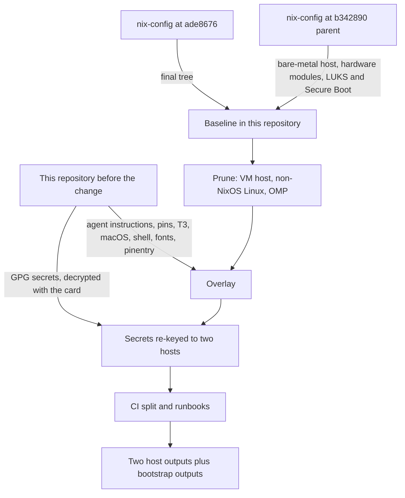

# Nix Flake Cutover - Plan

## Goal Capsule

- **Objective:** The MacBook Pro M5 Pro and the MS-7D91 desktop get the same tools, applications, agent configuration, and secrets from this repository, with near-zero drift between them, and the owner can reinstall either machine from the repository's own documents.
- **Means:** Replace the chezmoi and mise structure with a Nix flake. Import the archived `hyperlapse122/nix-config` as the baseline, then overwrite it with what changed in this repository after that archive (KTD1, KTD5).
- **Product authority:** The repository owner, the only user of both hosts. The Product Contract outranks the Planning Contract, which outranks any unit.
- **Execution profile:** One pull request. Every unit depends on the import in U1, and no part can merge alone and leave `main` usable.
- **Stop conditions:** Stop and report when the OpenPGP card cannot decrypt the bootstrap or GPG envelopes U4 needs, or when evidence shows a settled Key Decision cannot work.
- **Who finishes:** The executing agent finishes at the merge-ready pull request. The owner merges and then reinstalls both hosts from the runbooks.
- **Open blockers:** None.

---

## Product Contract

### Summary

This repository becomes a Nix flake for two hosts: NixOS on the MS-7D91 with KDE Plasma on `nixos-unstable`, and macOS on the MacBook Pro through nix-darwin.
The archived `hyperlapse122/nix-config` supplies the baseline for tools, applications, secret structure and values, and installation method.
Changes made in this repository after the archive replace the matching parts of that baseline.
The chezmoi and mise structure, Windows, Ubuntu, and non-NixOS Linux support are removed in the same change, and CI stops building bootstrap outputs and every host on each pull request.

### Problem Frame

The owner archived `hyperlapse122/nix-config` on 2026-10-30 to start Windows development, and began this chezmoi repository on 2026-11-04 to carry the agent configuration across Windows, Ubuntu, and macOS.
Windows then showed problems that were critical to the development workflow, and the owner decided to stop using it.

What remains is a structure built to support Windows. It manages Ubuntu and macOS through separate package lists and scripts, and drift between the two has returned.
The earlier flake kept that drift close to zero and the owner had no complaint about it in daily use.
Its one weakness was CI: as the repository grew, each pull request built bootstrap outputs and every host, and that took too long.

### Key Decisions

- **`nix-config` is the baseline and this repository is the overlay.** The import brings tools, applications, secret structure and values, and installation method unchanged; this repository's later changes then replace the matching parts. Governs R2, R4. (session-settled: user-directed — chosen over rebuilding the flake around this repository's structure: the earlier configuration worked without complaint and only needs the later changes applied.)
- **Secrets return to sops and age.** Governs R7, R8. (session-settled: user-directed — chosen over keeping this repository's GPG single-recipient encryption: the owner wants the `nix-config` secret structure and values back, updated only where secrets changed here.)
- **The owner installs both hosts from runbooks.** Governs R12, R13, R14. (session-settled: user-directed — chosen over an agent installing the MS-7D91 remotely over SSH: the owner performs both installs and wants no agent action or validation on the hosts.)
- **Non-NixOS Linux support is dropped.** Governs R10. (session-settled: user-directed — chosen over importing that code unused: no remaining host needs it.)
- **Windows is dropped completely.** Governs R9. (session-settled: user-directed — chosen over keeping Windows support beside the flake: Windows had critical problems in the development workflow.)
- **Non-agent changes made in this repository are carried over too.** Governs R5. (session-settled: user-approved — chosen over carrying only agent-related changes: the agent proposed the wider overlay with its added scope stated, and the owner confirmed it.)
- **Completion is the merge, not the reinstall.** Governs R16. The owner reinstalls on their own schedule after the conversion and runbooks are on `main`.

### Requirements

**Flake and hosts**

- R1. The repository is a Nix flake that pins `nixos-unstable` with a lock file and defines exactly two hosts: a bare-metal NixOS host `MS-7D91` running KDE Plasma, and a nix-darwin host for the MacBook Pro M5 Pro.
- R2. The baseline for tools, applications, and module structure is the final state of `hyperlapse122/nix-config`.
- R3. The `MS-7D91-VM` host, a VMware guest on Windows, is removed, and the bare-metal `MS-7D91` host is restored in its place.

**Overlay from this repository**

- R4. Agent instructions, agent applications, harness plugins and skills, and T3 Code routing follow this repository's current state wherever it differs from `nix-config`.
- R5. Non-agent changes made in this repository after the archive are carried into the flake, including the Ghostty default terminal, fonts, the macOS Dock, the Xcode bootstrap, and the Apple `container` runtime.
- R6. A tool this repository retired stays retired after the import, even when `nix-config` still managed it.

**Secrets**

- R7. Secrets use the `nix-config` sops and age structure with its existing values, and each secret that is new or changed in this repository is re-encrypted into that structure.
- R8. The restored `MS-7D91` host reuses the former `MS-7D91` SSH identity that this repository holds encrypted, and gets an age recipient registered through the `nix-config` procedure for adding a host.

**Removal**

- R9. The chezmoi source, mise tasks, bootstrap and provisioning scripts, tests, and documents for Windows and Ubuntu are removed in the same change.
- R10. The `nix-config` support for non-NixOS Linux hosts, with its documents and checks, is not imported.
- R11. `STRATEGY.md` and `AGENTS.md` describe the two-host Nix structure and no longer describe Windows, Ubuntu, chezmoi, or mise bootstrap.

**Installation**

- R12. The repository carries the `nix-config` installation and recovery documents as runbooks for both hosts, updated for R1, R3, R7, and R8.
- R13. The runbooks cover backup of keys and data before a disk is erased, and recovery of secret access on the freshly installed host.
- R14. No agent installs an operating system, erases a disk, or runs validation on either host.

**CI and completion**

- R15. A pull request runs only lightweight evaluation and checks scoped to what it changed; full host builds and bootstrap outputs run outside the pull-request path.
- R16. The work is complete when the converted repository and the runbooks are merged to `main`, with flake evaluation and builds checked in the repository.

### Key Flows

- F1. MS-7D91 reinstall
  - **Trigger:** The conversion is on `main` and the owner chooses to reinstall.
  - **Actors:** The owner.
  - **Steps:** Back up keys and data; boot installation media; follow the NixOS runbook to initialize the disk and install the bootstrap output; recover the age identity; apply the final host output.
  - **Outcome:** The MS-7D91 runs NixOS with Plasma and the full configuration.
  - **Covered by:** R1, R3, R8, R12, R13, R14
- F2. MacBook Pro reinstall
  - **Trigger:** The conversion is on `main` and the owner chooses to reinstall.
  - **Actors:** The owner.
  - **Steps:** Back up keys and data; erase and reinstall macOS; follow the macOS runbook to install Nix and apply the bootstrap output; recover the age identity; apply the final nix-darwin output.
  - **Outcome:** The MacBook Pro runs the same user environment as the MS-7D91, with GUI applications installed as the runbook describes.
  - **Covered by:** R1, R12, R13, R14

### Acceptance Examples

- AE1. **Covers R4, R6.** Given `nix-config` managed OMP and this repository retired it, when the import and overlay finish, then the flake does not install or configure OMP.
- AE2. **Covers R7.** Given a secret whose value changed in this repository after 2026-10-30, when the overlay finishes, then the sops file holds the new value and no GPG-encrypted chezmoi secret remains in the tree.
- AE3. **Covers R15.** Given a pull request that changes one agent instruction file, when CI runs, then it does not build a bootstrap output or every host.

### Scope Boundaries

- Intel Macs, arm64 Linux hosts, and any host other than the two in R1 are out of scope.
- Windows, including the `nix-config` document for the Windows PC that hosted the VMware guest, is out of scope.
- A numeric time target for pull-request checks is not set.
- The actual reinstall of either host is the owner's work after this plan completes.
- Measuring the `STRATEGY.md` key metrics is not part of this work.

### Dependencies / Assumptions

- Re-encrypting this repository's secrets into sops requires the owner to approve GPG decryption and to have the YubiKey or age identity that the `nix-config` recipients expect.
- The bare-metal `MS-7D91` host definition from before its replacement by `MS-7D91-VM` is recoverable from the `nix-config` history; the secrets guide in this repository cites commit `c71756ab76eca6031118973726f4139a86e6b4db` for that host's SSH secret.
- Checks in the repository still run flake evaluation and builds. The owner's instruction to skip validation is read as applying to the hosts only.
- `hyperlapse122/nix-config` stays readable while archived.

### Outstanding Questions

**Deferred to Implementation**

- Whether each token and the corporate CA in this repository's GPG secrets differ from the `nix-config` sops values. U4 compares them without printing either side.
- Whether the Jetendard and Pretendard variant fonts exist in nixpkgs or need a fetched derivation. U8 checks each family.
- The exact set of checks that lose their only fixture when the non-NixOS fixtures go. U2 finds them by evaluating the flake.

### Sources / Research

- `hyperlapse122/nix-config` (archived, last push 2026-10-30): `flake.nix` pins `nixos-unstable` with Home Manager, nix-darwin, sops-nix, and system-manager; `hosts/` holds `MS-7D91-VM` and `MacBook-Pro-Mac17-9`; `docs/install.md`, `docs/macos.md`, `docs/recovery.md`, and `docs/adding-a-host.md` describe installation; `packages/` holds the custom CLIs, including `nr`.
- `hyperlapse122/nix-config` `.github/workflows/check.yml`: runs on pull requests and pushes with jobs `fmt`, `markdown-lint`, `changes`, `flake-check`, `check-shards`, `vm-checks`, `build`, `build-linux`, and `build-darwin`, building normal and `-bootstrap` host outputs.
- `docs/guides/secrets-and-authentication.md`: the former `MS-7D91` SSH identity and its origin.
- `home/private_dot_ssh/encrypted_private_id_ed25519.asc` and `home/.secrets/`: the GPG-encrypted secrets to re-encrypt; the recipient fingerprint is in `home/.chezmoidata/gpg.yaml`.
- `docs/guides/harness-plugins.md`: the managed native harnesses are Claude Code, Codex, pi, Grok, and Antigravity; T3 Code is managed as a launcher.
- `.github/workflows/`: `test.yml` plus three daily lock-update workflows.
- `.compound-engineering/artifacts/plans/2026-11-09-0127-refactor-unmanage-omp-plan.md`: the OMP retirement that R6 preserves.
- Product Contract preservation: Product Contract unchanged. The planning questions it deferred are resolved in the Planning Contract (KTD1, KTD5, KTD9, KTD10).

---

## Planning Contract

### Key Technical Decisions

- KTD1. **Import the final tree of `nix-config` at `ade86764da243eb3bcfa101499aa7231819390cd`, not its history.** The tree lands in one commit that names the source repository and commit. Grafting 1,952 commits onto this repository adds nothing a reinstall needs, and the archive keeps the history. Serves R2.
- KTD2. **Carry the `nix-config` learnings and `CONCEPTS.md`, not its plans.** Its `.compound-engineering/artifacts/solutions/` entries merge into this repository's solutions tree, and its roughly 190 plan files stay in the archive. This repository's own plans and solutions stay.
- KTD3. **Restore the bare-metal `MS-7D91` by reversing the NixOS side of `nix-config` commit `b342890`.** That commit deleted the host files and also the NVIDIA, Bluetooth audio, DualSense, NuPhy Gem80, Sennheiser, and iPhone-restore modules, the Lanzaboote input, and the LUKS boot layout and its checks. Restoring only `hosts/MS-7D91/` would not evaluate against the current boot modules. The restore keeps later fixes, including the removal of system-wide `cudatoolkit` in commit `5cea746`. Serves R3.
- KTD4. **Remove everything that exists only for the VMware guest.** That is the `MS-7D91-VM` host, the Gpg4win relay branch and its check, the VM bootstrap and SSH secrets, and `docs/windows.md`. The SSH server trait stays because it is a general trait. Serves R3 and the Windows scope boundary.
- KTD5. **Overlay rule: this repository wins where both declare the same thing, and a `nix-config` declaration this repository never mentions stays.** Absence from this repository is not retirement. Only OMP has an explicit retirement here, so only OMP is removed; fff, tokscale, the extra skills, and the extra desktop applications stay. Serves R4, R5, R6.
- KTD6. **Harnesses and CLIs stay Nix packages, bumped to this repository's locked versions.** The `packages/*-release.json` manifests take the versions in `home/.chezmoidata/personal-app-lock.json`, and the Compound Engineering pin moves from v3.33.1 to v3.36.1 at commit `173bd337fa639aac19ce7363d288836a074231a5`. Nothing downloads a second copy into `~/.local/bin`. Pi is the exception to a plain bump: `nix-config` commit `5a26c07` retired its Pi provisioning, and this repository manages Pi, so the Pi package, module, release manifest, and updater step return from that commit's parent. Serves R4.
- KTD7. **Claude Code's model, effort, and context window are owner-owned.** The forced `model = "opus[1m]"` in `home/h82/agents/claude.nix` is removed, because this repository deliberately preserves the owner's choice. The other managed keys follow `home/.chezmoitemplates/claude-settings`. Serves R4.
- KTD8. **macOS runs containers through Apple's `container` CLI, and NixOS keeps rootless Podman.** On macOS the Podman machine and its minikube launch agents are removed and the `container` formula, kernel, and login service take their place. This repository's rootless-Docker policy for Linux was proven only on Ubuntu, so the NixOS baseline stays. Serves R5.
- KTD9. **Secrets get a fresh age identity for `MS-7D91`, and shared files are re-keyed to the two hosts.** `scripts/prepare-age-identity` creates the identity, since `b342890` rotated the shared secrets away from the old one. `tokens.yaml` is keyed to both hosts; `wifi.yaml`, `tailscale.yaml`, and `printers.yaml` to `MS-7D91` only. The VM recipient leaves every rule and every ciphertext. Serves R7, R8.
- KTD10. **Pull requests evaluate and run light checks; closures build after merge.** On `pull_request`, CI runs `fmt`, markdown lint, `nix flake check --no-build`, and the `light-*` check shards. The `hosts` shard, the `build` and `build-darwin` jobs with their `-bootstrap` outputs, and `vm-checks` run on push to `main`, on `workflow_dispatch`, and on a pull request that carries the `full-ci` label. The label exists because GitHub cannot dispatch a workflow from a branch until that workflow is on the default branch. The dependency-update workflow keeps its full verification before it pushes. Serves R15.
- KTD11. **This repository's lock updaters fold into `update-dependencies.yml`.** The harness-plugin and personal-app updaters already have counterparts there. Fonts come from flake inputs and nixpkgs, so the font-lock updater has no successor.
- KTD12. **The keyring pinentry crate becomes a Nix package and replaces the `pinentry-card` scripts.** `crates/pinentry` is the newer behavior and already carries protocol tests; it builds through the flake instead of `mise run pinentry:build`. Serves R5.
- KTD13. **Xcode installs through `xcodes` with the Apple account in sops.** This replaces the `mas` path in `modules/darwin/xcode.nix`. The account moves from `home/.secrets/apple-account.json.asc` into a file keyed to the MacBook recipient only. Serves R5, R7.
- KTD14. **Verification is evaluation locally and builds in CI.** This Mac has no Nix installed and worktree preparation must not change the host. Evaluation and formatting run inside a disposable `nixos/nix` container under Apple `container`, started for `linux/amd64` with Rosetta so the `x86_64-linux` formatter and checks resolve. `nix flake check` evaluates only the container's own system, so the Darwin outputs and `checks.aarch64-darwin` are evaluated by name. Closure builds run in GitHub Actions on this pull request under the `full-ci` label from KTD10. Serves R14, R16.

### High-Level Technical Design

The work is a tree replacement followed by ordered edits. The diagram shows which source feeds each part of the result.

Secrets end in this recipient layout:

| File | Recipients |
|---|---|
| `secrets/tokens.yaml` | `MS-7D91`, `MacBook-Pro-Mac17-9` |
| `secrets/wifi.yaml`, `secrets/tailscale.yaml`, `secrets/printers.yaml` | `MS-7D91` |
| `secrets/hosts/MS-7D91/ssh.yaml` | `MS-7D91` |
| `secrets/hosts/MacBook-Pro-Mac17-9/ssh.yaml`, `tls-inspection-ca.yaml`, and the new Apple account file | `MacBook-Pro-Mac17-9` |

### Assumptions

- The owner's YubiKey is connected and the owner approves PIN prompts while U4 runs. `gpg --card-status` already reports the card on this Mac.
- The MacBook Pro M5 Pro is the same machine as the `MacBook-Pro-Mac17-9` host; this Mac reports model `Mac17,9`.
- The MS-7D91 hardware is unchanged since `b342890`: the Samsung 980 PRO system disk, the exFAT data disk, the NVIDIA GPU, and the listed peripherals. The runbook tells the owner to check the disk IDs before running disko.
- Encrypted disk and Secure Boot return with the bare-metal host, because that was the `nix-config` install method for this machine.
- `secrets/tokens.yaml` values in `nix-config` are still valid unless U4's comparison shows this repository holds a different value.
- Repository checks still build and evaluate; the owner's instruction to skip validation covers the hosts only.

### System-Wide Impact

- Every path in this repository changes. Open branches and worktrees based on the chezmoi layout cannot be rebased onto the result.
- `AGENTS.md` rules about `mise install`, hook-free chezmoi configuration, and `mise run apply` stop applying. The `nix-config` agent rules replace them, and the harness-instruction, plugin, retirement, and container-cleanup rules carry over in Nix terms.
- The scheduled workflows change from three daily lock updaters to the `nix-config` set, which pushes verified pin updates to `main` every 30 minutes.
- Until the owner reinstalls, both machines keep whatever the chezmoi apply left on them. Nothing in this work touches them.

### Risks & Dependencies

| Risk | Mitigation |
|---|---|
| The restored hardware and boot modules no longer evaluate against two months of later refactors. | U3 restores them against the current module layout and proves it with `nix flake check --no-build` and the boot-layout invariants. |
| A check that partitions hosts by trait goes vacuous or fails when a host kind disappears. | U2 and U3 follow `removing-a-host-empties-one-side-of-a-partitioned-check.md` and keep each guard non-vacuous. |
| `tests/linux-host-secrets.sh` also covers the Darwin host's recipients, so deleting it with the non-NixOS code loses that coverage. | U2 keeps the Darwin assertions under a name that no longer mentions non-NixOS hosts. |
| A secret is printed or left in plaintext during re-encryption. | U4 uses `SOPS_AGE_KEY_CMD` and `sops set --value-stdin` with mode `0600` temporary files outside the checkout, and deletes them before the unit ends. |
| Closure builds fail only after merge because pull requests no longer build them. | U9 labels this pull request `full-ci` so the closure jobs run once before it is declared ready. |
| The disposable Nix container is left behind. | U1 through U10 remove the container, its image, and its volumes after each verification run, as the owner's container rules require. |

---

## Implementation Units

| U-ID | Title | Key paths | Depends on |
|---|---|---|---|
| U1 | Import the baseline and remove the chezmoi tree | whole tree | none |
| U2 | Drop non-NixOS Linux support | `lib/`, `modules/system-manager/`, `tests/`, `flake.nix` | U1 |
| U3 | Restore bare-metal `MS-7D91`, remove the VM host | `hosts/`, `modules/nixos/`, `tests/` | U2 |
| U4 | Re-key and migrate secrets | `.sops.yaml`, `secrets/` | U3 |
| U5 | Overlay agent instructions, harness pins, and retirements | `home/h82/agents/`, `packages/` | U1 |
| U6 | Overlay T3 Code settings and routing | `home/h82/t3code.nix`, `t3.json` | U5 |
| U7 | Overlay macOS: Homebrew, Dock, Xcode, Apple `container` | `modules/darwin/`, `home/h82/dev/` | U1, U4 |
| U8 | Overlay shell, terminal, fonts, pinentry, and toolchains | `home/h82/`, `modules/shared/`, `crates/pinentry/` | U1 |
| U9 | Split CI and fold the updaters | `.github/workflows/` | U2, U3 |
| U10 | Rewrite runbooks and governance documents | `docs/`, `README.md`, `STRATEGY.md`, `AGENTS.md` | U3, U4, U7, U9 |

### U1. Import the baseline and remove the chezmoi tree

- **Goal:** The repository holds the `nix-config` tree, and no chezmoi, mise-task, Windows, or Ubuntu source remains.
- **Requirements:** R2, R9; KTD1, KTD2.
- **Dependencies:** None.
- **Files:** Delete `home/` (chezmoi source), `bootstrap.sh`, `bootstrap-ubuntu.sh`, `bootstrap.ps1`, `configure-chezmoi.sh`, `configure-chezmoi.ps1`, `provision-macos.sh`, `provision-ubuntu.sh`, `scripts/`, `tests/`, `docs/`, `mise.toml`, `mise.lock`, `.mise/`, `.github/workflows/`, `Cargo.toml`, `Cargo.lock`. Keep `crates/pinentry/` and `.compound-engineering/`. Add the `nix-config` tree: `flake.nix`, `flake.lock`, `lib/`, `modules/`, `home/`, `hosts/`, `packages/`, `scripts/`, `secrets/`, `keys/`, `config/`, `tests/`, `docs/`, `.github/workflows/`, `.githooks/`, `.sops.yaml`, `.markdownlint-cli2.jsonc`, `agents.toml`, `t3.json`, `mise.toml`, `mise.lock`, `.mise/`, `CONCEPTS.md`, `CLAUDE.md`, `AGENTS.md`, `README.md`, and `.compound-engineering/artifacts/solutions/`.
- **Approach:**
  1. Before deleting anything, copy the files later units read into a scratch directory outside the checkout: `home/.chezmoitemplates/`, `home/.chezmoidata/`, `home/.secrets/`, `home/private_dot_ssh/`, `home/private_dot_t3/`, the harness adapters, `home/dot_local/share/dotfiles/zsh/`, `docs/guides/`, and `tests/`.
  2. Replace the tree with the `nix-config` tree at the KTD1 commit.
  3. Keep this repository's `.compound-engineering/config.yaml`, plans, and solutions; merge the imported solutions beside them.
  4. Record the source repository and commit in the commit message.
- **Execution note:** This is a tree replacement; prove it by evaluating the unmodified import before any later unit edits it.
- **Patterns to follow:** The `nix-config` layout as described in its `README.md` and `CONCEPTS.md`.
- **Test scenarios:** Test expectation: none -- this unit moves files and adds no behavior; the imported checks are the proof.
- **Verification:** `nix flake check --no-build` evaluates the imported tree unchanged, and a search finds no `chezmoi` source directory, `.ps1` file, or Ubuntu provisioning script.

### U2. Drop non-NixOS Linux support

- **Goal:** The flake has no system-manager or standalone Home Manager path, and every remaining check still asserts something.
- **Requirements:** R10; KTD5.
- **Dependencies:** U1.
- **Files:** Delete `lib/linux-host.nix`, `modules/system-manager/`, `scripts/nr-linux`, `tests/non-nixos-outputs.nix`, `tests/non-nixos-scripts.nix`, `tests/non-nixos-vm.nix`, `tests/nr-linux.sh`, `tests/lib/linux-fixtures.nix`, and the `hollyhock` and `juniper` fixtures under `tests/fixtures/hosts/`. Keep `home/h82/security/non-nixos-secrets.nix`, `packages/host-secrets.nix`, `scripts/host-secrets`, and `tests/host-secrets.nix`, because the Darwin host stages and publishes its user secrets through them. Modify `flake.nix`, `flake.lock`, `lib/hosts.nix`, `modules/shared/host.nix`, `scripts/nr`, `packages/nix-tools.nix`, `tests/lib/configurations.nix`, `tests/lib/fixture-checks.nix`, `tests/vm-checks.nix`, `tests/linux-host-secrets.nix`, `tests/linux-host-secrets.sh`, `docs/adding-a-host.md`.
- **Approach:**
  1. Remove the `system-manager` and `nix-vm-test` inputs with their lock entries, and the `homeConfigurations` and `systemConfigs` outputs.
  2. Make `lib/hosts.nix` reject any host kind other than NixOS and Darwin.
  3. Remove the Linux-fixture entries from `tests/lib/configurations.nix` and update each guard that counted them.
  4. Keep the Darwin recipient assertions from `tests/linux-host-secrets.sh` under a name that describes user-identity hosts.
  5. Drop `checks.aarch64-linux` entries that only exercised the fixtures.
  6. Scope the user-mode secrets module and its comments to Darwin hosts; a rename is optional and must update `home/h82/security/default.nix`, `ssh.nix`, `home/h82/agents/tokscale.nix`, `usage.nix`, and `docs/macos.md` together.
- **Patterns to follow:** `.compound-engineering/artifacts/solutions/best-practices/removing-a-host-empties-one-side-of-a-partitioned-check.md` and `trait-split-check-cannot-catch-a-widened-default.md`.
- **Test scenarios:**
  - Evaluating the flake lists no `homeConfigurations` or `systemConfigs` attribute.
  - A fixture host whose `host.nix` declares a kind other than `darwin` fails evaluation with a message naming the kind.
  - The renamed recipient check fails when the Darwin host's recipient is added to the `wifi.yaml` rule.
  - `nr switch` on a NixOS host and on a Darwin host still dispatches to its platform script.
  - The Darwin output still defines the `my.secrets` paths and runs the `host-secrets` stage and publish steps.
- **Verification:** `nix flake check --no-build` passes, and a search for `system-manager` and `systemConfigs` finds nothing outside the archive citation in this plan.

### U3. Restore bare-metal `MS-7D91`, remove the VM host

- **Goal:** `hosts/MS-7D91/` evaluates as an encrypted, Secure Boot NixOS host with its hardware modules, and `MS-7D91-VM` is gone.
- **Requirements:** R1, R3; KTD3, KTD4.
- **Dependencies:** U2.
- **Files:** Add `hosts/MS-7D91/default.nix`, `disko.nix`, `hardware.nix`, `modules/nixos/hardware/nvidia.nix`, `bluetooth-audio.nix`, `dualsense.nix`, `nuphy-gem80.nix`, `sennheiser-btd.nix`, `iphone-restore.nix`, `idevicerestore-yonkers-ir1-generic.patch`, `tests/iphone-restore.nix`, `tests/wireplumber-bluetooth.nix`. Delete `hosts/MS-7D91-VM/`, `tests/gpg-agent-relay.nix`. Modify `flake.nix`, `flake.lock`, `modules/nixos/profile.nix`, `modules/nixos/system/boot.nix`, `boot-splash.nix`, `base.nix`, `modules/shared/host.nix`, `lib/nixos-host.nix`, `lib/host-facts.nix`, `home/h82/security/gpg.nix`, `tests/boot-layout.nix`, `tests/boot-splash.nix`, `tests/lib/disko-invariants.nix`, `tests/lib/configurations.nix`, `tests/udev-device-access.nix`, `tests/desktop-autostart.nix`, `tests/printing.nix`, `tests/proton-vpn.nix`, `tests/wifiman.nix`, `tests/nix-cleanup.nix`, `tests/vm-checks.nix`.
- **Approach:**
  1. Take each file `b342890` deleted from that commit's parent, and for each file it modified, restore the bare-metal behavior on top of the current version instead of checking out the old file.
  2. Restore the Lanzaboote input and the LUKS2 plus Btrfs layout, and make the disko and boot-layout invariants expect them again.
  3. Add the GPU kernel-mode-setting module to the initrd, which the current boot-splash contract requires and the old hardware file predates.
  4. Do not re-add system-wide `cudatoolkit`.
  5. Remove the GPG relay trait, its `gpg.nix` branch, and its VM check; keep the SSH server trait and its check, and leave it disabled on `MS-7D91`.
  6. Leave the host's secrets to U4; until then evaluation uses the fake-secret fixtures the checks already use.
- **Technical design:** Directional, not a specification. The host declares the traits its old file declared (NuPhy Gem80, both T3 traits, the office printer, Tailscale routes outside bootstrap) and mounts the exFAT data disk by ID with `nofail`.
- **Patterns to follow:** `lib/nixos-host.nix` host-generic composition: the host file does not import the profile.
- **Test scenarios:**
  - `nixosConfigurations` lists exactly `MS-7D91` and `MS-7D91-bootstrap`.
  - The disko invariant check fails when the root volume of a NixOS host is not on LUKS.
  - The boot-splash check fails when the initrd lacks the host's GPU kernel module.
  - The `MS-7D91` closure contains the proprietary NVIDIA driver and no `cudatoolkit` in the system path.
  - The udev device-access check covers the NuPhy and DualSense rules again.
  - No check or module mentions the GPG relay.
- **Verification:** `nix flake check --no-build` passes, both `MS-7D91` attributes evaluate to a derivation path, and a search for `MS-7D91-VM` and `vmware` finds nothing.

### U4. Re-key and migrate secrets

- **Goal:** Every secret is in sops, keyed as the Planning Contract table shows, and no GPG-encrypted chezmoi secret remains.
- **Requirements:** R7, R8; KTD9, KTD13. Covers AE2.
- **Dependencies:** U3.
- **Files:** Modify `.sops.yaml`, `secrets/tokens.yaml`, `secrets/wifi.yaml`, `secrets/tailscale.yaml`, `secrets/printers.yaml`, `secrets/README.md`. Add `secrets/bootstrap/MS-7D91/age-key.asc`, `recipient.txt`, `secrets/hosts/MS-7D91/ssh.yaml`, `ssh.pub`, and a MacBook-only Apple account file under `secrets/hosts/MacBook-Pro-Mac17-9/`. Delete `secrets/bootstrap/MS-7D91-VM/`, `secrets/hosts/MS-7D91-VM/`.
- **Approach:**
  1. Create the `MS-7D91` identity with `scripts/prepare-age-identity`.
  2. Decrypt the existing envelopes through the card with `SOPS_AGE_KEY_CMD`, as `secrets/README.md` documents.
  3. Update the creation rules, run `sops updatekeys` on each shared file, and rotate the data keys of the files the VM recipient could read.
  4. Decrypt the former `MS-7D91` SSH identity from the scratch copy of `home/private_dot_ssh/encrypted_private_id_ed25519.asc` and write it to the host's sops file with its public key.
  5. Compare each token, the Synthetic key, and the corporate CA between the scratch copies of `home/.secrets/` and the sops files by digest; write only the values that differ. Map the GitLab record to `gitlab_token` or `jpi_token` by its host field, without printing it.
  6. Add the Apple account fields to the new MacBook-only file.
  7. Delete every plaintext temporary file and the scratch copies of the GPG secrets.
- **Execution note:** The card prompts for a PIN. If decryption fails after one retry, stop per the Goal Capsule and report which step failed; do not commit a partial recipient change.
- **Patterns to follow:** `docs/adding-a-host.md` key provisioning and `docs/recovery.md` decommissioning; `.compound-engineering/artifacts/solutions/integration-issues/tmpfs-gnupghome-card-provisioning-traps.md`.
- **Test scenarios:**
  - Covers AE2. The `sops-recipients` check passes with the new rules and fails when the VM recipient is put back into any rule.
  - The `bootstrap-recipients` check passes with one bootstrap directory per host and fails when `secrets/bootstrap/MS-7D91/recipient.txt` is absent.
  - The recipient check from U2 fails when the MacBook recipient appears in `tailscale.yaml`.
  - `secrets/hosts/MS-7D91/ssh.pub` equals the public half of the migrated private key.
  - A search of the tree finds no `.asc` file other than the bootstrap envelopes and `keys/`.
- **Verification:** The three recipient checks pass, and the working tree and scratch directory contain no decrypted secret.

### U5. Overlay agent instructions, harness pins, and retirements

- **Goal:** Each managed harness gets this repository's instructions, plugin pin, skills, and settings through the `nix-config` modules, and OMP is no longer managed.
- **Requirements:** R4, R6; KTD5, KTD6, KTD7. Covers AE1.
- **Dependencies:** U1.
- **Files:** Modify `home/h82/agents/instructions/instructions.md.tmpl`, `instructions/default.nix`, `agent-plugin-pins.nix`, `agent-plugins.nix`, `claude.nix`, `codex.nix`, `gemini.nix`, `grok.nix`, `default.nix`, `packages/claude-code-manifest.json`, `codex-release.json`, `grok-build-release.json`, `antigravity-cli-release.json`, `flake.nix`, `flake.lock`, `tests/` checks for instructions and plugins. Delete `home/h82/agents/omp*.nix`, `omp-*.md`, `omp-ce-explicit-review.patch`, `omp-declarations.py`, `packages/omp.nix`, `omp-release.json`, `scripts/omp*`, and the OMP checks. Restore `packages/pi.nix`, `packages/pi-release.json`, `home/h82/agents/pi.nix`, and `scripts/pi-release` from the parent of `nix-config` commit `5a26c07`.
- **Approach:**
  1. Replace the shared instruction body with the scratch copy of `home/.chezmoitemplates/agent-instructions`, keeping the template's harness selection so each harness renders only its own branch.
  2. Rewrite the instruction text that names chezmoi, mise, Windows, or Ubuntu so it describes NixOS and macOS.
  3. Move the Compound Engineering pin and the harness release manifests to the locked versions KTD6 names.
  4. Apply the Claude settings ownership from KTD7.
  5. Remove OMP's packages, modules, scripts, pins, and checks, and add no cleanup of installed OMP state; convert `retire-orca.nix` the same way if it deletes user data.
  6. Keep fff, tokscale, usage, tanstack-intent, and the pinned and local skills.
  7. Restore Pi per KTD6 at the locked version, then apply this repository's Pi behavior from the scratch copies of `home/private_dot_pi/` and `synthetic-model-lock.json`: shared instructions, the Compound Engineering plugin, the Synthetic-only model policy, and the Synthetic key in Pi's native auth file.
- **Patterns to follow:** This repository's harness rules in `AGENTS.md`: one shared template, no foreign branch in any rendered file, each shared skill discovered exactly once.
- **Test scenarios:**
  - Covers AE1. No package, module, or generated settings file in either host's closure names OMP.
  - Each harness's rendered instruction file contains the common body and none of another harness's branch text.
  - The rendered Claude settings contain no `model` key and keep the disabled auto-memory and updater keys.
  - The plugin check fails when the Compound Engineering flake input revision differs from the pin file.
  - Each of the three Korean skills appears once in each harness's skill roots.
  - The Pi package is in both hosts' closures at the locked version, and its rendered policy rejects a model outside the Synthetic lock.
- **Verification:** `nix flake check --no-build` passes with the updated instruction, plugin, and settings checks.

### U6. Overlay T3 Code settings and routing

- **Goal:** T3 Code launches with this repository's settings, provider list, and delegation instructions.
- **Requirements:** R4; KTD5.
- **Dependencies:** U5.
- **Files:** Modify `home/h82/t3code.nix`, `t3.json`, `packages/t3code-release.json`, `home/h82/agents/instructions/` for the T3 context branch, and the T3 checks under `tests/`.
- **Approach:**
  1. Carry each field of the scratch copy of `home/.chezmoidata/t3-code.json` into the T3 module's merged settings, preserving keys the module does not own.
  2. Remove the OMP provider from declarations and from settings the module merges into, so an existing settings file loses the entry.
  3. Render the T3-only instruction additions through each provider's per-launch option, as `docs/guides/t3-code.md` in the scratch copy specifies, with no shadow home.
  4. Enable the Pi provider that `nix-config` disabled when it retired Pi.
  5. Keep the documented limits: T3 cannot enforce a read-only delegate, and the Grok driver takes no prompt addition.
- **Patterns to follow:** The CE model ladder table in the shared instruction template.
- **Test scenarios:**
  - The merged settings set the default model, fallback, text-generation model, and worktree mode from `t3-code.json`.
  - Merging into a settings file that contains an OMP provider and an unrelated user key removes the provider and keeps the key.
  - A T3-launched Claude instance receives the baseline instructions plus the T3 additions; a CLI-launched one receives the baseline only.
  - The Grok launch arguments contain no prompt-addition flag.
- **Verification:** The T3 checks pass under `nix flake check --no-build`.

### U7. Overlay macOS: Homebrew, Dock, Xcode, Apple `container`

- **Goal:** The Darwin host declares this repository's macOS applications, Dock, Xcode path, and container runtime.
- **Requirements:** R5; KTD8, KTD13.
- **Dependencies:** U1, U4.
- **Files:** Modify `modules/shared/darwin-apps.nix`, `modules/darwin/homebrew.nix`, `dock.nix`, `xcode.nix`, `tls-inspection-ca.nix`, `home/h82/dev/containers.nix`, `kubernetes.nix`, `hosts/MacBook-Pro-Mac17-9/default.nix`, `tests/darwin-outputs.nix`. Delete `packages/minikube-darwin-start.nix`, `podman-machine-resources.nix`, `scripts/minikube-darwin-start`, `scripts/podman-machine-resources` if nothing else uses them. Add a Darwin module for the Apple `container` runtime.
- **Approach:**
  1. Add the `aria2` and `container` formulae and any cask from `macos.yaml` that the baseline lacks; remove none of the baseline's casks.
  2. Set the Dock size, recents, and app order from `macos-dock.json`.
  3. Switch Xcode to `xcodes` with the sops account, keeping first-launch ordering and a single updater. Gate it on `!config.my.bootstrap`, as `modules/darwin/tls-inspection-ca.nix` does, because the age identity is recovered only after the bootstrap switch.
  4. Have the Xcode helper check that the user age identity is a regular file owned by the primary user with mode `0600`, decrypt the account in memory, and hand it to `xcodes` only through that process's environment, following `scripts/tls-inspection-ca`.
  5. Replace the Podman machine and minikube launch agents with the Apple `container` setup: start a stopped API, install the recommended kernel, enable the login service, and leave a running runtime alone.
  6. Keep the kubectl and minikube clients without an automatic cluster start.
  7. Keep one CA trust path; do not add a second launch agent for the same environment.
- **Patterns to follow:** `.compound-engineering/artifacts/solutions/best-practices/nix-darwin-preactivation-reads-previous-generation-etc.md`; this repository's `2026-11-09-2049-feat-macos-container-kernel-service-plan.md`.
- **Test scenarios:**
  - The Darwin output's Homebrew declaration includes `container` and `aria2` and still includes the baseline casks.
  - The Dock declaration lists the applications in `macos-dock.json` order with size 32 and recents off.
  - The Darwin closure defines no Podman-machine or minikube launch agent.
  - The container activation step does nothing when the API is already running.
  - The Xcode module reads its credentials from the sops path and never from the Nix store.
  - The `-bootstrap` Darwin output evaluates without the Apple account secret and does not run the Xcode step.
- **Verification:** `tests/darwin-outputs.nix` passes under evaluation, and the `build-darwin` job builds the system in CI.

### U8. Overlay shell, terminal, fonts, pinentry, and toolchains

- **Goal:** Both hosts get this repository's zsh setup, Ghostty default, fonts, keyring pinentry, and build toolchains from shared modules.
- **Requirements:** R5; KTD12.
- **Dependencies:** U1.
- **Files:** Modify `home/h82/shell/shell.nix`, `home/h82/desktop/terminal.nix`, `modules/shared/font-packages.nix`, `home/h82/security/gpg.nix`, `home/h82/dev/git.nix`, `home/h82/dev/cpp.nix`, `rust.nix`, `flake.nix`. Add `packages/pinentry-keyring.nix` building `crates/pinentry`, a .NET module providing SDK 8 and 10, and font derivations where nixpkgs lacks a family. Modify `packages/gpg-tools.nix`, `tests/darwin-config.nix`, `tests/darwin-outputs.nix`. Delete `scripts/pinentry-card`, `scripts/pinentry-card-darwin`, `tests/pinentry-card.sh`, `tests/pinentry-card-darwin.sh` once nothing references them. Restore `Cargo.toml` and `Cargo.lock` for the crate.
- **Approach:**
  1. Translate the Prezto modules, XDG startup files, and completions from the scratch copies of `zsh.json` and `cli-completions.json` into the Home Manager zsh module, with one startup manager.
  2. Apply the Ghostty configuration and default-terminal setting from the scratch copy of `ghostty-config`; keep the baseline emoji fallback.
  3. Add the font families in `fonts.json` that the baseline lacks.
  4. Package the pinentry crate, run its tests as a flake check, and point `gpg-agent` at it on both hosts. The binary reads its fallback pinentry from a JSON file beside the executable, so the package writes that file: `pinentry-qt` on NixOS and `pinentry_mac` on Darwin.
  5. Carry the git identity and signing settings from `git.yaml` without hardcoded Homebrew paths.
  6. Provide .NET 8 and 10, Rust, cmake, ninja, and vcpkg through Nix; add Bun at the locked version.
- **Patterns to follow:** Existing shared modules under `home/h82/`; the crate's own tests in `crates/pinentry/tests/`.
- **Test scenarios:**
  - The rendered `.zshrc` sources Prezto once and loads each completion in `cli-completions.json`.
  - The Ghostty configuration names the Jetendard-based font stack, and the NixOS host's default terminal is Ghostty.
  - The pinentry package's protocol tests pass as a flake check on Linux and Darwin.
  - The rendered `gpg-agent.conf` on each host points at the packaged pinentry.
  - The packaged pinentry has a companion JSON file whose `fallback` names an executable in the Nix store for that platform.
  - `dotnet --list-sdks` in the Home Manager profile's closure reports an 8.x and a 10.x SDK.
  - The rendered git configuration signs with fingerprint `621512777E6933FEB4458FDC4945855D4F283F05` and names a `gpg` from the profile.
- **Verification:** `nix flake check --no-build` passes, and the pinentry check builds in the CI `light-*` shards.

### U9. Split CI and fold the updaters

- **Goal:** Pull requests finish without building host closures, and one workflow owns pin updates.
- **Requirements:** R15; KTD10, KTD11. Covers AE3.
- **Dependencies:** U2, U3.
- **Files:** Modify `.github/workflows/check.yml`, `update-dependencies.yml`, `scripts/ci-docs-only-paths`, `tests/check-shards.nix`, `tests/check-shards-guard.nix`, and the workflow policy checks under `tests/`. Modify `model-catalogs.yml`, whose `VERIFY_TARGETS` builds the `omp-settings` and `omp-models-load` checks that U5 deletes. Keep `synthetic-models.yml`.
- **Approach:**
  1. Gate the `hosts` shard, `hosts` matrix, `build`, `build-darwin`, and `vm-checks` jobs per KTD10.
  2. Remove `build-linux` and the aarch64 Linux runner, which only served non-NixOS hosts.
  3. Keep `fmt`, `changes`, `markdown-lint`, `flake-check`, and the `light-*` shards on pull requests, with the docs-only skip.
  4. Keep the full verification inside `update-dependencies.yml`, restore its Pi step, and add any pin this repository's updaters tracked that it lacks.
  5. Point `model-catalogs.yml` at the checks that survive U5, and drop a catalog snapshot only OMP consumed.
  6. Label this pull request `full-ci` so the closure builds are proven before merge.
- **Patterns to follow:** The existing fail-open gate in `check.yml`: run on push or classifier failure, skip only a definite docs-only pull request.
- **Test scenarios:**
  - Covers AE3. The workflow policy check fails when a job that builds a `-bootstrap` output or a host toplevel can run on `pull_request`.
  - The shard guard still reports every check in exactly one shard after the `hosts` shard moves off the pull-request path.
  - A docs-only pull request runs markdown lint and skips the shards.
  - A pull request with the `full-ci` label runs `build`, `build-darwin`, and `vm-checks`; the same pull request without it does not.
  - Every target in `model-catalogs.yml` `VERIFY_TARGETS` names a check the flake still defines.
- **Verification:** The labelled run on this pull request is green, and a run without the label contains no closure-build job.

### U10. Rewrite runbooks and governance documents

- **Goal:** The owner can reinstall either host from `docs/`, and the governance documents describe the two-host flake.
- **Requirements:** R11, R12, R13, R14, R16; F1, F2.
- **Dependencies:** U3, U4, U7, U9.
- **Files:** Modify `docs/install.md`, `docs/macos.md`, `docs/recovery.md`, `docs/adding-a-host.md`, `README.md`, `STRATEGY.md`, `AGENTS.md`, `CLAUDE.md`, `CONCEPTS.md`, `secrets/README.md`. Delete `docs/windows.md`. Add the guides from the scratch copy of `docs/guides/` that still apply, rewritten for Nix.
- **Approach:**
  1. In `docs/install.md`, describe the encrypted bare-metal install of F1: disk ID check, disko, bootstrap output, Secure Boot key enrollment, age identity recovery, final switch.
  2. In `docs/macos.md`, describe F2 from an erased Mac: install Nix, apply the bootstrap output, recover the user age identity, apply the final output.
  3. Put the backup list of R13 at the top of both runbooks: the YubiKeys, GPG public key and ownertrust, any file-based SSH key, 1Password access, and data on disks that disko will erase.
  4. State in both runbooks that the owner runs every step and that no agent runs disko, an install, or a switch on a host.
  5. Rewrite `STRATEGY.md` for NixOS and macOS, and merge this repository's harness, retirement, container-cleanup, and writing-skill rules into the `nix-config` `AGENTS.md`, dropping the chezmoi and mise bootstrap rules.
  6. Remove non-NixOS, Windows, and VM text from every document.
- **Patterns to follow:** The existing `nix-config` runbook structure; markdown lint through `.markdownlint-cli2.jsonc`.
- **Test scenarios:** Test expectation: none -- documentation only; markdown lint and the host-name guard on shared sources are the checks.
- **Verification:** Markdown lint passes, each runbook step names a command or path that exists in the tree, and a search of `docs/`, `README.md`, `STRATEGY.md`, and `AGENTS.md` finds no mention of chezmoi, Windows, Ubuntu, or system-manager outside history notes.

---

---

## Verification Contract

| Gate | Command or evidence | Applies to |
|---|---|---|
| Formatting | `nix fmt -- --ci` | every unit |
| Evaluation | `nix flake check --no-build`, plus `nix eval` of each `darwinConfigurations.<name>.system.drvPath` and of `checks.aarch64-darwin` | every unit |
| Host outputs exist | `nix eval .#nixosConfigurations --apply builtins.attrNames` and the same for `darwinConfigurations` return only the two hosts and their `-bootstrap` variants | U2, U3 |
| Secret recipients | the `sops-recipients`, `bootstrap-recipients`, and renamed recipient checks | U4 |
| Markdown | the `markdown-lint` check | U10 |
| Closure builds | a green `check.yml` run on the pull request under the `full-ci` label, including `build`, `build-darwin`, and `vm-checks` | U3, U7, U9 |
| Pull-request path | the workflow policy check proves an unlabelled pull request has no closure-build job | U9 |

Local commands run inside a disposable `nixos/nix` container started with Apple `container` for `linux/amd64` with Rosetta, with the checkout mounted. Remove the container, image, and volumes after each session and confirm none remain.

---

## Definition of Done

- R1 through R16 hold, and AE1 through AE3 are each covered by a passing check.
- Every gate in the Verification Contract passes on the final commit.
- The tree contains no chezmoi source, PowerShell file, Ubuntu script, system-manager module, VM host, OMP package, or GPG-encrypted chezmoi secret.
- No decrypted secret exists in the checkout, the scratch directories, or any container.
- No disposable container, image, or volume from verification remains.
- Abandoned attempts and temporary files are removed from the diff.
- The pull request is open against `main` with CI decided; the owner merges it and reinstalls from `docs/install.md` and `docs/macos.md`.

