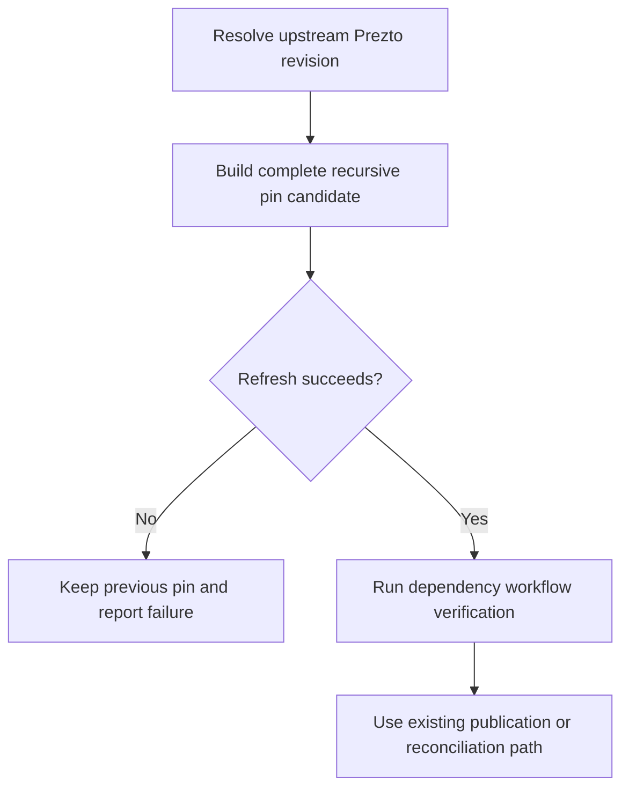
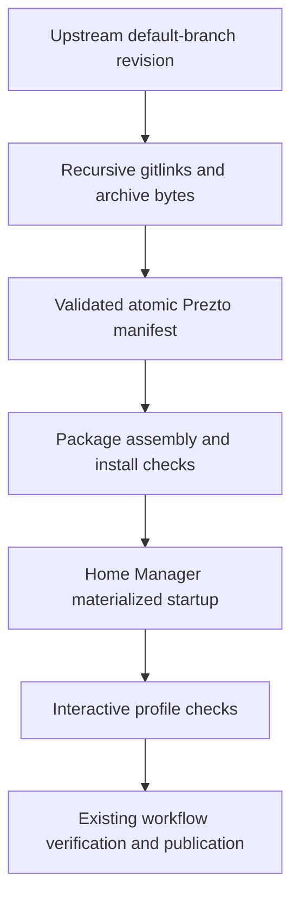
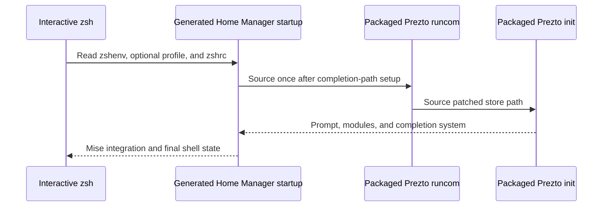

# Nix Prezto Parity - Plan

## Goal Capsule

- **Objective:** The owner can open a shell on either personal machine and rely on the prompt, completions, history, and key bindings previously supplied by chezmoi, with Prezto kept current automatically.
- **Means:** Extend the existing Nix and Home Manager shell setup.
- **Product authority:** [Issue #133](https://github.com/hyperlapse122/dotfiles/issues/133), the behavior at commit `501dfdf`, and the scope confirmed in this conversation.
- **Execution profile:** One pull request, with dependency-ordered implementation units and independent review.
- **Open blockers:** None for requirements planning; package integrity, Home Manager collision behavior, and host verification remain work to perform.

---

## Product Contract

### Summary

Close or explain every shell-parity gap in issue #133 through the existing Nix-managed setup.
Add automatic Prezto refreshes and verify the resulting shell behavior on Linux and macOS.

### Problem Frame

The cutover in #128 translated the chezmoi shell setup without a running host comparison.
The current checks inspect generated startup files and register completion functions in a noninteractive shell, leaving interactive startup behavior unproven.
Prezto has a recursive archive manifest, but the dependency workflow does not refresh it.

### Key Decisions

- **Extend the current setup.** Keep the existing Nix and Home Manager ownership model; reintroducing chezmoi would add a second configuration authority. Governs R1, R15.
- **Track the upstream-selected dependency tree.** Follow the Prezto revision and its selected submodule commits rather than updating each submodule independently. Governs R2, R3.
- **Document migration behavior.** Automatic merging of arbitrary custom startup code is outside the confirmed scope. Governs R15. (session-settled: user-approved — chosen over automatic merging: the confirmed scope retains documented Home Manager file ownership.)
- **Keep host evidence distinct.** Build and sandbox results cannot establish behavior in the owner's actual terminal sessions. Governs R18. (session-settled: user-approved — chosen over treating CI as host proof: the confirmed scope leaves missing host evidence pending.)

### Requirements

**Parity accounting and updates**

- R1. Compare every gap in issue #133 against commit `501dfdf` and record whether it was fixed, already equivalent, or deliberately unnecessary under Nix, with supporting evidence or a stated reason.
- R2. Automatically refresh the Prezto pin from its upstream default branch through `update-dependencies.yml`, using the workflow's existing verification before publication.
- R3. Rebuild the recursive lock from the selected Prezto revision with real archive hashes and the submodule commits recorded by that revision.
- R4. Test the updater's refresh and failure behavior, including keeping the previous complete pin when a refresh cannot produce a valid replacement.
- R5. Prove the packaged tree contains all nine previously locked submodules at their selected commits and retains the prompt themes those assets supported.

**Interactive shell behavior**

- R6. Load `utility` before `git` as before, unless investigation establishes a concrete reason for a different order and records its behavioral effect.
- R7. Enable Prezto's color style, `emacs` key bindings, and `sorin` prompt theme in the materialized shell environment.
- R8. Keep `git` and Darwin `homebrew` module loading behavior equivalent to the old conditional setup, documenting any reliance on guaranteed executable availability.
- R9. Export `GPG_TTY` from an available terminal and preserve the existing GPG-module guard that avoids replacing the SSH-agent environment.
- R10. Provide and load the six completion functions for `codex`, `gh`, `glab`, `ghq`, `mise`, and `usage` on both hosts.
- R11. Preserve working Bash-style completion support and explain how Nix replaces or supplies the former bash-completion 2.18.0 asset.
- R12. Activate mise in interactive zsh sessions when it is available.
- R13. Preserve `NODE_USE_SYSTEM_CA=1` and the applicable `~/.local/bin` precedence while deliberately retiring the chezmoi-specific `~/.local/share/dotfiles/zsh/bin` path.
- R14. Initialize Prezto once in each fresh interactive login or non-login shell and preserve XDG startup placement and history behavior relative to `501dfdf`.
- R15. Document and verify how the current Home Manager setup handles pre-existing `~/.zshenv` and `~/.zshrc` files on an existing machine, including whether unrelated user lines remain active, are backed up, or cause an activation conflict.

**Evidence and completion**

- R16. Assert implemented parity behavior through materialized files or real shell execution, with conditional behavior exercised in the state that distinguishes it from a regression.
- R17. Start an interactive zsh using the built profile and generated startup files, proving prompt loading, all six defined completion functions, and absence of startup errors.
- R18. Verify prompt, completion, history, key bindings, and error-free startup on both actual hosts, with sandbox, platform CI, and owner-run host evidence reported separately.

### Key Flows

- F1. Dependency refresh. Covers R2–R5, R16.
  - **Trigger:** The scheduled or manually dispatched dependency workflow runs.
  - **Steps:** Resolve Prezto's upstream default branch, lock its recursive dependency tree, and generate a complete pin candidate.
  - **Outcome:** A valid candidate enters the workflow's verification and publication path; a failed refresh follows R4.
- F2. Open a terminal. Covers R6–R14, R17, R18.
  - **Trigger:** The owner starts an interactive login or non-login zsh.
  - **Steps:** The generated startup files establish the environment, load the applicable modules and completions, and activate mise.
  - **Outcome:** The owner receives the expected prompt and interactive behavior without startup errors.
- F3. Apply configuration to an existing account. Covers R15, R18.
  - **Trigger:** The owner applies the configuration to an account with pre-existing startup files.
  - **Steps:** Home Manager encounters those files under its verified collision policy.
  - **Outcome:** Documentation explains the observed result and the owner's required migration steps.

### Acceptance Examples

- AE1. Successful refresh. Covers R2–R5.
  - **Given:** Upstream has a new default-branch revision with resolvable submodules and downloadable archives.
  - **When:** The dependency updater runs.
  - **Then:** The candidate records that revision, its selected recursive commits, and actual hashes, and reaches workflow verification.
- AE2. Incomplete refresh. Covers R4.
  - **Given:** A required submodule or archive cannot be resolved or validated.
  - **When:** The updater attempts a refresh.
  - **Then:** It reports failure and leaves the previous complete pin intact.
- AE3. Fresh shell sessions. Covers R6–R14, R17.
  - **Given:** An isolated home populated with the materialized startup files and the built profile.
  - **When:** Interactive login and non-login shells start.
  - **Then:** Each initializes Prezto once, selects sorin and emacs, exposes all six completions, activates mise, and starts without errors.
- AE4. Conditional modules. Covers R8, R9, R16.
  - **Given:** Executable availability and the SSH-agent guard are varied across the supported cases.
  - **When:** Startup selects and initializes modules.
  - **Then:** The applicable branch follows the preserved condition or the documented equivalence, and the GPG guard protects the SSH-agent environment.
- AE5. Existing user files. Covers R15.
  - **Given:** An account with distinct unrelated lines in pre-existing `~/.zshenv` and `~/.zshrc` files.
  - **When:** The relevant Home Manager activation is exercised in a disposable home.
  - **Then:** The observed conflict, backup, replacement, and active-line behavior matches the documented migration behavior.
- AE6. Owner's machines. Covers R18.
  - **Given:** The owner has applied the intended generation on the NixOS desktop and the Apple silicon MacBook.
  - **When:** The owner exercises fresh terminal sessions on each machine.
  - **Then:** The recorded results establish the required everyday shell behavior for that host; an untested host remains pending.

### Scope Boundaries

- Keep this work to shell parity and Prezto maintenance; shell redesign, a different framework, and a new prompt theme are excluded.
- Automatic merging or reactivation of arbitrary custom startup code is excluded per R15 and the migration decision.
- Build-time completions may use packaged assets where that preserves R10; reproducing chezmoi's download layout is unnecessary.
- Exact historical versions and paths are comparison evidence, not an obligation to retain obsolete assets when Nix provides equivalent behavior under R1 and R11.
- Host switches are run only by the repository owner per R18 and repository policy.

### Outstanding Questions

**Deferred to Planning**

- Which of the reported gaps already pass against the materialized configuration, and which require changes under R1?
- What are the pinned Home Manager module's actual startup-file collision and preservation behaviors under R15?
- How does the Nix-managed completion stack satisfy R11, including the distinction between Bash support and using Bash completions inside zsh?
- Which existing package, shell, workflow, and platform checks should own the evidence required by R5 and R16–R18?

### Sources / Research

- [Issue #133](https://github.com/hyperlapse122/dotfiles/issues/133): requested gaps, automation, and completion criteria; follow-up to #128.
- Commit `501dfdf`: `home/.chezmoidata/zsh.json` names the six completions and nine submodule paths; `cli-completions.json` pins bash-completion 2.18.0; the zsh `env.zsh`, `interactive.zsh`, and `preztorc.zsh` files establish historical startup behavior.
- `home/h82/shell/shell.nix`: present module ordering, prompt and keymap choices, GPG guard, completion path, environment, and mise integration.
- `packages/prezto.nix` and `packages/prezto-pin.json`: current recursive archive assembly; manifest presence alone does not prove gitlink or package integrity.
- `packages/zsh-completions.nix`: six packaged completion functions and noninteractive registration verification.
- `tests/shell-utilities.nix` and `tests/personal-environment.py`: materialized startup-file assertions without an interactive zsh startup test in those checks.
- `.github/workflows/update-dependencies.yml`: current update, verification, and publication behavior; no Prezto refresh step at the time of this brainstorm.
- `STRATEGY.md`, `CONCEPTS.md`, and `AGENTS.md`: repository ownership, bootstrap coverage, verification vocabulary, and owner-only host switches.

---

## Planning Contract

Product Contract unchanged.

### Key Technical Decisions

- KTD1. Preserve the recursive archive manifest and adapt the package to Home Manager's expected layout. Use a derivation with the same store-path runcom patch as nixpkgs' `zsh-prezto`, and own packaged-tree and theme sanity at its install-check boundary. This fixes the raw upstream runcom's dependency on an absent `.zprezto` link without introducing another startup manager. Implements R5, R14, R16.
- KTD2. Adapt the historical recursive gitlink resolver into `prezto-release`. Resolve the repository's default branch rather than hardcoding `master`, retain the nine required top-level paths, follow nested gitlinks, hash downloaded archive bytes, and atomically replace the manifest only after full validation. Reuse release-helper packaging and workflow tests instead of adding another update workflow. Implements R2–R4.
- KTD3. Use Home Manager's existing shell ordering and integration points. Put completion paths before the Prezto load, restore utility-before-git ordering, express executable-dependent modules at startup, preserve the SSH-agent guard, and use zsh environment initialization for local-bin precedence. Keep Home Manager's existing color and mise integration where materialized evidence confirms them. Implements R6–R14.
- KTD4. Replace the existing `zsh-prezto` text-only check with host-profile runtime coverage. Exercise copies of materialized startup and session-variable files with only declared-home prefixes relocated into an isolated home, preserving store paths and production startup logic. Run the same harness on supported Linux and Darwin builders, including production and bootstrap environments. Implements R16–R18.
- KTD5. Exercise the generated Home Manager collision-check activation block against conflicting regular files before writing migration guidance. Keep separate cases for root `.zshenv`, root `.zshrc`, and managed XDG files, because their ownership differs. Implements R15. (session-settled: user-approved — chosen over automatic custom-code merging: the approved migration decision governs R15.)

### High-Level Technical Design

These diagrams describe responsibility and data flow; exact helper structure remains an implementation detail.

### Evidence and Resolved Planning Questions

The pinned Home Manager Prezto module supplies the color style by default and loads the package's runcom at order 850.
The zsh module supplies environment initialization and the XDG bridge; the mise module emits its own activation.
The raw archive package omits nixpkgs' runcom patch, so sourcing the runcom can silently skip Prezto when `.zprezto` is absent.
KTD1 addresses that observed source-level mismatch; U1 will establish runtime evidence before changing it.

The pinned Home Manager collision checker refuses differing unmanaged files unless force or backup is configured.
No shell-specific force or backup declaration was found in this repository.
The root `.zshrc` is outside the declared XDG startup location; U4 must verify its actual treatment and document the difference under R15.

### Assumptions and Deferred Execution Details

- The supported host profiles provide Git and GPG; executable-absence and SSH-guard cases still need distinguishable runtime fixtures under R8 and R9.
- The old bash-completion asset alone does not establish a zsh bridge; U2 must trace its old loader and verify the intended equivalent under R11 before claiming parity.
- Exact terminal diagnostics, prompt-theme behavior, and shell hook ordering are execution-time discoveries owned by U1 and U2.
- Darwin builds and actual-host sessions require their respective builders or the owner; missing evidence stays pending under R18.

### System-Wide Impact and Risks

The package feeds both production and bootstrap user environments, so a startup regression reaches installer and desktop shells alike.
Keep host-name branching out of modules and checks.
Tests must isolate GPG-agent state and subprocesses so they cannot touch the owner's agents or credentials.
The updater consumes GitHub trees and archives; reject incomplete trees, unsafe paths, and malformed metadata before publication per KTD2.
No new retry service or shell-time network update is planned: the existing dependency workflow owns cadence and failure visibility.

### Research Basis

- Pinned Home Manager revision `1e3ebeb683d055d1675d3f64e6d2b186cb2ee504`: `modules/programs/zsh/plugins/prezto.nix`, `modules/programs/zsh/default.nix`, `modules/programs/mise.nix`, and `modules/files/check-link-targets.sh` establish startup order, integration, and collision behavior.
- Pinned nixpkgs `pkgs/by-name/zs/zsh-prezto/package.nix` patches the runcom to its installed store path; the custom package currently omits that adaptation.
- [Pinned upstream Prezto runcom](https://github.com/sorin-ionescu/prezto/blob/cff2d01871425b1b80710f8ec6a475c5a53145b4/runcoms/zshrc) establishes the `.zprezto` lookup that KTD1 repairs.
- Historical `scripts/update-zsh-lock.py` at `501dfdf` provides the recursive resolver and atomic-write baseline for KTD2.
- `scripts/mise-release`, `packages/agent-tools.nix`, and `tests/test_mise_release.py` provide current helper packaging and executable-stub patterns.
- `tests/update-dependencies-reconcile.sh` owns structural and behavioral coverage of the dependency workflow.
- Check-design learnings under `.compound-engineering/artifacts/solutions/` require materialized boundaries, assertion-specific mutation failures, and actual activation execution; they shape KTD4 and KTD5.

---

## Implementation Units

### U1. Repair and verify packaged Prezto

- **Goal:** A fresh Home Manager shell can initialize the fully assembled package.
- **Requirements:** R5, R7, R14, R16, R17; F2 / AE3.
- **Dependencies:** None.
- **Files:** `packages/prezto.nix`, `tests/zsh-prezto.nix` and `tests/zsh-prezto.py` to add, existing `zsh-prezto` registration in `flake.nix`.
- **Approach:** Apply KTD1 and establish KTD4's runtime harness; package checks own archive assembly and theme loading, while the host check owns generated startup behavior.
- **Execution note:** Capture the fresh-home silent-skip failure before repairing the runcom.
- **Patterns:** Native nixpkgs Prezto runcom patch, package install checks, and existing materialized home-file/profile checks.
- **Test scenarios:**
  1. Covers AE3. A fresh isolated home without `.zprezto` starts both interactive login modes with initialized sorin, emacs bindings, and no startup errors.
  2. Each of the nine archived submodule trees matches its unpacked selected archive; each supported external prompt can be loaded.
  3. A missing package-init path or submodule asset fails the package or profile check at the relevant assertion.
  4. Production and bootstrap startup files are both exercised; no empty host collection silently passes.
- **Verification:** The silent skip is reproduced before the fix, then package and host checks pass with their distinct responsibilities.

### U2. Complete shell behavior parity

- **Goal:** Materialized shell sessions meet the historical behavior requirements.
- **Requirements:** R6–R14, R16, R17; F2 / AE3, AE4.
- **Dependencies:** U1.
- **Files:** `home/h82/shell/shell.nix`, `packages/zsh-completions.nix` if runtime evidence requires a change, `tests/zsh-prezto.nix`, `tests/zsh-prezto.py`, and existing shell assertions in `tests/personal-environment.py` where ownership overlaps.
- **Approach:** Apply KTD3 and extend the U1 harness, retaining the existing completion package's syntax and registration checks.
- **Test scenarios:**
  1. Covers AE3. Both login modes expose six completion mappings and functions, mise hooks, the CA environment value, local-bin precedence, and persistent XDG history settings.
  2. Runtime module order places utility before git and initializes Prezto once.
  3. Covers AE4. Missing Git or Homebrew follows the applicable condition; each SSH guard file independently prevents the GPG module from taking over the agent environment.
  4. A terminal session exports the correct GPG_TTY, and an isolated allowed-GPG case leaves no test-owned daemon running.
  5. Bash-format completion behavior is exercised through the mechanism actually used by the historical setup, with its Nix equivalent documented.
- **Verification:** All applicable startup cases pass from the materialized output; mutations to each assertion class fail for their intended reason.

### U3. Automate recursive pin refreshes

- **Goal:** The dependency workflow maintains Prezto without manual pin edits.
- **Requirements:** R2–R4, R16; F1 / AE1, AE2.
- **Dependencies:** U2, so refreshes pass the repaired package and shell checks.
- **Files:** `scripts/prezto-release` and `tests/test_prezto_release.py` to add, `packages/agent-tools.nix`, `flake.nix`, `.github/workflows/update-dependencies.yml`, `tests/update-dependencies-reconcile.sh`, and `packages/prezto-pin.json` if refreshed upstream content differs.
- **Approach:** Apply KTD2 with `--output` and `--check` consistent with adjacent helpers; package required network tools explicitly and register the source test through the existing Python check helper.
- **Test scenarios:**
  1. Covers AE1. A fixture default branch with nine top-level submodules and a nested submodule produces exact selected commits and hashes of the supplied archive bytes.
  2. An unchanged upstream tree leaves the manifest unchanged; changing the repository's default branch changes the resolved revision rather than relying on `master`.
  3. Covers AE2. Missing required paths, truncated trees, malformed revisions, unsafe paths, cycles, or failed downloads report failure and preserve existing bytes.
  4. `--check` detects stale pins without modifying them, and a valid replacement is published atomically.
  5. The structural workflow test executes the updater with the correct output and includes its pin in the existing verified publication path.
- **Verification:** Packaged helper execution, fixture tests, the workflow owner check, and shard classification all pass.

### U4. Verify migration and account for every gap

- **Goal:** The owner can migrate an existing account with documented, tested expectations.
- **Requirements:** R1, R11, R15, R18; F3 / AE5, AE6.
- **Dependencies:** U3.
- **Files:** `tests/zsh-prezto.nix`, `tests/zsh-prezto.py`, `docs/shell.md` to add, and `docs/README.md` if an index entry is needed.
- **Approach:** Apply KTD5, record each issue gap with its evidence or rationale, and give owner-run verification steps without running host switches.
- **Test scenarios:**
  1. Covers AE5. Differing unmanaged root `.zshenv` and managed XDG files trigger actual collision checks and retain their bytes.
  2. Covers AE5. An old root `.zshrc` has distinguishable content; startup proves whether it is active after the XDG bridge is installed.
  3. Identical-content files and already-managed links follow the pinned Home Manager behavior without inventing backup policy.
- **Verification:** Migration documentation agrees with executed activation and startup results; every issue gap has a disposition, and actual-host evidence is separately recorded under R18.

---

## Verification Contract

| Boundary | Evidence | Applicability |
| --- | --- | --- |
| Package | Prezto install checks and completion package checks | Native Linux and Darwin builders |
| Interactive startup and migration | `nix build --no-link .#checks.x86_64-linux.zsh-prezto`, corresponding Darwin check | Materialized production and bootstrap profiles |
| Updater | `nix build --no-link .#checks.x86_64-linux.prezto-release` | Offline fixtures and packaged helper |
| Workflow | Existing `update-dependencies-reconcile` check | Extracted workflow steps with argument-checking stubs |
| Repository | `git diff --check`, changed Markdown lint, `nix fmt -- --ci`, affected checks and shard guard | Local supported builder; required platform evidence deferred explicitly |
| Pull request | Current-head full CI with `full-ci`, including evaluation, all checks, VM tests, and production/bootstrap NixOS and Darwin outputs | Required before declaring merge-ready |
| Hardware | Owner-run fresh-terminal checks on both machines | Separate from sandbox and CI results per R18 |

Host-closure checks remain in `hostClosureChecks`; use derivation-closure inspection when widening a check to keep light shards free of host generations.
Run no host switch, disk operation, firmware operation, or test with real plaintext credentials.

---

## Definition of Done

- U1–U4 are implemented with their materialized and runtime evidence, and the gap accounting satisfies R1.
- Required repository checks pass on supported local builders; CI and hardware gaps are explicitly pending rather than reported as passes.
- The open pull request has reviewed code, durable dispositions for any unapplied findings, and current-head verification evidence.
- Merge readiness requires the CI and hardware evidence stated in the Verification Contract; opening a PR does not establish that state.
- No abandoned implementation attempts, disposable test resources, test-owned agents, or temporary homes remain after their use.
