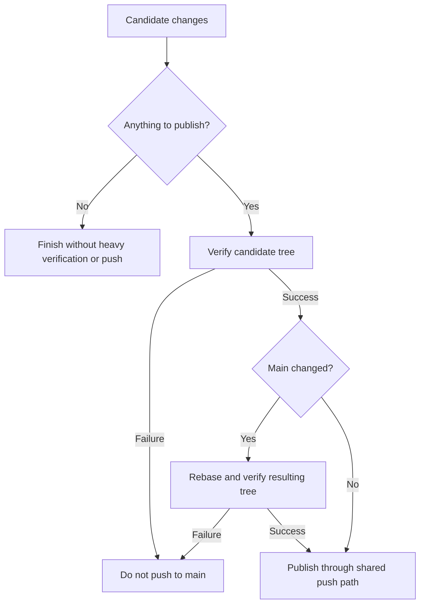
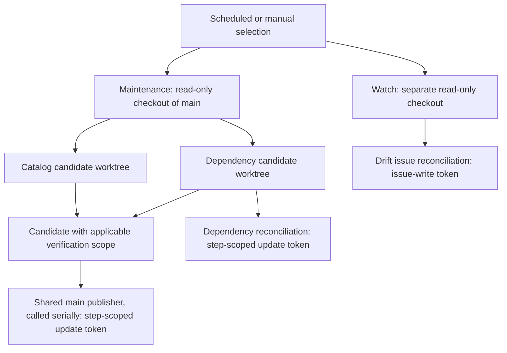
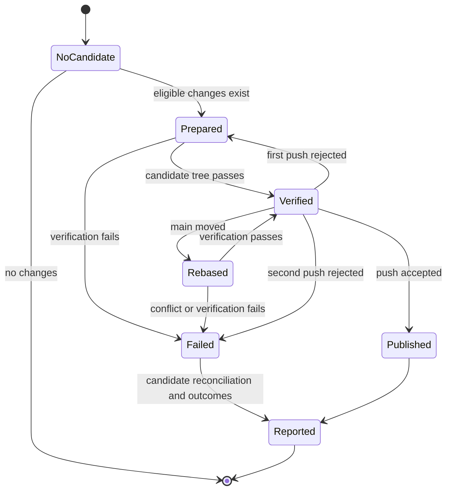

# Unified Scheduled Updates - Plan

## Goal Capsule

- **Objective:** Keep dependency pins and model catalogs current through one maintenance run whose results the repository owner can assess independently.
- **Means:** Consolidate the scheduled maintenance workflows.
- **Product authority:** [Issue #135](https://github.com/hyperlapse122/dotfiles/issues/135), with the cadence and scope confirmed by the owner in this conversation.
- **Execution profile:** One PR containing U1-U3; the LFG caller implements, reviews, and ships it.
- **Stop conditions:** An invalidated Product Contract decision or missing required verification evidence.
- **Open blockers:** None.

---

## Product Contract

### Summary

Combine dependency updates, catalog snapshot refreshes, and catalog drift reporting in one scheduled maintenance workflow.
Give the owner independent results and retain the existing reconciliation channels.

### Problem Frame

Separate schedules and publication implementations make routine maintenance harder to inspect and allow the two writers to race. The owner needs one maintenance entry point without losing independent results or the safeguards around automatic changes.

### Key Decisions

- **One cadence for all maintenance.** Governs R1. (session-settled: user-directed — chosen over hourly or daily updates and daily-only drift reporting: the owner wants all three functions on the same cadence.)
- **Avoid unchanged work and repeated notifications.** Governs R7, R9. (session-settled: user-approved — chosen over full verification and issue writes on every run: frequent execution should not repeat work without a relevant change.)

### Requirements

**Scheduling and control**

- R1. Run dependency updates, catalog snapshot refreshes, and catalog drift reporting together every 30 minutes through one workflow, one schedule, and one concurrency group.
- R2. Retain manual dispatch with a choice of all parts or exactly one of the three parts.

**Independent results and publication**

- R3. Attempt every selected part despite another part's failure, and report each failed part without hiding the failure.
- R4. Publish verified dependency and snapshot changes through one shared push path that prevents concurrent pushes to `main`.
- R5. After rebasing onto changed `main`, verify the resulting tree again before publication; a verification failure must push nothing to `main`.
- R6. Retain the dependency reconciliation PR behavior, including preservation of fixes already on an open reconciliation branch.
- R7. Retain drift issue creation, updates, deduplication, closure, and outage notices without repeated writes for an unchanged result; changed details may update the body without a new comment.

**Cost and permissions**

- R8. Limit credentials and permissions to what each part needs, and give the drift-reporting part no push token.
- R9. Skip heavy verification when there are no candidate changes to publish, while retaining the verification required by R5 for changed rebased trees.

**Regression evidence and documentation**

- R10. Merge the dependency and catalog push reconcile suites into one suite that exercises the merged workflow and preserves their existing scenarios.
- R11. Cover diverged `main`, failed verification after a rebase, nothing to push, and a snapshot that changes during the run, with guard-removal mutations that make the corresponding tests fail.
- R12. Cover independent failures, manual part selection, drift issue behavior, and credential boundaries in the workflow's checks.
- R13. Update the workflow policy check, `AGENTS.md`, and the README CI description so `.github/workflows/` contains only `check.yml` and the merged update workflow.

### Key Flows

- F1. **Scheduled maintenance.** Attempt all parts under R1 and R3, publish eligible changes under R4 and R5, and retain reconciliation behavior under R6 and R7.
- F2. **Manual maintenance.** Run the selection from R2 through the same applicable publication and reporting rules as F1.

The publication decision below illustrates R4, R5, and R9 without prescribing a job layout.

### Acceptance Examples

- AE1. **Covers R1, R3, R6.** Given a scheduled run whose dependency verification fails, catalog refresh and drift reporting still run, and the dependency failure retains its reconciliation channel.
- AE2. **Covers R3, R4.** Given a failed catalog refresh, verified dependency updates can still publish and the drift report is still attempted.
- AE3. **Covers R4, R5, R11.** Given `main` advances during a run, publication uses the rebased tree only after verification succeeds; failed re-verification leaves `main` untouched.
- AE4. **Covers R7.** Given identical drift and issue details on consecutive runs, the later run neither edits the issue nor adds a comment; changed details alone permit a body update.
- AE5. **Covers R7.** Given duplicate drift issues, resolved drift, or a continuing catalog outage, retain the existing deduplication, closure, and one-notice-per-failure-streak behavior.
- AE6. **Covers R2, R8.** Given manual drift-only selection, neither publishing part runs and the reporting part receives no push token.
- AE7. **Covers R9, R11.** Given no candidate changes, no heavy publication verification or push occurs; drift reporting still runs when selected.
- AE8. **Covers R10, R11, R12.** Given removal of a protected workflow guard, the relevant regression test fails for the behavior that guard protects.

### Scope Boundaries

- This work reorganizes maintenance orchestration; it does not change which dependencies or models the repository manages.
- New package updaters, model-selection policy changes, and host configuration changes are outside scope.
- Existing verification gates remain required; R9 changes when they run, not what a changed candidate must pass.

### Sources

- `.github/workflows/update-dependencies.yml`: dependency updates, verification, direct publication, and reconciliation PR handling.
- `.github/workflows/model-catalogs.yml`: snapshot refresh, targeted verification, and publication with rebase and retry.
- `.github/workflows/synthetic-models.yml`: drift comparison and issue lifecycle with fingerprint and body-digest comparisons.
- `tests/update-dependencies-reconcile.sh`, `tests/model-catalogs-reconcile.sh`, and `tests/synthetic-models-reconcile.sh`: existing behavior coverage to preserve.

---

## Planning Contract

### Key Technical Decisions

- KTD1. **Two jobs in the existing update workflow.** Keep `update-dependencies.yml` with a maintenance job and an independent `watch` job, satisfying R1-R3 and R8. Serial producer phases within maintenance avoid artifact transport and multiple publishers; separate drift execution provides a credential boundary that steps alone cannot provide. The workflow defaults to read-only contents, and only `watch` receives issue-write permission.
- KTD2. **Publish isolated candidates serially, catalog first.** For R3, R4, and R6, use separate task-owned Git worktrees and the same publisher for each candidate. Attempt catalog production and publication first, then prepare dependency changes from current `main`. Preserve per-pin dependency commits. Failed, staged, or untracked producer output cannot enter the other candidate. Remove owned worktrees during final cleanup.
- KTD3. **One verification implementation and one main publisher.** For R4, R5, and R9, each candidate uses the same publication routine with its applicable verification scope. Dependency changes require formatting, flake checks, and VM checks; catalog changes require the existing Pi and Synthetic checks. Verify before publication and repeat that suite after every changed-main rebase. Capture each command's own status and keep attempt-specific logs outside candidate trees.
- KTD4. **A bounded publication retry per candidate.** For R4 and R5, the shared publisher fetches `main`, rebases when needed, verifies, and pushes `HEAD:refs/heads/main`; one rejected push may repeat that same gate once. Missing credentials, conflicts, or verification failure cannot fall through to a push of that candidate. The other selected producer is still attempted under R3.
- KTD5. **Keep reconciliation attributable to its dependency candidate.** For R6, retain the dependency candidate, its base, and its verification results. Existing PRs receive logs without branch replacement, and lookup failure remains fail-closed. New reconciliation branches contain only dependency changes above the applicable main revision. Catalog publication followed by failing dependency verification retains the catalog commit and reports the dependency failure. Abort a failed rebase before recovery; a conflict report must not claim verification ran.
- KTD6. **Scope secrets to the steps that consume them.** For R8, every checkout is pinned to `main` with credential persistence disabled. Only catalog-fetch and drift-compare steps receive the catalog key. Only main publication and dependency reconciliation receive the update PAT; verification subprocesses must not inherit it. The drift job uses the job token only for issue operations. Its messages identify the actual checked-out revision, including manual dispatch from another branch.
- KTD7. **Use the existing Actions interface.** For R2, use stable selection values `all`, `dependencies`, `catalogs`, and `drift`, defaulting to `all`. Gate producers explicitly, distinguish unselected, unchanged, changed, and failed outcomes, and finish with a failing result if a selected part failed. Cancellation prevents further publication. No separate agent API is needed.
- KTD8. **One workflow check owns the merged behavior.** For R10-R13, keep `update-dependencies-reconcile` as the merged check and remove obsolete per-workflow check registrations. Retain the drift lifecycle helper under that owner. Move catalog-target validation out of the check-workflow policy test into the merged update check so each workflow has one primary owner.

### High-Level Technical Design

Candidate and credential ownership under KTD1, KTD2, and KTD6:

Publication states under KTD3-KTD5:

Selection under KTD7:

- `schedule` or manual `all`: both producers and drift reporting.
- Manual `dependencies`: dependency producer and shared publication/reconciliation only.
- Manual `catalogs`: catalog producer and shared publication only.
- Manual `drift`: watch job only.

### Assumptions and Risks

- Catalog-first publication prevents slow dependency verification from starving the catalog path. Bound step and job runtimes for the candidate check and at most two rebased checks, and report a timed-out part without presenting it as success. GitHub runner termination and cancellation stop publication rather than guaranteeing later work.
- The watch observes its own checked-out `main`; it need not wait for the publisher or claim to have observed newly published changes.
- Step-scoped credentials limit direct exposure, not hostile-code containment: this updater continues to trust code executed from its pinned upstream dependencies. Disable Git hooks for publication and avoid embedding tokens in remote URLs. A separate sandbox for compromised upstream packages is not introduced by this orchestration change.
- Snapshot fetch failure or a missing catalog key preserves the committed snapshot but is visible as unavailable or failed, not unchanged success. Other selected parts continue under R3.
- Existing `GH_TOKEN_FOR_UPDATES` and `SYNTHETIC_API_KEY` secrets remain externally provisioned prerequisites. Tests use fake values and cannot establish live secret availability.
- Repository-owned references to removed workflow identities will be updated. External callers are not discoverable from this checkout; the README documents the replacement and selection values.
- Full platform build evidence is required by `AGENTS.md` before readiness; unavailable builders remain pending evidence. No host switches or hardware verification are part of this change.

### Sources and Constraints

- Apply the existing verification suites and PR-preservation behavior from the Product Contract sources.
- Follow the `PIPESTATUS[0]` guidance in `.compound-engineering/artifacts/solutions/logic-errors/pipe-to-tee-exit-status-reports-success-in-github-actions-step.md` for KTD3.
- Follow the repository's mutation-testing and scratch-Git learnings for U2: use distinct states, initialize independent repositories, and pin bare origin HEAD to `main`.
- GitHub's [workflow syntax](https://docs.github.com/en/actions/reference/workflows-and-actions/workflow-syntax) documents failed dependency propagation and job permissions; use explicit continuation conditions for KTD1 and KTD7.
- GitHub's [token guidance](https://docs.github.com/en/actions/tutorials/authenticate-with-github_token) supports KTD6's job and step credential boundaries.

---

## Implementation Units

### U1. Consolidate maintenance and publication

- **Goal:** Implement the two-job workflow with isolated producer candidates and one verified publisher.
- **Requirements:** R1-R9; F1, F2; AE1-AE7; KTD1-KTD7.
- **Dependencies:** None.
- **Files:** `.github/workflows/update-dependencies.yml`, removal of `.github/workflows/model-catalogs.yml` and `.github/workflows/synthetic-models.yml`, `scripts/ci-update-verify`, `scripts/ci-update-publish`, and `tests/update-dependencies-reconcile.sh`.
- **Approach:** Preserve updater commands and per-pin commits, introduce the KTD2 ownership boundary, and route each candidate serially through KTD3-KTD5. Adapt the `watch` job's existing issue scripts and revision reporting. Share verification and main publication rather than duplicating gate implementations.
- **Patterns to follow:** Existing snapshot publisher's main checkout, retry, and credential handling; existing dependency verifier's status capture; existing drift issue lifecycle.
- **Execution note:** Characterize existing reconcile behavior before replacing the orchestration, then exercise the new workflow scripts against disposable remotes.
- **Test scenarios:** Covers AE1-AE7. Exercise all four manual selections, dependency failure with successful catalog publication, catalog failure with successful dependency publication, both failures, no changes, and failed comparison with issue reconciliation still attempted. Check per-pin commit contents, partial and untracked failed-producer output, catalog-first success followed by failing dependency verification, rebase conflict recovery, actual revision reporting, and cancellation gates.
- **Verification:** The extracted workflow and any shared helpers produce the expected remote history and per-part outcomes; no unverified candidate reaches main.

### U2. Merge the workflow regression suites

- **Goal:** Preserve existing behavior coverage under one workflow check and prove its guards detect deliberate breaks.
- **Requirements:** R10-R12; AE1-AE8; KTD8.
- **Dependencies:** U1.
- **Files:** `tests/update-dependencies-reconcile.sh`, removal of `tests/model-catalogs-reconcile.sh`, `tests/synthetic-models-reconcile.sh`, and additional runner helpers under `tests/` only if they reduce duplication.
- **Approach:** Reuse the existing real-Git fixture and PATH-stub patterns while structurally extracting the merged workflow. Keep old updater, verification-status, PR-preservation, and snapshot scenarios. The harness must reject unknown workflow expressions rather than silently approximate them.
- **Patterns to follow:** Read the check and mutation learnings listed in `AGENTS.md` before changing assertions, including the copied-worktree, bare-HEAD, shell-pipeline, and materialized-output traps. Exercise production scripts without command-override environment variables.
- **Test scenarios:** Covers AE3, AE7, AE8. Test diverged main, each verifier's failure, post-rebase failure, one and two rejected pushes, missing update token, dispatch from another branch, unchanged snapshot, and a snapshot/main change during the run. Retain all existing drift lifecycle cases. Remove verification, post-rebase verification, selection, isolation, credential, and no-change guards in independent fixtures and require the appropriate assertion to fail.
- **Verification:** The baseline merged suite passes; each guard mutation fails because of the guarded behavior, not a fixture or evaluation error. Scratch repositories have their own Git metadata and are cleaned up.

### U3. Register checks and document operations

- **Goal:** Align check ownership and operator guidance with the merged workflow.
- **Requirements:** R13; R1, R2, R7, R8; KTD7, KTD8.
- **Dependencies:** U1, U2.
- **Files:** `flake.nix`, `tests/check-shards.nix`, `tests/check-workflow-docs-skip.sh`, `AGENTS.md`, `README.md`, `scripts/synthetic-models-watch`, and related fixtures if they contain the retired daily-workflow wording.
- **Approach:** Keep one merged reconciliation check, remove retired registrations, and move catalog verification-target validation to its owning workflow check. Replace references to old workflows and daily reporting, including issue-body guidance, with the merged identity and manual choices.
- **Test scenarios:** The merged check is assigned to exactly one appropriate light shard and has no host closure dependency. CI policy remains valid without the removed workflow input. Generated drift guidance names the new cadence. The instruction check still accepts the changed `AGENTS.md` input.
- **Verification:** Relevant flake checks evaluate and pass; Markdown and Nix formatting pass; searches find no active reference to removed workflow identities outside historical artifacts.

---

## Verification Contract

- Run the merged `update-dependencies-reconcile` check with fake credentials and disposable repositories, retaining a scenario inventory of migrated tests and mutation results.
- Run affected checks including `ci-workflow-docs-skip`, `check-shards-guard`, `agent-instructions`, `synthetic-models-watch`, and the merged check's light shard. Confirm final names from the flake before execution.
- Run `git diff --check`, changed-Markdown lint, `nix fmt -- --ci`, and flake evaluation before pushing. Inspect the merged check's derivation closure for unintended host-generation dependencies.
- Apply `full-ci` and require successful current-head CI including all declared checks, VM tests, and production/bootstrap Linux and Darwin outputs as specified by `AGENTS.md`. Report local evidence separately from CI and hardware evidence.
- Test harnesses prove workflow scripts, conditions, and remote effects; they do not execute GitHub's hosted scheduler or authenticate real credentials.

---

## Definition of Done

- U1-U3 satisfy their cited requirements and acceptance examples in one PR linked to issue #135.
- Required workflow and mutation checks pass, and review findings are assessed and fixed or recorded with evidence.
- The final branch contains the two intended workflow files and no abandoned implementation, stale check registration, or task-owned temporary Git resources.
- Current-head CI supplies the required platform evidence before the PR is called ready; merging remains the owner's action.
