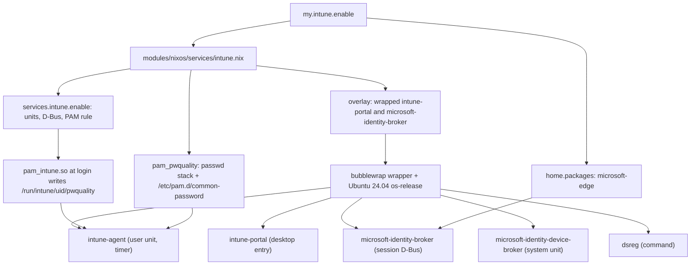

# Intune enrollment and Microsoft Edge on NixOS - Plan

## Goal Capsule

- **Objective:** The owner opens all of Microsoft 365 in Microsoft Edge on `MS-7D91`, because Intune reports the machine as enrolled and compliant.
- **Means:** One NixOS trait that installs the Intune app, the identity broker, and Edge, and shows Intune's executables an Ubuntu OS identity (KTD1, KTD2).
- **Product authority:** The owner chose a compliant verdict as the goal, kept macOS out of scope, and accepted presenting Ubuntu to Intune. The Product Contract outranks the Planning Contract on product behavior.
- **Execution profile:** One pull request. Repository checks and one VM test prove the build; the owner proves enrollment on hardware after merge.
- **Stop conditions:** Stop if any wrapped executable cannot start under KTD2 and has no fallback; the fallback in Risks exists only for the two systemd units. Stop if a change would touch a disk, a macOS host, or the system-wide OS identity.
- **Open blockers:** None. The company's compliance policy is unknown, so the checks it runs appear only after the first enrollment.

---

## Product Contract

**Product Contract preservation:** changed: R4, R6 — research on the pinned packages refined two mechanisms without changing scope. R4 now covers every executable that reads the OS identity, which includes the identity brokers. R6 keeps the declared password policy and adds the second source the agent reads, the PAM module's record of the login password.

### Summary

Add a NixOS trait that installs the Microsoft Intune app, the Microsoft identity broker, and Microsoft Edge, and configures the system so the three standard Linux compliance checks can pass.
The data disk and the login password decide two of those checks at enrollment.
The owner enables the trait on `MS-7D91`, switches, signs in, and enrolls.

### Problem Frame

Conditional access on the owner's Microsoft 365 tenant admits only devices that Intune reports as compliant.
`MacBook-Pro-Mac17-9` is compliant through ABM and Intune provisioning.
`MS-7D91` is not enrolled, so whenever the owner needs Microsoft 365 they leave the NixOS desktop and work on the Mac.

Microsoft supports the Intune app only on Ubuntu Desktop 24.04 LTS and 26.04 LTS and on RHEL 9 and 10.
The pinned `nixpkgs` carries `intune-portal` 1.2609.5, `microsoft-identity-broker` 3.0.2, `microsoft-edge`, and a `services.intune` module, so installation works.
That module does nothing about the OS identity or a declared password policy, and on NixOS the Intune executables report a distribution Microsoft does not accept.

### Key Decisions

- **The goal is a compliant verdict, not only a working installation.** Governs R4–R7 and R10. (session-settled: user-directed — chosen over stopping at installation and enrollment: the owner needs conditional access to admit the machine.)
- **Only Intune's processes see Ubuntu.** Governs R4. (session-settled: user-approved — chosen over changing the system-wide OS identity: other tools read that identity and could misbehave. Whether company policy permits the workaround is the owner's call, and they accepted it.)
- **Defender for Endpoint and custom compliance scripts are deferred.** Governs R9. (session-settled: user-directed — chosen over packaging Defender now: the owner does not know whether the policy requires it, and `nixpkgs` has no Defender package.)
- **The unencrypted data disk stays as it is.** Governs R5. (session-settled: user-approved — chosen over encrypting or unmounting `/mnt/data` now: whether the check objects to it is unknown until enrollment.)
- **macOS is out of scope.** Governs R8. (session-settled: user-directed — chosen over adding Edge on both hosts: ABM and Intune already keep the Mac compliant.)
- **This work sits outside the `STRATEGY.md` Intune boundary.** That boundary excludes applications Intune provisions. The Intune agent and Edge on Linux are installed by this repository because Intune for Linux deploys no applications.

### Requirements

**Installation**

- R1. A NixOS host trait, off by default, installs the Intune app, the identity broker and its services, and Microsoft Edge. `MS-7D91` enables it.
- R2. Edge signs in through the identity broker, so a session in Edge carries the enrolled device's identity.
- R3. Google Chrome stays the default browser, and no existing application or setting is removed.

**Compliance**

- R4. Every Intune and identity broker executable that reads the OS identity reads a supported Ubuntu release. Every other process on the host still reads NixOS.
- R5. The disk encryption check sees the host's existing LUKS2 root. This work changes no disk, partition, or mount.
- R6. The system enforces a password quality policy on password changes and declares it where the Intune agent looks, and the Intune PAM module records the login password's quality at login.
- R7. A switch on an enrolled host keeps the enrollment: the app's device registration and broker state survive rebuilds and reboots.

**Boundaries**

- R8. No macOS host's installed applications, Dock, or settings change. The `darwin-config` check requires a macOS decision for Edge, and that entry in `modules/shared/darwin-apps.nix` is a `leftOut` reason and nothing more.
- R9. This work installs no Defender for Endpoint and handles no tenant-specific compliance script.

**Verification**

- R10. Repository checks prove the installed packages, units, and OS identity from built outputs. Sign-in, enrollment, and the compliant verdict are hardware verification, recorded separately and run only by the owner.
- R11. The NixOS documentation gains the owner's steps after the switch: sign in, enroll, read the compliance status, and what to do when a check fails.

### Key Flow

- F1. First enrollment
  - **Trigger:** The owner enables the trait on `MS-7D91` and runs the production switch.
  - **Steps:** The owner logs out and back in, opens the Intune app, signs in with the work account, and registers the device. The app runs the compliance checks and shows the result. The owner opens Edge, signs in to the work profile, and opens Microsoft 365.
  - **Outcome:** The app shows the device as compliant, and Microsoft 365 loads in Edge without a conditional access block.
  - **Covered by:** R1, R2, R4–R6

### Acceptance Examples

- AE1. **Covers R4.** Given the trait is enabled, when an Intune executable reads the OS identity, it reads Ubuntu; when any other program reads `/etc/os-release`, it reads NixOS.
- AE2. **Covers R1.** Given a NixOS host with the trait off, when it is built, it contains no Intune app, identity broker, or Edge.
- AE3. **Covers R7.** Given an enrolled and compliant host, when the owner switches to a new generation and reboots, the Intune app still shows the device as enrolled without a new sign-in.
- AE4. **Covers R9, R11.** Given enrollment succeeds but the app lists a failing check this work does not cover, such as Defender or the data disk, the documentation tells the owner that the item is follow-up work, and this work still counts as delivered.

### Success Criteria

- The Intune app on `MS-7D91` shows the device as compliant. If the only failing checks are ones R9 or the data disk decision deferred, the work is delivered and those items become follow-up work.
- With a compliant verdict, Microsoft 365 on the web opens in Edge on `MS-7D91`; Outlook, Teams, and SharePoint are the pages the owner checks.

### Scope Boundaries

- Defender for Endpoint, and any tenant-specific compliance script.
- Encrypting, reformatting, or unmounting the exFAT data disk at `/mnt/data`.
- Any change to `MacBook-Pro-Mac17-9`.
- Making Edge the default browser, and managing Edge policies, profiles, or extensions.
- Automating sign-in or enrollment; both stay interactive.
- Native Microsoft 365 clients on Linux.
- Considered and not built: a host option for the Ubuntu release. One host uses it, and KTD3 keeps the value in one place.

### Dependencies / Assumptions

- The company's Linux compliance policy is unknown. The plan assumes the three standard checks: allowed distributions, device encryption, and password policy. The first enrollment shows the real list.
- The encryption check may reject the unencrypted exFAT disk at `/mnt/data`. Microsoft documents that it ignores read-only partitions, pseudo-filesystems, and `/boot`; a writable exFAT disk is none of those. This is unverified.
- The agent has two password sources: the PAM module's record at `/run/intune/<uid>/pwquality` and a `pam_pwquality` line in a PAM file. Which one it prefers is unverified, so R6 satisfies both.
- If the agent uses the PAM module's record, the owner's login password must itself satisfy the tenant's policy; if it does not, the owner changes the password.
- The tenant's password thresholds are unknown. KTD8 declares values stricter than a typical policy.
- Microsoft requires a GNOME desktop. The plan assumes the requirement is about the Secret Service keyring, which KDE Plasma provides through KWallet on this host. This is unverified until enrollment.
- Microsoft does not support NixOS, so an Intune app update can break enrollment or compliance without a change in this repository.
- The owner runs the switch and the enrollment; the repository's rule that only the owner switches a host holds.

### Sources / Research

- Microsoft Learn: [Intune app for Linux](https://learn.microsoft.com/en-us/intune/user-help/company-portal/intune-app-linux), [Enroll a Linux device](https://learn.microsoft.com/en-us/intune/user-help/enrollment/enroll-linux), and [Linux compliance settings](https://learn.microsoft.com/en-us/intune/device-security/compliance/ref-linux-settings).
- `nixpkgs` `nixos/modules/services/security/intune.nix`: installs both packages, their systemd and D-Bus units, the tmpfiles rule for `/run/intune`, and the broker's system user.
- `nixpkgs` `nixos/modules/security/pam.nix`: with `services.intune.enable`, adds `pam_intune.so` from `pkgs.intune-portal` as an optional rule to the auth, password, and session stacks.
- `nixpkgs` `nixos/tests/intune.nix`: starts the system daemons and expects `/run/intune/<uid>/pwquality` after a console login.
- Strings in the pinned binaries: `intune-portal`, `intune-agent`, `microsoft-identity-broker`, `microsoft-identity-device-broker`, and `dsreg` read `/etc/os-release` and then `/usr/lib/os-release`. `intune-daemon` reads neither.
- Strings in the pinned `intune-agent`: it parses a password policy from `/run/intune/<uid>/pwquality`, `/etc/pam.d/common-password`, `/etc/pam.d/system-password`, or `/etc/pam.d/password-auth`, with the `pam_pwquality` options `minlen`, `dcredit`, `lcredit`, `ocredit`, and `ucredit`. It reads `/proc/mounts` for the encryption check. `pam_intune.so` writes a `pam_pwquality` line to `/run/intune/<uid>/pwquality`.
- Strings in the pinned `intune-daemon`: it compares a connecting process's `/proc/<pid>/exe` with `/opt/microsoft/intune/bin/intune-agent` and `intune-portal` and can answer `PeerValidationFailed`.
- [alexpomsft/intune-arm64-nix](https://github.com/alexpomsft/intune-arm64-nix): on a non-Ubuntu host the enrollment Terms API call sent an empty `os-version` and got HTTP 400; presenting Ubuntu 24.04 in a mount namespace got HTTP 200.
- `modules/nixos/services/wifiman.nix`, `tests/wifiman.nix`, and `tests/lib/configurations.nix`: the trait, check, and `withTrait` pattern this work follows.
- `tests/darwin-config.nix`: derives the packages that need a macOS decision from each production NixOS configuration's Home Manager `home.packages`.

---

## Planning Contract

### Key Technical Decisions

- KTD1. **Build on the `nixpkgs` `services.intune` module.** The trait module sets `services.intune.enable` and adds only what that module lacks. It already owns the units, D-Bus services, tmpfiles rule, system user, and the `pam_intune.so` rule that the login half of R6 needs.
- KTD2. **Give each OS-identity-reading executable a mount namespace with an Ubuntu `/etc/os-release`.** Covers R4. A `nixpkgs` overlay, applied only when the trait is on, overrides `intune-portal` and `microsoft-identity-broker` so their five executables start through `bubblewrap`, binding one Ubuntu os-release file over `/etc/os-release`. Each override moves the real executable out of `bin` and puts the wrapper at the original path, so the unit, D-Bus, and desktop files that `nixpkgs` already points at `$out/bin` need no rewriting. The wrapper keeps the host's whole mount tree and adds only that one bind, because `intune-agent` judges disk encryption from its own `/proc/mounts` (R5). The overlay is needed because `services.intune` and `pam.nix` reference `pkgs.intune-portal` and `pkgs.microsoft-identity-broker` directly and expose no package option. One wrapper covers every launch path: the desktop entry, the session D-Bus activation, the user unit, the system unit, and the `dsreg` command. A systemd `BindReadOnlyPaths` drop-in was rejected as the primary mechanism because it reaches only the two systemd units, not the D-Bus-activated broker or the app started from the desktop.
- KTD3. **Present Ubuntu 24.04 LTS.** Microsoft supports 24.04 and 26.04. A tenant's allowed-distributions range is likelier to include the older LTS, and the one public report of this workaround succeeded with 24.04. The os-release text lives in one file beside the wrapper, so changing the release is a one-file edit.
- KTD4. **The host enables the trait only on its production output.** `hosts/MS-7D91/default.nix` sets it to `!config.my.bootstrap`, as it does for `my.tailscale.advertiseRoutes`. An installation console needs no enrollment, and the bootstrap closure stays free of three unfree downloads.
- KTD5. **Edge comes from `home.packages`, gated on the trait.** This follows how `home/h82/default.nix` installs the WiFiman GUI under `my.wifiman.enable`, and it puts Edge in the set `tests/darwin-config.nix` derives, which forces the `leftOut` entry of R8.
- KTD6. **Enrollment state needs no code.** Covers R7. The state lives in `/var/lib/intune`, `/var/lib/microsoft-identity-device-broker`, `~/.config/intune`, `~/.config/microsoft-identity-broker`, `~/.local/share/intune-portal`, `~/.local/share/microsoft/identity`, `~/.local/state/intune`, and the Secret Service keyring. The host's root and home are persistent, and no module manages those paths. The documentation lists them so a later change does not clear them.
- KTD8. **Declare one password policy and enforce the same one.** Covers R6. One definition holds `minlen=12` and `dcredit`, `ucredit`, `lcredit`, and `ocredit` at `-1`. It produces the `pam_pwquality.so` rule in the `passwd` service's password stack and the same line in `/etc/pam.d/common-password`, the first PAM file the agent names. Declaring a policy the system did not enforce would misreport the device, so the two never diverge.
- KTD7. **Prove the OS identity in a VM, and the rest from built outputs.** A string match on a wrapper script would pass a wrapper that does nothing. The VM test reads the live mount namespace of a wrapped process; the build-time check then ties every other entry point to the same wrapper.

### High-Level Technical Design

### Assumptions

- `bubblewrap` can start all five executables, including the device broker as root under its system unit and `intune-portal` with its own WebKit sandbox nested inside. U1 verifies the build-time part and U3 the runtime part for the device broker; the graphical app is verified on hardware.
- The executables read `/etc/os-release` first and need no `/usr/lib/os-release`, which NixOS does not have.
- The Home Manager package name of Edge, as `tests/darwin-config.nix` derives it, is `microsoft-edge`.

### Risks & Dependencies

| Risk | Effect | Response |
| --- | --- | --- |
| A wrapped executable fails inside the mount namespace, for example on a polkit call | Enrollment or check-in fails | For a systemd unit, fall back to a `BindReadOnlyPaths` drop-in on that unit and keep the wrapper for the rest; record which mechanism each executable uses in the module comment. No wrapper or unit override may disable `intune-portal`'s WebKit sandbox or remove hardening from an upstream unit |
| `intune-daemon` rejects the agent or app because their executable path is in the store, not under `/opt/microsoft/intune/bin` | Daemon-mediated features fail; this is a gap in `nixpkgs` with or without the wrapper | Hardware finding. The mount namespace of KTD2 can present the executables at that path, which follow-up work would add |
| The declared password thresholds are below the tenant's | Password check fails | Raise the values in the one definition of KTD8 |
| The tenant's allowed distributions exclude 24.04 | Distribution check fails | Edit the one os-release file to 26.04 (KTD3) |
| Microsoft removes a pinned `.deb` from `packages.microsoft.com` | Host closure and CI stop building | Update the `nixpkgs` pin; no repository mechanism is added |
| KWallet's Secret Service is not accepted as the keyring | Broker cannot store tokens | Hardware finding; follow-up work decides on GNOME Keyring |
| `pam_intune.so` handles the login password on every authentication | A proprietary module sits in the auth stack | Inherent to Intune on Linux and the same on Ubuntu; stated in the documentation so the owner enables the trait knowingly |

### Open Questions

**Deferred to implementation**

- Whether the device broker's unit hardening tolerates `bubblewrap`. If not, that unit takes the fallback in Risks.
- The exact `bubblewrap` arguments that bind over `/etc/os-release`, which on NixOS is a symlink into the store.
- How the VM test assembles a node with the trait: from the shared profile or from the trait module and `modules/shared/host.nix` alone. `tests/podman-prune.nix` and `tests/desktop-ssh-session.nix` show both shapes.

**For the owner, not blocking**

- `pam_intune.so` records the login password's quality at login, which the brainstorm did not anticipate. If the agent prefers that record and the current password is too weak for the tenant's policy, compliance needs a new login password.

---

## Implementation Units

### U1. Intune trait, module, and OS identity wrapper

- **Goal:** A NixOS host with the trait on has the Intune app, both brokers, their units, and the PAM rule, and every OS-identity-reading executable starts through the Ubuntu wrapper.
- **Requirements:** R1, R4, R5, R6, R7; KTD1–KTD4, KTD6, KTD8. Implements the Key Decisions governing R4 and R5.
- **Dependencies:** None.
- **Files:**
  - `modules/shared/host.nix` (declare `my.intune.enable`)
  - `modules/nixos/services/intune.nix` (new)
  - `modules/nixos/profile.nix` (import the module)
  - `packages/intune-ubuntu-identity.nix` (new: the wrapper and the os-release text)
  - `hosts/MS-7D91/default.nix` (enable the trait per KTD4)
  - `tests/intune.nix` (new), `flake.nix`, `tests/check-shards.nix`
- **Approach:**
  1. Declare the trait with `lib.mkEnableOption`, described as NixOS-only, beside the other traits.
  2. In the module, under the trait, enable `services.intune`, add the overlay of KTD2, and add the password policy of KTD8.
  3. Override each package per KTD2. Every other file, including `lib/security/pam_intune.so`, stays at its original relative path.
  4. Register the check in `flake.nix`, in a shard in `tests/check-shards.nix`, and in `hostClosureChecks`, because it reads host closures.
- **Execution note:** Mostly packaging and configuration. Build the host closure early and inspect the unit and D-Bus files before writing assertions.
- **Patterns to follow:** `modules/nixos/services/wifiman.nix` for a trait-gated service module; `tests/wifiman.nix` for assertions on built outputs over `configurations.withTrait`; `tests/lib/etc-file.nix` for reading unit files.
- **Test scenarios** (in `tests/intune.nix`; this seam catches a missing, masked, or unwrapped entry point in the built system, and misses whether the wrapper changes what a running process reads, which U3 covers):
  - Trait on: `intune-daemon.service`, `intune-daemon.socket`, and `microsoft-identity-device-broker.service` are regular system units, not masked.
  - Trait on: `intune-agent.service` and `intune-agent.timer` are user units, and the session D-Bus service `com.microsoft.identity.broker1` exists.
  - Trait on: the `ExecStart` of the agent and device broker units, the `Exec` of the D-Bus service and the desktop entry, and `dsreg` on the system path each reach the Ubuntu os-release file through their recorded mechanism. For a wrapper that is the same os-release binding as the device broker's; for a systemd unit on the fallback it is a `BindReadOnlyPaths` entry in the built unit.
  - Trait on: the bound os-release file names Ubuntu with `VERSION_ID` 24.04, and the system's own `etc/os-release` names NixOS. Covers AE1 at build time.
  - Trait on: the PAM service file for the display manager login references `pam_intune.so`, and that path exists in the store.
  - Trait on: the built `etc/pam.d/passwd` has a `pam_pwquality.so` password rule before `pam_unix.so`, its module path exists, and the built `etc/pam.d/common-password` carries the same module arguments.
  - Covers AE2. Trait off, over the `disabled` set of `configurations.withTrait`: the system path has no `intune-portal`, no Intune or broker unit exists, no PAM file references `pam_intune.so` or `pam_pwquality.so`, and `etc/pam.d/common-password` does not exist.
  - Each bootstrap configuration has the trait off, per KTD4.
- **Verification:** The `intune` check builds. It fails when the overlay is removed, when one entry point is pointed back at the unwrapped executable, and when the `common-password` arguments differ from the enforced ones.

### U2. Microsoft Edge under the trait

- **Goal:** A NixOS host with the trait on has Edge in the user environment, and the macOS mapping records that macOS leaves it out.
- **Requirements:** R1, R2, R3, R8; KTD5. Implements the Key Decision governing R8.
- **Dependencies:** U1 (the trait option).
- **Files:**
  - `home/h82/default.nix`
  - `modules/shared/darwin-apps.nix`
  - `tests/intune.nix`
- **Approach:** Add Edge to `home.packages` behind `nixos && config.my.intune.enable`, in the same place and form as the WiFiman GUI. Add a `leftOut` entry for it whose reason is that ABM and Intune manage the Mac's applications. Change nothing about the default browser.
- **Patterns to follow:** The `my.wifiman.enable` branch in `home/h82/default.nix`; the `leftOut` entries in `modules/shared/darwin-apps.nix`.
- **Test scenarios:**
  - Trait on: the user's `home.path` carries an executable `bin/microsoft-edge` and its desktop entry.
  - Covers AE2. Trait off: `home.path` carries no `bin/microsoft-edge`.
  - The existing `darwin-config` check passes with the new entry and fails without it.
  - The existing Chrome entries in `home.path` are unchanged.
- **Verification:** The `intune` and `darwin-config` checks build; no macOS output's cask or package list changes.

### U3. VM test of the OS identity

- **Goal:** A booted NixOS VM with the trait on shows Ubuntu inside a wrapped Intune process and NixOS everywhere else.
- **Requirements:** R4, R10; KTD7.
- **Dependencies:** U1.
- **Files:**
  - `tests/intune-os-identity.nix` (new)
  - `tests/vm-checks.nix`
- **Approach:** Register the test in `tests/vm-checks.nix`, never under `checks`. Start the device broker unit and read files inside its mount namespace with `nsenter --target <MainPID> --mount`. Reading through `/proc/<pid>/root` would resolve the absolute `/etc/os-release` symlink against the reader's root and show NixOS even when the wrapper works. The test needs no network and no Microsoft account.
- **Patterns to follow:** `tests/podman-prune.nix` and `tests/desktop-ssh-session.nix`; `nixpkgs` `nixos/tests/intune.nix` for which units start offline.
- **Test scenarios:**
  - Covers AE1. After `microsoft-identity-device-broker.service` starts, `cat /etc/os-release` inside that process's mount namespace has `ID=ubuntu` and `VERSION_ID="24.04"`.
  - Covers AE1. `cat /etc/os-release` in the VM's ordinary shell has `ID=nixos`.
  - The mount points in `/proc/self/mountinfo` inside that namespace are the host's mount points plus the one os-release bind, which is what the encryption check of R5 needs.
  - After a console login, `/run/intune/<uid>/pwquality` exists, which shows that `pam_intune.so` from the overridden package still loads.
  - `passwd` rejects a new password that breaks the policy of KTD8 and accepts one that meets it.
- **Verification:** `vmChecks.intune-os-identity` builds, and fails when the wrapper's binding is removed.

### U4. Owner documentation

- **Goal:** The owner can enroll, read the result, and act on a failing check from the repository's documentation alone.
- **Requirements:** R11; AE3, AE4; KTD3, KTD6.
- **Dependencies:** U1, U2.
- **Files:**
  - `docs/intune.md` (new)
  - `docs/adding-a-host.md` (trait table row)
  - `docs/install.md` (link from the post-switch steps)
  - `AGENTS.md` (module list and trait mention in Project structure)
- **Approach:** Write `docs/intune.md` in this order:
  1. What the trait installs, and that Intune's executables see Ubuntu 24.04 while the system stays NixOS.
  2. Enrollment steps of F1, including the log-out and log-in that lets the PAM module record the password result, and the Refresh link for a new check-in.
  3. A table of failing checks and responses: distribution (edit the release per KTD3), encryption naming `/mnt/data` (follow-up decision), password (change the login password, or raise the thresholds of KTD8), Defender or a custom script (follow-up work, per AE4), keyring (follow-up work), and a `PeerValidationFailed` error from the daemon (follow-up work).
  4. The state paths of KTD6 and that removing them unenrolls the device.
  5. That `pam_intune.so` handles the login password, and that Microsoft supports neither NixOS nor KDE.
- **Test expectation:** none -- documentation only. `AGENTS.md` is an input to the `agent-instructions` check, which must still build.
- **Verification:** `markdownlint-cli2` passes on the changed files, and the `agent-instructions` check builds.

---

## Verification Contract

| Gate | Command | Applies to |
| --- | --- | --- |
| Formatting | `nix fmt -- --ci` | U1–U3 |
| Whitespace | `git diff --check` | all |
| Trait check | `nix build --no-link .#checks.x86_64-linux.intune` | U1, U2 |
| macOS mapping | `nix build --no-link .#checks.x86_64-linux.darwin-config` | U2 |
| Registration guards | `nix build --no-link .#checks.x86_64-linux.check-shards-guard .#checks.x86_64-linux.vm-checks-guard .#checks.x86_64-linux.host-name-guard` | U1, U3 |
| VM test | `nix build --no-link .#vmChecks.intune-os-identity` | U3 |
| Instruction inputs | `nix build --no-link .#checks.x86_64-linux.agent-instructions` | U4 |
| Markdown | `markdownlint-cli2` on changed Markdown | U4 |
| Evaluation | `nix flake check --no-build` | all |
| Host closures | build every `nixosConfigurations.<host>.config.system.build.toplevel` | U1, U2 |
| Full CI | the `full-ci` label, with green `host-checks`, `vm-checks`, `build`, and `build-darwin` on the head commit | all |

Mutation evidence: the `intune` check and the VM test must each be shown to fail on the mutations named in U1 and U3 before they are trusted.
`darwinConfigurations` outputs build only on `aarch64-darwin`; on a Linux builder they are evidence deferred to CI.

Hardware verification, run by the owner after merge and reported separately: F1 end to end, AE3 after one switch and reboot, the Success Criteria, and that the Intune app's device details and `dsreg` report Ubuntu 24.04, which covers the executables the VM test does not start.

## Definition of Done

- R1–R11 hold, with R2, R5–R7, and the Success Criteria marked as hardware verification where no repository check can reach them.
- Every gate in the Verification Contract passes on the head commit, or is recorded as deferred to CI with the reason.
- The `intune` check and the VM test have recorded mutation failures.
- No macOS output changes, and no disk, mount, or system-wide os-release changes.
- No abandoned wrapper experiments, unused options, or test-only seams remain in the diff.
- The pull request body lists the hardware verification the owner still has to run and the owner-facing open question about the login password.
