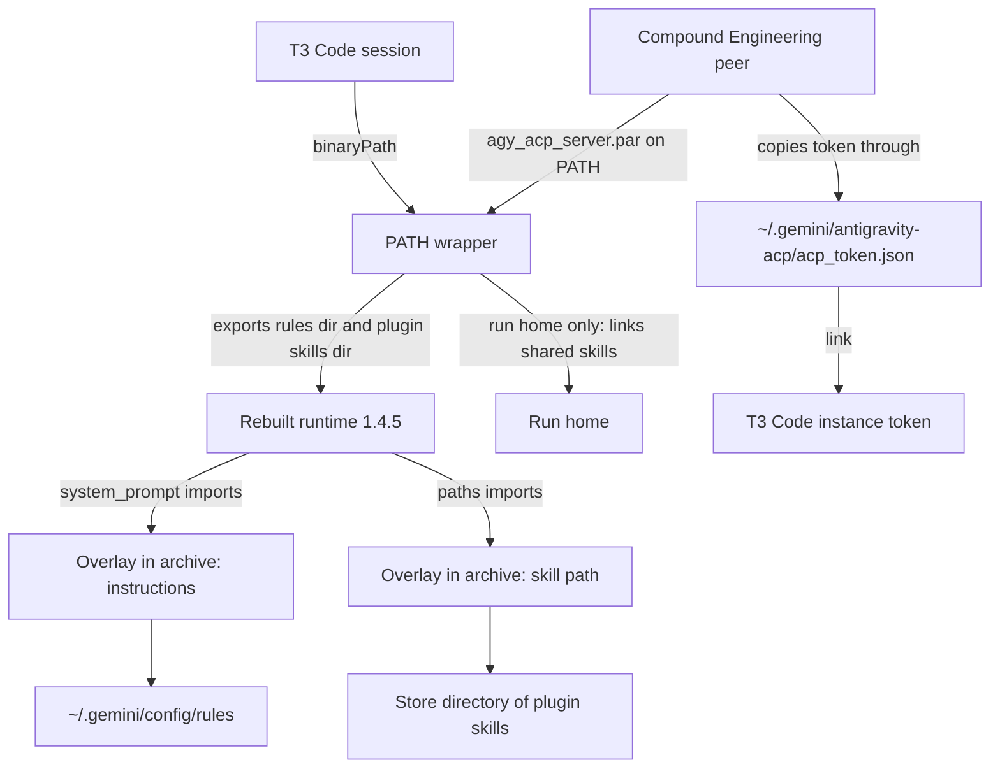

# Antigravity as a first-tier harness - Plan

## Goal Capsule

- **Objective:** Whether the owner runs Antigravity through the `agy` CLI, a T3 Code session, or a Compound Engineering peer, it has the same plugin skills, the same shared instructions, and the same Google sign-in.
- **Means:** The repository rebuilds the Antigravity ACP runtime's embedded archive with its own additions and points T3 Code at the result (KTD1, KTD2, KTD5).
- **Product authority:** The owner chose runtime repackaging by rebuilding the archive, on Linux and macOS in this pull request, chose that review run homes get the plugin skills, and chose that later plugins reach Antigravity without Antigravity-specific work. The Product Contract outranks the Planning Contract on product behavior.
- **Execution profile:** One pull request. Repository checks prove packaging, wiring, and settings; the owner proves live sessions on `MS-7D91` and on the Mac after a switch.
- **Stop conditions:** Stop if the rebuilt Linux runtime does not answer `initialize`, or if a raising overlay does not make it fail, because then the additions are not executing. Stop and report if the macOS build's own start check fails in CI and no fix is found. Stop before any change that copies Google's runtime source into the repository.
- **Open blockers:** None.

---

## Product Contract

**Product Contract preservation:** changed: Key Decisions, Scope Boundaries, Dependencies / Assumptions, Outstanding Questions — research settled the open questions, and the owner then chose to rebuild the archive, to include macOS, and to drop the token link step inside run homes. R-IDs and AE-IDs are unchanged.

### Summary

Antigravity becomes a first-tier harness beside Claude Code and Codex.
Its three run paths get the same skills, instructions, and sign-in: the `agy` CLI, T3 Code sessions, and the run homes Compound Engineering creates for cross-model peers.
The repository ships its own rebuild of the ACP runtime and takes over T3 Code's Antigravity settings.

### Problem Frame

Only the `agy` CLI is fully wired today.
It lists the Compound Engineering plugin with 37 skills, the 20 shared skills, and the shared instructions.

A T3 Code Antigravity session shows the 20 shared skills and nothing from Compound Engineering.
The ACP runtime has no plugin loader, and T3 Code's instance home links only the shared skill directory.
The session also receives none of the shared instructions, because the runtime reads no rule file from any location.

A Compound Engineering run home has the same two gaps and a third.
Compound Engineering copies the sign-in from `~/.gemini/antigravity-acp/acp_token.json`, and that file does not exist on `MS-7D91`.
The only signed-in token belongs to T3 Code's instance home, so a peer stalls waiting for a browser sign-in.

The owner uses a Google account's Antigravity quota through OAuth, not an API key.

### Key Decisions

- **Repackage the runtime to deliver instructions.** The rebuilt runtime reads the shared instructions itself, whatever its client sends. Governs R5, R6, R7. (session-settled: user-directed — chosen over a relay wrapper that rewrites each session request to add the instructions: the owner prefers a runtime that needs no cooperation from its client and accepts redoing the rebuild each release)
- **Manage T3 Code's Antigravity settings.** The repository owns them so T3 Code runs the rebuilt runtime. Governs R8. (session-settled: user-directed — chosen over leaving the native Antigravity settings user-owned: T3 Code otherwise keeps running the runtime it downloads itself)
- **Review run homes get the plugin skills.** Governs R2. (session-settled: user-directed — chosen over keeping run homes on the 20 shared skills only: the owner wants one skill list wherever Antigravity runs and accepts that a peer may start another workflow)
- **One linked sign-in serves run homes.** The standard home's token path is a link to T3 Code's token, and Compound Engineering copies through it. Governs R9, R10. (session-settled: user-directed — chosen over a wrapper step that also turns each run home's copy into a link: the runtime rewrites its token on the first request of every process, so that link would not last)
- **Later plugins reach Antigravity automatically.** Governs R3. (session-settled: user-directed — chosen over wiring only Compound Engineering: the owner treats Antigravity as a first-tier harness)
- **macOS is rebuilt in this pull request.** Governs R1, R2, R5. (session-settled: user-directed — chosen over deferring the Mac to a follow-up: the owner wants both machines first-tier now and accepts that the Mac result is proven only by CI's macOS build and by hand on the Mac)

### Requirements

**Skills and plugins**

- R1. A T3 Code Antigravity session lists every skill of every repository-managed plugin, and every shared skill, the same set `agy` lists.
- R2. A Compound Engineering run home lists the same set as R1.
- R3. A plugin added to the repository's plugin pins appears on all three run paths with no Antigravity-specific change.
- R4. Each skill appears exactly once on each run path, including the CLI, which already gets plugin skills from its native plugin install.

**Shared instructions**

- R5. An ACP session started by T3 Code or by a Compound Engineering peer receives the shared user-scope instructions rendered for Antigravity from the single template.
- R6. T3 Code's own session additions, such as its pull request linking instructions, still reach the session alongside the shared instructions.
- R7. A new upstream runtime release that the patch does not fit fails the update visibly, and the previous patched runtime stays in use.

**T3 Code**

- R8. The repository manages T3 Code's Antigravity provider settings, and T3 Code runs the repackaged runtime instead of the one it downloads.

**Sign-in**

- R9. A Compound Engineering run home uses the owner's Google OAuth sign-in through a link, with no API key and no second browser sign-in.
- R10. One browser sign-in serves T3 Code sessions and run homes.

### Acceptance Examples

- AE1. **Covers R1, R4.** Given a switched host, when the owner opens a T3 Code Antigravity session and lists skills, then `ce-brainstorm` and `humanizer` each appear once.
- AE2. **Covers R5, R6.** Given a marker rule in the shared instructions, when a T3 Code Antigravity session is asked for the marker, then it answers the marker, and it still follows T3 Code's pull request linking instructions.
- AE3. **Covers R2, R9, R10.** Given the owner is signed in once, when a Compound Engineering cross-model review picks the Antigravity peer from a terminal session, then the peer answers without a browser prompt and can list a Compound Engineering skill.
- AE4. **Covers R7.** Given an upstream release whose source the patch no longer matches, when the release updater runs, then the update fails with the patch named and the pinned runtime does not change.
- AE5. **Covers R3.** Given a second plugin added to the pins in a fixture, when the checks run, then its skills are present for the CLI, a T3 Code instance home, and a run home.

### Success Criteria

- The owner verifies AE1, AE2, and AE3 on `MS-7D91` and on the Mac after a switch. Repository checks cannot prove that a signed-in session loads skills or instructions, so this hardware evidence is reported separately.
- `AGENTS.md`, `docs/agent-routing.md`, and the affected learning stop saying that Antigravity ACP sessions load none of the shared instructions and that native Antigravity settings stay user-owned.

### Scope Boundaries

- The `agy` CLI keeps its native plugin install and its rule files. Its install step changes only to cover every pinned plugin (R3).
- Repackaging covers the ACP runtime on Linux and macOS, not the `agy` CLI or Antigravity Desktop.
- The rebuild replaces only the embedded archive. The launcher around it is Google's binary and stays as shipped, apart from the macOS signature.
- The repackaged runtime is for the owner's machines and is not redistributed. No runtime source is copied into the repository.
- T3 Code's own T3-only instruction branch still does not reach Antigravity sessions. R6 covers only what T3 Code itself sends.
- Considered and not built: moving a token the owner created under `~/.gemini` into T3 Code's instance home. The activation step leaves a regular token file alone and warns, because moving a credential without being asked risks losing the only sign-in.
- Considered and not built: a switch that hides plugin skills from review peers. The owner accepted that risk.

#### Deferred to Follow-Up Work

- Deliver the T3-only instruction branch to T3 Code Antigravity sessions through the rebuilt runtime.

### Dependencies / Assumptions

- T3 Code 0.1.7 accepts a custom `binaryPath` and checks only that the file is executable and that `localharness_external` sits in its real directory. Its byte-size check applies only to the runtime it downloads itself.
- T3 Code sends its session additions only when the runtime reports version `1.4.5` exactly. The rebuilt runtime is built from the release T3 Code qualifies and keeps that version.
- With a custom `binaryPath`, T3 Code treats the runtime version as unknown and offers the client-side file read it disables for its own download. This is accepted.
- The runtime stores a refresh token only and rewrites its token file with an atomic replace on the first request of every process. A run home therefore always ends with its own regular copy of the same sign-in, and no process writes through to the canonical file.
- T3 Code names its instance home after the SHA-256 of the instance id `antigravity`. A T3 Code release that changes this leaves the sign-in link dangling, which only hardware shows.
- An ad hoc signature gives the macOS runtime a new code identity on every rebuild, so Keychain items would prompt or be unreadable. The Mac therefore uses file token storage, which T3 Code already selects for its own sessions.
- A sign-in a Compound Engineering peer made earlier in the macOS Keychain is not carried over; the owner signs in once through T3 Code.
- Whether Google's terms allow running a modified build is not established here. The owner accepts this for private use.
- The owner switches each host and restarts T3 Code afterwards; nothing here runs a switch.
- NixOS activation runs only when a new Home Manager generation activates, so the sign-in link and settings merge take effect on the first switch that includes this change.

### Sources / Research

- `packages/antigravity-acp-path.nix`: the `PATH` wrapper, which links shared skills into run homes and recognizes run homes by their `mktemp` prefixes.
- `home/h82/agents/skills.nix`: skill roots, `my.antigravitySkillNames`, and the evaluation-time enumeration of Compound Engineering's skills.
- `home/h82/agents/agent-plugins.nix`: `sources`, `membership`, and the `nativePlugins` step that hard-codes Compound Engineering for `agy`.
- `home/h82/t3code.nix`: `providerInstances`, the `declaration` helper, and the Pi `binaryPath` leaf; `tests/t3code-traits.nix` compares it through a placeholder.
- `packages/t3code-release.json`: its `antigravity` section holds the 1.4.5 record for all three systems; `scripts/t3code-release` writes it.
- `.compound-engineering/artifacts/solutions/integration-issues/antigravity-acp-runtime-loads-no-global-rule-files.md`: the probes showing the runtime loads no rule file, and the marker probe to reuse for AE2.
- `.compound-engineering/artifacts/solutions/integration-issues/t3code-antigravity-acp-openssl-missing-ca-bundle-hangs-sessions.md`: the CA bundle the runtime must still receive.
- `.compound-engineering/artifacts/solutions/best-practices/shebang-script-stub-cannot-observe-argv0.md`: the compiled stub the wrapper check already uses.
- Runtime layout, read from the 1.4.5 archives: the launcher keeps a stored, uncompressed zip in a section named `.par_data` and reads the end record at the section's end. On Linux the section is the last 167 MiB of an ELF and its 148 native modules sit at page-aligned offsets. On macOS it sits inside `__TEXT` of a Mach-O signed with a Developer ID and the hardened runtime, with no entitlements.
- Runtime source inside the archive under `google3/cloud/developer_experience/antigravity_extensions/acp_server/`: `system_prompt.py` defines `extract_system_prompt`, called for new, loaded, and resumed sessions; `paths.py` defines `global_skills_paths`, whose result also becomes the agent's allowed directories; `oauth/credential_manager.py` saves credentials after each silent refresh. Each module has a cached bytecode file beside it.
- T3 Code 0.1.7 `app.asar`: `AntigravityInstallation.resolve` for `binaryPath`, `isQualifiedAntigravityRelease` for the version gate, `linkAntigravityUserSkills` for the instance-home skill links it rewrites on every profile preparation.
- Probes run on `MS-7D91` during planning:
  - Replacing a source file alone changes nothing: the launcher runs the cached bytecode.
  - A zip rebuilt from every entry, without the changed module's cached bytecode, padded to the original length and written back at the same offset, answers `initialize` at the original file size.
  - In that rebuild, a module made to raise stops the start, and a new module added to the archive and imported from a shipped one runs.
  - `rcodesign` 0.29.0 from the pinned nixpkgs signs the macOS binary ad hoc and keeps its identifier. By default it also keeps the hardened-runtime flag.

---

## Planning Contract

### Key Technical Decisions

- KTD1. **Rebuild the embedded archive at its original length.** The tool reads every entry, applies the changes, and writes a new stored zip in name order. For every entry whose original data offset is a multiple of the page size, which is how the shipped archive places the files the launcher maps, it keeps that alignment. It pads before the central directory to the original length, and writes the result back at the same offset. It fails when the result would be longer. Nothing in the launcher changes, so the same tool serves ELF and Mach-O. (session-settled: user-directed — chosen over replacing two modules in place at their exact byte size: a rebuild lifts the per-file size limit and lets the repository add its own files)
- KTD2. **The changes are additions; the repository holds only its own code.** The tool adds the repository's overlay modules to the archive, appends one import line to each shipped module an overlay extends, and drops that module's cached bytecode so the launcher compiles the changed source. It fails when a target module is missing, is compressed, or lacks the function its overlay wraps.
- KTD3. **Two shipped modules are extended.** `system_prompt.py`: `extract_system_prompt` returns the shared instructions followed by the client's `systemPrompt.append`. `paths.py`: `global_skills_paths` returns a pair, `<GEMINI_HOME>/config/skills` then `<GEMINI_HOME>/antigravity-cli/skills`; the overlay replaces the first with the plugin skills directory and leaves the second, which holds the shared skills. Extending the skill path was chosen over linking into T3 Code's instance home, because T3 Code rewrites those links on every profile preparation and a running session would lose its skills.
- KTD4. **The wrapper names the inputs; the overlay guesses nothing.** The wrapper exports `ANTIGRAVITY_ACP_RULES_DIR` and `ANTIGRAVITY_ACP_PLUGIN_SKILLS`. With a variable unset, the overlay keeps the shipped behavior for that function. The rules directory is `~/.gemini/config/rules`, the files the CLI already reads, so one render serves both and the template and its receipt hashes do not change. The plugin skills directory is a read-only store path, so the agent's allowed directories gain nothing it can write.
- KTD5. **One runtime pin: the release T3 Code qualifies.** The `antigravity` section of `packages/t3code-release.json` becomes the only runtime pin, and `packages/antigravity-acp-release.json` with its updater is removed. A runtime newer than T3 Code qualifies would silently lose T3 Code's session additions (R6), and two pins would put two 1 GB runtimes in the closure.
- KTD6. **The updater owns the R7 failure.** When the embedded runtime section changes, `scripts/t3code-release` runs the rebuild tool in check mode against each system's archive and exits non-zero, naming the module, before it writes. The T3 Code bump and the runtime then stay on the previous pin together. A mismatch found only at build time would instead block the whole dependency batch.
- KTD7. **The canonical sign-in is T3 Code's instance token.** `~/.gemini/antigravity-acp/acp_token.json` becomes a link to it, created by activation only when that path is absent or already a link. Compound Engineering then finds a token to copy, and `agent-usage` finds one to read. Implements R9 and R10.
- KTD9. **Plugin skills are enumerated by one pure function over the plugin sources.** It returns skill name to store path for every pinned plugin and throws on a name shared by two plugins or by a plugin and a shared skill. The module, the `agy` install step, and the AE5 fixture all call it, so a second plugin needs no Antigravity-specific code (R3, R4).
- KTD10. **T3 Code's instance is declared leaf by leaf.** `driver`, `enabled`, and `config.binaryPath` are declared; sibling keys the owner sets stay. `binaryPath` is the wrapper in the user profile, following the Pi precedent.
- KTD11. **The macOS runtime is re-signed ad hoc after the rebuild.** `rcodesign` from nixpkgs signs it in the build with the shipped identifier and without the hardened-runtime flag, because library validation under that flag would refuse Google-signed native modules once the launcher has no Team ID. The macOS derivation's install check starts the result and requires an `initialize` answer, which is the only place a macOS start runs before the owner's Mac.
- KTD12. **On macOS the wrapper selects file token storage.** It exports `AGY_ACP_FORCE_FILE_STORAGE=1`, so run homes read the token Compound Engineering copied instead of a Keychain item the re-signed binary cannot read.

### High-Level Technical Design

### Assumptions

- The rebuilt archive loads on `aarch64-linux` as it does on `x86_64-linux`; the tool keys on module interface, not on a per-system hash.
- The space freed by two cached bytecode files, about 12 KiB, plus the archive's existing slack holds the overlays. The tool fails by name if it does not.
- The page size is 16384 on macOS and 4096 on Linux.

### Risks

- **A T3 Code release ships a runtime the rebuild does not fit.** T3 Code bumps stop until the tool or overlays are updated; the workflow warning names the module (KTD6).
- **T3 Code changes its version gate.** The session additions would stop silently. The owner's AE2 check covers it after each T3 Code bump.
- **The macOS runtime cannot be started on this host.** Its first start is the install check in CI's macOS build (KTD11). If the launcher there verifies something the rebuild changed, the stop condition applies.
- **The macOS build sandbox blocks the start check.** Then the check is limited to signature and archive verification, and the first real start is the owner's Mac. Report that in the pull request.

---

## Implementation Units

### U1. Archive rebuild tool

- **Goal:** A tool that rebuilds the embedded archive of an ELF or Mach-O `.par` with added modules, or reports why it cannot.
- **Requirements:** R5, R7; KTD1, KTD2.
- **Dependencies:** none.
- **Files:** `scripts/antigravity-acp-repack`, `tests/test_antigravity_acp_repack.py`, `packages/agent-tools.nix`, `flake.nix`, `tests/check-shards.nix`.
- **Approach:**
  1. Take the input and output paths, the page size, and one or more extensions. Each extension names a shipped module, the function its overlay wraps, and the overlay file to add beside it.
  2. Locate the archive by its end record and central directory, choosing the one that lists the target modules; derive its base offset from the central directory's offset field.
  3. Require every entry stored and every target module to define its function at module level.
  4. Add each overlay, append the import line to its target, drop the target's cached bytecode, and write the archive as KTD1 states.
  5. Reopen the result and verify every entry.
  6. `--check` does steps 1 to 4 in memory and writes nothing. Every failure exits non-zero with the module named.
- **Technical design:** The planning prototype that passed the Linux probes is the reference for layout. It is directional and is not kept in the repository: entries sorted by name, zero bytes before an aligned entry's local header to restore its alignment, zero bytes between the last entry and the central directory to reach the original length.
- **Patterns to follow:** `scripts/antigravity-acp-release` for a stdlib-only script, its `Failure` handling, and its registration as a `pythonScriptCheck`.
- **Test scenarios:**
  - A fixture with a zip inside a larger file, holding a target module, its cached bytecode, and an entry at a page-aligned offset, is rebuilt: the file length is unchanged, bytes outside the archive are identical, and every entry verifies.
  - After the rebuild the target ends with the import line, the overlay is present, the target's cached bytecode is gone, and other cached bytecode remains.
  - An entry at a page-aligned offset whose name has no `.so` suffix stays page-aligned after an earlier entry grows.
  - Importing the rebuilt target from the rebuilt archive runs the overlay.
  - A target without the named function fails and writes no output.
  - A deflated entry fails with the entry named.
  - An overlay too large for the freed space fails with the shortfall stated.
  - A file with two archives picks the one that lists the target; a file with none fails.
  - `--check` on a rebuildable file exits zero and writes nothing.
- **Verification:** The script check passes, and the same tool rebuilds the real 1.4.5 archives in U3.

### U2. Overlays

- **Goal:** The repository's own modules that run inside the runtime.
- **Requirements:** R1, R2, R5, R6; KTD3, KTD4.
- **Dependencies:** none.
- **Files:** `packages/antigravity-acp-overlay/system_prompt_overlay.py`, `packages/antigravity-acp-overlay/paths_overlay.py`, `tests/test_antigravity_acp_overlay.py`, `flake.nix`, `tests/check-shards.nix`.
- **Approach:**
  - Each overlay imports its shipped module and rebinds one function on it around the shipped one. Callers reach both functions through the module, so the rebinding takes effect.
  - The instructions overlay reads `nix-config-*.md` in `ANTIGRAVITY_ACP_RULES_DIR` in sorted order, strips exactly the frontmatter `scripts/agent-instructions` writes, and returns that text followed by the client's append. With no rule text it returns the shipped result and logs one warning.
  - The skill-path overlay returns `ANTIGRAVITY_ACP_PLUGIN_SKILLS` in the first position when it names a directory.
  - Both stay small; KTD1's length limit bounds them.
- **Test scenarios:**
  - Two rule files and a client append produce rules in name order, then the append, with no frontmatter.
  - Rules with no client append produce the rules alone.
  - An unset variable, a missing directory, and an empty directory each produce the shipped result; the missing and empty cases log one warning.
  - A rule file without the expected frontmatter is included unchanged.
  - The skill-path overlay swaps the first element when the variable names a directory and leaves the pair alone when unset or not a directory.
  - Covers AE2 at the unit level: the client append survives intact after the rules.
- **Verification:** The overlay tests pass against a stand-in for the shipped modules, with no copy of the shipped source in the repository.

### U3. Rebuilt runtime package and single pin

- **Goal:** One runtime derivation per system, built from the release T3 Code qualifies and rebuilt with the overlays.
- **Requirements:** R1, R2, R5, R6, R8; KTD1, KTD5, KTD11.
- **Dependencies:** U1, U2.
- **Files:** `packages/antigravity-acp.nix`, `packages/antigravity-acp-path.nix`, `packages/antigravity-acp-release.json` (removed), `scripts/antigravity-acp-release` (removed), `tests/test_antigravity_acp_release.py` (removed), `packages/agent-tools.nix`, `flake.nix`, `tests/check-shards.nix`, `tests/antigravity-profiles.nix`, `tests/darwin-outputs.nix`, `tests/test_agent_usage.py`, `README.md`.
- **Approach:**
  1. Every consumer reads the `antigravity` section of `packages/t3code-release.json`; the package header says so.
  2. The install phase runs U1 with the U2 overlays after moving the binaries; `dontFixup` stays.
  3. On macOS the build then signs the result ad hoc.
  4. The install check verifies on every system that the archive's entries verify and that the overlays and import lines are present. On Linux it also checks the pinned byte size. On macOS it starts the runtime with a scratch `GEMINI_HOME` and requires an `initialize` answer.
  5. `AGENT_USAGE_ANTIGRAVITY_VERSION` follows the same pin.
- **Execution note:** This is packaging. After the Linux build, run the rebuilt runtime on `MS-7D91` and send `initialize`; then build once with an overlay that raises and confirm `initialize` fails. That pair is the evidence the overlays execute. Linux cannot run the runtime inside the build sandbox, so this probe is by hand.
- **Test scenarios:**
  - The Linux derivation's `.par` size equals `executable.bytes` in the pin.
  - A target the tool cannot extend fails the build with the module named.
  - `tests/antigravity-profiles.nix` and `tests/darwin-outputs.nix` find the wrapper's `exec` line under the new runtime directory.
  - The macOS derivation's `.par` carries an ad hoc signature with the shipped identifier and no hardened-runtime flag.
- **Verification:** `nix build .#antigravity-acp` succeeds on `x86_64-linux`, the host probe in the execution note passes, CI's macOS build passes its start check, and no file references the removed pin.

### U4. Updater fails when the rebuild does not fit

- **Goal:** A T3 Code bump whose runtime the rebuild misses leaves the pin untouched.
- **Requirements:** R7; KTD6.
- **Dependencies:** U1, U3.
- **Files:** `scripts/t3code-release`, `tests/test_t3code_release.py`, `.github/workflows/update-dependencies.yml`, `tests/update-dependencies-reconcile.sh`, `packages/agent-tools.nix`.
- **Approach:**
  1. After resolving the embedded runtime table and before writing, compare it with the pinned section. When it differs, download each system's archive, verify its hash against the table, and run the rebuild tool in check mode.
  2. A failure exits non-zero with `rebuild of <module> does not fit <version>` and writes nothing.
  3. Remove the workflow step for the retired updater, and make the T3 Code step's warning carry the updater's message.
- **Patterns to follow:** `tests/test_t3code_release.py` for a `curl` stub on `PATH` and a failed run that keeps the pin; `tests/update-dependencies-reconcile.sh` for `FAIL_SOFT` cases and the warning title list.
- **Test scenarios:**
  - Covers AE4. A fixture release whose module lacks the wrapped function makes the updater exit non-zero, name the module, and leave the pin file byte-identical.
  - A fixture release with rebuildable archives writes the pin.
  - An unchanged runtime section downloads no archive.
  - An archive whose hash differs from the table fails before the rebuild check.
  - The workflow test shows the warning for a failed T3 Code update and no step or title for the retired updater.
- **Verification:** The updater's script check and the `update-dependencies-reconcile` check pass.

### U5. Plugin skills for every pinned plugin

- **Goal:** One enumeration of plugin skills feeds the ACP runtime and the CLI's install step.
- **Requirements:** R1, R2, R3, R4; KTD9.
- **Dependencies:** none.
- **Files:** `home/h82/agents/plugin-skills.nix`, `home/h82/agents/skills.nix`, `home/h82/agents/agent-plugins.nix`, `home/h82/default.nix`, `tests/antigravity-skills.nix`, `tests/native-plugins.py`, `tests/agent-plugins.nix`, `tests/antigravity-profiles.nix`, `tests/fixtures/plugins/second-plugin/skills/second-skill/SKILL.md`.
- **Approach:**
  1. `plugin-skills.nix` is a pure function from plugin sources and shared skill names to an attribute set of skill name to path. It applies the existing `skills/<name>/SKILL.md` rule and throws on any shared name.
  2. `agent-plugins.nix` exposes its plugin sources to the skills module through an internal read-only option.
  3. `skills.nix` builds one store directory holding a link per plugin skill and passes it to the wrapper. The existing collision check is replaced by the function's.
  4. The `agy` validate, install, and enable steps run once per plugin source.
- **Test scenarios:**
  - Covers AE5. With the fixture plugin added to the sources, the function returns `second-skill`, the store directory holds it, and the `agy` step installs and enables both plugins.
  - With the real pins, the store directory's entries equal Compound Engineering's skill names and share no name with `~/.gemini/antigravity-cli/skills` in the generation's home files.
  - Two plugins that both define one skill name fail evaluation with both sources named.
  - A plugin skill named like a shared skill fails evaluation.
  - Replacing the iteration with the literal Compound Engineering source makes the AE5 scenario fail.
- **Verification:** `antigravity-skills`, `agent-plugins`, and `antigravity-profiles` pass, and the hard-coding mutation turns the check red.

### U6. Wrapper: runtime inputs

- **Goal:** Every ACP launch gets the rules and plugin skills paths.
- **Requirements:** R1, R2, R5; KTD4, KTD12.
- **Dependencies:** U3, U5.
- **Files:** `packages/antigravity-acp-path.nix`, `tests/antigravity-acp-path.nix`, `tests/antigravity-profiles.nix`, `tests/darwin-outputs.nix`.
- **Approach:**
  1. Export `ANTIGRAVITY_ACP_RULES_DIR` and `ANTIGRAVITY_ACP_PLUGIN_SKILLS`, each only when the caller left that variable unset; the plugin skills path is a package argument.
  2. On macOS also export `AGY_ACP_FORCE_FILE_STORAGE=1` when unset.
  3. Keep the run-home skill linking and the package name `antigravity-acp-path`, which the cross-model peer checks key on.
  4. Update the header, which still says no rules reach the runtime.
- **Patterns to follow:** the wrapper's Linux-only `SSL_CERT_FILE` block; the compiled stub runtime in `tests/antigravity-acp-path.nix`.
- **Test scenarios:**
  - The stub runtime sees both variables for a run home and for any other `GEMINI_HOME`.
  - A caller's own value for either variable is kept.
  - A `GEMINI_HOME` that is not a run home gains no file.
  - The macOS wrapper text sets `AGY_ACP_FORCE_FILE_STORAGE` and still sets no `SSL_CERT_FILE`; the Linux wrapper does not set the storage variable.
- **Verification:** `antigravity-acp-path` passes, and removing either export turns its scenario red.

### U7. T3 Code settings and the canonical sign-in link

- **Goal:** T3 Code launches the wrapper, and the standard home's token path points at T3 Code's token.
- **Requirements:** R8, R9, R10; KTD7, KTD10.
- **Dependencies:** U6.
- **Files:** `home/h82/t3code.nix`, `tests/t3code-antigravity-instance.py`, `tests/t3code-traits.nix`, `tests/t3code-launch.py`, `tests/test_agent_usage.py`.
- **Approach:**
  1. Declare `providerInstances.antigravity` with `driver`, `enabled`, and `config.binaryPath` set to the wrapper in the user profile.
  2. Add an activation step after the settings merge: create `~/.gemini/antigravity-acp` at mode 700, then create or refresh the link when the token path is absent or a link. A regular file stays, with one warning line.
  3. Both follow the existing T3 trait gate; with T3 Code off neither exists.
- **Patterns to follow:** the Pi instance and its placeholder comparison in `tests/t3code-traits.nix`; `tests/t3code-codex-home.py` for a merger test run twice with a ledger.
- **Test scenarios:**
  - Merging into settings that hold an owner-set sibling key under the Antigravity instance sets the three declared leaves and keeps the sibling, twice in a row.
  - Merging into settings with no Antigravity instance creates it.
  - The activation block, run in a scratch home with no token path, creates a link to the instance token path computed from the instance id.
  - Run again, it leaves one link with the same target.
  - With a regular file at the token path, the file is unchanged and the warning is printed.
  - Replacing the link command with `echo` makes the activation scenario fail.
  - With the T3 trait off, the generation holds neither the declaration nor the activation step.
  - Covers AE3 at the file level: a copy made through the link holds the instance token's content.
- **Verification:** `t3code-traits` passes, and the rewritten instance test fails against the previous declaration.

### U8. Documentation and the superseded learning

- **Goal:** Project instructions describe Antigravity as a first-tier harness and stop pointing at behavior this change replaces.
- **Requirements:** Success Criteria; R5, R8.
- **Dependencies:** U3, U5, U6, U7.
- **Files:** `AGENTS.md`, `CONCEPTS.md`, `docs/agent-routing.md`, `docs/macos.md`, `README.md`, `.compound-engineering/artifacts/solutions/integration-issues/antigravity-acp-runtime-loads-no-global-rule-files.md`.
- **Approach:**
  - `AGENTS.md`: the project structure, the harness instruction and plugin sections, and the pointer whose link text says the runtime loads no rule files.
  - `docs/agent-routing.md`: replace the sentence that native Antigravity settings stay user-owned; state the delivery path.
  - `docs/macos.md`: the re-signed runtime, file token storage, and the sign-in through T3 Code.
  - `CONCEPTS.md`: refine **Provider instance home** to say the rebuilt runtime reads instructions and plugin skills from outside it.
  - The learning: record that the runtime is now rebuilt, keep the marker probe, and correct the claims that existing files were removed.
- **Test scenarios:** Test expectation: none -- documentation. `agent-instructions` consumes `AGENTS.md`, `CONCEPTS.md`, and `docs/agent-routing.md`, so it runs.
- **Verification:** `markdownlint-cli2` passes on the changed files and `agent-instructions` passes.

---

## Verification Contract

| Gate | Command | Applies to |
| --- | --- | --- |
| Format | `nix fmt -- --ci` | all |
| Whitespace | `git diff --check` | all |
| Markdown | `markdownlint-cli2` on changed Markdown | U8, this plan |
| Script checks | `nix build --no-link .#checks.x86_64-linux.antigravity-acp-repack .#checks.x86_64-linux.antigravity-acp-overlay .#checks.x86_64-linux.t3code-release` | U1, U2, U4 |
| Wrapper | `nix build --no-link .#checks.x86_64-linux.antigravity-acp-path` | U6 |
| Host closure checks | `nix build --no-link .#checkShards.hosts` | U3, U5, U6, U7, U8 |
| Workflow | `nix build --no-link .#checks.x86_64-linux.update-dependencies-reconcile` | U4 |
| Registration | `nix build --no-link .#checks.x86_64-linux.check-shards-guard` | U1, U2, U3 |
| Everything declared | `nix flake check` | all |
| Linux runtime start | rebuilt runtime answers `initialize`; a raising overlay makes it fail | U3 |
| macOS runtime | `build-darwin` and `darwin-outputs` in CI under the `full-ci` label, including the derivation's start check | U3, U6 |

Check names for new checks follow the script names; if registration yields a different name, use the registered one.
Each new or changed assertion gets one mutation round, and the mutation must fail at the assertion's own message, not at evaluation.

## Definition of Done

- Every unit's verification holds, and `nix flake check` passes on `x86_64-linux`.
- CI is green on the pull request head with the `full-ci` label, including `host-checks`, `vm-checks`, `build`, and `build-darwin`.
- No file references `packages/antigravity-acp-release.json` or `scripts/antigravity-acp-release`.
- No Google runtime source is in the repository.
- Abandoned experiments, scratch copies of the runtime, and probe files are removed.
- The pull request body lists the hardware evidence still owed by the owner on each machine: AE1, AE2 including one resumed session, and AE3.
- The pull request body states that the macOS runtime has run only in CI's build, and that the separate runtime updater was removed.
