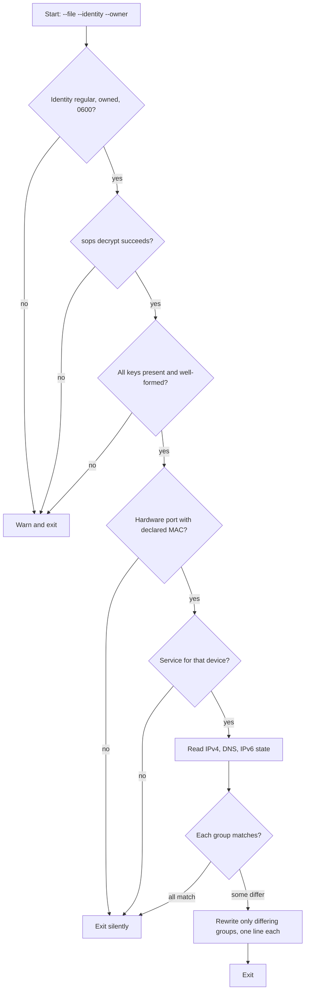

# macOS Wired Adapter Static IP - Plan

## Goal Capsule

- **Objective:** The MacBook Pro's wired adapter gets its network settings from this repository. A production switch leaves the adapter with the declared static IPv4 address, router, DNS servers, and IPv6 turned off. No network value appears in plaintext in the public repository.
- **Means:** A macOS host trait whose production activation runs a packaged script that decrypts a host SOPS file and reconciles the matching adapter's network service with `networksetup` (KTD1, KTD3).
- **Product authority:** The repository owner, who settled every Key Decision below in the brainstorm. The Product Contract wins over the Planning Contract on behavior.
- **Execution profile:** One pull request. Units U1 through U4 land in dependency order on one branch.
- **Stop conditions:** Stop and report if `networksetup` cannot express a required setting, or if any requirement can only be met by failing the switch.
- **Finishing:** `ce-work` implements and verifies with repository checks. The owner runs the production switch on the Mac; no agent runs `darwin-rebuild switch` or `nr switch`.
- **Open blockers:** None.

---

## Product Contract

Product Contract preservation: unchanged except that the two items formerly under Outstanding Questions are resolved by KTD5 and KTD6 and removed.

### Summary

A production switch on the macOS host finds the wired adapter by its MAC address and applies the declared IPv4 manual configuration, DNS servers, and IPv6-off setting to that adapter's network service. The MAC address and network values live in a host-only SOPS file and are decrypted at activation with the host's age identity. No other network service is touched.

### Problem Frame

The MacBook Pro has one wired adapter, the `Thunderbolt Ethernet Slot 0` hardware port (currently `en7`). Its static IPv4 address, router, and two DNS servers were entered by hand in System Settings. Every other managed setting on this Mac is declared in this flake, but this one is not recorded anywhere. A reinstall, a replaced adapter, or a stray edit in System Settings would leave no source to restore it from.

This repository is public. Network topology it already manages, such as Wi-Fi SSIDs and Tailscale route labels, is kept in SOPS-encrypted files, so this adapter's addresses must follow the same rule.

### Key Decisions

- **Store the adapter's MAC address and network values encrypted with SOPS, decrypted only at activation.** The repository is public, and internal addresses committed in plaintext would stay in git history permanently. Governs R2, R3. (session-settled: user-approved — chosen over plaintext values in the host's Nix configuration: internal addresses would be published permanently)
- **Identify the adapter by MAC address, not by network service name.** The settings apply to this one adapter, and another adapter plugged into the same slot never receives the static address. Governs R1, R7. (session-settled: user-approved — chosen over matching the `Thunderbolt Ethernet Slot 0` service name: that would give the same static address to any adapter in the slot)
- **Turn IPv6 off on this adapter.** Governs R4. (session-settled: user-directed — chosen over leaving IPv6 automatic and unmanaged: the owner wants IPv6 disabled on this adapter)
- **Reassert the declared values on every production switch.** A manual change in System Settings is reverted at the next switch, as with other declared settings. Governs R5. (session-settled: user-approved — chosen over applying once and leaving later manual changes alone: the motivation is a declarative record that stays consistent)
- **Apply the static address unconditionally.** The adapter only ever connects to the one office network, so no per-network switching is needed. Governs R5. (session-settled: user-directed — chosen over per-network handling such as macOS Locations: the adapter is never plugged into another wired network)
- **An absent adapter is a normal state and is skipped silently.** Switching while the adapter is unplugged is routine. Governs R7. (session-settled: user-directed — chosen over logging a warning: an unplugged adapter is not a fault)

### Requirements

**Adapter settings**

- R1. A production switch selects the network service whose hardware port has the declared MAC address, and only that service.
- R2. The declared settings are the IPv4 address, subnet mask, router, and an ordered list of DNS servers, matching the adapter's current manual configuration.
- R3. The MAC address and every network value in R2 are stored only in a SOPS-encrypted file scoped to the macOS host, and no plaintext copy enters the repository, a derivation, or the Nix store.
- R4. IPv6 is turned off on the selected service.

**Switch behavior**

- R5. Each production switch brings the selected service to the declared state, reverting any manual change made since the previous switch.
- R6. When the service already matches the declared state, the switch changes nothing on it, so the wired connection is not interrupted.
- R7. When no hardware port has the declared MAC address, the switch skips this step without any message and succeeds.
- R8. When the encrypted file cannot be decrypted, the switch logs a warning without printing any secret value, leaves the adapter untouched, and succeeds.
- R9. Bootstrap builds do not run this step at all.

**Boundaries of management**

- R10. Wi-Fi, Thunderbolt Bridge, Tailscale, and any other network service stay untouched.
- R11. Removing the declaration later leaves the adapter's last applied settings in place rather than resetting it to DHCP or automatic IPv6.

### Acceptance Examples

- AE1. **Covers R5, R6.** **Given** the adapter already has the declared address, DNS servers, and IPv6 off, **when** the owner runs a production switch, **then** the adapter's settings are not rewritten and the wired connection does not drop.
- AE2. **Covers R5.** **Given** the owner changed the adapter's DNS servers in System Settings, **when** the next production switch runs, **then** the declared DNS servers are restored in the declared order.
- AE3. **Covers R4, R5.** **Given** IPv6 was set back to automatic on the adapter, **when** the next production switch runs, **then** IPv6 is off again.
- AE4. **Covers R7.** **Given** the adapter is unplugged and macOS lists no hardware port with the declared MAC address, **when** the owner switches, **then** the switch succeeds with no output from this step.
- AE5. **Covers R1, R7.** **Given** a different adapter with another MAC address sits in the same Thunderbolt slot, **when** the owner switches, **then** that adapter keeps its own settings and the switch succeeds silently.
- AE6. **Covers R8.** **Given** the host age identity is missing, **when** the owner switches, **then** a warning names the failed decryption, no secret value is printed, the adapter is untouched, and the switch succeeds.

### Scope Boundaries

- Search domains, proxies, additional routes, MTU, and network service order are not managed.
- The NixOS host's wired configuration is out of scope.
- Per-network profiles (macOS Locations) are not needed, since the adapter only joins one network.
- Moving the static assignment to a DHCP reservation on the router was rejected because the office router is not under the owner's control.
- Considered and not built: a check that the declared address is reachable after applying it. Nothing in this flow would act on the result, and a wrong value shows up immediately as lost wired connectivity to the owner. A report of silent misconfiguration would change this.

### Dependencies / Assumptions

- macOS keeps listing the adapter's hardware port while it is unplugged, so settings can still apply in that state. When the port is not listed, R7 applies.
- The adapter's wired MAC address is fixed by hardware. macOS private-address randomization applies only to Wi-Fi.
- The existing `network-recovery` launchd daemon turns network services off and on but does not change their IP configuration, so it does not conflict with this step.

### Sources / Research

- `modules/darwin/xcode.nix`: the existing production-only activation step that decrypts a host SOPS file with the user's age identity at activation time.
- `modules/darwin/tls-inspection-ca.nix` and `scripts/tls-inspection-ca`: a trait-gated macOS module whose option defaults to `secrets/hosts/<host>/<name>.yaml` when present, asserts the file exists in production, and runs a packaged script from activation.
- `modules/nixos/wifi.nix`: precedent for keeping network identifiers in SOPS.
- `modules/darwin/network-recovery.nix` and `scripts/network-recovery`: the daemon that cycles network services on this host.
- `.sops.yaml` and `secrets/README.md`: per-host creation rules under `secrets/hosts/MacBook-Pro-Mac17-9/`.

---

## Planning Contract

### Key Technical Decisions

- KTD1. **A new macOS trait, `my.wiredNetwork.enable`, owns the step.** Modules branch on traits, never host names, so the host opts in from `hosts/MacBook-Pro-Mac17-9/default.nix`. The module is `modules/darwin/wired-network.nix`, imported by `modules/darwin/profile.nix`, and is active only when the trait is on and `my.bootstrap` is false (R9).
- KTD2. **The encrypted file is `secrets/hosts/<host>/wired-network.yaml`, referenced through a `my.wiredNetwork.file` option.** The option defaults to that path when it exists, as `my.tlsInspectionCa.certificateFile` does, and a production output with the trait on and no file fails an evaluation assertion. A missing file is a repository mistake caught at build time; a runtime decryption failure is R8's warning. Only ciphertext enters the store, which R3 allows. Implements R3.
- KTD3. **A packaged Python script, `scripts/macos-wired-network.py`, does the work; activation only calls it.** The script decrypts with `sops` under `SOPS_AGE_KEY_FILE`, reads state with `networksetup`, and writes only what differs. Python keeps parsing `networksetup` output and comparing state testable with PATH stubs. It never prints decrypted values, including in exceptions. Implements R1, R4, R5, R6, R10.
- KTD4. **The file schema is one flat YAML map.** Keys: `mac`, `ipv4_address`, `ipv4_subnet_mask`, `ipv4_router`, and `dns_servers` (a list of one or more addresses). The script validates presence and basic shape. A file that decrypts but fails validation gets R8's handling: a warning naming the bad key, never its value, with the adapter untouched.
- KTD5. **The step runs in `postActivation` with `lib.mkAfter`.** It runs after the Homebrew, Xcode, and container steps, so a brief wired drop while settings change cannot interrupt their downloads.
- KTD6. **Reporting: silent when nothing changed or no adapter matched; one stderr line per setting group it rewrote.** The line names the group (`IPv4`, `DNS`, `IPv6`) and the service name, never an address. Failures print one `macos-wired-network:` warning.
- KTD7. **Every failure path exits 0.** Activation runs under `set -e`, and R8 requires the switch to succeed. Decryption failure, invalid fields, and an identity with the wrong owner or mode each print one warning and leave the adapter untouched. A failing `networksetup` write prints one warning for its group, and the other groups still reconcile, so one bad write does not leave unrelated settings stale (R5). The script still exits non-zero on a usage error such as a missing argument, which only a broken module could cause and which repository checks catch.
- KTD8. **Matching is MAC-first through two `networksetup` listings.** `-listallhardwareports` maps the MAC (compared case-insensitively, normalized to colon-separated lowercase) to a device. `-listnetworkserviceorder` maps that device to a service name, including a disabled service marked `*`. No matching port, or no service for the device, is R7's silent skip.
- KTD9. **The identity is the host age key at `<home>/.config/nix-config/age/key.txt`, checked like the existing tools.** It must be a regular file owned by `my.user.name` with mode 0600. Activation runs as root, so the script reads the key directly without `sudo`.

### High-Level Technical Design

The script's run, as a decision flow. Every exit is status 0 except a usage error.

The comparison rules per group:

- **IPv4** matches when `-getinfo` reports `Manual Configuration` and the address, subnet mask, and router equal the declared values. Otherwise `-setmanual` sets all three.
- **DNS** matches when `-getdnsservers` lists exactly the declared servers in order. Otherwise `-setdnsservers` sets the declared list.
- **IPv6** matches when `-getinfo` reports `IPv6: Off`. Otherwise `-setv6off` applies.

### Assumptions

- `networksetup -getinfo` on this macOS release prints `IPv6: Off` for a service with IPv6 disabled, and `Manual Configuration` as its first line for a manual IPv4 service. U2's tests pin these strings, and the owner's first switch confirms them on hardware.
- `networksetup -listallhardwareports` prints an `Ethernet Address:` line for the Thunderbolt Ethernet port. On this Mac it currently prints `Device: en7` with a MAC line.

---

## Implementation Units

### U1. Trait, option, and module

**Goal:** Declare the trait and file option and wire production activation to the packaged script.

**Requirements:** R1, R3, R5, R9 (Key Decisions governing R3, R5); KTD1, KTD2, KTD5, KTD9.

**Dependencies:** U2 (the package the module calls).

**Files:**

- `modules/shared/host.nix` (add `wiredNetwork.enable` beside the other macOS traits)
- `modules/darwin/wired-network.nix` (new)
- `modules/darwin/profile.nix` (import it)
- `hosts/MacBook-Pro-Mac17-9/default.nix` (enable the trait)
- `tests/darwin-config.nix` (new `assertWiredNetwork` block)
- `tests/fixtures/hosts/magnolia/default.nix`, `tests/lib/fake-darwin-secrets-module.nix` (fixture opts in, with a fake file)

**Approach:**

1. Mirror `modules/darwin/tls-inspection-ca.nix`: `my.wiredNetwork.file` defaults to the host path when it exists, `active = enable && !bootstrap`, and an assertion fires when active with a null file.
2. Append one `postActivation` call through `lib.mkAfter`, passing `--file`, `--identity`, and `--owner`.

**Patterns to follow:** `modules/darwin/tls-inspection-ca.nix` (option, assertion, activation call); `assertTlsInspectionCa` and `assertNetworkRecovery` in `tests/darwin-config.nix`.

**Test scenarios:**

- The fixture enables the trait, and the option defaults to false.
- The production fixture's activation script contains exactly one call to the packaged `macos-wired-network` with the fixture file, `/Users/tester/.config/nix-config/age/key.txt`, and owner `tester`, and the call sits after the `setting up /etc...` marker.
- The bootstrap fixture's activation script has no `macos-wired-network` call.
- The production fixture with `my.wiredNetwork.file = null` fails an assertion naming `secrets/hosts/`.

**Verification:** `darwin-config` passes on `aarch64-darwin`, and each new assertion fails when the line it guards is removed (mutation check per the repository's check-writing learnings).

### U2. The reconciliation script and its package

**Goal:** Implement the decision flow in High-Level Technical Design.

**Requirements:** R1, R2, R4, R5, R6, R7, R8, R10 (Key Decisions governing R1, R4, R5, R7); KTD3, KTD4, KTD6, KTD7, KTD8, KTD9.

**Dependencies:** None.

**Files:**

- `scripts/macos-wired-network.py` (new)
- `packages/macos-wired-network.nix` (new; `writeShellApplication` with `python3` and `sops`; `networksetup` comes from macOS's own PATH at activation)
- `tests/macos-wired-network.nix` (new check: runs a Python test file against the packaged script with PATH stubs)
- `tests/test_macos_wired_network.py` (new)
- `tests/lib/fake-secrets.nix` (add `wired-network.yaml` and failure fixtures encrypted to the fake key)
- `flake.nix` (register the check)

**Approach:**

- Stubs for `networksetup` read answer files and append every call to a log, as `tests/network-recovery.nix` and `tests/tls-inspection-ca.nix` do. A stub told to fail a `-set*` call prints its full argument list to stderr before exiting non-zero, as real `networksetup` errors can, so the leak scenario catches a script that forwards tool errors into its warning. The real `sops` decrypts the fake files from `tests/lib/fake-secrets.nix`.
- Fake values use documentation address ranges (`192.0.2.0/24`, `198.51.100.0/24`) and a locally administered fake MAC. The leak check greps every run's output for each fake address and the fake MAC.

**Execution note:** Write the stub-driven tests for the decision flow first; the script is mostly branching on parsed tool output.

**Patterns to follow:** `scripts/macos-xcode.py` `read_account` (identity checks, `SOPS_AGE_*` scrubbing, no secret in errors); `tests/tls-inspection-ca.nix` (stubs plus fake-secrets).

**Test scenarios:**

- Covers AE1. All three groups already match: no `-set*` call is logged and stdout and stderr are empty.
- Covers AE2. DNS lists the declared servers in reverse order: only `-setdnsservers <service> <declared order>` is called, and one stderr line names DNS and the service.
- Covers AE3. `-getinfo` reports `IPv6: Automatic`: only `-setv6off` is called.
- IPv4 shows `DHCP Configuration`: `-setmanual` is called with the declared address, mask, and router.
- IPv4 is manual but the router differs: `-setmanual` is called; DNS and IPv6 untouched.
- Covers AE4. No hardware port lists the declared MAC: exit 0, no output, no `-get*` or `-set*` call on any service.
- Covers AE5. A port lists a different MAC in the same `Thunderbolt Ethernet Slot 0` port name: same as AE4.
- The MAC appears in uppercase in `-listallhardwareports`: it still matches.
- The device has a disabled service (`(*) ...` line in the service order): it is selected and reconciled.
- Two hardware ports exist (Wi-Fi and the wired adapter): only the wired adapter's service is queried or changed (R10).
- Covers AE6. The identity file is missing: exit 0, one warning, no `networksetup` call.
- The identity has mode 0644 or a different owner: exit 0, one warning, no `networksetup` call.
- The file is encrypted to the other fake key: exit 0, one warning naming decryption.
- A decrypted file lacks `ipv4_router`, or has an empty `dns_servers`: exit 0, warning names the key, no `-set*` call.
- `-setmanual` exits non-zero: exit 0, a warning, and the DNS and IPv6 groups still reconcile.
- No run's stdout or stderr contains any fake address or the fake MAC.
- A missing `--file` argument exits non-zero with usage text.

**Verification:** The new check passes, and the leak scenario fails when the script is mutated to print the decrypted map.

### U3. The encrypted host file

**Goal:** Commit the real host file, encrypted to the host recipient only.

**Requirements:** R2, R3 (Key Decision governing R2, R3); KTD2, KTD4.

**Dependencies:** None.

**Files:**

- `.sops.yaml` (add `^secrets/hosts/MacBook-Pro-Mac17-9/wired-network\.yaml$` with the MacBook recipient, beside the other host rules)
- `secrets/hosts/MacBook-Pro-Mac17-9/wired-network.yaml` (new, SOPS-encrypted)

**Approach:** Encrypt from stdin with `sops --encrypt` against the `.sops.yaml` rule, which needs only the public recipient. Read the current values with `networksetup` on this Mac so they match R2 exactly. Plaintext never touches a file in the checkout or a log.

**Patterns to follow:** The other `secrets/hosts/MacBook-Pro-Mac17-9/*.yaml` rules in `.sops.yaml`.

**Test expectation:** Covered by the existing `sops-recipients` check, which matches every encrypted file under `secrets/hosts/<host>/` to its `.sops.yaml` rule.

**Verification:** `sops-recipients` passes, and `git grep` finds none of the plaintext values in the tree.

### U4. Documentation

**Goal:** Document the trait and file where the other macOS traits are documented.

**Requirements:** R3, R7, R8, R11.

**Dependencies:** U1, U3.

**Files:**

- `docs/macos.md` (a `## Wired network` section after `## Network recovery`, plus the file in the secrets list)
- `docs/adding-a-host.md` (trait table row and optional per-host file step)
- `secrets/README.md` (recipient layout list)
- `AGENTS.md` (`modules/darwin/` listing gains `wired-network.nix`)

**Approach:** State the file schema keys from KTD4 without values, the silent-skip and warning behavior, and that removing the trait or file leaves the adapter as last applied (R11).

**Test expectation:** none -- documentation; `AGENTS.md` feeds the `agent-instructions` check, which the Verification Contract runs.

**Verification:** `markdownlint-cli2` passes on the changed files.

---

## Verification Contract

| Gate | Command or check | Where |
| --- | --- | --- |
| Formatting | `nix fmt -- --ci` | Linux builder or CI `fmt` (no `formatter.aarch64-darwin`) |
| Whitespace | `git diff --check` | Local |
| Markdown | `markdownlint-cli2` on changed `.md` files | Local |
| New script check | `nix build --no-link .#checks.aarch64-darwin.macos-wired-network` | Local (macOS) and CI light shard |
| Darwin config | `nix build --no-link .#checks.aarch64-darwin.darwin-config` | Local (macOS) |
| Recipients | `nix build --no-link .#checks.aarch64-darwin.sops-recipients` | Local |
| Instructions | `agent-instructions` check (AGENTS.md is its input) | Local |
| Shard registration | `check-shards-guard` | Local |
| Host outputs | `darwinConfigurations.MacBook-Pro-Mac17-9` and `-bootstrap` build | Local (macOS) and CI `build-darwin` with `full-ci` |
| Full CI | `full-ci` label; green `host-checks`, `vm-checks`, `build`, `build-darwin` on the head commit | CI |

The owner's first production switch on the Mac is hardware verification and is reported separately.

## Definition of Done

- U1 through U4 are implemented, and every gate above that can run locally passes, with the rest recorded as deferred to CI.
- Each new assertion in `darwin-config` and each leak scenario in the script check was shown to fail under a mutation of the line it guards.
- No plaintext address, router, DNS server, or MAC appears in the diff, in test output, or in the store.
- No abandoned experimental code remains in the diff.
