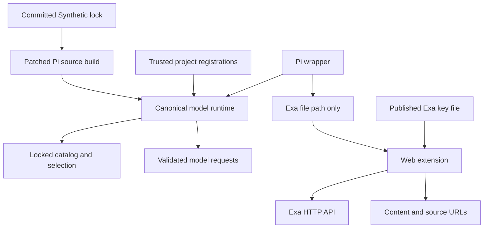
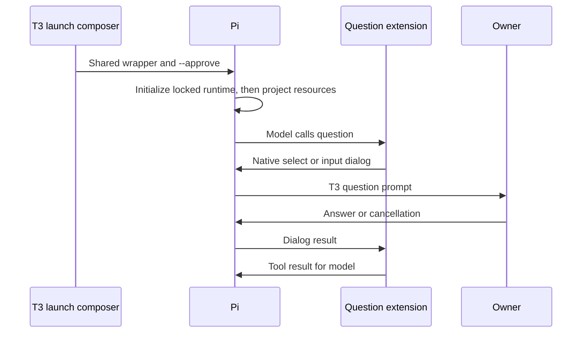
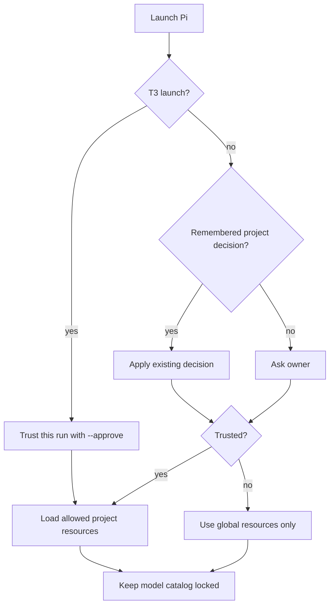

# Pi Tools and Project Trust - Plan

## Goal Capsule

- **Objective:** The owner can ask Pi to research the web and clarify a task in either terminal Pi or T3 Code, with project context available in T3 sessions.
- **Means:** Native Pi tools, Exa, composed T3 trust arguments, and enforcement of the Synthetic lock in Pi's model runtime (KTD1–KTD5).
- **Authority:** The current request and issue [#139](https://github.com/hyperlapse122/dotfiles/issues/139) govern product scope; R-IDs govern behavior; KTDs govern implementation; units implement both.
- **Execution profile:** One PR, with U1 first because project trust must not become available before its model guard. Implementation includes local verification, simplification, review, and the repository's shipping checks. The owner retains merge and host-switch authority.
- **Stop conditions:** Stop for an unsupported package build, a model path that bypasses the runtime guard, or missing required live/platform evidence. Report pending evidence separately from passing repository checks.

---

## Product Contract

### Summary

Add `question`, `web_search`, and `web_fetch` to managed Pi on both host kinds. T3 Pi sessions automatically load project resources while terminal sessions retain per-project approval. The Synthetic catalog remains authoritative after project resources load.

### Problem Frame

Pi is the owner's harness for Synthetic models, but its managed configuration currently offers no question or web tools. T3 Pi sessions also omit untrusted project resources. The existing policy only rechecks provider registrations at resource discovery, which does not cover registrations from later handlers.

### Key Decisions

- **Keep the strict model restriction, including runtime changes when required.** Governs R7. (session-settled: user-directed — chosen over allowing outside models to appear and rejecting inference: the owner chose to keep only locked Synthetic models selectable.)
- **Keep Pi and Exa.** Governs R2, R3, R7; issue #139 rejects OpenCode v2 and holds fx pending its listed limitations.

### Requirements

**Human questions**

- R1. A model-callable `question` tool accepts one question with optional choices and returns the owner's selected or typed answer through native Pi dialogs in terminal and T3 sessions. Cancellation and unavailable UI produce distinct outcomes without inventing an answer.

**Web research and credentials**

- R2. `web_search` uses Exa and returns each result's actual URL, title, and extract suitable for citation, including an explicit empty result when nothing is found.
- R3. `web_fetch` uses Exa to retrieve requested public HTTP(S) URLs and returns content with its source URL, identifying individual fetch failures when results are partial.
- R4. The Exa key comes from the already published `exa_api_key` through the Pi wrapper; its value never enters Pi/T3-owned files, argv, tool subprocess environments, or diagnostic output.
- R5. Missing credentials leave Pi and the question tool usable; web calls return a sanitized explanation. Web calls honor cancellation and distinguish service errors from empty results.

**Project resources and model policy**

- R6. T3's managed Pi launch includes `--approve` while preserving user-added launch arguments and shared homes. Terminal Pi asks before loading an undecided project's resources and preserves existing per-project trust decisions.
- R7. Only models in the committed Synthetic lock are selectable, including after project settings, extension registration, refresh, reload, and session restoration. Ordinary supported registrations must not widen the catalog or replace the locked Synthetic definitions.
- R8. Each new extension is repository-owned and linked under the normal `~/.pi/agent/` on NixOS and Darwin, with no shadow home or new provider instance.
- R9. Change shared instructions only where a rule depends on the tools; any template change updates its receipt hashes and routing documentation in the same change.

### Acceptance Examples

- AE1. **Covers R1.** A T3 model asks a multiple-choice question, the owner supplies an answer, and the model receives that exact answer. Terminal Pi also supports a typed answer outside the suggested choices.
- AE2. **Covers R2–R5.** Search and fetch return attributable sources; a command executed by Pi sees neither the Exa key variable nor its value. Removing the key file causes only web calls to fail.
- AE3. **Covers R6–R8.** A new T3 Pi session loads a project-local skill without the untrusted-folder notice. Opening an undecided project in terminal Pi still requests trust.
- AE4. **Covers R7.** A project extension registers a foreign model from a later `resources_discover` handler; the model remains absent from the effective selectable catalog and an explicit selection request fails.
- AE5. **Covers R6.** After the owner adds a quoted argument in T3, reconciliation preserves it, retains `--approve`, and does not duplicate managed additions.

### Scope Boundaries

- No session-info tool, harness replacement, additional Exa services, new secret publication flow, or unrelated agent configuration cleanup.
- Trusted project extensions run with the user's account privileges. The model guard governs Pi's normal catalog and request paths; it cannot sandbox arbitrary JavaScript that reads credentials or directly opens a network connection. The issue explicitly accepts project-code execution and web-query disclosure risks.
- Do not build a subprocess sandbox, a general policy language, a credential broker, or automatic web retries. The accepted same-user boundary and explicit tool failures do not require these mechanisms; reconsider only if the supported trust boundary changes.
- No global project trust setting of `always`, separate Pi home, persistent test deployment, or agent-run host switch.

---

## Planning Contract

### Current Evidence

The current pins are Pi **1.5.2** and T3 Code **0.1.8**, newer than the issue's version descriptions. Re-read the owning release files when implementing.

`scripts/pi` launches the managed policy explicitly, and `scripts/pi-state` also reconciles its settings entry. Upstream loads CLI extensions before discovered extensions, binds queued providers, then runs `session_start` and `resources_discover` in extension order. `ModelRuntime` also permits immediate provider registration after binding. Therefore the current `pi-policy.ts` resource handler cannot be the sole owner of R7.

`scripts/pi-state` currently sets `defaultProjectTrust` to `never`. T3 trust arguments alone would not satisfy the terminal half of R6; the managed terminal default must return to native prompting.

### Key Technical Decisions

- KTD1. **Enforce R7 in the shared model runtime before project code loads.** Add a narrow repository patch to Pi's `ModelRuntime`, embedding the existing committed lock as build input. Keep the underlying provider collection canonical at composition/registration, so synchronous getters and asynchronous availability snapshots share the same allowed set. Validate explicit selections and physical request targets against that same policy. This replaces event-order dependence; filtering only the selector or only `updateModelSnapshot` misses direct getter and refresh paths.
- KTD2. **Build the patched Pi from pinned source using upstream's Nix recipe as the baseline.** Adapt v1.5.2 `nix/package.nix`, its npm install lock, workspace package overrides, and offline model-catalog hydration. Apply the patch before workspace compilation, and retain the repository wrapper plus the `libexec/pi/pi` launcher contract. Read metadata and dependency locks from fetched source rather than a patch derivation to avoid import-from-derivation. The upstream binary cannot receive a TypeScript runtime patch; do not byte-edit its compiled payload.
- KTD3. **Pass only the Exa file location from the wrapper.** Add a validated `exaKeyFile` package parameter beside `syntheticKeyFile`, selected from the existing host-kind secret directory. The wrapper exports a repository-specific path variable, clears inherited `EXA_API_KEY`, and the web extension reads the published file at call time without caching it in state. This meets R4 without credential-bearing environment variables or new subprocess hooks.
- KTD4. **Use two small extensions with native tools.** Register `question` in `pi-question.ts` and the two web tools in `pi-web.ts`. Link them as `dotfiles-question.ts` and `dotfiles-web.ts`, and compose explicit wrapper loads with settings reconciliation so each module loads once. Use Pi's current schema support and native `select`/`input` dialogs; custom TUI screens do not have equivalent T3 support.
- KTD5. **Treat `--approve` as an owned T3 native control.** Extend `NATIVE_CONTROLS` and Pi's application branch in `scripts/t3-instructions.py`, including operation without an instruction addition. Preserve the existing schema-one base/last argument ledger and unrelated mutable settings. Set terminal Pi's managed trust default to native `ask`, using the pinned settings contract, without changing remembered decisions.
- KTD6. **Keep HTTP calls in process and return attributable, bounded results.** Use native `fetch` with the tool abort signal, Exa `/search` with `type: auto` and highlights, and `/contents` for explicit fetch. Preserve URLs beside excerpts and label returned page text as untrusted source content. Sanitize errors instead of echoing raw response bodies or headers. Current Exa documentation supports these endpoints; avoid legacy search modes and ineffective fields.
- KTD7. **Consolidate proof in existing contract owners.** Package install checks own launch/native-module sanity; `tests/pi.nix` owns materialized host files and executable Pi behavior; `t3code-traits` owns launch composition. Add test files to these owners instead of adding overlapping per-platform flake checks. Read AGENTS.md's required mutation-testing learnings before changing or relying on these assertions.

### High-Level Technical Design

### Assumptions and Implementation-Time Details

The existing issue remains the scope; the brainstorm produced no new requirements artifact. Tool defaults below are planning assumptions that may be corrected without changing the objective:

- Questions are single-select. With choices, include a terminal route to typed text; without choices, use input. Empty input is not an answer. Cancellation and no UI return separate statuses, and dialog waits end when the tool is cancelled.
- Search requests default to five results, accept one through ten, and reject an out-of-range count. Fetch accepts one through five public HTTP(S) URLs. Bound extracted content with a visible truncation marker; choose the exact text budget when exercising representative responses.
- Web failures do not retry automatically. Mixed fetch success returns successful cited content and per-URL failure information. Credentials that are absent, unreadable, empty, or multiline produce a sanitized tool error without a request.
- The wrapper path variable is transport for a non-secret filename, not a caller credential override. Key rotation is observed on the next web call. Existing Synthetic authentication stays as currently managed.
- Exact patch helpers and tool-result schema fields are implementation details. The build must cover bundled CLI and unbundled SDK paths from one patched source; neither may retain an unrestricted model runtime.

### System-Wide Impact and Risks

The source build replaces the opaque runtime binary while retaining Pi's version and entry point. Preserve native extension imports, TUI helpers, clipboard dependencies, asset discovery, plugin installation, and RPC behavior on Linux and Darwin. Source and dependency pins must advance atomically through `scripts/pi-release`; a new release that no longer accepts the patch must fail verification before publication.

The lock remains one tracked input, `home/h82/agents/pi-model-lock.json`. Compile it into the runtime and continue rendering its existing Home Manager files from that same input. No separate model catalog or editable policy registry is introduced.

NixOS activation reassertion occurs when the Home Manager generation changes; Darwin applies activation on each switch. Live evidence must name the generation and installed package actually probed. Only the owner runs host switches; absent post-switch evidence remains pending.

### Sources and Research

- Current owners: `packages/pi.nix`, `packages/pi-release.json`, `scripts/pi`, `scripts/pi-state`, `home/h82/agents/pi.nix`, `home/h82/agents/pi-policy.ts`, `scripts/t3-instructions.py`.
- [Pi source-build recipe, v1.5.2](https://github.com/earendil-works/pi/blob/v1.5.2/nix/package.nix) grounds KTD2. Its fixed model-catalog snapshot is a build input, not a live catalog request during normal use.
- [Pi model runtime](https://github.com/earendil-works/pi/blob/v1.5.2/packages/coding-agent/src/core/model-runtime.ts), [extension runner](https://github.com/earendil-works/pi/blob/v1.5.2/packages/coding-agent/src/core/extensions/runner.ts), and [resource loader](https://github.com/earendil-works/pi/blob/v1.5.2/packages/coding-agent/src/core/resource-loader.ts) establish KTD1's ownership and ordering constraints.
- [Pi extension documentation](https://github.com/earendil-works/pi/blob/v1.5.2/packages/coding-agent/docs/extensions.md) and [RPC protocol](https://github.com/earendil-works/pi/blob/v1.5.2/packages/coding-agent/docs/rpc.md) govern KTD4 and native protocol probes.
- [T3 Pi adapter, v0.1.8](https://github.com/pingdotgg/t3code/blob/v0.1.8/packages/provider-pi/src/server/adapter.ts) maps native select/input dialogs into question requests.
- [Exa Search](https://exa.ai/docs/reference/search), [Contents](https://exa.ai/docs/reference/get-contents), and [changelog](https://exa.ai/docs/changelog) ground KTD6.
- [Archived Pi plan](https://github.com/hyperlapse122/nix-config/blob/main/.compound-engineering/artifacts/plans/2026-10-22-1131-feat-pi-synthetic-harness-plan.md), R3/R4/R17, supplies key-handling and citation prior art. Its session-info and checkout-extension prohibitions do not govern this issue.
- Repository learnings: `.compound-engineering/artifacts/solutions/integration-issues/t3code-settings-json-value-outranks-repository-t3-json.md`, `.compound-engineering/artifacts/solutions/best-practices/home-manager-activation-does-not-run-on-every-rebuild.md`, `.compound-engineering/artifacts/solutions/best-practices/converged-fixture-state-defeats-nix-check-mutation-testing.md`, and `.compound-engineering/artifacts/solutions/best-practices/nix-check-reads-option-value-not-materialized-output.md` shape KTD5, KTD7, and live-evidence reporting.

---

## Implementation Units

### U1. Enforce the model lock in the packaged runtime

**Goal:** Make R7 independent of extension ordering.

**Requirements:** R7, R8; AE4. Implements the session-settled strict-restriction decision.

**Dependencies:** None.

**Files:** `packages/pi.nix`, new `packages/pi-runtime.nix`, new `packages/pi-model-policy.patch`, `packages/pi-release.json`, `scripts/pi-release`, `tests/test_pi_release.py`, `home/h82/agents/pi-policy.ts`, `tests/pi-policy.mjs`, `tests/pi-runtime.py`, new `tests/pi-runtime-policy.mjs`, `tests/pi.nix`.

**Approach:**

1. Adapt the upstream source-build recipe per KTD2 and pin the exact source revision and hash in the existing Pi release record. Keep every retained pin field consumed or remove it and its obsolete assertions together.
2. Implement KTD1 at provider composition and all supported model-registration paths, including native and virtual providers. Invalid registrations must leave the effective collection locked; valid Synthetic behavior stays canonical.
3. Prevent refresh, direct model lookups, explicit model objects, and restored session choices from bypassing the same guard. Keep any extension-side validation as diagnostics, not a second enforcement owner.
4. Update the release resolver and fixtures for the source contract, retaining stable-release and downgrade protections. Preserve the current external launcher paths.

**Execution note:** Start with packaged-runtime characterization of a late project registration. Do not enable automatic trust until the guarded runtime passes.

**Patterns to follow:** Upstream `nix/package.nix`, repository `packages/npm-release-package.nix`, existing Pi package/install checks.

**Test scenarios:**

- Covers AE4. With trusted project extensions enabled, register foreign and extra Synthetic models at factory load, `session_start`, later `resources_discover`, and a post-start command; each effective model inventory remains the lock.
- Register a native provider, virtual model, and same-ID Synthetic replacement; none adds a selectable model or changes the locked route.
- Refresh and reload after registrations, and apply project model defaults or enabled-model lists; inventories remain locked and explicit outside selections fail.
- Resume a session saved with a removed or foreign model; reject it without silently substituting another model.
- Exercise catalog getters, availability refresh, and request resolution through the packaged runtime; an outside direct model object cannot reach a provider request.
- Build/update fixtures reject incomplete or mismatched source pins and downgrades; a lock change reaches both CLI and SDK builds.

**Verification:** `tests/pi-runtime-policy.mjs` probes the actual patched runtime; `tests/pi-runtime.py` probes the packaged CLI/RPC boundary with project extensions enabled. These prove supported model paths, not containment of arbitrary same-user JavaScript. Package checks also verify version, native helpers, assets, and extension imports.

### U2. Add Exa tools and credential transport

**Goal:** Let Pi research public sources without inherited Exa credentials.

**Requirements:** R2–R5, R8; AE2.

**Dependencies:** U1 package interface.

**Files:** `scripts/pi`, `packages/pi.nix`, `home/h82/agents/pi.nix`, new `home/h82/agents/pi-web.ts`, `scripts/pi-state`, `tests/pi-state.py`, new `tests/pi-tools.mjs`, `tests/pi-runtime.py`, `tests/pi.nix`.

**Approach:** Wire the host-selected key file through KTD3, register both tools per KTD4/KTD6, and reconcile their settings entries while retaining user extensions. Add real module execution with fake credentials and controlled HTTP responses to the existing Pi check.

**Patterns to follow:** Existing plain-path validation in `packages/pi.nix`, mutable resource reconciliation in `scripts/pi-state`, and executed policy tests in `tests/pi-policy.mjs`.

**Test scenarios:**

- Covers AE2. Execute each loaded web tool with a fake key file; verify endpoint, authentication header, request fields, actual returned source URLs, and citation text.
- Covers AE2. Execute native Pi bash and an extension subprocess after web-tool loading; neither inherits the Exa key or its value, including when the caller exported `EXA_API_KEY`.
- Change the file's fake key between calls; the second request uses the new value without rewriting the source file or persisting either value in Pi/T3 state.
- Missing, unreadable, empty, and multiline key files leave tools registered and unrelated Pi use available; no HTTP request occurs.
- Empty search, mixed fetch success, malformed response, 401, 429, 500, network failure, and cancellation produce distinct sanitized outcomes.
- Validate count/URL boundaries, unsupported schemes, truncation markers, and the abort signal passed to HTTP.

**Verification:** `tests/pi-tools.mjs` executes the production extension against scripted network responses; packaged-runtime integration proves actual loading and native subprocess behavior. No real credentials enter repository checks.

### U3. Add the native question tool

**Goal:** Let the owner answer a model question in terminal Pi and T3.

**Requirements:** R1, R8; AE1.

**Dependencies:** U2 extension-loading pattern.

**Files:** New `home/h82/agents/pi-question.ts`, `home/h82/agents/pi.nix`, `scripts/pi`, `scripts/pi-state`, `tests/pi-state.py`, `tests/pi-tools.mjs`, `tests/pi-runtime.py`, `tests/pi.nix`.

**Approach:** Use native select/input dialogs per KTD4. Serialize question interactions with Pi's native sequential-tool mode. Return structured answer, cancellation, and unavailable-UI outcomes; honor tool abort without leaving a dialog waiting.

**Test scenarios:**

- Covers AE1. Choices select the exact answer; the terminal typed-text route and a question without choices return the entered text.
- Cancel a selection or input, submit empty input, or execute without UI; each returns its specified outcome without a fabricated answer.
- Abort while a dialog is pending; the tool settles and no pending dialog remains.
- Execute the registered tool in a native RPC harness and correlate its dialog request and response; verify registration after reload without duplicates.

**Verification:** Scripted dialog tests cover tool behavior, and native RPC coverage verifies Pi's protocol. Neither substitutes for the live T3 model roundtrip in the Verification Contract.

### U4. Enable project trust only through the T3 launch path

**Goal:** Load project context in T3 while retaining terminal approval.

**Requirements:** R6, R7; AE3–AE5.

**Dependencies:** U1 guarded runtime; U2/U3 may proceed independently of this launch change.

**Files:** `scripts/t3-instructions.py`, `scripts/pi-state`, `tests/test_t3_instructions.py`, `tests/t3code-launch.py`, `tests/pi-state.py`, `tests/pi-runtime.py`, `tests/t3code-traits.nix`.

**Approach:** Implement KTD5 in the existing ownership ledger, and remove the terminal `never` behavior without persisting T3 approval into `trust.json`. Exercise rendered activation in scratch homes.

**Test scenarios:**

- Covers AE5. First apply, repeat apply, and app edits preserve quoted user arguments and unrelated provider settings while retaining one effective owned approval flag.
- A user-preexisting `--approve` survives owned-addition removal; a managed contribution can be removed without deleting a user's contribution.
- Empty instruction additions still retain the T3 approval control. Terminal wrapper invocation receives no added approval flag.
- Covers AE3. With no remembered decision, terminal trust uses native prompting; T3 approves the run and discovers a fixture project skill and extension.
- Project model settings and a late registration under that trusted fixture still satisfy U1's invariants.

**Verification:** `test_t3_instructions.py` owns reconciliation behavior; `t3code-launch.py` owns executed activation/materialized settings; native Pi integration owns resource discovery. Live T3 evidence remains separate.

### U5. Align instructions and complete the evidence record

**Goal:** Explain the available tools where rules need them and demonstrate issue completion.

**Requirements:** R1–R9; AE1–AE5.

**Dependencies:** U1–U4.

**Files:** `docs/agent-routing.md`, `AGENTS.md` where current Pi packaging descriptions change, conditionally `home/h82/agents/instructions/instructions.md.tmpl` and `tests/agent-instructions.py`, plus existing check owners `tests/pi.nix` and `tests/t3code-traits.nix`.

**Approach:** Update Pi-specific routing/tool guidance and source-build documentation without adding a generic tool inventory to shared instructions. When a template rule changes, update receipts and execute the instruction check. Record live evidence with OS, versions, generation, probe inputs, and outcomes in the PR.

**Test scenarios:**

- Materialized homes for both production host kinds load each managed extension exactly once and preserve unrelated native state.
- If template text changes, rendered Pi instructions contain the applicable rule and other harness branches retain their own guidance; receipt checks pass.
- Perform the live probes below after the owner installs the generation. Report any unavailable platform or generation as pending.

**Verification:** A reviewer can distinguish executable repository coverage, both-platform builds, live terminal/T3 behavior, and owner-only hardware/switch evidence from the PR record.

---

## Verification Contract

No implementation tests or live probes ran during planning. The following are execution gates.

| Owner | Required execution evidence |
| --- | --- |
| Package | Pi source runtime builds on supported Linux and Darwin builders; install checks cover launcher, version, native dependencies, assets, and imports. |
| `pi` | Build `.#checks.x86_64-linux.pi` and the Darwin counterpart on its builder; executable tests cover materialized files, registration, tools, environment isolation, policy, and reload. |
| `pi-release` | Build the existing release-resolver check with source-pin fixtures and updater failure cases. |
| `t3code-traits` | Build the check on supported builders, covering executed activation and launch reconciliation. |
| `agent-instructions` | Run whenever the template, receipts, `AGENTS.md`, or `docs/agent-routing.md` changes because documentation is a check input. |
| Mutation evidence | Break runtime policy, extension wiring, key transport, and approval composition separately; each relevant owner fails for its intended reason. Restore each mutation. |
| Branch and CI | Run repository-required formatting, changed-Markdown lint, `git diff --check`, evaluation, checks, VM tests, and production/bootstrap outputs. Apply `full-ci`; require current-head evidence including `host-checks`, `vm-checks`, `build`, and `build-darwin` before declaring ready. |

Reuse existing registered checks. If implementation adds a check, register it in `flake.nix` and `tests/check-shards.nix`; classify its actual derivation closure in `hostClosureChecks`. Use fake secrets and distinguishable fixtures, and execute activation rather than inspecting its text.

### Live Evidence

1. On both production hosts, inventory the three tools in an actual Pi session and verify the Synthetic model inventory.
2. In a new T3 Pi session, have the model call `question`, answer it through T3's prompt, and verify the answer reaches the model. Exercise selection and typed input, then cancellation.
3. In a new T3 Pi session, load a disposable project-local skill and observe that no untrusted-folder notice appears; verify terminal Pi's undecided-project trust interaction separately.
4. Run a public Exa search and fetch, retain their cited URLs, and execute a shell probe that reports only whether Exa credentials are present. Never print values.
5. Capture the installed Pi/T3 versions and generation for each result, then remove probe files and close probe sessions. Only the owner performs any necessary switch.

### Deferred Implementation Details

Resolve exact build hashes, patch hunk locations, schema helpers, and output text budgets while implementing. These are execution-time details, not permission to relax R1–R9. Missing builders or live access leave verification pending; they are not successful checks.

---

## Definition of Done

- U1–U5 satisfy their traced requirements, with the strict Synthetic restriction verified after late registrations and reload.
- Existing credentials, sessions, undeclared settings, shared homes, plugins, and per-project trust records are preserved.
- Relevant repository checks and mutation rounds pass; required Linux/Darwin build and current-head CI evidence is recorded.
- All live evidence required by issue #139 is recorded, or the work is explicitly reported as awaiting that evidence.
- Review findings are applied or recorded with the repository's required dispositions.
- Abandoned implementation attempts, temporary probe files, and task-owned processes/resources are removed; no host switch or merge is performed by the agent.
