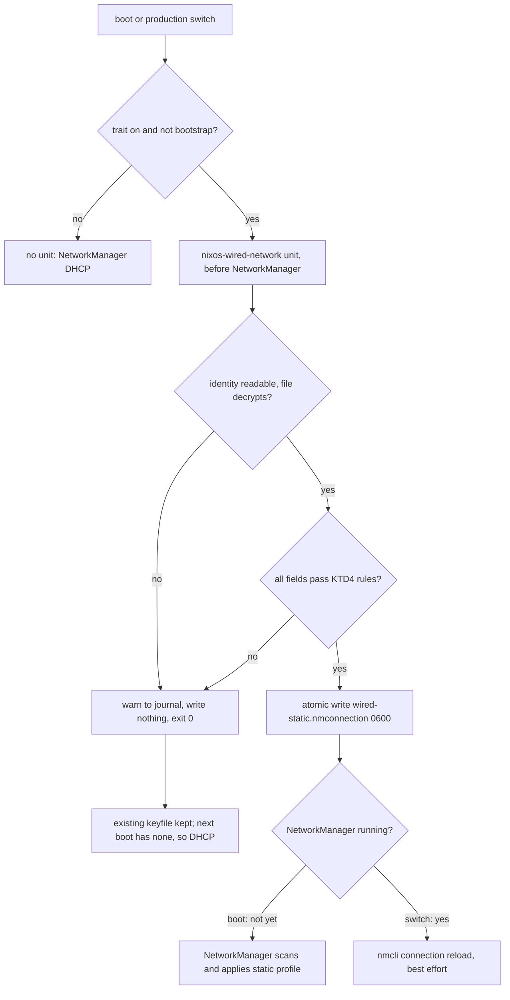

# NixOS Wired Static Address - Plan

## Goal Capsule

- **Objective:** After a reinstall or recovery, the `MS-7D91` desktop comes back on the office wired network with the same static address, gateway, and DNS servers it uses today, and nothing in the public repository reveals those values.
- **Means:** Extend the `my.wiredNetwork` trait and its encrypted `secrets/hosts/<host>/wired-network.yaml` file from macOS to NixOS, rendered into a NetworkManager keyfile by a packaged tool that runs before NetworkManager (KTD1, KTD2).
- **Product authority:** Issue #131 and the repository owner's direction in this session to declare the settings exactly as the host has them now. The Product Contract below wins on behavior; KTDs win on mechanism.
- **Execution profile:** One pull request containing every unit, including the real encrypted file and the host's trait flip (KTD8).
- **Stop conditions:** Stop and report if the VM check shows NetworkManager does not apply a keyfile written before it starts (KTD2), or if a valid fixture cannot be rendered without weakening a requirement.
- **Who finishes:** The implementing agent lands the PR through CI. The owner alone runs `nr switch` on `MS-7D91`, brings the declared profile up, and deletes the hand-made profile; that hardware evidence is reported separately.
- **Open blockers:** None.

---

## Product Contract

Product Contract preservation: changed: R8, R11, R12, AE1 — clarified to match the mechanism without scope change. A missing secret file is now a build-time assertion rather than a runtime case; R11 reads the rendered keyfile instead of a sops-nix path; AE1 no longer claims the second port gets nothing while the hand-made profile still exists; R8 separates a bad file at boot from a bad file applied during a running boot, which keeps the current connection.

### Summary

Declare the wired address `MS-7D91` uses today (manual IPv4, gateway, two DNS servers, IPv6 off) in the repository, with the values encrypted to that host alone. The production output renders them into a NetworkManager profile bound to the wired adapter's MAC address. The bootstrap output, and any host whose secret cannot be decrypted or is malformed, stay on DHCP.

### Problem Frame

The desktop's static address lives only in a NetworkManager profile created by hand in Plasma. The repository has no record of it, so a fresh install or a recovery from `docs/recovery.md` brings the host up on DHCP. The office network then hands out a different address and different DNS servers, and the owner has to recreate the profile from memory. The values describe an internal network, so they cannot go into this public repository as plaintext.

### Key Decisions

- **Use the values the host runs with today.** The hand-made profile is the source of truth; nothing is redesigned. (session-settled: user-approved — chosen over a router DHCP reservation and over adding a home-network address: the current configuration already works and the owner asked to declare it as is.) Governs R1, R2.
- **Reuse the macOS `my.wiredNetwork` trait and its secret file schema.** One trait, one file path convention, and one key set across both host kinds; the option description stops saying "macOS hosts only". (session-settled: user-approved — chosen over a new `secrets/network.yaml` with its own schema: parity with the existing macOS feature and per-host file isolation.) Governs R3, R4.
- **Bind the profile to the wired adapter by MAC address.** Interface names can change across kernel or hardware changes, and the host has a second, unused onboard Ethernet port that must not receive the address. (session-settled: user-approved — chosen over matching by interface name.) Governs R5.
- **Leave the hand-made profile for the owner to delete.** Activation never deletes NetworkManager profiles it did not create; the docs tell the owner to remove the old one after the declared profile is verified. (session-settled: user-approved — chosen over a cleanup step in activation, which this repository's rules avoid.) Governs R13.

### Requirements

**Address and matching**

- R1. The production `MS-7D91` output declares a wired NetworkManager profile with manual IPv4 addressing, using the same address, prefix, gateway, and DNS servers the host's hand-made profile holds today.
- R2. The declared profile disables IPv6 on the wired adapter, matching the current profile.
- R3. `MS-7D91` turns the feature on through `my.wiredNetwork.enable` in its host file; shared modules contain no host name and no address value, so `host-name-guard` keeps passing.
- R4. The values live in `secrets/hosts/MS-7D91/wired-network.yaml` with the same keys the macOS feature uses (`mac`, `ipv4_address`, `ipv4_subnet_mask`, `ipv4_router`, `dns_servers`), encrypted to the `MS-7D91` recipient alone.
- R5. The profile applies only to the adapter whose MAC address matches the `mac` value, and that MAC address appears nowhere in plaintext.
- R6. The declared profile's connection id carries no organization or network name.

**Fallback and coexistence**

- R7. The bootstrap output declares no wired static profile and keeps the host on DHCP until the age identity is recovered.
- R8. A secret that cannot be decrypted or holds a malformed value never costs the host its wired link: at boot the declared profile is absent, so NetworkManager falls back to DHCP (or to the hand-made profile while it still exists), and a bad update during a running boot leaves the current connection in place until the next boot. A secret file absent from the repository fails the production build instead.
- R9. Tailscale, its advertised subnet routes, and Proton VPN keep working with the static address in place.

**Checks**

- R10. The recipient checks (`sops-recipients`, `user-identity-secrets`) cover the new file: it is encrypted to `MS-7D91` alone, and adding the MacBook recipient fails the check.
- R11. A check reads the rendered configuration, not the option value: the production output carries the unit that renders the manual-IPv4 profile from the encrypted file, and the bootstrap output carries none.
- R12. A VM check in the style of `wifi-provisioning` shows that a profile built from a fake address activates, and that an undecryptable or malformed secret leaves the host on DHCP and reachable.

**Documentation**

- R13. `secrets/README.md`, `docs/install.md`, `docs/recovery.md`, and `docs/adding-a-host.md` describe the NixOS use of `wired-network.yaml`, how to update it when the office network changes, and the one-time removal of the hand-made profile after the declared one is verified.

### Acceptance Examples

- AE1. **Covers R1, R5.** Given the production output with a valid secret, when NetworkManager starts, the adapter with the declared MAC address gets the declared address, gateway, and DNS servers, and the other onboard port does not receive the declared address once the hand-made profile is deleted.
- AE2. **Covers R7.** Given the bootstrap output on a freshly installed host, when the wired cable is plugged in, the host gets a DHCP address.
- AE3. **Covers R8.** Given a production output whose secret file holds an invalid address, when the host boots, the wired adapter comes up on DHCP and the host stays reachable over SSH and Tailscale.
- AE4. **Covers R10.** Given the new file re-encrypted with the MacBook recipient added, when the recipient check runs, it fails.

### Scope Boundaries

- No static address for the home network or any network other than the current office one.
- No router-side DHCP reservation.
- No IPv6 static addressing.
- No automatic deletion of the hand-made profile.
- No change to the macOS `wired-network` behavior beyond sharing the trait description and the validator module (KTD3).
- Running `nr switch` on `MS-7D91` happens only when the owner instructs it in their own message.

**Considered and not built**

- No reachability fallback when valid values meet the wrong network. The profile activates and the link is dead; the docs list three escapes instead (second port, `nmcli connection down`, edit and switch). Evidence that would change this: the desktop moving between networks.
- No warning when no adapter matches the declared MAC. udev may not have enumerated the NIC when the unit runs, so the warning would fire falsely; the docs give the diagnosis commands instead.
- No `--check` mode for testing a file before a switch. A bad file falls back per R8 and the journal names the field, and the owner is at the machine when editing the file. Evidence that would change this: a remote-only update workflow.
- No validation beyond KTD4, such as rejecting a network or broadcast address or an address equal to the router. The values come from a working profile; such a mistake shows up as a dead link the owner sees at once. Evidence that would change this: values typed by hand rather than read from a working profile.
- No DHCP profile that outranks the hand-made one when rendering fails. While the hand-made profile exists it carries the same working values, so reachability holds, and outranking it would work against the decision to leave it to the owner.
- No `.path` watcher that reruns the unit when the age identity appears later in the same boot. Identity recovery is a one-time step; the docs say to restart the unit or reboot.

### Dependencies / Assumptions

- Encrypting needs only the host's public age recipient, so the implementing agent can create the real file by piping the live values from `nmcli` into `sops --encrypt` without writing plaintext to disk, the checkout, or the conversation (KTD8).
- The office network keeps its current addressing until this ships; a later change follows R13's update procedure.

### Assumptions

- The advertised Tailscale routes are secret, so the plan cannot compare them with the wired subnet. Because the address, gateway, and route metric match the hand-made profile, routing should not change (R9). The owner's hardware check confirms it.
- NetworkManager applies a keyfile that exists in `/run/NetworkManager/system-connections/` when it starts. The VM boot case proves it (KTD2).

### Sources / Research

- Issue #131 (scope, checks, and open questions this plan resolves).
- `modules/darwin/wired-network.nix`, `scripts/macos-wired-network.py`, `tests/test_macos_wired_network.py`, and `docs/macos.md#wired-network`: the macOS feature, its validators, and its file schema.
- `modules/nixos/wifi.nix`: the sops template plus `ensureProfiles` pattern, which this plan does not reuse (KTD1).
- sops-nix `pkgs/sops-install-secrets/main.go`: secrets must be strings, and one decrypt failure stops every secret from installing.
- nixpkgs `nixos/modules/services/networking/networkmanager.nix` (ensure-profiles at about lines 662-686): `envsubst` turns an unset variable into an empty string and validates nothing.
- `tests/lib/fake-secrets.nix` (wired-network fixtures, documentation-range values), `tests/wifi-provisioning.nix`, `tests/user-identity-secrets.sh`, `tests/darwin-config.nix` (`assertWiredNetwork`).
- Learnings: `.compound-engineering/artifacts/solutions/best-practices/nix-check-reads-option-value-not-materialized-output.md`, `trait-split-check-cannot-catch-a-widened-default.md`, `converged-fixture-state-defeats-nix-check-mutation-testing.md`, `declared-line-identical-to-distribution-default-makes-verbatim-check-vacuous.md`, `store-hash-spells-forbidden-word-in-substring-check.md`, `systemd-notify-unit-timeout-still-satisfies-ordering.md`, and `.compound-engineering/artifacts/solutions/logic-errors/lib-hasinfix-over-whole-activation-script-overflows-linux-nix-stack.md`.

---

## Planning Contract

### Key Technical Decisions

- KTD1. **Render with a dedicated oneshot unit and packaged tool, outside the sops-nix manifest.** The tool decrypts `wired-network.yaml` itself with `sops --decrypt` and the host identity `config.my.cliAuth.ageKeyFile` (`/var/lib/sops-nix/key.txt`). sops-nix cannot carry the `dns_servers` list as a secret, `ensureProfiles` validates nothing, and one bad file inside `sops-install-secrets` would stop the Tailscale and CLI tokens from installing (R8, R9).
- KTD2. **Order the unit before NetworkManager.** `Before=NetworkManager.service`, `WantedBy=` NetworkManager and `multi-user.target`, `After=local-fs.target`, `RequiresMountsFor` the identity directory, `Type=oneshot`, `RemainAfterExit=true`, `TimeoutStartSec=30`. The profile then exists when NetworkManager first scans, so boot lands on the static address. On a switch, NetworkManager is already running, so the tool runs `nmcli connection reload` as best effort. No ordering against any Tailscale unit.
- KTD3. **Share decrypt and validation code between the two tools.** Extract decrypt, MAC normalization, IPv4 and mask parsing, and the "no value in any message" rule from `scripts/macos-wired-network.py` into `scripts/wired_network_common.py`. Package it with both tools. The macOS tool keeps its current rules; the NixOS tool adds KTD4's stricter ones. One copy cannot drift from the other.
- KTD4. **Validate before writing.** On top of the macOS rules, the NixOS tool requires IPv4-only DNS servers (an IPv6 literal is invalid in the keyfile's `[ipv4]` section), a prefix from 1 to 30, and a router inside the address's network. Output uses only canonical `ipaddress` strings and the normalized MAC, so an input value cannot inject a keyfile line (R8). Rarer wrong-but-parseable values are not checked; see Scope Boundaries.
- KTD5. **Fail open and keep the last good profile.** On any problem the tool logs one warning with the `<4>` syslog prefix that names the field but no value, writes nothing, and exits 0. A failing unit would make `switch-to-configuration` fail and block bootstrap recovery. A previously written keyfile stays until reboot, since deleting it mid-switch could drop the owner's session; `/run` is tmpfs, so the next boot comes up on DHCP (R8).
- KTD6. **One tool-owned keyfile, written atomically.** The tool owns `/run/NetworkManager/system-connections/wired-static.nmconnection` and nothing else. It creates `/run/NetworkManager` at 0755 and `system-connections` at 0700 if absent, writes a hidden temp file at 0600 root, and renames it into place. The profile sets `connection.id=wired-static` (R6), `type=ethernet`, `autoconnect-priority=10` (above the hand-made profile's -100, and not the default 0), `ethernet.mac-address`, `ipv4.method=manual` with address, prefix, gateway, and DNS, and `ipv6.method=disabled`. It sets no `dns-priority`, `ignore-auto-dns`, `route-metric`, or `never-default`, matching the hand-made profile (R9).
- KTD8. **The PR carries the real encrypted file and the trait flip.** Encryption needs only the public recipient that `.sops.yaml` names, so the implementing agent pipes the live values from `nmcli` (and the MAC from the adapter that carries the hand-made profile) through a converter into `sops --encrypt --filename-override secrets/hosts/MS-7D91/wired-network.yaml /dev/stdin`. No plaintext touches disk, the checkout, or the conversation; the agent prints neither the values nor the decrypted file.
- KTD9. **A secret file absent from the repository is a build error.** The NixOS module asserts, as the Darwin module does, that `my.wiredNetwork.enable` on a production output has a file. The bootstrap output is inert: `active = cfg.enable && !config.my.bootstrap` (R7, R8).
- KTD10. **Check "encrypted to one host alone" for every per-host file.** Generalize `tests/user-identity-secrets.sh` so every `secrets/hosts/<h>/*.yaml` on every host kind must name exactly the recipient in `secrets/bootstrap/<h>/recipient.txt`. A NixOS fixture host and a mutation prove it (R10, AE4).

### High-Level Technical Design

Boot and switch flow:

### Sequencing

U1 builds the shared module and the NixOS tool. U2 adds the module and its configuration check on top of U1. U3's VM check needs U1 and U2. U4 is independent. U5 needs U2 and U4 so CI proves the real file. U6 documents the finished behavior.

---

## Implementation Units

### U1. Shared validator module and the NixOS rendering tool

- **Goal:** A packaged `nixos-wired-network` tool that decrypts, validates, and writes the keyfile, sharing its decrypt and validation code with the macOS tool.
- **Requirements:** R1, R2, R5, R6, R8; KTD3, KTD4, KTD5, KTD6.
- **Dependencies:** None.
- **Files:**
  - create `scripts/wired_network_common.py`, `scripts/nixos-wired-network.py`, `packages/nixos-wired-network.nix`
  - modify `scripts/macos-wired-network.py`, `packages/macos-wired-network.nix`
  - modify `tests/lib/fake-secrets.nix` (negative fixtures: router outside the subnet, IPv6 DNS, prefix 32, malformed MAC)
  - create `tests/test_nixos_wired_network.py`, `tests/nixos-wired-network.nix`; register the check in `flake.nix` (it does not touch a host closure, so it lands in a `light-*` shard)
- **Approach:**
  1. Move decrypt, MAC, IPv4, mask, and DNS parsing into the common module; keep each tool's output code separate.
  2. The NixOS tool takes the encrypted file, the identity path, and the output directory as arguments; the identity must be root-owned at 0600, mirroring the macOS owner check.
  3. Write with a temp file and rename; emit only canonical values.
  4. Give `sops` a 15-second timeout, under the unit's 30-second limit.
- **Patterns to follow:** `scripts/macos-wired-network.py`, `packages/macos-wired-network.nix`, `tests/test_macos_wired_network.py` (PATH stubs, fake secrets, no-leak assertions).
- **Test scenarios:**
  - A valid fixture renders a keyfile whose `[ipv4]` section holds the fixture address with prefix 24, the router, and both DNS servers, `[ipv6]` holds `method=disabled`, `[ethernet]` holds the normalized MAC, and `[connection]` holds `id=wired-static` and `autoconnect-priority=10`.
  - The rendered keyfile has mode 0600 and contains no `dns-priority`, `ignore-auto-dns`, `route-metric`, or `never-default` key.
  - Each negative fixture (no router, no DNS, bad mask, bad DNS, IPv6 DNS, prefix 32, router outside the subnet, malformed MAC) writes nothing, exits 0, and prints one warning naming the field.
  - A file encrypted to another key writes nothing and exits 0.
  - A loose-mode or non-root identity writes nothing and exits 0.
  - With an existing good keyfile, a malformed fixture leaves it byte-identical.
  - No run's output contains a fixture address or the MAC.
  - `tests/macos-wired-network.nix` still passes unchanged against the refactored macOS tool.
- **Verification:** both tool checks pass, and a mutation that drops one KTD4 rule turns the NixOS check red in its builder.

### U2. NixOS module, trait wiring, and the configuration check

- **Goal:** The NixOS module that installs the unit on production outputs with the trait on, and a check that reads the rendered unit.
- **Requirements:** R3, R7, R8, R11; KTD1, KTD2, KTD9.
- **Dependencies:** U1.
- **Files:**
  - create `modules/nixos/wired-network.nix` (beside `modules/nixos/wifi.nix`)
  - modify `modules/nixos/profile.nix` (import), `modules/shared/host.nix` (trait description drops "macOS hosts only"), `modules/darwin/wired-network.nix` (generic `file` description)
  - create `tests/nixos-wired-network-config.nix`; register in `flake.nix` and add to `hostClosureChecks`
- **Approach:**
  1. Declare `my.wiredNetwork.file` in the NixOS module with the Darwin default expression.
  2. Gate on `active = cfg.enable && !config.my.bootstrap` and assert a file exists when active.
  3. Define the unit per KTD2, passing the file's store path and `config.my.cliAuth.ageKeyFile`; the encrypted file's store path changes with its content, so a switch restarts the unit.
- **Patterns to follow:** `modules/darwin/wired-network.nix`; `tests/darwin-config.nix` `assertWiredNetwork`; `tests/proton-vpn.nix` for reading materialized units; `tests/lib/configurations.nix`.
- **Test scenarios:**
  - Covers R11. The production `MS-7D91` unit file orders before `NetworkManager.service` and its `ExecStart` names the packaged tool and the encrypted file.
  - Covers R11, AE2. The bootstrap output has no such unit.
  - A production evaluation with the trait forced on and `my.wiredNetwork.file` forced to null fails with the `my.wiredNetwork.enable needs secrets/hosts/` assertion.
  - The trait's option default is false, so a host that does not set it has no unit.
  - Mutations: removing the bootstrap gate, or the `Before=` ordering, turns the check red in its builder rather than at evaluation.
- **Verification:** the check passes on the real outputs and fails on each mutation; `host-name-guard` passes.

### U3. VM check for activation and DHCP fallback

- **Goal:** `wired-network-provisioning`, a NixOS VM test proving boot activation, switch behavior, and fail-open fallback.
- **Requirements:** R1, R2, R5, R8, R9, R12; AE1, AE3; KTD2, KTD5, KTD6.
- **Dependencies:** U1, U2.
- **Files:** create `tests/wired-network-provisioning.nix`; register in `tests/vm-checks.nix`.
- **Approach:**
  1. Nodes with two NICs on different VLANs, so their QEMU-assigned MACs (`52:54:00:12:<vlan>:<machine>`, `qemuNicMac` in nixpkgs `nixos/lib/qemu-common.nix`) differ. Generate the VM's wired fixtures with the second NIC's QEMU MAC rather than the shared `tests/lib/fake-secrets.nix` MAC, because NetworkManager matches the permanent address and a guest-side MAC change does not satisfy it. A DHCP server on that VLAN hands out addresses that differ from the fixture address.
  2. Import the production sops path (`modules/nixos/system/secrets.nix` with `my.cliAuth.enable` on, so `sops-install-secrets` is a systemd unit) beside the wired module, so isolation is exercised.
  3. Generate a fixture identity and fixture files with `tests/lib/fake-secrets.nix`.
- **Patterns to follow:** `tests/wifi-provisioning.nix`, `tests/tailscale-provisioning.nix`.
- **Test scenarios:**
  - Covers AE1. After a reboot, the NIC with the declared MAC carries the fixture address, prefix, gateway, and DNS; the other NIC does not carry the fixture address.
  - Directory and file modes are 0755, 0700, and 0600.
  - Covers AE3. A node with a malformed fixture boots with the declared NIC on a DHCP address and accepts an SSH connection from the DHCP server node. Tailscale needs only that IP connectivity; the owner's hardware check covers it.
  - A node with no identity boots on DHCP and the unit is active (exited).
  - A switch from a valid to a malformed file leaves the keyfile byte-identical and the link up.
  - With a malformed wired file, `sops-install-secrets` still installs an unrelated fixture secret.
- **Verification:** `nix build --no-link .#vmChecks.wired-network-provisioning` passes on a KVM builder.

### U4. "Encrypted to one host alone" recipient check

- **Goal:** R10 holds for every per-host secret on both host kinds.
- **Requirements:** R10; AE4; KTD10.
- **Dependencies:** None.
- **Files:** modify `tests/user-identity-secrets.sh`, `tests/user-identity-secrets.nix`; add a NixOS fixture host under the check's fixture tree.
- **Approach:** iterate every host directory, not only Darwin ones; for each `secrets/hosts/<h>/*.yaml`, compare the file's age recipients with `secrets/bootstrap/<h>/recipient.txt` alone. Keep the existing Darwin assertions.
- **Patterns to follow:** existing mutation rounds in `tests/user-identity-secrets.nix` and `tests/sops-recipients.nix`.
- **Test scenarios:**
  - The real repository passes, including `secrets/hosts/MS-7D91/ssh.yaml`.
  - Covers AE4. A fixture NixOS host whose per-host file and rule both add a second recipient fails.
  - A fixture NixOS host whose per-host file names only its own recipient passes.
- **Verification:** the check passes on the repository and fails on the mutation.

### U5. Real encrypted secret, sops rule, and host trait

- **Goal:** `MS-7D91` declares its current wired settings.
- **Requirements:** R1, R2, R3, R4, R5; KTD8.
- **Dependencies:** U2, U4.
- **Files:** modify `.sops.yaml` (rule `secrets/hosts/MS-7D91/wired-network\.yaml$` with the `MS-7D91` recipient only, no `^` anchor, matching the existing rules); create `secrets/hosts/MS-7D91/wired-network.yaml`; modify `hosts/MS-7D91/default.nix` (`my.wiredNetwork.enable = true;`).
- **Approach:**
  1. Read the address, prefix, gateway, and DNS from the active hand-made profile and the MAC from the adapter carrying it, convert the prefix to a dotted mask, and pipe the YAML straight into `sops --encrypt`. Print nothing derived from the values.
  2. Stage the file before running checks, since flake checks see only tracked files.
- **Test expectation:** none -- data and a one-line trait flip; U2's and U4's checks and `sops-recipients` cover it once the file is tracked.
- **Verification:** `sops-recipients`, `user-identity-secrets`, and the U2 check pass with the real file; the production `MS-7D91` toplevel builds.

### U6. Documentation

- **Goal:** The docs describe the NixOS feature, its update procedure, and the owner's first-switch steps.
- **Requirements:** R13; supports R8, R9.
- **Dependencies:** U1 through U5.
- **Files:** modify `secrets/README.md`, `docs/install.md`, `docs/recovery.md`, `docs/adding-a-host.md`, `docs/macos.md` (cross-reference only), `AGENTS.md` (module and package bullets).
- **Approach:** cover the following, in English:
  1. The file's schema and the NixOS-only strict rules.
  2. Creating or updating the file with the `sops --encrypt --filename-override` recipe.
  3. The first switch on the live host: reboot, or `nmcli connection up wired-static` from the console or over Tailscale. Then verify, and delete the hand-made profile.
  4. Reading warnings with `journalctl -b -p warning -u nixos-wired-network`.
  5. The three escapes on a wrong network, and that the profile disappears at the next boot when the trait is off.
  6. That the bootstrap output stays on DHCP.
- **Test expectation:** none -- documentation; the `agent-instructions` check covers the `AGENTS.md` change and `markdownlint-cli2` covers formatting.
- **Verification:** `markdownlint-cli2` passes on changed files and the `agent-instructions` check passes.

---

## Verification Contract

| Gate | Command | Applies to |
| --- | --- | --- |
| Format | `nix fmt -- --ci` | all Nix changes |
| Whitespace | `git diff --check` | all |
| Markdown | `markdownlint-cli2` on changed Markdown | U6, this plan |
| Tool checks | `nix build --no-link .#checks.x86_64-linux.nixos-wired-network .#checks.x86_64-linux.macos-wired-network` | U1 |
| Config check | `nix build --no-link .#checks.x86_64-linux.nixos-wired-network-config` | U2, U5 |
| Recipient checks | `nix build --no-link .#checks.x86_64-linux.user-identity-secrets .#checks.x86_64-linux.sops-recipients` | U4, U5 |
| Guards | `host-name-guard`, `check-shards-guard`, `vm-checks-guard`, `agent-instructions` | U2, U3, U6 |
| Flake | `nix flake check` | all |
| VM | `nix build --no-link .#vmChecks.wired-network-provisioning` | U3 |
| Hosts | build every `nixosConfigurations` toplevel (production and bootstrap) | U2, U5 |
| CI | `full-ci` label; `host-checks`, `vm-checks`, `build`, and `build-darwin` green on the head commit | PR readiness |

Hardware evidence, reported separately and gathered only by the owner: the first switch on `MS-7D91`, the static address on the matched adapter, Tailscale routes and Proton VPN before and after, and deletion of the hand-made profile.

---

## Definition of Done

- Every unit's verification holds, and each new check fails on its mutation in the builder.
- The production `MS-7D91` output carries the unit; the bootstrap output does not.
- The VM check proves boot activation, the fail-open cases, and isolation from `sops-install-secrets`.
- No plaintext value, MAC, or address from the live host appears in the repository, a log the agent prints, or the PR.
- The docs in U6 are updated and lint clean.
- No abandoned-attempt code or stray fixtures remain in the diff.
