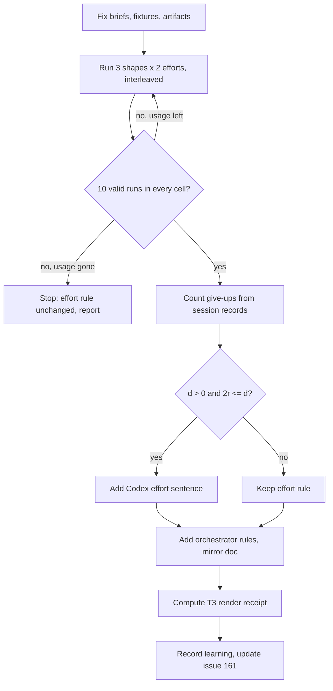

# Codex child early returns in T3 delegation - Plan

## Goal Capsule

- **Objective:** An LFG run in T3 Code with Codex as the orchestrator carries a small change to an open pull request without the owner typing "continue" or handing the thread to another model.
- **Means:** Measure give-ups at two effort levels, then change the T3-only shared instructions (KTD1, KTD5, KTD6).
- **Product authority:** The session-settled decisions and this Product Contract govern scope. `AGENTS.md` governs integration. Issue [#161](https://github.com/hyperlapse122/dotfiles/issues/161) is the origin; where its "Likely causes" and "Proposed changes" differ from this contract, this contract wins.
- **Execution profile:** One PR. The orchestrating session runs the measurement itself (U1); Codex workers implement U2–U5. LFG owns verification, review, and publication; merging and host switches stay with the owner.
- **Stop conditions:** A settled decision proves infeasible, a required check is refused, or the measurement cannot reach ten valid runs in a cell and no usage remains to replace them. Never run a host switch.
- **Open blockers:** None.

---

## Product Contract

### Summary

Measure how often delegated Codex children return without their assigned output at T3's default reasoning effort and at a raised effort, and change the effort rule for Codex children when the measurement supports it.
Add three orchestrator rules to the T3-only shared instructions: keep `ce-code-review` and `ce-simplify-code` in the orchestrator's context, brief children to wait for slow commands, and brief children that evidence this machine cannot produce is deferred to CI.
Cover each new rule with a check that fails when its sentence is removed or negated.

### Problem Frame

On 2026-11-12 an LFG run on `gpt-6-astra` stopped twice while retiring WiFiman Desktop (PR #162). LFG stops when a child return is anything but complete and evidenced, and two children returned that way. The owner typed "continue" after the first stop and moved the thread to Claude after the second.

The Codex session records on the NixOS workstation (`~/.codex/sessions`, Codex CLI 0.167.1) show what the children did:

- **The implementation child interrupted its own command.** The `gpt-6.1-terra` child started the `agent-instructions` check with a one-second wait, polled it in five-second waits, and sent Ctrl-C about three minutes in. It then reported "blocked on verification". No harness limit ended the command: Codex's `exec_command` waits at most 30 seconds per call and returns a session ID for a command that is still running.
- **The same child reported Darwin outputs as pending** on a machine with no Darwin builder, which `AGENTS.md` treats as evidence for CI.
- **The review child returned `failed` after 22 seconds and 30 reasoning tokens.** The orchestrator had handed it the whole `ce-code-review` skill. Two of its three tool outputs were cut at the default budget of 10,000 tokens per call. The cut output contained the skill's own rule to read a shortened result again in smaller ranges, and the child did not follow it.
- **The grounding scout for this plan did the same.** A `gpt-6-luna` child returned "I can't complete the requested dossier in this turn" after 18 seconds and four tool calls.

Truncated output does not separate the children that gave up from those that finished. In 278 delegated Codex children recorded since 2026-11-10, a final message with blocked, failed, or incomplete wording appeared as follows. The match is a regular expression over the final message and was not checked by hand.

| Model | Effort passed | Children | Gave up |
| --- | --- | --- | --- |
| `gpt-6.1-terra` | none (T3 default `low`) | 140 | 22 |
| `gpt-6.1-terra` | `high` | 9 | 0 |
| `gpt-6.1-sol` | none (T3 default `low`) | 83 | 3 |
| `gpt-6.1-sol` | `high` or `xhigh` | 33 | 1 |
| `gpt-6-luna` | none (T3 default `medium`) | 13 | 1 |

104 of the 112 `gpt-6.1-sol` children that finished had also received truncated output, and 9 of the 27 that gave up had received none. The children that gave up ran in several projects and roles: `ce-work` units, `ce-plan`, review personas, and simplify passes. The tasks and efforts in this record are mixed, so it suggests that effort matters and does not show it.

The shared instructions currently tell an orchestrator to pass no effort for a ladder-selected child (`home/h82/agents/instructions/instructions.md.tmpl`), which gives `gpt-6.1-sol` and `gpt-6.1-terra` children `low`.

### Key Decisions

- **Confirm causes before writing rules.** Governs R1–R4. (session-settled: user-directed — chosen over adopting the issue's five proposed rules as written and over confirming causes with no fix: a rule aimed at an unconfirmed cause can miss, and the command time limit named in the issue did not exist.)
- **Child reasoning effort is in scope.** Governs R5–R7. (session-settled: user-directed — chosen over changing instructions and briefs only and over a separate issue: the review child ignored a rule it had been given.) This reopens "Effort follows T3's per-model default" from `.compound-engineering/artifacts/plans/2026-11-10-1446-feat-t3-ce-model-ladder-plan.md`.
- **Measurement first, then the effort rule and orchestrator rules.** Governs R1–R10. (session-settled: user-directed — chosen over adding a one-retry rule from the start, over instruction rules alone, and over a retry rule first: the effect of each change should show in numbers before more policy is added.)
- **Ten runs per task shape per effort level.** Governs R2. (session-settled: user-directed — chosen over five runs and over judging from existing records alone: more runs separate smaller differences, at twice the Codex usage of five.)
- **The effort rule changes only on a halving.** Governs R5. (session-settled: user-approved — chosen over changing effort on any improvement: a higher effort raises Codex usage in every project, so a small difference does not justify it.)
- **No new child-facing rule about truncated output.** (session-settled: user-approved — chosen over the issue's "write a long diff to a file and read it in ranges" rule: `ce-code-review` already states an equivalent rule and the review child did not follow it.) R8 removes the brief that caused the oversized reads.

### Actors

- A1. Owner: starts LFG runs and merges pull requests.
- A2. Orchestrator: the T3 Code session that runs a CE skill and delegates through `delegate_task`, on any provider.
- A3. Codex child: a delegated T3 thread on a Codex model chosen from the CE model ladder.

### Requirements

**Measurement**

- R1. The measurement uses three task shapes taken from the recorded failures: a review of a diff of about 620 lines, a work unit whose verification includes a check that runs for minutes, and a grounding scout.
- R2. Each task shape runs ten times with no effort passed and ten times at one raised effort level, as an A3 child started through `delegate_task` on the model the ladder assigns to that role.
- R3. A run counts as a give-up when the child's session record shows it ended without the assigned output; the child's own summary does not decide the count.
- R4. The repository records the counts for each task shape and effort level, the raised level used, and the usage observed, as a learning under `.compound-engineering/artifacts/solutions/`.

**Effort rule**

- R5. When the raised-effort runs give up at most half as often as the default runs across the three task shapes combined, the T3-only shared instructions set that effort for ladder-selected Codex children; otherwise the effort rule stays as it is.
- R6. An effort named by the user's prompt or by CE configuration still wins over the rule in R5.
- R7. The effort of children on other providers does not change.

**Orchestrator rules**

- R8. The T3-only shared instructions tell an A2 orchestrator to run `ce-code-review` and `ce-simplify-code` in its own context and to delegate only the leaves those skills dispatch.
- R9. The T3-only shared instructions tell an A2 orchestrator to brief a child that runs verification to wait for a slow command to finish and not to interrupt it.
- R10. The T3-only shared instructions tell an A2 orchestrator to brief a child that evidence this machine cannot produce, such as Darwin builds on Linux, is recorded as deferred to CI and does not make its return incomplete.

**Guards and records**

- R11. Each sentence added for R5 and R8–R10 has a repository check on the T3-only render that fails when the sentence is removed and when it is negated.
- R12. `docs/agent-routing.md` matches the changed template sections in the same change.
- R13. Issue #161 states the confirmed causes in place of its "Likely causes to confirm" list.

### Key Flows

- F1. Measurement to effort decision
  - **Trigger:** The measurement tasks and their expected outputs are fixed.
  - **Actors:** A2, A3
  - **Steps:** A2 runs each task shape ten times per effort level. A2 reads each child's session record and counts give-ups. A2 records the counts. A2 applies R5.
  - **Outcome:** The effort rule is changed or kept, with the counts on record.
  - **Covered by:** R1–R5

### Acceptance Examples

- AE1. **Covers R5.** Given 9 give-ups in 30 default runs and 2 in 30 raised runs, when the decision is made, then the instructions set the raised effort for Codex children.
- AE2. **Covers R5.** Given 9 give-ups in 30 default runs and 6 in 30 raised runs, when the decision is made, then the effort rule stays unchanged and the counts are recorded.
- AE3. **Covers R5.** Given no give-ups in the default runs, when the decision is made, then the effort rule stays unchanged, because the measurement showed nothing to halve.
- AE4. **Covers R6.** Given R5 set a raised effort and `cross_model_effort` names another level for the review peer, when the peer is delegated, then it runs at the configured level.
- AE5. **Covers R8.** Given an orchestrator at LFG's review step, when it follows the instructions, then it loads `ce-code-review` itself and its `delegate_task` calls go to that skill's reviewers, not to a child told to run the whole skill.
- AE6. **Covers R11.** Given the R9 sentence rewritten to tell the child to interrupt a slow command, when the check runs, then it fails.

### Success Criteria

- After the changes, one LFG run with a Codex orchestrator on a change of about 18 files and 600 diff lines reaches an open pull request with no manual "continue". One run shows the path works; it does not show the give-ups are gone.

### Scope Boundaries

Deferred for later:

- A rule that lets an orchestrator rerun once a child that returned without its output and reported no defect. It is the next step when give-ups remain after R5 and R8–R10. It needs a change to the template sentence that forbids adding a failure policy.
- A proposal to upstream LFG to retry a child once on a recoverable cause.
- Raising or configuring Codex's per-call tool output budget.
- Effort rules for Claude, Synthetic, and Antigravity children.

### Dependencies / Assumptions

- Delegated children for this work run on Codex, as the owner directed for this task.
- A changed effort rule applies to every project run in T3 Code on the owner's machines and to Codex children of a Claude orchestrator, and raises Codex usage accordingly.
- `default_subagent_reasoning_effort` in `home/h82/agents/codex.nix` applies to Codex's native subagents, which T3 launches disable. The repository gives no evidence that it reaches `delegate_task` children, and the measurement passes its effort explicitly (KTD1).
- The Codex `priority` service tier stays off for delegated children (`.compound-engineering/artifacts/solutions/best-practices/codex-priority-tier-costs-2-5x-subscription-usage-for-review-peer.md`).

### Outstanding Questions

Deferred to Implementation:

- The Success Criteria run needs the changed instructions on the machine, which arrive only when the owner applies the configuration after merge. It is a gate on closing issue #161, not on merging the PR.

### Sources / Research

- Orchestrator thread of the failed run: T3 thread `1258f917-2146-49e9-850a-c01ba94ab298`, runs 1–5 on `gpt-6-astra`.
- Codex session records on the NixOS workstation, named by local time: `rollout-2026-11-12T20-17-59-*` (implementation child), `rollout-2026-11-12T20-29-28-*` (review child), `rollout-2026-11-13T01-13-28-*` (scout).
- `home/h82/agents/instructions/instructions.md.tmpl`: the T3 delegation and T3 CE model selection sections, including the current effort sentence.
- `tests/agent-instructions.py` and `tests/t3code-launch.py`: the T3-only render is checked for its two section headings and the Codex ladder row; no check covers a single sentence.
- `.compound-engineering/artifacts/solutions/best-practices/substring-sentence-check-passes-a-negated-instruction.md`: why R11 requires a negation case.
- `.compound-engineering/artifacts/solutions/best-practices/benchmark-cross-model-review-peers-in-t3-code-before-changing-them.md`: measure in T3 Code and never rank on one sample.
- `.compound-engineering/artifacts/solutions/integration-issues/slow-command-wait-needs-harness-exit-record-not-pgrep-or-monitor.md`: earlier slow-command rules for Claude Code and Antigravity, removed from the template on 2026-10-24; the record does not give the reason.
- The pinned LFG skill stops on "A child return is anything but complete and evidenced" and never retries a blocked return. It invokes `ce-code-review` as a skill at its review step.
- Planning research: the T3-only render has one independent render in `tests/agent-instructions.py` and one delivery check in `tests/t3code-launch.py` (run by `tests/t3code-traits.nix`); both checks are in `hostClosureChecks` in `flake.nix`. No check compares `docs/agent-routing.md` with the template.

---

## Planning Contract

Product Contract preservation: Product Contract unchanged. The planning questions it deferred are resolved in KTD1–KTD7 and removed from Outstanding Questions.

### Key Technical Decisions

- KTD1. **The raised effort is `high`, passed as `reasoningEffort` in `target.options`.** It is the lowest level above every measured model's default: `gpt-6.1-sol` and `gpt-6.1-terra` default to `low`, and `gpt-6-luna` defaults to `medium`. The existing record also has `high`. Governs R2, R5.
- KTD2. **Each task shape runs on the model the ladder gives its role.** The diff review runs on `gpt-6.1-sol`, the work unit on `gpt-6.1-terra`, and the grounding scout on `gpt-6-luna`. Governs R2.
- KTD3. **A valid run is one where the child started and ended on its own.** A launch failure, a run cut by a usage limit, and a run the orchestrator cancelled are recorded and replaced until each cell has ten valid runs. The decision in R5 uses valid runs only. Governs R2, R3.
- KTD4. **A give-up is a valid run whose assigned artifact is missing; a wrong artifact is counted separately.** The artifacts are fixed before the first run: for the review, a findings file at the named path that lists the files it read; for the work unit, a final report that states the slow check's exit status, with that exit present in the session record; for the scout, a dossier at the named path. The measurement targets early returns, not answer quality. Governs R3.
- KTD5. **The slow check in the work-unit task is a fixed script that runs for about four minutes, not a `nix build`.** Nix serves a repeated build from the store in seconds, so only the first of twenty runs would be slow. The script and its expected output live in the measurement scratch directory, outside the repository. Governs R1.
- KTD6. **The review task replays the diff that failed.** The fixture is commit `ef32731` against its parent, the 18-file change the failed review child was given, checked out in a worktree per run. Governs R1.
- KTD7. **Runs use `delegate_task` with `isolation: "worktree"` from one commit, with arms interleaved.** Each run gets the same brief text for its shape, and the two arms alternate so a change in provider conditions does not fall on one arm. The benchmark learning requires identical prompts and an untouched fixture per run. Governs R2.
- KTD8. **The orchestrating session runs and judges the measurement.** A Codex worker that launched the children would add a nesting level the incident did not have, and it would judge its own provider. Governs R2, R3.
- KTD9. **R5's threshold is inclusive and needs at least one default give-up.** With `d` default give-ups and `r` raised give-ups, the rule changes when `d > 0` and `2r <= d`. Governs R5.
- KTD10. **A changed effort rule is one sentence that qualifies the existing one.** "Set no effort for a ladder-selected child" stays for other providers, and a following sentence names the effort for a Codex child. The sentence about a user-named or configured effort is not touched, which keeps R6. Governs R5–R7.
- KTD11. **The three orchestrator rules go in the T3 delegation section and apply to every CE run in a T3 session, not only LFG.** They are delegation rules, and the common branch holds no delegation text. R9 and R10 stay out of the common branch. Governs R8–R10.
- KTD12. **R11 is a SHA-256 receipt of the whole T3-only render in `tests/agent-instructions.py`.** The common branch is guarded the same way, and one receipt fails on a removed, negated, repeated, or moved sentence, which a per-sentence substring match does not (`.compound-engineering/artifacts/solutions/best-practices/substring-sentence-check-passes-a-negated-instruction.md`). Governs R11.

### High-Level Technical Design

### Assumptions

- The Codex subscription has room for about 60 child runs plus replacements. The record shows one `gpt-6.1-sol` review at `xhigh` used about 9 percent of a five-hour window, so the runs may need to spread across windows.
- `task_status` reporting `reasoningEffort: high` means the child ran at that effort. T3 Code gives no independent proof of the serving effort.
- A wrong-but-present artifact is rare enough that counting it separately does not hide the effect being measured.

### Risks

- **The measurement shows no difference.** The effort rule stays, the orchestrator rules still ship, and the retry rule under Scope Boundaries becomes the next step.
- **Thirty runs per arm separate only large differences.** The learning states the counts per shape and does not claim more than they show.
- **The owner's session work shares the Codex account.** Concurrent use changes usage readings, so the learning records usage as observed and marks it approximate.

### System-Wide Impact

A changed effort sentence reaches every T3 Code session on both hosts after the owner applies the configuration, for every project and every orchestrating provider. Grok and Antigravity sessions receive no T3-only text and are unaffected (`docs/agent-routing.md`).

---

## Implementation Units

### U1. Measure give-ups at default and raised effort

- **Goal:** Produce the counts R5 decides on, and the record R4 requires.
- **Requirements:** R1–R4; KTD1–KTD9.
- **Dependencies:** None.
- **Files:** `.compound-engineering/artifacts/solutions/best-practices/codex-child-give-up-rate-by-reasoning-effort.md` (new)
- **Approach:**
  1. Write the three briefs, fixtures, and artifact definitions to a scratch directory before any run, and do not change them afterwards.
  2. Launch runs in small interleaved batches per KTD7 and wait for each batch through the T3 task lifecycle.
  3. Judge each run from its Codex session record and T3 activity view per KTD3 and KTD4.
  4. Remove each run's worktree and scratch output once judged.
  5. Write the learning with the repository's frontmatter schema: protocol, per-cell counts of valid, give-up, wrong-artifact, and replaced runs, usage as observed, and the R5 outcome.
- **Execution note:** The orchestrating session does this unit itself; do not delegate the launching or the judging.
- **Patterns to follow:** `.compound-engineering/artifacts/solutions/best-practices/benchmark-cross-model-review-peers-in-t3-code-before-changing-them.md` for fixture rebuilding, timing from `startedAt` to `completedAt`, and the results table.
- **Test scenarios:** Test expectation: none -- this unit produces a measurement record and no code.
- **Verification:** Every cell shows ten valid runs or the learning states why not. Every counted run names its T3 thread. No measurement worktree remains.

### U2. Add the orchestrator rules to the T3 delegation section

- **Goal:** T3 sessions keep `ce-code-review` and `ce-simplify-code` in the orchestrator and brief children on slow commands and unavailable evidence.
- **Requirements:** R8–R10, R12; KTD11.
- **Dependencies:** U1. The measurement finishes before any instruction text changes.
- **Files:** `home/h82/agents/instructions/instructions.md.tmpl`, `docs/agent-routing.md`
- **Approach:**
  1. Add one sentence per rule to the T3 delegation section, each worded as an instruction to the orchestrator.
  2. Keep the existing sentence that preserves CE's failure policy unchanged; none of the three rules adds a retry.
  3. Word R10 so that deferred evidence is recorded as deferred, never as passed, matching "A missing builder is pending evidence, never a pass" in `AGENTS.md`.
  4. Mirror the same sentences in `docs/agent-routing.md`.
- **Patterns to follow:** The sentences added by `.compound-engineering/artifacts/plans/2026-11-12-1104-fix-t3-delegation-inline-fallback-plan.md`.
- **Test scenarios:**
  - Covers AE5. The T3-only render contains the R8 sentence and names both skills.
  - The common render for each harness is byte-identical to before, so its receipts in `tests/agent-instructions.py` do not change.
  - `docs/agent-routing.md` holds each new sentence verbatim.
- **Verification:** A render with `{"t3": true}` shows the three sentences in the delegation section, and the common-branch receipts still pass.

### U3. Apply the R5 outcome to the effort rule

- **Goal:** The effort sentence reflects what U1 measured.
- **Requirements:** R5–R7; KTD9, KTD10.
- **Dependencies:** U1.
- **Files:** `home/h82/agents/instructions/instructions.md.tmpl`, `docs/agent-routing.md`
- **Approach:** When KTD9's condition holds, add the Codex sentence after the existing effort sentence and mirror it in the routing document. When it does not, change neither file for this unit.
- **Test scenarios:**
  - Covers AE1. With counts that meet KTD9, the T3-only render names `high` for a ladder-selected Codex child.
  - Covers AE2, AE3. With counts that do not, the effort paragraph is byte-identical to before.
  - Covers AE4. The sentence giving a user-named or configured effort precedence is unchanged in either case.
  - The ladder table rows for Claude, Synthetic, and Antigravity are unchanged.
- **Verification:** The effort paragraph matches the outcome recorded in U1's learning.

### U4. Guard the T3-only render with a receipt

- **Goal:** Any later change to a T3-only sentence fails a check until the receipt is updated on purpose.
- **Requirements:** R11; KTD12.
- **Dependencies:** U2, U3.
- **Files:** `tests/agent-instructions.py`
- **Approach:** Add a receipt for the render the test already produces with `{"t3": true}`, and run the same three mutations the common body gets against it. Compute the hash after U2 and U3 are final, from a render read and compared with the template diff.
- **Execution note:** Prove the guard in a scratch copy built per `.compound-engineering/artifacts/solutions/best-practices/copied-git-worktree-writes-the-real-index.md`: delete one new sentence, then prefix one with "Do not", and confirm `agent-instructions` fails each time for the receipt.
- **Patterns to follow:** `EXPECTED` and `receipt` in `tests/agent-instructions.py`.
- **Test scenarios:**
  - The unmodified T3-only render passes its receipt.
  - Covers AE6. The R9 sentence rewritten to tell the child to interrupt a slow command fails the receipt.
  - A T3-only render with one new sentence deleted fails the receipt.
  - A T3-only render with one sentence repeated fails the receipt.
- **Verification:** `agent-instructions` passes on the branch and failed on both scratch mutations.

### U5. Record the outcome in the issue and the project instructions

- **Goal:** The issue and `AGENTS.md` point at what was confirmed.
- **Requirements:** R13, R4.
- **Dependencies:** U1, U3.
- **Files:** `AGENTS.md`
- **Approach:**
  1. Replace the "Likely causes to confirm" list in issue #161 with the confirmed causes from the Problem Frame and the measured counts, and link the learning.
  2. Add one "Before changing ..." pointer to the new learning beside the existing pointer to the review-peer benchmark in `AGENTS.md`.
  3. State in the issue that the Success Criteria run waits for the owner to apply the configuration.
- **Test scenarios:** Test expectation: none -- documentation and an issue edit. `AGENTS.md` is an input to `agent-instructions`, which U4's verification already runs.
- **Verification:** The issue body no longer lists a command time limit as a cause, and the `AGENTS.md` link resolves.

---

## Verification Contract

| Check | Applies to | Passes when |
| --- | --- | --- |
| `git diff --check` | all units | no whitespace errors |
| `markdownlint-cli2` on changed Markdown | U1, U2, U3, U5 | 0 issues |
| `nix fmt -- --ci` | all units | no formatting changes |
| `nix build --no-link .#checks.x86_64-linux.agent-instructions` | U2–U5 | builds; it reads the template, `AGENTS.md`, and `docs/agent-routing.md` |
| `nix build --no-link .#checks.x86_64-linux.t3code-traits` | U2, U3 | builds; it reads the delivered T3 additions |
| Scratch mutations of the template | U4 | `agent-instructions` fails on a deleted and on a negated sentence |
| CI with the `full-ci` label | the PR | `host-checks`, `vm-checks`, `build`, and `build-darwin` succeed on the head commit |

Darwin outputs cannot build on the NixOS workstation and are deferred to `build-darwin` in CI.

## Definition of Done

- U1's learning holds the per-cell counts, and R5's outcome follows from them by KTD9.
- The T3-only render holds the three orchestrator sentences, and the effort paragraph matches the outcome.
- `docs/agent-routing.md` matches the changed template sections.
- The T3-only render has a receipt, shown to fail on deletion and negation.
- Issue #161 states the confirmed causes and the pending Success Criteria run.
- Every check in the Verification Contract passed, or is recorded as deferred to CI.
- No measurement worktree, scratch fixture, or abandoned draft sentence remains in the diff or on disk.
