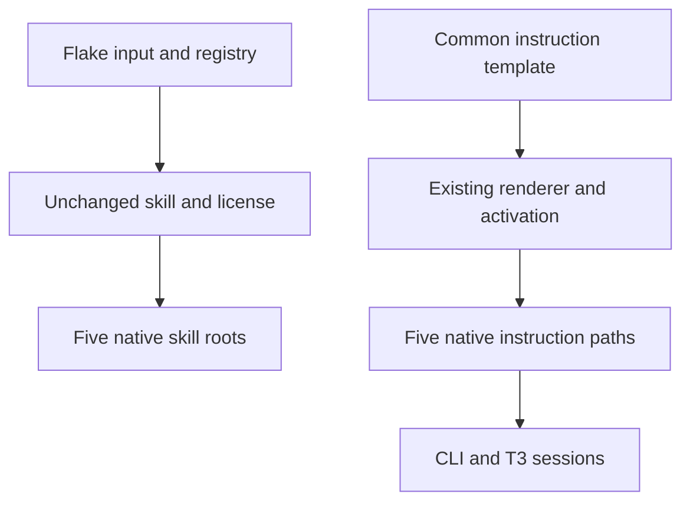

# Modern Web Guidance for All Harnesses - Plan

## Goal Capsule

- **Objective:** Every managed coding harness consults Modern Web Guidance when working on browser UI and web platform code.
- **Means:** Extend the existing shared skill registry and instruction template (KTD1, KTD2).
- **Authority:** The confirmed session scope and Product Contract govern behavior; repository instructions govern verification and shipping.
- **Execution profile:** Two dependent units in one PR. The LFG controller implements, verifies, reviews, and publishes it.
- **Stop conditions:** A settled decision proves infeasible, unrelated dirty files collide, or required evidence cannot be obtained or honestly deferred.

## Product Contract

### Summary

Install the upstream skill for all five managed harnesses and require its use through their shared user instructions, including CLI and T3 launches.

### Problem Frame

Shared coding agents already receive design and framework skills, but this skill is absent and their instructions do not require consulting its web platform guidance.

### Requirements

**Availability**

- R1. Deliver one unchanged, revision-pinned `modern-web-guidance` skill directory, with its upstream license, to Claude, Codex, Antigravity, Grok, and Pi on the supported user environments.
- R2. Preserve upstream's `npx modern-web-guidance@latest` execution behavior; pinning the skill files does not pin that npm tool.

**Use**

- R3. Common user instructions require loading and following the skill before HTML, CSS, web UI, or browser JavaScript work, including relevant framework work.
- R4. Apply the upstream skill's trigger boundaries: backend-only, infrastructure, tooling-only, and native-only work do not require it.
- R5. Deliver the rule through the existing native instruction paths for CLI and T3 sessions, while retaining other applicable design and framework skills.

### Key Decisions

- **Shared Nix management.** Governs R1. (session-settled: user-directed — chosen over dotagents installation or project-only scope: the owner wants the existing common distribution across all five harnesses.)
- **Retain upstream execution.** Governs R2. (session-settled: user-approved — chosen over pinning or repackaging the npm CLI: the owner accepted that the tool can update independently of Nix.)
- **Require consultation.** Governs R3, R4, R5. (session-settled: user-approved — chosen over relying on skill discovery alone: the owner wants every harness instructed to use it for web work.)

### Acceptance Examples

- AE1. Covers R1. A materialized user environment exposes the complete pinned skill in every managed skill root, exactly once.
- AE2. Covers R3, R5. Rendering the common instructions for each OS and harness includes the web rule; the T3 addition continues to contain only its own additions because baseline instructions supply the common rule.
- AE3. Covers R4. Backend-only work is outside the mandatory consultation rule, while a browser component inside a framework is covered.

### Scope Boundaries

No independent npm package pin, custom fork of the skill, new skill installer, or host activation is part of this change.

## Planning Contract

### Key Technical Decisions

- KTD1. Extend `flake.nix`, `flake.lock`, and `home/h82/agents/pinned-skills-pin.nix`; the existing `pinned-skills.nix` copies the complete upstream directory and license and `skills.nix` distributes it. This follows the other published skills without adding another management mechanism. Implements R1, R2.
- KTD2. Put a short invocation rule in the common region of `home/h82/agents/instructions/instructions.md.tmpl`, referencing the skill rather than copying its workflow. Update the rendered receipt hashes and routing documentation. Implements R3–R5.
- KTD3. Extend existing materialized-output checks rather than add a parallel check. `pinned-skills` currently compares skill content in three roots; include Grok and Pi as required by R1. The independent root-population list in `korean-skills` also needs the new name.

### High-Level Technical Design

### Evidence and Assumptions

- `home/h82/agents/skills.nix` already declares all five roots; no new root or shadow home is needed.
- `tests/pinned-skills.nix` verifies installed bytes and locked revisions; `tests/korean-skills.nix` owns exact root populations.
- `tests/agent-instructions.py` checks real renderer output and activation delivery using independent hashes. Refresh only the changed common-body receipts.
- The upstream [skill](https://github.com/GoogleChrome/modern-web-guidance/blob/main/skills/modern-web-guidance/SKILL.md) owns its search, retrieval, and execution workflow. Keep those files unchanged.
- Repository checks establish instruction and file delivery, not whether a signed-in model follows a rule on every task. Live session behavior remains separate evidence.

## Implementation Units

### U1. Register and distribute the upstream skill

- **Goal:** Satisfy R1 and R2 through the established registry.
- **Dependencies:** None.
- **Files:** `flake.nix`, `flake.lock`, `home/h82/agents/pinned-skills-pin.nix`, `tests/pinned-skills.nix`, `tests/korean-skills.nix`.
- **Approach:** Resolve the upstream release or commit, register its skill path and license, and update the independent expected names and roots per KTD1 and KTD3.
- **Patterns:** Existing published skill registrations and complete-directory copying in `home/h82/agents/pinned-skills.nix`.
- **Execution note:** Prefer materialized installation checks over new unit tests for declarative packaging.
- **Test scenarios:** Covers AE1. Each root holds the complete unchanged upstream directory and license. Removing or corrupting the delivery must fail a relevant check in its builder, with a diagnostic for the missing or changed skill.
- **Verification:** Existing `pinned-skills`, `korean-skills`, and relevant Antigravity checks pass. This seam proves installed contents and discovery metadata, not authenticated model behavior.

### U2. Require consultation through shared instructions

- **Goal:** Satisfy R3–R5 using the common native delivery.
- **Dependencies:** U1.
- **Files:** `home/h82/agents/instructions/instructions.md.tmpl`, `tests/agent-instructions.py`, `docs/agent-routing.md`.
- **Approach:** Add the common rule under KTD2 and review its rendered OS variants before refreshing their receipt hashes.
- **Patterns:** The existing writing-skills block and independent receipt checks in `tests/agent-instructions.py`.
- **Test scenarios:** Covers AE2 and AE3. All five baseline deliveries contain the same scoped rule on both OS variants; T3-only output retains its separate body. Deleting or negating the common rule must invalidate the expected receipt.
- **Verification:** `agent-instructions` passes through the real renderer and scratch-home activation paths. The test proves delivered policy bytes, not model compliance during arbitrary sessions.

## Verification Contract

- Run `git diff --check`, changed Markdown lint, and `nix fmt -- --ci` before each push.
- Run `nix build --no-link .#checks.x86_64-linux.pinned-skills .#checks.x86_64-linux.korean-skills .#checks.x86_64-linux.agent-instructions` and the affected Antigravity check discovered in `flake.nix`.
- Prove changed assertions with targeted removal or content mutations, restore the implementation, and rerun affected checks.
- Run flake evaluation and relevant supported checks locally. Classify local results separately from Darwin, VM, and host-output evidence delegated to CI.
- Apply `full-ci` and require successful current-head `host-checks`, `vm-checks`, `build`, and `build-darwin`, alongside ordinary PR jobs, before declaring readiness.
- Use no host switch or temporary container for this change. Hardware and authenticated-session verification remain separate from repository checks.

## Definition of Done

U1 and U2 satisfy their linked requirements, relevant local checks pass, the final diff is simplified and independently reviewed, and all findings have an evidenced disposition. Publish one open PR with current-head CI decided and any missing platform evidence stated explicitly. Remove temporary mutation edits and abandoned code before completion.
