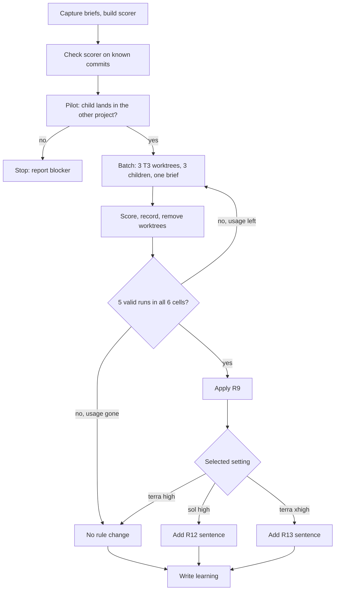

# Codex implementation worker tier measurement - Plan

## Goal Capsule

- **Objective:** When a Codex implementation worker gets a unit that needs investigation, the T3 instructions name the model and effort it runs on, and that choice rests on measured runs.
- **Means:** Replay the two briefs that failed on `gpt-6.1-terra` at three model and effort settings, pick one setting by a rule fixed before the first run, then change the T3 CE model selection text to match.
- **Product authority:** The session-settled decisions and this Product Contract govern scope. `AGENTS.md` governs how a change to the shared instructions template is integrated and checked.
- **Execution profile:** One PR in this repository. A user-requested T3 measurement coordinator in the source project runs and scores U1 and U2 without another worker layer. This session owns U3 and U4, verification, review, and publication. Merging and host switches stay with the owner.
- **Stop conditions:** A settled decision proves infeasible, a required check is refused, or the pilot in U1 cannot place a child in the other repository's project. When Codex usage runs out before every cell has five valid runs, the measurement stops under KTD8 and the work continues with U4. Never run a host switch, and never commit or push in the other repository.
- **Open blockers:** None requiring a user decision. The owner approved a separate measurement thread and substitution of checkout paths and branch names on 2026-11-13. A pilot must still establish the starting tree, dependencies, and instructions before any measurement run counts.

---

## Product Contract

### Summary

Run 30 delegated Codex children: two real briefs, three settings (`gpt-6.1-terra` at `high`, `gpt-6.1-terra` at `xhigh`, `gpt-6.1-sol` at `high`), five runs each.
Score every run from the files it leaves, select one setting by the rule in R9, and change the T3 CE model selection section as R11 to R13 say.
Record the numbers as a learning whatever the result.

### Problem Frame

The T3 CE model selection section sends every Codex implementation worker to the middle rung, `gpt-6.1-terra`, at `high`.
On 2026-11-13 an LFG run in another repository (T3 thread `bebc053a-c9b7-469b-aa7b-041409e9b586`) gave that worker a unit that required reading 20 console screens and their manual sections before writing help copy.
The first child returned after 29 seconds and four tool calls with no file changed.
The second, on a narrower brief, produced a passing skeleton and filled most menus with the same generic sentences, and said so in its return.
The orchestrator then chose `gpt-6.1-sol` at `high` on its own judgment, and that model finished this unit and the six tasks that followed.

Nothing on this machine says whether a higher effort would have been enough.
No `gpt-6.1-terra` child has run at `xhigh`.
The same model at `high` completed 12 of 14 real implementation tasks on 2026-11-12 and 2026-11-13, counted from each child's final message, and used up to 104,635 reasoning tokens on one of them; the two failures used 203 and 423.
The comparison with `gpt-6.1-sol` is one sample on a different, sharper brief.
`ce-work` separates units whose plan settles what to build from units that need investigation and sends the second kind to the session model, but the T3 section has no such split and does not say where a retried unit goes.
So the next orchestrator that meets this case guesses again.

### Key Decisions

- **Measure before changing the rule** (session-settled: user-directed — chosen over splitting workers by unit shape now: the owner wants the numbers first). Governs R1 to R10.
- **Two briefs, three settings, five runs each** (session-settled: user-directed — chosen over five runs of the narrow brief only: the early return on the wide brief is measured too). Governs R1, R2.
- **A near tie goes to the setting with fewer tokens per run** (session-settled: user-approved — chosen over shorter wall time, always `gpt-6.1-terra`, or always `gpt-6.1-sol`: it spares the subscription limit). Governs R9.
- **A `gpt-6.1-sol` win moves only investigation units and retries** (session-settled: user-approved — chosen over moving every implementation worker: the measurement covers only an investigation unit, and settled units already complete on `gpt-6.1-terra`). Governs R12.
- **A `gpt-6.1-terra` `xhigh` win changes only the middle-rung implementation worker.** The measurement says nothing about reviewers or scouts, whose effort stays as it is. Governs R13.
- **Briefs are replayed verbatim except for checkout paths and branch names** (session-settled: user-approved — chosen over keeping the original identifiers and stopping: the original checkout is gone and T3 requires separate worktrees; all task wording and scoring rules stay fixed). The owner approved this exception after document review on 2026-11-13. Governs R3.

### Requirements

**Runs**

- R1. The measurement uses two briefs from the source thread: the wide brief that asked for units U1 and U2, and the narrow brief that asked for U1 only.
- R2. Each brief runs five times at each of three settings: `gpt-6.1-terra` at `high`, `gpt-6.1-terra` at `xhigh`, and `gpt-6.1-sol` at `high`.
- R3. Every run receives the text the original child received with only checkout paths and branch names substituted, and starts from the tree that child saw: the other repository at commit `3bf8c548` plus the research files the wide brief names. Preserve both the original and substituted text and verify that no other character changed.
- R4. Each run works in its own checkout of that repository. No run commits to a shared branch or pushes, and every checkout is removed when the measurement ends.
- R5. A run is valid when the child started and its turn ended on its own. An invalid run is replaced, and the report says how many were.

**Scoring**

- R6. A run is scored from the files it leaves and from its session record, never from the child's summary.
- R7. A run succeeds when every file its brief names exists, the verification commands the brief lists pass when the scorer runs them, and the copy check in R8 passes.
- R8. The copy check is the pair of assertions the finished feature uses against templated help copy: purpose and usage lines are distinct across the 20 menus in each language, and no step is shared by more than two menus. The check is fixed before the first run and applied to every run unchanged.
- R9. The selected setting is the one with the lowest median total tokens per run among the settings whose success count, over both briefs, is within one of the highest count.
- R10. The report gives, per brief and setting: valid runs, successes, runs that changed no file, runs that failed only the copy check, median wall time, median tool calls, median reasoning tokens, and median total tokens.

**Outcome**

- R11. When `gpt-6.1-terra` at `high` is selected, the model and effort rules stay as they are.
- R12. When `gpt-6.1-sol` at `high` is selected, the T3 CE model selection section sends two kinds of Codex implementation work to the top child rung: a unit that `ce-work` assigns to the session model, and a unit retried after a middle-rung worker failed. Units whose plan settles what to build stay on the middle rung.
- R13. When `gpt-6.1-terra` at `xhigh` is selected, the section raises the effort of the middle-rung Codex implementation worker to `xhigh` and leaves every other Codex child's effort unchanged.
- R14. Whatever is selected, a learning under `.compound-engineering/artifacts/solutions/` records the protocol, the table from R10, and the decision, and says what the measurement cannot show.

### Acceptance Examples

- AE1. **Covers R9, R13.** Given success counts of 3, 8, and 9 for `gpt-6.1-terra` `high`, `gpt-6.1-terra` `xhigh`, and `gpt-6.1-sol` `high`, when `gpt-6.1-terra` `xhigh` has the lower median total tokens of the last two, then it is selected and R13 applies.
- AE2. **Covers R9, R11.** Given success counts of 9, 9, and 10, when `gpt-6.1-terra` `high` has the lowest median total tokens, then it is selected and no rule changes.
- AE3. **Covers R9, R12.** Given success counts of 2, 4, and 9, then `gpt-6.1-sol` `high` is selected whatever the token medians are, and R12 applies.
- AE4. **Covers R6, R7, R10.** Given a child that reports the unit complete and leaves help copy that repeats one sentence across menus, then the run counts as a failure and appears under runs that failed only the copy check.

### Scope Boundaries

- Rewriting briefs so that `gpt-6.1-terra` fails less often is not part of this work.
- Units whose plan settles what to build are not measured.
- The effort of Codex reviewers and scouts is not measured or changed.
- Other providers' ladders are not measured or changed.
- The changes the runs make in the other repository are discarded; nothing is merged there.

### Dependencies / Assumptions

- The other repository's commit `3bf8c548` and the final commit that holds the copy assertions, `fd457b4a` on branch `feat/interactive-user-guide`, stay reachable on this machine.
- The wide brief names research files under `/tmp/compound-engineering-1000/ce-plan-research/a4af13d8/`. They exist now and are temporary, so they are copied before the first run.
- T3 Code's state database still holds both original briefs.
- Enough Codex subscription usage remains for 30 runs. One original run took about 1.0 M total tokens on `gpt-6.1-terra` and 2.1 M on `gpt-6.1-sol`, mostly cached input. Other sessions share the account, so usage is recorded as tokens, not as a share of the limit.
- A reported `reasoningEffort` shows the setting T3 Code passed. T3 Code gives no independent proof of the effort that served the run.

### Outstanding Questions

**Deferred to Implementation**

- Whether `delegate_task` with the other repository's `projectId` starts the child in a directory that loads that repository's `AGENTS.md`. The pilot in U1 answers it from the child's session record.
- How many usage windows 30 runs span. Batches continue across windows; the learning records the dates.

### Sources / Research

- Source thread and its three child session records under `~/.codex/sessions/2026/11/13/` (`rollout-2026-11-13T16-49-48-…`, `T16-51-04-…`, `T16-54-24-…`): timings, tool calls, and token counts quoted above.
- `home/h82/agents/instructions/instructions.md.tmpl`, T3 CE model selection section, and its mirror in `docs/agent-routing.md`: the rule under measurement.
- `ce-work`'s `references/worker-model.md` in the pinned Compound Engineering plugin: the split between settled units and session-model units, and the one-time escalation.
- `.compound-engineering/artifacts/solutions/best-practices/codex-child-give-up-rate-by-reasoning-effort.md`: the earlier protocol, its judging rules, and why a summary is not evidence.
- `.compound-engineering/artifacts/solutions/best-practices/benchmark-cross-model-review-peers-in-t3-code-before-changing-them.md`: how to capture a real brief from T3 Code's state database and rebuild the tree a child saw.

---

## Planning Contract

Product Contract preservation: The owner approved the checkout-path and branch-name exception to verbatim replay after document review on 2026-11-13. The remaining requirements, 30-run size, scoring rules, and selection rule are unchanged.

### Key Technical Decisions

- KTD1. **Both briefs come from T3 Code's state database, not from memory.** The stored first message of each original child is read with the query in the review-peer benchmark learning, launched with `role: "implementation"`, and compared with the stored text after the launch. Governs R1, R3.
- KTD2. **Only checkout paths and branch names change in each brief.** Both original briefs name the same now-missing checkout and branch. Substitute the T3-created worktree path and its branch, then compare the sent message against the original with exactly those substitutions. The owner approved this exception after document review; task wording is unchanged. Governs R3, R4.
- KTD3. **Separate child checkouts must use T3-managed worktrees.** The former shell-clone recipe is withdrawn because current host instructions require `delegate_task` with `isolation: "worktree"`. The tool accepts no checkout path or base revision override, so the required parent tree and dependency setup must be established before a pilot can validate the recipe. Do not create child checkouts in a shell or in a child's task. Governs R3, R4.
- KTD4. **The measurement coordinator starts in the source project at the required commit.** The owner requested a separate T3 measurement thread after document review. Create it with `t3_thread_launch`, the source project's ID, and `workspaceStrategy` selecting a new worktree at `3bf8c548` with `startFromOrigin: false`. That coordinator launches the measured children through `delegate_task` with `isolation: "worktree"`; no shell-created child checkouts. The pilot must verify the actual starting tree, dependencies, and repository instructions before any run counts. Governs R3.
- KTD5. **The scorer is one script kept in the measurement scratch directory, outside both repositories.** For a run it lists the files the brief names, runs the brief's verification commands in the checkout, and runs a test file it copies in that applies the two assertions of R8 to whatever registry the run exported. It writes one JSON record per run. Governs R6, R7, R8.
- KTD6. **A wide-brief run that completes U1 and not U2 is a failure, counted in its own column.** The brief asked for both units, and the column keeps a partial result visible. Governs R7, R10.
- KTD7. **Timing, tool calls, and tokens come from the child's Codex session record.** Wall time is first to last timestamp. Count `response_item` events whose payload type is `custom_tool_call`, `function_call`, or `local_shell_call` once each; do not count output or completion events. Read reasoning tokens and total tokens from the final `token_count` entry's `total_token_usage`. The original wide-brief session has four call events; its token record has no tool-call count. Governs R10.
- KTD8. **Selection needs five valid runs in all six cells.** When usage runs out first, no rule changes, and the learning records the partial counts and says the measurement is incomplete. Governs R9, R11.
- KTD9. **The measurement coordinator launches and scores every run itself.** It is the separate top-level thread the owner requested, not an extra delegated worker layer. This session checks its records before changing instructions or publishing the result. Governs R2, R6.
- KTD10. **Batches are one run per setting on the same brief, with the two briefs alternating.** A change in provider conditions then falls on all three settings alike. Governs R2.
- KTD11. **A rule change is one sentence beside the text it qualifies.** For R12 the sentence follows the rung list and names the two kinds of unit that go to the top child rung. For R13 it follows the Codex effort sentence. `docs/agent-routing.md` mirrors it, and the T3 render receipt in `tests/agent-instructions.py` is recomputed. Governs R12, R13.

### High-Level Technical Design

### Assumptions

- The approved checkout path and branch substitutions leave every task instruction unchanged; saved-message comparison verifies this for each run.
- T3 Code's reported model and options establish the requested configuration, not independent evidence of the serving model or effort.
- The research files the wide brief names stay at their original path for the whole measurement; U1 keeps a copy and restores them when they are missing.

### Risks

- **Five runs per cell separate only large differences.** R9 already treats a one-run gap as a tie, and the learning states the counts without claiming more.
- **The owner's other sessions share the Codex account.** Usage is recorded as tokens per run.
- **A child edits outside its checkout.** The original checkout no longer exists. Before the pilot, identify the current repository checkout and record its status and head; compare them before and after each batch and void a batch that changed them.

### System-Wide Impact

A changed sentence reaches every T3 Code session on both hosts after the owner applies the configuration. Grok and Antigravity sessions receive no T3-only text and are unaffected.

---

## Implementation Units

### U1. Freeze the briefs, the fixture, and the scorer

- **Goal:** Everything that decides a run's score exists and is checked before the first counted run.
- **Requirements:** R1, R3, R6–R8; KTD1–KTD6.
- **Dependencies:** None.
- **Files:** none in this repository; briefs, scorer, and records live in a scratch directory under `/tmp/compound-engineering-<uid>/`.
- **Approach:**
  1. Read both briefs from the state database and save them with a checksum.
  2. Copy the research files the wide brief names.
  3. Establish the T3-managed worktree recipe of KTD3 and the scorer of KTD5.
  4. Launch one pilot child per KTD4 and read its session record for the directory it started in and the instructions it loaded. The pilot is not counted.
- **Execution note:** Prove the scorer on known states of the other repository before trusting it; a scorer that passes everything would make R9 meaningless.
- **Patterns to follow:** `.compound-engineering/artifacts/solutions/best-practices/benchmark-cross-model-review-peers-in-t3-code-before-changing-them.md` for capturing a prompt and rebuilding a tree.
- **Test scenarios:**
  - A scorer-only fixture at `3bf8c548` with nothing changed scores as a run that changed no file.
  - A scorer-only fixture at `5e0da289`, the commit that finished U1, scores as a success on the narrow brief.
  - A scorer-only fixture at `8f9794f1`, the commit that finished U2, scores as a success on the wide brief.
  - A scorer-only fixture at `5e0da289` scores as U1 only on the wide brief.
  - Covers AE4. A scorer-only fixture at `5e0da289` with one step sentence copied into three menus fails only the copy check.
- **Verification:** The five scenarios give the stated scores, the saved briefs match the stored text, and the pilot's record shows the other repository's instructions.

### U2. Run and score the 30 children

- **Goal:** The table of R10 and the selection of R9.
- **Requirements:** R2, R4, R5, R9, R10; KTD7–KTD10.
- **Dependencies:** U1.
- **Files:** none in this repository.
- **Approach:**
  1. For each batch, launch three children in T3-managed worktrees per KTD10 and wait through the T3 task lifecycle.
  2. Score each finished run, save its record with its T3 thread and session file, and remove its worktree after collecting the evidence.
  3. Replace invalid runs per R5.
  4. When all six cells hold five valid runs, compute R9 from the records.
- **Execution note:** The orchestrating session does this unit itself (KTD9). Do not change a brief, the scorer, or the clone recipe after the first counted run.
- **Test scenarios:** Test expectation: none -- this unit produces measurement records and no code.
- **Verification:** Every counted run names its thread and session file, the protected source checkout's head and status are unchanged, and no measurement worktree remains.

### U3. Apply the selected setting to the model selection text

- **Goal:** The T3 CE model selection section says what R9 selected.
- **Requirements:** R11–R13; KTD11.
- **Dependencies:** U2.
- **Files:** `home/h82/agents/instructions/instructions.md.tmpl`, `docs/agent-routing.md`, `tests/agent-instructions.py`
- **Approach:** When R11 or KTD8 applies, change none of the three files. Otherwise add the sentence KTD11 describes, mirror it, and recompute the T3 receipt from a render compared with the template diff.
- **Patterns to follow:** The Codex effort sentence added by `.compound-engineering/artifacts/plans/2026-11-13-0122-fix-codex-child-early-returns-plan.md`, and `EXPECTED` in `tests/agent-instructions.py`.
- **Test scenarios:**
  - Covers AE3. With `gpt-6.1-sol` `high` selected, the T3-only render sends session-model units and retried units to the top child rung and still names the middle rung for other implementation workers.
  - Covers AE1. With `gpt-6.1-terra` `xhigh` selected, the render names `xhigh` for the middle-rung Codex implementation worker and `high` for every other Codex child.
  - Covers AE2. With `gpt-6.1-terra` `high` selected, the three files are byte-identical to before.
  - The common render for each harness is unchanged, so its receipts do not change.
  - `docs/agent-routing.md` holds the new sentence verbatim.
- **Verification:** `agent-instructions` passes, and the render matches the outcome recorded in U4's learning.

### U4. Record the measurement

- **Goal:** The next change to this rule starts from these numbers.
- **Requirements:** R14.
- **Dependencies:** U2, U3.
- **Files:** `.compound-engineering/artifacts/solutions/best-practices/codex-implementation-worker-tier-on-investigation-units.md` (new), `AGENTS.md`
- **Approach:**
  1. Write the learning with the repository's frontmatter schema: the protocol, the R10 table, replaced runs, the R9 outcome, and what five runs per cell cannot show.
  2. Add one "Before changing ..." pointer to it beside the existing pointer about the reasoning effort of delegated Codex children.
- **Test scenarios:** Test expectation: none -- documentation. `AGENTS.md` is an input to `agent-instructions`, which U3's verification runs.
- **Verification:** The learning's table matches the saved records, and the `AGENTS.md` link resolves.

---

## Verification Contract

| Check | Applies to | Passes when |
| --- | --- | --- |
| Scorer scenarios in U1 | U1 | all five give the stated score |
| `git diff --check` | U3, U4 | no whitespace errors |
| `markdownlint-cli2` on changed Markdown | U3, U4 | 0 issues |
| `nix fmt -- --ci` | U3, U4 | no formatting changes |
| `nix build --no-link .#checks.x86_64-linux.agent-instructions` | U3, U4 | builds; it reads the template, `AGENTS.md`, and `docs/agent-routing.md` |
| `nix build --no-link .#checks.x86_64-linux.t3code-traits` | U3 | builds; it reads the delivered T3 additions |
| CI with the `full-ci` label | the PR | `host-checks`, `vm-checks`, `build`, and `build-darwin` succeed on the head commit |

Darwin outputs cannot build on the NixOS workstation and are deferred to `build-darwin` in CI.

---

## Definition of Done

- Every cell holds five valid scored runs, or the learning states the shortfall and no rule changed.
- The model selection text, its mirror, and the T3 receipt agree with the selected setting.
- The learning exists and `AGENTS.md` points to it.
- No measurement worktree, pilot checkout, or scratch output remains after the report is captured, and the source repository's pre-existing checkout, branches, and remote are as they were. Remove task-created branches after their worktrees are gone.
- Every check in the Verification Contract passes or is recorded as deferred to CI.

---

## Document Review Resolution

The 2026-11-13 lite review used one independent reviewer for coherence, feasibility, and scope. All three findings were substantiated and addressed; none was rejected.

- Replaced the unsupported shell-clone recipe with T3-managed worktrees. The owner explicitly requested the separate source-project coordinator thread; a pilot still verifies whether its children can reproduce the required environment.
- The owner approved substituting checkout paths and branch names while preserving all other brief text, the 30-run size, and the scoring and selection rules. Updated the verbatim replay decision and R3 accordingly.
- Count tool calls from call events rather than `token_count`; the original wide-brief session confirms four calls and no tool-call count in its token record.

The planning assumptions also distinguish T3's reported configuration from independent proof of the serving model or effort.

---

## Approved Preparation Revision

The owner approved this revision on 2026-11-13 after the first wave stopped. It replaces that wave's preparation recipe and sample; the briefs, scorer, baseline commit, model settings, five runs per cell, and selection rule remain unchanged.

**Fresh sample after verified preparation** (session-settled: user-approved). The first 15 attempts remain a separate historical record. Five scored runs have complete preparation logs, but their full tool bundle cannot be compared with the original pilot because its manifest was not captured. None enters the new 30-run sample. Preserve every original score, metric, audit, and frozen checksum.

This revision governs U1's preparation and U2's new sample:

1. Prepare a complete project tool bundle with a task-owned `DOTAGENTS_STATE_DIR` outside the source checkout. Record exact tool versions, source commits, file hashes and modes, symlink targets, generated ignore rules, runtime configuration, and hook-engine bytes.
2. Freeze that materialized bundle. Install each worker's copy without fetching moving tool sources. Reproduce Node and Yarn dependencies from the baseline lockfiles. Permit only recorded relocation of checkout and task-cache roots in links and generated configuration.
3. Use T3's supported worktree setup mechanism. Capture effective settings before and after; the project object's scripts array alone is insufficient. Scope the temporary command to this measurement, preserve unrelated work, and restore the prior setting when the measurement ends. T3 still creates every child checkout.
4. Before starting an agent, verify the baseline, clean tracked and nonignored status, full normalized tool manifest, symlink destinations, ignore rules, runtime configuration, and dependency versions. Reject incomplete preparation and preserve its logs as an infrastructure failure.
5. Validate the revised recipe with an excluded pilot. Deliberately remove a required tool file and verify rejection, including that T3 does not start a measured agent after the gate fails. If the supported setup cannot enforce this, report the blocker before counted runs.
6. Freeze the revised setup receipt and manifest after the pilot. Run 30 fresh valid children in the existing coordinator thread, retaining the original alternating three-setting batches. Replace infrastructure-invalid attempts; natural incomplete returns remain valid failures. Save setup terminal logs before archiving closes them.

Do not change the revised preparation after its first counted run. Apply R9 only when every cell in this new wave has five valid runs. The original prompt and scorer files remain byte-identical, and the new wave writes separate records. Cleanup still covers every task-owned worktree, branch alias, dependency tree, cache, fixture, and tool process; shared resources remain untouched.
